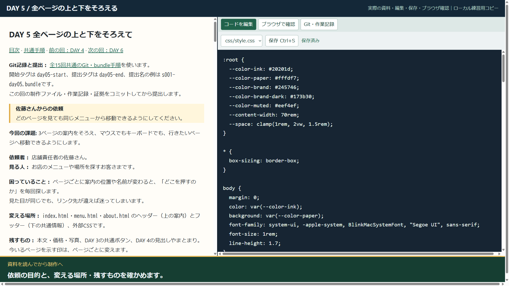
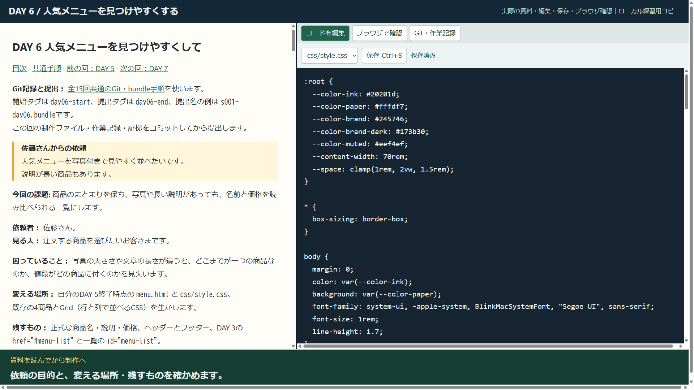

# DAY 5・6 実作業動画

日本語字幕付き・音声なしの1920×1080 MP4です。  
録画専用のローカル画面で、資料を表示しながら実ファイルを編集・保存し、Chromiumで確認しています。  
教材原本を保持し、DAY4相当の専用コピーからDAY5、DAY6へ継続しました。

[動画プレーヤーを開く](index.html)

## DAY 5（3:35）

[MP4](./day05-walkthrough.mp4) · [字幕SRT](./day05.srt) · [実演のGit bundle](./demo-day05.bundle) · [課題の正本](../../docs/workbook/day05.md)

- 0:01 依頼を読む：佐藤さんの依頼：どのページからも、同じ案内で移動できるようにする。
- 0:13 範囲を決める：対象は3ページの上下と共通CSS。  
  本文・価格・前回のボタンは残します。
- 0:23 開始を記録：DAY4までの継続コピーを使い、day05-startから作業します。
- 0:34 ① 3ページを比較：index.html：リンクの名前・順番・現在地を確認。  
  すでに一致する部分は残します。
- 0:43 ① 3ページを比較：menu.html：リンクの名前・順番・現在地を確認。  
  すでに一致する部分は残します。
- 0:52 ① 3ページを比較：about.html：リンクの名前・順番・現在地を確認。  
  すでに一致する部分は残します。
- 1:01 ② 余白を調整：gapはリンク同士の間。  
  paddingはリンクの内側の押せる範囲です。
- 1:26 保存して確認：文字の周りにも押せる余白ができ、現在地のメニューに背景が付きました。
- 1:37 ③ 現在地を確認：index.html：aria-currentは、そのページのリンク1件だけに付けます。
- 1:42 ③ 現在地を確認：menu.html：aria-currentは、そのページのリンク1件だけに付けます。
- 1:48 ③ 現在地を確認：about.html：aria-currentは、そのページのリンク1件だけに付けます。
- 2:02 ④ TabとEnter：Tabでメニューへ。  
  フォーカス枠と現在地の印は、別の役割です。
- 2:11 ④ Shift+Tab：Enterでメニューへ移動できました。  
  Shift+Tabで前のリンクへ戻ります。
- 2:17 ④ 狭い画面：index.html / 390px。  
  折り返しても、リンクの文字と枠が重ならないか確認。
- 2:24 ④ 狭い画面：menu.html / 390px。  
  折り返しても、リンクの文字と枠が重ならないか確認。
- 2:31 ④ 狭い画面：about.html / 390px。  
  折り返しても、リンクの文字と枠が重ならないか確認。
- 2:36 ④ ブラウザ200%：ブラウザの表示倍率を200%にして、3ページの案内を確認します。
- 3:05 変更報告を書く：3ページの移動・Tab・390px・200%を確認。  
  本文と商品情報は保持しました。
- 3:15 記録と提出：制作・証拠をコミット。  
  bundleを検査し、別フォルダーに復元しました。
- 3:28 DAY 5 完了：次はこの終了状態を引き継ぎ、商品カードの一覧を整えます。

## DAY 6（4:28）

[MP4](./day06-walkthrough.mp4) · [字幕SRT](./day06.srt) · [実演のGit bundle](./demo-day06.bundle) · [課題の正本](../../docs/workbook/day06.md)

- 0:01 依頼を読む：佐藤さんの依頼：人気メニューを写真付きで見やすく。  
  長い説明も読めるように。
- 0:13 変える場所と確認事項：DAY5の結果を継続。  
  商品名・価格・案内は保持し、人気の順序と実写真は確認待ち。
- 0:23 開始を記録：day05-endと同じ制作ファイルへ、day06-startを付けました。
- 0:32 ① 開始状態を見る：4商品の名前・説明・価格を確認。  
  既存のカードとGridを生かします。
- 0:42 画像の扱いを確認：ラテアートの教材用生成画像で練習します。  
  他3商品の写真を仮の別商品で埋めません。
- 1:15 ② 保存して表示：画像・商品名・説明・価格を、同じarticleの中へ入れました。
- 1:24 ③ Gridを調整：一覧の親が列を決めます。  
  狭い幅は1列、42rem以上は2列にします。
- 1:58 カード内はFlexbox：価格の上に余った空間を集めます。  
  固定の高さで説明を切りません。
- 2:18 ④ 練習コピーで負荷試験：1商品を長い名前・説明へ変更。  
  正式な内容は保存して、最後に戻します。
- 2:42 ④ 4件で確認：4件：長い商品名・説明が、価格や隣のカードと重ならないか確認。
- 2:51 ④ 1件に変更：articleの開始から終了までを1組として1件だけ残します。
- 2:58 ④ 1件の表示：1件：カードの折り返しと、商品情報のまとまりを見ます。
- 3:07 ④ 7件に変更：articleの開始から終了までを1組として複製します。  
  親のid="menu-list"は1個のままです。
- 3:15 ④ 7件の表示：7件：カードの折り返しと、商品情報のまとまりを見ます。
- 3:23 ④ 390pxの表示：7件・長い内容で確認。  
  スマホ幅では1列になり、HTMLの順で読めます。
- 3:34 ④ 長いカードの末尾：説明を削らず、価格まで同じカードの中に収まっていることを確認。
- 3:44 ⑤ 正式な4商品へ戻す：試験用の追加商品と長い名前を戻します。  
  画像とCSSの改善は残します。
- 3:55 ⑤ 結果と確認待ちを報告：Gridは列幅、Flexboxはカード内の縦配置。  
  実写真・人気の指定は佐藤さんへ確認待ちです。
- 4:06 記録と提出：制作・証拠をコミット。  
  bundleを検査し、別フォルダーに復元しました。
- 4:19 DAY 6 完了：4商品へ復元済み。  
  制作ファイル・画像・証拠・報告をbundleへ記録しました。

## 確認記録

- `verification.json`：録画中の実行結果、200%のブラウザ倍率、bundleと復元結果、資料のハッシュ。
- `final-checks.json`：復元した3ページのリンク・Tab順・390px・画像・正式な商品情報の検査。
- `videos.json`：動画の長さ、解像度、SHA-256、場面一覧。
- `record.cjs`：録画用ローカル画面と収録手順。
- `verify.cjs`：復元した成果物の表示検査。
- `publish.cjs`：動画情報・字幕・再生ページの生成。

DAY6のラテ画像は素材台帳にある教材用生成画像です。  
実商品写真と人気の指定は確認待ちとして、実演の作業報告にも記録しました。
