# ワークブックの挿絵一覧

各DAYに合わせて作った15枚のイラストです。操作用のスクリーンショットとは別の、作業をイメージするための絵です。

背景や小物を減らし、各画像で見る要点を1つに絞っています。人物は胸の名札で見分けます。「あなた」は新人、「佐藤さん」は店舗責任者、「山本さん」は先輩、「高橋さん」は最終承認者です。お客さま・撮影担当には役割の名札を付けています。

「あなた」は、幼い顔立ちで性別を限定しない人物として、全15枚で外見をそろえています。

[ワークブックへ戻る](../../../docs/student-workbook.md)

## DAY 1 依頼を受け取る

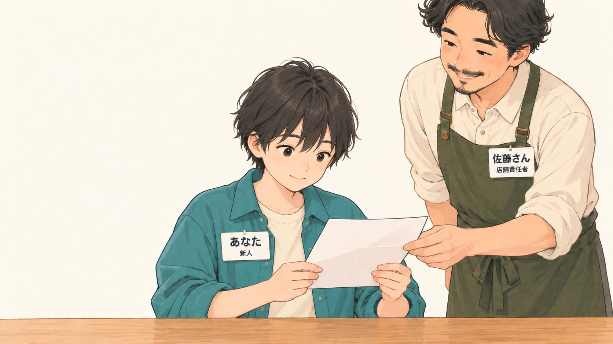

依頼を受け取ったら、まず読み、分からないことをメモします。

## DAY 2 同じ言葉を探す

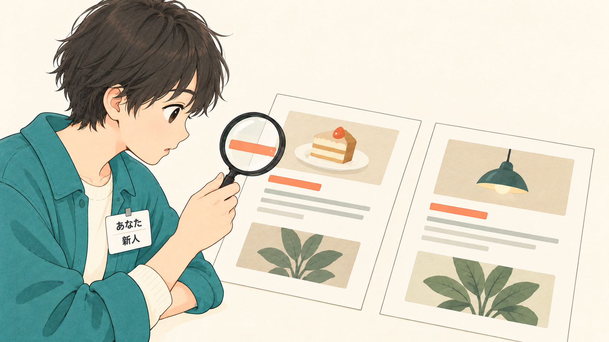

同じ言葉を見つけても、一件ずつ使われ方を確かめます。

## DAY 3 ボタンの見た目をそろえる

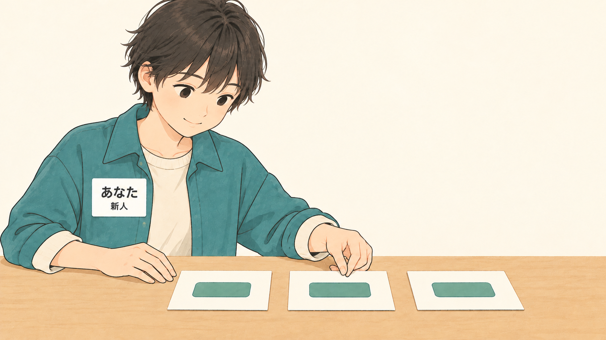

色だけでなく、角の形と余白もそろえると同じ役目が伝わります。

## DAY 4 来店前の情報を整理する

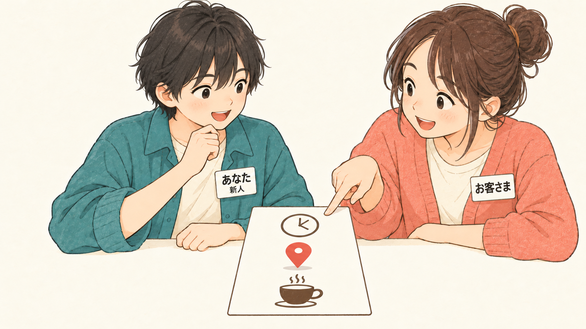

時間・場所・お店の紹介を、見る人が探す順にまとめます。

## DAY 5 ページの案内をそろえる

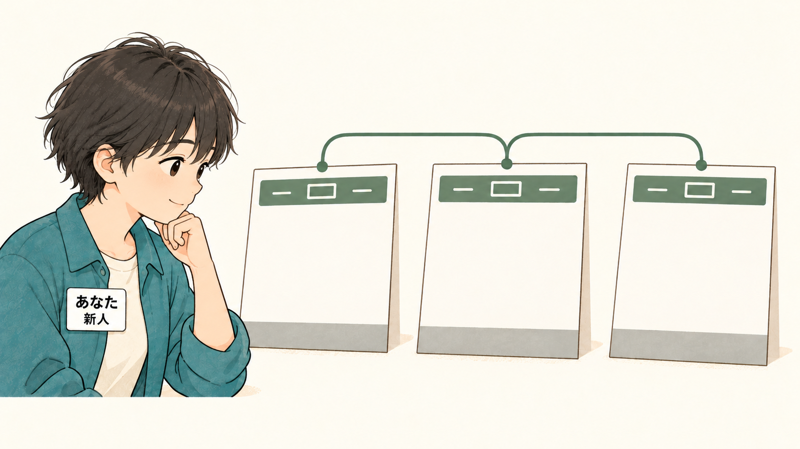

どのページからでも、同じ案内を使って移動できるようにします。

## DAY 6 商品カードを並べる

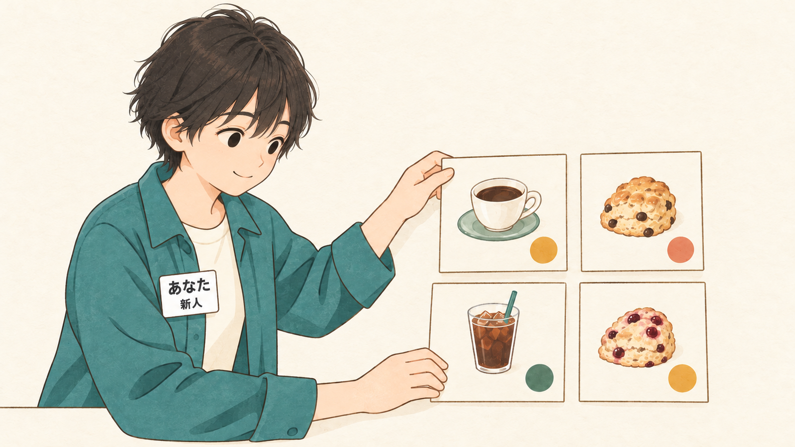

説明の長さが違っても、商品と価格を読み分けられる並びを考えます。

## DAY 7 入力しやすいフォームを作る

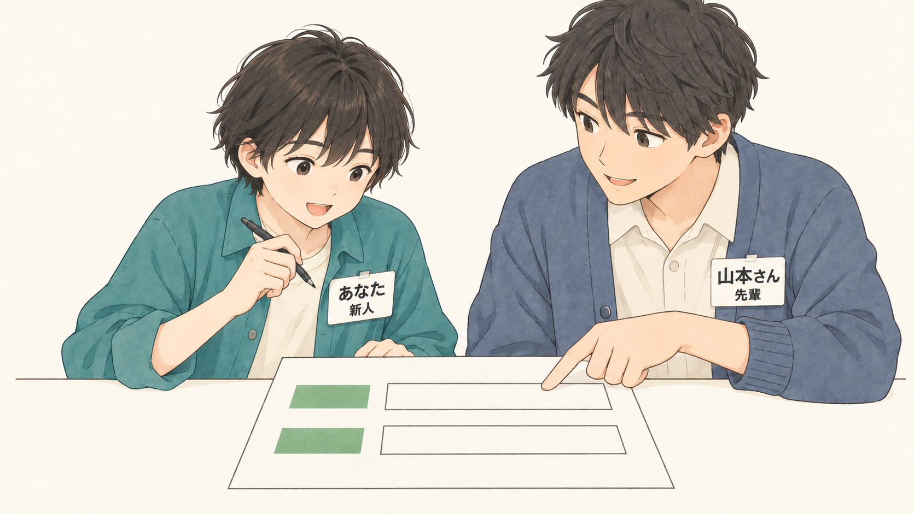

欄の名前と選び方が分かると、入力途中も迷いにくくなります。

## DAY 8 大切な案内を邪魔せず残す

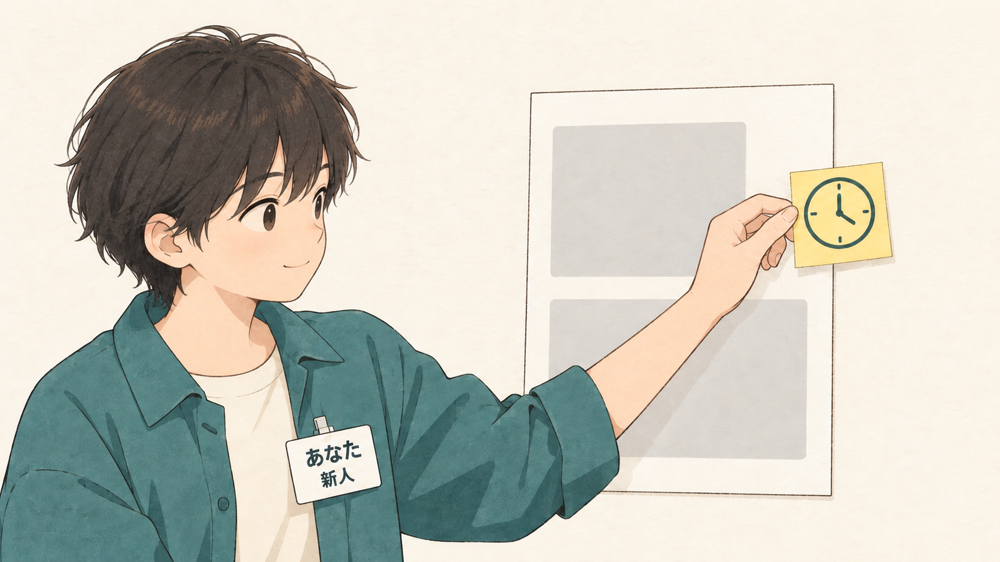

大切な案内を残すときも、本文や入力欄を隠さないようにします。

## DAY 9 写真の切り取りを考える

横長と縦長の切り取りで、見せたい被写体が残るか確かめます。

## DAY 10 スマホで読みやすくする

画面を狭くしたときも、文字とボタンが使える状態を保ちます。

## DAY 11 直す商品を取り違えない

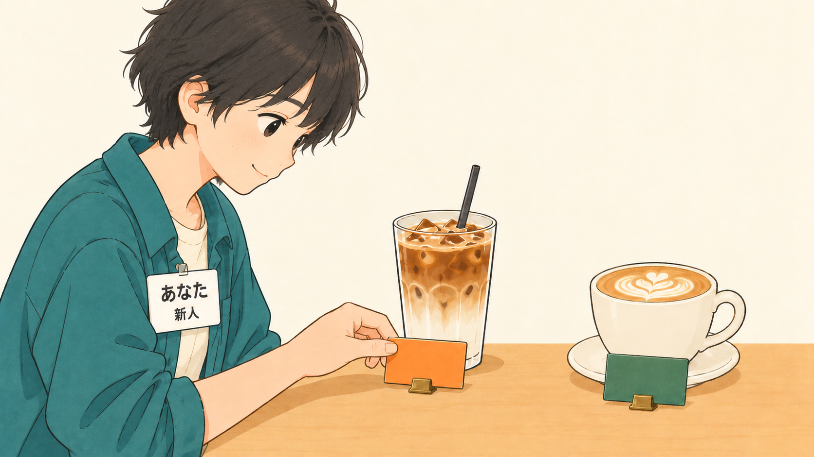

似た商品を見比べて、依頼されたものだけを変更します。

## DAY 12 指摘された場所だけ直す

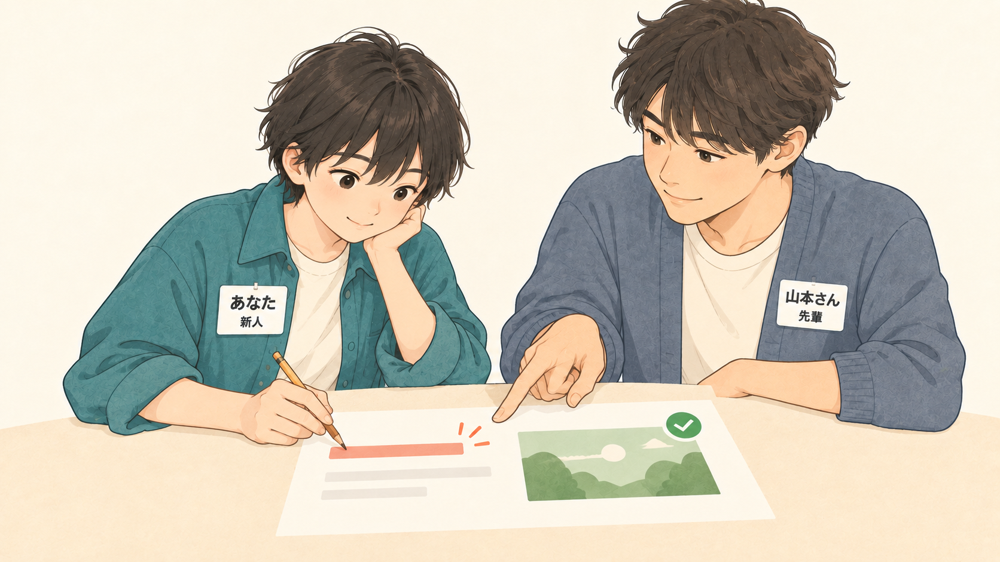

OK済みの場所を残し、指摘された場所へ変更を絞ります。

## DAY 13 承認とバックアップをそろえて公開する

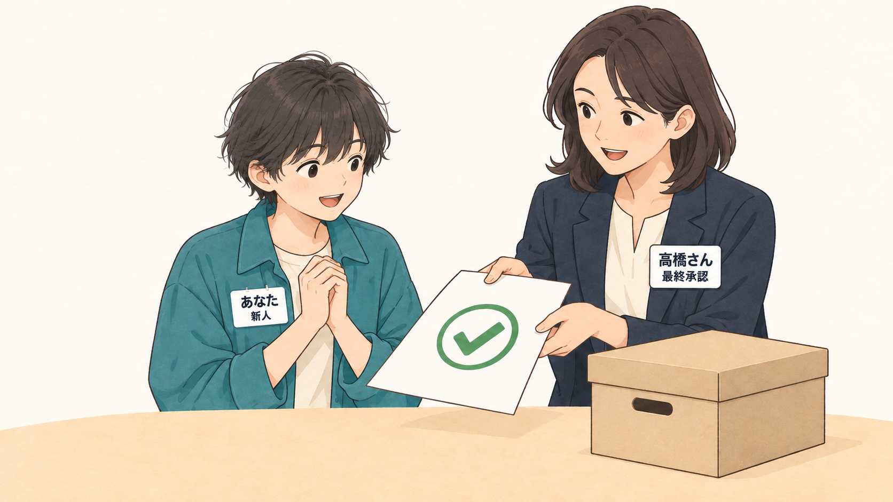

採用案の承認、戻せるコピー、公開後の確認をそろえます。

## DAY 14 作品で自分を紹介する

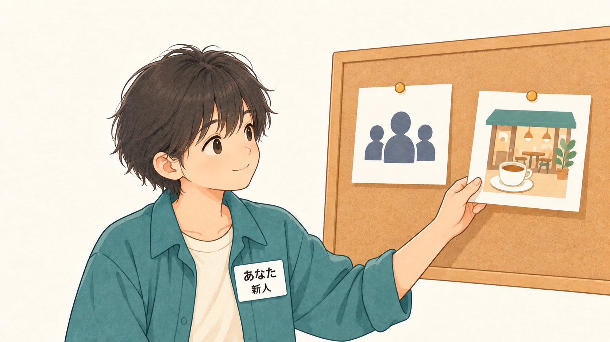

見る相手と伝えたいことを決め、実際の作品で裏付けます。

## DAY 15 完成した作品を発表する

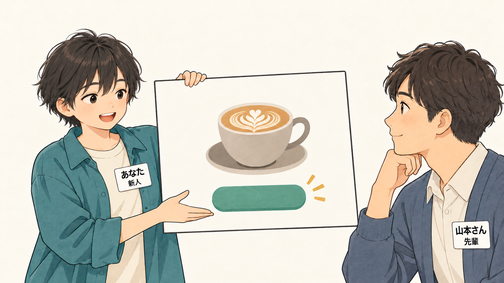

完成画面を見せながら、工夫した場所と確認したことを話します。

## 画像について

内蔵の画像生成ツール image_gen で制作しました。画像はこのフォルダーにPNGで保存しています。

[15枚のファイル名と生成指示](./generation-manifest.json)
[表示・リンクの確認記録](./validation.json)

