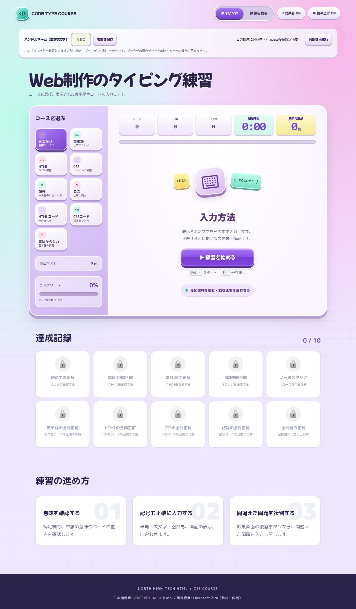
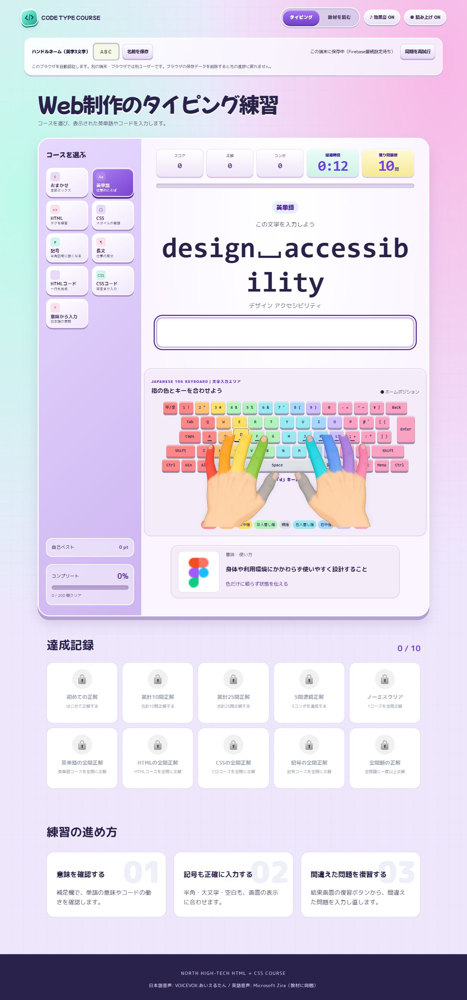
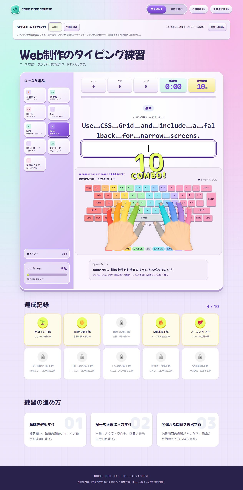
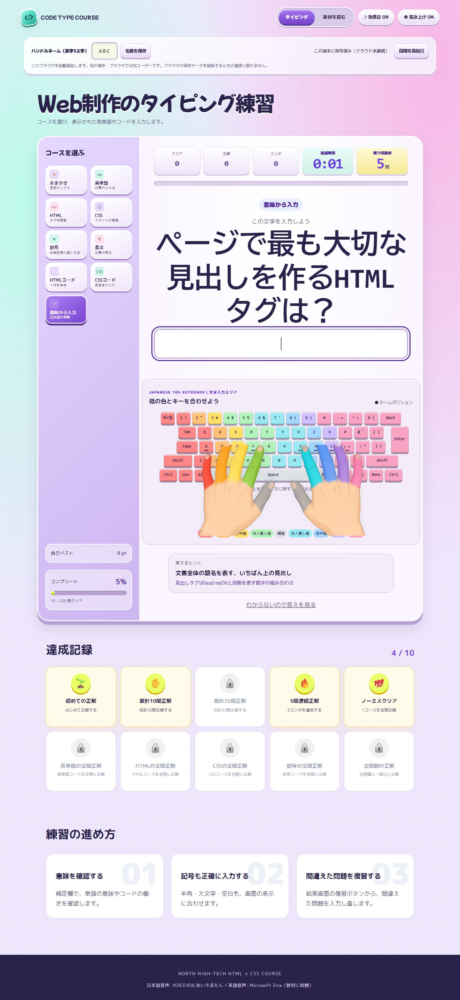
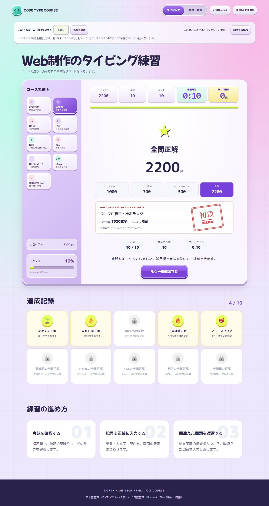
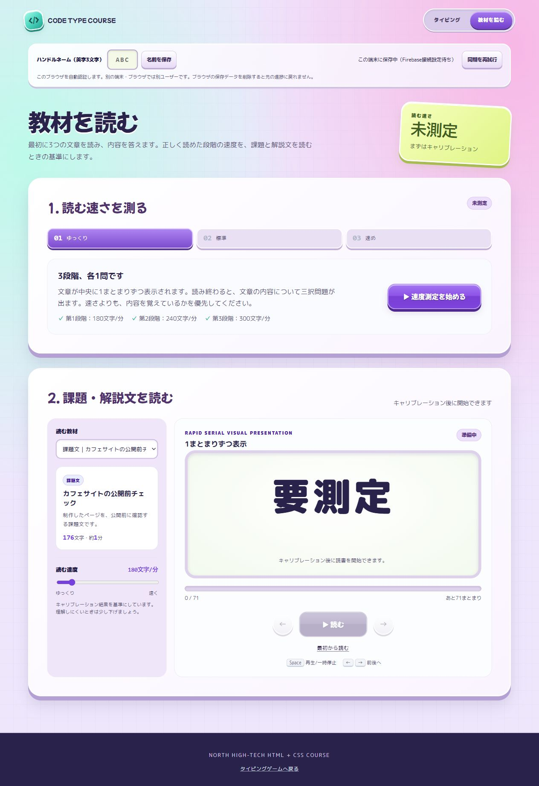
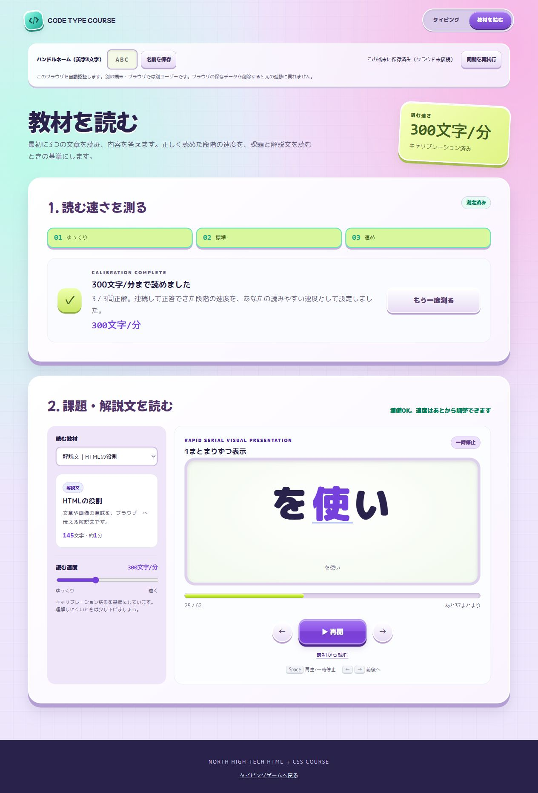

# 講座付属アプリの解説と遊び方

北ハイテク HTML・CSS講座｜受講者向けガイド

付属アプリでは、Web制作で使う文字の入力と、教材を読む練習ができます。最初は速さより正確さを大切にしましょう。

## 1. どんなアプリ？

| アプリ | できること | 授業での使いどころ |
|---|---|---|
| [CODE TYPE COURSE（タイピング）](../typing-app/index.html) | 英単語・HTML・CSS・記号などを入力する。意味やコード例も確認できる | 授業前のウォーミングアップ、苦手な記号の練習、用語の復習 |
| [READING LAB（教材リーダー）](../typing-app/reader.html) | 文章を画面中央に短いまとまりずつ表示する。自分に合う読む速度を調整できる | 課題や解説を読む練習、依頼内容の確認 |

上部の「タイピング」「教材を読む」で行き来できます。アプリで覚えたことは、授業のHTML・CSS編集でも使ってみましょう。

掲載画像は付属アプリを実際にブラウザで開いて撮影したものです。名前の `ABC` は説明用です。結果画面の数値は操作確認用の入力例で、受講者の成績や目標速度を示すものではありません。

## 2. 最初の準備

教材から起動するときは、[Python不要の起動手順](./app-start-guide.md)を使います。

1. 講師から配布されたアプリのURLを、ブラウザで開きます。
2. 音を使う場合はPCの音量を確認します。授業中は必要に応じてイヤホンを使います。
3. 「ハンドルネーム（英字3文字）」に `ABC` などの名前を入力し、「名前を保存」を押します。名前は後から変更できます。
4. 名前の下にある保存状況を確認します。詳しくは「7. 進捗の保存」を見てください。
5. タイピングでは、日本語入力をOFFにして半角英数で入力します。

**教材フォルダーから開く場合：** `start-app.cmd` でVS Codeを開き、コマンドパレットの「Live Preview: Start Server」で起動します。教材リーダーは上部の「教材を読む」から開けます。詳しくは[アプリの起動手順](./app-start-guide.md)を参照してください。Codespacesを使う授業では講師が指定した転送ポートから開きます。

HTMLファイルを直接ダブルクリックするより、配布URLやLive Previewのプレビューを使いましょう。アプリには読み込みにWebサーバーが必要な機能があります。

**画面1：開始画面。** 上部で名前・保存状況を確認し、左側でコースを選んで、中央の「▶ 練習を始める」を押します。下部には達成記録があります。

## 3. タイピングの遊び方

### まず1回遊んでみよう

1. 左側の「コースを選ぶ」で、まずは「英単語」か「HTML」を選びます。
2. 「▶ 練習を始める」を押します。開始画面では `Enter` でもスタートできます。
3. 画面のお手本を見て、回答欄に同じ文字を入力します。
4. 完全に一致すると、自動で正解になり、次の問題へ進みます。毎回 `Enter` を押す必要はありません。
5. 入力中に「MISS!」が出たら、`Backspace` で違う部分を消し、正しい文字に直します。
6. 全問が終わったら、結果画面で正解数・スコア・クリアタイムを確認します。

通常は選んだコースからランダムに最大10問が出ます。もう一度遊ぶと出題順や問題が変わることがあります。

**画面2：入力中の画面。** 大きな文字がお手本、その下の白い欄が回答欄です。入力するキーや意味を確認しながら進めます。

**入力のコツ：** 大文字・小文字、半角の記号、空白もお手本どおりに入力します。空白を表す画面上の `␣` は、`Space` で入力してください。入力途中で `Enter` を押すと、その時点の回答が採点され、不正解なら次へ進みます。まずは自動で正解になるまで入力しましょう。

### 9つのコース

| コース | 練習内容 | おすすめの使い方 |
|---|---|---|
| おまかせ | 全コースを混ぜて出題 | いろいろな問題に慣れてから挑戦 |
| 英単語 | Web制作の仕事で使う英単語 | 最初の練習に |
| HTML | HTMLのタグ | ページの構造を学ぶ日に |
| CSS | スタイルに関する単語 | 見た目を整える日に |
| 記号 | 半角の記号 | `<`、`>`、`{`、`}` などが苦手なときに |
| 長文 | 仕事で使う英文 | 単語の入力に慣れたら |
| HTMLコード | HTMLの一行 | タグを組み合わせる練習に |
| CSSコード | CSSの宣言 | プロパティと値をまとめて入力する練習に |
| 意味から入力 | 日本語の質問から答えを入力 | 意味まで覚えられたか確認するときに |

「意味から入力」など、答えを隠した問題では「わからないので答えを見る」が表示されます。押すと答えを確認して次へ進めます。その問題は復習の対象になります。

### 補足欄で分かること

英単語やコードの下の **意味・使い方** は、言葉の意味やコードの働きの説明です。長文では **英文のポイント** に、単語の意味や文のつながりが出ます。例えば `with` は「〜が付いた」、`without` は「〜せずに」を表します。

**長文の補足欄。** 英文に出てくる言葉を手掛かりに、文の意味を理解できます。入力する英文が依頼の表現でも、この練習で行うのはタイピングです。サイトを直す課題の依頼は、各DAYの教材で確認します。

**考えるヒント。** 「意味から入力」では、質問に答えるための手掛かりが出ます。例えば文字色の問題なら、背景色との違いや色の値との関係から考えられます。

### 画面の見方

| 表示 | 意味 |
|---|---|
| スコア | 今回のプレイで獲得した点数 |
| 正解 | 今回、正解した問題数 |
| コンボ | 連続で正解した問題数 |
| 経過時間・残り問題数 | 開始からの時間と、まだ終わっていない問題数 |
| 自己ベスト | 選択中のコースの最高スコア |
| コンプリート | 全問題のうち、一度でも正解した問題の割合 |
| キーボードガイド | 指の色、ホームポジション、次に入力するキーのヒント |
| 意味・使い方 | 単語の意味や、コードが表す働きと使用例 |
| 英文のポイント | 英単語の意味や、文のつながり |
| 考えるヒント | 答えを思い出すための、意味や仕組みの手掛かり |
| 達成記録 | 正解数やコンボなどの条件で獲得するバッジ |

キーの場所に迷ったら、画面のキーボードを見てください。ガイドは日本語106キーボード向けです。使っているPCの配列が違う場合は、実物のキー表示も確認します。

### 点数と結果の見方

- 正解1問につき **100点**。
- 連続正解の加点は、2問目から **20・40・60・80・100点** と増え、その後は1問につき100点です。
- 今回の問題をすべて正解すると **500点** のクリアボーナスが付きます。

例えば、10問をすべて連続正解すると、基本点1,000点＋コンボ加点700点＋クリアボーナス500点＝**2,200点**です。

入力途中のミスは、直して正解すれば正解として進めます。ただし、結果の「入力ミス」には記録されるため、全問正解と入力ミス0回は別の目標です。

「ワープロ検定・推定ランク」は、入力実績を10分に換算し、ミスの減点を加えたアプリ内の目安です。正式な検定結果や資格の認定ではありません。短い練習では数値が変わりやすいので、正確さを確かめる参考として使います。

**画面3：結果画面。** 合計点だけでなく、正解数・入力ミス・最高コンボを確認します。この例は撮影用に自動入力した結果です。表示されたクリアタイムや推定ランクを、人が入力した成績として比較しないでください。

### 終わったら復習しよう

1. 不正解や「答えを見る」で進んだ問題があれば、「まちがえた問題を復習」を押します。
2. 意味やコード例を読み、自分で入力して正解を目指します。
3. 別の問題も練習したければ「もう一度練習する」を押します。

入力途中のミスを直して正解した問題は、復習ボタンの対象には入りません。気になる単語や記号はメモして、同じコースでもう一度練習しましょう。

プレイ中に `Esc` を押すと開始画面へ戻ります。その回のプレイは中断されます。

## 4. 教材リーダーの使い方

### 最初に「読む速さを測る」

初回は、キャリブレーション（読む速度の調整）を行います。

**画面4：初回の速度測定。** まず上の「▶ 速度測定を始める」を押します。測定が終わるまで、下の教材再生は始められません。

1. 「▶ 速度測定を始める」を押します。
2. 「第1段階を読む」を押し、中央に表示される文章を読みます。
3. 読み終わると三択問題が出るので、文章の内容を選びます。
4. 「第2段階へ」「第3段階へ」と進み、各段階の文章と問題に取り組みます。
5. 「結果を見る」でおすすめの速度を確認します。

3段階の速度は **180 → 240 → 300文字／分**です。最初の段階から連続して正答できたところを基準に速度が設定されます。第1段階が不正解なら140文字／分が基準になります。測定中も「一時停止」「再開」が使えます。

一度測定した記録が保存されていれば、次回はその設定から始められます。「もう一度測る」で測定をやり直せます。

### 課題や解説を読む

1. 「読む教材」で文章を選びます。
2. 「▶ 読む」を押すと、画面中央に文章が短いまとまりずつ表示されます。
3. 速すぎる場合は一時停止し、「読む速度」のスライダーを下げます。120〜600文字／分の範囲で調整できます。
4. 見逃した部分は「←」で1つ戻り、「→」で1つ進みます。
5. 全体を読み直したいときは「最初から読む」を押します。

| 教材 | 内容 |
|---|---|
| 課題文｜カフェサイトの公開前チェック | 公開前に行う確認 |
| 解説文｜HTMLの役割 | 文章やページの構造 |
| 解説文｜CSSで見た目を整える | 色や配置などの見た目 |
| 解説文｜依頼から公開まで | Web制作の仕事の流れ |
| 自分の文章を貼り付ける | 自分で用意した課題や解説文 |

自分の文章を使う場合は、文章を入力・貼り付けて「この文章を使う」を押してから読みます。教材の選択だけでは文章の読み込みは完了しません。

**画面5：教材を読んでいる途中で一時停止した画面。** 左側で教材と速度を選び、中央で文章を読みます。「▶ 再開」で続け、「←」「→」で前後を確認できます。300文字／分は撮影時の設定例です。自分の理解しやすい速度に合わせましょう。

読了は最後まで表示した記録です。内容を理解できたかは、読み終わってから「何をする課題だったか」を自分の言葉で説明して確認しましょう。リンクを開いたり、コード全体を見たりする必要があるときは、元の教材も開きます。

## 5. 操作の早見表

| 場面 | 操作 | 動き |
|---|---|---|
| タイピング開始画面 | 「▶ 練習を始める」／`Enter` | プレイ開始 |
| タイピング入力中 | お手本どおりに入力 | 一致したら自動で正解・次の問題へ |
| タイピング入力中 | `Backspace` | 間違えた文字を消す |
| タイピング入力中 | `Enter` | 現在の回答を採点 |
| タイピング | `Esc` | 開始画面へ戻る |
| タイピング | 「効果音 ON／OFF」 | 効果音の切り替え |
| タイピング | 「読み上げ ON／OFF」 | 問題の音声の切り替え |
| 教材リーダー | `Space` | 教材の再生／一時停止 |
| 教材リーダー | `←`／`→` | 1まとまり戻る／進む |

リーダーのショートカットは、入力欄・選択欄・ボタン・リンクを操作しているときは働きません。反応しない場合は画面のボタンを使います。速度測定中の操作は測定欄のボタンを使ってください。

## 6. 授業でのおすすめの使い方

### 授業前の10分

1. **3分：** 今日の内容に合うコースを1回遊ぶ。
2. **2分：** 間違えた問題を復習する。
3. **3分：** リーダーで関連する解説を読む。初回の速度測定は別に時間を取る。
4. **2分：** 覚えた用語を1つ、意味と一緒にメモする。

### 自分で決めるチャレンジ

- **正確さチャレンジ：** 同じコースで、前回より入力ミスを減らす。
- **意味チャレンジ：** 「意味から入力」で、答えを見ずに正解する。
- **コードチャレンジ：** 「HTMLコード」「CSSコード」で入力した内容を、授業のファイルでも探して説明する。
- **読解チャレンジ：** 解説を読んだ後、要点を一文で説明する。難しければ速度を下げて再読する。

スコアや速度は自分の前回と比べましょう。コースや出題内容が違うと単純には比較できません。

## 7. 進捗の保存

タイピングの自己ベスト・コンプリート・実績や、リーダーの速度設定・測定結果・読了記録はブラウザに保存されます。

| 表示・状況 | どうすればよい？ |
|---|---|
| 「この端末に保存中（Firebase接続設定待ち）」 | このブラウザに保存されます。クラウドへの同期は行われていません |
| 「接続できません。端末に保存し、同期は再試行できます。」 | 端末で練習を続け、接続が戻ったら「同期を再試行」を押します |
| 「保存できません。このページ内でのみ進捗を保持します」 | 練習は続けられますが、再読み込みやページ移動で今回の進捗が失われます。結果を記録し、講師に画面の表示を伝えます |

ハンドルネームは表示用の名前です。同じ名前を別のPCで入力しても、同じ利用者としてログインできるわけではありません。別のPC・ブラウザ・アクセス先URLでは進捗が別になる場合があります。共有PCでは同じブラウザの進捗を共有することがあるため、講師の指定した利用環境で練習します。

ブラウザの保存データを削除すると元の進捗に戻れなくなることがあります。記録を残したい場合は、データを消す前に結果画面や数値を記録してください。

## 8. 困ったとき

| 困りごと | 確認・対処 |
|---|---|
| 正解にならない | 日本語入力をOFFにする。大文字・小文字、半角記号、空白をお手本と比べる |
| 赤い画面になった | 入力ミスの合図です。`Backspace` で消して直す |
| 記号のキーがわからない | キーボードガイドを見る。実物の配列と違う場合は講師に確認する |
| 音が出ない | PCの音量とアプリのON／OFFを確認する。プレイ開始後に試す。音なしでも練習できます |
| 「読む」が押せない | 初回の速度測定を最後の「結果を見る」まで終える |
| 文章が速すぎる | 一時停止して速度を下げる。戻るボタンで読み直す |
| ボタンやコースが出ない | 読み込みを待つ。改善しなければ配布URLまたはLive Previewで開き直し、再読み込みする |
| 名前を保存できない | 半角英字3文字になっているか、保存状況にエラーがないか確認する |
| 記録が消えた・違う | 前回と同じPC・ブラウザ・URLか確認する。保存データを消さず、講師に相談する |

## 9. 今日のできたかチェック

- [ ] アプリを開き、コースを選んで1回遊べた。
- [ ] 入力ミスを `Backspace` で直せた。
- [ ] 結果を見て、復習したい言葉を1つ選べた。
- [ ] 速度測定を終え、自分に合う速度で解説を読めた。
- [ ] 覚えた用語や、読んだ文章の要点を説明できた。
- [ ] 進捗がどこに保存されるか確認できた。

授業の課題に戻るときは[学生向け入口](../student/README.md)を開きます。
