# 付属アプリの進行レビュー

確認日：2026年10月13日。対象：CODE TYPE COURSE／READING LAB。

**初回レビューで再現した4件を修正し、同じ条件で改善を確認しました。** 下の問題点とFAILは修正前の記録です。修正後の結果は「修正後の確認」に記載しています。原因箇所の行番号も修正前のものです。

保存容量不足・保存領域の利用拒否は、テスト専用ブラウザで保存APIに例外を発生させて再現した条件です。実際の利用端末で発生する頻度は未測定です。掲載画像はその条件で実アプリを動作させて撮影しました。

## 1. [P1] 保存容量不足で正解後・速度測定終了時に進行不能になる

**再現手順：**

1. タイピングを開始する。
2. ブラウザの保存処理が容量不足の例外を返す状態にする。
3. お手本どおりに入力する。

**実際の結果：** 正解後、回答欄が無効になったままで、次の問題に進みません。残り10問のまま停止しました。`Esc` で戻っても、保存エラーが続く限り次の正解で再発します。

リーダーでも、3段階の測定を終えた後に同じ保存エラーが起きると「結果を見る」から先へ進めず、「読む」は無効のままです。

**原因：** [progress-store.mjs](../typing-app/progress-store.mjs) の20〜21行は保存の例外を呼び出し元へ伝えます。[app.js](../typing-app/app.js) の238行の保存で処理が中断すると、470行の次問への予約まで到達しません。[reader.js](../typing-app/reader.js) の354行も、保存が成功しないと測定完了状態への切り替えに進みません。

**修正方針：** 保存失敗を画面に表示し、一時的なメモリー保存で学習を続けられるようにする。画面遷移の成功を永続保存の成功に依存させない。

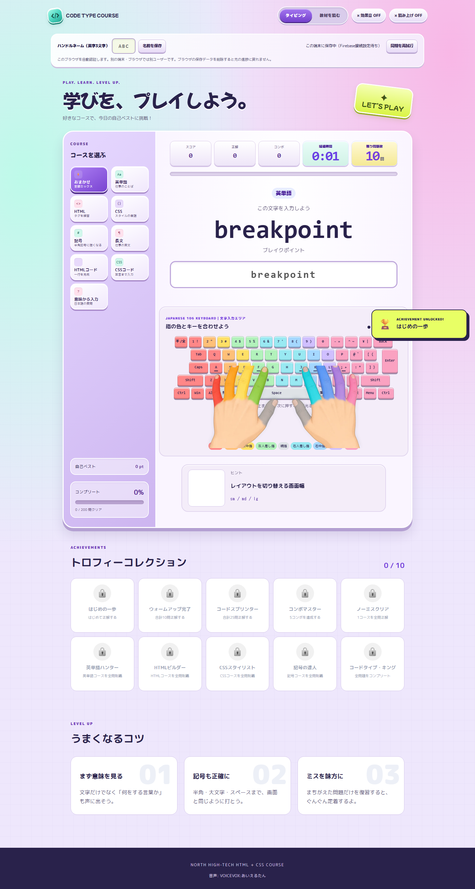

正解文字を入力済みですが回答欄は無効です。保存失敗の説明も更新されず、操作だけでは原因が分かりません。

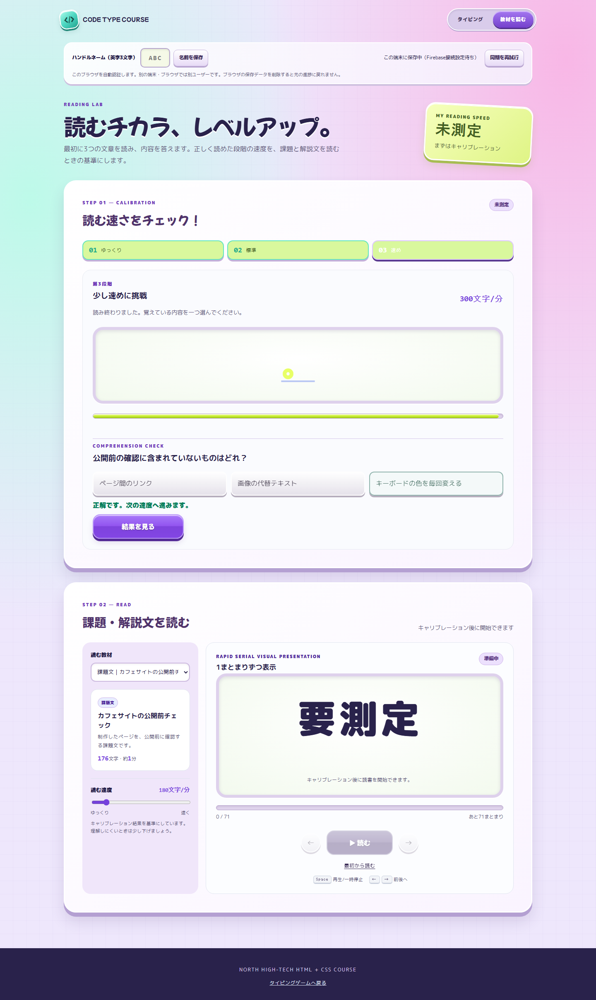

「結果を見る」を押しても未測定のままです。

## 2. [P1] 保存領域を使えないブラウザでは両アプリが起動できない

**再現手順：** ブラウザの保存領域の読み取りが利用拒否の例外を返す状態で、各アプリを開く。

**実際の結果：** タイピングのコース一覧が空になり、プレイを開始できません。リーダーも速度測定のボタンが反応しません。

**原因：** [account.js](../typing-app/account.js) は保存領域の問題を捕捉し、保存なしの代替処理を用意します。しかし、その後に読み込まれる [app.js](../typing-app/app.js) の122行と [reader.js](../typing-app/reader.js) の100行は、保存領域を直接読み取り、例外を捕捉しません。イベント登録前に初期化が止まります。

**修正方針：** 読み取りも共通の保存層を通し、利用できない場合は初期値とメモリー保存を使う。保存不能でも開始・入力・速度測定を操作できることを確認する。

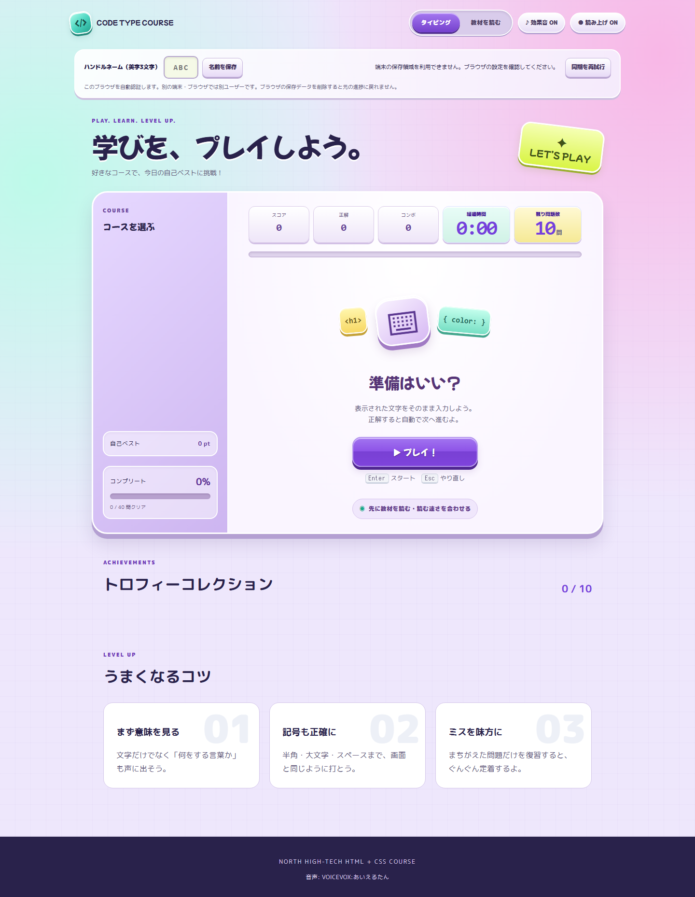

保存領域を利用できない旨は表示されていますが、コースも操作処理も初期化されません。

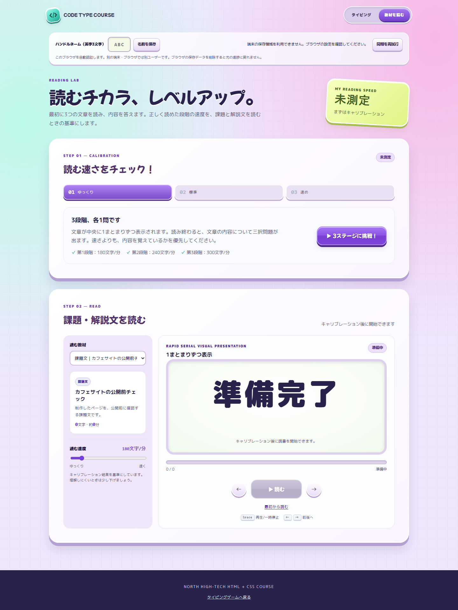

「3ステージに挑戦！」を押しても先へ進めません。

## 3. [P2] 正解直後のやり直しで、新しい回の問題が飛ばされる

**再現手順：**

1. タイピングで1問正解する。
2. 次の問題へ進むまでの約0.9秒の間に `Esc` を押す。
3. すぐに「▶ プレイ！」で新しい回を開始する。
4. 約1秒待つ。

**実際の結果：** 新しい回で何も回答していないのに、残り問題数が10から9に減ります。正解数は0のままです。問題を解く機会が失われ、全問正解もできなくなります。

**原因：** [app.js](../typing-app/app.js) の470行の次問タイマーを保持・取消していません。738行からの `resetToStart()` で問題列を入れ替えても、前の回の予約処理が新しい問題列に対して実行されます。「答えを見る」の621行にも同じ予約方式があります。

**修正方針：** 次問タイマーを回ごとに管理し、リセット・コース変更・再開始時に取り消す。古い回のコールバックは新しい回を変更できないようにする。

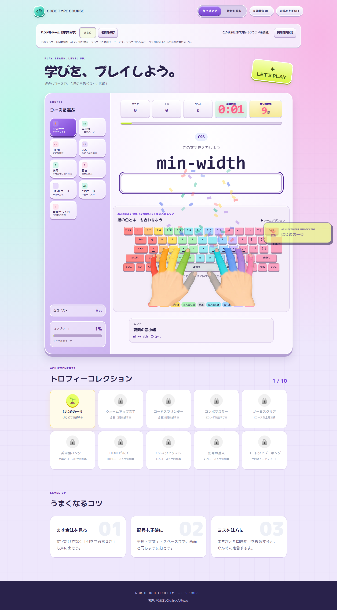

回答していない新しい回で1問が消費されています。

## 4. [P2] 手動調整した読む速度が、再読み込みで測定時の速度に戻る

**再現手順：**

1. 速度測定を終え、300文字／分の設定になる。
2. スライダーを120文字／分に変更する。
3. ページを再読み込みする。

**実際の結果：** 手動設定の120は保存されていますが、表示・再生設定が300文字／分へ戻ります。

**原因：** [reader.js](../typing-app/reader.js) の84行で手動設定を読み込んだ後、110行で測定記録の `speed` に上書きされます。495行からの `updateSpeed()` は手動設定の保存だけを更新するため、2つの保存値が食い違います。

**修正方針：** 次回起動では手動調整した速度を優先する。測定結果は基準値として保持し、現在の再生速度と区別する。

## 検証範囲と残件

ブラウザの自動操作でボタン・入力・結果表示を確認しました。速度測定・問題切り替えなどの待機時間は、テスト用のブラウザ時計を進めて確認しています。画像の内容も確認しました。

- **FAIL：** 保存容量不足時のタイピング継続と速度測定完了。
- **FAIL：** 保存領域の利用拒否時の両アプリの初期化。
- **FAIL：** 正解直後のやり直しで新しい問題列を維持すること。
- **FAIL：** 手動調整した速度を再読み込み後に維持すること。
- **NOT RUN：** 本番Firebaseの認証・同期、実機スマートフォンのタッチ操作、実機での音声再生、すべての異常な保存データの組み合わせ。

- **PASS：** タイピング9コースの開始から結果まで（各コースの実際の出題数で確認）。
- **PASS：** 「意味から入力」の答え表示から、該当問題の復習完了まで。
- **PASS：** 速度測定3段階の完了、組み込み教材4種類と貼り付け文章の読了。
- **PASS：** 通常経路でアプリの未処理例外なし。
- **PASS：** 撮影・検証用ブラウザの終了と、HTTPサーバーの終了。

テスト用ブラウザは各検証の終了時に正常終了し、起動したプロセスが存在しないことを確認しました。起動記録のPIDは35592・28868・23952・38240です。利用者の既存ブラウザは操作していません。

保存エラーの対策を優先し、次に古い次問タイマーの取消と速度設定の復元を直すのが妥当です。通常経路のPASSは、上記の条件で発生するFAILを解消したことを意味しません。

## 修正後の確認

2026年10月13日に、共通保存処理・初期化・次問タイマー・速度の復元処理を修正しました。

| 修正対象 | 修正後の挙動 | 検証 |
|---|---|---|
| 保存容量不足 | 保存できない場合はページ内のメモリーで進捗を保持し、正解後も次問へ進む。速度測定も終了できる | PASS |
| 保存領域の利用拒否 | 保存領域の取得・読み取りが例外になっても、両アプリを開始できる | PASS |
| 正解直後のやり直し | 前の回の次問タイマーを取り消し、回答前の残り問題数が10のままになる | PASS |
| 手動の速度設定 | 120文字／分に変更した後、再読み込みしても120を維持する | PASS |

保存できない環境では「このページ内でのみ進捗を保持します。再読み込みで失われます」と表示します。この代替動作は、ページを移動した後やブラウザを閉じた後の進捗保存を保証するものではありません。認証情報を端末に保存できない場合はクラウド接続を停止し、学習は続けられるようにしています。

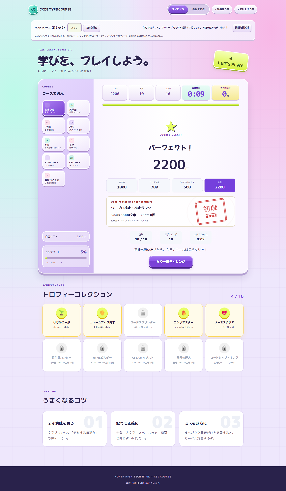

**修正後：** 保存容量不足でも、全問の入力と採点を終えられます。

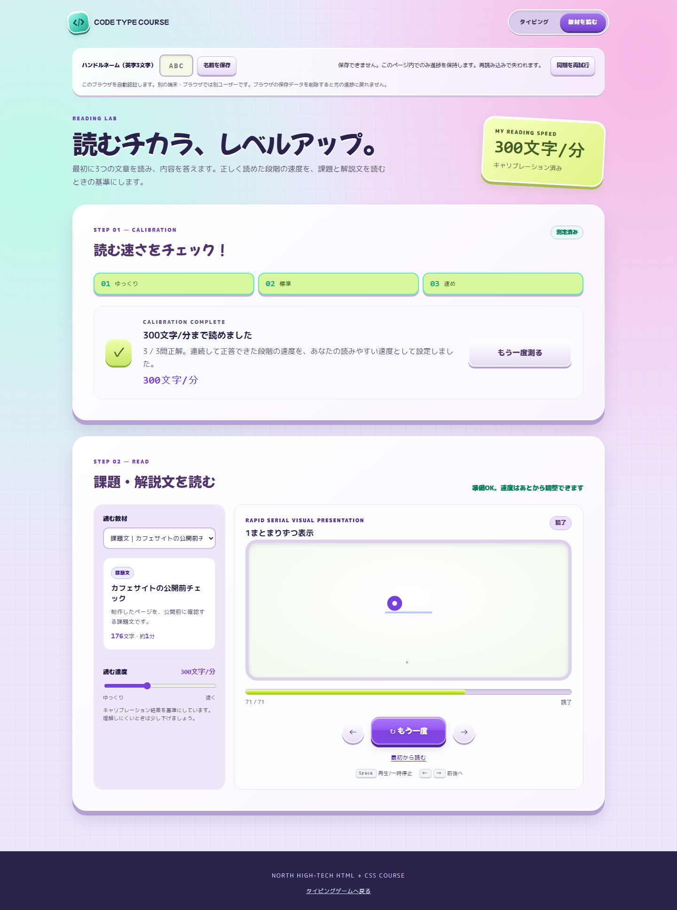

**修正後：** 保存領域そのものを取得できない条件でも、初期化・速度測定・教材読了まで進められます。

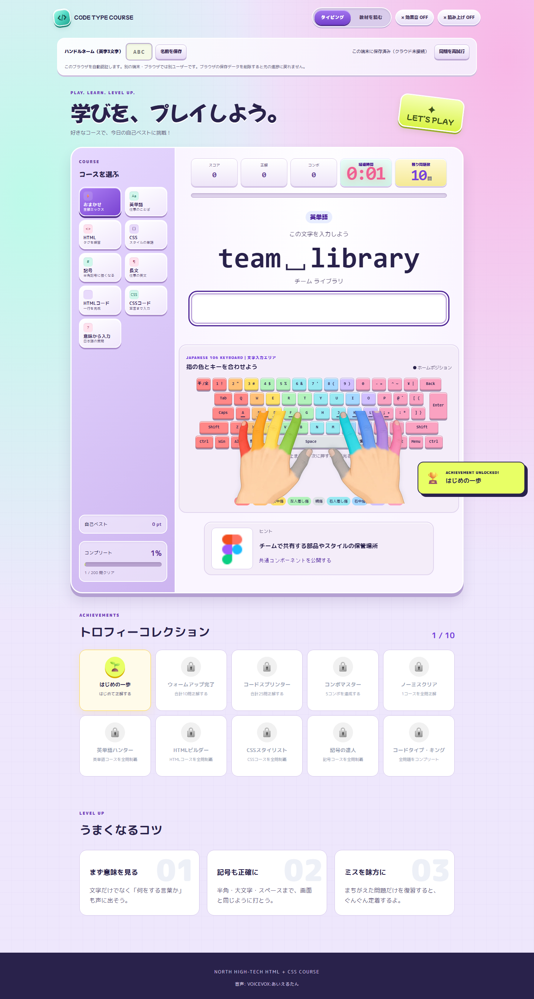

**修正後：** 以前の回のタイマーが動く時間まで待っても、新しい回の問題は消費されません。

- **PASS：** 保存処理の6つの単体テスト（既存の同期・再試行・同時更新と、保存不可時の代替動作）。
- **PASS：** 修正前に失敗した条件の再検証。未処理例外なし。
- **PASS：** 保存領域を取得できない場合と容量不足の場合の、タイピング全問完了・速度測定完了・教材読了。
- **PASS：** 通常のタイピング9コース、答え表示からの復習、教材4種類と貼り付け文章の読了。
- **PASS：** 構文・画像リンク・教材の検証と、検証用ブラウザ・サーバーの終了確認。
- **NOT RUN：** 本番Firebase、実機スマートフォン、実機音声の検証。

修正後のブラウザ検証では、起動記録のPID 22084・40108・40584の正常終了とプロセス不存在、各HTTPサーバーの終了を確認しました。

## 音声のずれ・無音の追加確認と修正

受講者の指摘を受け、全200問の音声対応を確認しました。修正前は基本問題60問の後に追加英単語が続きますが、追加音声の生成番号は64から始まっていました。全体の順番を音声番号へ使うため、追加英単語の最初の3語は無音になり、その後の音声が3問ずつずれていました。追加CSSにも英単語の音声が割り当てられ、音声が用意されていない問題は無音でした。

修正後は、コース名と入力文字をキーにする音声カタログを使います。全200問の実際の問題から音声を生成して同梱しました。日本語はVOICEVOX:あいえるたん、英語はMicrosoft Ziraです。英単語はその読み、英文は英文、CSS・コード・記号は入力内容と記号名を読みます。「意味から入力」では答えを伏せた日本語の質問を読みます。

コース変更・やり直しの際には前の音声を止めます。前の問題の音声が残る経路も取り除きました。

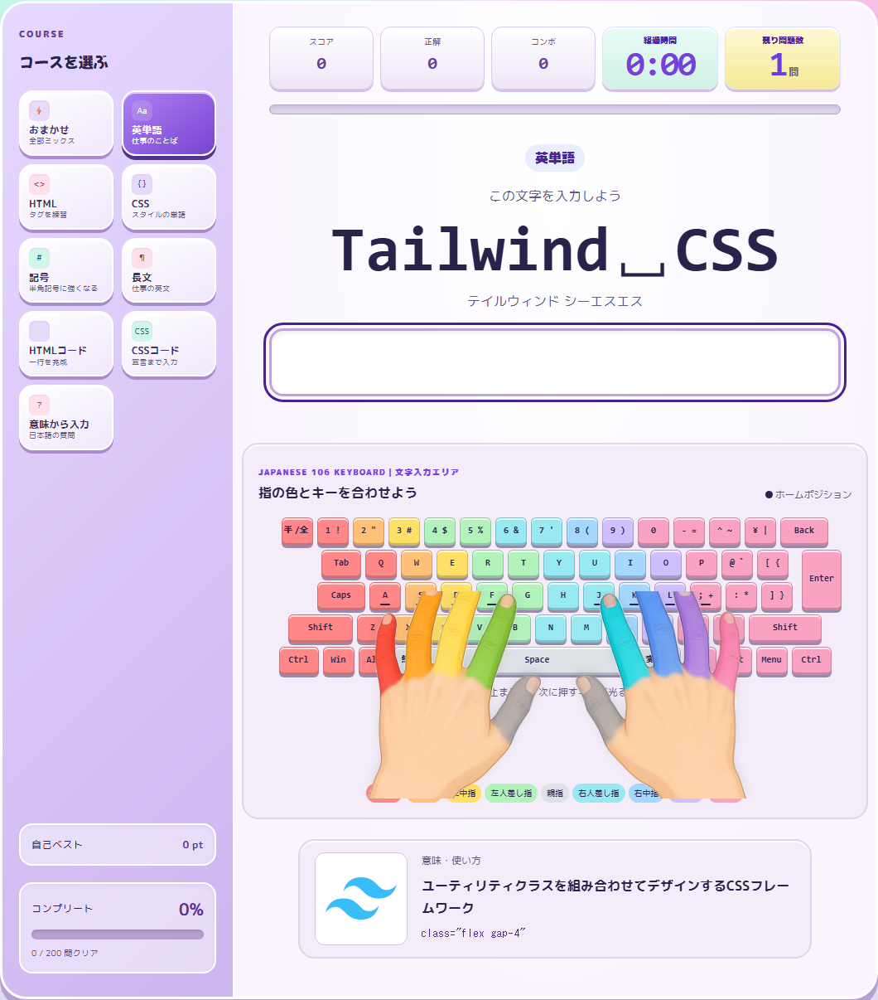

英単語の最初の追加問題にも、対応する音声があります。

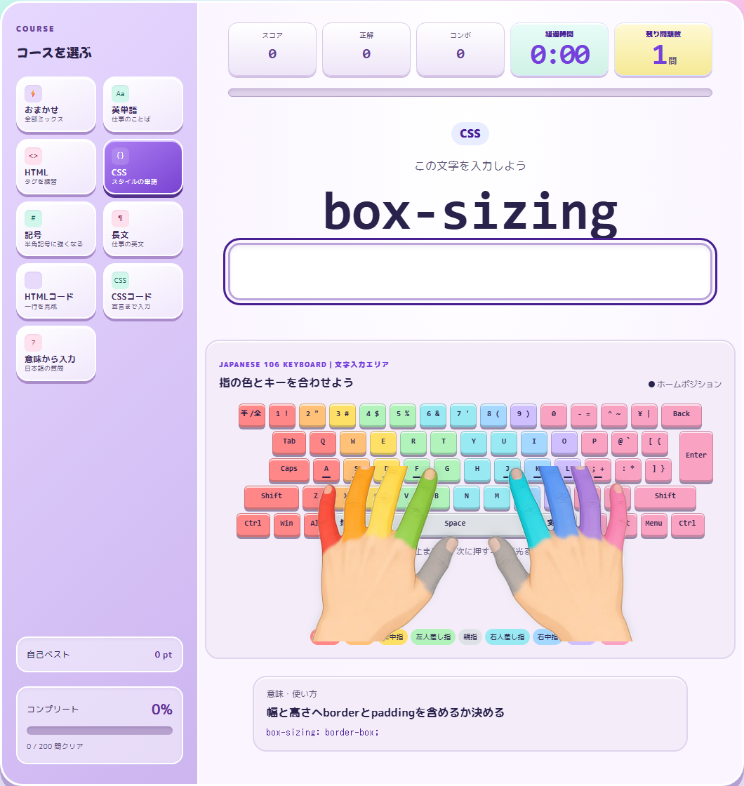

追加CSSにも専用の音声を同梱しています。

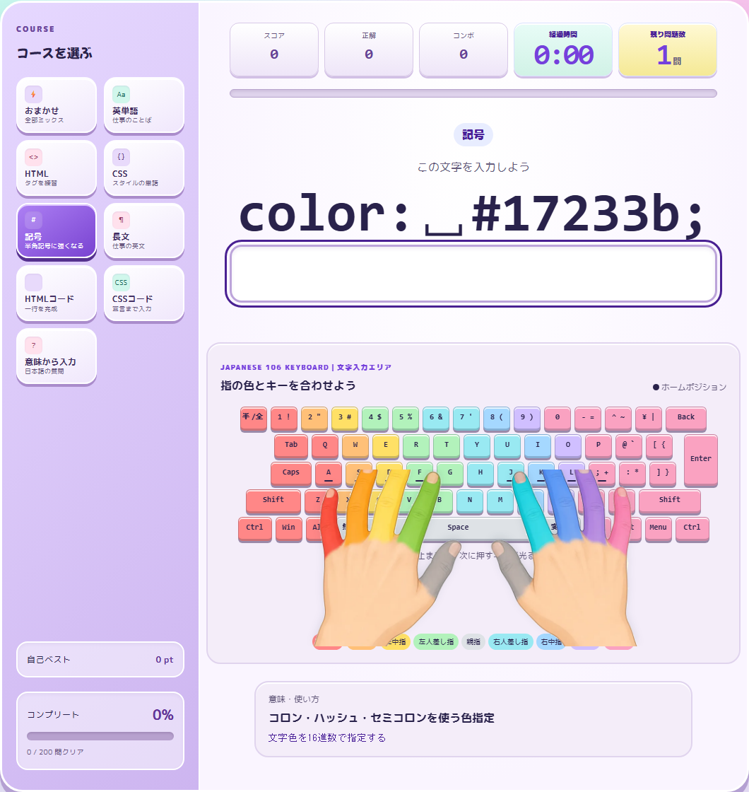

この問題の音声には「コロン」「スペース」「ハッシュ」「セミコロン」を明示しています。

- **PASS：** 200問のキーと音声ファイルの対応、生成入力、ファイル形式、欠落の検査。
- **PASS：** ブラウザで全200音声を再生開始できることと、正しい参照先・正の再生時間の確認。質問音声を変更した5問も追加確認。
- **PASS：** 保存処理6件＋音声カタログ4件の単体テスト。
- **PASS：** 音声生成の正常系・既存ファイルを再利用する再実行・入力欠落と不正なカタログの拒否。
- **PASS：** 音声検証用ブラウザの正常終了とプロセス不存在（PID 3120・35680）、確認用HTTPサーバーの終了。
- **NOT RUN：** 受講者が使う各端末での聞き取りやすさの評価。再生・データ対応の検証と、人による聞き取り評価は別です。

## Pythonを使わない起動環境

[新しい起動手順](./app-start-guide.md)を追加しました。`start-app.cmd` で教材とアプリHTMLをVS Codeに開き、Microsoft製Live Previewで配信します。推奨拡張・PC内限定の待ち受け設定・アプリを開く初期パス・起動タスクを教材に同梱しました。受講者はPythonやNode.jsを追加する必要がありません。

VS Codeの実画面で起動し、アプリのHTTP 200と、`127.0.0.1:5500` だけで待ち受けていることを確認しました。確認後は教材ウィンドウと検証用タブを閉じ、VS Codeプロセス（PID 30828）と待ち受けの終了を確認しました。復元された以前の未保存内容は破棄していません。

## 日本語音声を「あいえるたん」に差し替え

利用者の指定に合わせて、日本語の読み・質問・記号名をMicrosoft HarukaからVOICEVOX:あいえるたんへ変更しました。英語はMicrosoft Ziraを維持しました。日本語を含む162音声を再生成し、英語だけの38音声はファイルのSHA-256が変更されていないことを確認しました。

生成時に、音声モデルのメタデータでスタイル68の話者名が「あいえるたん」であることを検査します。すべての音声が揃うまでは以前のアプリ用対応表を維持し、検査後に切り替えます。ページ下部のクレジットも更新しました。

- **PASS：** 日本語・英語の話者割り当て、全200音声のファイルとブラウザでの再生確認。
- **PASS：** 英語のみの38ファイルのハッシュ不変。
- **PASS：** 保存処理6件＋音声カタログ5件の単体テスト。
- **PASS：** 生成の正常系、既存ファイルを再利用する再実行、不正なカタログ・実行環境欠落の拒否。
- **NOT RUN：** 各受講者の実機での聞き取り評価。

差し替え後の検証用ブラウザは正常終了し、起動したPID 31024の不存在とHTTPサーバーの終了を確認しました。
