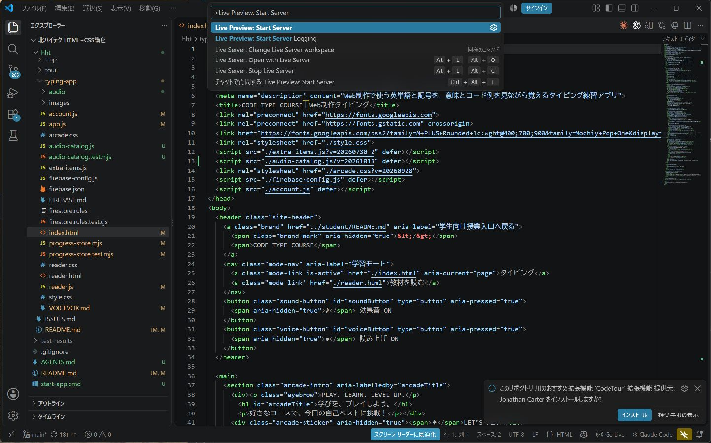

# 付属アプリを起動する

Windowsの授業PCでは、**VS Code＋Microsoft製Live Preview** で起動します。Python・Node.js・Dockerを受講者が追加する必要はありません。拡張機能に同梱されたサーバーがVS Code内で動作します。

## 初回だけ準備する

1. 教材フォルダーをVS Codeで開きます。
2. 左の「拡張機能」を開き、検索欄に `@recommended` を入力します。
3. **Live Preview（発行元：Microsoft、ID：`ms-vscode.live-server`）** をインストールします。学校PCで導入が制限される場合は講師に相談します。

VS Codeの準備も必要な場合は[ハンズオン手順](./vscode-hands-on.md)を使います。

## 毎回の起動

1. 教材ルートの `start-app.cmd` をダブルクリックします。VS Codeで教材とタイピングのHTMLが開きます。
2. `Ctrl + Shift + P` でコマンドパレットを開きます。
3. **Live Preview: Start Server** を選びます。ブラウザにアプリが表示されます。
4. コースを選び、「▶ 練習を始める」を押します。リーダーは上部の「教材を読む」から開きます。

**起動する画面：** 上部の「Live Preview: Start Server」を選びます。教材の設定に、最初に開くアプリのパスが登録されています。

通常のURLは `http://127.0.0.1:5500/hht/typing-app/index.html` です。実際にブラウザに表示されたURLを確認してください。Pythonサーバーで遊んでいた場合はアクセス先が変わるため、以前のブラウザ進捗は自動移行されません。

「ターミナル」→「タスクの実行」→ **付属アプリのサーバーを起動** からもサーバーを起動できます。ブラウザが自動で開かない場合は上記URLを開きます。`start-app.cmd` はVS Codeで教材を開く入口で、サーバー開始には手順2〜3が必要です。

## 終了する

コマンドパレットで **Live Preview: Stop Server** を実行します。ログ付きタスクで起動した場合は、対応するターミナルの終了ボタンから停止することもできます。起動した練習用ブラウザタブも閉じます。

## 困ったとき

| 状況 | 対処 |
|---|---|
| コマンドが見つからないと表示される | VS Codeの「フォルダーを開く」で教材ルートを開き、手順2から進める |
| Live Previewのコマンドがない | Microsoft製の推奨拡張が有効か確認する。必要ならVS Codeを再起動する |
| 5500番ポートを使えない | 他のアプリを終了せず、Live Previewの出力を講師に見せる。必要なら `.vscode/settings.json` の `livePreview.portNumber` を変更する |
| アプリではなくフォルダー一覧が出る | 教材ルートを開いているか確認し、実際のサーバーURLの末尾を `/hht/typing-app/index.html` にする |
| 音声が以前と同じ・古い表示のまま | プレイを終えてからブラウザを再読み込みする |

サーバーは教材の設定で `127.0.0.1` に限定しています。同じPC内で利用する設定です。編集内容を保存するとLive Previewがブラウザを更新するため、プレイ途中の教材編集は避けましょう。別の設定で起動するとポート番号が変わる場合があります。

講座のHTML・CSS編集手順にあるRitwick Dey製Live Serverと、ここで使うMicrosoft製Live Previewは別の拡張機能です。付属アプリの起動では、この資料のLive Previewを選んでください。[公式の拡張機能案内](https://marketplace.visualstudio.com/items?itemName=ms-vscode.live-server)も参照できます。

遊び方は[アプリの解説と遊び方](./app-play-guide.md)を参照してください。
