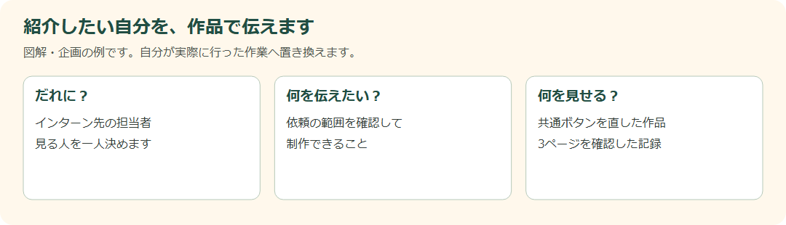

# DAY 14 自分のポートフォリオを企画しよう

> **旧構成の参考資料です。**
> 2026年10月29日版の授業・提出には[現行DAY本文](../workbook/day14.md)と[共通手順](../workbook/common.md)を使います。
> 以下の課題条件、教材内コミット・タグ、公開・発表の必須指定は旧運用です。

[目次](../student-workbook.md) · [共通手順](../workbook/common.md#local-git-workflow) · [前の回：DAY 13](./day13.md) · [次の回：DAY 15](./day15.md)

💾 **旧運用のGit記録（現行授業では使わない）：** [共通の作業手順](../workbook/common.md#local-git-workflow)で、作業前後の変更を記録します。  
作業後は `git tag -f day14-end`で、その日の最後のコミットに目印を付けます。

**仕事のイメージ：** 見る相手と伝えたいことを決め、実際の作品で裏付けます。

**開始データ：** 白紙のポートフォリオと `reference-cafe/` の架空の参考サイトを使います。
参考サイトを自分の実績と偽らず、自分が担当した作品や作業を選びます。  

VS Codeで `Documents/edu` を開き、`hht/day14/` のファイルを編集します。  
開始データはコミット済みで、他の回の成果は必要ありません。  
再開するときも同じフォルダーを開きます。

> **山本先輩からの新しい課題**  
> カフェサイトの仕事、おつかれさまでした。  
> 次は、今回できるようになったことを紹介する、自分のポートフォリオサイトを作ってみましょう。

**今回の課題:** 見てほしい相手と伝えたいことを決め、ポートフォリオのHTMLを作ります。

### 次は、自分の仕事を紹介する番です

「HTMLができます」だけでは、何を作れるか想像しにくいかもしれません。  
カフェサイトのどこを考え、どう直したのかを、作品と一緒に伝えます。

**依頼者・見る人：** 山本先輩からの課題です。  
見る相手は自分で一人思い浮かべます。

**今回の範囲：** 自分用portfolioに企画とHTMLを作ります。  
完成したカフェサイトは保ちます。  
掲載してよい名前・画像・実績の範囲を先に確認します。

### 開くファイル：DAY 14

**VS Codeで開くもの：** `hht/day14/index.html`。

**ブラウザで見るページ：** `hht/day14/index.html` です。  
参考サイトは `hht/day14/reference-cafe/index.html` です。  
まずこのHTMLへ自分の紹介を書きます。  
下は編集前の教材原本です。

**見る場所（画像の番号と対応）:**

- **① `header`内のコメント**：見出しと短い紹介を書く場所です。  
  コメントの外に`h1`や`p`を書きます。
- **② `main`内の架空事例の紹介のコメント**：自分の作品で何を変え、何を確認したかを書く場所です。  
  自分の作品へのリンクも、実際の保存先と照合して設定します。
- **③ `footer`内のコメント**：名前や連絡先など、公開してよい情報を確認してから書く場所です。

**開始時の本文はコメントだけなので、ブラウザが白いのは正常です。**  
この図は`hht/day14/index.html`の実際のコードから作った入力位置の参照図で、完成画面ではありません。

### この順に、ひとつずつ進めます

1. 見てほしい相手と、伝えたいことを一文にします。
2. 自分が担当した作品や作業から、紹介する内容を選びます。
3. 自己紹介・できること・制作実績・次に作りたいものを書き出します。
4. 個人情報と利用条件を確認し、掲載する内容を決めます。
5. 紙に四角を描き、上から読む順番を決めます。
6. 自分用の`hht/day14/index.html`に、見出しと本文を書きます。
7. 見出しだけを読み、内容の流れを確かめます。
8. クラスメイトに読んでもらい、伝わった印象をメモします。

**図で見る場所:** 左欄で見る相手、中央で伝えたいこと、右欄で裏付ける作品を決めます。  
右欄の作品は、上のコード参照図②の制作実績に書く内容とつなげます。  
図の例を、自分が実際に行った作業へ置き換えます。

### 紹介文の例です

> **相手：** インターン先の担当者です。  
>
> **伝えたいこと：** 依頼の範囲を確認し、表示まで確かめて制作できます。  
>
> **実績の説明：** カフェサイトの共通ボタンを整理しました。  
> 3ページの見た目とリンク先を確認しました。

### 書くときのコツ：作業名に、理由と確認を添えます

「CSSを使いました」に「何のために」「何を見て確かめたか」が付くと、担当したことが伝わります。  
自分が実際に行ったことを材料にすると、発表でも説明しやすくなります。

**作業前に考えること:** だれに見てほしい？  
どんな自分を知ってほしい？  
自分はどの作品で何を担当した？  
公開してはいけない情報は？

**今回学ぶこと:** 目的、想定閲覧者、情報設計、ワイヤーフレーム、セマンティックHTML、制作実績の説明

**作業メモ:** 紹介したいことを付箋に書き、順番を決めよう。  
ワイヤーフレームを作り、`hht/day14/index.html`へ見出しと文章を書きます。

**相談の練習:** クラスメイトに「このサイトから、どんな人だと感じた？」  
と聞き、伝えたい印象と合っているか確認します。

**確認項目:**

- [ ] 見てほしい相手を決めた
- [ ] 実績を正直に書いた
- [ ] 個人情報を入れていない
- [ ] HTMLの読み順が自然

### 完成条件・証拠・発展課題

**入力:** [ポートフォリオ制作ガイド](../portfolio-project.md)、開始データの`PLAN.md`と、架空の参考サイト`reference-cafe/`

**完成物:** 企画メモ、掲載可否チェック、ワイヤーフレーム、ポートフォリオHTML

**完成条件:**

- 見てほしい相手と伝えたいことを一文で書いている
- 実際に担当した制作内容だけを掲載している
- 個人情報と利用権を確認している
- 見出しだけを読んでも内容の流れが分かる
- 制作で迷ったこと、確認したことも書いている

**証拠:** 企画メモ、ワイヤーフレーム、HTML、ペアレビュー

**発展課題:** 30秒で内容が伝わる順番と、じっくり読む順番を比べます。

---

[目次](../student-workbook.md) · [共通手順](../workbook/common.md#local-git-workflow) · [前の回：DAY 13](./day13.md) · [次の回：DAY 15](./day15.md)
