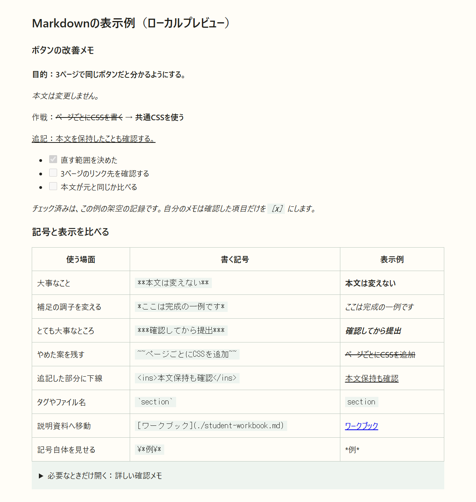

# Markdownで「伝わるお仕事メモ」を作る

**目的：** 読む人が、*大事なこと・変更したこと・まだ終わっていないこと*をすぐ見つけられる記録にする。

> [!TIP]
> 記号を少し足すだけで、ただのメモを**見出し・表・チェックリストのある資料**にできます。全部を暗記する必要はありません。

## まず見比べる：同じ情報でも探しやすさが違う

**記号を付ける前**

```text
ボタンをそろえる。本文は変えない。まだリンク確認が終わっていない。
ページごとにCSSを書く案をやめて共通CSSにする。本文保持の確認も追加。
```

**Markdownで整理した例**

### ボタンの改善メモ

**目的：3ページで同じボタンだと分かるようにする。**

*本文は変更しません。*

作戦：~~ページごとにCSSを書く~~ → **共通CSSを使う**

<ins>追記：本文を保持したことも確認する。</ins>

- [x] 直す範囲を決めた
- [ ] 3ページのリンク先を確認する
- [ ] 本文が元と同じか比べる

*チェック済みは、この例の架空の記録です。自分のメモは確認した項目だけを `[x]` にします。*



写真は実際に動かした**ローカルのMarkdown表示例**です。GitHubの画面ではありません。GitHub独自の注意枠・脚注・図の表示は、下の書式と公式資料を参照します。

## 書き方と表示を並べて見る

| 使う場面 | 書く記号 | 表示例 |
|---|---|---|
| 大事なこと | `**本文は変えない**` | **本文は変えない** |
| 補足の調子を変える | `*ここは完成の一例です*` | *ここは完成の一例です* |
| とても大事なところ | `***確認してから提出***` | ***確認してから提出*** |
| やめた案を残す | `~~ページごとにCSSを追加~~` | ~~ページごとにCSSを追加~~ |
| 追記した部分に下線 | `<ins>本文保持も確認</ins>` | <ins>本文保持も確認</ins> |
| タグやファイル名 | `` `section` `` | `section` |
| 説明資料へ移動 | `[ワークブック](./student-workbook.md)` | [ワークブック](./student-workbook.md) |
| 記号自体を見せる | `\*例\*` | \*例\* |

**下線の注意：** GitHubでは `<ins>` を使う方法があります。これはMarkdown専用の下線記号ではなく、HTMLの「追加した内容」を表すタグです。普通の強調は**太字**、追記を示すなら<ins>追加した文章</ins>、というように役目で使い分けます。`_文字_`は下線ではなく*斜体*です。

### 見出し・箇条書き・順番

```markdown
## 今日の変更

- ボタンの見た目
- 確認したページ

### 確認する順番

1. 保存する
2. 再読み込みする
3. リンク先を確かめる
```

`#`の数は見出しの階層。`-`は並列の項目、`1.`は順番がある項目です。見出しで話題を分ければ、長いメモの中から必要な場所へ移れます。

### 引用・コード・表

依頼の文章は引用、実際のHTMLはコードとして分けます。

> **佐藤さんからの依頼：** 本文は変えず、営業時間を探しやすくしてください。

```html
<section>
  <h2>営業時間</h2>
  <p>10:00〜19:00</p>
</section>
```

コードを書くときは、3つのバッククォートで囲み、`html`などの種類を添えます。文章の中のタグ名は1つのバッククォートで囲みます。

**表は、変更前後や複数案を比較するときに使います。** 用語の定義や項目の説明だけならリストで十分です。縦線で列を区切り、2行目で見出しと本文を分けます。

```markdown
| 変更前 | 変更後 |
|---|---|
| 1段落に情報が混在 | 見出しで話題を分ける |
| 完了と未完了が混在 | チェック欄で区別する |
```

| 変更前 | 変更後 |
|---|---|
| 1段落に情報が混在 | **見出しで話題を分ける** |
| 完了と未完了が混在 | **チェック欄で区別する** |

### チェックリスト・画像・折りたたみ

```markdown
- [ ] まだ確認していない
- [x] 確認した
```

`[ ]`は未完了、`[x]`は完了。GitHubなどではチェック欄として表示されます。読み取り専用の画面でクリックできない場合は、Markdownの記号を書き換えます。

画像は `` のように書きます。この教材で使っている例です。

```markdown

```

`!`を付けると画像、付けないとリンクになります。画像の説明も添えると、画像が見えない場合にも内容を伝えられます。

<details>
<summary>必要なときだけ開く：詳しい確認メモ</summary>

**確認したページ：** ホーム・メニュー・店舗案内。

ここには、詳しい理由や補足を入れられます。最初から全部を表示せず、必要な人だけが読めます。

</details>

````markdown
<details>
<summary>詳しい確認メモ</summary>

**補足の内容をここに書く。**

</details>
````

### GitHubの表示機能：注意枠・脚注・図

> [!NOTE]
> GFM（GitHub Flavored Markdown）は、GitHubで使うMarkdownの書き方です。表・取り消し線・チェックリストなどの拡張があります。下の注意枠・脚注・MermaidはGitHubの表示機能も利用します。

**注意枠**：大切な注意を、長い文章の中に埋もれさせません。

```markdown
> [!WARNING]
> 教材原本を上書きしないでください。
```

> [!WARNING]
> 教材原本を上書きしないでください。

**脚注**：出典や補足を本文から分けられます。GitHubで表示するための記述例です。

```markdown
表示方法は環境によって違います。[^preview]

[^preview]: GitHubとローカルのプレビューで見え方が異なる場合があります。
```

**脚注を使った表示例：** 確認した表示環境も記録します。[^local-preview]

**Mermaidの図**：四角と矢印の関係を、文字で書けます。GitHubで図として表示されます。

````markdown

````

**図の表示例（対応する画面で表示）：**


*ローカルのプレビューでは、対応機能や拡張機能によって表示が変わります。文字のまま表示されても、すぐ記述ミスと決めつけません。*

## お仕事メモにどう使う？

- **目的・変えてはいけないもの**：**太字**、引用、注意枠
- **変更前後・やめた案**：~~古い案~~、<ins>追記</ins>、比較表
- **済んだこと・残っていること**：チェックリスト
- **理由や確認の証拠**：表、画像、リンク、コード
- **長い補足**：折りたたみ、脚注

**飾りを増やすためではなく、情報の役目を見分けやすくするために使います。** 全文を太字にすると、大事な場所が分からなくなります。斜体は日本語フォントによって傾きが目立たないこともあるので、文字の内容でも意味が分かるようにします。

授業の提出メモに、必要な書き方を選んで使えます。今回の授業時間や提出物は増やしません。

## 公式の書式一覧

[GitHubの基本書式](https://docs.github.com/en/get-started/writing-on-github/getting-started-with-writing-and-formatting-on-github/basic-writing-and-formatting-syntax)／[表](https://docs.github.com/en/get-started/writing-on-github/working-with-advanced-formatting/organizing-information-with-tables)／[折りたたみ](https://docs.github.com/en/get-started/writing-on-github/working-with-advanced-formatting/organizing-information-with-collapsed-sections)／[図](https://docs.github.com/en/get-started/writing-on-github/working-with-advanced-formatting/creating-diagrams)／[GFM仕様](https://github.github.com/gfm/)

[ワークブックへ戻る](./student-workbook.md)

[^local-preview]: 掲載写真はローカルでのMarkdown表示例です。GitHub独自の機能の実画面ではありません。
