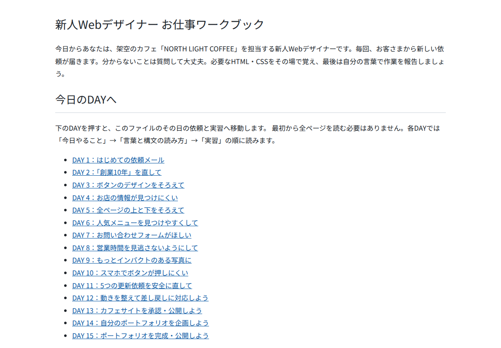
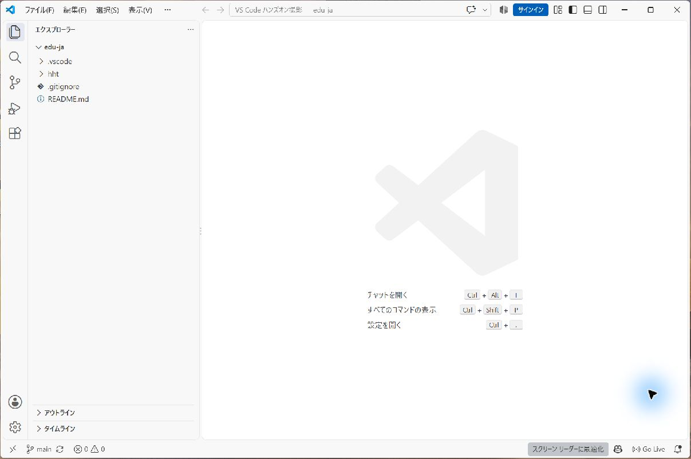
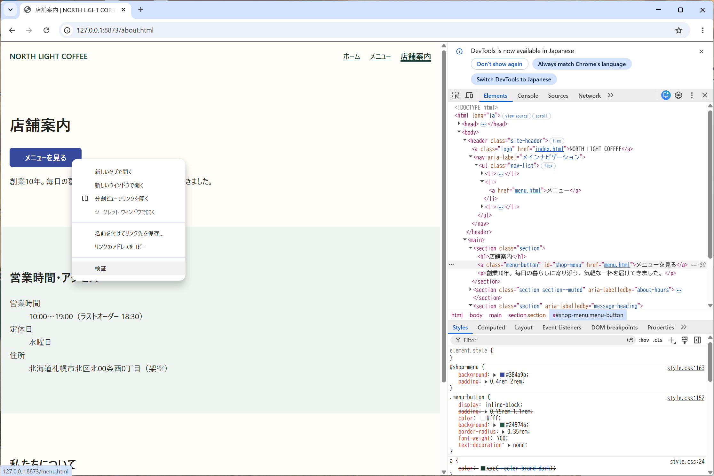
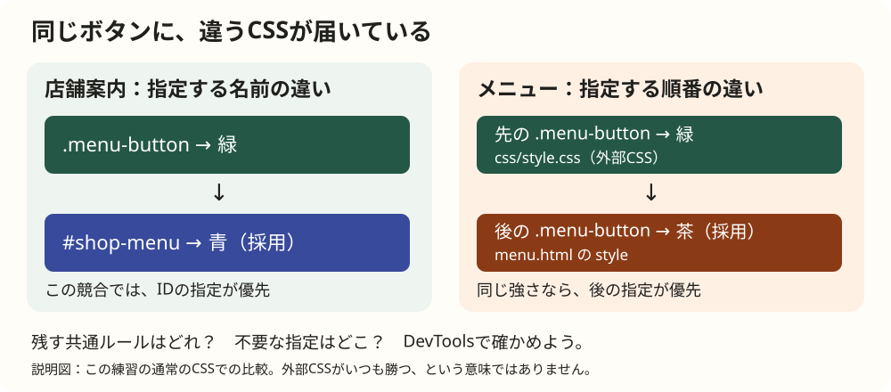

# 新人Webデザイナー お仕事ワークブック

今日からあなたは、架空のカフェ「NORTH LIGHT COFFEE」を担当する新人Webデザイナーです。毎回、お客さまから新しい依頼が届きます。分からないことは質問して大丈夫。必要なHTML・CSSをその場で覚え、最後は自分の言葉で作業を報告しましょう。

<a id="workbook-days"></a>

## 今日のDAYへ

**下のDAYを押すと、このファイルのその日の依頼と実習へ移動します。** 最初から全ページを読む必要はありません。各DAYでは「今日やること」→「言葉と構文の読み方」→「実習」の順に読みます。

- [DAY 1：はじめての依頼メール](#day-1)
- [DAY 2：「創業10年」を直して](#day-2)
- [DAY 3：ボタンのデザインをそろえて](#day-3)
- [DAY 4：お店の情報が見つけにくい](#day-4)
- [DAY 5：全ページの上と下をそろえて](#day-5)
- [DAY 6：人気メニューを見つけやすくして](#day-6)
- [DAY 7：お問い合わせフォームがほしい](#day-7)
- [DAY 8：営業時間を見逃さないようにして](#day-8)
- [DAY 9：もっとインパクトのある写真に](#day-9)
- [DAY 10：スマホでボタンが押しにくい](#day-10)
- [DAY 11：5つの更新依頼を安全に直して](#day-11)
- [DAY 12：動きを整えて差し戻しに対応しよう](#day-12)
- [DAY 13：カフェサイトを承認・公開しよう](#day-13)
- [DAY 14：自分のポートフォリオを企画しよう](#day-14)
- [DAY 15：ポートフォリオを完成・公開しよう](#day-15)

VS Codeで記号のまま表示されている場合は、右上の「プレビューを横に表示」（WindowsはCtrl+Kの後にV）でMarkdownの表示を開きます。コードを書く画面と教材を読む画面は別です。GitHubではファイルのPreviewを開いてリンクを押します。



## 前書き：まず意味を整える。見せ方は後から変えられる

**マークアップをする目的は、文章を意味のまとまりで整理し、人にもコンピューターにも内容の役目が伝わるようにすることです。** 先に「題名」「営業時間」「アクセス」「紹介文」をはっきりさせると、後からCSSで色・余白・配置を変えても、何の情報かを保てます。


### なぜ整理が必要？

情報があっても、まとまりや順番が分からないと、相手は答えを探すために何度も読み直すことになります。

- **メモ書き：** 北海道札幌市北区北00条西0丁目（架空）／水曜／18:30ラストオーダー／10:00〜19:00。数字や曜日が何の情報かを、その都度考える。
- **文章：** お店は札幌にあります。水曜日は休みです。ラストオーダーは18:30です。住所は北海道札幌市北区北00条西0丁目（架空）です。営業時間は10:00〜19:00です。時間と場所の話が行き来し、欲しい情報を拾いにくい。
- **会話：** 「住所はどこ？」「札幌です。水曜は休みで、ラストオーダーは18:30です」「住所は？」「北00条西0丁目です。あ、営業時間は10:00〜19:00です」。質問の途中で話題が変わり、聞き直しが増える。

同じ情報を「営業時間：10:00〜19:00、ラストオーダー18:30」「定休日：水曜日」「アクセス：住所」に分ければ、必要なまとまりを選んで読めます。**まず情報を整理し、そのまとまりにHTMLで役目を付けます。** 色を付けるだけでは、話題が混ざったままの文章は整理されません。

### 前回のマークアップ・Markdownとつなげる

マークアップは、文章に「ここは見出し」「ここは段落」などの目印を付けること。HTMLは、そのための**マークアップ言語**です。プログラミングと同じくコードを書いてコンピューターに伝えますが、計算や条件分岐を行うプログラミング言語とは役割が違います。

| 伝えたい役目 | Markdownで書く | HTMLで書く |
|---|---|---|
| 見出し | `## 営業時間` | `<h2>営業時間</h2>` |
| 段落 | `10:00〜19:00`（前後を空行で区切る） | `<p>10:00〜19:00</p>` |

Markdownは、文章の構造を読み書きしやすい記号で示す方法です。HTMLもMarkdownも「見出しや段落として何を伝えるか」を表します。Webページの色・文字の大きさ・余白・並べ方はCSSで表現します。

> [!TIP]
> Markdownなら、**大事なこと**、*補足*、~~やめた案~~、<ins>追記した内容</ins>も短い記号で示せます。[書き方と表示の比較](./markdown-format-guide.md)で、表・チェックリスト・引用・折りたたみも見られます。

**DAY 4の順番：意味を整理する → ワイヤーフレームで順番と配置を考える → HTMLで構造を示す → 見つけやすくなったか確認する。** デザインを変える前に、何の情報かを分かるようにします。DAY 4ではCSSを変えず、構造の改善まで取り組みます。


## このワークブックが学習内容と課題条件の正本です

**目的・依頼・入力データ・作業内容・完成条件・提出するものは、このファイルだけで管理します。** READMEや各回のページは、この正本への入口です。完成条件の一覧も別ファイルへ複製しません。

- **このワークブック：** 学生が何のために、何を変え、何を確認・提出するか。
- **講師用資料：** 時間配分、デモの進め方、支援方法。課題条件はこの正本を参照します。
- **参照資料・配布データ：** Markdownの書式、用語、サンプル、HTML・CSS・画像の実体。課題の条件を独立して追加しません。

## 授業の始め方

- **PCのVS Codeで取り組む場合：** 本人用の教材フォルダーを開きます。環境準備は[VS Codeハンズオン手順](./vscode-hands-on.md)を参照します。
- **Codespacesで取り組む場合：** READMEからCodespaceを起動し、リポジトリのルートに`README.md`と`hht`が見えること、本人のコピーまたは作業ブランチであることを確認します。
- **Gitを使わない場合：** 本人の作業フォルダーを使い、開始時点のバックアップとZIP提出で記録を残せます。教材原本は編集しません。

**DAY 3・DAY 4は、各DAYにある開始ZIPのコピーで練習します。** DAY 5以降への引き継ぎも、以下の該当DAYで確認します。


## 全15回で共通の保存・提出

標準環境はVS Code＋ローカルファイルです。Git/GitHubを使わずに全15回を進められます。[ZIP提出の手順](../submissions/local-submission.md)に従い、毎回、編集前に作業前ソースを保存し、編集後に作業後ソースを保存します。WORKLOGの8項目、画面、各DAYの証拠をそろえて提出し、講師の指摘を直して再提出します。Git/GitHubを使う場合のPRは[任意の提出経路](../submissions/README.md#任意のprで提出してci判定を受ける)です。

**任意のPR提出でDAY 3・4に取り組む場合：** 演習ZIPの変更した部分を、本人のリポジトリの`hht/starter-site`へ反映して提出します。以前の本文・画像は保持し、WORKLOGと画面・証拠は該当DAYの提出フォルダーに入れます。Gitを使わない標準のZIP提出では、各DAYの案内どおりに作業します。

## 毎回のお仕事ルート

1. **メールを開く** — 何を頼まれたのか見つける
2. **作戦を立てる** — 直す場所、直さない場所、質問を決める
3. **技を覚える** — 今日の仕事に必要なHTML・CSSを試す
4. **サイトを直す** — 小さく変更し、ブラウザで見る
5. **チェックする** — パソコン、スマートフォン、キーボードで確かめる
6. **返信する** — 変更したこと、確認したこと、まだ分からないことを伝える

星チェックは振り返りの要点です。完成度だけではなく、質問できたこと、対象外を守れたこと、確認できたことにも星を付けましょう。

---

<a id="day-1"></a>

## DAY 1 はじめての依頼メール

[DAY一覧へ](#workbook-days) · [DAY 2 →](#day-2)

[言葉・構文を読む](#day-1-concepts) · [実習へ進む](#day-1-actions) · [完成条件・提出へ](#day-1-done)


> **佐藤さんからの依頼**
> カフェのWebサイトを更新してほしいです。まずは受け取ったことを返信して、今のサイトを確認してください。

**今日のミッション:** 依頼を正しく受け取り、HTMLを公開URLに表示する。最初のバージョンとバックアップを残し、いつでも自習を続けられる環境を作る。

### 今日やること

1. 自分用教材の `hht/starter-site/index.html` を開き、今の画面を確認する。
2. 変更前のサイトをコピーし、開始バージョンを記録する。
3. `h1`の文字だけに「DAY1練習：」を付け、保存して表示を確かめる。依頼の「創業10年」は今日は直さない。
4. 練習公開先（未配布なら `hht/practice-server/staging`）へ対象ファイルをコピーし、表示と復元を試す。
5. 変更前後のID・実URL・復元結果・画面を残し、WORKLOGと受領返信を提出する。詳しい操作は下のSTEP 1〜10で行う。


**作戦会議:** 全員への返信が必要？ ToとCCはだれ？ 最後にOKを出す人は？ 期限は書かれている？ 間違えたときは、どこから元へ戻せる？

**今日覚える技:** フォルダー、拡張子、HTMLの基本、保存、再読み込み、[ブラウザ開発者ツール](./devtools-first-lesson.md)、ローカルHTTPサーバー、デプロイ、バージョン管理、バックアップ、復元

**開発者ツール・ミニミッション（15分）:** カフェサイトの見出しをElementsで選び、文字とCSSを一時的に変えてみよう。再読み込みで元へ戻ることを確認したら、375px幅とConsoleも見て、気づいたことを1つメモしよう。

**制作メモ:** 公開URL、最初のバージョン名、バックアップの場所、復元テストの結果を書こう。

**返信チャレンジ:** 「受け取りました」「練習用URLへ公開しました」「確認したいこと」を3文で書こう。

**星チェック:**

- [ ] CCを確認した
- [ ] Elementsで`h1`を見つけた
- [ ] 375px幅とConsoleを確認した
- [ ] 公開URLで表示できた
- [ ] 最初の状態へ戻せた

### 今日の目的

最初の仕事では、Webページを大きく作り変えることよりも、**一人で安全に作業を始め、確認し、元へ戻せる状態を作ること**が目的です。

今日は「ファイルを開く → ブラウザで見る → 変更する → バージョンを残す → 練習公開する → 元に戻す」を一度通します。

### 今日のゴール

授業の最後に、次のものが残っていれば完了です。

- カフェサイトをローカルHTTPサーバーで表示できる
- Elementsでh1、Stylesで適用中のCSS、375px幅、Consoleを確認できる
- 開始時点と変更後の **2つのバージョンID** を記録できる
- HTMLを1か所変更し、ローカルと練習公開先の両方で確認できる
- 開始時点へ戻し、もう一度変更後へ戻せる
- 練習用URLが配布されていない場合は、practice-server/staging を模擬公開先として使える
- hht/submissions/day-01/WORKLOG.md に確認結果を残せる
- 依頼を受け取ったことを3文程度で報告できる

> **重要:** 接続先URL、ユーザー名、パスワード、秘密鍵は推測して作りません。学校から接続情報が配布されていない場合は、このページの「模擬公開」を使えばDAY 1を完了できます。


<a id="day-1-concepts"></a>

### 言葉と構文の読み方：HTMLの最初の1行

**HTML（エイチ・ティー・エム・エル）**は、文章に「見出し」「段落」「リンク」などの役目を付ける書き方です。**CSS（シー・エス・エス）**は色・文字の大きさ・余白・配置を指定する書き方です。**ブラウザ**（ChromeやEdge）はそれを読み、Webページとして表示するアプリです。**エディター**（VS Code）は元の文字を編集するアプリです。

#### ファイル名とフォルダーの読み方

- **ファイル**は保存された1つのデータ。`index.html`はファイル名です。
- **拡張子**は末尾の`.html`や`.css`。HTMLかCSSかなどの種類を示します。`index.html.txt`は同じ名前ではありません。
- **フォルダー**はファイルをまとめる場所。`hht/starter-site/index.html`は「hhtの中のstarter-siteの中のindex.html」と読みます。ここでの`/`は場所の区切りです。
- **ソース**は表示の元になるHTML・CSSなど。ブラウザの画面とソースは同じものではありません。
- **保存**はエディターの変更をファイルへ書くこと。**再読み込み**はブラウザが保存済みファイルを読み直すことです。保存前に再読み込みしても、未保存の変更は出ません。

#### タグと要素を、記号ごとに読む

```html
<h1>一杯から、街の日常をあたためる。</h1>
```

- **`<h1>`**（エイチ・ワン）は開始タグ。「ここから大見出し」と示します。`h`はheading（見出し）、`1`は見出しの階層です。
- **`<`と`>`**はタグの名前を囲む半角記号。画面にそのまま出したい本文とは区別されます。
- **間の日本語**は内容。今回編集するのは、ここだけです。
- **`</h1>`**は終了タグ。`/`が付くと「ここでh1を終える」です。開始・終了で名前をそろえます。
- **要素（ようそ）**は、開始タグ・内容・終了タグを合わせたまとまりです。「タグ」と「要素」は関連する言葉ですが、指す範囲が違います。

`<h1>`だけを書いて終わりにしたり、終了を`</p>`にしたりすると、囲む範囲が意図とずれます。タグの記号は半角で書き、日本語の本文は日本語で構いません。

#### ページ全体の中で、今どこを編集している？

```html
<!doctype html>
<html lang="ja">
  <head>
    <meta charset="utf-8">
    <title>カフェのホーム</title>
  </head>
  <body>
    <h1>一杯から、街の日常をあたためる。</h1>
  </body>
</html>
```

これは**構造を読むための短い例**です。既存のページ全体をこの例で置き換える課題ではありません。

- **`<!doctype html>`**はHTMLの文書であることをブラウザへ伝える宣言。本文を囲むタグではありません。
- **`html`**は文書全体。`lang="ja"`は「この文書の言語は日本語」という追加情報です。
- **属性（ぞくせい）**は、開始タグに書く追加情報。`lang`が属性名、`=`の右の`"ja"`が値です。**`=`は属性名と値を結び、`" "`は値の範囲を囲む**と読みます。
- **`head`**は文書の設定。**`title`**はブラウザのタブの名前。画面内の見出し`h1`とは別です。
- **`meta charset="utf-8"`**は文字の読み取り方を指定します。文字化けを防ぐための設定です。`meta`には終了タグを書きません。
- **`body`**はページに表示する内容。今日はこの中の`h1`を探します。
- 行頭の空白は**インデント**。囲む関係を人が読みやすくするために字下げしています。

#### 今日出てくる操作の言葉

- **URL（ユー・アール・エル）**はブラウザで開く場所を示す文字列。`http://localhost:8000/`の`localhost`は今使っているPC、`8000`は接続口の番号（**ポート**）です。別の人のPCから同じURLを開いても、自分のファイルは見えません。
- **HTTPサーバー**は、ブラウザから求められたファイルを渡すプログラム。下のSTEP 2で起動します。`python -m http.server 8000 --directory hht/starter-site`は「PythonでHTTPサーバーを起動し、8000番でstarter-siteを配る」と読みます。これはHTMLではなくターミナルへ入力する命令です。
- **デプロイ**は確認・公開先へ対象ファイルを配置すること。**staging（ステージング）**は本番に出す前の確認場所。今回の模擬公開はPC内の練習で、インターネットへ一般公開したことにはなりません。
- **バックアップ**は戻すための保存コピー。**バージョンID**はどの保存状態かを区別する名前。**復元**は保存した内容へ戻す操作です。Gitなしでは保存フォルダー名をIDにできます。
- **From／To／CC**はメールの差出人／宛先／情報を共有する相手。受領返信は「依頼を受け取りました」と伝える返信です。

ここまでは説明です。実際の編集は次のSTEP 1から順に行います。

### 例を分解して読む：必要な項目から確認する

ここは、今日の実習に出てくる言葉を1つずつ読むための参照欄です。全部を追加する作業一覧ではありません。最初は使う項目だけを読み、つづり・記号・意味・画面の変化を対応させます。実習へ進むときはこの欄の後の手順へ戻ります。

#### 読み取り例：見出しの囲み — h1

**何の言葉？** 見出しとしての役目を持たせるための要素です。開始と終了のタグに挟まれた文字が内容です。タグそのものは通常のページ本文へそのまま表示されません。

```html
<h1>わたしの練習見出し</h1>
```

**まず外側を読む：** `<`から最初の`>`までが開始タグです。`h1`という名前で、このまとまりの役目をブラウザへ伝えています。見た目の色や大きさをここで直接決めるとは限りません。CSSのセレクターから選ばれ、見た目が付く場合もあります。

- この短い例では属性を省略しています。`h1`は要素名です。必要な属性がある実際のファイルでは、名前と値を1組ずつ読みます。

**どこまでが1つ？** `</h1>`はこの要素の終了です。開始と同じ名前を使い、先頭に`/`を付けます。開始と終了の間の内容が、この要素のまとまりです。 見本に内容の位置を示すコメントがある場合は、コメント自体を提出する文章として使う意味ではありません。元のファイルのどの内容を残すかを、依頼に合わせて確かめます。

**画面と照合する：** 見出しの内容が画面へ表示されることを確認します。設定用の要素は本文画面へ直接文字が出ない場合もあるので、要素の目的に合う場所を見ます。画面上で変化がないことと、HTMLに役目がないことは同じではありません。

**この例で間違いやすいところ：** タグの記号ごと画面に出た場合は、ファイルをHTMLとして開いているか、文字参照として書いていないかを見る。属性の値をタグの外へ書いたり、本文と設定をまとめて書き換えたりしないようにします。変更前を残すと、どの記号や文字を変えたか比べられます。

**HTMLとして読む順序：** 最初に要素名、次に開始タグの属性、次に内容、最後に終了を読みます。内側に別の要素があれば同じ順序を繰り返します。字下げをそろえるのは、この囲む関係を見つけやすくするためです。画面で改行されるかどうかは、要素とCSSの表示の指定も関係します。

**理解の確認：** 「何の役目の要素か」「値や本文はどこか」「どの場所で結果を確かめるか」を、この例を指しながら説明してみましょう。読み方を理解するための見本であり、既存ページをこの短い例だけで置き換える課題ではありません。使うファイルと変更範囲は今日の実習の案内を優先します。

#### 読み取り例：文書と言語 — html

**何の言葉？** 文書全体を囲む要素です。langは文書の自然言語を示す属性で、jaは日本語。HTMLの命令を日本語で書く設定ではありません。

```html
<html lang="ja">
  <!-- この要素の内容が入ります -->
</html>
```

**まず外側を読む：** `<`から最初の`>`までが開始タグです。`html`という名前で、このまとまりの役目をブラウザへ伝えています。見た目の色や大きさをここで直接決めるとは限りません。CSSのセレクターから選ばれ、見た目が付く場合もあります。

- **`lang="ja"`**は、属性名`lang`と値`ja`の組です。`=`は両者の区切り、前後の半角の二重引用符は値の範囲。属性は開始タグの`>`より前へ置きます。

**どこまでが1つ？** `</html>`はこの要素の終了です。開始と同じ名前を使い、先頭に`/`を付けます。開始と終了の間の内容が、この要素のまとまりです。 見本に内容の位置を示すコメントがある場合は、コメント自体を提出する文章として使う意味ではありません。元のファイルのどの内容を残すかを、依頼に合わせて確かめます。

**画面と照合する：** 文書の言語が日本語として示されることを確認します。設定用の要素は本文画面へ直接文字が出ない場合もあるので、要素の目的に合う場所を見ます。画面上で変化がないことと、HTMLに役目がないことは同じではありません。

**この例で間違いやすいところ：** htmlをbody内へ追加せず、既存の文書全体のhtmlを確認する。属性の値をタグの外へ書いたり、本文と設定をまとめて書き換えたりしないようにします。変更前を残すと、どの記号や文字を変えたか比べられます。

**HTMLとして読む順序：** 最初に要素名、次に開始タグの属性、次に内容、最後に終了を読みます。内側に別の要素があれば同じ順序を繰り返します。字下げをそろえるのは、この囲む関係を見つけやすくするためです。画面で改行されるかどうかは、要素とCSSの表示の指定も関係します。

**理解の確認：** 「何の役目の要素か」「値や本文はどこか」「どの場所で結果を確かめるか」を、この例を指しながら説明してみましょう。読み方を理解するための見本であり、既存ページをこの短い例だけで置き換える課題ではありません。使うファイルと変更範囲は今日の実習の案内を優先します。

#### 読み取り例：タブの名前 — title

**何の言葉？** head内に置く文書のタイトルです。ブラウザのタブなどに使われます。ページ内に表示されるh1と同じ文章にしても、別の要素です。

```html
<title>店舗案内 | カフェ</title>
```

**まず外側を読む：** `<`から最初の`>`までが開始タグです。`title`という名前で、このまとまりの役目をブラウザへ伝えています。見た目の色や大きさをここで直接決めるとは限りません。CSSのセレクターから選ばれ、見た目が付く場合もあります。

- この短い例では属性を省略しています。`title`は要素名です。必要な属性がある実際のファイルでは、名前と値を1組ずつ読みます。

**どこまでが1つ？** `</title>`はこの要素の終了です。開始と同じ名前を使い、先頭に`/`を付けます。開始と終了の間の内容が、この要素のまとまりです。 見本に内容の位置を示すコメントがある場合は、コメント自体を提出する文章として使う意味ではありません。元のファイルのどの内容を残すかを、依頼に合わせて確かめます。

**画面と照合する：** タブの題名に文書の名前が出ることを確認します。設定用の要素は本文画面へ直接文字が出ない場合もあるので、要素の目的に合う場所を見ます。画面上で変化がないことと、HTMLに役目がないことは同じではありません。

**この例で間違いやすいところ：** 画面内の大見出しが変わらないときは、titleとh1を取り違えていないかを見る。属性の値をタグの外へ書いたり、本文と設定をまとめて書き換えたりしないようにします。変更前を残すと、どの記号や文字を変えたか比べられます。

**HTMLとして読む順序：** 最初に要素名、次に開始タグの属性、次に内容、最後に終了を読みます。内側に別の要素があれば同じ順序を繰り返します。字下げをそろえるのは、この囲む関係を見つけやすくするためです。画面で改行されるかどうかは、要素とCSSの表示の指定も関係します。

**理解の確認：** 「何の役目の要素か」「値や本文はどこか」「どの場所で結果を確かめるか」を、この例を指しながら説明してみましょう。読み方を理解するための見本であり、既存ページをこの短い例だけで置き換える課題ではありません。使うファイルと変更範囲は今日の実習の案内を優先します。

#### 読み取り例：文字コード — meta

**何の言葉？** 文字をどの符号化方式で読むかを示す設定です。UTF-8は日本語を含む多くの文字を扱えます。文字化け時にはファイル自体の保存形式とも照合します。

```html
<meta charset="utf-8">
```

**まず外側を読む：** `<`から最初の`>`までが開始タグです。`meta`という名前で、このまとまりの役目をブラウザへ伝えています。見た目の色や大きさをここで直接決めるとは限りません。CSSのセレクターから選ばれ、見た目が付く場合もあります。

- **`charset="utf-8"`**は、属性名`charset`と値`utf-8`の組です。`=`は両者の区切り、前後の半角の二重引用符は値の範囲。属性は開始タグの`>`より前へ置きます。

**どこまでが1つ？** `meta`は**空要素**なので、終了タグやタグ間の内容はありません。`</meta>`を追加して囲む種類ではありません。 見本に内容の位置を示すコメントがある場合は、コメント自体を提出する文章として使う意味ではありません。元のファイルのどの内容を残すかを、依頼に合わせて確かめます。

**画面と照合する：** 日本語を意図した文字として表示できることを確認します。設定用の要素は本文画面へ直接文字が出ない場合もあるので、要素の目的に合う場所を見ます。画面上で変化がないことと、HTMLに役目がないことは同じではありません。

**この例で間違いやすいところ：** 設定だけを変えればすべての文字化けが直るとは限らないので、保存形式や元の文字も確認する。属性の値をタグの外へ書いたり、本文と設定をまとめて書き換えたりしないようにします。変更前を残すと、どの記号や文字を変えたか比べられます。

**HTMLとして読む順序：** 最初に要素名、次に開始タグの属性、次に内容、最後に終了を読みます。内側に別の要素があれば同じ順序を繰り返します。字下げをそろえるのは、この囲む関係を見つけやすくするためです。画面で改行されるかどうかは、要素とCSSの表示の指定も関係します。

**理解の確認：** 「何の役目の要素か」「値や本文はどこか」「どの場所で結果を確かめるか」を、この例を指しながら説明してみましょう。読み方を理解するための見本であり、既存ページをこの短い例だけで置き換える課題ではありません。使うファイルと変更範囲は今日の実習の案内を優先します。

<a id="day-1-actions"></a>

### 実習の進め方

### STEP 1　作業場所と依頼を確認する

**このSTEPで行うこと：教材ルートと依頼**

VS Codeの左側の一覧でREADME.mdとhhtを探します。hhtの中にstarter-siteとsubmissionsがあるか展開して確認します。依頼のFrom／To／CCを読み、自分が何を返す役なのかメモします。

**できたかの見分け方：** 教材の保存場所と、依頼者・確認者を指させることを、編集画面だけでなく必要な表示・操作で確かめます。「操作した」ことと「期待した結果を見た」ことを分けて考えます。

**そこで止まったとき：** hhtが見えない場合は、starter-siteだけを開いている可能性があります。エディターの「フォルダーを開く」で教材の一番上を開き直します。 原因を調べる間は、最後に確かめられた状態を残します。分からない箇所を全部消してやり直すより、今のファイル・今のSTEP・出ている表示を特定すると相談しやすくなります。

**記録の考え方：** このSTEPで実際に見た結果を、今日の制作メモまたはWORKLOGの該当項目へ短く残します。例の成功文を先に写して完了扱いにしません。結果が違った場合も、どこまで進めたかを残せば次に再開する手がかりになります。


CodespacesまたはVS Codeで **リポジトリのルート** を開きます。左側に README.md と hht が見えることを確認してください。

次に、教材フォルダーの保存場所が **自分用のコピー** であることを確認します。Gitを使う人だけ自分の作業ブランチを確認します。共有教材のmainを直接編集しません。

依頼から次をメモします。

- Fromはだれか
- Toはだれか
- CCはだれか
- 頼まれていること
- まだ分からないこと
- DAY 1では依頼された文章そのものは変更しないこと

### STEP 2　現在のサイトをローカルで表示する

**このSTEPで行うこと：ローカル表示**

ターミナルは文字で命令を入力する場所です。STEP 2の命令を1行で実行し、終了させずにブラウザを開きます。サーバーのターミナルとHTMLを編集する画面を取り違えないようにします。

**できたかの見分け方：** カフェのトップページと画像が表示され、メニューと店舗案内へ移動できることを、編集画面だけでなく必要な表示・操作で確かめます。「操作した」ことと「期待した結果を見た」ことを分けて考えます。

**そこで止まったとき：** ブラウザに接続できないときは、命令を実行したターミナルが開いたままか、ポートとURLが一致するかを確認します。サーバーの停止はそのターミナルでCtrl+Cです。 原因を調べる間は、最後に確かめられた状態を残します。分からない箇所を全部消してやり直すより、今のファイル・今のSTEP・出ている表示を特定すると相談しやすくなります。

**記録の考え方：** このSTEPで実際に見た結果を、今日の制作メモまたはWORKLOGの該当項目へ短く残します。例の成功文を先に写して完了扱いにしません。結果が違った場合も、どこまで進めたかを残せば次に再開する手がかりになります。


VS Codeのターミナルを開き、リポジトリのルートで次を実行します。

~~~bash
python -m http.server 8000 --directory hht/starter-site
~~~

#### Codespacesの場合

1. 画面下部の **PORTS** を開く
2. ポート8000を探す
3. **Open in Browser** を押す
4. PORTSに表示された **Forwarded Address** を使う

Forwarded AddressはCodespaceごとに異なります。教材に書かれていないURLを自分で作らないでください。

#### PC上のVS Codeの場合

ブラウザで次を開きます。

~~~text
http://localhost:8000/
~~~

「Address already in use」と出た場合は8001など空いている番号へ変え、ブラウザ側も同じ番号にします。

表示できたら、トップページ、画像、メニューへのリンク、店舗案内へのリンクを確認します。

### STEP 3　開発者ツールで「一時変更」を体験する

**このSTEPで行うこと：開発者ツール**

Elementsはブラウザが解釈したHTML、Stylesは選んだ要素に関わるCSS、Consoleはエラーなどのメッセージを読む場所です。見出しを右クリックして検証すると、調べたい要素を選んだ状態で開けます。

**できたかの見分け方：** 選んだh1とそのCSSを見つけ、一時変更が再読み込みで戻ることを、編集画面だけでなく必要な表示・操作で確かめます。「操作した」ことと「期待した結果を見た」ことを分けて考えます。

**そこで止まったとき：** h1以外が選ばれた場合はElementsの行と、画面上で色が付く範囲を見比べます。DevToolsで変えてもファイルへ自動保存はされないので、再読み込みで元へ戻るのは正常です。 原因を調べる間は、最後に確かめられた状態を残します。分からない箇所を全部消してやり直すより、今のファイル・今のSTEP・出ている表示を特定すると相談しやすくなります。

**記録の考え方：** このSTEPで実際に見た結果を、今日の制作メモまたはWORKLOGの該当項目へ短く残します。例の成功文を先に写して完了扱いにしません。結果が違った場合も、どこまで進めたかを残せば次に再開する手がかりになります。


[はじめてのブラウザ開発者ツール](./devtools-first-lesson.md)を開き、次を実行します。

1. Elementsでh1を選ぶ
2. h1の文字を一時的に変更する
3. Stylesでcolorまたはfont-sizeを一時的に変更する
4. 再読み込みし、元へ戻ることを確認する
5. 画面幅を375pxにする
6. Consoleに赤いエラーがないか確認する

ここでの変更はHTMLファイルには保存されません。

hht/submissions/day-01/WORKLOG.md の「確認したこと」へ、次のように結果を残します。

~~~text
DevTools: h1確認 / CSS確認 / 375px確認 / Console: エラーなし
~~~

エラーがある場合は「エラーなし」と書かず、最初の1件のメッセージを記録します。

### STEP 4　開始時点を記録し、復元用コピーを作る

**このSTEPで行うこと：開始状態の保存**

保存用コピーは今から直すファイルとは別の場所へ置きます。フォルダー名の日時は自分が保存した日時へ変えます。開始時点は、変更を加える前に保存できて初めて開始記録になります。

**できたかの見分け方：** 編集用と保存用を別々に開き、開始時点のファイルが残っていることを、編集画面だけでなく必要な表示・操作で確かめます。「操作した」ことと「期待した結果を見た」ことを分けて考えます。

**そこで止まったとき：** コピー先の中へさらに同名フォルダーを作ると、どこが保存状態の先頭か分かりにくくなります。コピー先を開いてindex.html、CSS、画像の位置を確認します。 原因を調べる間は、最後に確かめられた状態を残します。分からない箇所を全部消してやり直すより、今のファイル・今のSTEP・出ている表示を特定すると相談しやすくなります。

**記録の考え方：** このSTEPで実際に見た結果を、今日の制作メモまたはWORKLOGの該当項目へ短く残します。例の成功文を先に写して完了扱いにしません。結果が違った場合も、どこまで進めたかを残せば次に再開する手がかりになります。


#### 標準: Gitなし

[作業前と作業後を保存する](../submissions/local-submission.md#作業前と作業後を保存する)の手順で、現在のstarter-siteとportfolioを教材フォルダーの外へコピーします。作業前フォルダー名を開始バージョンIDとしてWORKLOGへ記録します。模擬公開側の復元用には、エクスプローラーで `hht/practice-server/backups/day-01-<開始ID>` を作り、現在のstarter-site/index.htmlをそこへコピーします。<開始ID>は自分の保存したフォルダー名に置き換えます。

#### 任意: Gitを使う人

別のターミナルを開き、次を実行します。

~~~bash
git status --short
git rev-parse --short HEAD
~~~

2行目に表示された文字列が **開始バージョンID** です。WORKLOG.mdへ記録してください。

次に、表示された開始バージョンIDを使って復元用フォルダーを作ります。以下の <開始ID> を実際のIDへ置き換えます。

~~~bash
mkdir -p hht/practice-server/backups/day-01-<開始ID>
cp hht/starter-site/index.html hht/practice-server/backups/day-01-<開始ID>/index.html
~~~

このコピーは、模擬公開側を戻す練習に使います。

### STEP 5　HTMLを1か所だけ変更する

**このSTEPで行うこと：h1の本文変更**

Ctrl+Fで見出しの本文を検索します。選ぶのは開始タグと終了タグの間の日本語だけです。「DAY1練習：」を先頭に付け、保存してから、すでに開いているローカルページを再読み込みします。

**できたかの見分け方：** 見出しにDAY1練習が付き、画像とリンクも元どおりに使えることを、編集画面だけでなく必要な表示・操作で確かめます。「操作した」ことと「期待した結果を見た」ことを分けて考えます。

**そこで止まったとき：** 文字が変わらないときは、保存先のパスと表示しているページが一致するかを確認します。違うコピーのindex.htmlを編集しても、今のサーバーが配る画面は変わりません。 原因を調べる間は、最後に確かめられた状態を残します。分からない箇所を全部消してやり直すより、今のファイル・今のSTEP・出ている表示を特定すると相談しやすくなります。

**記録の考え方：** このSTEPで実際に見た結果を、今日の制作メモまたはWORKLOGの該当項目へ短く残します。例の成功文を先に写して完了扱いにしません。結果が違った場合も、どこまで進めたかを残せば次に再開する手がかりになります。


hht/starter-site/index.html を開き、h1を次のように **DAY 1の練習用** に変更します。

変更前:

~~~html
<h1>一杯から、街の日常をあたためる。</h1>
~~~

変更後:

~~~html
<h1>DAY1練習：一杯から、街の日常をあたためる。</h1>
~~~

保存し、STEP 2で開いたローカルページを再読み込みします。

- 「DAY1練習：」が表示される
- CSSが壊れていない
- メニューと店舗案内へのリンクが動く

ことを確認します。

### STEP 6　変更後のバージョンを残す

**このSTEPで行うこと：変更後の保存**

変更したファイルを保存してから、別名の作業後コピーを作ります。開始時点と同じ保存先を使うと戻す元が消えるため、beforeとafterを別にします。Gitを使う場合はHTMLだけを選んでコミットします。

**できたかの見分け方：** 開始と変更後の2つの実在する保存状態を区別できることを、編集画面だけでなく必要な表示・操作で確かめます。「操作した」ことと「期待した結果を見た」ことを分けて考えます。

**そこで止まったとき：** 前後IDが同じになったときは、記録の書き間違いだけでなく保存先の上書きがないか調べます。保存していない変更は、作業後コピーにも入りません。 原因を調べる間は、最後に確かめられた状態を残します。分からない箇所を全部消してやり直すより、今のファイル・今のSTEP・出ている表示を特定すると相談しやすくなります。

**記録の考え方：** このSTEPで実際に見た結果を、今日の制作メモまたはWORKLOGの該当項目へ短く残します。例の成功文を先に写して完了扱いにしません。結果が違った場合も、どこまで進めたかを残せば次に再開する手がかりになります。


#### 標準: Gitなし

保存したstarter-siteとportfolioを、[ZIP提出の作業後フォルダー](../submissions/local-submission.md#作業前と作業後を保存する)へコピーします。作業前のコピーは上書きしません。作業後フォルダー名を変更後バージョンIDとしてWORKLOGへ記録します。

#### 任意: Gitを使う人

変更したHTMLだけをコミットします。

~~~bash
git add hht/starter-site/index.html
git commit -m "DAY1: practice HTML change"
git rev-parse --short HEAD
~~~

最後に表示された文字列が **変更後バージョンID** です。WORKLOG.mdへ記録します。

git commitで「nothing to commit」と出た場合は、index.htmlを保存できているか確認します。Gitの利用自体ができない環境では、[完成条件の「困ったとき」](../student/assignment-checks.md#day-1-環境デプロイ復元)にある日時付きバックアップ方式を使います。

### STEP 7　練習公開する

**このSTEPで行うこと：stagingへの配置**

stagingは編集の正本ではなく確認先です。HTML・CSS・画像の相対位置を保って配置します。ローカル表示用と模擬公開用は別のフォルダーを配るので、それぞれのブラウザのURLを確かめます。

**できたかの見分け方：** 模擬公開URLでも同じDAY1練習の見出しを表示できることを、編集画面だけでなく必要な表示・操作で確かめます。「操作した」ことと「期待した結果を見た」ことを分けて考えます。

**そこで止まったとき：** HTMLだけをコピーすると画像やCSSが欠けます。staging/css/style.css、staging/images/hero-cafe.webpが元と同じ相対位置にあるか確認します。 原因を調べる間は、最後に確かめられた状態を残します。分からない箇所を全部消してやり直すより、今のファイル・今のSTEP・出ている表示を特定すると相談しやすくなります。

**記録の考え方：** このSTEPで実際に見た結果を、今日の制作メモまたはWORKLOGの該当項目へ短く残します。例の成功文を先に写して完了扱いにしません。結果が違った場合も、どこまで進めたかを残せば次に再開する手がかりになります。


#### A. 学校から練習用URLと接続方法が配布されている場合

配布された接続票や手順だけを使います。そこに書かれていないホスト名、パス、ユーザー名、パスワードを推測しません。

公開後、実際にブラウザで開いたURLをWORKLOG.mdの「確認URL」へ記録します。

#### B. 練習用URLが配布されていない場合（この教材の標準手順）

practice-server/staging を **模擬公開先** にします。最初だけ、ページ表示に必要なファイルを明示して配置します。

PC上のVS Codeではエクスプローラーでstaging内にcssとimagesフォルダーを作り、index.html、menu.html、about.html、css/style.css、images/hero-cafe.webpを同じ相対位置へコピーすれば、以下のmkdir/cpコマンドは不要です。

~~~bash
mkdir -p hht/practice-server/staging/css hht/practice-server/staging/images
cp hht/starter-site/index.html hht/starter-site/menu.html hht/starter-site/about.html hht/practice-server/staging/
cp hht/starter-site/css/style.css hht/practice-server/staging/css/
cp hht/starter-site/images/hero-cafe.webp hht/practice-server/staging/images/
~~~

フォルダー全体を無条件に上書きせず、何を公開したか分かるようにファイルを指定しています。

次に、別のターミナルで模擬公開先を表示します。

~~~bash
python -m http.server 8001 --directory hht/practice-server/staging
~~~

CodespacesではPORTSの8001から **Open in Browser** を押し、表示されたForwarded Addressを使います。PC上のVS Codeでは http://localhost:8001/ を開きます。

このURLで「DAY1練習：」が表示されることを確認し、WORKLOG.mdには **模擬公開URL** として実際に開いたURLを記録します。

### STEP 8　ソースを開始時点へ戻し、変更後へ戻す

**このSTEPで行うこと：ソースの復元**

まず開始コピーのindex.htmlだけを作業中の同じ位置へ戻します。見出しから練習文字が消えたことを確認した後、作業後コピーのindex.htmlで戻し直します。バックアップそのものを編集しません。

**できたかの見分け方：** 開始状態と変更後状態を、ブラウザで1回ずつ確認できることを、編集画面だけでなく必要な表示・操作で確かめます。「操作した」ことと「期待した結果を見た」ことを分けて考えます。

**そこで止まったとき：** 戻しても変わらない場合は、コピーの向きを確認します。「保存元→作業中」が復元です。作業中のファイルを保存元へコピーすると、戻す元を上書きしてしまいます。 原因を調べる間は、最後に確かめられた状態を残します。分からない箇所を全部消してやり直すより、今のファイル・今のSTEP・出ている表示を特定すると相談しやすくなります。

**記録の考え方：** このSTEPで実際に見た結果を、今日の制作メモまたはWORKLOGの該当項目へ短く残します。例の成功文を先に写して完了扱いにしません。結果が違った場合も、どこまで進めたかを残せば次に再開する手がかりになります。


#### 標準: Gitなし

1. STEP 4の作業前コピーからstarter-site/index.htmlだけを、作業中のhht/starter-site/index.htmlへコピーして置き換える。
2. ローカルページを再読み込みし、「DAY1練習：」が消えたことを確認する。
3. STEP 6の作業後コピーから同じindex.htmlだけをコピーして置き換える。
4. 再読み込みし、「DAY1練習：」が戻ったことを確認する。

作業前・作業後の保存フォルダー自体は編集しません。復元結果と画面を提出記録に残します。

#### 任意: Gitを使う人

STEP 4で記録した開始バージョンIDを使います。<開始ID> を実際のIDへ置き換えてください。

~~~bash
git restore --source=<開始ID> -- hht/starter-site/index.html
~~~

ローカルページを再読み込みし、「DAY1練習：」が消えたことを確認します。

確認できたら、変更後コミットの内容へ戻します。

~~~bash
git restore --source=HEAD -- hht/starter-site/index.html
~~~

再読み込みし、「DAY1練習：」が再び表示されたことを確認します。

これで **変更前へ戻せる / 変更後へ戻せる** ことを確認できました。

### STEP 9　模擬公開先も一度戻す

**このSTEPで行うこと：stagingの復元**

今度は作業中のソースではなく、staging/index.htmlを戻します。backupsにある開始時点を配置して表示を確認し、その後に作業中の変更後ファイルを配置し直します。2つの表示結果を別々に記録します。

**できたかの見分け方：** 模擬公開側でも、元に戻った画面と再反映した画面を説明できることを、編集画面だけでなく必要な表示・操作で確かめます。「操作した」ことと「期待した結果を見た」ことを分けて考えます。

**そこで止まったとき：** ローカルURLを見てstagingが戻ったと判断しないようにします。サーバーのdirectoryとブラウザのポートを照合すると、どちらを見ているか区別できます。 原因を調べる間は、最後に確かめられた状態を残します。分からない箇所を全部消してやり直すより、今のファイル・今のSTEP・出ている表示を特定すると相談しやすくなります。

**記録の考え方：** このSTEPで実際に見た結果を、今日の制作メモまたはWORKLOGの該当項目へ短く残します。例の成功文を先に写して完了扱いにしません。結果が違った場合も、どこまで進めたかを残せば次に再開する手がかりになります。


STEP 7でBの模擬公開を使った人だけ行います。PC上のVS Codeではエクスプローラーで、バックアップのindex.htmlをstaging/index.htmlへコピーして置き換え、確認後に作業中のstarter-site/index.htmlで置き換え直します。以下は同じ操作のコマンド例です。

<開始ID> を実際の開始バージョンIDへ置き換えます。

~~~bash
cp hht/practice-server/backups/day-01-<開始ID>/index.html hht/practice-server/staging/index.html
~~~

模擬公開URLを再読み込みし、「DAY1練習：」が消えたことを確認します。

次に、現在の変更後HTMLをもう一度配置します。

~~~bash
cp hht/starter-site/index.html hht/practice-server/staging/index.html
~~~

再読み込みし、「DAY1練習：」が戻ったことを確認します。

この **戻した画面 / もう一度反映した画面** を復元記録として残します。

### STEP 10　WORKLOGと受領返信を完成させる

**このSTEPで行うこと：記録と受領返信**

WORKLOGは作業を再現するための短い記録です。成功・失敗を実際の確認に合わせて書き、URLと時刻、前後ID、復元したファイルと結果を対応させます。受領返信は、文章修正まで完了したと書かず、今日できた環境確認を伝えます。

**できたかの見分け方：** 別の人が前後の保存状態と確認先、まだできていないことを読めることを、編集画面だけでなく必要な表示・操作で確かめます。「操作した」ことと「期待した結果を見た」ことを分けて考えます。

**そこで止まったとき：** 例文の「エラーなし」は、Consoleを見ていないなら写しません。まだ見られない項目はNOT RUN、その理由が環境などの阻害ならBLOCKEDとして残します。 原因を調べる間は、最後に確かめられた状態を残します。分からない箇所を全部消してやり直すより、今のファイル・今のSTEP・出ている表示を特定すると相談しやすくなります。

**記録の考え方：** このSTEPで実際に見た結果を、今日の制作メモまたはWORKLOGの該当項目へ短く残します。例の成功文を先に写して完了扱いにしません。結果が違った場合も、どこまで進めたかを残せば次に再開する手がかりになります。


[提出フォルダーの使い方](../submissions/README.md)に従い、hht/submissions/day-01/WORKLOG.md を作ります。Gitなしの人は[ZIP提出](../submissions/local-submission.md)で提出します。質問や未確認がないときは「なし（理由）」と書き、空欄や例のままにしません。

最低限、次を埋めます。

~~~md
DAY 1 作業記録
- 依頼: 「創業10年」の文章修正依頼を受領。DAY 1では環境確認と復元練習まで実施
- 質問:
- 変更した場所: hht/starter-site/index.html のh1（DAY 1練習）
- 変更しなかった場所: 依頼された「創業10年」の本文
- 確認したこと: DevTools / 375px / Console / ローカル表示 / 練習公開 / 復元
- 未確認:
- バージョン: 開始=<開始ID> / 変更後=<変更後ID>
- 確認URL: <実際に開いた練習用URLまたは模擬公開URL>
~~~

最後に、受領返信の下書きを3文程度で作ります。

含める内容:

- 依頼を受け取ったこと
- 現在のサイトと確認用URLを確認できたこと
- 文章修正に入る前に確認したい点があること

パスワード、秘密鍵、Cookie、個人用トークンはWORKLOG、スクリーンショット、返信文へ入れません。

### 完了チェック

- [ ] From / To / CCを確認した
- [ ] ローカルHTTPサーバーでカフェサイトを開いた
- [ ] Elementsでh1を選び、StylesのCSSを確認した
- [ ] 375px幅とConsoleを確認した
- [ ] 開始バージョンIDを記録した
- [ ] h1を1か所変更し、ローカルで確認した
- [ ] 変更後バージョンIDを記録した
- [ ] 練習用URLまたはpractice-server/stagingの模擬公開URLで確認した
- [ ] ソースを開始時点へ戻し、変更後へ戻せた
- [ ] 模擬公開を使った場合、公開側もバックアップから一度戻せた
- [ ] WORKLOG.mdへURL、バージョンID、復元結果を記録した
- [ ] 受領返信の下書きを書いた

完成条件の一覧は [DAY 1 環境・デプロイ・復元](../student/assignment-checks.md#day-1-環境デプロイ復元) でも確認できます。

<a id="day-1-done"></a>

### 完成条件・提出するもの

**入力:** リポジトリ、最初の依頼メール、練習用公開先（配布されている場合。なければpractice-server/staging）

**完成物:** 開発者ツール確認メモ、DAY 1練習用のHTML変更、確認URL、開始・変更後のバージョンID、復元記録、WORKLOG.md、受領返信

**完成条件:**

- VS CodeまたはCodespacesでリポジトリのルートを開き、自分用のコピーまたは作業ブランチを使っている
- Elementsでh1を選び、Stylesで適用中のCSSを1つ確認している
- 375px幅とConsoleを確認し、開発者ツールの一時変更が再読み込みで戻ると説明できる
- 開始時点と変更後のバージョンIDを記録している
- DAY 1練習用のHTML変更がローカルと練習公開先の両方に表示される
- 練習用URLが配布されていない場合、practice-server/stagingを模擬公開先としてブラウザ表示している
- ソースを開始時点へ一度戻し、変更後へ戻せる
- 模擬公開を使った場合、practice-server/backupsの復元用コピーから公開側も一度戻している
- 接続情報を推測していない。パスワード、秘密鍵、Cookie、個人用トークンを記録・提出していない。認証情報を含まない実際の確認URLだけを記録している
- hht/submissions/day-01/WORKLOG.md に確認URL、開始・変更後バージョンID、復元結果を残している

**証拠:** 開発者ツール確認メモ、375px幅の画面、Consoleのエラー有無、実際に開いた練習用URLまたは模擬公開URL、開始・変更後バージョンID、復元前後の画面、WORKLOG.md

**困ったとき:**

- 外部の練習サーバー情報がない場合は、URLや認証情報を作らず、practice-server/stagingを模擬公開先にする
- Gitなしの標準経路では、[ZIP提出の作業前・作業後の保存](../submissions/local-submission.md#作業前と作業後を保存する)を使い、両方のフォルダー名をバージョンIDとして記録する
- ローカルHTTPサーバーで「Address already in use」と出た場合は、8001など空いているポートへ変更し、ブラウザ側も同じ番号にする
- CodespacesではPORTSに表示されたForwarded Addressを使い、URLを手入力で推測しない
- どの方法でも「変更前へ戻せること」「ブラウザで確認できること」「復元結果を記録すること」は省略しない

**追加チャレンジ:** 「作業を開く → 編集 → 確認 → バージョン記録 → 練習公開」を、次回の自分が迷わない5行でWORKLOG.mdに追記しよう。


[DAY一覧へ](#workbook-days) · [DAY 2 →](#day-2)

---

<a id="day-2"></a>

## DAY 2 「創業10年」を直して

[← DAY 1](#day-1) · [DAY一覧へ](#workbook-days) · [DAY 3 →](#day-3)

[言葉・構文を読む](#day-2-concepts) · [実習へ進む](#day-2-actions) · [完成条件・提出へ](#day-2-done)

> **佐藤さんからの依頼**
> 「創業10年」を「地域と歩んで12年」に変更してください。

**今日のミッション:** 同じ言葉がある場所を全部探し、依頼された場所だけを直す。

### 今日やること

1. DAY 1終了時の自分の `hht/starter-site` を使い、変更前を保存する。
2. 「創業10年」を検索し、ファイル名・文章・変更してよいかを記録する。対象が不明なら質問して確認を待つ。
3. 確認できた文章だけを変更し、見出し・リンク・画像・メタ情報も点検する。
4. 保存・再読み込みで表示を確認し、検索結果・変更前後の比較・画面・確認依頼を提出する。


**作戦会議:** 店舗紹介と沿革は同じ意味？ 全部まとめて変えてよい？

**今日覚える技:** `h1`〜`h3`、`p`、リスト、リンク、画像、`alt`、エディター検索

**制作メモ:** 見つけた場所／直した場所／直さなかった場所と理由を書こう。

**返信チャレンジ:** どのページを変更したか、変更しなかった候補も含めて報告しよう。

**星チェック:**

- [ ] 全候補を探した
- [ ] 一括置換しなかった
- [ ] 見出しを意味で選べた

### 今日の目的

文章を変更するときに、**同じ言葉を全部まとめて置き換えない**ことを学びます。

Web制作では、同じ言葉が別の意味で使われていることがあります。

### 今日のゴール

- 「創業10年」が使われている場所を全部見つける
- 変更する場所と、変更しない場所を分ける
- HTMLの基本タグを確認する
- 修正後の表示をブラウザで確認する
- どこを変更したか報告する


<a id="day-2-concepts"></a>

### 言葉と構文の読み方：文章・リンク・画像

**シンタックス（構文）**は、コンピューターが読めるように記号や単語を並べる規則です。HTMLでは「どのタグで、どこからどこまで囲むか」を読みます。タグと属性は別です。`img`はタグ名、`alt`はそのタグに付ける属性名です。

```html
<h2>私たちについて</h2>
<p>地域と歩んで12年。毎日の一杯を届けます。</p>
<ul>
  <li>営業時間を確認できます</li>
  <li>メニューを確認できます</li>
</ul>
```

- **`h1`・`h2`・`h3`**は見出しの階層。ページの題名、話題の見出し、その中の小見出しのような関係です。小さい字にするために`h3`を選ぶのではありません。
- **`p`（ピー）**はparagraph（段落）。文章のひとかたまりを囲みます。
- **`ul`（ユー・エル）**は順番を付けないリスト。手順のように順序に意味がある場合は**`ol`（オー・エル）**です。
- **`li`（エル・アイ）**はリストの1項目。`ul`か`ol`の中へ置きます。上の例は2項目あります。
- **入れ子**は要素の中へ別の要素を置くこと。外側の`ul`を閉じる前に内側の`li`を閉じます。`p`の中へ見出しや`section`を入れないようにします。

#### リンクを左から読む

```html
<a href="menu.html">メニューを見る</a>
```

- **`a`（エー）**は別の場所へ移動するリンクの要素。形がボタンでも、ページ移動なら`a`です。
- **`href`（エイチ・レフ）**は移動先を示す属性。`href="menu.html"`は「このファイルと同じフォルダーのmenu.htmlへ移動する」です。
- **`=`と`" "`**は属性名と値、値の範囲を示します。`href`だけでなく、後の`src`・`alt`・`class`も同じ形です。
- **タグの間の文字**が画面に表示されるリンク名。`href`の値はリンク名として表示されません。
- **相対パス**は今のファイルから見た場所。`../`は1つ上のフォルダーです。**ルート相対パス**の`/menu.html`はサイトの一番上を基準にします。**絶対URL**は`https://...`のように接続先まで書きます。
- **`#menu-list`**は同じページ内の`id="menu-list"`という目印へ移動する指定。`#`の後と`id`の値が一致する必要があります。
- **`target="_blank"`**は別タブなどで開く指定。必要な理由があるときだけ使います。教材の既存リンクへ一律追加する課題ではありません。

#### 画像を左から読む

```html

```

- **`img`（イメージ）**は画像。**`src`（ソース）**は画像ファイルの場所、**`alt`（オルト）**は画像が伝える内容の代わりになる文字です。例の画像を実際に使うときは、本当に写っている内容に合わせます。
- **空要素**は終了タグと中身を持たない要素。`img`・`meta`・`link`などです。`</img>`は付けません。
- 画像の形はファイルを見つけられて初めて表示されます。表示されないときは`src`・フォルダー・拡張子・大文字小文字を確認します。
- **`&amp;`**は`&`を、**`&lt;`**は`<`を文字として表示する書き方です。このような書き方を文字参照と呼びます。

#### メタ情報は本文と別の場所にある

```html
<meta name="description" content="地域と歩むカフェの店舗紹介です。">
```

- **メタ情報**はページ自体についての説明。上の行は`head`の中へ書きます。
- **`name="description"`**は「この設定はページの説明」、**`content="..."`**はその説明文。本文の`p`とは別なので、片方を直しても自動ではそろいません。
- **OGP（オー・ジー・ピー）**はSNSなどでページを紹介するときの題名・説明・画像などの情報。`property="og:description"`と`content`の形で書かれる場合があります。

このコードは読み方の例です。今回どの文章を変更するかは、下の検索と確認で決めます。

### 例を分解して読む：必要な項目から確認する

ここは、今日の実習に出てくる言葉を1つずつ読むための参照欄です。全部を追加する作業一覧ではありません。最初は使う項目だけを読み、つづり・記号・意味・画面の変化を対応させます。実習へ進むときはこの欄の後の手順へ戻ります。

#### 読み取り例：段落 — p

**何の言葉？** 文章の意味のひとかたまりです。単に見た目の行が変わっただけではpが増えたことにはなりません。段落ごとの始まりと終わりをタグで示します。

```html
<p>地域と歩んで12年。</p>
```

**まず外側を読む：** `<`から最初の`>`までが開始タグです。`p`という名前で、このまとまりの役目をブラウザへ伝えています。見た目の色や大きさをここで直接決めるとは限りません。CSSのセレクターから選ばれ、見た目が付く場合もあります。

- この短い例では属性を省略しています。`p`は要素名です。必要な属性がある実際のファイルでは、名前と値を1組ずつ読みます。

**どこまでが1つ？** `</p>`はこの要素の終了です。開始と同じ名前を使い、先頭に`/`を付けます。開始と終了の間の内容が、この要素のまとまりです。 見本に内容の位置を示すコメントがある場合は、コメント自体を提出する文章として使う意味ではありません。元のファイルのどの内容を残すかを、依頼に合わせて確かめます。

**画面と照合する：** 文章が段落として表示されることを確認します。設定用の要素は本文画面へ直接文字が出ない場合もあるので、要素の目的に合う場所を見ます。画面上で変化がないことと、HTMLに役目がないことは同じではありません。

**この例で間違いやすいところ：** pの中へsectionや別のpを入れないようにし、ブラウザが組み替えた構造にも注意する。属性の値をタグの外へ書いたり、本文と設定をまとめて書き換えたりしないようにします。変更前を残すと、どの記号や文字を変えたか比べられます。

**HTMLとして読む順序：** 最初に要素名、次に開始タグの属性、次に内容、最後に終了を読みます。内側に別の要素があれば同じ順序を繰り返します。字下げをそろえるのは、この囲む関係を見つけやすくするためです。画面で改行されるかどうかは、要素とCSSの表示の指定も関係します。

**理解の確認：** 「何の役目の要素か」「値や本文はどこか」「どの場所で結果を確かめるか」を、この例を指しながら説明してみましょう。読み方を理解するための見本であり、既存ページをこの短い例だけで置き換える課題ではありません。使うファイルと変更範囲は今日の実習の案内を優先します。

#### 読み取り例：話題の見出し — h2

**何の言葉？** ページ内の話題の見出しを示します。h1の下にある話題として、内容の階層を読み手へ伝えます。サイズだけを目的にh2を使うものではありません。

```html
<h2>営業時間</h2>
```

**まず外側を読む：** `<`から最初の`>`までが開始タグです。`h2`という名前で、このまとまりの役目をブラウザへ伝えています。見た目の色や大きさをここで直接決めるとは限りません。CSSのセレクターから選ばれ、見た目が付く場合もあります。

- この短い例では属性を省略しています。`h2`は要素名です。必要な属性がある実際のファイルでは、名前と値を1組ずつ読みます。

**どこまでが1つ？** `</h2>`はこの要素の終了です。開始と同じ名前を使い、先頭に`/`を付けます。開始と終了の間の内容が、この要素のまとまりです。 見本に内容の位置を示すコメントがある場合は、コメント自体を提出する文章として使う意味ではありません。元のファイルのどの内容を残すかを、依頼に合わせて確かめます。

**画面と照合する：** 営業時間という話題を見出しから見つけられることを確認します。設定用の要素は本文画面へ直接文字が出ない場合もあるので、要素の目的に合う場所を見ます。画面上で変化がないことと、HTMLに役目がないことは同じではありません。

**この例で間違いやすいところ：** 字を小さくしたいだけでh3へ替えず、意味とCSSの責任を分ける。属性の値をタグの外へ書いたり、本文と設定をまとめて書き換えたりしないようにします。変更前を残すと、どの記号や文字を変えたか比べられます。

**HTMLとして読む順序：** 最初に要素名、次に開始タグの属性、次に内容、最後に終了を読みます。内側に別の要素があれば同じ順序を繰り返します。字下げをそろえるのは、この囲む関係を見つけやすくするためです。画面で改行されるかどうかは、要素とCSSの表示の指定も関係します。

**理解の確認：** 「何の役目の要素か」「値や本文はどこか」「どの場所で結果を確かめるか」を、この例を指しながら説明してみましょう。読み方を理解するための見本であり、既存ページをこの短い例だけで置き換える課題ではありません。使うファイルと変更範囲は今日の実習の案内を優先します。

#### 読み取り例：順序なしのリスト — ul

**何の言葉？** 順番に意味を付けない項目のまとまりです。各項目はliで囲み、ulの中へ並べます。本文の先頭へ記号を直接打つのとは役目が異なります。

```html
<ul>
  <!-- この要素の内容が入ります -->
</ul>
```

**まず外側を読む：** `<`から最初の`>`までが開始タグです。`ul`という名前で、このまとまりの役目をブラウザへ伝えています。見た目の色や大きさをここで直接決めるとは限りません。CSSのセレクターから選ばれ、見た目が付く場合もあります。

- この短い例では属性を省略しています。`ul`は要素名です。必要な属性がある実際のファイルでは、名前と値を1組ずつ読みます。

**どこまでが1つ？** `</ul>`はこの要素の終了です。開始と同じ名前を使い、先頭に`/`を付けます。開始と終了の間の内容が、この要素のまとまりです。 見本に内容の位置を示すコメントがある場合は、コメント自体を提出する文章として使う意味ではありません。元のファイルのどの内容を残すかを、依頼に合わせて確かめます。

**画面と照合する：** 項目のまとまりとして読めることを確認します。設定用の要素は本文画面へ直接文字が出ない場合もあるので、要素の目的に合う場所を見ます。画面上で変化がないことと、HTMLに役目がないことは同じではありません。

**この例で間違いやすいところ：** ul直下へ項目本文だけを置かず、li要素に入っているかを確認する。属性の値をタグの外へ書いたり、本文と設定をまとめて書き換えたりしないようにします。変更前を残すと、どの記号や文字を変えたか比べられます。

**HTMLとして読む順序：** 最初に要素名、次に開始タグの属性、次に内容、最後に終了を読みます。内側に別の要素があれば同じ順序を繰り返します。字下げをそろえるのは、この囲む関係を見つけやすくするためです。画面で改行されるかどうかは、要素とCSSの表示の指定も関係します。

**理解の確認：** 「何の役目の要素か」「値や本文はどこか」「どの場所で結果を確かめるか」を、この例を指しながら説明してみましょう。読み方を理解するための見本であり、既存ページをこの短い例だけで置き換える課題ではありません。使うファイルと変更範囲は今日の実習の案内を優先します。

#### 読み取り例：リストの1項目 — li

**何の言葉？** ulかolの中で1つの項目を表します。2つの項目ならliも2つに分けます。複数項目を1つのliの中で改行するだけにしません。

```html
<li>メニューを見る</li>
```

**まず外側を読む：** `<`から最初の`>`までが開始タグです。`li`という名前で、このまとまりの役目をブラウザへ伝えています。見た目の色や大きさをここで直接決めるとは限りません。CSSのセレクターから選ばれ、見た目が付く場合もあります。

- この短い例では属性を省略しています。`li`は要素名です。必要な属性がある実際のファイルでは、名前と値を1組ずつ読みます。

**どこまでが1つ？** `</li>`はこの要素の終了です。開始と同じ名前を使い、先頭に`/`を付けます。開始と終了の間の内容が、この要素のまとまりです。 見本に内容の位置を示すコメントがある場合は、コメント自体を提出する文章として使う意味ではありません。元のファイルのどの内容を残すかを、依頼に合わせて確かめます。

**画面と照合する：** 1項目ごとの区切りを確認できることを確認します。設定用の要素は本文画面へ直接文字が出ない場合もあるので、要素の目的に合う場所を見ます。画面上で変化がないことと、HTMLに役目がないことは同じではありません。

**この例で間違いやすいところ：** liを単独でページへ置かず、ulかolの中へ入れる。属性の値をタグの外へ書いたり、本文と設定をまとめて書き換えたりしないようにします。変更前を残すと、どの記号や文字を変えたか比べられます。

**HTMLとして読む順序：** 最初に要素名、次に開始タグの属性、次に内容、最後に終了を読みます。内側に別の要素があれば同じ順序を繰り返します。字下げをそろえるのは、この囲む関係を見つけやすくするためです。画面で改行されるかどうかは、要素とCSSの表示の指定も関係します。

**理解の確認：** 「何の役目の要素か」「値や本文はどこか」「どの場所で結果を確かめるか」を、この例を指しながら説明してみましょう。読み方を理解するための見本であり、既存ページをこの短い例だけで置き換える課題ではありません。使うファイルと変更範囲は今日の実習の案内を優先します。

#### 読み取り例：順序付きのリスト — ol

**何の言葉？** 操作手順や順位など、順番に意味があるリストです。1つずつの項目はulと同じくliです。見た目が番号なら何でも手順というわけではありません。

```html
<ol>
  <!-- この要素の内容が入ります -->
</ol>
```

**まず外側を読む：** `<`から最初の`>`までが開始タグです。`ol`という名前で、このまとまりの役目をブラウザへ伝えています。見た目の色や大きさをここで直接決めるとは限りません。CSSのセレクターから選ばれ、見た目が付く場合もあります。

- この短い例では属性を省略しています。`ol`は要素名です。必要な属性がある実際のファイルでは、名前と値を1組ずつ読みます。

**どこまでが1つ？** `</ol>`はこの要素の終了です。開始と同じ名前を使い、先頭に`/`を付けます。開始と終了の間の内容が、この要素のまとまりです。 見本に内容の位置を示すコメントがある場合は、コメント自体を提出する文章として使う意味ではありません。元のファイルのどの内容を残すかを、依頼に合わせて確かめます。

**画面と照合する：** 項目の順序を番号で追えることを確認します。設定用の要素は本文画面へ直接文字が出ない場合もあるので、要素の目的に合う場所を見ます。画面上で変化がないことと、HTMLに役目がないことは同じではありません。

**この例で間違いやすいところ：** 番号を本文に手打ちする前に、順序付きの構造としてolを使うかを考える。属性の値をタグの外へ書いたり、本文と設定をまとめて書き換えたりしないようにします。変更前を残すと、どの記号や文字を変えたか比べられます。

**HTMLとして読む順序：** 最初に要素名、次に開始タグの属性、次に内容、最後に終了を読みます。内側に別の要素があれば同じ順序を繰り返します。字下げをそろえるのは、この囲む関係を見つけやすくするためです。画面で改行されるかどうかは、要素とCSSの表示の指定も関係します。

**理解の確認：** 「何の役目の要素か」「値や本文はどこか」「どの場所で結果を確かめるか」を、この例を指しながら説明してみましょう。読み方を理解するための見本であり、既存ページをこの短い例だけで置き換える課題ではありません。使うファイルと変更範囲は今日の実習の案内を優先します。

#### 読み取り例：ページへのリンク — a

**何の言葉？** hrefに書いた場所へ移動する要素です。文字列menu.htmlはファイル名で、間にある日本語がリンク名です。見た目の色を付けるCSSとは別です。

```html
<a href="menu.html">メニューを見る</a>
```

**まず外側を読む：** `<`から最初の`>`までが開始タグです。`a`という名前で、このまとまりの役目をブラウザへ伝えています。見た目の色や大きさをここで直接決めるとは限りません。CSSのセレクターから選ばれ、見た目が付く場合もあります。

- **`href="menu.html"`**は、属性名`href`と値`menu.html`の組です。`=`は両者の区切り、前後の半角の二重引用符は値の範囲。属性は開始タグの`>`より前へ置きます。

**どこまでが1つ？** `</a>`はこの要素の終了です。開始と同じ名前を使い、先頭に`/`を付けます。開始と終了の間の内容が、この要素のまとまりです。 見本に内容の位置を示すコメントがある場合は、コメント自体を提出する文章として使う意味ではありません。元のファイルのどの内容を残すかを、依頼に合わせて確かめます。

**画面と照合する：** 押すと同じフォルダーのmenu.htmlへ移動することを確認します。設定用の要素は本文画面へ直接文字が出ない場合もあるので、要素の目的に合う場所を見ます。画面上で変化がないことと、HTMLに役目がないことは同じではありません。

**この例で間違いやすいところ：** ファイル名、フォルダー、大文字小文字、リンク先が実在するかを確認する。属性の値をタグの外へ書いたり、本文と設定をまとめて書き換えたりしないようにします。変更前を残すと、どの記号や文字を変えたか比べられます。

**HTMLとして読む順序：** 最初に要素名、次に開始タグの属性、次に内容、最後に終了を読みます。内側に別の要素があれば同じ順序を繰り返します。字下げをそろえるのは、この囲む関係を見つけやすくするためです。画面で改行されるかどうかは、要素とCSSの表示の指定も関係します。

**理解の確認：** 「何の役目の要素か」「値や本文はどこか」「どの場所で結果を確かめるか」を、この例を指しながら説明してみましょう。読み方を理解するための見本であり、既存ページをこの短い例だけで置き換える課題ではありません。使うファイルと変更範囲は今日の実習の案内を優先します。

#### 読み取り例：ページ内リンク — a

**何の言葉？** #で始まるhrefは同じページ内の目印を指します。menu-listというidが移動先に必要です。別ページのURLと同じように全部へコピーするものではありません。

```html
<a href="#menu-list">商品一覧へ</a>
```

**まず外側を読む：** `<`から最初の`>`までが開始タグです。`a`という名前で、このまとまりの役目をブラウザへ伝えています。見た目の色や大きさをここで直接決めるとは限りません。CSSのセレクターから選ばれ、見た目が付く場合もあります。

- **`href="#menu-list"`**は、属性名`href`と値`#menu-list`の組です。`=`は両者の区切り、前後の半角の二重引用符は値の範囲。属性は開始タグの`>`より前へ置きます。

**どこまでが1つ？** `</a>`はこの要素の終了です。開始と同じ名前を使い、先頭に`/`を付けます。開始と終了の間の内容が、この要素のまとまりです。 見本に内容の位置を示すコメントがある場合は、コメント自体を提出する文章として使う意味ではありません。元のファイルのどの内容を残すかを、依頼に合わせて確かめます。

**画面と照合する：** 商品一覧の位置へ移動することを確認します。設定用の要素は本文画面へ直接文字が出ない場合もあるので、要素の目的に合う場所を見ます。画面上で変化がないことと、HTMLに役目がないことは同じではありません。

**この例で間違いやすいところ：** hrefの#以降とidの値が一致するか、同じidが重複していないかを確認する。属性の値をタグの外へ書いたり、本文と設定をまとめて書き換えたりしないようにします。変更前を残すと、どの記号や文字を変えたか比べられます。

**HTMLとして読む順序：** 最初に要素名、次に開始タグの属性、次に内容、最後に終了を読みます。内側に別の要素があれば同じ順序を繰り返します。字下げをそろえるのは、この囲む関係を見つけやすくするためです。画面で改行されるかどうかは、要素とCSSの表示の指定も関係します。

**理解の確認：** 「何の役目の要素か」「値や本文はどこか」「どの場所で結果を確かめるか」を、この例を指しながら説明してみましょう。読み方を理解するための見本であり、既存ページをこの短い例だけで置き換える課題ではありません。使うファイルと変更範囲は今日の実習の案内を優先します。

#### 読み取り例：画像と代替テキスト — img

**何の言葉？** srcは読み込む画像の場所、altは画像の代わりに伝える内容です。画像の目的や実際の内容に合わせて書き、ファイル名をそのまま説明として使いません。

```html

```

**まず外側を読む：** `<`から最初の`>`までが開始タグです。`img`という名前で、このまとまりの役目をブラウザへ伝えています。見た目の色や大きさをここで直接決めるとは限りません。CSSのセレクターから選ばれ、見た目が付く場合もあります。

- **`src="images/hero-cafe.webp"`**は、属性名`src`と値`images/hero-cafe.webp`の組です。`=`は両者の区切り、前後の半角の二重引用符は値の範囲。属性は開始タグの`>`より前へ置きます。
- **`alt="カフェのカウンター"`**は、属性名`alt`と値`カフェのカウンター`の組です。`=`は両者の区切り、前後の半角の二重引用符は値の範囲。属性は開始タグの`>`より前へ置きます。

**どこまでが1つ？** `img`は**空要素**なので、終了タグやタグ間の内容はありません。`</img>`を追加して囲む種類ではありません。 見本に内容の位置を示すコメントがある場合は、コメント自体を提出する文章として使う意味ではありません。元のファイルのどの内容を残すかを、依頼に合わせて確かめます。

**画面と照合する：** 画像が表示され、代わりに伝える文字もソースにあることを確認します。設定用の要素は本文画面へ直接文字が出ない場合もあるので、要素の目的に合う場所を見ます。画面上で変化がないことと、HTMLに役目がないことは同じではありません。

**この例で間違いやすいところ：** 画像が出なければsrcの位置を確認し、altは見えている画像の事実と合うかを確かめる。属性の値をタグの外へ書いたり、本文と設定をまとめて書き換えたりしないようにします。変更前を残すと、どの記号や文字を変えたか比べられます。

**HTMLとして読む順序：** 最初に要素名、次に開始タグの属性、次に内容、最後に終了を読みます。内側に別の要素があれば同じ順序を繰り返します。字下げをそろえるのは、この囲む関係を見つけやすくするためです。画面で改行されるかどうかは、要素とCSSの表示の指定も関係します。

**理解の確認：** 「何の役目の要素か」「値や本文はどこか」「どの場所で結果を確かめるか」を、この例を指しながら説明してみましょう。読み方を理解するための見本であり、既存ページをこの短い例だけで置き換える課題ではありません。使うファイルと変更範囲は今日の実習の案内を優先します。

#### 読み取り例：ページの説明 — meta

**何の言葉？** head内のページ自体の説明です。nameが設定の種類、contentが説明文。本文の文字を変更してもこの属性値は自動で更新されません。

```html
<meta name="description" content="カフェの店舗案内です。">
```

**まず外側を読む：** `<`から最初の`>`までが開始タグです。`meta`という名前で、このまとまりの役目をブラウザへ伝えています。見た目の色や大きさをここで直接決めるとは限りません。CSSのセレクターから選ばれ、見た目が付く場合もあります。

- **`name="description"`**は、属性名`name`と値`description`の組です。`=`は両者の区切り、前後の半角の二重引用符は値の範囲。属性は開始タグの`>`より前へ置きます。
- **`content="カフェの店舗案内です。"`**は、属性名`content`と値`カフェの店舗案内です。`の組です。`=`は両者の区切り、前後の半角の二重引用符は値の範囲。属性は開始タグの`>`より前へ置きます。

**どこまでが1つ？** `meta`は**空要素**なので、終了タグやタグ間の内容はありません。`</meta>`を追加して囲む種類ではありません。 見本に内容の位置を示すコメントがある場合は、コメント自体を提出する文章として使う意味ではありません。元のファイルのどの内容を残すかを、依頼に合わせて確かめます。

**画面と照合する：** ソース内の説明と本文の意味が一致することを確認します。設定用の要素は本文画面へ直接文字が出ない場合もあるので、要素の目的に合う場所を見ます。画面上で変化がないことと、HTMLに役目がないことは同じではありません。

**この例で間違いやすいところ：** 本文画面だけで確認したつもりにならず、head内のcontentを読む。属性の値をタグの外へ書いたり、本文と設定をまとめて書き換えたりしないようにします。変更前を残すと、どの記号や文字を変えたか比べられます。

**HTMLとして読む順序：** 最初に要素名、次に開始タグの属性、次に内容、最後に終了を読みます。内側に別の要素があれば同じ順序を繰り返します。字下げをそろえるのは、この囲む関係を見つけやすくするためです。画面で改行されるかどうかは、要素とCSSの表示の指定も関係します。

**理解の確認：** 「何の役目の要素か」「値や本文はどこか」「どの場所で結果を確かめるか」を、この例を指しながら説明してみましょう。読み方を理解するための見本であり、既存ページをこの短い例だけで置き換える課題ではありません。使うファイルと変更範囲は今日の実習の案内を優先します。

<a id="day-2-actions"></a>

### 実習の進め方

### STEP 1　依頼の対象を確認する

**このSTEPで行うこと：依頼範囲の確認**

依頼文の短さと、変更対象が確定しているかを分けて考えます。同じ文字列でも、今の紹介文と過去の沿革は意味が違うかもしれません。最初にサイトのどの文章を指すかを探し、確認待ちを記録します。

**できたかの見分け方：** 変更対象・対象外・確認待ちを区別できることを、編集画面だけでなく必要な表示・操作で確かめます。「操作した」ことと「期待した結果を見た」ことを分けて考えます。

**そこで止まったとき：** 自分にとって分かりやすい文章へ勝手に直すと、頼まれていない意味まで変わります。質問には候補のファイル名と前後の文を添えます。 原因を調べる間は、最後に確かめられた状態を残します。分からない箇所を全部消してやり直すより、今のファイル・今のSTEP・出ている表示を特定すると相談しやすくなります。

**記録の考え方：** このSTEPで実際に見た結果を、今日の制作メモまたはWORKLOGの該当項目へ短く残します。例の成功文を先に写して完了扱いにしません。結果が違った場合も、どこまで進めたかを残せば次に再開する手がかりになります。


まず、依頼文の「創業10年」が、サイトのどの文章を指しているのか考えます。

「同じ文字だから全部変更する」と決めつけないでください。

### STEP 2　サイト全体を検索する

**このSTEPで行うこと：候補の検索**

検索結果の件数と、実際に変更する件数は同じとは限りません。結果の行を押して周辺を読み、ページ名と候補文を書きます。バックアップや依頼メールは制作サイトではないので検索範囲を分けます。

**できたかの見分け方：** すべての候補を場所・文脈とともに記録できることを、編集画面だけでなく必要な表示・操作で確かめます。「操作した」ことと「期待した結果を見た」ことを分けて考えます。

**そこで止まったとき：** 検索結果が0件のときは、教材の別フォルダーを開いていないか、全角と半角、検索対象の指定を確認します。表示画面だけを見て検索を省略しません。 原因を調べる間は、最後に確かめられた状態を残します。分からない箇所を全部消してやり直すより、今のファイル・今のSTEP・出ている表示を特定すると相談しやすくなります。

**記録の考え方：** このSTEPで実際に見た結果を、今日の制作メモまたはWORKLOGの該当項目へ短く残します。例の成功文を先に写して完了扱いにしません。結果が違った場合も、どこまで進めたかを残せば次に再開する手がかりになります。


開始画面で、左のエクスプローラーに `.vscode` と `hht` が見えることを確認します。検索を開く虫眼鏡は、いちばん左の縦並びのアイコンにあります。



この実画面は検索を始める前の状態です。フォルダー名は保存先によって異なります。

1. VS Codeの左側の虫眼鏡（検索）を開き、「創業10年」と入力します。
2. 検索対象を `hht/starter-site/**/*.html` に絞ります。教材の依頼文や保存したバックアップまで変更しないためです。
3. 検索結果を1つずつ押し、ファイル名・見出し・その前後の文章を読みます。
4. `hht/submissions/day-02/evidence/search-results.md`へ、候補ごとの場所・元の文章・変更／対象外／確認待ち・理由を書きます。まだ決まっていない対象に「はい」と書きません。

同じ言葉でも「今の店舗紹介」なのか「過去の出来事」なのかを区別します。対象ページや期限が分からなければ、その候補を添えて質問します。返答を待つ間は、保存とHTMLの読み方の確認まで進められます。

### STEP 3　HTMLの意味を確認する

**このSTEPで行うこと：HTMLの読解**

変更する日本語を囲む開始タグと終了タグを見つけます。見出しなのか段落なのかを声に出して読んでみます。リンクや画像が近くにあるときは属性値も読み、本文と移動先・説明を混同しません。

**できたかの見分け方：** 対象の文字がどの要素の内容かを説明できることを、編集画面だけでなく必要な表示・操作で確かめます。「操作した」ことと「期待した結果を見た」ことを分けて考えます。

**そこで止まったとき：** タグのつづりを本文と一緒に選んでしまったら、編集前に選択を解除し、日本語だけを選び直します。改行があるから別の段落とは限らず、pの範囲で判断します。 原因を調べる間は、最後に確かめられた状態を残します。分からない箇所を全部消してやり直すより、今のファイル・今のSTEP・出ている表示を特定すると相談しやすくなります。

**記録の考え方：** このSTEPで実際に見た結果を、今日の制作メモまたはWORKLOGの該当項目へ短く残します。例の成功文を先に写して完了扱いにしません。結果が違った場合も、どこまで進めたかを残せば次に再開する手がかりになります。


変更する場所の周りにあるHTMLを見ます。

今日確認する主なタグ:

- h1〜h3: 見出し
- p: 文章
- ul / ol / li: リスト
- a: リンク
- img: 画像
- alt: 画像の説明

「どのタグに入っている文字か」を確認してから変更します。

### STEP 4　対象だけを変更する

**このSTEPで行うこと：対象限定の修正**

確認済みの候補だけを置き換えます。メタ情報はhead内にあるため、本文の画面だけでは確認できません。descriptionが古い事実を説明していないかを読み、必要な変更範囲を確認してから反映します。

**できたかの見分け方：** 許可された本文と必要なメタ情報が整合し、対象外が残ることを、編集画面だけでなく必要な表示・操作で確かめます。「操作した」ことと「期待した結果を見た」ことを分けて考えます。

**そこで止まったとき：** 検索で見つかった全部を選んで置き換えると、対象外まで変わります。変更前後を比べ、依頼された意味の変更だけかを読み返します。 原因を調べる間は、最後に確かめられた状態を残します。分からない箇所を全部消してやり直すより、今のファイル・今のSTEP・出ている表示を特定すると相談しやすくなります。

**記録の考え方：** このSTEPで実際に見た結果を、今日の制作メモまたはWORKLOGの該当項目へ短く残します。例の成功文を先に写して完了扱いにしません。結果が違った場合も、どこまで進めたかを残せば次に再開する手がかりになります。


1. 変更してよいと確認できた候補のファイルを開きます。
2. タグや属性を消さず、対象の本文「創業10年」だけを「地域と歩んで12年」に置き換えます。
3. 保存します。検索結果の対象外はそのまま残します。
4. 同じファイルの`head`内で`name="description"`を探し、`content`の説明と本文が食い違わないか読みます。説明が変更対象の事実に関わるなら確認し、必要な部分だけ直します。OGPがある場合も比較します。
5. 見出しの階層、リンクの移動先、画像とaltを確認し、結果をメモします。

一括置換は使いません。対象が未確認なら本文を変更せず、確認待ちと記録して質問します。

### STEP 5　ブラウザで確認する

**このSTEPで行うこと：表示と対象外の確認**

変更したページだけでなく、変更しない候補のページも開きます。本文・見出し・画像・リンクを同じ順番で見ます。HTMLの説明文はソースでも読み、画面に出ない設定を確認から落とさないようにします。

**できたかの見分け方：** 変更箇所が表示され、対象外の内容とリンク・画像が保たれていることを、編集画面だけでなく必要な表示・操作で確かめます。「操作した」ことと「期待した結果を見た」ことを分けて考えます。

**そこで止まったとき：** 画面が古いときは再読み込みし、URLとファイル名を確認します。間違った表示を見たまま成功とせず、確認できた位置と幅を残します。 原因を調べる間は、最後に確かめられた状態を残します。分からない箇所を全部消してやり直すより、今のファイル・今のSTEP・出ている表示を特定すると相談しやすくなります。

**記録の考え方：** このSTEPで実際に見た結果を、今日の制作メモまたはWORKLOGの該当項目へ短く残します。例の成功文を先に写して完了扱いにしません。結果が違った場合も、どこまで進めたかを残せば次に再開する手がかりになります。


変更後に次を確認します。

- 依頼された文章になっている
- 見出しやレイアウトが崩れていない
- 変更しないと決めた場所はそのまま
- リンクや画像が壊れていない

### STEP 6　報告する

**このSTEPで行うこと：確認依頼**

報告は、どのファイルを何から何へ変えたか、変更しなかった候補と理由、確認してほしい場所を分けて書きます。質問への返答がない箇所は「未反映・確認待ち」として残します。

**できたかの見分け方：** 対象・対象外・確認待ちが報告と差分で一致することを、編集画面だけでなく必要な表示・操作で確かめます。「操作した」ことと「期待した結果を見た」ことを分けて考えます。

**そこで止まったとき：** 「全部直しました」だけでは依頼者が何を見ればよいか分かりません。確認URLまたは表示対象パスと、確認してほしい文を具体的に添えます。 原因を調べる間は、最後に確かめられた状態を残します。分からない箇所を全部消してやり直すより、今のファイル・今のSTEP・出ている表示を特定すると相談しやすくなります。

**記録の考え方：** このSTEPで実際に見た結果を、今日の制作メモまたはWORKLOGの該当項目へ短く残します。例の成功文を先に写して完了扱いにしません。結果が違った場合も、どこまで進めたかを残せば次に再開する手がかりになります。


報告には、

- 変更したページ
- 変更した文章
- 似ていたが変更しなかった場所

を書きます。

### 完了チェック

- [ ] 検索で候補を全部見つけた
- [ ] 一括置換を使わなかった
- [ ] 変更する理由を説明できる
- [ ] 変更しない場所も確認した
- [ ] ブラウザで表示を確認した
- [ ] 作業内容を報告した

<a id="day-2-done"></a>

### 完成条件・提出するもの

**入力:** 「創業10年」の修正依頼、`index.html`、`about.html`

**完成物:** 対象限定の文章修正、検索結果、メタ情報確認、確認依頼

**完成条件:**

- 「創業10年」の候補をすべて記録している
- 変更した候補と変更しなかった候補の理由がある
- 見出し、入れ子、リンク、画像の`alt`が内容に合う
- `meta description`と本文の内容が食い違っていない

**証拠:** 検索結果、変更差分、ブラウザ画面

**追加チャレンジ:** SNSで共有されたときのタイトルと説明を考えよう。


[← DAY 1](#day-1) · [DAY一覧へ](#workbook-days) · [DAY 3 →](#day-3)

---

<a id="day-3"></a>

## DAY 3 ボタンのデザインをそろえて

[← DAY 2](#day-2) · [DAY一覧へ](#workbook-days) · [DAY 4 →](#day-4)

[言葉・構文を読む](#day-3-concepts) · [実習へ進む](#day-3-actions) · [完成条件・提出へ](#day-3-done)

> **佐藤さんからの依頼**
> ページによって「メニューを見る」ボタンの色や形が違います。同じデザインにそろえられますか？

**今日のミッション:** どのページでも、同じボタンだと分かるようにする。

### 今日やること

1. 下のDAY 3開始ZIPを展開する。元の自分のサイトとは別のフォルダーで練習する。
2. `index.html`・`menu.html`・`about.html` の対象リンクをブラウザで比較する。
3. HTMLとCSSを読み、青・茶色になる指定を探す。採用／上書きされた指定をメモする。
4. 3ページの `class="menu-button"` は使い続け、競合する指定を整理する。本文とリンク先は変えない。
5. 保存・再読み込み後の3ページとリンク先を確認し、修正ファイル・競合メモ・報告を提出する。


- **依頼者／見る人**：店舗責任者の佐藤さん／メニューを探すお客さま
- **困っていること**：同じ「メニューを見る」なのに、色や形が違う
- **変えるところ**：3ページの対象リンクの色・形・内側の余白。共通のclassと外部CSSでそろえる
- **変えないところ**：本文、商品・価格、リンク先、ほかのリンクや見出し
- **完成の目印**：3ページで見た目がそろい、CSSが競合した理由を説明できる

> **授業用に確認済みの仕様：** ホームの緑色を基準にします。色・角の丸み・内側の余白をそろえます。実際の依頼なら、基準のデザインが決まっているか作業前に質問します。

### 最初に見る：どこが違う？

| ホーム：基準 | メニュー：茶色・丸い角 | 店舗案内：青色・横に広い |
|---|---|---|
|  |  |  |

**観察すること：** 色だけ同じにすれば、同じボタンに見えるでしょうか？ 違うところを2つ指さしてから、直す範囲を決めます。

### 使うファイル

[開始データをZIPで受け取る](../lessons/03/day3-start.zip) → 展開 → フォルダー名を `day3-氏名` にする → VS Codeの「ファイル → フォルダーを開く」で開く。

既存の自分のサイトはそのまま残します。この回は [練習用start](../lessons/03/start/) のコピーで作業します。ZIPが使えない場合は、講師から同じフォルダー一式を受け取ります。

ブラウザで `index.html`、`menu.html`、`about.html` を開きます。編集するのは、この3ファイルと `css/style.css` です。保存したらブラウザを再読み込みします。

<a id="day-3-concepts"></a>

### 言葉と構文の読み方：HTMLの名前とCSSの指定

**CSS（Cascading Style Sheets）**は、どの要素へ、どの見た目を付けるかを書く言語です。カスケードは、複数の指定から採用する値を決める仕組みです。全部を暗記する前に、今日の1つのリンクで確かめます。

#### HTML側：classとidは名前を付ける属性

```html
<a class="menu-button" id="shop-menu" href="menu.html">メニューを見る</a>
```

- **`a`**は移動するリンク。**`href`**は移動先。見た目をそろえてもリンク先はそのままです。
- **`class`（クラス）**は同じ役目に繰り返し付けられる名前。`menu-button`はこの教材で付けた名前で、HTMLの予約語ではありません。付けただけで自動的に緑色にはなりません。
- **`id`（アイ・ディー）**はそのページ内の要素を一意に示す名前。同じページで同じidを繰り返しません。
- `class="menu-button"`の値に`.`は書きません。`id="shop-menu"`の値に`#`も書きません。`.`や`#`は、CSS側で名前の種類を指定するときに使います。
- `class="menu-button featured"`のように、半角空白で区切ると2つのclassを付けられます。

#### CSS側：1つの規則を、記号ごとに読む

```css
.menu-button {
  background: #245746;
  color: #fff;
  padding: 0.75rem 1.1rem;
  border-radius: 0.35rem;
}
```

- **`.menu-button`**はセレクター。「classにmenu-buttonがある要素を選ぶ」です。先頭の**`.`（ドット）**がclassの目印です。
- **`{`と`}`（波かっこ）**は指定をまとめる範囲。「ここからここまでが、その要素への見た目の指定」です。
- **`background`**は背景、**`color`**は文字色、**`padding`**は内側の余白、**`border-radius`**は角の丸みを指定するプロパティ（設定項目）です。
- **`:`（コロン）**は項目名と値の区切り、**`;`（セミコロン）**は1つの指定の終わり。`color: #fff;`は「文字色を白にする」と読みます。1つの「項目名: 値;」を**宣言**と呼びます。
- **`#245746`**は16進数の色の表記。ここでの`#`は値の中にあるので色を表します。セレクターの`#shop-menu`（idを選ぶ）とは場所も役目も違います。
- **`rem`（レム）**は文書の基準文字サイズに対する長さ。`padding`に2値を書くと「上下・左右」の順です。**`px`（ピクセル）**も長さの単位です。`0`以外の長さでは原則として単位も書きます。
- **`/* 補足 */`**はCSSのコメント。ブラウザが見た目の指定として実行しない、人のためのメモです。HTMLのコメントは`<!-- 補足 -->`で、書き方が違います。

#### CSSファイルを読むためのlink

```html
<link rel="stylesheet" href="css/style.css">
```

`head`内の**`link`**は別ファイルとの関係を示す空要素。**`rel="stylesheet"`**はCSSとして読む関係、**`href`**はそのCSSの場所です。画面上の移動リンク`a`とは別です。CSSが効かないときは、この場所と保存先も照合します。

#### 同じ指定が複数あるとき、何が採用される？

- **外部CSS**は`style.css`のような別ファイル。**内部CSS**はHTMLの`<style> ... </style>`内。**インラインCSS**は要素の`style="..."`属性です。今回のメニューページには内部CSSがあります。
- 今日のように同じ出所の通常の指定を比べる場合、**詳細度（しょうさいど）**というセレクターの強さを見ます。`#shop-menu`のようなid指定は`.menu-button`のようなclass指定より強くなります。
- 同じ詳細度でほかの優先条件も同じなら、後に書かれた指定が採用されます。「外部CSSなら常に弱い」というルールではありません。
- **継承**は親要素から子へ文字色などが受け継がれること。すべての項目が継承されるわけではありません。要素自身に指定があれば、継承値よりそちらを使います。
- **`!important`**は通常の指定より優先させる印。今日の課題ではこれを追加して押し切らず、重複する原因を整理します。

**構文で困ったら：** 全角の`：`・`；`・`｛`にしていないか、`;`や`}`を消していないか、class名のつづりが一致するかを確認します。HTMLの属性は`=`、CSSの宣言は`:`です。

### 例を分解して読む：必要な項目から確認する

ここは、今日の実習に出てくる言葉を1つずつ読むための参照欄です。全部を追加する作業一覧ではありません。最初は使う項目だけを読み、つづり・記号・意味・画面の変化を対応させます。実習へ進むときはこの欄の後の手順へ戻ります。

#### 読み取り例：background（バックグラウンド）

**何の言葉？** 背景の色や画像などをまとめて指定する項目です。この例は背景色だけを指定しています。文字の色はcolorで別に決めます。

```css
.menu-button {
  background: #245746;
}
```

**上から順に読むと：** 「.menu-buttonで選ぶ要素に、backgroundという項目を、#245746という値で指定する」です。どの要素を選ぶかと、その要素の何を変えるかを別々に読みます。セレクターとプロパティ名は同じ役目の言葉ではありません。

- `.menu-button`は**対象**です。自分のHTMLにある要素名・class・idと対応するかを先に調べます。見本の名前を写すだけでは、存在しない対象には表示の変化が出ません。
- 開く`{`から閉じる`}`までが、この対象へ書く**規則の本体**です。前後にある別の要素への規則を巻き込まないように、区切りを追います。
- `background`が**プロパティ**、`:`の後の`#245746`が**値**です。項目名と値を逆に書きません。HTMLの属性のように`=`で結ぶ書き方でもありません。
- `;`はこの宣言の終わりです。1つの規則へ次の項目を書くときも、宣言の区切りを保ちます。日本語の本文と違って、記号の種類が読み取りに関わります。

**表示との対応：** 正しく当たる条件なら、対象リンクの背景が教材の基準の緑色になることを確認します。コードにこの行があるというだけでは、最終的にこの値が採用された証拠にはなりません。選んだ要素のStylesで、採用・上書きの状態も対応させます。

**比べると理解しやすいこと：** 背景だけを変えても文字色はそのままなので、背景と文字の組み合わせを比較する。変更は作業用コピーで1項目ずつ行い、見る場所と画面幅をそろえて比較します。変化がなければ、まず元の状態との違いを言葉にします。

**この例で間違いやすいところ：** 青いままならセレクターが当たっているか、id指定などが上書きしていないかを見る。全角記号に変わっていないか、値に必要な単位やかっこが残っているかも確かめます。原因が分からない間に別の場所へ同じ宣言を大量に追加せず、実際の対象と採用元を追います。

**理解の確認：** 「この指定は誰に当たる？」「どの項目を変える？」「画面のどこを見れば分かる？」を、この例の対象・項目・結果の言葉で説明してみましょう。説明のための読解例なので、この規則をそのまま全ページへ追加する課題ではありません。実際に変える範囲は今日の依頼と実習を使います。

#### 読み取り例：color（カラー）

**何の言葉？** 文字の色を指定します。#fffは#ffffffを短く書いた白です。backgroundの色と区別して、文字と背景の明暗差を確認します。

```css
.menu-button {
  color: #fff;
}
```

**上から順に読むと：** 「.menu-buttonで選ぶ要素に、colorという項目を、#fffという値で指定する」です。どの要素を選ぶかと、その要素の何を変えるかを別々に読みます。セレクターとプロパティ名は同じ役目の言葉ではありません。

- `.menu-button`は**対象**です。自分のHTMLにある要素名・class・idと対応するかを先に調べます。見本の名前を写すだけでは、存在しない対象には表示の変化が出ません。
- 開く`{`から閉じる`}`までが、この対象へ書く**規則の本体**です。前後にある別の要素への規則を巻き込まないように、区切りを追います。
- `color`が**プロパティ**、`:`の後の`#fff`が**値**です。項目名と値を逆に書きません。HTMLの属性のように`=`で結ぶ書き方でもありません。
- `;`はこの宣言の終わりです。1つの規則へ次の項目を書くときも、宣言の区切りを保ちます。日本語の本文と違って、記号の種類が読み取りに関わります。

**表示との対応：** 正しく当たる条件なら、リンクの文字が白くなることを確認します。コードにこの行があるというだけでは、最終的にこの値が採用された証拠にはなりません。選んだ要素のStylesで、採用・上書きの状態も対応させます。

**比べると理解しやすいこと：** 背景を白くしたまま文字も白くすると読めなくなるため、文字色だけで判断しない。変更は作業用コピーで1項目ずつ行い、見る場所と画面幅をそろえて比較します。変化がなければ、まず元の状態との違いを言葉にします。

**この例で間違いやすいところ：** リンクに別のaの色指定が当たっていないか、Stylesでcolorの採用元を見る。全角記号に変わっていないか、値に必要な単位やかっこが残っているかも確かめます。原因が分からない間に別の場所へ同じ宣言を大量に追加せず、実際の対象と採用元を追います。

**理解の確認：** 「この指定は誰に当たる？」「どの項目を変える？」「画面のどこを見れば分かる？」を、この例の対象・項目・結果の言葉で説明してみましょう。説明のための読解例なので、この規則をそのまま全ページへ追加する課題ではありません。実際に変える範囲は今日の依頼と実習を使います。

#### 読み取り例：padding（パディング）

**何の言葉？** 内容と枠の間の内側の余白です。2つの値は上下、左右の順です。この例は上下0.75rem、左右1.1remで、文字の外側に押しやすい広さを作ります。

```css
.menu-button {
  padding: 0.75rem 1.1rem;
}
```

**上から順に読むと：** 「.menu-buttonで選ぶ要素に、paddingという項目を、0.75rem 1.1remという値で指定する」です。どの要素を選ぶかと、その要素の何を変えるかを別々に読みます。セレクターとプロパティ名は同じ役目の言葉ではありません。

- `.menu-button`は**対象**です。自分のHTMLにある要素名・class・idと対応するかを先に調べます。見本の名前を写すだけでは、存在しない対象には表示の変化が出ません。
- 開く`{`から閉じる`}`までが、この対象へ書く**規則の本体**です。前後にある別の要素への規則を巻き込まないように、区切りを追います。
- `padding`が**プロパティ**、`:`の後の`0.75rem 1.1rem`が**値**です。項目名と値を逆に書きません。HTMLの属性のように`=`で結ぶ書き方でもありません。
- `;`はこの宣言の終わりです。1つの規則へ次の項目を書くときも、宣言の区切りを保ちます。日本語の本文と違って、記号の種類が読み取りに関わります。

**表示との対応：** 正しく当たる条件なら、文字とボタンの端の距離が広がることを確認します。コードにこの行があるというだけでは、最終的にこの値が採用された証拠にはなりません。選んだ要素のStylesで、採用・上書きの状態も対応させます。

**比べると理解しやすいこと：** marginは要素の外側の距離なので、同じ値をmarginへ書いてもボタン内部は広がらない。変更は作業用コピーで1項目ずつ行い、見る場所と画面幅をそろえて比較します。変化がなければ、まず元の状態との違いを言葉にします。

**この例で間違いやすいところ：** 文字の大きさだけが変わったように見える場合は、font-sizeとpaddingの指定を取り違えていないかを見る。全角記号に変わっていないか、値に必要な単位やかっこが残っているかも確かめます。原因が分からない間に別の場所へ同じ宣言を大量に追加せず、実際の対象と採用元を追います。

**理解の確認：** 「この指定は誰に当たる？」「どの項目を変える？」「画面のどこを見れば分かる？」を、この例の対象・項目・結果の言葉で説明してみましょう。説明のための読解例なので、この規則をそのまま全ページへ追加する課題ではありません。実際に変える範囲は今日の依頼と実習を使います。

#### 読み取り例：border-radius（ボーダー・レイディアス）

**何の言葉？** 枠の角の丸みを指定します。枠線がなくても背景の角は丸くなります。色や文字は変えず、同じ役目のボタンの形をそろえるために使います。

```css
.menu-button {
  border-radius: 0.35rem;
}
```

**上から順に読むと：** 「.menu-buttonで選ぶ要素に、border-radiusという項目を、0.35remという値で指定する」です。どの要素を選ぶかと、その要素の何を変えるかを別々に読みます。セレクターとプロパティ名は同じ役目の言葉ではありません。

- `.menu-button`は**対象**です。自分のHTMLにある要素名・class・idと対応するかを先に調べます。見本の名前を写すだけでは、存在しない対象には表示の変化が出ません。
- 開く`{`から閉じる`}`までが、この対象へ書く**規則の本体**です。前後にある別の要素への規則を巻き込まないように、区切りを追います。
- `border-radius`が**プロパティ**、`:`の後の`0.35rem`が**値**です。項目名と値を逆に書きません。HTMLの属性のように`=`で結ぶ書き方でもありません。
- `;`はこの宣言の終わりです。1つの規則へ次の項目を書くときも、宣言の区切りを保ちます。日本語の本文と違って、記号の種類が読み取りに関わります。

**表示との対応：** 正しく当たる条件なら、ボタンの四隅がわずかに丸くなることを確認します。コードにこの行があるというだけでは、最終的にこの値が採用された証拠にはなりません。選んだ要素のStylesで、採用・上書きの状態も対応させます。

**比べると理解しやすいこと：** 値を大きくした例と比べると、色が同じでも形の違いが分かる。変更は作業用コピーで1項目ずつ行い、見る場所と画面幅をそろえて比較します。変化がなければ、まず元の状態との違いを言葉にします。

**この例で間違いやすいところ：** 角だけ戻らない場合は、内部CSSでborder-radiusが後から指定されていないかを確認する。全角記号に変わっていないか、値に必要な単位やかっこが残っているかも確かめます。原因が分からない間に別の場所へ同じ宣言を大量に追加せず、実際の対象と採用元を追います。

**理解の確認：** 「この指定は誰に当たる？」「どの項目を変える？」「画面のどこを見れば分かる？」を、この例の対象・項目・結果の言葉で説明してみましょう。説明のための読解例なので、この規則をそのまま全ページへ追加する課題ではありません。実際に変える範囲は今日の依頼と実習を使います。

#### 読み取り例：display（ディスプレイ）

**何の言葉？** 要素がどのような箱として並ぶかを決めます。inline-blockは行内に並びながら箱としての幅や上下の余白を扱える表示です。aのリンクとしての機能は変わりません。

```css
.menu-button {
  display: inline-block;
}
```

**上から順に読むと：** 「.menu-buttonで選ぶ要素に、displayという項目を、inline-blockという値で指定する」です。どの要素を選ぶかと、その要素の何を変えるかを別々に読みます。セレクターとプロパティ名は同じ役目の言葉ではありません。

- `.menu-button`は**対象**です。自分のHTMLにある要素名・class・idと対応するかを先に調べます。見本の名前を写すだけでは、存在しない対象には表示の変化が出ません。
- 開く`{`から閉じる`}`までが、この対象へ書く**規則の本体**です。前後にある別の要素への規則を巻き込まないように、区切りを追います。
- `display`が**プロパティ**、`:`の後の`inline-block`が**値**です。項目名と値を逆に書きません。HTMLの属性のように`=`で結ぶ書き方でもありません。
- `;`はこの宣言の終わりです。1つの規則へ次の項目を書くときも、宣言の区切りを保ちます。日本語の本文と違って、記号の種類が読み取りに関わります。

**表示との対応：** 正しく当たる条件なら、リンクが文字列の一部だけでなく、余白を持つ箱として見えることを確認します。コードにこの行があるというだけでは、最終的にこの値が採用された証拠にはなりません。選んだ要素のStylesで、採用・上書きの状態も対応させます。

**比べると理解しやすいこと：** displayを変えることと、HTMLのaをbuttonへ替えることは別である。変更は作業用コピーで1項目ずつ行い、見る場所と画面幅をそろえて比較します。変化がなければ、まず元の状態との違いを言葉にします。

**この例で間違いやすいところ：** 見た目のボタンを作る目的でaそのものをbuttonへ置き換えていないか、hrefが残るかを見る。全角記号に変わっていないか、値に必要な単位やかっこが残っているかも確かめます。原因が分からない間に別の場所へ同じ宣言を大量に追加せず、実際の対象と採用元を追います。

**理解の確認：** 「この指定は誰に当たる？」「どの項目を変える？」「画面のどこを見れば分かる？」を、この例の対象・項目・結果の言葉で説明してみましょう。説明のための読解例なので、この規則をそのまま全ページへ追加する課題ではありません。実際に変える範囲は今日の依頼と実習を使います。

#### 読み取り例：text-decoration（テキスト・デコレーション）

**何の言葉？** 文字の下線などの装飾を指定します。noneは装飾なしです。下線を外したリンクもリンクだと分かる見た目や操作時の変化を残します。

```css
.menu-button {
  text-decoration: none;
}
```

**上から順に読むと：** 「.menu-buttonで選ぶ要素に、text-decorationという項目を、noneという値で指定する」です。どの要素を選ぶかと、その要素の何を変えるかを別々に読みます。セレクターとプロパティ名は同じ役目の言葉ではありません。

- `.menu-button`は**対象**です。自分のHTMLにある要素名・class・idと対応するかを先に調べます。見本の名前を写すだけでは、存在しない対象には表示の変化が出ません。
- 開く`{`から閉じる`}`までが、この対象へ書く**規則の本体**です。前後にある別の要素への規則を巻き込まないように、区切りを追います。
- `text-decoration`が**プロパティ**、`:`の後の`none`が**値**です。項目名と値を逆に書きません。HTMLの属性のように`=`で結ぶ書き方でもありません。
- `;`はこの宣言の終わりです。1つの規則へ次の項目を書くときも、宣言の区切りを保ちます。日本語の本文と違って、記号の種類が読み取りに関わります。

**表示との対応：** 正しく当たる条件なら、リンクの既定の下線が消えることを確認します。コードにこの行があるというだけでは、最終的にこの値が採用された証拠にはなりません。選んだ要素のStylesで、採用・上書きの状態も対応させます。

**比べると理解しやすいこと：** 普通の本文リンクまで一括で下線を消すと見つけにくくなるので、対象classだけに限定する。変更は作業用コピーで1項目ずつ行い、見る場所と画面幅をそろえて比較します。変化がなければ、まず元の状態との違いを言葉にします。

**この例で間違いやすいところ：** 対象外の本文リンクへ同じ見た目が広がっていないか、セレクターがa全体になっていないかを見る。全角記号に変わっていないか、値に必要な単位やかっこが残っているかも確かめます。原因が分からない間に別の場所へ同じ宣言を大量に追加せず、実際の対象と採用元を追います。

**理解の確認：** 「この指定は誰に当たる？」「どの項目を変える？」「画面のどこを見れば分かる？」を、この例の対象・項目・結果の言葉で説明してみましょう。説明のための読解例なので、この規則をそのまま全ページへ追加する課題ではありません。実際に変える範囲は今日の依頼と実習を使います。

#### 読み取り例：font-weight（フォント・ウェイト）

**何の言葉？** 文字の太さを指定します。700は太めの重みです。使うフォントが持つ重みなどによって、実際の見え方は異なります。文字サイズや角の丸みとは別の項目です。

```css
.menu-button {
  font-weight: 700;
}
```

**上から順に読むと：** 「.menu-buttonで選ぶ要素に、font-weightという項目を、700という値で指定する」です。どの要素を選ぶかと、その要素の何を変えるかを別々に読みます。セレクターとプロパティ名は同じ役目の言葉ではありません。

- `.menu-button`は**対象**です。自分のHTMLにある要素名・class・idと対応するかを先に調べます。見本の名前を写すだけでは、存在しない対象には表示の変化が出ません。
- 開く`{`から閉じる`}`までが、この対象へ書く**規則の本体**です。前後にある別の要素への規則を巻き込まないように、区切りを追います。
- `font-weight`が**プロパティ**、`:`の後の`700`が**値**です。項目名と値を逆に書きません。HTMLの属性のように`=`で結ぶ書き方でもありません。
- `;`はこの宣言の終わりです。1つの規則へ次の項目を書くときも、宣言の区切りを保ちます。日本語の本文と違って、記号の種類が読み取りに関わります。

**表示との対応：** 正しく当たる条件なら、対象リンクの文字が太く見えることを確認します。コードにこの行があるというだけでは、最終的にこの値が採用された証拠にはなりません。選んだ要素のStylesで、採用・上書きの状態も対応させます。

**比べると理解しやすいこと：** font-sizeを変えると文字の大きさが変わるが、太さの指定とは目的が違う。変更は作業用コピーで1項目ずつ行い、見る場所と画面幅をそろえて比較します。変化がなければ、まず元の状態との違いを言葉にします。

**この例で間違いやすいところ：** 変化が分かりにくければ、font-weightの採用値と使われているフォントを確認する。全角記号に変わっていないか、値に必要な単位やかっこが残っているかも確かめます。原因が分からない間に別の場所へ同じ宣言を大量に追加せず、実際の対象と採用元を追います。

**理解の確認：** 「この指定は誰に当たる？」「どの項目を変える？」「画面のどこを見れば分かる？」を、この例の対象・項目・結果の言葉で説明してみましょう。説明のための読解例なので、この規則をそのまま全ページへ追加する課題ではありません。実際に変える範囲は今日の依頼と実習を使います。

#### 読み取り例：classとCSSのつながり — a

**何の言葉？** classは複数の要素へ共通で付けられる名前です。CSS側の.menu-buttonというセレクターがこの名前を選びます。名前はHTMLとCSSで完全に一致させます。

```html
<a class="menu-button" href="menu.html">メニューを見る</a>
```

**まず外側を読む：** `<`から最初の`>`までが開始タグです。`a`という名前で、このまとまりの役目をブラウザへ伝えています。見た目の色や大きさをここで直接決めるとは限りません。CSSのセレクターから選ばれ、見た目が付く場合もあります。

- **`class="menu-button"`**は、属性名`class`と値`menu-button`の組です。`=`は両者の区切り、前後の半角の二重引用符は値の範囲。属性は開始タグの`>`より前へ置きます。
- **`href="menu.html"`**は、属性名`href`と値`menu.html`の組です。`=`は両者の区切り、前後の半角の二重引用符は値の範囲。属性は開始タグの`>`より前へ置きます。

**どこまでが1つ？** `</a>`はこの要素の終了です。開始と同じ名前を使い、先頭に`/`を付けます。開始と終了の間の内容が、この要素のまとまりです。 見本に内容の位置を示すコメントがある場合は、コメント自体を提出する文章として使う意味ではありません。元のファイルのどの内容を残すかを、依頼に合わせて確かめます。

**画面と照合する：** 同じclassのリンクへ共通の見た目が適用されることを確認します。設定用の要素は本文画面へ直接文字が出ない場合もあるので、要素の目的に合う場所を見ます。画面上で変化がないことと、HTMLに役目がないことは同じではありません。

**この例で間違いやすいところ：** HTMLの値へ.menu-buttonとドットまで書いていないか、CSSとのつづりが同じかを見る。属性の値をタグの外へ書いたり、本文と設定をまとめて書き換えたりしないようにします。変更前を残すと、どの記号や文字を変えたか比べられます。

**HTMLとして読む順序：** 最初に要素名、次に開始タグの属性、次に内容、最後に終了を読みます。内側に別の要素があれば同じ順序を繰り返します。字下げをそろえるのは、この囲む関係を見つけやすくするためです。画面で改行されるかどうかは、要素とCSSの表示の指定も関係します。

**理解の確認：** 「何の役目の要素か」「値や本文はどこか」「どの場所で結果を確かめるか」を、この例を指しながら説明してみましょう。読み方を理解するための見本であり、既存ページをこの短い例だけで置き換える課題ではありません。使うファイルと変更範囲は今日の実習の案内を優先します。

#### 読み取り例：idと一意の名前 — a

**何の言葉？** idはそのページの特定の要素を指す名前です。CSSで選ぶ場合は#shop-menuと書きます。同じidを複数要素へ付ける共通化はしません。

```html
<a id="shop-menu" href="menu.html">メニューを見る</a>
```

**まず外側を読む：** `<`から最初の`>`までが開始タグです。`a`という名前で、このまとまりの役目をブラウザへ伝えています。見た目の色や大きさをここで直接決めるとは限りません。CSSのセレクターから選ばれ、見た目が付く場合もあります。

- **`id="shop-menu"`**は、属性名`id`と値`shop-menu`の組です。`=`は両者の区切り、前後の半角の二重引用符は値の範囲。属性は開始タグの`>`より前へ置きます。
- **`href="menu.html"`**は、属性名`href`と値`menu.html`の組です。`=`は両者の区切り、前後の半角の二重引用符は値の範囲。属性は開始タグの`>`より前へ置きます。

**どこまでが1つ？** `</a>`はこの要素の終了です。開始と同じ名前を使い、先頭に`/`を付けます。開始と終了の間の内容が、この要素のまとまりです。 見本に内容の位置を示すコメントがある場合は、コメント自体を提出する文章として使う意味ではありません。元のファイルのどの内容を残すかを、依頼に合わせて確かめます。

**画面と照合する：** そのページ内の特定のリンクを指定できることを確認します。設定用の要素は本文画面へ直接文字が出ない場合もあるので、要素の目的に合う場所を見ます。画面上で変化がないことと、HTMLに役目がないことは同じではありません。

**この例で間違いやすいところ：** 同じidをほかの要素へ重複させていないか、検索で確認する。属性の値をタグの外へ書いたり、本文と設定をまとめて書き換えたりしないようにします。変更前を残すと、どの記号や文字を変えたか比べられます。

**HTMLとして読む順序：** 最初に要素名、次に開始タグの属性、次に内容、最後に終了を読みます。内側に別の要素があれば同じ順序を繰り返します。字下げをそろえるのは、この囲む関係を見つけやすくするためです。画面で改行されるかどうかは、要素とCSSの表示の指定も関係します。

**理解の確認：** 「何の役目の要素か」「値や本文はどこか」「どの場所で結果を確かめるか」を、この例を指しながら説明してみましょう。読み方を理解するための見本であり、既存ページをこの短い例だけで置き換える課題ではありません。使うファイルと変更範囲は今日の実習の案内を優先します。

#### 読み取り例：外部CSSの読み込み — link

**何の言葉？** headに置く空要素です。relは関係を示し、stylesheetはスタイルシートとして読む関係。hrefはこのHTMLから見たCSSの場所です。

```html
<link rel="stylesheet" href="css/style.css">
```

**まず外側を読む：** `<`から最初の`>`までが開始タグです。`link`という名前で、このまとまりの役目をブラウザへ伝えています。見た目の色や大きさをここで直接決めるとは限りません。CSSのセレクターから選ばれ、見た目が付く場合もあります。

- **`rel="stylesheet"`**は、属性名`rel`と値`stylesheet`の組です。`=`は両者の区切り、前後の半角の二重引用符は値の範囲。属性は開始タグの`>`より前へ置きます。
- **`href="css/style.css"`**は、属性名`href`と値`css/style.css`の組です。`=`は両者の区切り、前後の半角の二重引用符は値の範囲。属性は開始タグの`>`より前へ置きます。

**どこまでが1つ？** `link`は**空要素**なので、終了タグやタグ間の内容はありません。`</link>`を追加して囲む種類ではありません。 見本に内容の位置を示すコメントがある場合は、コメント自体を提出する文章として使う意味ではありません。元のファイルのどの内容を残すかを、依頼に合わせて確かめます。

**画面と照合する：** 別ファイルのCSSがページへ反映されることを確認します。設定用の要素は本文画面へ直接文字が出ない場合もあるので、要素の目的に合う場所を見ます。画面上で変化がないことと、HTMLに役目がないことは同じではありません。

**この例で間違いやすいところ：** CSSが見つからない場合は、HTMLを置いたフォルダーからcss/style.cssへたどれるか確認する。属性の値をタグの外へ書いたり、本文と設定をまとめて書き換えたりしないようにします。変更前を残すと、どの記号や文字を変えたか比べられます。

**HTMLとして読む順序：** 最初に要素名、次に開始タグの属性、次に内容、最後に終了を読みます。内側に別の要素があれば同じ順序を繰り返します。字下げをそろえるのは、この囲む関係を見つけやすくするためです。画面で改行されるかどうかは、要素とCSSの表示の指定も関係します。

**理解の確認：** 「何の役目の要素か」「値や本文はどこか」「どの場所で結果を確かめるか」を、この例を指しながら説明してみましょう。読み方を理解するための見本であり、既存ページをこの短い例だけで置き換える課題ではありません。使うファイルと変更範囲は今日の実習の案内を優先します。

#### 読み取り例：内部CSS — style

**何の言葉？** HTMLの中へCSSを直接書く要素です。通常head内に置きます。style属性とは書く位置が違いますが、どちらもCSSの規則と関係するので外部CSSとの競合を確認します。

```html
<style>.menu-button { color: #fff; }</style>
```

**まず外側を読む：** `<`から最初の`>`までが開始タグです。`style`という名前で、このまとまりの役目をブラウザへ伝えています。見た目の色や大きさをここで直接決めるとは限りません。CSSのセレクターから選ばれ、見た目が付く場合もあります。

- この短い例では属性を省略しています。`style`は要素名です。必要な属性がある実際のファイルでは、名前と値を1組ずつ読みます。

**どこまでが1つ？** `</style>`はこの要素の終了です。開始と同じ名前を使い、先頭に`/`を付けます。開始と終了の間の内容が、この要素のまとまりです。 見本に内容の位置を示すコメントがある場合は、コメント自体を提出する文章として使う意味ではありません。元のファイルのどの内容を残すかを、依頼に合わせて確かめます。

**画面と照合する：** HTML内にあるCSSも見た目へ関係することを確認します。設定用の要素は本文画面へ直接文字が出ない場合もあるので、要素の目的に合う場所を見ます。画面上で変化がないことと、HTMLに役目がないことは同じではありません。

**この例で間違いやすいところ：** 同じclassの規則が外部と内部に重なっていないか、どちらが採用されたかをStylesで見る。属性の値をタグの外へ書いたり、本文と設定をまとめて書き換えたりしないようにします。変更前を残すと、どの記号や文字を変えたか比べられます。

**HTMLとして読む順序：** 最初に要素名、次に開始タグの属性、次に内容、最後に終了を読みます。内側に別の要素があれば同じ順序を繰り返します。字下げをそろえるのは、この囲む関係を見つけやすくするためです。画面で改行されるかどうかは、要素とCSSの表示の指定も関係します。

**理解の確認：** 「何の役目の要素か」「値や本文はどこか」「どの場所で結果を確かめるか」を、この例を指しながら説明してみましょう。読み方を理解するための見本であり、既存ページをこの短い例だけで置き換える課題ではありません。使うファイルと変更範囲は今日の実習の案内を優先します。

### 作業の意味を1つずつ確認する

ここは実習を理解するための補足です。提出条件を増やすものではありません。

#### 1. 読む前に3つを区別する

aはHTMLの要素名、menu-buttonは自分で付けるclass名、backgroundはCSSの設定項目です。役目が違う3つを全部「タグ」と呼ばないようにします。ソースを読むときは、HTMLの名前がCSSのどの指定とつながるかを追います。

#### 2. 店舗案内のHTMLを読む

about.htmlの対象リンクにはclassとidがあります。classだけを見て緑になるはずと判断せず、idを選ぶCSSも検索します。hrefは移動先なので見た目を直すために変える値ではありません。

#### 3. 共通規則を読む

style.cssの.menu-buttonの波かっこの中を読みます。backgroundとpaddingとborder-radiusは別々の宣言です。背景色だけが上書きされていても、角丸まで全部無効とは限りません。DevToolsでも項目ごとに確認します。

#### 4. 優先の理由を確かめる

店舗案内ではidの指定、メニューページでは後から読まれる同じclassの指定が関係します。今回の条件でどう採用されるかを実画面で確認し、すべての場合に後の指定が勝つと一般化しません。

#### 5. 変更する規則を絞る

対象リンクの色・内側余白・角丸を上書きしている指定だけを整理します。共通規則をコピーして各ページへ貼る方法だと、次の変更で3か所直す必要が残ります。共通の規則へ寄せる理由を記録します。

#### 6. 本当に保存されたかを確かめる

DevToolsで試した後は、同じ内容を編集用ファイルへ反映します。保存して再読み込みし、他ページへ移って戻っても同じ見た目かを確認します。再読み込みで元に戻るなら、一時変更だけだった可能性があります。

#### 7. 同じ見た目と同じ機能を区別する

3つのボタンは見た目をそろえますが、メニューページではその中の商品一覧へ、ほかの2ページではメニューページへ移動します。hrefを全部同じにすることは、今回の課題ではありません。

<a id="day-3-actions"></a>

### ① 調べる：緑色の指定はあるのに、なぜ青い？

店舗案内の「メニューを見る」を右クリック → **検証** → **Elements／要素** → **Styles／スタイル**。



**図の見方：** 右下の `#shop-menu` は採用された指定。`.menu-button` の `background` と `padding` の打ち消し線は、その項目が別の指定に上書きされた印です。ほかの項目まで無効になったわけではありません。写真では右クリックメニューが残っていますが、調べる場所は右下です。



メニューページでも、同じ方法で背景色を調べます。**指定の名前・ファイル名・採用された値**を見つけます。答えを予想してから、実画面で確かめましょう。

| ページ | 調べる項目 | 採用された指定・場所 | 上書きされた指定 | 理由の予想→確認 |
|---|---|---|---|---|
| 店舗案内 | 背景色 |  |  |  |
| メニュー | 背景色 |  |  |  |

### ② 決めて直す：次の変更も1か所で済む形に

**まず編集する場所を開きます。** 次の手順は開始ZIPのコピーに対して行います。

1. `about.html`で`id="shop-menu"`を検索します。次に`css/style.css`で`#shop-menu`を検索し、同じ要素を選んでいることを照合します。
2. `menu.html`の`head`内の`style`を読みます。共通CSSと同じ`.menu-button`に別の背景色・角丸が指定されていることを確認します。
3. 削除・変更前に、①の表へ現在の採用値とファイル名、上書きされた値を記録します。
4. 基準の外部CSSの`.menu-button`を残し、対象ボタンだけの青・茶色の上書き指定を整理します。他のCSS規則までまとめて消さず、HTMLの`href`と本文を保持します。
5. 保存して3ページを再読み込みします。色だけでなくpaddingとborder-radiusの採用値も確認します。

3ページの対象リンクには、すでに `class="menu-button"` が付いています。共通の指定が使われなくなる原因を見つけて、不要な指定を整理します。強い指定を次々と追加する前に、**どの指定を残せば同じ役目のリンクがそろうか**を考えます。

```html
<!-- 同じ役目に、同じ名前。hrefは元のまま -->
<a class="menu-button" href="menu.html">メニューを見る</a>
```

メニューページのリンク先は `#menu-list`（そのページの商品一覧）です。ほかの2ページと同じURLへ書き換える必要はありません。

**残すもの／整理するもの／理由**を1行ずつ書いてから、HTMLと `css/style.css` を修正します。共通CSSが読めているか、各ページの `<link rel="stylesheet" href="css/style.css">` も確認します。

### ③ 確かめる：別の人にも同じボタンに見える？

| 改善例：ホーム | 改善例：メニュー | 改善例：店舗案内 |
|---|---|---|
|  |  |  |

写真は完成の一例です。自分の3ページを再読み込みして、ペアで次を確かめます。

**星チェック:**

- [ ] 色・角の丸み・内側の余白がそろった
- [ ] クリックすると元のリンク先に移動する
- [ ] DevToolsで共通CSSの背景色が採用されている
- [ ] ほかのリンク、本文、価格を変えていない

**保存の注意：** DevToolsで一時的に直しただけでは提出ファイルは変わりません。VS Codeで保存し、再読み込みしても直っているか確認します。

> [!IMPORTANT]
> *画面だけでなく、提出するファイルも確認します。* ~~DevToolsで直して終了~~ → **保存・再読み込みして確認**。

### 提出：修正ページ＋競合メモ＋変更報告

`day3-氏名` フォルダーに、3つのHTML・`css/style.css`・[提出メモ](../lessons/03/submission.md)の記入済みコピーを入れます。フォルダーをZIPにして提出できます。Gitは必須ではありません。提出したZIPを別の場所に展開し、ページとCSSが表示されるか確認します。

**佐藤さんへの変更報告：**「何をそろえたか」「どのページで何を確認したか」「残っていること」を各1文で。お客さまにとって何が分かりやすくなったかも伝えます。

### 用語のヒント

<details>
<summary>class・id・CSSの用語を確認する</summary>

- **class**：同じ役目のものに繰り返し付けられる名前。CSSでは `.名前`
- **id**：ページ内の1つの要素を指す名前。同じページで重複させない。CSSでは `#名前`
- **外部CSS**：HTMLとは別のCSSファイル。複数ページから読める
- **CSSの競合**：同じ要素の同じ項目に、違う値が指定されること
- **padding**：文字とボタンの端の間にある、内側の余白

</details>

**作戦会議:** 共通の緑色指定があるのに、青や茶色になるのはなぜ？ どの指定を残せば、次の変更を1か所で済ませられる？

**今日覚える技:** class、外部CSS、同じ項目の指定の競合、DevToolsの打ち消し線。難しい言葉は実習の末尾のヒントで確認します。

**制作メモ:** 採用・上書きされた指定、残した指定、整理した指定とその理由を記録する。

**返信チャレンジ:** 何がそろったか、どのページで確認したか、残っていることを伝える。

<a id="day-3-done"></a>

### 完成条件・提出するもの

**入力:** ページごとに見た目が違うボタン

**目的:** メニューを探すお客さまに、同じボタンだと伝える。[DAY 3の開始ZIP・図と実習](#day-3)を使用。

**完成物:** 共通ボタンclass、CSS競合の調査記録、確認返信

**提出:** 修正した3ページ・共通CSS・競合メモ・変更報告。ZIP可、Git必須ではない。

**完成条件:**

- 同じ役目のボタンへ同じclassを使っている
- ホームを基準に色・角の丸み・内側の余白がそろい、元のリンク先を保持している
- インラインCSSを増やしていない
- 色のコントラストで文字が読める
- 開発者ツールで、採用されたCSSと上書きされたCSSを説明できる

**証拠:** 3ページのボタン、開発者ツールの確認メモ

**追加チャレンジ:** ボタンの色を変えずに、押せることを分かりやすくしよう。


[← DAY 2](#day-2) · [DAY一覧へ](#workbook-days) · [DAY 4 →](#day-4)

---

<a id="day-4"></a>

## DAY 4 お店の情報が見つけにくい

[← DAY 3](#day-3) · [DAY一覧へ](#workbook-days) · [DAY 5 →](#day-5)

[言葉・構文を読む](#day-4-concepts) · [実習へ進む](#day-4-actions) · [完成条件・提出へ](#day-4-done)

> **佐藤さんからの相談**
> 初めてサイトを見る人から、営業時間やアクセスが見つけにくいと言われました。

**今日のミッション:** 初めて来る人が「いつ開いている？ どこにある？」を見つけられるようにする。

### 今日やること

1. 下のDAY 4開始ZIPを展開する。DAY 3が途中でも、このデータで始められる。
2. `about.html`を表示し、時間・定休日・住所・紹介文を見つける。変更前を保存する。
3. 時間→場所→紹介の順番とまとまりを、紙かメモアプリに描く。
4. `about.html`の既存本文を移動し、1つの`main`の中で`section`・`h2`・`p`に整理する。数値・本文・CSSは変えない。
5. 保存・再読み込みし、元の本文と比較する。サイト一式・設計図・構造の変更報告を提出する。


- **依頼者／見る人**：店舗責任者の佐藤さん／初めて来店するお客さま
- **困っていること**：店舗紹介の後に情報が続き、時間や住所を探しにくい
- **変えるところ**：店舗案内 `about.html` の本文の順番、まとまり、見出し、内容に合うタグ
- **変えないところ**：本文の言葉、営業時間、定休日、住所、商品情報、CSS、リンク先
- **完成の目印**：見出しで情報を探せる。`main`は1つ。本文を変えずに整理できた

> **授業用に確認済みの仕様：** 時間と場所を店舗紹介より先に見せます。見出しと「定休日」「住所」などの項目名は追加・変更してよいものとします。時間・住所・紹介文など、本文の情報は書き換えません。

### 最初に見る：来店前に知りたいことは？


**観察すること：** 「何時まで？」「休みは？」「どこ？」の答えを指さしましょう。見つけにくい原因は、順番でしょうか、見出しでしょうか。「水曜日」は何を表すのか、画面だけで分かりますか？

### 使うファイル

[開始データをZIPで受け取る](../lessons/04/day4-start.zip) → 展開 → フォルダー名を `day4-氏名` にする → VS Codeでフォルダーを開く。

この回は [練習用start](../lessons/04/start/) のコピーを使います。DAY 3が途中でも開始できます。`about.html` をブラウザで開き、編集するのもこのファイルだけです。元のサイトとDAY 3の提出物は残します。

<a id="day-4-concepts"></a>

### 言葉と構文の読み方：まとまりと入れ子

**構造（こうぞう）**は、ページのどの情報が何の役目で、何に含まれるかという関係です。**セマンティックHTML**は、その意味・役目に合うHTML要素を選ぶことです。色や配置だけで意味を決めません。

```html
<main class="section">
  <h1>店舗案内</h1>
  <section>
    <h2>営業時間</h2>
    <p>10:00〜19:00（ラストオーダー 18:30）</p>
    <p>定休日：水曜日</p>
  </section>
</main>
```

- **`main`（メイン）**はページの中心内容。今回は店舗案内をまとめる1つの`main`を作ります。`header`・`footer`まで囲む必要はありません。
- **`section`（セクション）**は話題のまとまり。ここでは営業時間の見出しと本文が同じまとまりです。
- **`h1`**はページの題名、**`h2`**はその中の話題の見出し。`h2`を大きく見せたい場合も、話題の階層は保ってCSSで見せ方を調整します。今回はCSSの変更はしません。
- **`p`**は段落。営業時間の値と、休みの情報をそれぞれ段落にしています。
- **`class="section"`**はCSSを当てるための名前。`main`という要素名や`section`という要素名とは別です。教材では既存の`.section`の余白を保つために使います。
- **親・子**は囲む関係。上では`main`が`section`の親、`section`が`h2`と2つの`p`の親です。行頭の空白をそろえると、この関係を読みやすくできます。
- **閉じる順番**は、最後に開いた内側から。`p`→`section`→`main`の順です。`</main>`の後に営業時間の`p`があれば、中心内容の外へ出ています。

この例は「営業時間の部分」の書き方です。アクセスと店舗紹介、既存のリンクなども残します。ページ全体をこの短い例だけに置き換えません。

#### ページの周りにある要素も読む

- **`header`（ヘッダー）**は導入・案内。教材では店名とナビゲーションを含みます。
- **`nav`（ナビ）**は主要なページ移動のリンク群です。
- **`footer`（フッター）**は末尾の情報。教材では著作権表示などです。
- **`div`（ディブ）**は特定の意味を持たないまとまり。表示をまとめる用途には使えますが、付けるだけで見出しや中心内容にはなりません。
- **ワイヤーフレーム**は、何をどの順に置くかを示す簡単な設計図。色の完成見本でなく、情報の順番を考えるために描きます。

**よくある間違い：** `<section> ... </div>`は開始と終了の名前が不一致です。`<p><section> ...`も段落の中に置ける構造ではありません。元の本文を移すときは、開始タグと終了タグを一緒に選んだかを確認します。

### 例を分解して読む：必要な項目から確認する

ここは、今日の実習に出てくる言葉を1つずつ読むための参照欄です。全部を追加する作業一覧ではありません。最初は使う項目だけを読み、つづり・記号・意味・画面の変化を対応させます。実習へ進むときはこの欄の後の手順へ戻ります。

#### 読み取り例：ページの中心 — main

**何の言葉？** ページの中心となる情報を囲みます。classのsectionは見た目用の名前で、要素名のsectionとは別のものです。今回はmainを1つにまとめます。

```html
<main class="section">
  <!-- この要素の内容が入ります -->
</main>
```

**まず外側を読む：** `<`から最初の`>`までが開始タグです。`main`という名前で、このまとまりの役目をブラウザへ伝えています。見た目の色や大きさをここで直接決めるとは限りません。CSSのセレクターから選ばれ、見た目が付く場合もあります。

- **`class="section"`**は、属性名`class`と値`section`の組です。`=`は両者の区切り、前後の半角の二重引用符は値の範囲。属性は開始タグの`>`より前へ置きます。

**どこまでが1つ？** `</main>`はこの要素の終了です。開始と同じ名前を使い、先頭に`/`を付けます。開始と終了の間の内容が、この要素のまとまりです。 見本に内容の位置を示すコメントがある場合は、コメント自体を提出する文章として使う意味ではありません。元のファイルのどの内容を残すかを、依頼に合わせて確かめます。

**画面と照合する：** 中心の情報がmainの中にまとまることを確認します。設定用の要素は本文画面へ直接文字が出ない場合もあるので、要素の目的に合う場所を見ます。画面上で変化がないことと、HTMLに役目がないことは同じではありません。

**この例で間違いやすいところ：** headerとfooterを一緒に入れず、mainが複数できていないかをソースで確認する。属性の値をタグの外へ書いたり、本文と設定をまとめて書き換えたりしないようにします。変更前を残すと、どの記号や文字を変えたか比べられます。

**HTMLとして読む順序：** 最初に要素名、次に開始タグの属性、次に内容、最後に終了を読みます。内側に別の要素があれば同じ順序を繰り返します。字下げをそろえるのは、この囲む関係を見つけやすくするためです。画面で改行されるかどうかは、要素とCSSの表示の指定も関係します。

**理解の確認：** 「何の役目の要素か」「値や本文はどこか」「どの場所で結果を確かめるか」を、この例を指しながら説明してみましょう。読み方を理解するための見本であり、既存ページをこの短い例だけで置き換える課題ではありません。使うファイルと変更範囲は今日の実習の案内を優先します。

#### 読み取り例：話題のまとまり — section

**何の言葉？** 同じ話題の見出しと本文をまとめます。意味のまとまりを示す要素で、枠線や背景色を自動で付ける機能ではありません。

```html
<section>
  <!-- この要素の内容が入ります -->
</section>
```

**まず外側を読む：** `<`から最初の`>`までが開始タグです。`section`という名前で、このまとまりの役目をブラウザへ伝えています。見た目の色や大きさをここで直接決めるとは限りません。CSSのセレクターから選ばれ、見た目が付く場合もあります。

- この短い例では属性を省略しています。`section`は要素名です。必要な属性がある実際のファイルでは、名前と値を1組ずつ読みます。

**どこまでが1つ？** `</section>`はこの要素の終了です。開始と同じ名前を使い、先頭に`/`を付けます。開始と終了の間の内容が、この要素のまとまりです。 見本に内容の位置を示すコメントがある場合は、コメント自体を提出する文章として使う意味ではありません。元のファイルのどの内容を残すかを、依頼に合わせて確かめます。

**画面と照合する：** 1つの話題を開始と終了の間で追えることを確認します。設定用の要素は本文画面へ直接文字が出ない場合もあるので、要素の目的に合う場所を見ます。画面上で変化がないことと、HTMLに役目がないことは同じではありません。

**この例で間違いやすいところ：** 何の話題か言えない囲みを増やさず、見出しと本文が対応しているか考える。属性の値をタグの外へ書いたり、本文と設定をまとめて書き換えたりしないようにします。変更前を残すと、どの記号や文字を変えたか比べられます。

**HTMLとして読む順序：** 最初に要素名、次に開始タグの属性、次に内容、最後に終了を読みます。内側に別の要素があれば同じ順序を繰り返します。字下げをそろえるのは、この囲む関係を見つけやすくするためです。画面で改行されるかどうかは、要素とCSSの表示の指定も関係します。

**理解の確認：** 「何の役目の要素か」「値や本文はどこか」「どの場所で結果を確かめるか」を、この例を指しながら説明してみましょう。読み方を理解するための見本であり、既存ページをこの短い例だけで置き換える課題ではありません。使うファイルと変更範囲は今日の実習の案内を優先します。

#### 読み取り例：意味を限定しない囲み — div

**何の言葉？** 特定の意味を付けないまとまりです。見た目を調整するために囲めますが、それだけで話題や中心という役目は生まれません。

```html
<div class="info-card">
  <!-- この要素の内容が入ります -->
</div>
```

**まず外側を読む：** `<`から最初の`>`までが開始タグです。`div`という名前で、このまとまりの役目をブラウザへ伝えています。見た目の色や大きさをここで直接決めるとは限りません。CSSのセレクターから選ばれ、見た目が付く場合もあります。

- **`class="info-card"`**は、属性名`class`と値`info-card`の組です。`=`は両者の区切り、前後の半角の二重引用符は値の範囲。属性は開始タグの`>`より前へ置きます。

**どこまでが1つ？** `</div>`はこの要素の終了です。開始と同じ名前を使い、先頭に`/`を付けます。開始と終了の間の内容が、この要素のまとまりです。 見本に内容の位置を示すコメントがある場合は、コメント自体を提出する文章として使う意味ではありません。元のファイルのどの内容を残すかを、依頼に合わせて確かめます。

**画面と照合する：** 同じclassのCSSで見た目の箱を作れることを確認します。設定用の要素は本文画面へ直接文字が出ない場合もあるので、要素の目的に合う場所を見ます。画面上で変化がないことと、HTMLに役目がないことは同じではありません。

**この例で間違いやすいところ：** divを付けたから見出しやナビと同じ意味になったと判断しない。属性の値をタグの外へ書いたり、本文と設定をまとめて書き換えたりしないようにします。変更前を残すと、どの記号や文字を変えたか比べられます。

**HTMLとして読む順序：** 最初に要素名、次に開始タグの属性、次に内容、最後に終了を読みます。内側に別の要素があれば同じ順序を繰り返します。字下げをそろえるのは、この囲む関係を見つけやすくするためです。画面で改行されるかどうかは、要素とCSSの表示の指定も関係します。

**理解の確認：** 「何の役目の要素か」「値や本文はどこか」「どの場所で結果を確かめるか」を、この例を指しながら説明してみましょう。読み方を理解するための見本であり、既存ページをこの短い例だけで置き換える課題ではありません。使うファイルと変更範囲は今日の実習の案内を優先します。

#### 読み取り例：導入と案内 — header

**何の言葉？** ページやまとまりの導入を置く要素です。教材では店名とナビゲーションを含みます。headという設定要素と名前が似ていますが別です。

```html
<header class="site-header">
  <!-- この要素の内容が入ります -->
</header>
```

**まず外側を読む：** `<`から最初の`>`までが開始タグです。`header`という名前で、このまとまりの役目をブラウザへ伝えています。見た目の色や大きさをここで直接決めるとは限りません。CSSのセレクターから選ばれ、見た目が付く場合もあります。

- **`class="site-header"`**は、属性名`class`と値`site-header`の組です。`=`は両者の区切り、前後の半角の二重引用符は値の範囲。属性は開始タグの`>`より前へ置きます。

**どこまでが1つ？** `</header>`はこの要素の終了です。開始と同じ名前を使い、先頭に`/`を付けます。開始と終了の間の内容が、この要素のまとまりです。 見本に内容の位置を示すコメントがある場合は、コメント自体を提出する文章として使う意味ではありません。元のファイルのどの内容を残すかを、依頼に合わせて確かめます。

**画面と照合する：** ページ冒頭の案内が構造としてまとまることを確認します。設定用の要素は本文画面へ直接文字が出ない場合もあるので、要素の目的に合う場所を見ます。画面上で変化がないことと、HTMLに役目がないことは同じではありません。

**この例で間違いやすいところ：** headは設定、headerはbody側の案内と区別し、片方をもう片方へ置き換えない。属性の値をタグの外へ書いたり、本文と設定をまとめて書き換えたりしないようにします。変更前を残すと、どの記号や文字を変えたか比べられます。

**HTMLとして読む順序：** 最初に要素名、次に開始タグの属性、次に内容、最後に終了を読みます。内側に別の要素があれば同じ順序を繰り返します。字下げをそろえるのは、この囲む関係を見つけやすくするためです。画面で改行されるかどうかは、要素とCSSの表示の指定も関係します。

**理解の確認：** 「何の役目の要素か」「値や本文はどこか」「どの場所で結果を確かめるか」を、この例を指しながら説明してみましょう。読み方を理解するための見本であり、既存ページをこの短い例だけで置き換える課題ではありません。使うファイルと変更範囲は今日の実習の案内を優先します。

#### 読み取り例：主要な移動 — nav

**何の言葉？** 主要な移動リンクをまとめる要素です。aria-labelはそのまとまりの名前を支援技術などへ伝える属性。本文のすべてのリンクをnavへ入れる必要はありません。

```html
<nav aria-label="メインナビゲーション">
  <!-- この要素の内容が入ります -->
</nav>
```

**まず外側を読む：** `<`から最初の`>`までが開始タグです。`nav`という名前で、このまとまりの役目をブラウザへ伝えています。見た目の色や大きさをここで直接決めるとは限りません。CSSのセレクターから選ばれ、見た目が付く場合もあります。

- **`aria-label="メインナビゲーション"`**は、属性名`aria-label`と値`メインナビゲーション`の組です。`=`は両者の区切り、前後の半角の二重引用符は値の範囲。属性は開始タグの`>`より前へ置きます。

**どこまでが1つ？** `</nav>`はこの要素の終了です。開始と同じ名前を使い、先頭に`/`を付けます。開始と終了の間の内容が、この要素のまとまりです。 見本に内容の位置を示すコメントがある場合は、コメント自体を提出する文章として使う意味ではありません。元のファイルのどの内容を残すかを、依頼に合わせて確かめます。

**画面と照合する：** ページ移動のまとまりが分かることを確認します。設定用の要素は本文画面へ直接文字が出ない場合もあるので、要素の目的に合う場所を見ます。画面上で変化がないことと、HTMLに役目がないことは同じではありません。

**この例で間違いやすいところ：** 本文の時間や住所を見た目の横並びだけを理由にnavへ入れない。属性の値をタグの外へ書いたり、本文と設定をまとめて書き換えたりしないようにします。変更前を残すと、どの記号や文字を変えたか比べられます。

**HTMLとして読む順序：** 最初に要素名、次に開始タグの属性、次に内容、最後に終了を読みます。内側に別の要素があれば同じ順序を繰り返します。字下げをそろえるのは、この囲む関係を見つけやすくするためです。画面で改行されるかどうかは、要素とCSSの表示の指定も関係します。

**理解の確認：** 「何の役目の要素か」「値や本文はどこか」「どの場所で結果を確かめるか」を、この例を指しながら説明してみましょう。読み方を理解するための見本であり、既存ページをこの短い例だけで置き換える課題ではありません。使うファイルと変更範囲は今日の実習の案内を優先します。

#### 読み取り例：末尾の情報 — footer

**何の言葉？** ページやまとまりの末尾情報を置く要素です。教材では著作権表示などが入ります。画面の一番下へ固定するCSSとは別の役目です。

```html
<footer class="site-footer">
  <!-- この要素の内容が入ります -->
</footer>
```

**まず外側を読む：** `<`から最初の`>`までが開始タグです。`footer`という名前で、このまとまりの役目をブラウザへ伝えています。見た目の色や大きさをここで直接決めるとは限りません。CSSのセレクターから選ばれ、見た目が付く場合もあります。

- **`class="site-footer"`**は、属性名`class`と値`site-footer`の組です。`=`は両者の区切り、前後の半角の二重引用符は値の範囲。属性は開始タグの`>`より前へ置きます。

**どこまでが1つ？** `</footer>`はこの要素の終了です。開始と同じ名前を使い、先頭に`/`を付けます。開始と終了の間の内容が、この要素のまとまりです。 見本に内容の位置を示すコメントがある場合は、コメント自体を提出する文章として使う意味ではありません。元のファイルのどの内容を残すかを、依頼に合わせて確かめます。

**画面と照合する：** 末尾情報を構造として読めることを確認します。設定用の要素は本文画面へ直接文字が出ない場合もあるので、要素の目的に合う場所を見ます。画面上で変化がないことと、HTMLに役目がないことは同じではありません。

**この例で間違いやすいところ：** footerというタグへ替えただけで固定表示されると考えず、意味と配置を分ける。属性の値をタグの外へ書いたり、本文と設定をまとめて書き換えたりしないようにします。変更前を残すと、どの記号や文字を変えたか比べられます。

**HTMLとして読む順序：** 最初に要素名、次に開始タグの属性、次に内容、最後に終了を読みます。内側に別の要素があれば同じ順序を繰り返します。字下げをそろえるのは、この囲む関係を見つけやすくするためです。画面で改行されるかどうかは、要素とCSSの表示の指定も関係します。

**理解の確認：** 「何の役目の要素か」「値や本文はどこか」「どの場所で結果を確かめるか」を、この例を指しながら説明してみましょう。読み方を理解するための見本であり、既存ページをこの短い例だけで置き換える課題ではありません。使うファイルと変更範囲は今日の実習の案内を優先します。

#### 読み取り例：項目名と説明の組 — dl

**何の言葉？** 名前とそれに対応する説明をまとめる要素です。中へdtとddを置きます。例えば営業時間という項目名とその値の組に使えます。今回の基本構造に必須で追加する課題ではありません。

```html
<dl>
  <!-- この要素の内容が入ります -->
</dl>
```

**まず外側を読む：** `<`から最初の`>`までが開始タグです。`dl`という名前で、このまとまりの役目をブラウザへ伝えています。見た目の色や大きさをここで直接決めるとは限りません。CSSのセレクターから選ばれ、見た目が付く場合もあります。

- この短い例では属性を省略しています。`dl`は要素名です。必要な属性がある実際のファイルでは、名前と値を1組ずつ読みます。

**どこまでが1つ？** `</dl>`はこの要素の終了です。開始と同じ名前を使い、先頭に`/`を付けます。開始と終了の間の内容が、この要素のまとまりです。 見本に内容の位置を示すコメントがある場合は、コメント自体を提出する文章として使う意味ではありません。元のファイルのどの内容を残すかを、依頼に合わせて確かめます。

**画面と照合する：** 項目名と説明の関係を読めることを確認します。設定用の要素は本文画面へ直接文字が出ない場合もあるので、要素の目的に合う場所を見ます。画面上で変化がないことと、HTMLに役目がないことは同じではありません。

**この例で間違いやすいところ：** 見た目の字下げだけを目的に使わず、何と何が対応するかを確認する。属性の値をタグの外へ書いたり、本文と設定をまとめて書き換えたりしないようにします。変更前を残すと、どの記号や文字を変えたか比べられます。

**HTMLとして読む順序：** 最初に要素名、次に開始タグの属性、次に内容、最後に終了を読みます。内側に別の要素があれば同じ順序を繰り返します。字下げをそろえるのは、この囲む関係を見つけやすくするためです。画面で改行されるかどうかは、要素とCSSの表示の指定も関係します。

**理解の確認：** 「何の役目の要素か」「値や本文はどこか」「どの場所で結果を確かめるか」を、この例を指しながら説明してみましょう。読み方を理解するための見本であり、既存ページをこの短い例だけで置き換える課題ではありません。使うファイルと変更範囲は今日の実習の案内を優先します。

#### 読み取り例：組の項目名 — dt

**何の言葉？** dlの中で項目名を表します。説明はddです。dtを見出しの代わりにページ全体へ置くのでなく、名前と説明の組として使います。

```html
<dt>営業時間</dt>
```

**まず外側を読む：** `<`から最初の`>`までが開始タグです。`dt`という名前で、このまとまりの役目をブラウザへ伝えています。見た目の色や大きさをここで直接決めるとは限りません。CSSのセレクターから選ばれ、見た目が付く場合もあります。

- この短い例では属性を省略しています。`dt`は要素名です。必要な属性がある実際のファイルでは、名前と値を1組ずつ読みます。

**どこまでが1つ？** `</dt>`はこの要素の終了です。開始と同じ名前を使い、先頭に`/`を付けます。開始と終了の間の内容が、この要素のまとまりです。 見本に内容の位置を示すコメントがある場合は、コメント自体を提出する文章として使う意味ではありません。元のファイルのどの内容を残すかを、依頼に合わせて確かめます。

**画面と照合する：** 何の値かが項目名から分かることを確認します。設定用の要素は本文画面へ直接文字が出ない場合もあるので、要素の目的に合う場所を見ます。画面上で変化がないことと、HTMLに役目がないことは同じではありません。

**この例で間違いやすいところ：** dlの外へdtだけを書いていないか、対応するddがあるかを見る。属性の値をタグの外へ書いたり、本文と設定をまとめて書き換えたりしないようにします。変更前を残すと、どの記号や文字を変えたか比べられます。

**HTMLとして読む順序：** 最初に要素名、次に開始タグの属性、次に内容、最後に終了を読みます。内側に別の要素があれば同じ順序を繰り返します。字下げをそろえるのは、この囲む関係を見つけやすくするためです。画面で改行されるかどうかは、要素とCSSの表示の指定も関係します。

**理解の確認：** 「何の役目の要素か」「値や本文はどこか」「どの場所で結果を確かめるか」を、この例を指しながら説明してみましょう。読み方を理解するための見本であり、既存ページをこの短い例だけで置き換える課題ではありません。使うファイルと変更範囲は今日の実習の案内を優先します。

#### 読み取り例：組の説明 — dd

**何の言葉？** dl内で項目名に対応する説明を表します。内容が数字でも何の数字かはdtとの関係で伝わります。画面上の位置だけでなく構造として確認します。

```html
<dd>10:00〜19:00</dd>
```

**まず外側を読む：** `<`から最初の`>`までが開始タグです。`dd`という名前で、このまとまりの役目をブラウザへ伝えています。見た目の色や大きさをここで直接決めるとは限りません。CSSのセレクターから選ばれ、見た目が付く場合もあります。

- この短い例では属性を省略しています。`dd`は要素名です。必要な属性がある実際のファイルでは、名前と値を1組ずつ読みます。

**どこまでが1つ？** `</dd>`はこの要素の終了です。開始と同じ名前を使い、先頭に`/`を付けます。開始と終了の間の内容が、この要素のまとまりです。 見本に内容の位置を示すコメントがある場合は、コメント自体を提出する文章として使う意味ではありません。元のファイルのどの内容を残すかを、依頼に合わせて確かめます。

**画面と照合する：** 営業時間という項目と値が対応することを確認します。設定用の要素は本文画面へ直接文字が出ない場合もあるので、要素の目的に合う場所を見ます。画面上で変化がないことと、HTMLに役目がないことは同じではありません。

**この例で間違いやすいところ：** 値を移すときに項目名との組を入れ替えていないか、本文を読み直す。属性の値をタグの外へ書いたり、本文と設定をまとめて書き換えたりしないようにします。変更前を残すと、どの記号や文字を変えたか比べられます。

**HTMLとして読む順序：** 最初に要素名、次に開始タグの属性、次に内容、最後に終了を読みます。内側に別の要素があれば同じ順序を繰り返します。字下げをそろえるのは、この囲む関係を見つけやすくするためです。画面で改行されるかどうかは、要素とCSSの表示の指定も関係します。

**理解の確認：** 「何の役目の要素か」「値や本文はどこか」「どの場所で結果を確かめるか」を、この例を指しながら説明してみましょう。読み方を理解するための見本であり、既存ページをこの短い例だけで置き換える課題ではありません。使うファイルと変更範囲は今日の実習の案内を優先します。

### 作業の意味を1つずつ確認する

ここは実習を理解するための補足です。提出条件を増やすものではありません。

#### 1. 情報と見せ方を区別する

10:00〜19:00という値を変えず、その値が営業時間だと分かる見出しや項目名を添えます。本文の事実を直すことと、整理して意味を伝えることを分けます。

#### 2. ページ全体を読む

最初にbodyの中のheader、店舗案内のdiv、footerを確認します。どの開始タグにどの終了タグが対応するかを、同じ字下げの位置で追います。中心部分だけをmainへ変えるので、headerやfooterを削りません。

#### 3. 1つのまとまりを選ぶ

時間の見出しと値、定休日を1つの話題として考えます。住所は別の話題にし、店舗紹介はその後へ置きます。タグを決める前に読む人が何を探すかを図で確かめます。

#### 4. 要素全体を移動する

開始タグだけ、または中の日本語だけを切り取ると、閉じるタグや役目が残ってしまう場合があります。pを動かすなら<p>から</p>までを一緒に移し、移動後の位置を字下げで確認します。

#### 5. mainとsectionを読む

mainはこのページの中心、sectionはその中の話題です。mainを3つ作って時間・住所・紹介に分けるのではなく、1つの中心の中を話題で分けます。sectionを追加しただけで自動的に枠や色が付くわけではありません。

#### 6. 本文の保持を調べる

変更前と変更後を比較すると、行の移動とタグの変更は差分に出ます。その中で時間・住所・紹介文の文字が書き換わっていないかを見ます。表示が整ったかと本文を保持したかは別々に確認します。

#### 7. 別の人の探し方を見る

どこに情報があるかを先に教えず、営業時間と住所を探してもらいます。迷った場所があれば、設計図と見出しの名前を比べます。感想は実際に聞けたものだけを記録します。

<a id="day-4-actions"></a>

### ① 考える：タグを書く前に、まとまりを描く


**ワイヤーフレームは、何をどこに置くかを四角や線で示す「ページの設計図」です。** この例では、時間・場所・紹介を上から並べています。色や写真の仕上げは後で考えます。右側のHTMLタグは、まとまりの役目を示す補足です。

紙かメモアプリに、ページ全体の外枠と、見出し・本文・リンクの置き場所を描きます。細かな寸法は不要です。次の3点を図に添えれば十分です。

- 最初に探してほしい情報はどれか
- どの情報を同じ四角に入れるか
- その順番にした理由（「来店できる時間を先に確かめたいから」など）

### ② 選んで直す：まとまりに役目を付ける

- **`main`**：ページの中心。店舗案内の中心内容を1つにまとめる。
- **`section`**：同じ話題のまとまり。時間、場所、店舗紹介を見出しと組にする。
- **`h1`**：ページの題名。今回は「店舗案内」。
- **`h2`**：各まとまりの見出し。「営業時間」「アクセス」など。

上部の `header`（ページの案内）、`nav`（ページ移動）、下部の `footer`（末尾情報）は、開始データにあります。今回はそのまま使います。**タグを全部使うことが目的ではありません。**

```html
<!-- まとまりの書き方の例。ここに既存の本文を移す -->
<section>
  <h2>アクセス</h2>
  <p>北海道札幌市北区北00条西0丁目（架空）</p>
</section>
```

**編集の順番：**

1. `about.html`で`<h1>店舗案内</h1>`を検索し、その外側の`<div class="section">`から対応する終了タグまでを見つけます。
2. この外側の開始・終了を`<main class="section">`と`</main>`に変え、mainが1つだけあるか検索で確かめます。ほかのdivの終了タグと取り違えないよう、対応するタグを確認します。
3. 「営業時間・アクセス」のまとまりを、時間と場所という2つの話題に分けます。元のp要素を開始から終了までまとめて移し、時間の値や住所の文字は打ち直しません。
4. 時間・場所・紹介をそれぞれsectionで囲み、設計図の順に並べます。見出し・項目名は追加できます。元からある店舗紹介、仮文章、メニューへのリンクも残します。
5. 変更前ファイルと比較し、本文の言葉・数字、リンク先が同じかを確認します。CSSは編集しません。

同じ話題の見出しと本文がまとまるよう、元の内容を移します。タグを変えるときは、開始タグと終了タグを組で確認します。見出しの大きさではなく、**ページの題名→各話題**の関係で `h1`・`h2` を選びます。

**判断メモ：** 「＿＿を先にした。＿＿を1つのまとまりにした。見る人が＿＿を探すため。」

#### sectionとdiv：見た目は同じにできる。役目は違う

**`section`（セクション）と`div`（ディビジョン）は、今回のようなまとまりでは置き換え可能です。ただし、意味まで同じになるわけではありません。**

| 選ぶタグ | 伝える役目 | 選ぶ場面 |
|---|---|---|
| `section` | 1つの話題のまとまり | 「営業時間」「アクセス」など、見出しを付けて説明する部分 |
| `div` | 特定の意味を持たないまとまり | CSSで横並びにする、背景を付けるなどのためにまとめる部分 |

**HTMLは内容の役目を伝え、CSSは色・余白・配置などのデザインを決めます。** `section`は「四角く囲む」「横に並べる」というデザインの指定ではありません。同じCSSを使えば、`div`でも同じ見た目にできます。


[この比較ページを開く](../lessons/04/tag-comparison.html)。上の2つの枠は同じ `.info-card` を使用。下の例はタグ名を指定したCSSがあるため、タグを替えると見た目も変わります。

```html
<!-- 話題としてまとめる -->
<section class="info-card">
  <h2>営業時間</h2>
  <p>10:00〜19:00</p>
</section>

<!-- 特定の役目を付けずにまとめる -->
<div class="info-card">
  <h2>営業時間</h2>
  <p>10:00〜19:00</p>
</div>
```

**置き換えるときの確認：**

- 開始タグと終了タグを両方替える。本文、class、id、リンク先は理由なく変更しない。
- CSSに `section { ... }` や `main > section` があると、`div`へ替えた部分にそのCSSは当たらなくなる。同じ見た目を保つには、必要な指定を共通classで受けられるか確認する。
- JavaScriptにもタグ名を指定した処理があれば、対象が変わる。今回の店舗案内にはその処理はない。
- 見出しと本文の関係、ブラウザや読み上げソフトに伝わる役目を確認する。`main`・`nav`や名前付きの`section`を`div`に替えると、役目が自動で同じように伝わるわけではない。
- どこにでも置けるわけではない。たとえば `p`の中に`section`や`div`は入れない。置く場所と中身の条件を確認する。

**「デザインを指定するタグではない」と「替えても必ず見た目が同じ」は別です。** ブラウザには最初から用意されたCSSもあり、タグによって初期の見た目が違う場合があります。保存後に再読み込みし、表示も確認します。

#### ほかにも、同じ見た目にできるタグはある？

次は**見た目を同じにできても、意味は等価ではない**例です。タグは色や形でなく、内容の役目で選びます。この表は必要なときに読むヒントです。今、全種類を覚える必要はありません。

| 比較するタグ | 意味の違い・置き換えの注意 |
|---|---|
| `article` と `div` | `article`は単独でも成り立つ記事など。`div`にするとその役目がなくなる |
| `nav`・`main` と `div` | ページ移動・中心内容という役目がある。`div`で同じ配置を作れても、役目は同じにならない。今回の`main`を消さない |
| `strong` と `b` | 初期表示はどちらも太字になりやすい。`strong`は重要性、`b`は重要性を加えず注意を引く部分。太くするだけならCSS |
| `em` と `i` | 初期表示はどちらも斜体になりやすい。`em`は強調、`i`は専門用語や別の声・調子など。斜めにするだけならCSS |
| `time` と `span` | 同じ文字を表示できる。`time`は日付・時刻を表し、`datetime`で機械にも値を伝えられる。`span`にはその意味や専用属性がない |

`a`と`button`は同じ形にできても、リンク移動と操作という機能が違います。`h2`と`div`も、同じ文字サイズにできても見出しとしての役目が違います。**見た目が似ているからといって、どのタグでも自由に交換できるわけではありません。**

### ③ 確かめる：初めて見る人が探せる？


写真は一例です。タグを付けるだけで表示が必ず変わるわけではありません。今回は**順番と見出し**も変えたので、時間と場所を先に探せます。

ペアに自分の画面を見せ、「営業時間」「定休日」「住所」を探してもらいます。迷った場所を聞き、図とHTMLを見直しましょう。

**星チェック:**

- [ ] 本文用の `main` が1つ。中に店舗案内の中心内容が入っている
- [ ] 見出しだけを上から読むと、内容の順番が分かる
- [ ] 時間・定休日・住所・紹介文が、元と同じ言葉で残っている
- [ ] 見出しと、その話題の本文が同じまとまりにある
- [ ] ほかの2ページ、CSS、リンク先を変えていない

### 提出：ワイヤーフレーム＋修正HTML＋構造の変更報告

`day4-氏名` フォルダーに、サイト一式・ワイヤーフレームの画像（紙なら写真）・[提出メモ](../lessons/04/submission.md)の記入済みコピーを入れます。フォルダーをZIPにして提出できます。Gitは必須ではありません。提出したZIPを別の場所に展開し、店舗案内が表示されるか確認します。

**佐藤さんへの変更報告：** 「何を先にしたか」「誰が何を探しやすくなったか」「本文を変えていないことをどう確かめたか」を各1文で書きます。

### 用語のヒント（必要なときだけ）

<details>
<summary>用語の説明を開く</summary>

- **セマンティックHTML**：見た目だけでなく、内容の役目に合うタグを選ぶこと
- **`div`**：特定の意味を持たないまとまり
- **`article`**：単独でも内容が成り立つ記事など。今回、無理に追加しなくてよい
- **`aside`**：中心内容に関係する補足。来店に必要な時間・住所を機械的に補足扱いにしない
- **`dl`・`dt`・`dd`**：項目名と説明の組。「営業時間」とその時間など。使わなくても、役目が伝わる構造ならよい

</details>

**作戦会議:** お客さまが最初に知りたいことは？ どの情報をまとめれば探しやすい？ 自分の順番と理由を図にします。

**今日覚える技:** `main`、`section`、`h1`・`h2`。既存の `header`・`nav`・`footer` の役目も確認します。すべてのタグを使う必要はありません。

**制作メモ:** ワイヤーフレーム、情報の順番の理由、本文を元と比べた結果を記録する。

**返信チャレンジ:** 読む順番の理由と、本文を変えていないことをどう確認したかを伝える。

<a id="day-4-done"></a>

### 完成条件・提出するもの

**入力:** 情報が見つけにくい店舗ページ

**目的:** 初めて来店する人が、時間・休み・場所を探せるようにする。[DAY 4の開始ZIP・図と実習](#day-4)を使用。

**完成物:** ワイヤーフレーム、セマンティックHTML、構造変更の報告

**提出:** ワイヤーフレーム・修正HTMLを含むサイト一式・構造の変更報告。ZIP可、Git必須ではない。

**完成条件:**

- `main`が1つあり、ページの中心内容が分かる
- 見出しを上から読むと内容の流れが分かる
- 見出しと本文が話題ごとにまとまり、意味に合うタグを選んでいる（全種類を使う必要はない）
- 依頼されていない文章内容を変更していない
- 本文の言葉・値は保持し、見出しと項目名の追加・変更だけを許可範囲で行っている

**証拠:** ワイヤーフレーム、見出し一覧、HTML差分

**追加チャレンジ:** CSSを無効にしても、内容を自然な順番で読めるか試そう。


[← DAY 3](#day-3) · [DAY一覧へ](#workbook-days) · [DAY 5 →](#day-5)

---

<a id="day-5"></a>

## DAY 5 全ページの上と下をそろえて

[← DAY 4](#day-4) · [DAY一覧へ](#workbook-days) · [DAY 6 →](#day-6)

[言葉・構文を読む](#day-5-concepts) · [実習へ進む](#day-5-actions) · [完成条件・提出へ](#day-5-done)

**制作するサイト：** 本人の継続サイトを使います。下の制作リンクは原本の場所の参考です。[DAY 3・4からの引き継ぎ](#引き継ぐ範囲)を先に確認し、原本へ戻さず、共通ボタンと店舗案内の構造を保持します。

すでにナビの名前と順番が一致している場合は、既存の共通部分の余白・長い文字・画面幅・Tab操作を改善します。完成している部分を壊して作り直す課題ではありません。

**引き継ぐサイト：** DAY 5以降は、自分の継続サイトのコピーを改善します。DAY 3・4の演習ZIPで以前の本文や画像を上書きしません。[引き継ぎの確認](#引き継ぐ範囲)を講師と確認します。Gitを使わない場合も、開始時点のバックアップとZIP提出で記録を残せます。

### 引き継ぐ範囲

- **DAY 1・2の成果**：本人の本文修正、meta情報、画像、公開・バックアップの記録。演習ZIPの「創業10年」へ戻さない
- **DAY 3の成果**：対象リンクの共通classと外部CSS。今回の例では`.menu-button`。元の`.button`を使う部分と混同しない
- **メニューのリンク**：`href="#menu-list"`と商品一覧の`id="menu-list"`を組で保持
- **DAY 4の成果**：about.htmlのmainは1つ。時間・場所・紹介のまとまり、見出し、本文保持。見出しのidは本人のものを確認
- **aboutのCSSの当たり方**：原本は各sectionに`.section`、D4例はmainに`.section`がある。旧`.section--muted`や`about-hours`もそのまま使えるとは限らない。各回で実際のclass・id・入れ子を確認し、余白の二重適用や背景の消失を点検
- **画像**：演習ZIPにはimagesが含まれない。本人の継続サイトのimagesと画像利用条件を保持
- **営業時間と価格**：トップ、店舗案内、トップのJSON-LD、4商品を確認。今の営業時間や値を本人の開始記録に残す

継続サイトがある場合は、変更した部分だけを移す。DAY 3のCSS・対象リンク、DAY 4の構造を本人の本文や画像と照合する。移行前のバックアップを残し、移行後は3ページとリンク先を確認する。作業済みのページを完成例で一括置換しない。

継続サイトがない場合は、講師が教材原本一式を本人用に複製したものを基準にする。そのコピーへ本人のDAY 3・4の変更を反映し、開始状態を記録する。Git利用時は本人のリポジトリ内の`hht/starter-site`、ZIP利用時は本人用サイトフォルダーを継続場所にできる。


> **佐藤さんからの依頼**
> どのページを見ても同じメニューから移動できるようにしてください。

**今日のミッション:** 既存のヘッダーとフッターを確認・改善し、3ページで迷わず移動できるようにする。すでに名前と順番が一致する場合は、余白・長い文字・狭い画面・Tab操作を点検する。

### 今日やること

1. 下の「引き継ぐ範囲」を確認し、自分の継続サイトの変更前を保存する。
2. `index.html`・`menu.html`・`about.html`の`header`・`nav`・`footer`を比較する。
3. メニューの名前・順番をそろえ、現在ページのリンクに`aria-current="page"`を付ける。
4. `css/style.css`で余白や並び方を改善し、3ページ・Tabキー・200%拡大を確認する。
5. 変更ファイル、3ページの画面、Tab順・拡大の確認記録、報告を提出する。


**作戦会議:** どのページが対象？ 今いるページをどう伝える？

**今日覚える技:** ボックスモデル、余白、`max-width`、Flexbox、`gap`、`:focus-visible`

**制作メモ:** 3ページで共通にした部分と、ページごとに変えた部分を書こう。

**返信チャレンジ:** 対象ページと、Tabキーでも確認したことを報告しよう。

**星チェック:**

- [ ] 3ページを確認した
- [ ] 文字が切れない
- [ ] Tabキーで移動できる

### 今日の目的

複数ページで共通して使う部分をそろえ、利用者が迷わないサイトにします。

### 今日のゴール

- 対象ページを全部確認する
- ヘッダーとフッターをそろえる
- 今どのページにいるか分かるようにする
- Tabキーでもリンクを移動できるようにする


<a id="day-5-concepts"></a>

### 言葉と構文の読み方

**ボックスモデル**は、要素の内容・内側の余白（padding）・枠（border）・外側の余白（margin）を区別する考え方です。**ヘッダー／フッター**は上部の案内／末尾情報、**ナビゲーション**は移動リンクのまとまりです。

```css
.nav-list {
  display: flex;
  flex-wrap: wrap;
  gap: 1rem;
}
.nav-list a:focus-visible {
  outline: 3px solid #245746;
}
```

- **`display: flex;`**は子要素を主に1方向へ並べるFlexbox（フレックスボックス）を使う指定。`flex-wrap: wrap;`は入り切らなければ折り返す指定です。
- **`gap`**は並べた要素の間隔。`margin`と`padding`は外側／内側で、同じ余白ではありません。
- **`.nav-list a`**は「nav-listというclassの要素の中にあるa」。間の半角空白は、内側の要素を選ぶ意味です。
- **`:focus-visible`**はキーボード操作などで選択位置の表示が必要な状態を選ぶ疑似クラス。`outline`は輪郭線です。コロンはここではセレクターの一部です。
- **`max-width`**は幅の上限、`width`は幅。`aria-current="page"`はHTMLの属性で、今いるページのリンクを示します。

ここは書き方の説明です。既存ファイルを全部消して貼り替えず、下の実習で対象を確認してから使います。

### 例を分解して読む：必要な項目から確認する

ここは、今日の実習に出てくる言葉を1つずつ読むための参照欄です。全部を追加する作業一覧ではありません。最初は使う項目だけを読み、つづり・記号・意味・画面の変化を対応させます。実習へ進むときはこの欄の後の手順へ戻ります。

#### 読み取り例：margin（マージン）

**何の言葉？** 要素の外側の余白です。この2値は上下0、左右auto。通常のブロックで幅が利用可能な幅より狭い場合、左右autoで中央へ寄せられます。

```css
.site-header {
  margin: 0 auto;
}
```

**上から順に読むと：** 「.site-headerで選ぶ要素に、marginという項目を、0 autoという値で指定する」です。どの要素を選ぶかと、その要素の何を変えるかを別々に読みます。セレクターとプロパティ名は同じ役目の言葉ではありません。

- `.site-header`は**対象**です。自分のHTMLにある要素名・class・idと対応するかを先に調べます。見本の名前を写すだけでは、存在しない対象には表示の変化が出ません。
- 開く`{`から閉じる`}`までが、この対象へ書く**規則の本体**です。前後にある別の要素への規則を巻き込まないように、区切りを追います。
- `margin`が**プロパティ**、`:`の後の`0 auto`が**値**です。項目名と値を逆に書きません。HTMLの属性のように`=`で結ぶ書き方でもありません。
- `;`はこの宣言の終わりです。1つの規則へ次の項目を書くときも、宣言の区切りを保ちます。日本語の本文と違って、記号の種類が読み取りに関わります。

**表示との対応：** 正しく当たる条件なら、幅が制限された箱の左右に空間ができることを確認します。コードにこの行があるというだけでは、最終的にこの値が採用された証拠にはなりません。選んだ要素のStylesで、採用・上書きの状態も対応させます。

**比べると理解しやすいこと：** paddingへ0 autoと書いても同じ指定にはならず、paddingはautoを受け取らない。変更は作業用コピーで1項目ずつ行い、見る場所と画面幅をそろえて比較します。変化がなければ、まず元の状態との違いを言葉にします。

**この例で間違いやすいところ：** 中央にならないときは箱の幅と親の幅が同じでないか、displayや配置の条件を見る。全角記号に変わっていないか、値に必要な単位やかっこが残っているかも確かめます。原因が分からない間に別の場所へ同じ宣言を大量に追加せず、実際の対象と採用元を追います。

**理解の確認：** 「この指定は誰に当たる？」「どの項目を変える？」「画面のどこを見れば分かる？」を、この例の対象・項目・結果の言葉で説明してみましょう。説明のための読解例なので、この規則をそのまま全ページへ追加する課題ではありません。実際に変える範囲は今日の依頼と実習を使います。

#### 読み取り例：max-width（マックス・ウィズ）

**何の言葉？** 幅の上限を決めます。上限なので、狭い画面でも必ず70remになる指定ではありません。本文やナビが広い画面で長く広がり過ぎることを防ぎます。

```css
.site-header {
  max-width: 70rem;
}
```

**上から順に読むと：** 「.site-headerで選ぶ要素に、max-widthという項目を、70remという値で指定する」です。どの要素を選ぶかと、その要素の何を変えるかを別々に読みます。セレクターとプロパティ名は同じ役目の言葉ではありません。

- `.site-header`は**対象**です。自分のHTMLにある要素名・class・idと対応するかを先に調べます。見本の名前を写すだけでは、存在しない対象には表示の変化が出ません。
- 開く`{`から閉じる`}`までが、この対象へ書く**規則の本体**です。前後にある別の要素への規則を巻き込まないように、区切りを追います。
- `max-width`が**プロパティ**、`:`の後の`70rem`が**値**です。項目名と値を逆に書きません。HTMLの属性のように`=`で結ぶ書き方でもありません。
- `;`はこの宣言の終わりです。1つの規則へ次の項目を書くときも、宣言の区切りを保ちます。日本語の本文と違って、記号の種類が読み取りに関わります。

**表示との対応：** 正しく当たる条件なら、広い画面で内容の幅が一定の上限に収まることを確認します。コードにこの行があるというだけでは、最終的にこの値が採用された証拠にはなりません。選んだ要素のStylesで、採用・上書きの状態も対応させます。

**比べると理解しやすいこと：** widthを大きな固定値にする場合との違いを、狭い画面で比べる。変更は作業用コピーで1項目ずつ行い、見る場所と画面幅をそろえて比較します。変化がなければ、まず元の状態との違いを言葉にします。

**この例で間違いやすいところ：** 小さい画面ではみ出すなら、widthやmin-width、paddingなど別の指定も確認する。全角記号に変わっていないか、値に必要な単位やかっこが残っているかも確かめます。原因が分からない間に別の場所へ同じ宣言を大量に追加せず、実際の対象と採用元を追います。

**理解の確認：** 「この指定は誰に当たる？」「どの項目を変える？」「画面のどこを見れば分かる？」を、この例の対象・項目・結果の言葉で説明してみましょう。説明のための読解例なので、この規則をそのまま全ページへ追加する課題ではありません。実際に変える範囲は今日の依頼と実習を使います。

#### 読み取り例：display（ディスプレイ・フレックス）

**何の言葉？** 親要素の直接の子を主に1方向へ並べるFlexboxを有効にします。この教材ではulが親でliが子です。aが直接の子とは限りません。

```css
.nav-list {
  display: flex;
}
```

**上から順に読むと：** 「.nav-listで選ぶ要素に、displayという項目を、flexという値で指定する」です。どの要素を選ぶかと、その要素の何を変えるかを別々に読みます。セレクターとプロパティ名は同じ役目の言葉ではありません。

- `.nav-list`は**対象**です。自分のHTMLにある要素名・class・idと対応するかを先に調べます。見本の名前を写すだけでは、存在しない対象には表示の変化が出ません。
- 開く`{`から閉じる`}`までが、この対象へ書く**規則の本体**です。前後にある別の要素への規則を巻き込まないように、区切りを追います。
- `display`が**プロパティ**、`:`の後の`flex`が**値**です。項目名と値を逆に書きません。HTMLの属性のように`=`で結ぶ書き方でもありません。
- `;`はこの宣言の終わりです。1つの規則へ次の項目を書くときも、宣言の区切りを保ちます。日本語の本文と違って、記号の種類が読み取りに関わります。

**表示との対応：** 正しく当たる条件なら、liが同じ行に並ぶことを確認します。コードにこの行があるというだけでは、最終的にこの値が採用された証拠にはなりません。選んだ要素のStylesで、採用・上書きの状態も対応させます。

**比べると理解しやすいこと：** 子のaにdisplay:flexを書いた場合は、ul内のli全体の並びは同じようには変わらない。変更は作業用コピーで1項目ずつ行い、見る場所と画面幅をそろえて比較します。変化がなければ、まず元の状態との違いを言葉にします。

**この例で間違いやすいところ：** 並ばないときは指定した要素が親か、実際のHTMLの入れ子を確認する。全角記号に変わっていないか、値に必要な単位やかっこが残っているかも確かめます。原因が分からない間に別の場所へ同じ宣言を大量に追加せず、実際の対象と採用元を追います。

**理解の確認：** 「この指定は誰に当たる？」「どの項目を変える？」「画面のどこを見れば分かる？」を、この例の対象・項目・結果の言葉で説明してみましょう。説明のための読解例なので、この規則をそのまま全ページへ追加する課題ではありません。実際に変える範囲は今日の依頼と実習を使います。

#### 読み取り例：flex-wrap（フレックス・ラップ）

**何の言葉？** Flexboxの子が主方向の幅に収まらないときに折り返せるようにします。flexの宣言と組み合わせて使います。文字そのものの折り返しとは別です。

```css
.nav-list {
  flex-wrap: wrap;
}
```

**上から順に読むと：** 「.nav-listで選ぶ要素に、flex-wrapという項目を、wrapという値で指定する」です。どの要素を選ぶかと、その要素の何を変えるかを別々に読みます。セレクターとプロパティ名は同じ役目の言葉ではありません。

- `.nav-list`は**対象**です。自分のHTMLにある要素名・class・idと対応するかを先に調べます。見本の名前を写すだけでは、存在しない対象には表示の変化が出ません。
- 開く`{`から閉じる`}`までが、この対象へ書く**規則の本体**です。前後にある別の要素への規則を巻き込まないように、区切りを追います。
- `flex-wrap`が**プロパティ**、`:`の後の`wrap`が**値**です。項目名と値を逆に書きません。HTMLの属性のように`=`で結ぶ書き方でもありません。
- `;`はこの宣言の終わりです。1つの規則へ次の項目を書くときも、宣言の区切りを保ちます。日本語の本文と違って、記号の種類が読み取りに関わります。

**表示との対応：** 正しく当たる条件なら、画面を狭めるとメニュー項目が次の行へ移ることを確認します。コードにこの行があるというだけでは、最終的にこの値が採用された証拠にはなりません。選んだ要素のStylesで、採用・上書きの状態も対応させます。

**比べると理解しやすいこと：** nowrapの状態と比べると、入り切らないときの違いが分かる。変更は作業用コピーで1項目ずつ行い、見る場所と画面幅をそろえて比較します。変化がなければ、まず元の状態との違いを言葉にします。

**この例で間違いやすいところ：** 効かないときは親にdisplay:flexが適用されているか、子が縮み続けていないかを見る。全角記号に変わっていないか、値に必要な単位やかっこが残っているかも確かめます。原因が分からない間に別の場所へ同じ宣言を大量に追加せず、実際の対象と採用元を追います。

**理解の確認：** 「この指定は誰に当たる？」「どの項目を変える？」「画面のどこを見れば分かる？」を、この例の対象・項目・結果の言葉で説明してみましょう。説明のための読解例なので、この規則をそのまま全ページへ追加する課題ではありません。実際に変える範囲は今日の依頼と実習を使います。

#### 読み取り例：gap（ギャップ）

**何の言葉？** FlexboxやGridなどの子要素の間隔を指定します。1値なら行・列の間隔が同じです。親の外周の余白を作るものではありません。

```css
.nav-list {
  gap: 1rem;
}
```

**上から順に読むと：** 「.nav-listで選ぶ要素に、gapという項目を、1remという値で指定する」です。どの要素を選ぶかと、その要素の何を変えるかを別々に読みます。セレクターとプロパティ名は同じ役目の言葉ではありません。

- `.nav-list`は**対象**です。自分のHTMLにある要素名・class・idと対応するかを先に調べます。見本の名前を写すだけでは、存在しない対象には表示の変化が出ません。
- 開く`{`から閉じる`}`までが、この対象へ書く**規則の本体**です。前後にある別の要素への規則を巻き込まないように、区切りを追います。
- `gap`が**プロパティ**、`:`の後の`1rem`が**値**です。項目名と値を逆に書きません。HTMLの属性のように`=`で結ぶ書き方でもありません。
- `;`はこの宣言の終わりです。1つの規則へ次の項目を書くときも、宣言の区切りを保ちます。日本語の本文と違って、記号の種類が読み取りに関わります。

**表示との対応：** 正しく当たる条件なら、メニュー項目どうしの間が広がることを確認します。コードにこの行があるというだけでは、最終的にこの値が採用された証拠にはなりません。選んだ要素のStylesで、採用・上書きの状態も対応させます。

**比べると理解しやすいこと：** 親の端と最初の項目の距離はpaddingなどで調整し、gapと区別する。変更は作業用コピーで1項目ずつ行い、見る場所と画面幅をそろえて比較します。変化がなければ、まず元の状態との違いを言葉にします。

**この例で間違いやすいところ：** 項目間隔が変わらないときは、対象の並びがFlexboxやGridになっているか確認する。全角記号に変わっていないか、値に必要な単位やかっこが残っているかも確かめます。原因が分からない間に別の場所へ同じ宣言を大量に追加せず、実際の対象と採用元を追います。

**理解の確認：** 「この指定は誰に当たる？」「どの項目を変える？」「画面のどこを見れば分かる？」を、この例の対象・項目・結果の言葉で説明してみましょう。説明のための読解例なので、この規則をそのまま全ページへ追加する課題ではありません。実際に変える範囲は今日の依頼と実習を使います。

#### 読み取り例：box-sizing（ボックス・サイジング）

**何の言葉？** widthなどの寸法へpaddingとborderを含めるようにする指定です。箱の全体幅を把握しやすくなります。子にも自動で継承される指定ではありません。

```css
.site-header {
  box-sizing: border-box;
}
```

**上から順に読むと：** 「.site-headerで選ぶ要素に、box-sizingという項目を、border-boxという値で指定する」です。どの要素を選ぶかと、その要素の何を変えるかを別々に読みます。セレクターとプロパティ名は同じ役目の言葉ではありません。

- `.site-header`は**対象**です。自分のHTMLにある要素名・class・idと対応するかを先に調べます。見本の名前を写すだけでは、存在しない対象には表示の変化が出ません。
- 開く`{`から閉じる`}`までが、この対象へ書く**規則の本体**です。前後にある別の要素への規則を巻き込まないように、区切りを追います。
- `box-sizing`が**プロパティ**、`:`の後の`border-box`が**値**です。項目名と値を逆に書きません。HTMLの属性のように`=`で結ぶ書き方でもありません。
- `;`はこの宣言の終わりです。1つの規則へ次の項目を書くときも、宣言の区切りを保ちます。日本語の本文と違って、記号の種類が読み取りに関わります。

**表示との対応：** 正しく当たる条件なら、幅の指定に内側の余白と枠が含まれることを確認します。コードにこの行があるというだけでは、最終的にこの値が採用された証拠にはなりません。選んだ要素のStylesで、採用・上書きの状態も対応させます。

**比べると理解しやすいこと：** content-boxとの比較では同じwidthでも外側の寸法が違う場合がある。変更は作業用コピーで1項目ずつ行い、見る場所と画面幅をそろえて比較します。変化がなければ、まず元の状態との違いを言葉にします。

**この例で間違いやすいところ：** 幅の計算が合わないときは、ボックスモデル表示で内容・余白・枠を別々に見る。全角記号に変わっていないか、値に必要な単位やかっこが残っているかも確かめます。原因が分からない間に別の場所へ同じ宣言を大量に追加せず、実際の対象と採用元を追います。

**理解の確認：** 「この指定は誰に当たる？」「どの項目を変える？」「画面のどこを見れば分かる？」を、この例の対象・項目・結果の言葉で説明してみましょう。説明のための読解例なので、この規則をそのまま全ページへ追加する課題ではありません。実際に変える範囲は今日の依頼と実習を使います。

#### 読み取り例：outline（アウトライン）

**何の言葉？** 選択位置などを伝える輪郭線です。3pxは太さ、solidは実線、最後は色。通常はレイアウトの寸法を増やさず、外側に線を描きます。

```css
.nav-list a:focus-visible {
  outline: 3px solid #d78000;
}
```

**上から順に読むと：** 「.nav-list a:focus-visibleで選ぶ要素に、outlineという項目を、3px solid #d78000という値で指定する」です。どの要素を選ぶかと、その要素の何を変えるかを別々に読みます。セレクターとプロパティ名は同じ役目の言葉ではありません。

- `.nav-list a:focus-visible`は**対象**です。自分のHTMLにある要素名・class・idと対応するかを先に調べます。見本の名前を写すだけでは、存在しない対象には表示の変化が出ません。
- 開く`{`から閉じる`}`までが、この対象へ書く**規則の本体**です。前後にある別の要素への規則を巻き込まないように、区切りを追います。
- `outline`が**プロパティ**、`:`の後の`3px solid #d78000`が**値**です。項目名と値を逆に書きません。HTMLの属性のように`=`で結ぶ書き方でもありません。
- `;`はこの宣言の終わりです。1つの規則へ次の項目を書くときも、宣言の区切りを保ちます。日本語の本文と違って、記号の種類が読み取りに関わります。

**表示との対応：** 正しく当たる条件なら、Tabで選ばれたリンクの周りに線が出ることを確認します。コードにこの行があるというだけでは、最終的にこの値が採用された証拠にはなりません。選んだ要素のStylesで、採用・上書きの状態も対応させます。

**比べると理解しやすいこと：** borderは箱の枠であり、寸法へ影響する場合があるので同じものとして扱わない。変更は作業用コピーで1項目ずつ行い、見る場所と画面幅をそろえて比較します。変化がなければ、まず元の状態との違いを言葉にします。

**この例で間違いやすいところ：** マウスで押しただけではfocus-visibleが出ない場合があるため、Tabで確認する。全角記号に変わっていないか、値に必要な単位やかっこが残っているかも確かめます。原因が分からない間に別の場所へ同じ宣言を大量に追加せず、実際の対象と採用元を追います。

**理解の確認：** 「この指定は誰に当たる？」「どの項目を変える？」「画面のどこを見れば分かる？」を、この例の対象・項目・結果の言葉で説明してみましょう。説明のための読解例なので、この規則をそのまま全ページへ追加する課題ではありません。実際に変える範囲は今日の依頼と実習を使います。

#### 読み取り例：outline-offset（アウトライン・オフセット）

**何の言葉？** outlineを要素の縁からどれだけ離すかを指定します。輪郭線そのものの太さとは違い、文字や背景から選択枠を見分けやすくする調整です。

```css
.nav-list a:focus-visible {
  outline-offset: 3px;
}
```

**上から順に読むと：** 「.nav-list a:focus-visibleで選ぶ要素に、outline-offsetという項目を、3pxという値で指定する」です。どの要素を選ぶかと、その要素の何を変えるかを別々に読みます。セレクターとプロパティ名は同じ役目の言葉ではありません。

- `.nav-list a:focus-visible`は**対象**です。自分のHTMLにある要素名・class・idと対応するかを先に調べます。見本の名前を写すだけでは、存在しない対象には表示の変化が出ません。
- 開く`{`から閉じる`}`までが、この対象へ書く**規則の本体**です。前後にある別の要素への規則を巻き込まないように、区切りを追います。
- `outline-offset`が**プロパティ**、`:`の後の`3px`が**値**です。項目名と値を逆に書きません。HTMLの属性のように`=`で結ぶ書き方でもありません。
- `;`はこの宣言の終わりです。1つの規則へ次の項目を書くときも、宣言の区切りを保ちます。日本語の本文と違って、記号の種類が読み取りに関わります。

**表示との対応：** 正しく当たる条件なら、枠がリンクの縁から少し離れることを確認します。コードにこの行があるというだけでは、最終的にこの値が採用された証拠にはなりません。選んだ要素のStylesで、採用・上書きの状態も対応させます。

**比べると理解しやすいこと：** outlineの太さだけを増やす方法と、離す方法を比べる。変更は作業用コピーで1項目ずつ行い、見る場所と画面幅をそろえて比較します。変化がなければ、まず元の状態との違いを言葉にします。

**この例で間違いやすいところ：** 枠が見えないときはoutline自体があるか、親のoverflowで切られていないかを確認する。全角記号に変わっていないか、値に必要な単位やかっこが残っているかも確かめます。原因が分からない間に別の場所へ同じ宣言を大量に追加せず、実際の対象と採用元を追います。

**理解の確認：** 「この指定は誰に当たる？」「どの項目を変える？」「画面のどこを見れば分かる？」を、この例の対象・項目・結果の言葉で説明してみましょう。説明のための読解例なので、この規則をそのまま全ページへ追加する課題ではありません。実際に変える範囲は今日の依頼と実習を使います。

#### 読み取り例：現在ページの目印 — a

**何の言葉？** aria-currentは複数の関連項目のうち現在の項目を示す属性です。pageは現在ページ。この教材では各ページの自分自身を指すリンクに付けます。

```html
<a href="about.html" aria-current="page">店舗案内</a>
```

**まず外側を読む：** `<`から最初の`>`までが開始タグです。`a`という名前で、このまとまりの役目をブラウザへ伝えています。見た目の色や大きさをここで直接決めるとは限りません。CSSのセレクターから選ばれ、見た目が付く場合もあります。

- **`href="about.html"`**は、属性名`href`と値`about.html`の組です。`=`は両者の区切り、前後の半角の二重引用符は値の範囲。属性は開始タグの`>`より前へ置きます。
- **`aria-current="page"`**は、属性名`aria-current`と値`page`の組です。`=`は両者の区切り、前後の半角の二重引用符は値の範囲。属性は開始タグの`>`より前へ置きます。

**どこまでが1つ？** `</a>`はこの要素の終了です。開始と同じ名前を使い、先頭に`/`を付けます。開始と終了の間の内容が、この要素のまとまりです。 見本に内容の位置を示すコメントがある場合は、コメント自体を提出する文章として使う意味ではありません。元のファイルのどの内容を残すかを、依頼に合わせて確かめます。

**画面と照合する：** 現在いるページのリンクを区別できることを確認します。設定用の要素は本文画面へ直接文字が出ない場合もあるので、要素の目的に合う場所を見ます。画面上で変化がないことと、HTMLに役目がないことは同じではありません。

**この例で間違いやすいところ：** 3ページ全部の同じリンクへ固定して付けず、ページごとに正しい位置かを見る。属性の値をタグの外へ書いたり、本文と設定をまとめて書き換えたりしないようにします。変更前を残すと、どの記号や文字を変えたか比べられます。

**HTMLとして読む順序：** 最初に要素名、次に開始タグの属性、次に内容、最後に終了を読みます。内側に別の要素があれば同じ順序を繰り返します。字下げをそろえるのは、この囲む関係を見つけやすくするためです。画面で改行されるかどうかは、要素とCSSの表示の指定も関係します。

**理解の確認：** 「何の役目の要素か」「値や本文はどこか」「どの場所で結果を確かめるか」を、この例を指しながら説明してみましょう。読み方を理解するための見本であり、既存ページをこの短い例だけで置き換える課題ではありません。使うファイルと変更範囲は今日の実習の案内を優先します。

<a id="day-5-actions"></a>

### 実習の進め方

### STEP 1　対象ページを確認する

**このSTEPで行うこと：共通部分の比較**

自分の3ページを順番に開き、headerの店名、navのリンク名・順番、footerの内容を見比べます。すでに同じなら、その事実を記録し、余白と狭い幅での確認へ進みます。

**できたかの見分け方：** 3ページの共通部分と違いを説明できることを、編集画面だけでなく必要な表示・操作で確かめます。「操作した」ことと「期待した結果を見た」ことを分けて考えます。

**そこで止まったとき：** 違いを作るために名前をわざと変える必要はありません。教材原本と自分の継続サイトを取り違えていないか、パスを確認します。 原因を調べる間は、最後に確かめられた状態を残します。分からない箇所を全部消してやり直すより、今のファイル・今のSTEP・出ている表示を特定すると相談しやすくなります。

**記録の考え方：** このSTEPで実際に見た結果を、今日の制作メモまたはWORKLOGの該当項目へ短く残します。例の成功文を先に写して完了扱いにしません。結果が違った場合も、どこまで進めたかを残せば次に再開する手がかりになります。


まず3ページを開きます。

それぞれの、

- メニュー名
- メニューの順番
- フッター
- リンク先

を比べます。

### STEP 2　共通ルールを決める

**このSTEPで行うこと：共通ルール**

店名やメニュー名の内容を変える作業と、余白・配置をそろえる作業を分けます。変更してよい範囲をメモし、メニューを見る人が迷わない順番を維持します。

**できたかの見分け方：** 同じにする内容とページ別に変える情報が分かれていることを、編集画面だけでなく必要な表示・操作で確かめます。「操作した」ことと「期待した結果を見た」ことを分けて考えます。

**そこで止まったとき：** 共通だからといって現在ページのaria-currentまで同じ位置へコピーしません。現在ページという情報はページごとに異なります。 原因を調べる間は、最後に確かめられた状態を残します。分からない箇所を全部消してやり直すより、今のファイル・今のSTEP・出ている表示を特定すると相談しやすくなります。

**記録の考え方：** このSTEPで実際に見た結果を、今日の制作メモまたはWORKLOGの該当項目へ短く残します。例の成功文を先に写して完了扱いにしません。結果が違った場合も、どこまで進めたかを残せば次に再開する手がかりになります。


どのページでも同じにするものを決めます。

例:

- メニューの順番
- サイト名
- フッターの情報
- 余白

### STEP 3　HTMLをそろえる

**このSTEPで行うこと：HTMLの共通化**

各ページのnav内のaを読み、hrefとリンク名を比較します。自分のページを指すリンク1つにaria-currentを付けます。mainの内容やDAY 4で整理した構造はそのまま残します。

**できたかの見分け方：** どのページからでも同じメニューで正しい場所へ移動できることを、編集画面だけでなく必要な表示・操作で確かめます。「操作した」ことと「期待した結果を見た」ことを分けて考えます。

**そこで止まったとき：** リンクの表示名だけそろえてhrefが違うままになっていないか、実際に押して確認します。CSSの色だけで現在位置を表すことも避けます。 原因を調べる間は、最後に確かめられた状態を残します。分からない箇所を全部消してやり直すより、今のファイル・今のSTEP・出ている表示を特定すると相談しやすくなります。

**記録の考え方：** このSTEPで実際に見た結果を、今日の制作メモまたはWORKLOGの該当項目へ短く残します。例の成功文を先に写して完了扱いにしません。結果が違った場合も、どこまで進めたかを残せば次に再開する手がかりになります。


3ページのheader、nav、footerを同じ考え方でそろえます。

### STEP 4　CSSを整える

**このSTEPで行うこと：余白と並び方**

CSSで既存のsite-headerやnav-listを検索します。すでにFlexboxがある場合は新しい規則を重ねず、gap・折り返し・paddingのどこを変えるか1つずつ選びます。

**できたかの見分け方：** 共通部分の余白と並びが3ページで自然になっていることを、編集画面だけでなく必要な表示・操作で確かめます。「操作した」ことと「期待した結果を見た」ことを分けて考えます。

**そこで止まったとき：** paddingは内側、marginは外側なので、同じ値でも見た目は同じになりません。狭い幅で一度に全部変えると原因を追えなくなります。 原因を調べる間は、最後に確かめられた状態を残します。分からない箇所を全部消してやり直すより、今のファイル・今のSTEP・出ている表示を特定すると相談しやすくなります。

**記録の考え方：** このSTEPで実際に見た結果を、今日の制作メモまたはWORKLOGの該当項目へ短く残します。例の成功文を先に写して完了扱いにしません。結果が違った場合も、どこまで進めたかを残せば次に再開する手がかりになります。


今日使う主な内容:

- margin / padding
- max-width
- display: flex
- gap
- focus-visible

1つずつ追加して確認します。

### STEP 5　キーボードで確認する

**このSTEPで行うこと：Tabキーの確認**

ブラウザの本文付近を一度クリックし、Tabキーを押してリンクへ移動します。Shift+Tabは逆方向です。枠などの目印がどこに出るか、順番が読み順と合うか見ます。

**できたかの見分け方：** マウスを使わず全メニューへ移動し、現在位置が見えることを、編集画面だけでなく必要な表示・操作で確かめます。「操作した」ことと「期待した結果を見た」ことを分けて考えます。

**そこで止まったとき：** 選択位置が見えないからといってoutlineを消しません。focus-visibleの規則があるか、文字と背景の両方から枠を区別できるか調べます。 原因を調べる間は、最後に確かめられた状態を残します。分からない箇所を全部消してやり直すより、今のファイル・今のSTEP・出ている表示を特定すると相談しやすくなります。

**記録の考え方：** このSTEPで実際に見た結果を、今日の制作メモまたはWORKLOGの該当項目へ短く残します。例の成功文を先に写して完了扱いにしません。結果が違った場合も、どこまで進めたかを残せば次に再開する手がかりになります。


マウスを使わずTabキーだけでリンクを移動します。

今どこにいるか見えることを確認します。

### STEP 6　3ページすべてを見る

**このSTEPで行うこと：ページ横断の確認**

3ページの同じ幅で見比べた後、200%拡大します。メニュー名が長くなっても重ならないか、クリック可能な範囲が切れないかを確認します。

**できたかの見分け方：** 3ページと拡大表示で必要な内容が隠れていないことを、編集画面だけでなく必要な表示・操作で確かめます。「操作した」ことと「期待した結果を見た」ことを分けて考えます。

**そこで止まったとき：** トップだけで確認すると、別ページの長い題名や現在ページ表示が見落とされます。確認ページ名と幅・拡大率をセットで残します。 原因を調べる間は、最後に確かめられた状態を残します。分からない箇所を全部消してやり直すより、今のファイル・今のSTEP・出ている表示を特定すると相談しやすくなります。

**記録の考え方：** このSTEPで実際に見た結果を、今日の制作メモまたはWORKLOGの該当項目へ短く残します。例の成功文を先に写して完了扱いにしません。結果が違った場合も、どこまで進めたかを残せば次に再開する手がかりになります。


1ページだけで完成にしません。

3ページを行き来して確認します。

### STEP 7　変更内容を報告する

**このSTEPで行うこと：共通化の報告**

変更したHTMLとCSSの位置、共通化した部分、ページごとの差を報告します。Tab順と拡大の結果は、見たページ名も書きます。

**できたかの見分け方：** 変更理由と幅・操作別の結果が対応していることを、編集画面だけでなく必要な表示・操作で確かめます。「操作した」ことと「期待した結果を見た」ことを分けて考えます。

**そこで止まったとき：** 「レスポンシブにした」など方法の名前だけでは結果が伝わりません。「狭い幅では2行へ折り返し、重ならなかった」のように観察を添えます。 原因を調べる間は、最後に確かめられた状態を残します。分からない箇所を全部消してやり直すより、今のファイル・今のSTEP・出ている表示を特定すると相談しやすくなります。

**記録の考え方：** このSTEPで実際に見た結果を、今日の制作メモまたはWORKLOGの該当項目へ短く残します。例の成功文を先に写して完了扱いにしません。結果が違った場合も、どこまで進めたかを残せば次に再開する手がかりになります。


講師または依頼者へ、対象にした3ページ、共通化した部分、Tabキーで確認したことを短く報告します。

### 完了チェック

- [ ] 3ページを確認した
- [ ] メニュー名と順番がそろっている
- [ ] リンク先が正しい
- [ ] 現在ページが分かる
- [ ] Tabキーで移動できる
- [ ] 文字が切れたり重なったりしていない

<a id="day-5-done"></a>

### 完成条件・提出するもの

**入力:** 自分の継続サイトの3ページ。教材原本のナビの名前・順番はすでに一致する。違いがあれば統一し、一致していても余白・幅・長い文字・Tab操作を点検する。

**完成物:** 共通ヘッダー・フッター、対象ページ一覧、幅別確認

**完成条件:**

- 3ページでリンク名と順番が一致する
- 現在のページが`aria-current`で分かる
- 文字を200%へ拡大しても重ならない
- Tabキーで全リンクへ移動できる

**証拠:** 3ページの画面、Tab順、200%拡大画面

**追加チャレンジ:** メニュー名を長くしても壊れないか試そう。


[← DAY 4](#day-4) · [DAY一覧へ](#workbook-days) · [DAY 6 →](#day-6)

---

<a id="day-6"></a>

## DAY 6 人気メニューを見つけやすくして

[← DAY 5](#day-5) · [DAY一覧へ](#workbook-days) · [DAY 7 →](#day-7)

[言葉・構文を読む](#day-6-concepts) · [実習へ進む](#day-6-actions) · [完成条件・提出へ](#day-6-done)

**制作するサイト：** DAY 5終了時の本人の継続サイトを使います。下の制作リンクは場所の参考です。既存の4つの商品カードとGridを活用し、写真・長い説明・商品数への対応を改善します。DAY 3の`href="#menu-list"`と一覧の`id="menu-list"`は保持します。


> **佐藤さんからの依頼**
> 人気メニューを写真付きで見やすく並べたいです。説明が長い商品もあります。

**今日のミッション:** 既存の商品カードを改善し、写真や長い説明があっても崩れない一覧にする。すでにあるGridを消して作り直す必要はない。

### 今日やること

1. 自分の継続サイトの`menu.html`と`css/style.css`を開き、変更前を保存する。
2. 既存の商品カード1枚を確認し、商品名・説明・価格のまとまりと見た目を改善する。
3. 1件・4件・7件を作業用コピーで試し、長い文章でも重ならないか確認する。試験後は4商品へ戻す。
4. PCとスマートフォン幅で比較し、GridかFlexboxを選んだ理由を書く。
5. 修正ファイル、件数別・スマホの画面、選択理由、報告を提出する。


**作戦会議:** 横一列ならFlexbox？ 行と列ならGrid？ スマホでは何列？

**今日覚える技:** Grid、Flexbox、`repeat()`、`minmax()`、カードレイアウト

**制作メモ:** 選んだ並べ方と、商品数や文章を増やして試した結果を書こう。

**返信チャレンジ:** 並べ方を選んだ理由と、スマホ表示の予定を伝えよう。

**星チェック:**

- [ ] 長い商品名で試した
- [ ] 価格が重ならない
- [ ] 選んだ方法を説明できる

### 今日の目的

内容の長さが違っても崩れにくい「商品カード」を作ります。

### 今日のゴール

- 商品1件分のカードを作る
- 複数カードを並べる
- 長い商品名や説明でも崩れない
- スマートフォンでは読みやすく1列にする


<a id="day-6-concepts"></a>

### 言葉と構文の読み方

**カード**は1商品の画像・名前・説明・価格をまとめた表示です。**Grid（グリッド）**は行と列、**Flexbox**は主に1方向の並びを組む仕組みです。どちらでも実現できる配置があります。

```css
.menu-grid {
  display: grid;
  grid-template-columns: repeat(2, minmax(0, 1fr));
  gap: 1rem;
}
```

- **`grid-template-columns`**は列の幅を決める項目。値の**`repeat(2, ...)`**は「後ろの指定を2回繰り返す」。丸かっこは関数の引数、`,`は引数の区切りです。
- **`minmax(0, 1fr)`**は列の最小・最大の幅。**`fr`**は残りの空間を分ける単位。同じ`1fr`が2つなら均等に分けます。
- この例は2列の読み方です。小さい画面では1列へ切り替えます。[DAY 10](#day-10)のメディアクエリーは条件でCSSを変える書き方です。
- `grid-template-columns`はカード1枚でなく、カードを囲む親（教材の`.menu-grid`）へ指定します。

ここは書き方の説明です。既存ファイルを全部消して貼り替えず、下の実習で対象を確認してから使います。

### 例を分解して読む：必要な項目から確認する

ここは、今日の実習に出てくる言葉を1つずつ読むための参照欄です。全部を追加する作業一覧ではありません。最初は使う項目だけを読み、つづり・記号・意味・画面の変化を対応させます。実習へ進むときはこの欄の後の手順へ戻ります。

#### 読み取り例：grid-template-columns（グリッド・テンプレート・カラムズ）

**何の言葉？** Gridの列を2本作り、それぞれに残り空間の1割合を割り当てます。親にdisplay:gridがあることが前提です。カード自身の内容の並びとは別です。

```css
.menu-grid {
  grid-template-columns: repeat(2, 1fr);
}
```

**上から順に読むと：** 「.menu-gridで選ぶ要素に、grid-template-columnsという項目を、repeat(2, 1fr)という値で指定する」です。どの要素を選ぶかと、その要素の何を変えるかを別々に読みます。セレクターとプロパティ名は同じ役目の言葉ではありません。

- `.menu-grid`は**対象**です。自分のHTMLにある要素名・class・idと対応するかを先に調べます。見本の名前を写すだけでは、存在しない対象には表示の変化が出ません。
- 開く`{`から閉じる`}`までが、この対象へ書く**規則の本体**です。前後にある別の要素への規則を巻き込まないように、区切りを追います。
- `grid-template-columns`が**プロパティ**、`:`の後の`repeat(2, 1fr)`が**値**です。項目名と値を逆に書きません。HTMLの属性のように`=`で結ぶ書き方でもありません。
- `;`はこの宣言の終わりです。1つの規則へ次の項目を書くときも、宣言の区切りを保ちます。日本語の本文と違って、記号の種類が読み取りに関わります。

**表示との対応：** 正しく当たる条件なら、一覧が2列で並ぶことを確認します。コードにこの行があるというだけでは、最終的にこの値が採用された証拠にはなりません。選んだ要素のStylesで、採用・上書きの状態も対応させます。

**比べると理解しやすいこと：** 1frだけなら1列になるので、同じ商品数で行数の違いを比較する。変更は作業用コピーで1項目ずつ行い、見る場所と画面幅をそろえて比較します。変化がなければ、まず元の状態との違いを言葉にします。

**この例で間違いやすいところ：** 列が変わらないときは、親のGrid指定とメディアクエリーによる上書きを見る。全角記号に変わっていないか、値に必要な単位やかっこが残っているかも確かめます。原因が分からない間に別の場所へ同じ宣言を大量に追加せず、実際の対象と採用元を追います。

**理解の確認：** 「この指定は誰に当たる？」「どの項目を変える？」「画面のどこを見れば分かる？」を、この例の対象・項目・結果の言葉で説明してみましょう。説明のための読解例なので、この規則をそのまま全ページへ追加する課題ではありません。実際に変える範囲は今日の依頼と実習を使います。

#### 読み取り例：grid-template-columns（リピートとミンマックス）

**何の言葉？** repeatの内側にminmaxという関数を入れています。2列を繰り返し、各列は0から残り空間の1割合までの範囲で扱います。長い内容への対処は子の折り返しなども必要です。

```css
.menu-grid {
  grid-template-columns: repeat(2, minmax(0, 1fr));
}
```

**上から順に読むと：** 「.menu-gridで選ぶ要素に、grid-template-columnsという項目を、repeat(2, minmax(0, 1fr))という値で指定する」です。どの要素を選ぶかと、その要素の何を変えるかを別々に読みます。セレクターとプロパティ名は同じ役目の言葉ではありません。

- `.menu-grid`は**対象**です。自分のHTMLにある要素名・class・idと対応するかを先に調べます。見本の名前を写すだけでは、存在しない対象には表示の変化が出ません。
- 開く`{`から閉じる`}`までが、この対象へ書く**規則の本体**です。前後にある別の要素への規則を巻き込まないように、区切りを追います。
- `grid-template-columns`が**プロパティ**、`:`の後の`repeat(2, minmax(0, 1fr))`が**値**です。項目名と値を逆に書きません。HTMLの属性のように`=`で結ぶ書き方でもありません。
- `;`はこの宣言の終わりです。1つの規則へ次の項目を書くときも、宣言の区切りを保ちます。日本語の本文と違って、記号の種類が読み取りに関わります。

**表示との対応：** 正しく当たる条件なら、列の幅を均等に分ける指定が読めることを確認します。コードにこの行があるというだけでは、最終的にこの値が採用された証拠にはなりません。選んだ要素のStylesで、採用・上書きの状態も対応させます。

**比べると理解しやすいこと：** 関数の丸かっこの対応を外側repeatと内側minmaxで分けて読む。変更は作業用コピーで1項目ずつ行い、見る場所と画面幅をそろえて比較します。変化がなければ、まず元の状態との違いを言葉にします。

**この例で間違いやすいところ：** カンマや閉じかっこが欠けると値が無効になることがあるので、内側から対応をたどる。全角記号に変わっていないか、値に必要な単位やかっこが残っているかも確かめます。原因が分からない間に別の場所へ同じ宣言を大量に追加せず、実際の対象と採用元を追います。

**理解の確認：** 「この指定は誰に当たる？」「どの項目を変える？」「画面のどこを見れば分かる？」を、この例の対象・項目・結果の言葉で説明してみましょう。説明のための読解例なので、この規則をそのまま全ページへ追加する課題ではありません。実際に変える範囲は今日の依頼と実習を使います。

#### 読み取り例：border（ボーダー）

**何の言葉？** 箱の枠線です。太さ、線の種類、色をまとめて書いています。要素のまとまりを示すために使いますが、HTMLの意味のまとまりを作る役目はありません。

```css
.menu-card {
  border: 1px solid #c9d3cc;
}
```

**上から順に読むと：** 「.menu-cardで選ぶ要素に、borderという項目を、1px solid #c9d3ccという値で指定する」です。どの要素を選ぶかと、その要素の何を変えるかを別々に読みます。セレクターとプロパティ名は同じ役目の言葉ではありません。

- `.menu-card`は**対象**です。自分のHTMLにある要素名・class・idと対応するかを先に調べます。見本の名前を写すだけでは、存在しない対象には表示の変化が出ません。
- 開く`{`から閉じる`}`までが、この対象へ書く**規則の本体**です。前後にある別の要素への規則を巻き込まないように、区切りを追います。
- `border`が**プロパティ**、`:`の後の`1px solid #c9d3cc`が**値**です。項目名と値を逆に書きません。HTMLの属性のように`=`で結ぶ書き方でもありません。
- `;`はこの宣言の終わりです。1つの規則へ次の項目を書くときも、宣言の区切りを保ちます。日本語の本文と違って、記号の種類が読み取りに関わります。

**表示との対応：** 正しく当たる条件なら、カードの外周に細い実線が付くことを確認します。コードにこの行があるというだけでは、最終的にこの値が採用された証拠にはなりません。選んだ要素のStylesで、採用・上書きの状態も対応させます。

**比べると理解しやすいこと：** 枠だけを付けても、カード内の見出しや説明の意味は自動で整理されない。変更は作業用コピーで1項目ずつ行い、見る場所と画面幅をそろえて比較します。変化がなければ、まず元の状態との違いを言葉にします。

**この例で間違いやすいところ：** 線が出ないときはsolidなど線種を指定しているか、同じ背景色になっていないかを見る。全角記号に変わっていないか、値に必要な単位やかっこが残っているかも確かめます。原因が分からない間に別の場所へ同じ宣言を大量に追加せず、実際の対象と採用元を追います。

**理解の確認：** 「この指定は誰に当たる？」「どの項目を変える？」「画面のどこを見れば分かる？」を、この例の対象・項目・結果の言葉で説明してみましょう。説明のための読解例なので、この規則をそのまま全ページへ追加する課題ではありません。実際に変える範囲は今日の依頼と実習を使います。

#### 読み取り例：max-width（マックス・ウィズ・パーセント）

**何の言葉？** 親の利用可能な幅を超えない上限です。%は基準となる幅に対する割合。画像の元の寸法と表示寸法は同じとは限りません。

```css
.menu-card img {
  max-width: 100%;
}
```

**上から順に読むと：** 「.menu-card imgで選ぶ要素に、max-widthという項目を、100%という値で指定する」です。どの要素を選ぶかと、その要素の何を変えるかを別々に読みます。セレクターとプロパティ名は同じ役目の言葉ではありません。

- `.menu-card img`は**対象**です。自分のHTMLにある要素名・class・idと対応するかを先に調べます。見本の名前を写すだけでは、存在しない対象には表示の変化が出ません。
- 開く`{`から閉じる`}`までが、この対象へ書く**規則の本体**です。前後にある別の要素への規則を巻き込まないように、区切りを追います。
- `max-width`が**プロパティ**、`:`の後の`100%`が**値**です。項目名と値を逆に書きません。HTMLの属性のように`=`で結ぶ書き方でもありません。
- `;`はこの宣言の終わりです。1つの規則へ次の項目を書くときも、宣言の区切りを保ちます。日本語の本文と違って、記号の種類が読み取りに関わります。

**表示との対応：** 正しく当たる条件なら、大きな画像がカードの横幅を超えにくくなることを確認します。コードにこの行があるというだけでは、最終的にこの値が採用された証拠にはなりません。選んだ要素のStylesで、採用・上書きの状態も対応させます。

**比べると理解しやすいこと：** width:100%は常に幅を合わせる指定で、max-widthだけの場合と小さい画像で見え方が違う。変更は作業用コピーで1項目ずつ行い、見る場所と画面幅をそろえて比較します。変化がなければ、まず元の状態との違いを言葉にします。

**この例で間違いやすいところ：** 比率が崩れたらheightの固定値がないかを確認し、必要ならheight:autoを組み合わせる。全角記号に変わっていないか、値に必要な単位やかっこが残っているかも確かめます。原因が分からない間に別の場所へ同じ宣言を大量に追加せず、実際の対象と採用元を追います。

**理解の確認：** 「この指定は誰に当たる？」「どの項目を変える？」「画面のどこを見れば分かる？」を、この例の対象・項目・結果の言葉で説明してみましょう。説明のための読解例なので、この規則をそのまま全ページへ追加する課題ではありません。実際に変える範囲は今日の依頼と実習を使います。

#### 読み取り例：height（ハイト・オート）

**何の言葉？** 高さを自動計算させる指定です。画像の幅を調整したときに元の縦横比を保つ用途で使います。すべての要素が同じ高さになるという意味ではありません。

```css
.menu-card img {
  height: auto;
}
```

**上から順に読むと：** 「.menu-card imgで選ぶ要素に、heightという項目を、autoという値で指定する」です。どの要素を選ぶかと、その要素の何を変えるかを別々に読みます。セレクターとプロパティ名は同じ役目の言葉ではありません。

- `.menu-card img`は**対象**です。自分のHTMLにある要素名・class・idと対応するかを先に調べます。見本の名前を写すだけでは、存在しない対象には表示の変化が出ません。
- 開く`{`から閉じる`}`までが、この対象へ書く**規則の本体**です。前後にある別の要素への規則を巻き込まないように、区切りを追います。
- `height`が**プロパティ**、`:`の後の`auto`が**値**です。項目名と値を逆に書きません。HTMLの属性のように`=`で結ぶ書き方でもありません。
- `;`はこの宣言の終わりです。1つの規則へ次の項目を書くときも、宣言の区切りを保ちます。日本語の本文と違って、記号の種類が読み取りに関わります。

**表示との対応：** 正しく当たる条件なら、画像が縦や横に引き伸ばされず表示されることを確認します。コードにこの行があるというだけでは、最終的にこの値が採用された証拠にはなりません。選んだ要素のStylesで、採用・上書きの状態も対応させます。

**比べると理解しやすいこと：** 高さを固定した場合との違いを、縦長・横長の画像で比べる。変更は作業用コピーで1項目ずつ行い、見る場所と画面幅をそろえて比較します。変化がなければ、まず元の状態との違いを言葉にします。

**この例で間違いやすいところ：** 画像の内容が切れるならobject-fitや固定した領域の高さも確認する。全角記号に変わっていないか、値に必要な単位やかっこが残っているかも確かめます。原因が分からない間に別の場所へ同じ宣言を大量に追加せず、実際の対象と採用元を追います。

**理解の確認：** 「この指定は誰に当たる？」「どの項目を変える？」「画面のどこを見れば分かる？」を、この例の対象・項目・結果の言葉で説明してみましょう。説明のための読解例なので、この規則をそのまま全ページへ追加する課題ではありません。実際に変える範囲は今日の依頼と実習を使います。

<a id="day-6-actions"></a>

### 実習の進め方

### STEP 1　カードに必要な情報を決める

**このSTEPで行うこと：カードの内容**

既存のmenu-cardを1件読み、商品名、説明、価格、画像をどの要素へ入れるか確かめます。名前の長さが変わっても読み順が分かるまとまりを考えます。

**できたかの見分け方：** 1商品の内容と役目を要素ごとに説明できることを、編集画面だけでなく必要な表示・操作で確かめます。「操作した」ことと「期待した結果を見た」ことを分けて考えます。

**そこで止まったとき：** 画像を付けるために商品名や税込表示を削りません。実際の画像と利用条件を確認できない場合は、未確認として報告します。 原因を調べる間は、最後に確かめられた状態を残します。分からない箇所を全部消してやり直すより、今のファイル・今のSTEP・出ている表示を特定すると相談しやすくなります。

**記録の考え方：** このSTEPで実際に見た結果を、今日の制作メモまたはWORKLOGの該当項目へ短く残します。例の成功文を先に写して完了扱いにしません。結果が違った場合も、どこまで進めたかを残せば次に再開する手がかりになります。


商品カード1枚に必要な内容を整理します。

例:

- 商品画像
- 商品名
- 説明
- 価格

### STEP 2　既存の1枚を点検・改善する

**このSTEPで行うこと：1枚の改善**

menu.htmlの1つのarticleを対象に、見出し・説明・価格の間隔を点検します。カードが持つ情報の順番を先に決め、その後にCSSで見た目を整えます。

**できたかの見分け方：** 1枚だけでも情報が自然な順番で読めることを、編集画面だけでなく必要な表示・操作で確かめます。「操作した」ことと「期待した結果を見た」ことを分けて考えます。

**そこで止まったとき：** 同じ商品を追加して比較するときは、編集用コピーと提出する4商品を区別します。原本の商品を消してゼロから作り直す必要はありません。 原因を調べる間は、最後に確かめられた状態を残します。分からない箇所を全部消してやり直すより、今のファイル・今のSTEP・出ている表示を特定すると相談しやすくなります。

**記録の考え方：** このSTEPで実際に見た結果を、今日の制作メモまたはWORKLOGの該当項目へ短く残します。例の成功文を先に写して完了扱いにしません。結果が違った場合も、どこまで進めたかを残せば次に再開する手がかりになります。


いきなり4枚並べず、最初は1枚だけ作ります。

HTMLの構造とCSSを確認します。

### STEP 3　4枚を比較してそろえる

**このSTEPで行うこと：複数枚の比較**

4つの商品を同じ画面で見て、名前や説明の長さが違っても価格が重ならないか確認します。1枚の高さを固定しすぎると長い説明がはみ出すことがあります。

**できたかの見分け方：** 長さが違う4商品を内容を隠さず並べられることを、編集画面だけでなく必要な表示・操作で確かめます。「操作した」ことと「期待した結果を見た」ことを分けて考えます。

**そこで止まったとき：** 高さをそろえる目的と内容を隠すことを混同しません。overflowをhiddenにしただけで文章が読めなくなっていないか確認します。 原因を調べる間は、最後に確かめられた状態を残します。分からない箇所を全部消してやり直すより、今のファイル・今のSTEP・出ている表示を特定すると相談しやすくなります。

**記録の考え方：** このSTEPで実際に見た結果を、今日の制作メモまたはWORKLOGの該当項目へ短く残します。例の成功文を先に写して完了扱いにしません。結果が違った場合も、どこまで進めたかを残せば次に再開する手がかりになります。


1枚が完成したら、商品を4件に増やします。

### STEP 4　長い文章で試す

**このSTEPで行うこと：増減と長文の試験**

作業用コピーで1件、4件、7件を順番に表示し、それぞれの画面を残します。長い商品名と説明も試し、確認後は本来の4商品へ戻します。

**できたかの見分け方：** 件数と文章の長さが変わっても名前・説明・価格が重ならないことを、編集画面だけでなく必要な表示・操作で確かめます。「操作した」ことと「期待した結果を見た」ことを分けて考えます。

**そこで止まったとき：** 7件の確認をしたと書くために、同じ4件の画面を使い回しません。試した件数が分かる画面と、どの部分に問題があったかを記録します。 原因を調べる間は、最後に確かめられた状態を残します。分からない箇所を全部消してやり直すより、今のファイル・今のSTEP・出ている表示を特定すると相談しやすくなります。

**記録の考え方：** このSTEPで実際に見た結果を、今日の制作メモまたはWORKLOGの該当項目へ短く残します。例の成功文を先に写して完了扱いにしません。結果が違った場合も、どこまで進めたかを残せば次に再開する手がかりになります。


短い文章だけではなく、

- 長い商品名
- 長い説明
- 価格の桁数が違うもの

でも確認します。

### STEP 5　並べ方を選ぶ

**このSTEPで行うこと：GridとFlexboxの選択**

一覧の親要素を選び、displayと列・折り返しの指定を読みます。Gridなら列幅、Flexboxなら折り返し方を見て、今回の一覧に合う理由をメモします。

**できたかの見分け方：** 並べる親とカード1枚の指定を区別できることを、編集画面だけでなく必要な表示・操作で確かめます。「操作した」ことと「期待した結果を見た」ことを分けて考えます。

**そこで止まったとき：** カードの子要素にdisplay:gridを書いても、一覧全体の列は変わりません。DevToolsでどの要素を選んでいるか確認します。 原因を調べる間は、最後に確かめられた状態を残します。分からない箇所を全部消してやり直すより、今のファイル・今のSTEP・出ている表示を特定すると相談しやすくなります。

**記録の考え方：** このSTEPで実際に見た結果を、今日の制作メモまたはWORKLOGの該当項目へ短く残します。例の成功文を先に写して完了扱いにしません。結果が違った場合も、どこまで進めたかを残せば次に再開する手がかりになります。


FlexboxとGridのどちらが今回向いているか考えます。

「何となく」ではなく、理由を一言で説明できるようにします。

### STEP 6　スマートフォンで確認する

**このSTEPで行うこと：スマホ幅**

375px程度にした後、さらに狭い幅でも見ます。1列になったとき商品名・価格・画像が順番どおり読めるかを確認します。

**できたかの見分け方：** 小さい画面で1列になり、必要な情報が切れないことを、編集画面だけでなく必要な表示・操作で確かめます。「操作した」ことと「期待した結果を見た」ことを分けて考えます。

**そこで止まったとき：** PCのブラウザを少し狭めただけでスマホ確認とせず、幅の数値を記録します。固定幅の画像が一覧からはみ出していないかも見ます。 原因を調べる間は、最後に確かめられた状態を残します。分からない箇所を全部消してやり直すより、今のファイル・今のSTEP・出ている表示を特定すると相談しやすくなります。

**記録の考え方：** このSTEPで実際に見た結果を、今日の制作メモまたはWORKLOGの該当項目へ短く残します。例の成功文を先に写して完了扱いにしません。結果が違った場合も、どこまで進めたかを残せば次に再開する手がかりになります。


スマートフォン幅では、商品カードが読みやすい順番で1列になるか確認します。

### STEP 7　選んだ並べ方を報告する

**このSTEPで行うこと：選択理由と結果**

どの一覧にどの方式を使い、何を確認したかを報告します。1件・4件・7件の結果と、スマホでの列数も添えます。

**できたかの見分け方：** 並べ方の理由と試験結果を読み手が照合できることを、編集画面だけでなく必要な表示・操作で確かめます。「操作した」ことと「期待した結果を見た」ことを分けて考えます。

**そこで止まったとき：** 「Gridを使いました」だけでは判断理由が分かりません。列の幅をそろえたかった、件数を増やしても配置を保てたなど、観察に結び付けます。 原因を調べる間は、最後に確かめられた状態を残します。分からない箇所を全部消してやり直すより、今のファイル・今のSTEP・出ている表示を特定すると相談しやすくなります。

**記録の考え方：** このSTEPで実際に見た結果を、今日の制作メモまたはWORKLOGの該当項目へ短く残します。例の成功文を先に写して完了扱いにしません。結果が違った場合も、どこまで進めたかを残せば次に再開する手がかりになります。


FlexboxまたはGridを選んだ理由と、スマートフォンで確認した結果を短く報告します。

### 完了チェック

- [ ] 商品カードを1枚から作った
- [ ] 複数の商品を並べた
- [ ] 長い商品名で試した
- [ ] 説明が長くても重ならない
- [ ] 価格が見やすい
- [ ] スマートフォンで読みやすい
- [ ] FlexboxまたはGridを選んだ理由を説明できる

<a id="day-6-done"></a>

### 完成条件・提出するもの

**入力:** 名前・説明・価格の長さが違う4商品

**完成物:** 商品カード一覧、Flexbox／Gridの選択理由、内容増減テスト

**完成条件:**

- 商品名、説明、価格が重ならない
- 商品を1件・4件・7件にしても並びが破綻しない
- スマホで1列になり、読み順が自然
- FlexboxまたはGridを選んだ理由を説明できる

**証拠:** 1件・4件・7件の画面、スマホ画面

**追加チャレンジ:** 画像がない商品でもバランスが崩れないカードを考えよう。


[← DAY 5](#day-5) · [DAY一覧へ](#workbook-days) · [DAY 7 →](#day-7)

---

<a id="day-7"></a>

## DAY 7 お問い合わせフォームがほしい

[← DAY 6](#day-6) · [DAY一覧へ](#workbook-days) · [DAY 8 →](#day-8)

[言葉・構文を読む](#day-7-concepts) · [実習へ進む](#day-7-actions) · [完成条件・提出へ](#day-7-done)

**制作するサイト：** DAY 6終了時の本人の継続サイトを使います。下の制作リンクは場所の参考です。DAY 4で整理した店舗案内の既存main内に問い合わせのまとまりを追加し、mainを増やさず、時間・場所・紹介の情報は保持します。

> **佐藤さんからの依頼**
> 名前、メール、問い合わせ内容を入力できるフォームを作ってください。まだ実際の送信はしません。

**今日のミッション:** だれでも迷いにくく、キーボードでも使えるフォームを作る。

### 今日やること

1. 自分の継続サイトの`about.html`と`css/style.css`を開き、変更前を保存する。
2. 既存の1つの`main`内に問い合わせのまとまりを追加する。名前・メール・本文の入力欄を作る。
3. 各入力欄へ`label`を関連付け、必須の文字表示を付ける。必要な選択項目はcheckbox／radioの役目を比べる。
4. 架空のデータとTabキーで確認する。今回は送信先や送信処理を作らない。
5. HTML・CSS、入力画面、キーボード確認記録、実送信しない旨の報告を提出する。


**作戦会議:** 本当に必要な個人情報はどれ？ 必須項目は？ 今回作らない機能は？

**今日覚える技:** `form`、`label`、`input`、checkbox、radio、`fieldset`、`legend`、`select`、`textarea`、`button`、`required`

**制作メモ:** テストに使った架空の入力内容と、使いにくかった場所を書こう。

**返信チャレンジ:** 実送信はしないこと、キーボードで確認したことを伝えよう。

**星チェック:**

- [ ] ラベルがある
- [ ] 必須が文字でも分かる
- [ ] 本物の個人情報を使っていない

### 今日の目的

見た目だけではなく、**迷わず入力できるフォーム**を作ります。

今回は実際の送信処理は作りません。

### 今日のゴール

- 名前・メール・問い合わせ内容を入力できる
- すべての入力欄に説明がある
- キーボードだけでも操作できる
- 必須項目が分かる
- 本物の個人情報を使わずテストする


<a id="day-7-concepts"></a>

### 言葉と構文の読み方

**フォーム**は入力欄のまとまり。HTMLの見た目を作ることと、メール送信などの処理を作ることは別です。今回は入力と操作の確認までです。

```html
<form>
  <label for="contact-name">名前（必須）</label>
  <input id="contact-name" name="name" type="text" required>
  <label for="contact-message">問い合わせ内容</label>
  <textarea id="contact-message" name="message"></textarea>
  <button type="button">確認用ボタン（送信しません）</button>
</form>
```

- **`form`**はフォーム全体、**`label`**は入力欄の説明。`for`の値と入力欄の`id`を一致させると、説明をクリックして欄を選べます。
- **`input`**は空要素の入力欄。`type="text"`は1行の文字入力、`type="email"`はメール形式の欄。**`name`**は送るデータの項目名で、説明文の代わりにはなりません。
- **`required`**は必須という真偽属性。付いていれば有効です。`required="false"`としても無効にはなりません。必須という説明も文字で付けます。
- **`textarea`**は複数行の欄。`input`と違い終了タグがあります。**`button type="button"`**は送信しないボタンです。
- **`checkbox`**は複数選択、**`radio`**は同じ`name`の中から1つ選択。**`select`と`option`**は選択リストとその選択肢。**`fieldset`と`legend`**は関連する欄のグループとその見出しです。
- **`placeholder`**は未入力時の例。入力すると消えるためlabelの代用にしません。**`action`**は送信先、**`method`**は送信方法。今回は実際の送信先を設定しません。

ここは書き方の説明です。既存ファイルを全部消して貼り替えず、下の実習で対象を確認してから使います。

### 例を分解して読む：必要な項目から確認する

ここは、今日の実習に出てくる言葉を1つずつ読むための参照欄です。全部を追加する作業一覧ではありません。最初は使う項目だけを読み、つづり・記号・意味・画面の変化を対応させます。実習へ進むときはこの欄の後の手順へ戻ります。

#### 読み取り例：margin-bottom（マージン・ボトム）

**何の言葉？** 要素の下側の外側余白です。フォームの項目どうしを離して読み取りやすくする用途があります。下側のpaddingは箱の内側なので位置関係が異なります。

```css
.contact-field {
  margin-bottom: 1rem;
}
```

**上から順に読むと：** 「.contact-fieldで選ぶ要素に、margin-bottomという項目を、1remという値で指定する」です。どの要素を選ぶかと、その要素の何を変えるかを別々に読みます。セレクターとプロパティ名は同じ役目の言葉ではありません。

- `.contact-field`は**対象**です。自分のHTMLにある要素名・class・idと対応するかを先に調べます。見本の名前を写すだけでは、存在しない対象には表示の変化が出ません。
- 開く`{`から閉じる`}`までが、この対象へ書く**規則の本体**です。前後にある別の要素への規則を巻き込まないように、区切りを追います。
- `margin-bottom`が**プロパティ**、`:`の後の`1rem`が**値**です。項目名と値を逆に書きません。HTMLの属性のように`=`で結ぶ書き方でもありません。
- `;`はこの宣言の終わりです。1つの規則へ次の項目を書くときも、宣言の区切りを保ちます。日本語の本文と違って、記号の種類が読み取りに関わります。

**表示との対応：** 正しく当たる条件なら、隣の項目との間が広がることを確認します。コードにこの行があるというだけでは、最終的にこの値が採用された証拠にはなりません。選んだ要素のStylesで、採用・上書きの状態も対応させます。

**比べると理解しやすいこと：** どの要素へ余白を付けると説明と入力欄が同じ組に見えるかを比較する。変更は作業用コピーで1項目ずつ行い、見る場所と画面幅をそろえて比較します。変化がなければ、まず元の状態との違いを言葉にします。

**この例で間違いやすいところ：** 項目の組が離れ過ぎるならlabelと入力欄ではなく、1項目のまとまりへ指定しているかを見る。全角記号に変わっていないか、値に必要な単位やかっこが残っているかも確かめます。原因が分からない間に別の場所へ同じ宣言を大量に追加せず、実際の対象と採用元を追います。

**理解の確認：** 「この指定は誰に当たる？」「どの項目を変える？」「画面のどこを見れば分かる？」を、この例の対象・項目・結果の言葉で説明してみましょう。説明のための読解例なので、この規則をそのまま全ページへ追加する課題ではありません。実際に変える範囲は今日の依頼と実習を使います。

#### 読み取り例：display（ディスプレイ・ブロック）

**何の言葉？** 行全体を使うブロックの箱として表示する指定です。ラベルと入力欄を縦に並べたい場合に使えます。labelと入力欄の関連付け自体はforとidで行います。

```css
.contact-field label {
  display: block;
}
```

**上から順に読むと：** 「.contact-field labelで選ぶ要素に、displayという項目を、blockという値で指定する」です。どの要素を選ぶかと、その要素の何を変えるかを別々に読みます。セレクターとプロパティ名は同じ役目の言葉ではありません。

- `.contact-field label`は**対象**です。自分のHTMLにある要素名・class・idと対応するかを先に調べます。見本の名前を写すだけでは、存在しない対象には表示の変化が出ません。
- 開く`{`から閉じる`}`までが、この対象へ書く**規則の本体**です。前後にある別の要素への規則を巻き込まないように、区切りを追います。
- `display`が**プロパティ**、`:`の後の`block`が**値**です。項目名と値を逆に書きません。HTMLの属性のように`=`で結ぶ書き方でもありません。
- `;`はこの宣言の終わりです。1つの規則へ次の項目を書くときも、宣言の区切りを保ちます。日本語の本文と違って、記号の種類が読み取りに関わります。

**表示との対応：** 正しく当たる条件なら、ラベルの後で入力欄が次の行へ配置されることを確認します。コードにこの行があるというだけでは、最終的にこの値が採用された証拠にはなりません。選んだ要素のStylesで、採用・上書きの状態も対応させます。

**比べると理解しやすいこと：** 改行用のbrを重ねる方法と違い、表示の指定としてCSSにまとめられる。変更は作業用コピーで1項目ずつ行い、見る場所と画面幅をそろえて比較します。変化がなければ、まず元の状態との違いを言葉にします。

**この例で間違いやすいところ：** 表示が縦でも関連付けができた証拠にはならないので、labelのクリックも確認する。全角記号に変わっていないか、値に必要な単位やかっこが残っているかも確かめます。原因が分からない間に別の場所へ同じ宣言を大量に追加せず、実際の対象と採用元を追います。

**理解の確認：** 「この指定は誰に当たる？」「どの項目を変える？」「画面のどこを見れば分かる？」を、この例の対象・項目・結果の言葉で説明してみましょう。説明のための読解例なので、この規則をそのまま全ページへ追加する課題ではありません。実際に変える範囲は今日の依頼と実習を使います。

#### 読み取り例：min-height（ミン・ハイト）

**何の言葉？** 高さの下限です。文字を入力する欄が小さ過ぎないようにします。heightで固定する場合と違い、内容やほかの条件に応じて大きくなる余地があります。

```css
.contact-field textarea {
  min-height: 8rem;
}
```

**上から順に読むと：** 「.contact-field textareaで選ぶ要素に、min-heightという項目を、8remという値で指定する」です。どの要素を選ぶかと、その要素の何を変えるかを別々に読みます。セレクターとプロパティ名は同じ役目の言葉ではありません。

- `.contact-field textarea`は**対象**です。自分のHTMLにある要素名・class・idと対応するかを先に調べます。見本の名前を写すだけでは、存在しない対象には表示の変化が出ません。
- 開く`{`から閉じる`}`までが、この対象へ書く**規則の本体**です。前後にある別の要素への規則を巻き込まないように、区切りを追います。
- `min-height`が**プロパティ**、`:`の後の`8rem`が**値**です。項目名と値を逆に書きません。HTMLの属性のように`=`で結ぶ書き方でもありません。
- `;`はこの宣言の終わりです。1つの規則へ次の項目を書くときも、宣言の区切りを保ちます。日本語の本文と違って、記号の種類が読み取りに関わります。

**表示との対応：** 正しく当たる条件なら、問い合わせ本文の欄に複数行を入力しやすくなることを確認します。コードにこの行があるというだけでは、最終的にこの値が採用された証拠にはなりません。選んだ要素のStylesで、採用・上書きの状態も対応させます。

**比べると理解しやすいこと：** 1行用inputと複数行用textareaはHTML要素自体が違うので、CSSで大きくしただけでは同じではない。変更は作業用コピーで1項目ずつ行い、見る場所と画面幅をそろえて比較します。変化がなければ、まず元の状態との違いを言葉にします。

**この例で間違いやすいところ：** 文字が見えなくなるならoverflowや固定した高さ、入力欄のサイズ変更の状態を見る。全角記号に変わっていないか、値に必要な単位やかっこが残っているかも確かめます。原因が分からない間に別の場所へ同じ宣言を大量に追加せず、実際の対象と採用元を追います。

**理解の確認：** 「この指定は誰に当たる？」「どの項目を変える？」「画面のどこを見れば分かる？」を、この例の対象・項目・結果の言葉で説明してみましょう。説明のための読解例なので、この規則をそのまま全ページへ追加する課題ではありません。実際に変える範囲は今日の依頼と実習を使います。

#### 読み取り例：入力欄全体 — form

**何の言葉？** 入力項目をまとめる要素です。送信処理のあるフォームもありますが、今回の課題は入力画面と操作の確認。formがあるだけでメールが届くわけではありません。

```html
<form>
  <!-- この要素の内容が入ります -->
</form>
```

**まず外側を読む：** `<`から最初の`>`までが開始タグです。`form`という名前で、このまとまりの役目をブラウザへ伝えています。見た目の色や大きさをここで直接決めるとは限りません。CSSのセレクターから選ばれ、見た目が付く場合もあります。

- この短い例では属性を省略しています。`form`は要素名です。必要な属性がある実際のファイルでは、名前と値を1組ずつ読みます。

**どこまでが1つ？** `</form>`はこの要素の終了です。開始と同じ名前を使い、先頭に`/`を付けます。開始と終了の間の内容が、この要素のまとまりです。 見本に内容の位置を示すコメントがある場合は、コメント自体を提出する文章として使う意味ではありません。元のファイルのどの内容を残すかを、依頼に合わせて確かめます。

**画面と照合する：** 入力項目が1つのフォームとしてまとまることを確認します。設定用の要素は本文画面へ直接文字が出ない場合もあるので、要素の目的に合う場所を見ます。画面上で変化がないことと、HTMLに役目がないことは同じではありません。

**この例で間違いやすいところ：** 実在の送信先を仮に書いて動作確認せず、今回の対象外を記録する。属性の値をタグの外へ書いたり、本文と設定をまとめて書き換えたりしないようにします。変更前を残すと、どの記号や文字を変えたか比べられます。

**HTMLとして読む順序：** 最初に要素名、次に開始タグの属性、次に内容、最後に終了を読みます。内側に別の要素があれば同じ順序を繰り返します。字下げをそろえるのは、この囲む関係を見つけやすくするためです。画面で改行されるかどうかは、要素とCSSの表示の指定も関係します。

**理解の確認：** 「何の役目の要素か」「値や本文はどこか」「どの場所で結果を確かめるか」を、この例を指しながら説明してみましょう。読み方を理解するための見本であり、既存ページをこの短い例だけで置き換える課題ではありません。使うファイルと変更範囲は今日の実習の案内を優先します。

#### 読み取り例：入力欄の説明 — label

**何の言葉？** forの値で入力欄のidを指します。文字をクリックして欄を選べることが、関連付けの確認方法です。入力欄の近くに文字を書くだけとは異なります。

```html
<label for="contact-name">名前（必須）</label>
```

**まず外側を読む：** `<`から最初の`>`までが開始タグです。`label`という名前で、このまとまりの役目をブラウザへ伝えています。見た目の色や大きさをここで直接決めるとは限りません。CSSのセレクターから選ばれ、見た目が付く場合もあります。

- **`for="contact-name"`**は、属性名`for`と値`contact-name`の組です。`=`は両者の区切り、前後の半角の二重引用符は値の範囲。属性は開始タグの`>`より前へ置きます。

**どこまでが1つ？** `</label>`はこの要素の終了です。開始と同じ名前を使い、先頭に`/`を付けます。開始と終了の間の内容が、この要素のまとまりです。 見本に内容の位置を示すコメントがある場合は、コメント自体を提出する文章として使う意味ではありません。元のファイルのどの内容を残すかを、依頼に合わせて確かめます。

**画面と照合する：** 説明をクリックすると対応する欄へ移ることを確認します。設定用の要素は本文画面へ直接文字が出ない場合もあるので、要素の目的に合う場所を見ます。画面上で変化がないことと、HTMLに役目がないことは同じではありません。

**この例で間違いやすいところ：** forがinputのnameとしか一致していない場合は、idとの対応を見直す。属性の値をタグの外へ書いたり、本文と設定をまとめて書き換えたりしないようにします。変更前を残すと、どの記号や文字を変えたか比べられます。

**HTMLとして読む順序：** 最初に要素名、次に開始タグの属性、次に内容、最後に終了を読みます。内側に別の要素があれば同じ順序を繰り返します。字下げをそろえるのは、この囲む関係を見つけやすくするためです。画面で改行されるかどうかは、要素とCSSの表示の指定も関係します。

**理解の確認：** 「何の役目の要素か」「値や本文はどこか」「どの場所で結果を確かめるか」を、この例を指しながら説明してみましょう。読み方を理解するための見本であり、既存ページをこの短い例だけで置き換える課題ではありません。使うファイルと変更範囲は今日の実習の案内を優先します。

#### 読み取り例：1行入力と必須 — input

**何の言葉？** typeは入力欄の種類、idはlabelなどから参照する名前、nameはデータの項目名。requiredは存在することで必須を示す真偽属性です。

```html
<input id="contact-name" name="name" type="text" required>
```

**まず外側を読む：** `<`から最初の`>`までが開始タグです。`input`という名前で、このまとまりの役目をブラウザへ伝えています。見た目の色や大きさをここで直接決めるとは限りません。CSSのセレクターから選ばれ、見た目が付く場合もあります。

- **`id="contact-name"`**は、属性名`id`と値`contact-name`の組です。`=`は両者の区切り、前後の半角の二重引用符は値の範囲。属性は開始タグの`>`より前へ置きます。
- **`name="name"`**は、属性名`name`と値`name`の組です。`=`は両者の区切り、前後の半角の二重引用符は値の範囲。属性は開始タグの`>`より前へ置きます。
- **`type="text"`**は、属性名`type`と値`text`の組です。`=`は両者の区切り、前後の半角の二重引用符は値の範囲。属性は開始タグの`>`より前へ置きます。
- **`required`**は値を省略できる真偽属性。付いていること自体が必須を示します。画面の文字による「必須」の説明も合わせます。

**どこまでが1つ？** `input`は**空要素**なので、終了タグやタグ間の内容はありません。`</input>`を追加して囲む種類ではありません。 見本に内容の位置を示すコメントがある場合は、コメント自体を提出する文章として使う意味ではありません。元のファイルのどの内容を残すかを、依頼に合わせて確かめます。

**画面と照合する：** 1行の文字を入力できることを確認します。設定用の要素は本文画面へ直接文字が出ない場合もあるので、要素の目的に合う場所を見ます。画面上で変化がないことと、HTMLに役目がないことは同じではありません。

**この例で間違いやすいところ：** requiredをfalseという文字列にしても無効にならない点と、同じidの重複を確認する。属性の値をタグの外へ書いたり、本文と設定をまとめて書き換えたりしないようにします。変更前を残すと、どの記号や文字を変えたか比べられます。

**HTMLとして読む順序：** 最初に要素名、次に開始タグの属性、次に内容、最後に終了を読みます。内側に別の要素があれば同じ順序を繰り返します。字下げをそろえるのは、この囲む関係を見つけやすくするためです。画面で改行されるかどうかは、要素とCSSの表示の指定も関係します。

**理解の確認：** 「何の役目の要素か」「値や本文はどこか」「どの場所で結果を確かめるか」を、この例を指しながら説明してみましょう。読み方を理解するための見本であり、既存ページをこの短い例だけで置き換える課題ではありません。使うファイルと変更範囲は今日の実習の案内を優先します。

#### 読み取り例：メール形式の入力 — input

**何の言葉？** type=emailでメール形式の欄であることを示します。入力に使う文字は架空のものにし、ブラウザの形式確認と実在のメールの確認を混同しません。

```html
<input id="contact-email" name="email" type="email">
```

**まず外側を読む：** `<`から最初の`>`までが開始タグです。`input`という名前で、このまとまりの役目をブラウザへ伝えています。見た目の色や大きさをここで直接決めるとは限りません。CSSのセレクターから選ばれ、見た目が付く場合もあります。

- **`id="contact-email"`**は、属性名`id`と値`contact-email`の組です。`=`は両者の区切り、前後の半角の二重引用符は値の範囲。属性は開始タグの`>`より前へ置きます。
- **`name="email"`**は、属性名`name`と値`email`の組です。`=`は両者の区切り、前後の半角の二重引用符は値の範囲。属性は開始タグの`>`より前へ置きます。
- **`type="email"`**は、属性名`type`と値`email`の組です。`=`は両者の区切り、前後の半角の二重引用符は値の範囲。属性は開始タグの`>`より前へ置きます。

**どこまでが1つ？** `input`は**空要素**なので、終了タグやタグ間の内容はありません。`</input>`を追加して囲む種類ではありません。 見本に内容の位置を示すコメントがある場合は、コメント自体を提出する文章として使う意味ではありません。元のファイルのどの内容を残すかを、依頼に合わせて確かめます。

**画面と照合する：** 架空のメール形式の文字を入力できることを確認します。設定用の要素は本文画面へ直接文字が出ない場合もあるので、要素の目的に合う場所を見ます。画面上で変化がないことと、HTMLに役目がないことは同じではありません。

**この例で間違いやすいところ：** 形式が通ったから実在するアドレスと証明されたとは判断しない。属性の値をタグの外へ書いたり、本文と設定をまとめて書き換えたりしないようにします。変更前を残すと、どの記号や文字を変えたか比べられます。

**HTMLとして読む順序：** 最初に要素名、次に開始タグの属性、次に内容、最後に終了を読みます。内側に別の要素があれば同じ順序を繰り返します。字下げをそろえるのは、この囲む関係を見つけやすくするためです。画面で改行されるかどうかは、要素とCSSの表示の指定も関係します。

**理解の確認：** 「何の役目の要素か」「値や本文はどこか」「どの場所で結果を確かめるか」を、この例を指しながら説明してみましょう。読み方を理解するための見本であり、既存ページをこの短い例だけで置き換える課題ではありません。使うファイルと変更範囲は今日の実習の案内を優先します。

#### 読み取り例：複数行の入力 — textarea

**何の言葉？** 問い合わせ本文など、複数行の文字を入れる欄です。inputと違って終了タグがあります。開始と終了の間にある文字は初期値として扱われます。

```html
<textarea id="contact-message" name="message">
  <!-- この要素の内容が入ります -->
</textarea>
```

**まず外側を読む：** `<`から最初の`>`までが開始タグです。`textarea`という名前で、このまとまりの役目をブラウザへ伝えています。見た目の色や大きさをここで直接決めるとは限りません。CSSのセレクターから選ばれ、見た目が付く場合もあります。

- **`id="contact-message"`**は、属性名`id`と値`contact-message`の組です。`=`は両者の区切り、前後の半角の二重引用符は値の範囲。属性は開始タグの`>`より前へ置きます。
- **`name="message"`**は、属性名`name`と値`message`の組です。`=`は両者の区切り、前後の半角の二重引用符は値の範囲。属性は開始タグの`>`より前へ置きます。

**どこまでが1つ？** `</textarea>`はこの要素の終了です。開始と同じ名前を使い、先頭に`/`を付けます。開始と終了の間の内容が、この要素のまとまりです。 見本に内容の位置を示すコメントがある場合は、コメント自体を提出する文章として使う意味ではありません。元のファイルのどの内容を残すかを、依頼に合わせて確かめます。

**画面と照合する：** 改行を含む問い合わせ本文を入力できることを確認します。設定用の要素は本文画面へ直接文字が出ない場合もあるので、要素の目的に合う場所を見ます。画面上で変化がないことと、HTMLに役目がないことは同じではありません。

**この例で間違いやすいところ：** 終了タグがない場合や、例の説明文を初期値へ残した場合の表示を確認する。属性の値をタグの外へ書いたり、本文と設定をまとめて書き換えたりしないようにします。変更前を残すと、どの記号や文字を変えたか比べられます。

**HTMLとして読む順序：** 最初に要素名、次に開始タグの属性、次に内容、最後に終了を読みます。内側に別の要素があれば同じ順序を繰り返します。字下げをそろえるのは、この囲む関係を見つけやすくするためです。画面で改行されるかどうかは、要素とCSSの表示の指定も関係します。

**理解の確認：** 「何の役目の要素か」「値や本文はどこか」「どの場所で結果を確かめるか」を、この例を指しながら説明してみましょう。読み方を理解するための見本であり、既存ページをこの短い例だけで置き換える課題ではありません。使うファイルと変更範囲は今日の実習の案内を優先します。

#### 読み取り例：送信しないボタン — button

**何の言葉？** button要素のtype=buttonは押しても自動送信しない種類です。リンク移動のaとは役目が違います。見た目の形だけで要素を選びません。

```html
<button type="button">確認用ボタン</button>
```

**まず外側を読む：** `<`から最初の`>`までが開始タグです。`button`という名前で、このまとまりの役目をブラウザへ伝えています。見た目の色や大きさをここで直接決めるとは限りません。CSSのセレクターから選ばれ、見た目が付く場合もあります。

- **`type="button"`**は、属性名`type`と値`button`の組です。`=`は両者の区切り、前後の半角の二重引用符は値の範囲。属性は開始タグの`>`より前へ置きます。

**どこまでが1つ？** `</button>`はこの要素の終了です。開始と同じ名前を使い、先頭に`/`を付けます。開始と終了の間の内容が、この要素のまとまりです。 見本に内容の位置を示すコメントがある場合は、コメント自体を提出する文章として使う意味ではありません。元のファイルのどの内容を残すかを、依頼に合わせて確かめます。

**画面と照合する：** 押してもフォームの実送信をしないことを確認します。設定用の要素は本文画面へ直接文字が出ない場合もあるので、要素の目的に合う場所を見ます。画面上で変化がないことと、HTMLに役目がないことは同じではありません。

**この例で間違いやすいところ：** typeを省いたフォーム内のbuttonは送信ボタンになる場合があるので、今回は明示する。属性の値をタグの外へ書いたり、本文と設定をまとめて書き換えたりしないようにします。変更前を残すと、どの記号や文字を変えたか比べられます。

**HTMLとして読む順序：** 最初に要素名、次に開始タグの属性、次に内容、最後に終了を読みます。内側に別の要素があれば同じ順序を繰り返します。字下げをそろえるのは、この囲む関係を見つけやすくするためです。画面で改行されるかどうかは、要素とCSSの表示の指定も関係します。

**理解の確認：** 「何の役目の要素か」「値や本文はどこか」「どの場所で結果を確かめるか」を、この例を指しながら説明してみましょう。読み方を理解するための見本であり、既存ページをこの短い例だけで置き換える課題ではありません。使うファイルと変更範囲は今日の実習の案内を優先します。

#### 読み取り例：複数選択 — input

**何の言葉？** checkboxは複数の項目を選ぶ場面の部品です。valueは選択された項目の値であり、画面に表示する説明文はlabelで別に付けます。

```html
<input type="checkbox" name="topics" value="menu">
```

**まず外側を読む：** `<`から最初の`>`までが開始タグです。`input`という名前で、このまとまりの役目をブラウザへ伝えています。見た目の色や大きさをここで直接決めるとは限りません。CSSのセレクターから選ばれ、見た目が付く場合もあります。

- **`type="checkbox"`**は、属性名`type`と値`checkbox`の組です。`=`は両者の区切り、前後の半角の二重引用符は値の範囲。属性は開始タグの`>`より前へ置きます。
- **`name="topics"`**は、属性名`name`と値`topics`の組です。`=`は両者の区切り、前後の半角の二重引用符は値の範囲。属性は開始タグの`>`より前へ置きます。
- **`value="menu"`**は、属性名`value`と値`menu`の組です。`=`は両者の区切り、前後の半角の二重引用符は値の範囲。属性は開始タグの`>`より前へ置きます。

**どこまでが1つ？** `input`は**空要素**なので、終了タグやタグ間の内容はありません。`</input>`を追加して囲む種類ではありません。 見本に内容の位置を示すコメントがある場合は、コメント自体を提出する文章として使う意味ではありません。元のファイルのどの内容を残すかを、依頼に合わせて確かめます。

**画面と照合する：** 必要な項目を個別に選べることを確認します。設定用の要素は本文画面へ直接文字が出ない場合もあるので、要素の目的に合う場所を見ます。画面上で変化がないことと、HTMLに役目がないことは同じではありません。

**この例で間違いやすいところ：** 説明がvalueだけにあるつもりにならず、labelとの関連付けを確認する。属性の値をタグの外へ書いたり、本文と設定をまとめて書き換えたりしないようにします。変更前を残すと、どの記号や文字を変えたか比べられます。

**HTMLとして読む順序：** 最初に要素名、次に開始タグの属性、次に内容、最後に終了を読みます。内側に別の要素があれば同じ順序を繰り返します。字下げをそろえるのは、この囲む関係を見つけやすくするためです。画面で改行されるかどうかは、要素とCSSの表示の指定も関係します。

**理解の確認：** 「何の役目の要素か」「値や本文はどこか」「どの場所で結果を確かめるか」を、この例を指しながら説明してみましょう。読み方を理解するための見本であり、既存ページをこの短い例だけで置き換える課題ではありません。使うファイルと変更範囲は今日の実習の案内を優先します。

#### 読み取り例：1つを選ぶ部品 — input

**何の言葉？** 同じnameのradioはその組の中から1つを選ぶ部品です。組を作るのは共通のnameであり、同じidを付けることではありません。

```html
<input type="radio" name="reply" value="email">
```

**まず外側を読む：** `<`から最初の`>`までが開始タグです。`input`という名前で、このまとまりの役目をブラウザへ伝えています。見た目の色や大きさをここで直接決めるとは限りません。CSSのセレクターから選ばれ、見た目が付く場合もあります。

- **`type="radio"`**は、属性名`type`と値`radio`の組です。`=`は両者の区切り、前後の半角の二重引用符は値の範囲。属性は開始タグの`>`より前へ置きます。
- **`name="reply"`**は、属性名`name`と値`reply`の組です。`=`は両者の区切り、前後の半角の二重引用符は値の範囲。属性は開始タグの`>`より前へ置きます。
- **`value="email"`**は、属性名`value`と値`email`の組です。`=`は両者の区切り、前後の半角の二重引用符は値の範囲。属性は開始タグの`>`より前へ置きます。

**どこまでが1つ？** `input`は**空要素**なので、終了タグやタグ間の内容はありません。`</input>`を追加して囲む種類ではありません。 見本に内容の位置を示すコメントがある場合は、コメント自体を提出する文章として使う意味ではありません。元のファイルのどの内容を残すかを、依頼に合わせて確かめます。

**画面と照合する：** 同じ組では1つの選択肢が選ばれることを確認します。設定用の要素は本文画面へ直接文字が出ない場合もあるので、要素の目的に合う場所を見ます。画面上で変化がないことと、HTMLに役目がないことは同じではありません。

**この例で間違いやすいところ：** 全部同時に選べる場合はnameがばらばらでないかを確認する。属性の値をタグの外へ書いたり、本文と設定をまとめて書き換えたりしないようにします。変更前を残すと、どの記号や文字を変えたか比べられます。

**HTMLとして読む順序：** 最初に要素名、次に開始タグの属性、次に内容、最後に終了を読みます。内側に別の要素があれば同じ順序を繰り返します。字下げをそろえるのは、この囲む関係を見つけやすくするためです。画面で改行されるかどうかは、要素とCSSの表示の指定も関係します。

**理解の確認：** 「何の役目の要素か」「値や本文はどこか」「どの場所で結果を確かめるか」を、この例を指しながら説明してみましょう。読み方を理解するための見本であり、既存ページをこの短い例だけで置き換える課題ではありません。使うファイルと変更範囲は今日の実習の案内を優先します。

#### 読み取り例：入力項目のグループ — fieldset

**何の言葉？** 関連する入力欄を1つにまとめます。legendでその組の見出しを付けます。すべての欄へ機械的に追加するのでなく、まとまりが必要かを判断します。

```html
<fieldset>
  <!-- この要素の内容が入ります -->
</fieldset>
```

**まず外側を読む：** `<`から最初の`>`までが開始タグです。`fieldset`という名前で、このまとまりの役目をブラウザへ伝えています。見た目の色や大きさをここで直接決めるとは限りません。CSSのセレクターから選ばれ、見た目が付く場合もあります。

- この短い例では属性を省略しています。`fieldset`は要素名です。必要な属性がある実際のファイルでは、名前と値を1組ずつ読みます。

**どこまでが1つ？** `</fieldset>`はこの要素の終了です。開始と同じ名前を使い、先頭に`/`を付けます。開始と終了の間の内容が、この要素のまとまりです。 見本に内容の位置を示すコメントがある場合は、コメント自体を提出する文章として使う意味ではありません。元のファイルのどの内容を残すかを、依頼に合わせて確かめます。

**画面と照合する：** 関連する選択肢が1組として読めることを確認します。設定用の要素は本文画面へ直接文字が出ない場合もあるので、要素の目的に合う場所を見ます。画面上で変化がないことと、HTMLに役目がないことは同じではありません。

**この例で間違いやすいところ：** 説明だけ別の場所へ置かず、どの欄の組かが分かるようlegendを確認する。属性の値をタグの外へ書いたり、本文と設定をまとめて書き換えたりしないようにします。変更前を残すと、どの記号や文字を変えたか比べられます。

**HTMLとして読む順序：** 最初に要素名、次に開始タグの属性、次に内容、最後に終了を読みます。内側に別の要素があれば同じ順序を繰り返します。字下げをそろえるのは、この囲む関係を見つけやすくするためです。画面で改行されるかどうかは、要素とCSSの表示の指定も関係します。

**理解の確認：** 「何の役目の要素か」「値や本文はどこか」「どの場所で結果を確かめるか」を、この例を指しながら説明してみましょう。読み方を理解するための見本であり、既存ページをこの短い例だけで置き換える課題ではありません。使うファイルと変更範囲は今日の実習の案内を優先します。

#### 読み取り例：入力グループの名前 — legend

**何の言葉？** fieldsetの内容を説明する見出しです。本文の見出しh2とは置く目的が違います。どの質問への選択肢なのかを伝えます。

```html
<legend>返信方法</legend>
```

**まず外側を読む：** `<`から最初の`>`までが開始タグです。`legend`という名前で、このまとまりの役目をブラウザへ伝えています。見た目の色や大きさをここで直接決めるとは限りません。CSSのセレクターから選ばれ、見た目が付く場合もあります。

- この短い例では属性を省略しています。`legend`は要素名です。必要な属性がある実際のファイルでは、名前と値を1組ずつ読みます。

**どこまでが1つ？** `</legend>`はこの要素の終了です。開始と同じ名前を使い、先頭に`/`を付けます。開始と終了の間の内容が、この要素のまとまりです。 見本に内容の位置を示すコメントがある場合は、コメント自体を提出する文章として使う意味ではありません。元のファイルのどの内容を残すかを、依頼に合わせて確かめます。

**画面と照合する：** 選択肢の組に何を選ぶかの説明があることを確認します。設定用の要素は本文画面へ直接文字が出ない場合もあるので、要素の目的に合う場所を見ます。画面上で変化がないことと、HTMLに役目がないことは同じではありません。

**この例で間違いやすいところ：** fieldsetの中に置かれているか、組全体に合う説明かを確認する。属性の値をタグの外へ書いたり、本文と設定をまとめて書き換えたりしないようにします。変更前を残すと、どの記号や文字を変えたか比べられます。

**HTMLとして読む順序：** 最初に要素名、次に開始タグの属性、次に内容、最後に終了を読みます。内側に別の要素があれば同じ順序を繰り返します。字下げをそろえるのは、この囲む関係を見つけやすくするためです。画面で改行されるかどうかは、要素とCSSの表示の指定も関係します。

**理解の確認：** 「何の役目の要素か」「値や本文はどこか」「どの場所で結果を確かめるか」を、この例を指しながら説明してみましょう。読み方を理解するための見本であり、既存ページをこの短い例だけで置き換える課題ではありません。使うファイルと変更範囲は今日の実習の案内を優先します。

#### 読み取り例：選択リスト — select

**何の言葉？** optionを並べて選択肢を作る要素です。labelとの関連付けもinputと同じくidで行います。選択肢の値と表示文字は区別できます。

```html
<select id="contact-topic" name="topic">
  <!-- この要素の内容が入ります -->
</select>
```

**まず外側を読む：** `<`から最初の`>`までが開始タグです。`select`という名前で、このまとまりの役目をブラウザへ伝えています。見た目の色や大きさをここで直接決めるとは限りません。CSSのセレクターから選ばれ、見た目が付く場合もあります。

- **`id="contact-topic"`**は、属性名`id`と値`contact-topic`の組です。`=`は両者の区切り、前後の半角の二重引用符は値の範囲。属性は開始タグの`>`より前へ置きます。
- **`name="topic"`**は、属性名`name`と値`topic`の組です。`=`は両者の区切り、前後の半角の二重引用符は値の範囲。属性は開始タグの`>`より前へ置きます。

**どこまでが1つ？** `</select>`はこの要素の終了です。開始と同じ名前を使い、先頭に`/`を付けます。開始と終了の間の内容が、この要素のまとまりです。 見本に内容の位置を示すコメントがある場合は、コメント自体を提出する文章として使う意味ではありません。元のファイルのどの内容を残すかを、依頼に合わせて確かめます。

**画面と照合する：** リストから選択肢を選べることを確認します。設定用の要素は本文画面へ直接文字が出ない場合もあるので、要素の目的に合う場所を見ます。画面上で変化がないことと、HTMLに役目がないことは同じではありません。

**この例で間違いやすいところ：** optionをselectの外へ置いていないか、選択肢ごとのvalueを確認する。属性の値をタグの外へ書いたり、本文と設定をまとめて書き換えたりしないようにします。変更前を残すと、どの記号や文字を変えたか比べられます。

**HTMLとして読む順序：** 最初に要素名、次に開始タグの属性、次に内容、最後に終了を読みます。内側に別の要素があれば同じ順序を繰り返します。字下げをそろえるのは、この囲む関係を見つけやすくするためです。画面で改行されるかどうかは、要素とCSSの表示の指定も関係します。

**理解の確認：** 「何の役目の要素か」「値や本文はどこか」「どの場所で結果を確かめるか」を、この例を指しながら説明してみましょう。読み方を理解するための見本であり、既存ページをこの短い例だけで置き換える課題ではありません。使うファイルと変更範囲は今日の実習の案内を優先します。

#### 読み取り例：選択肢 — option

**何の言葉？** selectの中の1つの選択肢です。表示される文字と、データとして扱うvalueの値を別に読めます。HTMLの属性と本文を区別する練習にもなります。

```html
<option value="menu">メニューについて</option>
```

**まず外側を読む：** `<`から最初の`>`までが開始タグです。`option`という名前で、このまとまりの役目をブラウザへ伝えています。見た目の色や大きさをここで直接決めるとは限りません。CSSのセレクターから選ばれ、見た目が付く場合もあります。

- **`value="menu"`**は、属性名`value`と値`menu`の組です。`=`は両者の区切り、前後の半角の二重引用符は値の範囲。属性は開始タグの`>`より前へ置きます。

**どこまでが1つ？** `</option>`はこの要素の終了です。開始と同じ名前を使い、先頭に`/`を付けます。開始と終了の間の内容が、この要素のまとまりです。 見本に内容の位置を示すコメントがある場合は、コメント自体を提出する文章として使う意味ではありません。元のファイルのどの内容を残すかを、依頼に合わせて確かめます。

**画面と照合する：** 選択欄にメニューについてと表示されることを確認します。設定用の要素は本文画面へ直接文字が出ない場合もあるので、要素の目的に合う場所を見ます。画面上で変化がないことと、HTMLに役目がないことは同じではありません。

**この例で間違いやすいところ：** 表示文字だけを書いてvalueの意味が分からなくなったら、何を選んだデータかを確認する。属性の値をタグの外へ書いたり、本文と設定をまとめて書き換えたりしないようにします。変更前を残すと、どの記号や文字を変えたか比べられます。

**HTMLとして読む順序：** 最初に要素名、次に開始タグの属性、次に内容、最後に終了を読みます。内側に別の要素があれば同じ順序を繰り返します。字下げをそろえるのは、この囲む関係を見つけやすくするためです。画面で改行されるかどうかは、要素とCSSの表示の指定も関係します。

**理解の確認：** 「何の役目の要素か」「値や本文はどこか」「どの場所で結果を確かめるか」を、この例を指しながら説明してみましょう。読み方を理解するための見本であり、既存ページをこの短い例だけで置き換える課題ではありません。使うファイルと変更範囲は今日の実習の案内を優先します。

<a id="day-7-actions"></a>

### 実習の進め方

### STEP 1　必要な項目を整理する

**このSTEPで行うこと：入力項目の整理**

名前・メール・問い合わせ本文を、何のために必要かと一緒に書き出します。電話や住所など依頼にない個人情報は増やしません。選択項目を付ける場合は必要性を確認します。

**できたかの見分け方：** 必要な項目と今回は作らない機能が明確になることを、編集画面だけでなく必要な表示・操作で確かめます。「操作した」ことと「期待した結果を見た」ことを分けて考えます。

**そこで止まったとき：** 本物の情報を用意する必要はありません。テスト用の名前やexample.testのメールなど、架空だと分かる値を用います。 原因を調べる間は、最後に確かめられた状態を残します。分からない箇所を全部消してやり直すより、今のファイル・今のSTEP・出ている表示を特定すると相談しやすくなります。

**記録の考え方：** このSTEPで実際に見た結果を、今日の制作メモまたはWORKLOGの該当項目へ短く残します。例の成功文を先に写して完了扱いにしません。結果が違った場合も、どこまで進めたかを残せば次に再開する手がかりになります。


依頼文から必要な項目を抜き出します。

今回必要なのは、

- 名前
- メール
- 問い合わせ内容

です。

頼まれていない個人情報を勝手に増やさないようにします。

### STEP 2　HTMLを作る

**このSTEPで行うこと：フォームHTML**

about.htmlのmain内に問い合わせ用sectionを追加します。formの中へlabel・input・textarea・送信しないbuttonを置き、既存の営業時間・住所・紹介文は残します。

**できたかの見分け方：** 必要な入力欄があり、既存の情報も保たれていることを、編集画面だけでなく必要な表示・操作で確かめます。「操作した」ことと「期待した結果を見た」ことを分けて考えます。

**そこで止まったとき：** mainを新しくもう1つ作ると中心が分かれます。既存mainの閉じる位置を確認し、その中へ追加します。inputに終了タグを付けない点にも注意します。 原因を調べる間は、最後に確かめられた状態を残します。分からない箇所を全部消してやり直すより、今のファイル・今のSTEP・出ている表示を特定すると相談しやすくなります。

**記録の考え方：** このSTEPで実際に見た結果を、今日の制作メモまたはWORKLOGの該当項目へ短く残します。例の成功文を先に写して完了扱いにしません。結果が違った場合も、どこまで進めたかを残せば次に再開する手がかりになります。


今日使う主なタグ:

- form
- label
- input
- textarea
- button

必要に応じて、

- checkbox
- radio
- fieldset
- legend
- select

も確認します。

### STEP 3　labelを確認する

**このSTEPで行うこと：labelの関連付け**

labelのforと入力欄のidを1組ずつ同じ値にします。ブラウザで説明文をクリックし、対応する入力欄が選ばれるか確認します。

**できたかの見分け方：** 説明をクリックして対応する入力欄へ移れることを、編集画面だけでなく必要な表示・操作で確かめます。「操作した」ことと「期待した結果を見た」ことを分けて考えます。

**そこで止まったとき：** forとnameを合わせてもlabelの関連付けにはなりません。forはidと対応します。同じidを複数の入力欄で使わないよう検索します。 原因を調べる間は、最後に確かめられた状態を残します。分からない箇所を全部消してやり直すより、今のファイル・今のSTEP・出ている表示を特定すると相談しやすくなります。

**記録の考え方：** このSTEPで実際に見た結果を、今日の制作メモまたはWORKLOGの該当項目へ短く残します。例の成功文を先に写して完了扱いにしません。結果が違った場合も、どこまで進めたかを残せば次に再開する手がかりになります。


すべての入力欄に「何を入力する場所か」が分かるlabelを付けます。

labelの文字をクリックして入力欄を選べるか確認します。

### STEP 4　必須項目を分かりやすくする

**このSTEPで行うこと：必須の説明**

必要な項目へrequiredを付けるだけでなく、説明文にも必須と書きます。色を見分けにくい場合や画面を読み上げる場合も、何が必要かが伝わるようにします。

**できたかの見分け方：** 入力の前後で、項目名と必須の区別が分かることを、編集画面だけでなく必要な表示・操作で確かめます。「操作した」ことと「期待した結果を見た」ことを分けて考えます。

**そこで止まったとき：** 赤い枠だけを付けても必須の意味は伝わらないことがあります。placeholderの文字だけでは入力時に説明が消えるのでlabelを残します。 原因を調べる間は、最後に確かめられた状態を残します。分からない箇所を全部消してやり直すより、今のファイル・今のSTEP・出ている表示を特定すると相談しやすくなります。

**記録の考え方：** このSTEPで実際に見た結果を、今日の制作メモまたはWORKLOGの該当項目へ短く残します。例の成功文を先に写して完了扱いにしません。結果が違った場合も、どこまで進めたかを残せば次に再開する手がかりになります。


色だけで「必須」を表さず、文字でも分かるようにします。

### STEP 5　架空の情報で入力する

**このSTEPで行うこと：架空データの入力**

名前・メール・本文を入力し、長い文字、空欄、選択項目があれば選択の切り替えも確認します。送信しないbuttonであることをソースで確かめます。

**できたかの見分け方：** 架空の値で欄の見やすさを試せることを、編集画面だけでなく必要な表示・操作で確かめます。「操作した」ことと「期待した結果を見た」ことを分けて考えます。

**そこで止まったとき：** フォームの送信先を仮に外部URLへ向けて確認しません。今回は画面と操作を確認し、実送信は対象外として記録します。 原因を調べる間は、最後に確かめられた状態を残します。分からない箇所を全部消してやり直すより、今のファイル・今のSTEP・出ている表示を特定すると相談しやすくなります。

**記録の考え方：** このSTEPで実際に見た結果を、今日の制作メモまたはWORKLOGの該当項目へ短く残します。例の成功文を先に写して完了扱いにしません。結果が違った場合も、どこまで進めたかを残せば次に再開する手がかりになります。


本物の氏名やメールアドレスは使わず、架空のデータで試します。

### STEP 6　Tabキーで操作する

**このSTEPで行うこと：キーボード操作**

Tabで名前から本文、ボタンまで移動し、Shift+Tabで戻ります。radioがある場合は矢印キーによる切り替えも確認し、欄の順番と目印を見ます。

**できたかの見分け方：** 必要な欄とボタンへキーボードだけで到達できることを、編集画面だけでなく必要な表示・操作で確かめます。「操作した」ことと「期待した結果を見た」ことを分けて考えます。

**そこで止まったとき：** マウスを使って途中へ飛んだ結果をキーボードだけの確認としません。どこで止まったか、枠が見えなかったかを具体的に記録します。 原因を調べる間は、最後に確かめられた状態を残します。分からない箇所を全部消してやり直すより、今のファイル・今のSTEP・出ている表示を特定すると相談しやすくなります。

**記録の考え方：** このSTEPで実際に見た結果を、今日の制作メモまたはWORKLOGの該当項目へ短く残します。例の成功文を先に写して完了扱いにしません。結果が違った場合も、どこまで進めたかを残せば次に再開する手がかりになります。


マウスを使わず、Tabキーだけで、

- 名前
- メール
- 問い合わせ内容
- ボタン

まで移動できるか確認します。

### STEP 7　確認結果を報告する

**このSTEPで行うこと：対象外機能の報告**

作った画面と確認した入力・操作、実際の送信処理は未実装であることを分けて報告します。見た目が完成してもメールが届くとは説明しません。

**できたかの見分け方：** 使える範囲と対象外が読み手に伝わることを、編集画面だけでなく必要な表示・操作で確かめます。「操作した」ことと「期待した結果を見た」ことを分けて考えます。

**そこで止まったとき：** 未実装を隠すために「お問い合わせ機能完成」と書かないようにします。「入力画面とTab操作を確認、送信処理は今回の対象外」と具体化します。 原因を調べる間は、最後に確かめられた状態を残します。分からない箇所を全部消してやり直すより、今のファイル・今のSTEP・出ている表示を特定すると相談しやすくなります。

**記録の考え方：** このSTEPで実際に見た結果を、今日の制作メモまたはWORKLOGの該当項目へ短く残します。例の成功文を先に写して完了扱いにしません。結果が違った場合も、どこまで進めたかを残せば次に再開する手がかりになります。


実際の送信機能は作っていないこと、架空の情報で入力確認したこと、Tabキーでも操作できたことを報告します。

### 完了チェック

- [ ] 必要な項目だけを作った
- [ ] すべての入力欄にlabelがある
- [ ] 必須項目が文字でも分かる
- [ ] 架空の情報で試した
- [ ] Tabキーだけで操作できる
- [ ] 今回は実送信しないことを理解している

<a id="day-7-done"></a>

### 完成条件・提出するもの

**入力:** 実送信しない問い合わせフォームの依頼

**完成物:** フォームHTML・CSS、入力テスト、対象外機能の報告

**完成条件:**

- 全入力欄にクリックできるlabelがある
- checkboxとradioを目的に合わせて使い分けている
- 必須項目が色だけでなく文字でも分かる
- Tabキーだけで入力・選択・ボタン移動ができる
- 本物の個人情報を入力していない

**証拠:** 架空データの入力画面、Tab順、送信しない旨の報告

**追加チャレンジ:** 入力ミスがあったとき、どんな説明があれば直せるか考えよう。


[← DAY 6](#day-6) · [DAY一覧へ](#workbook-days) · [DAY 8 →](#day-8)

---

<a id="day-8"></a>

## DAY 8 営業時間を見逃さないようにして

[← DAY 7](#day-7) · [DAY一覧へ](#workbook-days) · [DAY 9 →](#day-9)

[言葉・構文を読む](#day-8-concepts) · [実習へ進む](#day-8-actions) · [完成条件・提出へ](#day-8-done)

**制作するサイト：** DAY 7終了時の本人の継続サイトを使います。下の制作リンクは場所の参考です。DAY 4は意味と読む順番、今回は読んでいる途中の参照しやすさをCSSの配置で検討します。HTMLの意味・順番と問い合わせフォームを保持し、固定しない案も比べます。

> **佐藤さんからの相談**
> 店舗案内を読んでいると、営業時間がどこにあったか分からなくなります。

**今日のミッション:** 大切な案内を見つけやすくし、ほかの内容を隠さない配置を選ぶ。

### 今日やること

1. 自分の店舗案内をスクロールし、営業時間を見失う場所を記録する。
2. 固定しない案と固定する案を、変更前コピーを残して比べる。
3. `css/style.css`で必要な配置だけを調整する。時間・住所・フォームは保持する。
4. 320px幅と200%拡大で、本文・リンク・フォームを隠していないか確認する。
5. 2案の画面、採用理由、修正ファイル、確認結果と報告を提出する。


**DAY 4との違い：** DAY 4は意味と読む順番を整理しました。今回は、ページを読んでいる途中でも時間を参照しやすい見せ方をCSSで検討します。本文の順番や意味を崩さず、固定しない案も比べます。

**作戦会議:** `sticky`は便利？ スマホでも邪魔にならない？ 固定しない案は？

**今日覚える技:** 通常の並び、`position`、`sticky`、`fixed`、`z-index`、`overflow`

**制作メモ:** 採用した配置／採用しなかった配置／理由を書こう。

**返信チャレンジ:** パソコンとスマホで確認した結果を報告しよう。

**星チェック:**

- [ ] 文章を隠していない
- [ ] 拡大しても使える
- [ ] 固定する理由を説明できる

### 今日の目的

大切な情報を見つけやすくします。

「固定表示にすればよい」と決めつけず、**利用者にとって邪魔にならない方法を比較する**ことがポイントです。

### 今日のゴール

- 営業時間が現在どこにあるか確認する
- 固定しない案も考える
- 必要ならstickyなどを使う
- スマートフォンでも邪魔にならないようにする


<a id="day-8-concepts"></a>

### 言葉と構文の読み方

**通常フロー**は要素を自然な順番に配置する仕組み。**固定表示**はスクロールしても特定の位置に置くことです。便利でも他の内容を隠すことがあります。

```css
.hours-panel {
  position: sticky;
  top: 1rem;
}
```

- **`position`**は配置の仕組みを指定する項目。**`sticky`**は通常の位置から、スクロール中に指定位置へ張り付く値。**`top`**は上からの位置です。
- **`fixed`**は通常は画面を基準に固定し、元の場所の空間を保ちません。stickyとは別の動きです。
- **`z-index`**は重なる順番に関わる項目。大きな数を付ければ全問題が解決するわけではありません。
- **`overflow`**は内容が領域をはみ出した場合の扱い。祖先のoverflow指定はstickyの挙動にも関係します。
- **`.hours-panel`**は読み方の例の名前。自分の店舗案内の実際のclassを調べてから、その要素へ指定します。

ここは書き方の説明です。既存ファイルを全部消して貼り替えず、下の実習で対象を確認してから使います。

### 例を分解して読む：必要な項目から確認する

ここは、今日の実習に出てくる言葉を1つずつ読むための参照欄です。全部を追加する作業一覧ではありません。最初は使う項目だけを読み、つづり・記号・意味・画面の変化を対応させます。実習へ進むときはこの欄の後の手順へ戻ります。

#### 読み取り例：position（ポジション・スティッキー）

**何の言葉？** 通常の流れの場所を保ちつつ、スクロールに応じて指定の位置へ張り付きます。親やスクロール領域の条件に影響されます。

```css
.hours-panel {
  position: sticky;
}
```

**上から順に読むと：** 「.hours-panelで選ぶ要素に、positionという項目を、stickyという値で指定する」です。どの要素を選ぶかと、その要素の何を変えるかを別々に読みます。セレクターとプロパティ名は同じ役目の言葉ではありません。

- `.hours-panel`は**対象**です。自分のHTMLにある要素名・class・idと対応するかを先に調べます。見本の名前を写すだけでは、存在しない対象には表示の変化が出ません。
- 開く`{`から閉じる`}`までが、この対象へ書く**規則の本体**です。前後にある別の要素への規則を巻き込まないように、区切りを追います。
- `position`が**プロパティ**、`:`の後の`sticky`が**値**です。項目名と値を逆に書きません。HTMLの属性のように`=`で結ぶ書き方でもありません。
- `;`はこの宣言の終わりです。1つの規則へ次の項目を書くときも、宣言の区切りを保ちます。日本語の本文と違って、記号の種類が読み取りに関わります。

**表示との対応：** 正しく当たる条件なら、スクロール途中で案内が上部に残ることを確認します。コードにこの行があるというだけでは、最終的にこの値が採用された証拠にはなりません。選んだ要素のStylesで、採用・上書きの状態も対応させます。

**比べると理解しやすいこと：** fixedと比べると、元の場所の空間と止まる範囲が異なる。変更は作業用コピーで1項目ずつ行い、見る場所と画面幅をそろえて比較します。変化がなければ、まず元の状態との違いを言葉にします。

**この例で間違いやすいところ：** topの指定、親の高さ、祖先のoverflowを調べる。全角記号に変わっていないか、値に必要な単位やかっこが残っているかも確かめます。原因が分からない間に別の場所へ同じ宣言を大量に追加せず、実際の対象と採用元を追います。

**理解の確認：** 「この指定は誰に当たる？」「どの項目を変える？」「画面のどこを見れば分かる？」を、この例の対象・項目・結果の言葉で説明してみましょう。説明のための読解例なので、この規則をそのまま全ページへ追加する課題ではありません。実際に変える範囲は今日の依頼と実習を使います。

#### 読み取り例：top（トップ）

**何の言葉？** 配置の上側の位置に関係する項目です。ここではstickyが上から1remの位置で張り付く目安になります。通常のstatic配置のままでは同じ効果にはなりません。

```css
.hours-panel {
  top: 1rem;
}
```

**上から順に読むと：** 「.hours-panelで選ぶ要素に、topという項目を、1remという値で指定する」です。どの要素を選ぶかと、その要素の何を変えるかを別々に読みます。セレクターとプロパティ名は同じ役目の言葉ではありません。

- `.hours-panel`は**対象**です。自分のHTMLにある要素名・class・idと対応するかを先に調べます。見本の名前を写すだけでは、存在しない対象には表示の変化が出ません。
- 開く`{`から閉じる`}`までが、この対象へ書く**規則の本体**です。前後にある別の要素への規則を巻き込まないように、区切りを追います。
- `top`が**プロパティ**、`:`の後の`1rem`が**値**です。項目名と値を逆に書きません。HTMLの属性のように`=`で結ぶ書き方でもありません。
- `;`はこの宣言の終わりです。1つの規則へ次の項目を書くときも、宣言の区切りを保ちます。日本語の本文と違って、記号の種類が読み取りに関わります。

**表示との対応：** 正しく当たる条件なら、上端に余白を残して案内が張り付くことを確認します。コードにこの行があるというだけでは、最終的にこの値が採用された証拠にはなりません。選んだ要素のStylesで、採用・上書きの状態も対応させます。

**比べると理解しやすいこと：** padding-topで親の内側を広げる方法とは目的が違う。変更は作業用コピーで1項目ずつ行い、見る場所と画面幅をそろえて比較します。変化がなければ、まず元の状態との違いを言葉にします。

**この例で間違いやすいところ：** 位置が変わらなければpositionの採用値と、スクロールする領域を確認する。全角記号に変わっていないか、値に必要な単位やかっこが残っているかも確かめます。原因が分からない間に別の場所へ同じ宣言を大量に追加せず、実際の対象と採用元を追います。

**理解の確認：** 「この指定は誰に当たる？」「どの項目を変える？」「画面のどこを見れば分かる？」を、この例の対象・項目・結果の言葉で説明してみましょう。説明のための読解例なので、この規則をそのまま全ページへ追加する課題ではありません。実際に変える範囲は今日の依頼と実習を使います。

#### 読み取り例：z-index（ズィー・インデックス）

**何の言葉？** 重なりの順番に関わる値です。同じ重なりの文脈の中での比較などの条件があるため、常に大きな数なら画面最前面になるわけではありません。

```css
.hours-panel {
  z-index: 2;
}
```

**上から順に読むと：** 「.hours-panelで選ぶ要素に、z-indexという項目を、2という値で指定する」です。どの要素を選ぶかと、その要素の何を変えるかを別々に読みます。セレクターとプロパティ名は同じ役目の言葉ではありません。

- `.hours-panel`は**対象**です。自分のHTMLにある要素名・class・idと対応するかを先に調べます。見本の名前を写すだけでは、存在しない対象には表示の変化が出ません。
- 開く`{`から閉じる`}`までが、この対象へ書く**規則の本体**です。前後にある別の要素への規則を巻き込まないように、区切りを追います。
- `z-index`が**プロパティ**、`:`の後の`2`が**値**です。項目名と値を逆に書きません。HTMLの属性のように`=`で結ぶ書き方でもありません。
- `;`はこの宣言の終わりです。1つの規則へ次の項目を書くときも、宣言の区切りを保ちます。日本語の本文と違って、記号の種類が読み取りに関わります。

**表示との対応：** 正しく当たる条件なら、他の内容との重なり方を確認できることを確認します。コードにこの行があるというだけでは、最終的にこの値が採用された証拠にはなりません。選んだ要素のStylesで、採用・上書きの状態も対応させます。

**比べると理解しやすいこと：** 999999のような数へ急に増やさず、どことどこが重なるかを先に調べる。変更は作業用コピーで1項目ずつ行い、見る場所と画面幅をそろえて比較します。変化がなければ、まず元の状態との違いを言葉にします。

**この例で間違いやすいところ：** 前後が変わらない場合は親の重なりやpositionなどの条件を見る。全角記号に変わっていないか、値に必要な単位やかっこが残っているかも確かめます。原因が分からない間に別の場所へ同じ宣言を大量に追加せず、実際の対象と採用元を追います。

**理解の確認：** 「この指定は誰に当たる？」「どの項目を変える？」「画面のどこを見れば分かる？」を、この例の対象・項目・結果の言葉で説明してみましょう。説明のための読解例なので、この規則をそのまま全ページへ追加する課題ではありません。実際に変える範囲は今日の依頼と実習を使います。

#### 読み取り例：overflow（オーバーフロー）

**何の言葉？** 内容が箱を超えたとき、必要に応じてスクロールできる扱いです。領域を固定する場合は、中の情報へ到達できるか確認します。

```css
.hours-panel {
  overflow: auto;
}
```

**上から順に読むと：** 「.hours-panelで選ぶ要素に、overflowという項目を、autoという値で指定する」です。どの要素を選ぶかと、その要素の何を変えるかを別々に読みます。セレクターとプロパティ名は同じ役目の言葉ではありません。

- `.hours-panel`は**対象**です。自分のHTMLにある要素名・class・idと対応するかを先に調べます。見本の名前を写すだけでは、存在しない対象には表示の変化が出ません。
- 開く`{`から閉じる`}`までが、この対象へ書く**規則の本体**です。前後にある別の要素への規則を巻き込まないように、区切りを追います。
- `overflow`が**プロパティ**、`:`の後の`auto`が**値**です。項目名と値を逆に書きません。HTMLの属性のように`=`で結ぶ書き方でもありません。
- `;`はこの宣言の終わりです。1つの規則へ次の項目を書くときも、宣言の区切りを保ちます。日本語の本文と違って、記号の種類が読み取りに関わります。

**表示との対応：** 正しく当たる条件なら、内容が多ければその領域内でスクロールできることを確認します。コードにこの行があるというだけでは、最終的にこの値が採用された証拠にはなりません。選んだ要素のStylesで、採用・上書きの状態も対応させます。

**比べると理解しやすいこと：** hiddenにすると見えない内容へ到達しにくくなる場合があるので比較する。変更は作業用コピーで1項目ずつ行い、見る場所と画面幅をそろえて比較します。変化がなければ、まず元の状態との違いを言葉にします。

**この例で間違いやすいところ：** ページ全体のスクロールと領域内のスクロールを混同していないかを見る。全角記号に変わっていないか、値に必要な単位やかっこが残っているかも確かめます。原因が分からない間に別の場所へ同じ宣言を大量に追加せず、実際の対象と採用元を追います。

**理解の確認：** 「この指定は誰に当たる？」「どの項目を変える？」「画面のどこを見れば分かる？」を、この例の対象・項目・結果の言葉で説明してみましょう。説明のための読解例なので、この規則をそのまま全ページへ追加する課題ではありません。実際に変える範囲は今日の依頼と実習を使います。

<a id="day-8-actions"></a>

### 実習の進め方

### STEP 1　現在の問題を確認する

**このSTEPで行うこと：問題の再現**

店舗案内を上から読み、時間をもう一度見たい位置でどれだけ戻る必要があるかを確かめます。画面幅と見失った位置を記録してから配置を変えます。

**できたかの見分け方：** どの場面で何が見つけにくいか説明できることを、編集画面だけでなく必要な表示・操作で確かめます。「操作した」ことと「期待した結果を見た」ことを分けて考えます。

**そこで止まったとき：** 最初からstickyを追加すると、本当の問題が順番なのか見出しなのか分からなくなります。まず現状で起きていることを言葉にします。 原因を調べる間は、最後に確かめられた状態を残します。分からない箇所を全部消してやり直すより、今のファイル・今のSTEP・出ている表示を特定すると相談しやすくなります。

**記録の考え方：** このSTEPで実際に見た結果を、今日の制作メモまたはWORKLOGの該当項目へ短く残します。例の成功文を先に写して完了扱いにしません。結果が違った場合も、どこまで進めたかを残せば次に再開する手がかりになります。


実際にページをスクロールして、「どの場面で見失うか」を確認します。

### STEP 2　固定しない方法を考える

**このSTEPで行うこと：固定しない案**

見出しやページ内リンクなど、画面に貼り付けない方法を作業用コピーで比較します。本文の意味と順番は保ち、利用者がどう探すかを考えます。

**できたかの見分け方：** 固定以外の方法と、その長所・短所を言えることを、編集画面だけでなく必要な表示・操作で確かめます。「操作した」ことと「期待した結果を見た」ことを分けて考えます。

**そこで止まったとき：** 固定しない案は何もしない案に限りません。時間への案内を分かりやすくするなど、今回の範囲で改善できる方法を比べます。 原因を調べる間は、最後に確かめられた状態を残します。分からない箇所を全部消してやり直すより、今のファイル・今のSTEP・出ている表示を特定すると相談しやすくなります。

**記録の考え方：** このSTEPで実際に見た結果を、今日の制作メモまたはWORKLOGの該当項目へ短く残します。例の成功文を先に写して完了扱いにしません。結果が違った場合も、どこまで進めたかを残せば次に再開する手がかりになります。


最初に、

- 見出しを分かりやすくする
- ページ上部にも営業時間を置く
- 情報の順番を変える

などで解決できないか考えます。

### STEP 3　固定表示を試す

**このSTEPで行うこと：stickyの試行**

営業時間の実際の要素を確認してから、position:stickyとtopを試します。スクロールし、いつから張り付き、どこで止まるかを観察します。

**できたかの見分け方：** 張り付く範囲と、元の並びとの関係を確認できることを、編集画面だけでなく必要な表示・操作で確かめます。「操作した」ことと「期待した結果を見た」ことを分けて考えます。

**そこで止まったとき：** topがない、親の高さが足りない、祖先がスクロール領域になっているなどで想定と違う動きになります。z-indexを増やす前に親の範囲を調べます。 原因を調べる間は、最後に確かめられた状態を残します。分からない箇所を全部消してやり直すより、今のファイル・今のSTEP・出ている表示を特定すると相談しやすくなります。

**記録の考え方：** このSTEPで実際に見た結果を、今日の制作メモまたはWORKLOGの該当項目へ短く残します。例の成功文を先に写して完了扱いにしません。結果が違った場合も、どこまで進めたかを残せば次に再開する手がかりになります。


必要ならposition、sticky、fixedを試します。

### STEP 4　邪魔になっていないか確認する

**このSTEPで行うこと：隠れの確認**

320pxと200%拡大で、貼り付いた案内が本文やフォーム、リンクを隠さないか見ます。Tabで移動した先が固定部分の裏へ隠れていないかも確認します。

**できたかの見分け方：** 必要な情報と操作が小さい画面でも利用できることを、編集画面だけでなく必要な表示・操作で確かめます。「操作した」ことと「期待した結果を見た」ことを分けて考えます。

**そこで止まったとき：** PCで小さく見える案内でもスマホでは画面の大半を占める場合があります。占有が大きければ通常の並びへ戻す案も比較します。 原因を調べる間は、最後に確かめられた状態を残します。分からない箇所を全部消してやり直すより、今のファイル・今のSTEP・出ている表示を特定すると相談しやすくなります。

**記録の考え方：** このSTEPで実際に見た結果を、今日の制作メモまたはWORKLOGの該当項目へ短く残します。例の成功文を先に写して完了扱いにしません。結果が違った場合も、どこまで進めたかを残せば次に再開する手がかりになります。


次を確認します。

- 本文を隠していない
- リンクを隠していない
- フォームを隠していない
- スマートフォンでも大きすぎない

### STEP 5　採用理由を書く

**このSTEPで行うこと：採用理由**

2案の画面と、時間を探しやすいか、内容を隠さないか、拡大時に使えるかを対応させて判断します。採用しない案の理由も残します。

**できたかの見分け方：** 比較した根拠から採用案を説明できることを、編集画面だけでなく必要な表示・操作で確かめます。「操作した」ことと「期待した結果を見た」ことを分けて考えます。

**そこで止まったとき：** 動きが面白いからという理由だけでは、営業時間を見つける課題に答えられません。誰がどの場面で助かるかを書きます。 原因を調べる間は、最後に確かめられた状態を残します。分からない箇所を全部消してやり直すより、今のファイル・今のSTEP・出ている表示を特定すると相談しやすくなります。

**記録の考え方：** このSTEPで実際に見た結果を、今日の制作メモまたはWORKLOGの該当項目へ短く残します。例の成功文を先に写して完了扱いにしません。結果が違った場合も、どこまで進めたかを残せば次に再開する手がかりになります。


採用した案と、採用しなかった案を1つずつ書きます。

### STEP 6　確認結果を報告する

**このSTEPで行うこと：配置の報告**

実際に確認した幅と拡大率、採用した配置と非採用の理由、残る問題を報告します。固定しない方法を選んでも、その判断を説明できれば意味があります。

**できたかの見分け方：** 使う人への効果と確認結果が報告に残ることを、編集画面だけでなく必要な表示・操作で確かめます。「操作した」ことと「期待した結果を見た」ことを分けて考えます。

**そこで止まったとき：** 固定表示を使わないと未完成だと決めつけません。今回の完成条件は、見つけやすさと他の操作を妨げないことです。 原因を調べる間は、最後に確かめられた状態を残します。分からない箇所を全部消してやり直すより、今のファイル・今のSTEP・出ている表示を特定すると相談しやすくなります。

**記録の考え方：** このSTEPで実際に見た結果を、今日の制作メモまたはWORKLOGの該当項目へ短く残します。例の成功文を先に写して完了扱いにしません。結果が違った場合も、どこまで進めたかを残せば次に再開する手がかりになります。


採用した配置とその理由、PCとスマートフォンで確認した結果を報告します。

### 完了チェック

- [ ] 現在の問題を確認した
- [ ] 固定しない案も考えた
- [ ] 採用理由を説明できる
- [ ] 本文やリンクを隠していない
- [ ] スマートフォンで確認した
- [ ] 拡大表示でも使える

<a id="day-8-done"></a>

### 完成条件・提出するもの

**入力:** 営業時間が見つけにくいという相談

**完成物:** 固定する案と固定しない案、採用理由、幅別確認

**完成条件:**

- 通常の並びで解決できるか先に検討している
- 固定要素が本文、フォーム、リンクを隠さない
- 320pxと200%拡大でも操作できる
- `z-index`を必要な要素だけに使っている

**証拠:** 2案の比較、スマホ・拡大画面

**追加チャレンジ:** CSSを使わず、文章の位置や見出しだけで見つけやすくしよう。


[← DAY 7](#day-7) · [DAY一覧へ](#workbook-days) · [DAY 9 →](#day-9)

---

<a id="day-9"></a>

## DAY 9 もっとインパクトのある写真に

[← DAY 8](#day-8) · [DAY一覧へ](#workbook-days) · [DAY 10 →](#day-10)

[言葉・構文を読む](#day-9-concepts) · [実習へ進む](#day-9-actions) · [完成条件・提出へ](#day-9-done)

**制作するサイト：** DAY 8終了時の本人の継続サイトを使います。下の制作リンクは場所の参考です。DAY 3・4のZIPにはimagesが含まれないため、本人の画像と支給素材・利用条件を確認します。共通ボタンや本文を保持し、サイト全体を原本へ戻しません。

> **佐藤さんからの依頼**
> 最初に出る写真を、もっとインパクトのあるものにしてください。

**今日のミッション:** あいまいな希望を質問で具体的にし、Web向け画像へ差し替える。

### 今日やること

1. 下の依頼・素材を読み、何を印象付ける写真かと利用条件を確認する。
2. 自分の継続サイトのヒーロー画像（最初に目に入る大きな画像）とCSSを確認し、変更前を保存する。
3. 元画像を上書きせずWebP／AVIFの候補を作り、寸法・容量・画質を比較する。
4. 自分のHTMLまたはCSSへ採用候補を反映し、PCとスマホで切れ方・文字を確認する。
5. 出自・利用条件、形式・寸法・容量の比較、幅別画面、実装ファイル、確認依頼を提出する。


**作戦会議:** 何を目立たせる？ 写真の上に文字を置く？ 避けたい表現は？ 利用してよい画像？

**今日覚える技:** 背景画像、グラデーション、`object-fit`、トリミング、WebP／AVIF

**制作メモ:** AIに伝えたプロンプトも記録し、AI案と撮影案を比べ、選んだ画像の大きさ・形式・利用条件を書こう。

**返信チャレンジ:** 候補画像と、パソコン・スマホでの見え方を確認してもらおう。

**星チェック:**

- [ ] 希望を質問した
- [ ] 不自然な部分を確認した
- [ ] 文字が読みやすい

### 今日の目的

「インパクト」というあいまいな依頼を、そのまま作業せず、**質問して具体的にする**ことを学びます。

### 今日のゴール

- 何を目立たせたいのか確認する
- 使用できる画像か確認する
- PCとスマートフォンで切れ方を見る
- 文字が読める状態にする
- 選んだ理由を説明する


<a id="day-9-concepts"></a>

### 言葉と構文の読み方

**ヒーロー画像**はページ冒頭の大きな画像。**WebP（ウェッピー）／AVIF（アビフ）**は画像の保存形式。**ピクセル寸法**は縦横の点の数、**容量（KB）**はファイルのデータ量で、別の値です。

```css
.hero {
  background-image: url("../images/hero-cafe.webp");
  background-size: cover;
  background-position: center;
}
```

- **`url(...)`**は使うファイルの場所。CSSファイルから見た相対パスなので、`css/style.css`から画像へは`../images/...`です。
- **`cover`**は領域を埋めるように拡大・縮小する指定。縦横比によって画像の端は切れます。**`center`**は中央を基準に配置する値です。
- **`alt`**はHTMLの`img`の代替テキスト。CSSの背景画像にはaltを書けないため、大切な情報は本文にも残します。
- **出自**はどこから来た素材か、**利用条件**は何に使ってよいか。形式を変えても利用条件は消えません。

ここは書き方の説明です。既存ファイルを全部消して貼り替えず、下の実習で対象を確認してから使います。

### 例を分解して読む：必要な項目から確認する

ここは、今日の実習に出てくる言葉を1つずつ読むための参照欄です。全部を追加する作業一覧ではありません。最初は使う項目だけを読み、つづり・記号・意味・画面の変化を対応させます。実習へ進むときはこの欄の後の手順へ戻ります。

#### 読み取り例：background-image（バックグラウンド・イメージ）

**何の言葉？** 背景へ画像を読み込みます。パスの基準はこの宣言を書いたCSSファイルです。HTMLから見たパスとは違うのでcssフォルダーから1つ上へ戻ります。

```css
.hero {
  background-image: url("../images/hero-cafe.webp");
}
```

**上から順に読むと：** 「.heroで選ぶ要素に、background-imageという項目を、url("../images/hero-cafe.webp")という値で指定する」です。どの要素を選ぶかと、その要素の何を変えるかを別々に読みます。セレクターとプロパティ名は同じ役目の言葉ではありません。

- `.hero`は**対象**です。自分のHTMLにある要素名・class・idと対応するかを先に調べます。見本の名前を写すだけでは、存在しない対象には表示の変化が出ません。
- 開く`{`から閉じる`}`までが、この対象へ書く**規則の本体**です。前後にある別の要素への規則を巻き込まないように、区切りを追います。
- `background-image`が**プロパティ**、`:`の後の`url("../images/hero-cafe.webp")`が**値**です。項目名と値を逆に書きません。HTMLの属性のように`=`で結ぶ書き方でもありません。
- `;`はこの宣言の終わりです。1つの規則へ次の項目を書くときも、宣言の区切りを保ちます。日本語の本文と違って、記号の種類が読み取りに関わります。

**表示との対応：** 正しく当たる条件なら、heroの背景に画像が出ることを確認します。コードにこの行があるというだけでは、最終的にこの値が採用された証拠にはなりません。選んだ要素のStylesで、採用・上書きの状態も対応させます。

**比べると理解しやすいこと：** img要素として表示する場合と、代替テキストの持ち方や切れ方が異なる。変更は作業用コピーで1項目ずつ行い、見る場所と画面幅をそろえて比較します。変化がなければ、まず元の状態との違いを言葉にします。

**この例で間違いやすいところ：** 画像が出なければファイルの有無、拡張子、CSSからの相対位置を確認する。全角記号に変わっていないか、値に必要な単位やかっこが残っているかも確かめます。原因が分からない間に別の場所へ同じ宣言を大量に追加せず、実際の対象と採用元を追います。

**理解の確認：** 「この指定は誰に当たる？」「どの項目を変える？」「画面のどこを見れば分かる？」を、この例の対象・項目・結果の言葉で説明してみましょう。説明のための読解例なので、この規則をそのまま全ページへ追加する課題ではありません。実際に変える範囲は今日の依頼と実習を使います。

#### 読み取り例：background-size（バックグラウンド・サイズ）

**何の言葉？** 画像の比率を保って領域を埋める大きさにします。画面と画像の縦横比が違うと端が切れます。切れないことを保証する値ではありません。

```css
.hero {
  background-size: cover;
}
```

**上から順に読むと：** 「.heroで選ぶ要素に、background-sizeという項目を、coverという値で指定する」です。どの要素を選ぶかと、その要素の何を変えるかを別々に読みます。セレクターとプロパティ名は同じ役目の言葉ではありません。

- `.hero`は**対象**です。自分のHTMLにある要素名・class・idと対応するかを先に調べます。見本の名前を写すだけでは、存在しない対象には表示の変化が出ません。
- 開く`{`から閉じる`}`までが、この対象へ書く**規則の本体**です。前後にある別の要素への規則を巻き込まないように、区切りを追います。
- `background-size`が**プロパティ**、`:`の後の`cover`が**値**です。項目名と値を逆に書きません。HTMLの属性のように`=`で結ぶ書き方でもありません。
- `;`はこの宣言の終わりです。1つの規則へ次の項目を書くときも、宣言の区切りを保ちます。日本語の本文と違って、記号の種類が読み取りに関わります。

**表示との対応：** 正しく当たる条件なら、背景領域が画像で埋まることを確認します。コードにこの行があるというだけでは、最終的にこの値が採用された証拠にはなりません。選んだ要素のStylesで、採用・上書きの状態も対応させます。

**比べると理解しやすいこと：** containは画像全体を領域に収めるため余りが出る場合があり、coverと目的が違う。変更は作業用コピーで1項目ずつ行い、見る場所と画面幅をそろえて比較します。変化がなければ、まず元の状態との違いを言葉にします。

**この例で間違いやすいところ：** 大切な被写体が切れるなら背景位置と画像の選び方を再検討する。全角記号に変わっていないか、値に必要な単位やかっこが残っているかも確かめます。原因が分からない間に別の場所へ同じ宣言を大量に追加せず、実際の対象と採用元を追います。

**理解の確認：** 「この指定は誰に当たる？」「どの項目を変える？」「画面のどこを見れば分かる？」を、この例の対象・項目・結果の言葉で説明してみましょう。説明のための読解例なので、この規則をそのまま全ページへ追加する課題ではありません。実際に変える範囲は今日の依頼と実習を使います。

#### 読み取り例：background-position（バックグラウンド・ポジション）

**何の言葉？** 背景画像を領域のどこへ配置するかを決めます。centerは中央を基準にします。画像の構図によって中央が適切とは限りません。

```css
.hero {
  background-position: center;
}
```

**上から順に読むと：** 「.heroで選ぶ要素に、background-positionという項目を、centerという値で指定する」です。どの要素を選ぶかと、その要素の何を変えるかを別々に読みます。セレクターとプロパティ名は同じ役目の言葉ではありません。

- `.hero`は**対象**です。自分のHTMLにある要素名・class・idと対応するかを先に調べます。見本の名前を写すだけでは、存在しない対象には表示の変化が出ません。
- 開く`{`から閉じる`}`までが、この対象へ書く**規則の本体**です。前後にある別の要素への規則を巻き込まないように、区切りを追います。
- `background-position`が**プロパティ**、`:`の後の`center`が**値**です。項目名と値を逆に書きません。HTMLの属性のように`=`で結ぶ書き方でもありません。
- `;`はこの宣言の終わりです。1つの規則へ次の項目を書くときも、宣言の区切りを保ちます。日本語の本文と違って、記号の種類が読み取りに関わります。

**表示との対応：** 正しく当たる条件なら、中央の部分を基準に背景が見えることを確認します。コードにこの行があるというだけでは、最終的にこの値が採用された証拠にはなりません。選んだ要素のStylesで、採用・上書きの状態も対応させます。

**比べると理解しやすいこと：** leftやrightに寄せた場合と、被写体や文字領域が残るかを比べる。変更は作業用コピーで1項目ずつ行い、見る場所と画面幅をそろえて比較します。変化がなければ、まず元の状態との違いを言葉にします。

**この例で間違いやすいところ：** PCでよくてもスマホでは切れ方が違うため、同じ幅で確認していないかを見る。全角記号に変わっていないか、値に必要な単位やかっこが残っているかも確かめます。原因が分からない間に別の場所へ同じ宣言を大量に追加せず、実際の対象と採用元を追います。

**理解の確認：** 「この指定は誰に当たる？」「どの項目を変える？」「画面のどこを見れば分かる？」を、この例の対象・項目・結果の言葉で説明してみましょう。説明のための読解例なので、この規則をそのまま全ページへ追加する課題ではありません。実際に変える範囲は今日の依頼と実習を使います。

#### 読み取り例：object-fit（オブジェクト・フィット）

**何の言葉？** imgなどの内容を決められた表示領域へどう収めるかを指定します。画像そのものの元データを切り抜く操作ではありません。

```css
.hero img {
  object-fit: cover;
}
```

**上から順に読むと：** 「.hero imgで選ぶ要素に、object-fitという項目を、coverという値で指定する」です。どの要素を選ぶかと、その要素の何を変えるかを別々に読みます。セレクターとプロパティ名は同じ役目の言葉ではありません。

- `.hero img`は**対象**です。自分のHTMLにある要素名・class・idと対応するかを先に調べます。見本の名前を写すだけでは、存在しない対象には表示の変化が出ません。
- 開く`{`から閉じる`}`までが、この対象へ書く**規則の本体**です。前後にある別の要素への規則を巻き込まないように、区切りを追います。
- `object-fit`が**プロパティ**、`:`の後の`cover`が**値**です。項目名と値を逆に書きません。HTMLの属性のように`=`で結ぶ書き方でもありません。
- `;`はこの宣言の終わりです。1つの規則へ次の項目を書くときも、宣言の区切りを保ちます。日本語の本文と違って、記号の種類が読み取りに関わります。

**表示との対応：** 正しく当たる条件なら、表示領域に合わせて画像が切り取られて見えることを確認します。コードにこの行があるというだけでは、最終的にこの値が採用された証拠にはなりません。選んだ要素のStylesで、採用・上書きの状態も対応させます。

**比べると理解しやすいこと：** 背景画像にはbackground-sizeを使うので、対象の種類を区別する。変更は作業用コピーで1項目ずつ行い、見る場所と画面幅をそろえて比較します。変化がなければ、まず元の状態との違いを言葉にします。

**この例で間違いやすいところ：** 画像の表示領域に幅や高さの条件があるか、imgを選べているかを見る。全角記号に変わっていないか、値に必要な単位やかっこが残っているかも確かめます。原因が分からない間に別の場所へ同じ宣言を大量に追加せず、実際の対象と採用元を追います。

**理解の確認：** 「この指定は誰に当たる？」「どの項目を変える？」「画面のどこを見れば分かる？」を、この例の対象・項目・結果の言葉で説明してみましょう。説明のための読解例なので、この規則をそのまま全ページへ追加する課題ではありません。実際に変える範囲は今日の依頼と実習を使います。

<a id="day-9-actions"></a>

### 実習の進め方

### STEP 1　質問を考える

**このSTEPで行うこと：画像要件**

依頼の「インパクト」を、誰へ何を伝えたいのかへ言い換えます。被写体、見せたい内容、文字を置く範囲、避けたい表現を分けて質問します。

**できたかの見分け方：** 画像を選ぶ判断軸と確認待ちが記録されることを、編集画面だけでなく必要な表示・操作で確かめます。「操作した」ことと「期待した結果を見た」ことを分けて考えます。

**そこで止まったとき：** 色を派手にするだけで依頼を満たすとは限りません。写真の内容とページの目的、載せてよい素材かを先に確かめます。 原因を調べる間は、最後に確かめられた状態を残します。分からない箇所を全部消してやり直すより、今のファイル・今のSTEP・出ている表示を特定すると相談しやすくなります。

**記録の考え方：** このSTEPで実際に見た結果を、今日の制作メモまたはWORKLOGの該当項目へ短く残します。例の成功文を先に写して完了扱いにしません。結果が違った場合も、どこまで進めたかを残せば次に再開する手がかりになります。


依頼者に確認したいことを考えます。

例:

- コーヒーを目立たせたいですか
- お店の雰囲気を目立たせたいですか
- 写真の上に文字を置きますか
- 避けたい表現はありますか

### STEP 2　候補画像を比べる

**このSTEPで行うこと：候補の比較**

素材一覧の出自と利用条件を読み、候補ごとの被写体・文字領域・PCとスマホの切れ方を比較します。元の画像は上書きしません。

**できたかの見分け方：** 採用候補と非採用候補の違いを説明できることを、編集画面だけでなく必要な表示・操作で確かめます。「操作した」ことと「期待した結果を見た」ことを分けて考えます。

**そこで止まったとき：** 生成画像を実際の撮影写真として報告しません。利用条件が分からない候補は、分かったふりをせず未確認の理由を残します。 原因を調べる間は、最後に確かめられた状態を残します。分からない箇所を全部消してやり直すより、今のファイル・今のSTEP・出ている表示を特定すると相談しやすくなります。

**記録の考え方：** このSTEPで実際に見た結果を、今日の制作メモまたはWORKLOGの該当項目へ短く残します。例の成功文を先に写して完了扱いにしません。結果が違った場合も、どこまで進めたかを残せば次に再開する手がかりになります。


複数案を比べます。

確認すること:

- 利用してよい画像か
- 不自然な部分はないか
- 写真の主役が分かるか
- 文字を重ねても読めるか

### STEP 3　Web向けに調整する

**このSTEPで行うこと：画像の出力**

使う幅に合う寸法へ調整してからWebPまたはAVIFで別名保存します。元画像と出力画像の形式・幅・高さ・容量を、ファイル情報で読み取って記録します。

**できたかの見分け方：** 容量と画質を比較でき、元画像も残っていることを、編集画面だけでなく必要な表示・操作で確かめます。「操作した」ことと「期待した結果を見た」ことを分けて考えます。

**そこで止まったとき：** 拡張子だけを.webpへ変えても形式の変換にはなりません。画像編集・変換ツールで出力し、開き直して見え方を確認します。 原因を調べる間は、最後に確かめられた状態を残します。分からない箇所を全部消してやり直すより、今のファイル・今のSTEP・出ている表示を特定すると相談しやすくなります。

**記録の考え方：** このSTEPで実際に見た結果を、今日の制作メモまたはWORKLOGの該当項目へ短く残します。例の成功文を先に写して完了扱いにしません。結果が違った場合も、どこまで進めたかを残せば次に再開する手がかりになります。


必要に応じて、

- トリミング
- object-fit
- WebP / AVIF
- 背景の暗さ

などを調整します。

### STEP 4　PCとスマートフォンで見る

**このSTEPで行うこと：幅別の表示**

自分のサイトで画像の参照先を変更し、実際の背景またはimgで確認します。スマホでは端が切れるため、大切な被写体と文字が残る位置を確かめます。

**できたかの見分け方：** PCとスマホの両方で重要な部分と文字が読めることを、編集画面だけでなく必要な表示・操作で確かめます。「操作した」ことと「期待した結果を見た」ことを分けて考えます。

**そこで止まったとき：** 変換ツールの画面だけではサイトのトリミングを確認できません。ブラウザの実表示で、文字の読める背景と画像の位置を見ます。 原因を調べる間は、最後に確かめられた状態を残します。分からない箇所を全部消してやり直すより、今のファイル・今のSTEP・出ている表示を特定すると相談しやすくなります。

**記録の考え方：** このSTEPで実際に見た結果を、今日の制作メモまたはWORKLOGの該当項目へ短く残します。例の成功文を先に写して完了扱いにしません。結果が違った場合も、どこまで進めたかを残せば次に再開する手がかりになります。


同じ写真でも画面幅によって切れ方が変わります。

大切な部分が見切れていないか確認します。

### STEP 5　選んだ理由を報告する

**このSTEPで行うこと：採用理由の報告**

形式・寸法・容量の変化、利用条件、どの候補をなぜ採用したかを報告します。見た幅も添え、未確認の利用範囲があれば公開前に確認します。

**できたかの見分け方：** 素材の根拠と表示結果が採用理由につながることを、編集画面だけでなく必要な表示・操作で確かめます。「操作した」ことと「期待した結果を見た」ことを分けて考えます。

**そこで止まったとき：** 「軽くしました」だけでなく、元と出力の実測値を書きます。容量の小ささだけで採用し、読めないほど画質を落とさないようにします。 原因を調べる間は、最後に確かめられた状態を残します。分からない箇所を全部消してやり直すより、今のファイル・今のSTEP・出ている表示を特定すると相談しやすくなります。

**記録の考え方：** このSTEPで実際に見た結果を、今日の制作メモまたはWORKLOGの該当項目へ短く残します。例の成功文を先に写して完了扱いにしません。結果が違った場合も、どこまで進めたかを残せば次に再開する手がかりになります。


「こちらの方がインパクトがあります」だけではなく、

- 何が見やすいのか
- 何を目立たせたのか
- スマホでどう見えるのか

まで説明します。

### 完了チェック

- [ ] あいまいな点を質問した
- [ ] 画像の利用条件を確認した
- [ ] 候補を比較した
- [ ] PCで確認した
- [ ] スマートフォンで確認した
- [ ] 文字が読みやすい
- [ ] 選んだ理由を説明できる

<a id="day-9-done"></a>

### 完成条件・提出するもの

**入力:** 「もっとインパクトを」という依頼、AI案、模擬撮影データ

**完成物:** 画像要件、候補比較、最適化画像、実装、確認依頼

**完成条件:**

- 被写体、目的、文字領域、避けたい表現を確認している
- 画像の出自と利用条件を記録している
- WebPまたはAVIFへ変換し、ヒーロー画像を目安300KB以下にする
- スマホとPCで大切な部分が切れず、文字が読める
- 背景画像だけに重要な情報を入れていない

**証拠:** 変換前後の形式・ピクセル寸法・容量、画面幅別の切れ方

**追加チャレンジ:** 写真を使わなくても印象を強くできる案を作ろう。


[← DAY 8](#day-8) · [DAY一覧へ](#workbook-days) · [DAY 10 →](#day-10)

---

<a id="day-10"></a>

## DAY 10 スマホでボタンが押しにくい

[← DAY 9](#day-9) · [DAY一覧へ](#workbook-days) · [DAY 11 →](#day-11)

[言葉・構文を読む](#day-10-concepts) · [実習へ進む](#day-10-actions) · [完成条件・提出へ](#day-10-done)

**制作するサイト：** DAY 9終了時の本人の継続サイトを使います。下の制作リンクは場所の参考です。DAY 3の共通ボタン（例では`.menu-button`）、DAY 4の店舗案内、問い合わせフォームも幅別に確認します。原本の`.button`だけにCSSを追加して対象を漏らさないようにします。

> **佐藤さんからの連絡**
> スマートフォンで見ると、メニューが横にはみ出し、ボタンも押しにくいそうです。

**今日のミッション:** 小さな画面から考え、スマホでも使いやすいページにする。

### 今日やること

1. 自分の継続サイトを320px幅で表示し、横にはみ出す場所を記録する。
2. `css/style.css`で幅・余白・折り返しを1つずつ修正する。本文や商品情報は保持する。
3. 320px・768px・1280pxで同じ場所を確認する。
4. HTML・CSS、修正前後と3幅の画面、確認結果、修正報告を提出する。


**作戦会議:** どこから1列にする？ 文字や画像は切れていない？ 指で押しやすい？

**今日覚える技:** viewport、相対単位、`clamp()`、メディアクエリ、モバイルファースト

**制作メモ:** 320px・768px・1280pxで見つけた問題と、直した内容を書こう。

**返信チャレンジ:** どの画面幅で何を確認したか報告しよう。

**星チェック:**

- [ ] 横スクロールなし
- [ ] ボタンを押しやすい
- [ ] 3つの幅で確認した

### 今日の目的

小さな画面でも使いやすいページにします。

「PC版を小さくする」のではなく、**小さい画面から考える**ことを意識します。

### 今日のゴール

- 修正前の問題を確認する
- 横スクロールをなくす
- ボタンを押しやすくする
- 320px・768px・1280pxで確認する


<a id="day-10-concepts"></a>

### 言葉と構文の読み方

**レスポンシブ**は画面幅などに合わせて表示を調整する設計。**ブレークポイント**はCSSを切り替える境目。**メディアクエリー**はその条件を書く仕組みです。

```css
.menu-grid {
  grid-template-columns: 1fr;
}
@media (min-width: 48rem) {
  .menu-grid {
    grid-template-columns: repeat(2, 1fr);
  }
}
```

- **`@media`**は「この条件に合うときだけ中のCSSを使う」。**`min-width`**は幅が指定値以上という条件です。48remは基準文字が16pxなら768px相当です。
- 外側の`{ }`は条件に合うCSSのまとまり、内側は通常のCSS規則。閉じる`}`も2つあります。
- **`max-width: 100%;`**は親の幅を超えない上限、**`height: auto;`**は高さを自動にする指定。画像の比率を保つ用途に使います。
- 条件を増やす前に、固定幅や長い文字が原因でないか確認します。横スクロールを隠すだけでは内容が読めなくなる場合があります。

ここは書き方の説明です。既存ファイルを全部消して貼り替えず、下の実習で対象を確認してから使います。

### 例を分解して読む：必要な項目から確認する

ここは、今日の実習に出てくる言葉を1つずつ読むための参照欄です。全部を追加する作業一覧ではありません。最初は使う項目だけを読み、つづり・記号・意味・画面の変化を対応させます。実習へ進むときはこの欄の後の手順へ戻ります。

#### 読み取り例：font-size（フォント・サイズとクランプ）

**何の言葉？** 最小値、望ましい値、最大値の範囲で文字サイズを調整します。7vwは画面幅の7%に相当する長さです。狭過ぎ・広過ぎのサイズを上下限で抑えます。

```css
.hero h1 {
  font-size: clamp(2rem, 7vw, 5rem);
}
```

**上から順に読むと：** 「.hero h1で選ぶ要素に、font-sizeという項目を、clamp(2rem, 7vw, 5rem)という値で指定する」です。どの要素を選ぶかと、その要素の何を変えるかを別々に読みます。セレクターとプロパティ名は同じ役目の言葉ではありません。

- `.hero h1`は**対象**です。自分のHTMLにある要素名・class・idと対応するかを先に調べます。見本の名前を写すだけでは、存在しない対象には表示の変化が出ません。
- 開く`{`から閉じる`}`までが、この対象へ書く**規則の本体**です。前後にある別の要素への規則を巻き込まないように、区切りを追います。
- `font-size`が**プロパティ**、`:`の後の`clamp(2rem, 7vw, 5rem)`が**値**です。項目名と値を逆に書きません。HTMLの属性のように`=`で結ぶ書き方でもありません。
- `;`はこの宣言の終わりです。1つの規則へ次の項目を書くときも、宣言の区切りを保ちます。日本語の本文と違って、記号の種類が読み取りに関わります。

**表示との対応：** 正しく当たる条件なら、画面幅に応じて文字が変わり、上下限で止まることを確認します。コードにこの行があるというだけでは、最終的にこの値が採用された証拠にはなりません。選んだ要素のStylesで、採用・上書きの状態も対応させます。

**比べると理解しやすいこと：** vwだけにした場合と比べ、極端に小さく大きくならないかを見る。変更は作業用コピーで1項目ずつ行い、見る場所と画面幅をそろえて比較します。変化がなければ、まず元の状態との違いを言葉にします。

**この例で間違いやすいところ：** 切れるときは文字サイズだけでなく見出しの幅、長い語、行間も見る。全角記号に変わっていないか、値に必要な単位やかっこが残っているかも確かめます。原因が分からない間に別の場所へ同じ宣言を大量に追加せず、実際の対象と採用元を追います。

**理解の確認：** 「この指定は誰に当たる？」「どの項目を変える？」「画面のどこを見れば分かる？」を、この例の対象・項目・結果の言葉で説明してみましょう。説明のための読解例なので、この規則をそのまま全ページへ追加する課題ではありません。実際に変える範囲は今日の依頼と実習を使います。

#### 読み取り例：overflow-wrap（オーバーフロー・ラップ）

**何の言葉？** 長い語などが幅に収まらないときの折り返しに関係する指定です。URLや英単語など、通常の改行位置が少ない内容で確認します。

```css
.hero h1 {
  overflow-wrap: anywhere;
}
```

**上から順に読むと：** 「.hero h1で選ぶ要素に、overflow-wrapという項目を、anywhereという値で指定する」です。どの要素を選ぶかと、その要素の何を変えるかを別々に読みます。セレクターとプロパティ名は同じ役目の言葉ではありません。

- `.hero h1`は**対象**です。自分のHTMLにある要素名・class・idと対応するかを先に調べます。見本の名前を写すだけでは、存在しない対象には表示の変化が出ません。
- 開く`{`から閉じる`}`までが、この対象へ書く**規則の本体**です。前後にある別の要素への規則を巻き込まないように、区切りを追います。
- `overflow-wrap`が**プロパティ**、`:`の後の`anywhere`が**値**です。項目名と値を逆に書きません。HTMLの属性のように`=`で結ぶ書き方でもありません。
- `;`はこの宣言の終わりです。1つの規則へ次の項目を書くときも、宣言の区切りを保ちます。日本語の本文と違って、記号の種類が読み取りに関わります。

**表示との対応：** 正しく当たる条件なら、長い内容が親の横幅を突き抜けにくくなることを確認します。コードにこの行があるというだけでは、最終的にこの値が採用された証拠にはなりません。選んだ要素のStylesで、採用・上書きの状態も対応させます。

**比べると理解しやすいこと：** 日本語の短い見出しだけで試しても変化が分かりにくいので、長い語がある実際の箇所を使う。変更は作業用コピーで1項目ずつ行い、見る場所と画面幅をそろえて比較します。変化がなければ、まず元の状態との違いを言葉にします。

**この例で間違いやすいところ：** 内容が切れたままならwidthやwhite-spaceなど別の条件も調べる。全角記号に変わっていないか、値に必要な単位やかっこが残っているかも確かめます。原因が分からない間に別の場所へ同じ宣言を大量に追加せず、実際の対象と採用元を追います。

**理解の確認：** 「この指定は誰に当たる？」「どの項目を変える？」「画面のどこを見れば分かる？」を、この例の対象・項目・結果の言葉で説明してみましょう。説明のための読解例なので、この規則をそのまま全ページへ追加する課題ではありません。実際に変える範囲は今日の依頼と実習を使います。

#### 読み取り例：grid-template-columns（ワン・エフ・アール）

**何の言葉？** Gridの列を1本にします。小さい画面では1列、大きい画面では2列などへ切り替える基本の状態として使えます。

```css
.menu-grid {
  grid-template-columns: 1fr;
}
```

**上から順に読むと：** 「.menu-gridで選ぶ要素に、grid-template-columnsという項目を、1frという値で指定する」です。どの要素を選ぶかと、その要素の何を変えるかを別々に読みます。セレクターとプロパティ名は同じ役目の言葉ではありません。

- `.menu-grid`は**対象**です。自分のHTMLにある要素名・class・idと対応するかを先に調べます。見本の名前を写すだけでは、存在しない対象には表示の変化が出ません。
- 開く`{`から閉じる`}`までが、この対象へ書く**規則の本体**です。前後にある別の要素への規則を巻き込まないように、区切りを追います。
- `grid-template-columns`が**プロパティ**、`:`の後の`1fr`が**値**です。項目名と値を逆に書きません。HTMLの属性のように`=`で結ぶ書き方でもありません。
- `;`はこの宣言の終わりです。1つの規則へ次の項目を書くときも、宣言の区切りを保ちます。日本語の本文と違って、記号の種類が読み取りに関わります。

**表示との対応：** 正しく当たる条件なら、商品一覧が1列になることを確認します。コードにこの行があるというだけでは、最終的にこの値が採用された証拠にはなりません。選んだ要素のStylesで、採用・上書きの状態も対応させます。

**比べると理解しやすいこと：** カード1枚ずつに幅を付ける方法ではなく、一覧を囲む親の列を指定する。変更は作業用コピーで1項目ずつ行い、見る場所と画面幅をそろえて比較します。変化がなければ、まず元の状態との違いを言葉にします。

**この例で間違いやすいところ：** ほかの@mediaが同じ幅で2列を指定していないか、Stylesの採用元を見る。全角記号に変わっていないか、値に必要な単位やかっこが残っているかも確かめます。原因が分からない間に別の場所へ同じ宣言を大量に追加せず、実際の対象と採用元を追います。

**理解の確認：** 「この指定は誰に当たる？」「どの項目を変える？」「画面のどこを見れば分かる？」を、この例の対象・項目・結果の言葉で説明してみましょう。説明のための読解例なので、この規則をそのまま全ページへ追加する課題ではありません。実際に変える範囲は今日の依頼と実習を使います。

#### 読み取り例：padding-inline（パディング・インライン）

**何の言葉？** 文の流れる向きに対する左右側の内側余白です。日本語の横書きのこの教材では左と右に相当します。上下とは分けて余白を指定できます。

```css
.site-header {
  padding-inline: 1rem;
}
```

**上から順に読むと：** 「.site-headerで選ぶ要素に、padding-inlineという項目を、1remという値で指定する」です。どの要素を選ぶかと、その要素の何を変えるかを別々に読みます。セレクターとプロパティ名は同じ役目の言葉ではありません。

- `.site-header`は**対象**です。自分のHTMLにある要素名・class・idと対応するかを先に調べます。見本の名前を写すだけでは、存在しない対象には表示の変化が出ません。
- 開く`{`から閉じる`}`までが、この対象へ書く**規則の本体**です。前後にある別の要素への規則を巻き込まないように、区切りを追います。
- `padding-inline`が**プロパティ**、`:`の後の`1rem`が**値**です。項目名と値を逆に書きません。HTMLの属性のように`=`で結ぶ書き方でもありません。
- `;`はこの宣言の終わりです。1つの規則へ次の項目を書くときも、宣言の区切りを保ちます。日本語の本文と違って、記号の種類が読み取りに関わります。

**表示との対応：** 正しく当たる条件なら、狭い画面でも文字が端へ張り付かないことを確認します。コードにこの行があるというだけでは、最終的にこの値が採用された証拠にはなりません。選んだ要素のStylesで、採用・上書きの状態も対応させます。

**比べると理解しやすいこと：** 画面幅から余白の分だけ内容の幅が減るので、横はみ出しと合わせて確認する。変更は作業用コピーで1項目ずつ行い、見る場所と画面幅をそろえて比較します。変化がなければ、まず元の状態との違いを言葉にします。

**この例で間違いやすいところ：** 余白を増やしてはみ出した場合は、固定幅やbox-sizingの条件を見る。全角記号に変わっていないか、値に必要な単位やかっこが残っているかも確かめます。原因が分からない間に別の場所へ同じ宣言を大量に追加せず、実際の対象と採用元を追います。

**理解の確認：** 「この指定は誰に当たる？」「どの項目を変える？」「画面のどこを見れば分かる？」を、この例の対象・項目・結果の言葉で説明してみましょう。説明のための読解例なので、この規則をそのまま全ページへ追加する課題ではありません。実際に変える範囲は今日の依頼と実習を使います。

<a id="day-10-actions"></a>

### 実習の進め方

### STEP 1　問題を再現する

**このSTEPで行うこと：横にはみ出す箇所**

320pxにして横へ動かせるか、どの画像・文字・ボタンが外へ出るか確認します。同じ場所を後でも比べられるように修正前の画面を残します。

**できたかの見分け方：** 具体的な要素と幅で問題を再現できることを、編集画面だけでなく必要な表示・操作で確かめます。「操作した」ことと「期待した結果を見た」ことを分けて考えます。

**そこで止まったとき：** 横スクロールがないように見えても、内容自体が切れている場合があります。文章の末尾、画像の端、入力欄とボタンを順番に見ます。 原因を調べる間は、最後に確かめられた状態を残します。分からない箇所を全部消してやり直すより、今のファイル・今のSTEP・出ている表示を特定すると相談しやすくなります。

**記録の考え方：** このSTEPで実際に見た結果を、今日の制作メモまたはWORKLOGの該当項目へ短く残します。例の成功文を先に写して完了扱いにしません。結果が違った場合も、どこまで進めたかを残せば次に再開する手がかりになります。


修正する前に、320px程度の画面幅でページを見ます。

問題をメモします。

例:

- メニューが右にはみ出す
- ボタンが小さい
- 文字が切れる
- 画像が大きすぎる

### STEP 2　1つずつ直す

**このSTEPで行うこと：1つずつの修正**

問題の要素を検証し、幅、padding、長い文字、親の列数のどれが原因か考えます。1項目だけ変えて保存・再読み込みし、改善したか見ます。

**できたかの見分け方：** 変更した指定と改善した表示を対応させられることを、編集画面だけでなく必要な表示・操作で確かめます。「操作した」ことと「期待した結果を見た」ことを分けて考えます。

**そこで止まったとき：** 最初にbodyへoverflow-x:hiddenを付けて隠すと、原因と必要な内容を見失うことがあります。はみ出す要素の幅から調べます。 原因を調べる間は、最後に確かめられた状態を残します。分からない箇所を全部消してやり直すより、今のファイル・今のSTEP・出ている表示を特定すると相談しやすくなります。

**記録の考え方：** このSTEPで実際に見た結果を、今日の制作メモまたはWORKLOGの該当項目へ短く残します。例の成功文を先に写して完了扱いにしません。結果が違った場合も、どこまで進めたかを残せば次に再開する手がかりになります。


一度に全部変更せず、1つ直したら確認します。

### STEP 3　必要なCSSを使う

**このSTEPで行うこと：条件付きCSS**

小さい画面で基本の並びを作り、広い画面で必要な列数へ変える条件を書きます。既存の@mediaと競合していないか、適用中のCSSを確認します。

**できたかの見分け方：** 条件に合わせて必要なレイアウトへ切り替わることを、編集画面だけでなく必要な表示・操作で確かめます。「操作した」ことと「期待した結果を見た」ことを分けて考えます。

**そこで止まったとき：** メディアクエリーの外側・内側の波かっこを数えます。条件を閉じ忘れると後ろの規則まで意図しない範囲へ入ります。 原因を調べる間は、最後に確かめられた状態を残します。分からない箇所を全部消してやり直すより、今のファイル・今のSTEP・出ている表示を特定すると相談しやすくなります。

**記録の考え方：** このSTEPで実際に見た結果を、今日の制作メモまたはWORKLOGの該当項目へ短く残します。例の成功文を先に写して完了扱いにしません。結果が違った場合も、どこまで進めたかを残せば次に再開する手がかりになります。


今日使う主な内容:

- viewport
- %
- rem
- clamp()
- media query
- max-width

### STEP 4　3つの画面幅で確認する

**このSTEPで行うこと：3幅の再確認**

320px、768px、1280pxで同じ箇所を表示し、横はみ出し、文字、画像、フォーム、ボタンを見ます。境目のすぐ前後も動かして不自然な変化がないか確かめます。

**できたかの見分け方：** 3つの幅で内容が切れず、操作できることを、編集画面だけでなく必要な表示・操作で確かめます。「操作した」ことと「期待した結果を見た」ことを分けて考えます。

**そこで止まったとき：** 1つの幅だけ直っても、ほかの幅が壊れたら終了しません。変更前と比較し、関係しないページへの影響も見ます。 原因を調べる間は、最後に確かめられた状態を残します。分からない箇所を全部消してやり直すより、今のファイル・今のSTEP・出ている表示を特定すると相談しやすくなります。

**記録の考え方：** このSTEPで実際に見た結果を、今日の制作メモまたはWORKLOGの該当項目へ短く残します。例の成功文を先に写して完了扱いにしません。結果が違った場合も、どこまで進めたかを残せば次に再開する手がかりになります。


同じ場所を、

- 320px
- 768px
- 1280px

で確認します。

### STEP 5　修正内容を報告する

**このSTEPで行うこと：修正報告**

どの要素がどの幅ではみ出し、どの指定で直したかを書きます。3幅の結果を対応させ、まだ再現する問題は未対応として伝えます。

**できたかの見分け方：** 問題・変更・確認幅・結果が1対1で読めることを、編集画面だけでなく必要な表示・操作で確かめます。「操作した」ことと「期待した結果を見た」ことを分けて考えます。

**そこで止まったとき：** 端末名だけでは再現しにくいので数値の幅を残します。スマホを持っていなくても、幅を変えた検証はその方法を正直に書きます。 原因を調べる間は、最後に確かめられた状態を残します。分からない箇所を全部消してやり直すより、今のファイル・今のSTEP・出ている表示を特定すると相談しやすくなります。

**記録の考え方：** このSTEPで実際に見た結果を、今日の制作メモまたはWORKLOGの該当項目へ短く残します。例の成功文を先に写して完了扱いにしません。結果が違った場合も、どこまで進めたかを残せば次に再開する手がかりになります。


「レスポンシブ対応しました」だけではなく、どの幅で何を直したかを書きます。

### 完了チェック

- [ ] 修正前の問題を確認した
- [ ] 320pxで横スクロールがない
- [ ] ボタンが押しやすい
- [ ] 文字が切れていない
- [ ] 画像がはみ出していない
- [ ] 768pxで確認した
- [ ] 1280pxで確認した

<a id="day-10-done"></a>

### 完成条件・提出するもの

**入力:** 横にはみ出し、ボタンを押しにくいページ

**完成物:** モバイルCSS、問題再現記録、3画面幅確認、修正報告

**完成条件:**

- 修正前の問題を再現している
- 320pxで横スクロールがない
- 768px・1280pxでも内容が不自然に広がらない
- 文字、画像、フォーム、ボタンが切れない

**証拠:** 320px・768px・1280pxの同じ場所の画面

**追加チャレンジ:** 端末幅ではなく、内容が崩れる場所からブレークポイントを決めよう。


[← DAY 9](#day-9) · [DAY一覧へ](#workbook-days) · [DAY 11 →](#day-11)

---

<a id="day-11"></a>

## DAY 11 5つの更新依頼を安全に直して

[← DAY 10](#day-10) · [DAY一覧へ](#workbook-days) · [DAY 12 →](#day-12)

[言葉・構文を読む](#day-11-concepts) · [実習へ進む](#day-11-actions) · [完成条件・提出へ](#day-11-done)

**制作するサイト：** DAY 10終了時の本人の継続サイトを使います。下の制作リンクは場所の参考です。DAY 4で見出し・id・入れ子は変わるため、元の行番号や旧idだけで変更対象を決めません。時間はトップ・店舗案内・JSON-LDで照合し、紹介文の候補と商品名も確認します。


> **佐藤さんからの依頼**
> 添付文章、開店時刻、ラストオーダー、アイスカフェラテの価格、フッターの年を更新してください。

**今日のミッション:** 依頼された場所だけを直し、ステージングで確認してもらう。

### 今日やること

1. 下にある5件の依頼を別々に記録し、対象・対象外・確認待ちを分ける。
2. 自分の継続サイトの開始時点を保存し、確認できた内容だけを1件ずつ変更する。
3. 時間・価格・年などをページ横断で照合する。未確定の内容は変更しない。
4. 確認済みファイルだけを`practice-server/staging`へ配置し、実際の表示URLを記録する。
5. 修正ファイル、5件の比較表、対象外一覧、画面、ステージングURL、確認依頼を提出する。本番相当へはまだ出さない。


**作戦会議:** ダミー文章はどこ？ 開店時刻は何か所？ 価格はどの商品？ 似た商品までまとめて変更していない？ 年にはどんな意味がある？

**今日覚える技:** エディター検索、差分、影響範囲、構造化データ、誤字チェック、確認依頼、承認状態

**制作メモ:** 「変更したもの」と「似ているが変更しなかったもの」を並べよう。

**返信チャレンジ:** 不明点への回答をもらい、確定した5件を分けて報告し、ステージングURLの確認をお願いしよう。

**星チェック:**

- [ ] 全置換しなかった
- [ ] 対象外を守った
- [ ] ラストオーダーを確認した
- [ ] 承認待ちを区別した

### 今日の目的

複数の依頼を混ぜずに、**1件ずつ確認しながら安全に修正する**ことを学びます。

### 今日のゴール

5つの依頼をそれぞれ分けて管理し、依頼された場所だけを変更します。


<a id="day-11-concepts"></a>

### 言葉と構文の読み方

**影響範囲**は変更が関係するページ・項目。**ステージング**は公開前の確認先。**承認**は「この対象を公開してよい」という明示的な判断です。

```html
<p class="price">650円（税込）</p>
```

- `price`は価格へ見た目を付けるclass名。`650`だけを全ファイルで置換すると、別商品の価格も変える危険があります。商品名と税込・税別を一緒に確認します。
- **JSON-LD**は検索サービスなどが読める構造化データ。教材ではHTML内の`<script type="application/ld+json">`にあります。HTML本文を直しても自動では更新されません。文字列の`" "`・項目間の`,`を壊さないようにします。
- **差分**は変更前と変更後の違い。依頼の5件を分けて記録すると、どの変更を確認してもらうか説明できます。

ここは書き方の説明です。既存ファイルを全部消して貼り替えず、下の実習で対象を確認してから使います。

<a id="day-11-actions"></a>

### 実習の進め方

### STEP 1　5つの依頼を分けて書く

**このSTEPで行うこと：5件の依頼整理**

次の依頼本文と添付原稿を開いてから、変更対象を整理します。5件は、添付文章・開店時刻・ラストオーダー・対象商品の価格・フッターの年のことです。

- **添付文章：** [依頼メール3](../fixtures/emails/03-content-request.md)と[店舗紹介の添付原稿](../fixtures/attachments/about-copy.md)を読みます。
- **開店時刻・ラストオーダー・対象価格：** [依頼メール4「営業時間と価格」](../fixtures/emails/04-hours-and-price.md)を読み、分かることと確認待ちを分けます。
- **フッターの年：** [依頼メール5「更新年度」](../fixtures/emails/05-copyright-year.md)を読み、どの年の表示を指すのか確認します。

依頼本文と添付を読み、文章、開店時刻、ラストオーダー、対象価格、年を別々の行へ書きます。各行に現値・新値・対象・根拠・確認待ちを入れます。

**できたかの見分け方：** 5件の状態を混ぜずに管理できることを、編集画面だけでなく必要な表示・操作で確かめます。「操作した」ことと「期待した結果を見た」ことを分けて考えます。

**そこで止まったとき：** 不明な値をそれらしく埋めません。本文や添付に見当たらない場合は、その項目だけ確認待ちにして質問を準備します。 原因を調べる間は、最後に確かめられた状態を残します。分からない箇所を全部消してやり直すより、今のファイル・今のSTEP・出ている表示を特定すると相談しやすくなります。

**記録の考え方：** このSTEPで実際に見た結果を、今日の制作メモまたはWORKLOGの該当項目へ短く残します。例の成功文を先に写して完了扱いにしません。結果が違った場合も、どこまで進めたかを残せば次に再開する手がかりになります。


最初に次の表を作ります。

- [ ] **添付文章** — 対象：＿＿／確認が必要？：＿＿
- [ ] **開店時刻** — 対象：＿＿／確認が必要？：＿＿
- [ ] **ラストオーダー** — 対象：＿＿／確認が必要？：＿＿
- [ ] **アイスカフェラテ価格** — 対象：＿＿／確認が必要？：＿＿
- [ ] **フッターの年** — 対象：＿＿／確認が必要？：＿＿

### STEP 2　不明点を先に確認する

**このSTEPで行うこと：不明点の確認**

文章候補や商品サイズ、年の意味を質問します。営業時間は開店・閉店・ラストオーダーの関係と曜日も確認します。質問へ返答があった項目から確定へ進めます。

**できたかの見分け方：** 変更してよい根拠が項目ごとに分かることを、編集画面だけでなく必要な表示・操作で確かめます。「操作した」ことと「期待した結果を見た」ことを分けて考えます。

**そこで止まったとき：** 返答がない項目と、すでに回答がある項目を同じ未確認のままにしません。回答元の文と対象を対応させて記録します。 原因を調べる間は、最後に確かめられた状態を残します。分からない箇所を全部消してやり直すより、今のファイル・今のSTEP・出ている表示を特定すると相談しやすくなります。

**記録の考え方：** このSTEPで実際に見た結果を、今日の制作メモまたはWORKLOGの該当項目へ短く残します。例の成功文を先に写して完了扱いにしません。結果が違った場合も、どこまで進めたかを残せば次に再開する手がかりになります。


分からないまま変更しないようにします。

例:

- 開店時刻はどの店舗か
- ラストオーダーは何分前か
- 価格はどのサイズか
- フッターの年は何を表しているか

### STEP 3　1件ずつ変更する

**このSTEPで行うこと：対象限定の変更**

自分の継続サイトで対象語を検索し、1件の変更後に差分と表示を確認します。営業時間は本文だけでなくトップと店舗案内、構造化データも照合します。

**できたかの見分け方：** 1件の変更箇所と関連箇所を追跡できることを、編集画面だけでなく必要な表示・操作で確かめます。「操作した」ことと「期待した結果を見た」ことを分けて考えます。

**そこで止まったとき：** JSON-LDの引用符・カンマを壊すとデータとして読めなくなります。HTML表示が正常でもソースの構文を読み返します。 原因を調べる間は、最後に確かめられた状態を残します。分からない箇所を全部消してやり直すより、今のファイル・今のSTEP・出ている表示を特定すると相談しやすくなります。

**記録の考え方：** このSTEPで実際に見た結果を、今日の制作メモまたはWORKLOGの該当項目へ短く残します。例の成功文を先に写して完了扱いにしません。結果が違った場合も、どこまで進めたかを残せば次に再開する手がかりになります。


No.1を変更して確認したらNo.2へ進みます。

同時に全部変更しないことで、間違いを見つけやすくします。

### STEP 4　変更していない場所も確認する

**このSTEPで行うこと：対象外の照合**

似た名前の別商品、温かい飲み物、別のサイズなどを一覧にします。変更前と比べ、対象商品の価格以外が変わっていないか確認します。

**できたかの見分け方：** 対象外の情報が元と同じ状態で残ることを、編集画面だけでなく必要な表示・操作で確かめます。「操作した」ことと「期待した結果を見た」ことを分けて考えます。

**そこで止まったとき：** 数字が同じだったから一緒に変える、という判断はしません。商品名と条件が違えば別の情報として扱います。 原因を調べる間は、最後に確かめられた状態を残します。分からない箇所を全部消してやり直すより、今のファイル・今のSTEP・出ている表示を特定すると相談しやすくなります。

**記録の考え方：** このSTEPで実際に見た結果を、今日の制作メモまたはWORKLOGの該当項目へ短く残します。例の成功文を先に写して完了扱いにしません。結果が違った場合も、どこまで進めたかを残せば次に再開する手がかりになります。


似た数字や似た商品名があっても、対象外なら変更しません。

### STEP 5　ステージングで確認する

**このSTEPで行うこと：ステージング**

変更対象一覧にあるファイルだけをstagingへ配置します。CSSや画像の配置が必要なら同じ相対位置に置き、実際の確認URLで5件を確かめます。

**できたかの見分け方：** 確定した内容だけを確認先で表示できることを、編集画面だけでなく必要な表示・操作で確かめます。「操作した」ことと「期待した結果を見た」ことを分けて考えます。

**そこで止まったとき：** 手元のローカル画面とstagingの画面を取り違えないようにします。未確定内容を作業中のまままとめて転送しません。 原因を調べる間は、最後に確かめられた状態を残します。分からない箇所を全部消してやり直すより、今のファイル・今のSTEP・出ている表示を特定すると相談しやすくなります。

**記録の考え方：** このSTEPで実際に見た結果を、今日の制作メモまたはWORKLOGの該当項目へ短く残します。例の成功文を先に写して完了扱いにしません。結果が違った場合も、どこまで進めたかを残せば次に再開する手がかりになります。


公開前の確認用URLで、5件すべてを確認します。

### STEP 6　確認依頼を送る

**このSTEPで行うこと：確認依頼**

5件の変更と対象外、確認待ち、URL、特に見てほしい場所を分けて書きます。現時点では確認依頼中であり本番公開済みではないと伝えます。

**できたかの見分け方：** 相手が見るべき対象と状態を誤解なく伝えられることを、編集画面だけでなく必要な表示・操作で確かめます。「操作した」ことと「期待した結果を見た」ことを分けて考えます。

**そこで止まったとき：** 受領されたことを承認と解釈しません。内容の確認と公開可の判断が必要なときは、それを明示して依頼します。 原因を調べる間は、最後に確かめられた状態を残します。分からない箇所を全部消してやり直すより、今のファイル・今のSTEP・出ている表示を特定すると相談しやすくなります。

**記録の考え方：** このSTEPで実際に見た結果を、今日の制作メモまたはWORKLOGの該当項目へ短く残します。例の成功文を先に写して完了扱いにしません。結果が違った場合も、どこまで進めたかを残せば次に再開する手がかりになります。


まだ本番公開ではありません。

「確認してほしい状態」と「公開済み」を区別して報告します。

### 完了チェック

- [ ] 5件を別々に管理した
- [ ] 不明点を確認した
- [ ] 一括置換を使っていない
- [ ] 対象外を変更していない
- [ ] 5件すべて表示を確認した
- [ ] 確認依頼中と公開済みを区別できる

<a id="day-11-done"></a>

### 完成条件・提出するもの

**入力:** 添付文章、営業時間、価格、年の5件

**完成物:** 影響範囲表、対象限定の変更、ステージング、確認依頼

**完成条件:**

- 5件を別々に管理している
- 対象商品以外の価格を変更していない
- 開店時刻とラストオーダーの関係を確認している
- 確定した変更だけをステージングへ出している
- 「確認依頼中」と「承認済み」を区別している

**証拠:** 変更差分、対象外一覧、ステージングURL、確認メール

**追加チャレンジ:** 変更件数が50件なら、どう管理するか考えよう。


[← DAY 10](#day-10) · [DAY一覧へ](#workbook-days) · [DAY 12 →](#day-12)

---

<a id="day-12"></a>

## DAY 12 動きを整えて差し戻しに対応しよう

[← DAY 11](#day-11) · [DAY一覧へ](#workbook-days) · [DAY 13 →](#day-13)

[言葉・構文を読む](#day-12-concepts) · [実習へ進む](#day-12-actions) · [完成条件・提出へ](#day-12-done)

**制作するサイト：** DAY 11終了時の本人の継続サイトを使います。下の制作リンクは場所の参考です。動きを付ける対象は本人が実際に使うclass（DAY 3の例は`.menu-button`）で確認します。メニューへ移動するリンクとフォームのbuttonを区別し、OK済み写真とDAY 4の構造を保持します。

> **佐藤さんからの相談**
> ボタンや商品カードが押せることを、もう少し分かりやすくできますか？
>
> **高橋さんからの確認返信**
> 写真はこの案でOKです。スマホの見出しを、もう少し読みやすくしてください。

**今日のミッション:** 操作を助ける短い動きを作り、差し戻された見出しを直してもう一度確認してもらう。

### 今日やること

1. 下の追加依頼と差し戻しを分け、変更してはいけない箇所を記録する。
2. 自分のHTML・CSSの開始時点を保存し、hoverとfocusの見た目、スマホ見出しを対象限定で直す。
3. PC・スマホ・Tabキーで、依頼箇所以外も壊れていないか確かめる。
4. 修正ファイル、指摘→変更→再確認の記録、画面、再確認依頼を提出する。


**作戦会議:** 何のために動かす？ 差し戻しの「読みやすく」は何を変える？ OK済みの写真まで変えてよい？

**今日覚える技:** `:hover`、`:focus-visible`、`:active`、`transition`

**制作メモ:** 動かすもの／動かさないものを書こう。指摘、対応、確認結果も1行ずつ対応させよう。

**返信チャレンジ:** 動きの目的、見出しの変更、前回から変えていない場所、再確認URLを伝えよう。

**星チェック:**

- [ ] hoverだけに頼らない
- [ ] 指摘だけを直した
- [ ] OK済みを壊していない
- [ ] 再確認をお願いした

### 今日の目的

「動きを付ける仕事」と「修正指示への対応」を同時に経験します。

重要なのは、**OKが出た場所まで勝手に変更しないこと**です。

### 今日のゴール

- 押せる場所が分かる動きを付ける
- hoverだけに頼らない
- 見出しの指摘部分だけを直す
- OK済みの写真は変更しない
- 再確認を依頼する


<a id="day-12-concepts"></a>

### 言葉と構文の読み方

**hover（ホバー）**はマウスポインターが乗った状態。**focus（フォーカス）**はキーボードなどの操作対象になった状態。**transition（トランジション）**は値の変化を時間をかけて見せる指定です。

```css
.menu-button {
  transition: background-color 0.2s ease;
}
.menu-button:hover,
.menu-button:focus-visible {
  background-color: #173b30;
}
```

- **`background-color 0.2s ease`**は「背景色を0.2秒で、変化の速さをなだらかにして切り替える」。`s`は秒です。
- **`,`**で区切った2つのセレクターへ同じ指定が適用されます。ここではhoverとfocus-visibleの両方です。
- **差し戻し**は確認した人からの修正依頼。指摘番号と変更・再確認を対応させます。OK済みの部分までまとめて作り直しません。

ここは書き方の説明です。既存ファイルを全部消して貼り替えず、下の実習で対象を確認してから使います。

### 例を分解して読む：必要な項目から確認する

ここは、今日の実習に出てくる言葉を1つずつ読むための参照欄です。全部を追加する作業一覧ではありません。最初は使う項目だけを読み、つづり・記号・意味・画面の変化を対応させます。実習へ進むときはこの欄の後の手順へ戻ります。

#### 読み取り例：transition（トランジション）

**何の言葉？** 背景色が変わるときの途中を0.2秒で補間します。easeは速さの変化です。transition自体は変更後の色を指定しないので、状態別の規則と組み合わせます。

```css
.menu-button {
  transition: background-color 0.2s ease;
}
```

**上から順に読むと：** 「.menu-buttonで選ぶ要素に、transitionという項目を、background-color 0.2s easeという値で指定する」です。どの要素を選ぶかと、その要素の何を変えるかを別々に読みます。セレクターとプロパティ名は同じ役目の言葉ではありません。

- `.menu-button`は**対象**です。自分のHTMLにある要素名・class・idと対応するかを先に調べます。見本の名前を写すだけでは、存在しない対象には表示の変化が出ません。
- 開く`{`から閉じる`}`までが、この対象へ書く**規則の本体**です。前後にある別の要素への規則を巻き込まないように、区切りを追います。
- `transition`が**プロパティ**、`:`の後の`background-color 0.2s ease`が**値**です。項目名と値を逆に書きません。HTMLの属性のように`=`で結ぶ書き方でもありません。
- `;`はこの宣言の終わりです。1つの規則へ次の項目を書くときも、宣言の区切りを保ちます。日本語の本文と違って、記号の種類が読み取りに関わります。

**表示との対応：** 正しく当たる条件なら、hoverやfocus時に色が短くなだらかに変わることを確認します。コードにこの行があるというだけでは、最終的にこの値が採用された証拠にはなりません。選んだ要素のStylesで、採用・上書きの状態も対応させます。

**比べると理解しやすいこと：** hover側だけへtransitionを書くと戻るときの挙動が違う場合があるので通常状態へ置く。変更は作業用コピーで1項目ずつ行い、見る場所と画面幅をそろえて比較します。変化がなければ、まず元の状態との違いを言葉にします。

**この例で間違いやすいところ：** 何も変わらないときは背景色の変更規則と採用セレクターを確認する。全角記号に変わっていないか、値に必要な単位やかっこが残っているかも確かめます。原因が分からない間に別の場所へ同じ宣言を大量に追加せず、実際の対象と採用元を追います。

**理解の確認：** 「この指定は誰に当たる？」「どの項目を変える？」「画面のどこを見れば分かる？」を、この例の対象・項目・結果の言葉で説明してみましょう。説明のための読解例なので、この規則をそのまま全ページへ追加する課題ではありません。実際に変える範囲は今日の依頼と実習を使います。

#### 読み取り例：transform（トランスフォーム）

**何の言葉？** 要素の見た目の位置などを変換します。この例は押している間に縦へ1pxずらします。通常の並びの場所を押し下げるmarginの変更とは違います。

```css
.menu-button:active {
  transform: translateY(1px);
}
```

**上から順に読むと：** 「.menu-button:activeで選ぶ要素に、transformという項目を、translateY(1px)という値で指定する」です。どの要素を選ぶかと、その要素の何を変えるかを別々に読みます。セレクターとプロパティ名は同じ役目の言葉ではありません。

- `.menu-button:active`は**対象**です。自分のHTMLにある要素名・class・idと対応するかを先に調べます。見本の名前を写すだけでは、存在しない対象には表示の変化が出ません。
- 開く`{`から閉じる`}`までが、この対象へ書く**規則の本体**です。前後にある別の要素への規則を巻き込まないように、区切りを追います。
- `transform`が**プロパティ**、`:`の後の`translateY(1px)`が**値**です。項目名と値を逆に書きません。HTMLの属性のように`=`で結ぶ書き方でもありません。
- `;`はこの宣言の終わりです。1つの規則へ次の項目を書くときも、宣言の区切りを保ちます。日本語の本文と違って、記号の種類が読み取りに関わります。

**表示との対応：** 正しく当たる条件なら、押している間だけ少し下がって見えることを確認します。コードにこの行があるというだけでは、最終的にこの値が採用された証拠にはなりません。選んだ要素のStylesで、採用・上書きの状態も対応させます。

**比べると理解しやすいこと：** 大きな移動や長い動きは操作の邪魔になる場合があり、目的に合う最小限と比較する。変更は作業用コピーで1項目ずつ行い、見る場所と画面幅をそろえて比較します。変化がなければ、まず元の状態との違いを言葉にします。

**この例で間違いやすいところ：** 通常状態までずれたままならactiveの疑似クラスを正しく書いたかを見る。全角記号に変わっていないか、値に必要な単位やかっこが残っているかも確かめます。原因が分からない間に別の場所へ同じ宣言を大量に追加せず、実際の対象と採用元を追います。

**理解の確認：** 「この指定は誰に当たる？」「どの項目を変える？」「画面のどこを見れば分かる？」を、この例の対象・項目・結果の言葉で説明してみましょう。説明のための読解例なので、この規則をそのまま全ページへ追加する課題ではありません。実際に変える範囲は今日の依頼と実習を使います。

#### 読み取り例：line-height（ライン・ハイト）

**何の言葉？** 文字サイズに対する行の高さの倍率です。複数行の見出しが詰まり過ぎないか確認する項目で、単位なしの1.3は130%相当の倍率として読めます。

```css
.hero h1 {
  line-height: 1.3;
}
```

**上から順に読むと：** 「.hero h1で選ぶ要素に、line-heightという項目を、1.3という値で指定する」です。どの要素を選ぶかと、その要素の何を変えるかを別々に読みます。セレクターとプロパティ名は同じ役目の言葉ではありません。

- `.hero h1`は**対象**です。自分のHTMLにある要素名・class・idと対応するかを先に調べます。見本の名前を写すだけでは、存在しない対象には表示の変化が出ません。
- 開く`{`から閉じる`}`までが、この対象へ書く**規則の本体**です。前後にある別の要素への規則を巻き込まないように、区切りを追います。
- `line-height`が**プロパティ**、`:`の後の`1.3`が**値**です。項目名と値を逆に書きません。HTMLの属性のように`=`で結ぶ書き方でもありません。
- `;`はこの宣言の終わりです。1つの規則へ次の項目を書くときも、宣言の区切りを保ちます。日本語の本文と違って、記号の種類が読み取りに関わります。

**表示との対応：** 正しく当たる条件なら、見出しが2行になったときの行間が変わることを確認します。コードにこの行があるというだけでは、最終的にこの値が採用された証拠にはなりません。選んだ要素のStylesで、採用・上書きの状態も対応させます。

**比べると理解しやすいこと：** marginで見出しの外側を離す方法と、行の高さを変える方法を区別する。変更は作業用コピーで1項目ずつ行い、見る場所と画面幅をそろえて比較します。変化がなければ、まず元の状態との違いを言葉にします。

**この例で間違いやすいところ：** 行間が広過ぎるなら、どの要素へ継承・指定されているか確認する。全角記号に変わっていないか、値に必要な単位やかっこが残っているかも確かめます。原因が分からない間に別の場所へ同じ宣言を大量に追加せず、実際の対象と採用元を追います。

**理解の確認：** 「この指定は誰に当たる？」「どの項目を変える？」「画面のどこを見れば分かる？」を、この例の対象・項目・結果の言葉で説明してみましょう。説明のための読解例なので、この規則をそのまま全ページへ追加する課題ではありません。実際に変える範囲は今日の依頼と実習を使います。

<a id="day-12-actions"></a>

### 実習の進め方

### STEP 1　指示を2つに分ける

**このSTEPで行うこと：依頼の分離**

操作感の改善とスマホ見出しの差し戻しを別々に書きます。それぞれの対象要素・困りごと・確認方法を記録し、変更順を決めます。

**できたかの見分け方：** 2件の依頼を別の変更として説明できることを、編集画面だけでなく必要な表示・操作で確かめます。「操作した」ことと「期待した結果を見た」ことを分けて考えます。

**そこで止まったとき：** 動きを付ければ見出しも読みやすくなるとは限りません。文字サイズや重なりなど原因を別に調べます。 原因を調べる間は、最後に確かめられた状態を残します。分からない箇所を全部消してやり直すより、今のファイル・今のSTEP・出ている表示を特定すると相談しやすくなります。

**記録の考え方：** このSTEPで実際に見た結果を、今日の制作メモまたはWORKLOGの該当項目へ短く残します。例の成功文を先に写して完了扱いにしません。結果が違った場合も、どこまで進めたかを残せば次に再開する手がかりになります。


今回の依頼は2つあります。

1. ボタンやカードの操作感を改善する
2. スマホの見出しを読みやすくする

別々に管理します。

### STEP 2　変更してはいけない場所を確認する

**このSTEPで行うこと：OK済みの範囲**

前回の確認返信を読み、OK済み写真と構造、本文を対象外として記録します。開始状態の画像ファイルと参照先も残します。

**できたかの見分け方：** 変える箇所と保持する箇所が明確になることを、編集画面だけでなく必要な表示・操作で確かめます。「操作した」ことと「期待した結果を見た」ことを分けて考えます。

**そこで止まったとき：** 見出しと画像が重なる場合も、承認済み写真を勝手に別素材へ替えず、まず文字・余白・背景の調整など依頼範囲を検討します。 原因を調べる間は、最後に確かめられた状態を残します。分からない箇所を全部消してやり直すより、今のファイル・今のSTEP・出ている表示を特定すると相談しやすくなります。

**記録の考え方：** このSTEPで実際に見た結果を、今日の制作メモまたはWORKLOGの該当項目へ短く残します。例の成功文を先に写して完了扱いにしません。結果が違った場合も、どこまで進めたかを残せば次に再開する手がかりになります。


写真にはすでにOKが出ています。

写真まで変更しないようにします。

### STEP 3　操作時の見た目を作る

**このSTEPで行うこと：操作状態の見た目**

実際に使っているボタンclassへ通常時とhover・focus-visibleの規則を書きます。transitionは通常状態へ付け、入るときも戻るときも変化を見ます。

**できたかの見分け方：** マウスとキーボードの両方で操作対象が分かることを、編集画面だけでなく必要な表示・操作で確かめます。「操作した」ことと「期待した結果を見た」ことを分けて考えます。

**そこで止まったとき：** ポインターを乗せたときだけ見える案内ではキーボードやタッチで伝わらない場合があります。通常状態でもリンクだと分かる見た目を残します。 原因を調べる間は、最後に確かめられた状態を残します。分からない箇所を全部消してやり直すより、今のファイル・今のSTEP・出ている表示を特定すると相談しやすくなります。

**記録の考え方：** このSTEPで実際に見た結果を、今日の制作メモまたはWORKLOGの該当項目へ短く残します。例の成功文を先に写して完了扱いにしません。結果が違った場合も、どこまで進めたかを残せば次に再開する手がかりになります。


今日使う主な内容:

- :hover
- :focus-visible
- :active
- transition

動かすこと自体が目的ではありません。

「ここは押せる」と伝えるために使います。

### STEP 4　スマホ見出しを直す

**このSTEPで行うこと：見出しの改善**

スマホ幅で指摘箇所を開き、小ささ、行間、長さ、背景との重なりのどれが原因か記録します。その原因に合うCSSだけを変更します。

**できたかの見分け方：** 意味を保ったまま見出しが読みやすくなることを、編集画面だけでなく必要な表示・操作で確かめます。「操作した」ことと「期待した結果を見た」ことを分けて考えます。

**そこで止まったとき：** h1をpへ替えて小さくするなど、意味の階層を崩して見た目を合わせません。見出しの役目を保ってfont-sizeやline-heightを調整します。 原因を調べる間は、最後に確かめられた状態を残します。分からない箇所を全部消してやり直すより、今のファイル・今のSTEP・出ている表示を特定すると相談しやすくなります。

**記録の考え方：** このSTEPで実際に見た結果を、今日の制作メモまたはWORKLOGの該当項目へ短く残します。例の成功文を先に写して完了扱いにしません。結果が違った場合も、どこまで進めたかを残せば次に再開する手がかりになります。


「読みやすく」の原因を考えます。

例:

- 文字が小さい
- 行間が狭い
- 写真と重なっている
- 1行が長い

原因に合った修正をします。

### STEP 5　PC・スマホ・キーボードで確認する

**このSTEPで行うこと：回帰確認**

直した部分に加えて、前回OKの写真、ほかのページ、リンク、Tab操作を再確認します。新しい変更で以前できていたことが壊れていないかを見ます。

**できたかの見分け方：** 修正対象と既存の機能を両方確認できることを、編集画面だけでなく必要な表示・操作で確かめます。「操作した」ことと「期待した結果を見た」ことを分けて考えます。

**そこで止まったとき：** 回帰テストは高度な自動化だけを指しません。決めた項目を手動で再度確認した結果も、方法と範囲を正直に記録します。 原因を調べる間は、最後に確かめられた状態を残します。分からない箇所を全部消してやり直すより、今のファイル・今のSTEP・出ている表示を特定すると相談しやすくなります。

**記録の考え方：** このSTEPで実際に見た結果を、今日の制作メモまたはWORKLOGの該当項目へ短く残します。例の成功文を先に写して完了扱いにしません。結果が違った場合も、どこまで進めたかを残せば次に再開する手がかりになります。


特にfocus-visibleが見えるか確認します。

### STEP 6　再確認を依頼する

**このSTEPで行うこと：再確認依頼**

指摘ごとに何を変え、どの幅・操作で確かめたかを書きます。OK済み写真を変えていないことと、再確認URLも添えます。

**できたかの見分け方：** 依頼者が指摘の対応状況を追えることを、編集画面だけでなく必要な表示・操作で確かめます。「操作した」ことと「期待した結果を見た」ことを分けて考えます。

**そこで止まったとき：** 前回の報告をそのまま再送せず、指摘番号と今回の変更の対応を入れます。未確認は成功扱いにしません。 原因を調べる間は、最後に確かめられた状態を残します。分からない箇所を全部消してやり直すより、今のファイル・今のSTEP・出ている表示を特定すると相談しやすくなります。

**記録の考え方：** このSTEPで実際に見た結果を、今日の制作メモまたはWORKLOGの該当項目へ短く残します。例の成功文を先に写して完了扱いにしません。結果が違った場合も、どこまで進めたかを残せば次に再開する手がかりになります。


変更した点と、変更していない点の両方を報告します。

### 完了チェック

- [ ] 2つの指示を分けて管理した
- [ ] hoverだけに頼っていない
- [ ] 動きの目的を説明できる
- [ ] 見出しの指摘部分だけを直した
- [ ] OK済み写真を変更していない
- [ ] 再確認をお願いした

<a id="day-12-done"></a>

### 完成条件・提出するもの

**入力:** 操作を分かりやすくする相談、スマホ見出しの差し戻し

**完成物:** transition、指摘対応表、回帰テスト、再確認依頼

**完成条件:**

- hoverだけでなくfocusでも状態が分かる
- 動きの目的を一文で説明できる
- 差し戻しと変更が1対1で対応する
- OK済み画像や対象外を変更していない

**証拠:** キーボード確認、指摘対応表、前後差分

**追加チャレンジ:** 動きを使わない代替案と比べよう。


[← DAY 11](#day-11) · [DAY一覧へ](#workbook-days) · [DAY 13 →](#day-13)

---

<a id="day-13"></a>

## DAY 13 カフェサイトを承認・公開しよう

[← DAY 12](#day-12) · [DAY一覧へ](#workbook-days) · [DAY 14 →](#day-14)

[言葉・構文を読む](#day-13-concepts) · [実習へ進む](#day-13-actions) · [完成条件・提出へ](#day-13-done)

**制作するサイト：** DAY 12終了時の本人の継続サイトを承認・公開の対象にします。下の制作リンクは場所の参考です。バックアップ、公開後の3ページ・画像・リンクの確認も同じサイトで行い、教材原本を完成版として公開しません。

> **佐藤さんからの依頼**
> リニューアルのお知らせを、最初に見たときだけ目立たせたいです。
>
> **高橋さんからの返信**
> 修正内容を確認しました。お知らせの案を一つ選んだら、この内容で公開してください。

**今日のミッション:** 動く案と静かな案を比較し、選ばれた案と承認済みファイルだけを安全に公開する。

### 今日やること

1. 自分の継続サイトでお知らせの「動く案」と「静かな案」を比較する。
2. 採用案・対象ファイルの明示承認を確認する。未承認なら確認依頼までで止める。
3. 公開前のproductionをbackupsへ保存し、戻す位置と手順を記録する。
4. 承認された対象だけをproductionへ配置し、実URLで画面・画像・リンク・スマホを確認する。
5. 採用案、承認記録、前後ID、バックアップ・復元手順、公開URLと確認結果、完了報告を提出する。


**作戦会議:** どちらをおすすめする？ 最終承認はある？ バックアップはある？ 問題が出たらどこへ戻す？

**今日覚える技:** `@keyframes`、`prefers-reduced-motion`、最終承認、バックアップ、デプロイ、公開後確認、ロールバック

**制作メモ:** 2案の比較、選ばれた案、公開ファイル、公開時刻、確認結果、戻す場所を書こう。

**返信チャレンジ:** 公開URL、変更内容、確認済み項目、未対応事項を完了報告にまとめよう。

**星チェック:**

- [ ] 動き低減に対応
- [ ] 承認を確認した
- [ ] 公開後も確認した
- [ ] 戻し方が分かる

### 今日の目的

制作だけでなく、**確認を受けてから公開する**ところまで経験します。

### 今日のゴール

- お知らせ案を比較する
- 承認された内容を確認する
- 公開前の状態を残す
- 公開する
- 公開後にもう一度確認する
- 問題があれば戻せる状態にする


<a id="day-13-concepts"></a>

### 言葉と構文の読み方

**animation（アニメーション）**は時間に沿った見た目の変化。**keyframes（キーフレーム）**は途中と終わりの状態を定義する書き方です。

```css
@keyframes notice-in {
  from { opacity: 0; }
  to { opacity: 1; }
}
.notice {
  animation: notice-in 0.4s ease;
}
@media (prefers-reduced-motion: reduce) {
  .notice { animation: none; }
}
```

- **`notice-in`**は自分で付ける動きの名前。`animation`で同じ名前を指定して使います。
- **`from`／`to`**は開始／終了、**`opacity`**は不透明度。0は透明、1は不透明です。
- **`prefers-reduced-motion: reduce`**は端末で動きを減らしたい設定のとき。`none`はその動きを使わない値です。
- **production**は本番相当の配置先、**ロールバック**は公開前へ戻すこと。CIのPASSや提出の受領は公開承認ではありません。

ここは書き方の説明です。既存ファイルを全部消して貼り替えず、下の実習で対象を確認してから使います。

### 例を分解して読む：必要な項目から確認する

ここは、今日の実習に出てくる言葉を1つずつ読むための参照欄です。全部を追加する作業一覧ではありません。最初は使う項目だけを読み、つづり・記号・意味・画面の変化を対応させます。実習へ進むときはこの欄の後の手順へ戻ります。

#### 読み取り例：animation（アニメーション）

**何の言葉？** notice-inという名前のkeyframesを0.4秒で再生します。この例は繰り返しを指定していないので通常は1回です。再読み込み時も再生される場合があります。

```css
.notice {
  animation: notice-in 0.4s ease;
}
```

**上から順に読むと：** 「.noticeで選ぶ要素に、animationという項目を、notice-in 0.4s easeという値で指定する」です。どの要素を選ぶかと、その要素の何を変えるかを別々に読みます。セレクターとプロパティ名は同じ役目の言葉ではありません。

- `.notice`は**対象**です。自分のHTMLにある要素名・class・idと対応するかを先に調べます。見本の名前を写すだけでは、存在しない対象には表示の変化が出ません。
- 開く`{`から閉じる`}`までが、この対象へ書く**規則の本体**です。前後にある別の要素への規則を巻き込まないように、区切りを追います。
- `animation`が**プロパティ**、`:`の後の`notice-in 0.4s ease`が**値**です。項目名と値を逆に書きません。HTMLの属性のように`=`で結ぶ書き方でもありません。
- `;`はこの宣言の終わりです。1つの規則へ次の項目を書くときも、宣言の区切りを保ちます。日本語の本文と違って、記号の種類が読み取りに関わります。

**表示との対応：** 正しく当たる条件なら、読み込んだ際にお知らせが変化することを確認します。コードにこの行があるというだけでは、最終的にこの値が採用された証拠にはなりません。選んだ要素のStylesで、採用・上書きの状態も対応させます。

**比べると理解しやすいこと：** hover時の変化を補間するtransitionと、名前付きの時間変化を定義するanimationを区別する。変更は作業用コピーで1項目ずつ行い、見る場所と画面幅をそろえて比較します。変化がなければ、まず元の状態との違いを言葉にします。

**この例で間違いやすいところ：** 名前がkeyframesと一致するか、動き低減の条件で止まっていないかを確認する。全角記号に変わっていないか、値に必要な単位やかっこが残っているかも確かめます。原因が分からない間に別の場所へ同じ宣言を大量に追加せず、実際の対象と採用元を追います。

**理解の確認：** 「この指定は誰に当たる？」「どの項目を変える？」「画面のどこを見れば分かる？」を、この例の対象・項目・結果の言葉で説明してみましょう。説明のための読解例なので、この規則をそのまま全ページへ追加する課題ではありません。実際に変える範囲は今日の依頼と実習を使います。

#### 読み取り例：opacity（オパシティ）

**何の言葉？** 要素の不透明度です。0は透明、1は不透明で、その間は半透明です。透明でも要素の場所がなくなるわけではありません。

```css
.notice {
  opacity: 1;
}
```

**上から順に読むと：** 「.noticeで選ぶ要素に、opacityという項目を、1という値で指定する」です。どの要素を選ぶかと、その要素の何を変えるかを別々に読みます。セレクターとプロパティ名は同じ役目の言葉ではありません。

- `.notice`は**対象**です。自分のHTMLにある要素名・class・idと対応するかを先に調べます。見本の名前を写すだけでは、存在しない対象には表示の変化が出ません。
- 開く`{`から閉じる`}`までが、この対象へ書く**規則の本体**です。前後にある別の要素への規則を巻き込まないように、区切りを追います。
- `opacity`が**プロパティ**、`:`の後の`1`が**値**です。項目名と値を逆に書きません。HTMLの属性のように`=`で結ぶ書き方でもありません。
- `;`はこの宣言の終わりです。1つの規則へ次の項目を書くときも、宣言の区切りを保ちます。日本語の本文と違って、記号の種類が読み取りに関わります。

**表示との対応：** 正しく当たる条件なら、お知らせが不透明に見えることを確認します。コードにこの行があるというだけでは、最終的にこの値が採用された証拠にはなりません。選んだ要素のStylesで、採用・上書きの状態も対応させます。

**比べると理解しやすいこと：** display:noneは箱の表示そのものをなくすため、opacity:0とは同じではない。変更は作業用コピーで1項目ずつ行い、見る場所と画面幅をそろえて比較します。変化がなければ、まず元の状態との違いを言葉にします。

**この例で間違いやすいところ：** 透明な操作要素が見えないまま選択されていないか、キーボードでも確認する。全角記号に変わっていないか、値に必要な単位やかっこが残っているかも確かめます。原因が分からない間に別の場所へ同じ宣言を大量に追加せず、実際の対象と採用元を追います。

**理解の確認：** 「この指定は誰に当たる？」「どの項目を変える？」「画面のどこを見れば分かる？」を、この例の対象・項目・結果の言葉で説明してみましょう。説明のための読解例なので、この規則をそのまま全ページへ追加する課題ではありません。実際に変える範囲は今日の依頼と実習を使います。

#### 読み取り例：animation（アニメーション・ナン）

**何の言葉？** アニメーションを使わない値です。prefers-reduced-motionの条件内で指定すれば、その設定の利用者には不要な動きを止める用途に使えます。

```css
.notice {
  animation: none;
}
```

**上から順に読むと：** 「.noticeで選ぶ要素に、animationという項目を、noneという値で指定する」です。どの要素を選ぶかと、その要素の何を変えるかを別々に読みます。セレクターとプロパティ名は同じ役目の言葉ではありません。

- `.notice`は**対象**です。自分のHTMLにある要素名・class・idと対応するかを先に調べます。見本の名前を写すだけでは、存在しない対象には表示の変化が出ません。
- 開く`{`から閉じる`}`までが、この対象へ書く**規則の本体**です。前後にある別の要素への規則を巻き込まないように、区切りを追います。
- `animation`が**プロパティ**、`:`の後の`none`が**値**です。項目名と値を逆に書きません。HTMLの属性のように`=`で結ぶ書き方でもありません。
- `;`はこの宣言の終わりです。1つの規則へ次の項目を書くときも、宣言の区切りを保ちます。日本語の本文と違って、記号の種類が読み取りに関わります。

**表示との対応：** 正しく当たる条件なら、動きを減らす設定ではお知らせが静かに表示されることを確認します。コードにこの行があるというだけでは、最終的にこの値が採用された証拠にはなりません。選んだ要素のStylesで、採用・上書きの状態も対応させます。

**比べると理解しやすいこと：** 動きを止めても文章や操作を消さず、通常の表示として内容を読める状態にする。変更は作業用コピーで1項目ずつ行い、見る場所と画面幅をそろえて比較します。変化がなければ、まず元の状態との違いを言葉にします。

**この例で間違いやすいところ：** 動きが止まってもopacityが0のままになっていないか、通常状態のCSSを見る。全角記号に変わっていないか、値に必要な単位やかっこが残っているかも確かめます。原因が分からない間に別の場所へ同じ宣言を大量に追加せず、実際の対象と採用元を追います。

**理解の確認：** 「この指定は誰に当たる？」「どの項目を変える？」「画面のどこを見れば分かる？」を、この例の対象・項目・結果の言葉で説明してみましょう。説明のための読解例なので、この規則をそのまま全ページへ追加する課題ではありません。実際に変える範囲は今日の依頼と実習を使います。

<a id="day-13-actions"></a>

### 実習の進め方

### STEP 1　お知らせの案を2つ作る

**このSTEPで行うこと：2案の比較**

同じお知らせ内容で、動く案と静かな案を作業用コピーで比較します。目立ち方だけでなく、読むのを妨げないか、動きを減らす設定でどうなるかを記録します。

**できたかの見分け方：** 同じ内容の2案を根拠とともに比較できることを、編集画面だけでなく必要な表示・操作で確かめます。「操作した」ことと「期待した結果を見た」ことを分けて考えます。

**そこで止まったとき：** 静かな案だけ文章を短く変えると動きの比較になりません。比較する内容の条件をそろえて、それぞれの良い点と気になる点を書きます。 原因を調べる間は、最後に確かめられた状態を残します。分からない箇所を全部消してやり直すより、今のファイル・今のSTEP・出ている表示を特定すると相談しやすくなります。

**記録の考え方：** このSTEPで実際に見た結果を、今日の制作メモまたはWORKLOGの該当項目へ短く残します。例の成功文を先に写して完了扱いにしません。結果が違った場合も、どこまで進めたかを残せば次に再開する手がかりになります。


例:

- 少し動く案
- 動かない静かな案

それぞれの良い点・気になる点を書きます。

### STEP 2　選ばれた案を確認する

**このSTEPで行うこと：明示承認**

承認メールや学校で指定された同等文面を読み、採用案と公開してよい範囲を確かめます。概要へのOKと、選択した案への公開可を混同しません。

**できたかの見分け方：** 公開対象と採用案への明示的な許可を確認できることを、編集画面だけでなく必要な表示・操作で確かめます。「操作した」ことと「期待した結果を見た」ことを分けて考えます。

**そこで止まったとき：** 誰のいつの判断か、どの対象かが分からなければ公開を止めて確認します。自分の判断で承認記録を作りません。 原因を調べる間は、最後に確かめられた状態を残します。分からない箇所を全部消してやり直すより、今のファイル・今のSTEP・出ている表示を特定すると相談しやすくなります。

**記録の考え方：** このSTEPで実際に見た結果を、今日の制作メモまたはWORKLOGの該当項目へ短く残します。例の成功文を先に写して完了扱いにしません。結果が違った場合も、どこまで進めたかを残せば次に再開する手がかりになります。


依頼者がどちらを選んだか確認します。

自分の判断だけで公開しません。

### STEP 3　公開対象を確認する

**このSTEPで行うこと：対象ファイルの照合**

変更一覧を見て、承認されたページ・CSS・画像を実ファイルと照合します。作業メモ、未採用画像、未確定の変更は公開対象から外します。

**できたかの見分け方：** 承認内容と公開ファイルが一致することを、編集画面だけでなく必要な表示・操作で確かめます。「操作した」ことと「期待した結果を見た」ことを分けて考えます。

**そこで止まったとき：** フォルダーを丸ごと上書きすると対象外まで出ることがあります。対象ファイル名と配置先を1つずつ確認します。 原因を調べる間は、最後に確かめられた状態を残します。分からない箇所を全部消してやり直すより、今のファイル・今のSTEP・出ている表示を特定すると相談しやすくなります。

**記録の考え方：** このSTEPで実際に見た結果を、今日の制作メモまたはWORKLOGの該当項目へ短く残します。例の成功文を先に写して完了扱いにしません。結果が違った場合も、どこまで進めたかを残せば次に再開する手がかりになります。


公開する直前に、

- 変更したファイル
- 承認された内容
- 未対応の内容

を確認します。

### STEP 4　公開前の状態を残す

**このSTEPで行うこと：公開前バックアップ**

productionに今ある対象を、日時付きの別フォルダーへ保存します。どのファイルをどこへ戻すかを書き、コピーを開いて必要な内容があるか確認します。

**できたかの見分け方：** 公開直前の状態と戻す位置が分かることを、編集画面だけでなく必要な表示・操作で確かめます。「操作した」ことと「期待した結果を見た」ことを分けて考えます。

**そこで止まったとき：** 公開後のファイルをバックアップしても公開前には戻せません。配置前に保存した時刻と版を残します。初回で元がない場合はその状態を記録します。 原因を調べる間は、最後に確かめられた状態を残します。分からない箇所を全部消してやり直すより、今のファイル・今のSTEP・出ている表示を特定すると相談しやすくなります。

**記録の考え方：** このSTEPで実際に見た結果を、今日の制作メモまたはWORKLOGの該当項目へ短く残します。例の成功文を先に写して完了扱いにしません。結果が違った場合も、どこまで進めたかを残せば次に再開する手がかりになります。


問題があったとき戻せるように、公開前の状態を確認します。

### STEP 5　公開する

**このSTEPで行うこと：限定公開**

承認とバックアップを確認した後、配布された本番相当領域へ対象ファイルだけを配置します。模擬公開の場合もproductionとstagingを区別します。

**できたかの見分け方：** 承認済みの対象だけを本番相当で表示できることを、編集画面だけでなく必要な表示・操作で確かめます。「操作した」ことと「期待した結果を見た」ことを分けて考えます。

**そこで止まったとき：** 接続票や権限がない場合は外部サーバーを推測しません。模擬公開を使い、どの範囲を実施したかを明記します。 原因を調べる間は、最後に確かめられた状態を残します。分からない箇所を全部消してやり直すより、今のファイル・今のSTEP・出ている表示を特定すると相談しやすくなります。

**記録の考え方：** このSTEPで実際に見た結果を、今日の制作メモまたはWORKLOGの該当項目へ短く残します。例の成功文を先に写して完了扱いにしません。結果が違った場合も、どこまで進めたかを残せば次に再開する手がかりになります。


講師の指示に従って公開します。

### STEP 6　公開後に確認する

**このSTEPで行うこと：公開後の確認**

実URLを開き、ページ・リンク・画像・スマホ幅・動き低減を確認します。ローカルの編集画面で確認した結果を公開後の結果へ流用しません。

**できたかの見分け方：** 公開先で必要な表示と操作を確認できることを、編集画面だけでなく必要な表示・操作で確かめます。「操作した」ことと「期待した結果を見た」ことを分けて考えます。

**そこで止まったとき：** 表示が古い場合はURLと配置先、更新したファイルを確認します。重大な不具合があれば配布された復元手順で対象を戻し、その結果も残します。 原因を調べる間は、最後に確かめられた状態を残します。分からない箇所を全部消してやり直すより、今のファイル・今のSTEP・出ている表示を特定すると相談しやすくなります。

**記録の考え方：** このSTEPで実際に見た結果を、今日の制作メモまたはWORKLOGの該当項目へ短く残します。例の成功文を先に写して完了扱いにしません。結果が違った場合も、どこまで進めたかを残せば次に再開する手がかりになります。


公開したら終わりではありません。

公開URLで、

- トップページ
- リンク
- 画像
- スマートフォン表示

を確認します。

### STEP 7　完了報告をする

**このSTEPで行うこと：完了報告**

公開日時・URL・対象・確認結果・未対応を報告します。復元が必要だった場合は、戻した時刻・対象・現在の状態も書きます。

**できたかの見分け方：** 公開先の現状と残る課題が読み手に伝わることを、編集画面だけでなく必要な表示・操作で確かめます。「操作した」ことと「期待した結果を見た」ことを分けて考えます。

**そこで止まったとき：** 一部未確認なのに全項目完了とまとめません。利用者や依頼者が現状を判断できるよう、確認済みと未確認を分けます。 原因を調べる間は、最後に確かめられた状態を残します。分からない箇所を全部消してやり直すより、今のファイル・今のSTEP・出ている表示を特定すると相談しやすくなります。

**記録の考え方：** このSTEPで実際に見た結果を、今日の制作メモまたはWORKLOGの該当項目へ短く残します。例の成功文を先に写して完了扱いにしません。結果が違った場合も、どこまで進めたかを残せば次に再開する手がかりになります。


次を含めます。

- 公開URL
- 変更内容
- 確認した内容
- 未対応事項

### 完了チェック

- [ ] 2つの案を比較した
- [ ] 選ばれた案を確認した
- [ ] 公開の承認を確認した
- [ ] 公開前の状態へ戻せる
- [ ] 公開後にURLを確認した
- [ ] スマートフォンでも確認した
- [ ] 完了報告を書いた

<a id="day-13-done"></a>

### 完成条件・提出するもの

**入力:** お知らせの表現依頼、最終承認

**完成物:** 動く案・静かな案、承認記録、バックアップ、公開、完了報告

**完成条件:**

- `prefers-reduced-motion`で不要な動きを止める
- 公開前に承認と対象ファイルを照合する
- [採用案の明示承認メール](../student/requests/day13-release-approval.md)または講師指定の同等文面を受け取るまで公開しない
- 公開前バージョンへ戻せる
- 公開URLでページ、リンク、画像、スマホを確認する
- 完了報告に未対応事項も書く

**証拠:** 承認記録、バージョンID、公開URL、公開後チェック

**追加チャレンジ:** 公開後に不具合が見つかった想定で、復元を練習しよう。


[← DAY 12](#day-12) · [DAY一覧へ](#workbook-days) · [DAY 14 →](#day-14)

---

<a id="day-14"></a>

## DAY 14 自分のポートフォリオを企画しよう

[← DAY 13](#day-13) · [DAY一覧へ](#workbook-days) · [DAY 15 →](#day-15)

[言葉・構文を読む](#day-14-concepts) · [実習へ進む](#day-14-actions) · [完成条件・提出へ](#day-14-done)

**参考にする作品：** 本人がDAY 13で完成・公開したカフェサイトです。下の原本リンクはファイル配置の参考で、自分の完成作品ではありません。ポートフォリオは本人用の`portfolio`で新しく制作します。

> **山本先輩からの新しい課題**
> カフェサイトの仕事、おつかれさまでした。次は、今回できるようになったことを紹介する、自分のポートフォリオサイトを作ってみましょう。

**今日のミッション:** 見てほしい相手と伝えたいことを決め、ポートフォリオのHTMLを作る。

### 今日やること

1. 自分のカフェ制作記録を見返し、ポートフォリオを見る相手と伝えたいことを1文で書く。
2. 掲載してよい実績・文章・画像だけを選び、順番をワイヤーフレームに描く。
3. 自分の`portfolio/index.html`へ見出しと本文を作る。自分が担当していない実績は載せない。
4. 別の人に読んでもらい、相手に何が伝わったか記録する。
5. 企画メモ、掲載可否、設計図、HTML、レビュー結果を提出する。


**作戦会議:** だれに見てほしい？ どんな自分を知ってほしい？ カフェサイトでは何を担当した？ 公開してはいけない情報は？

**今日覚える技:** 目的、想定閲覧者、情報設計、ワイヤーフレーム、セマンティックHTML、制作実績の説明

**制作メモ:** 紹介したいことを付箋に書き、順番を決めよう。ワイヤーフレームを作り、`portfolio/index.html`へ見出しと文章を書こう。

**相談チャレンジ:** クラスメイトに「このサイトから、どんな人だと感じた？」と聞き、伝えたい印象と合っているか確認しよう。

**星チェック:**

- [ ] 見てほしい相手を決めた
- [ ] 実績を正直に書いた
- [ ] 個人情報を入れていない
- [ ] HTMLの読み順が自然

### 今日の目的

これまでの制作経験を、**自分の実績として相手に伝える方法**を考えます。

### 今日のゴール

- 誰に見てほしいか決める
- 何を伝えたいか決める
- 掲載する実績を選ぶ
- ワイヤーフレームを作る
- HTMLで内容を組み立てる


<a id="day-14-concepts"></a>

### 言葉と構文の読み方

**ポートフォリオ**は、作品を通して自分にできることと判断の過程を伝えるもの。**情報設計**は見る相手に合わせて内容・順番・まとまりを決めることです。

```html
<main>
  <h1>Web制作のポートフォリオ</h1>
  <section>
    <h2>カフェサイトの改善</h2>
    <p>担当したことと、確認して決めたことを書きます。</p>
  </section>
</main>
```

- `main`は中心、`h1`は全体の題名、`section`は1つの話題、`h2`はその見出し、`p`は説明です。DAY 4の構造を自分の作品紹介へ応用します。
- **ワイヤーフレーム**は配置と順番を示す設計図。**ペアレビュー**は別の人に見てもらい、何が伝わったか確かめることです。
- **掲載可否**は、画像・文章・情報を公開してよいか。授業で使えた素材が外部公開にも使えるとは限りません。

ここは書き方の説明です。既存ファイルを全部消して貼り替えず、下の実習で対象を確認してから使います。

### 例を分解して読む：必要な項目から確認する

ここは、今日の実習に出てくる言葉を1つずつ読むための参照欄です。全部を追加する作業一覧ではありません。最初は使う項目だけを読み、つづり・記号・意味・画面の変化を対応させます。実習へ進むときはこの欄の後の手順へ戻ります。

#### 読み取り例：単独で読める作品紹介 — article

**何の言葉？** 単独でも内容が成り立つまとまりに使えます。1つの作品紹介がそれ自体で理解できるときの候補です。見た目がカードだから必ずarticleという意味ではありません。

```html
<article class="project">
  <!-- この要素の内容が入ります -->
</article>
```

**まず外側を読む：** `<`から最初の`>`までが開始タグです。`article`という名前で、このまとまりの役目をブラウザへ伝えています。見た目の色や大きさをここで直接決めるとは限りません。CSSのセレクターから選ばれ、見た目が付く場合もあります。

- **`class="project"`**は、属性名`class`と値`project`の組です。`=`は両者の区切り、前後の半角の二重引用符は値の範囲。属性は開始タグの`>`より前へ置きます。

**どこまでが1つ？** `</article>`はこの要素の終了です。開始と同じ名前を使い、先頭に`/`を付けます。開始と終了の間の内容が、この要素のまとまりです。 見本に内容の位置を示すコメントがある場合は、コメント自体を提出する文章として使う意味ではありません。元のファイルのどの内容を残すかを、依頼に合わせて確かめます。

**画面と照合する：** 1作品の目的と内容をひとまとまりで読めることを確認します。設定用の要素は本文画面へ直接文字が出ない場合もあるので、要素の目的に合う場所を見ます。画面上で変化がないことと、HTMLに役目がないことは同じではありません。

**この例で間違いやすいところ：** 内容が成り立つまとまりか、単なる配置用の囲みかを先に考える。属性の値をタグの外へ書いたり、本文と設定をまとめて書き換えたりしないようにします。変更前を残すと、どの記号や文字を変えたか比べられます。

**HTMLとして読む順序：** 最初に要素名、次に開始タグの属性、次に内容、最後に終了を読みます。内側に別の要素があれば同じ順序を繰り返します。字下げをそろえるのは、この囲む関係を見つけやすくするためです。画面で改行されるかどうかは、要素とCSSの表示の指定も関係します。

**理解の確認：** 「何の役目の要素か」「値や本文はどこか」「どの場所で結果を確かめるか」を、この例を指しながら説明してみましょう。読み方を理解するための見本であり、既存ページをこの短い例だけで置き換える課題ではありません。使うファイルと変更範囲は今日の実習の案内を優先します。

#### 読み取り例：図や作品画像のまとまり — figure

**何の言葉？** 本文から参照する画像や図と、その説明などをまとめる用途の要素です。必要ならfigcaptionで説明を付けます。すべての画像へ必須の囲みではありません。

```html
<figure>
  <!-- この要素の内容が入ります -->
</figure>
```

**まず外側を読む：** `<`から最初の`>`までが開始タグです。`figure`という名前で、このまとまりの役目をブラウザへ伝えています。見た目の色や大きさをここで直接決めるとは限りません。CSSのセレクターから選ばれ、見た目が付く場合もあります。

- この短い例では属性を省略しています。`figure`は要素名です。必要な属性がある実際のファイルでは、名前と値を1組ずつ読みます。

**どこまでが1つ？** `</figure>`はこの要素の終了です。開始と同じ名前を使い、先頭に`/`を付けます。開始と終了の間の内容が、この要素のまとまりです。 見本に内容の位置を示すコメントがある場合は、コメント自体を提出する文章として使う意味ではありません。元のファイルのどの内容を残すかを、依頼に合わせて確かめます。

**画面と照合する：** 作品画面とその説明の組を読めることを確認します。設定用の要素は本文画面へ直接文字が出ない場合もあるので、要素の目的に合う場所を見ます。画面上で変化がないことと、HTMLに役目がないことは同じではありません。

**この例で間違いやすいところ：** 画像のaltと図の説明を同じ役目だと思わず、必要な情報が何かを考える。属性の値をタグの外へ書いたり、本文と設定をまとめて書き換えたりしないようにします。変更前を残すと、どの記号や文字を変えたか比べられます。

**HTMLとして読む順序：** 最初に要素名、次に開始タグの属性、次に内容、最後に終了を読みます。内側に別の要素があれば同じ順序を繰り返します。字下げをそろえるのは、この囲む関係を見つけやすくするためです。画面で改行されるかどうかは、要素とCSSの表示の指定も関係します。

**理解の確認：** 「何の役目の要素か」「値や本文はどこか」「どの場所で結果を確かめるか」を、この例を指しながら説明してみましょう。読み方を理解するための見本であり、既存ページをこの短い例だけで置き換える課題ではありません。使うファイルと変更範囲は今日の実習の案内を優先します。

#### 読み取り例：図の説明 — figcaption

**何の言葉？** figure内の図や画像などを説明する要素です。画面に出す説明文であり、imgのaltとは別です。担当範囲を説明する場所としても使えます。

```html
<figcaption>制作した店舗案内の画面</figcaption>
```

**まず外側を読む：** `<`から最初の`>`までが開始タグです。`figcaption`という名前で、このまとまりの役目をブラウザへ伝えています。見た目の色や大きさをここで直接決めるとは限りません。CSSのセレクターから選ばれ、見た目が付く場合もあります。

- この短い例では属性を省略しています。`figcaption`は要素名です。必要な属性がある実際のファイルでは、名前と値を1組ずつ読みます。

**どこまでが1つ？** `</figcaption>`はこの要素の終了です。開始と同じ名前を使い、先頭に`/`を付けます。開始と終了の間の内容が、この要素のまとまりです。 見本に内容の位置を示すコメントがある場合は、コメント自体を提出する文章として使う意味ではありません。元のファイルのどの内容を残すかを、依頼に合わせて確かめます。

**画面と照合する：** 図の近くに何の画面かの説明が見えることを確認します。設定用の要素は本文画面へ直接文字が出ない場合もあるので、要素の目的に合う場所を見ます。画面上で変化がないことと、HTMLに役目がないことは同じではありません。

**この例で間違いやすいところ：** 説明文へ実際に担当していない範囲を含めず、作品と記録を照合する。属性の値をタグの外へ書いたり、本文と設定をまとめて書き換えたりしないようにします。変更前を残すと、どの記号や文字を変えたか比べられます。

**HTMLとして読む順序：** 最初に要素名、次に開始タグの属性、次に内容、最後に終了を読みます。内側に別の要素があれば同じ順序を繰り返します。字下げをそろえるのは、この囲む関係を見つけやすくするためです。画面で改行されるかどうかは、要素とCSSの表示の指定も関係します。

**理解の確認：** 「何の役目の要素か」「値や本文はどこか」「どの場所で結果を確かめるか」を、この例を指しながら説明してみましょう。読み方を理解するための見本であり、既存ページをこの短い例だけで置き換える課題ではありません。使うファイルと変更範囲は今日の実習の案内を優先します。

#### 読み取り例：重要性 — strong

**何の言葉？** 文章の中で重要性を示す要素です。初期の見た目は太字になりやすいですが、太くするだけの目的とは分けて考えます。

```html
<strong>対象外を変更しなかった</strong>
```

**まず外側を読む：** `<`から最初の`>`までが開始タグです。`strong`という名前で、このまとまりの役目をブラウザへ伝えています。見た目の色や大きさをここで直接決めるとは限りません。CSSのセレクターから選ばれ、見た目が付く場合もあります。

- この短い例では属性を省略しています。`strong`は要素名です。必要な属性がある実際のファイルでは、名前と値を1組ずつ読みます。

**どこまでが1つ？** `</strong>`はこの要素の終了です。開始と同じ名前を使い、先頭に`/`を付けます。開始と終了の間の内容が、この要素のまとまりです。 見本に内容の位置を示すコメントがある場合は、コメント自体を提出する文章として使う意味ではありません。元のファイルのどの内容を残すかを、依頼に合わせて確かめます。

**画面と照合する：** 重要な判断の言葉が文中で区別されることを確認します。設定用の要素は本文画面へ直接文字が出ない場合もあるので、要素の目的に合う場所を見ます。画面上で変化がないことと、HTMLに役目がないことは同じではありません。

**この例で間違いやすいところ：** 文章全体を全部strongへ入れると重要な箇所が分からなくなるので範囲を絞る。属性の値をタグの外へ書いたり、本文と設定をまとめて書き換えたりしないようにします。変更前を残すと、どの記号や文字を変えたか比べられます。

**HTMLとして読む順序：** 最初に要素名、次に開始タグの属性、次に内容、最後に終了を読みます。内側に別の要素があれば同じ順序を繰り返します。字下げをそろえるのは、この囲む関係を見つけやすくするためです。画面で改行されるかどうかは、要素とCSSの表示の指定も関係します。

**理解の確認：** 「何の役目の要素か」「値や本文はどこか」「どの場所で結果を確かめるか」を、この例を指しながら説明してみましょう。読み方を理解するための見本であり、既存ページをこの短い例だけで置き換える課題ではありません。使うファイルと変更範囲は今日の実習の案内を優先します。

#### 読み取り例：作品への移動 — a

**何の言葉？** 公開時にも相手がたどれる場所をhrefへ書きます。自分のPCにしかないfile URLを作品公開のリンクとして使うと、相手は開けません。

```html
<a href="projects/cafe/index.html">カフェサイトを見る</a>
```

**まず外側を読む：** `<`から最初の`>`までが開始タグです。`a`という名前で、このまとまりの役目をブラウザへ伝えています。見た目の色や大きさをここで直接決めるとは限りません。CSSのセレクターから選ばれ、見た目が付く場合もあります。

- **`href="projects/cafe/index.html"`**は、属性名`href`と値`projects/cafe/index.html`の組です。`=`は両者の区切り、前後の半角の二重引用符は値の範囲。属性は開始タグの`>`より前へ置きます。

**どこまでが1つ？** `</a>`はこの要素の終了です。開始と同じ名前を使い、先頭に`/`を付けます。開始と終了の間の内容が、この要素のまとまりです。 見本に内容の位置を示すコメントがある場合は、コメント自体を提出する文章として使う意味ではありません。元のファイルのどの内容を残すかを、依頼に合わせて確かめます。

**画面と照合する：** 公開先から実際の作品へ移動できることを確認します。設定用の要素は本文画面へ直接文字が出ない場合もあるので、要素の目的に合う場所を見ます。画面上で変化がないことと、HTMLに役目がないことは同じではありません。

**この例で間違いやすいところ：** 作品ファイルが配置されているか、リンク元から相対位置でたどれるかを見る。属性の値をタグの外へ書いたり、本文と設定をまとめて書き換えたりしないようにします。変更前を残すと、どの記号や文字を変えたか比べられます。

**HTMLとして読む順序：** 最初に要素名、次に開始タグの属性、次に内容、最後に終了を読みます。内側に別の要素があれば同じ順序を繰り返します。字下げをそろえるのは、この囲む関係を見つけやすくするためです。画面で改行されるかどうかは、要素とCSSの表示の指定も関係します。

**理解の確認：** 「何の役目の要素か」「値や本文はどこか」「どの場所で結果を確かめるか」を、この例を指しながら説明してみましょう。読み方を理解するための見本であり、既存ページをこの短い例だけで置き換える課題ではありません。使うファイルと変更範囲は今日の実習の案内を優先します。

<a id="day-14-actions"></a>

### 実習の進め方

### STEP 1　見る人を決める

**このSTEPで行うこと：想定閲覧者**

採用担当、インターン先、学校の人など、今回見てもらいたい相手を1つ選びます。相手が作品から何を知りたいかを具体化します。

**できたかの見分け方：** 相手と伝える内容の組が決まることを、編集画面だけでなく必要な表示・操作で確かめます。「操作した」ことと「期待した結果を見た」ことを分けて考えます。

**そこで止まったとき：** 全員向けにすると情報の順番を決めにくくなります。誰に最初の30秒で何を伝えるかへ絞って考えます。 原因を調べる間は、最後に確かめられた状態を残します。分からない箇所を全部消してやり直すより、今のファイル・今のSTEP・出ている表示を特定すると相談しやすくなります。

**記録の考え方：** このSTEPで実際に見た結果を、今日の制作メモまたはWORKLOGの該当項目へ短く残します。例の成功文を先に写して完了扱いにしません。結果が違った場合も、どこまで進めたかを残せば次に再開する手がかりになります。


例:

- Web制作会社の採用担当者
- インターン先
- 学校の先生
- クラスメイト

「誰にでも」ではなく、まず1人を想定します。

### STEP 2　伝えたいことを1文にする

**このSTEPで行うこと：目的の1文**

相手へどんな制作経験を伝えたいか、1文で書きます。自分の得意だけでなく、依頼確認や試行錯誤など根拠のある経験を選びます。

**できたかの見分け方：** 紹介する作品と目的がつながることを、編集画面だけでなく必要な表示・操作で確かめます。「操作した」ことと「期待した結果を見た」ことを分けて考えます。

**そこで止まったとき：** 使った道具の名前だけではできることが伝わりません。「対象外を守って更新した」など、自分の行動と結果で表します。 原因を調べる間は、最後に確かめられた状態を残します。分からない箇所を全部消してやり直すより、今のファイル・今のSTEP・出ている表示を特定すると相談しやすくなります。

**記録の考え方：** このSTEPで実際に見た結果を、今日の制作メモまたはWORKLOGの該当項目へ短く残します。例の成功文を先に写して完了扱いにしません。結果が違った場合も、どこまで進めたかを残せば次に再開する手がかりになります。


例:

「HTML・CSSを使って、依頼内容を確認しながらWebサイトを改善できることを伝えたい。」

### STEP 3　載せる内容を選ぶ

**このSTEPで行うこと：掲載内容**

自分の担当範囲、比較画面、説明に必要な記録を選びます。素材の利用条件と個人情報を確認し、公開に不要な情報を外します。

**できたかの見分け方：** 根拠があり公開してよい内容だけになることを、編集画面だけでなく必要な表示・操作で確かめます。「操作した」ことと「期待した結果を見た」ことを分けて考えます。

**そこで止まったとき：** 講師の完成例や他の学生の作品を自分の実績として載せません。参考にした範囲と自分の変更を区別します。 原因を調べる間は、最後に確かめられた状態を残します。分からない箇所を全部消してやり直すより、今のファイル・今のSTEP・出ている表示を特定すると相談しやすくなります。

**記録の考え方：** このSTEPで実際に見た結果を、今日の制作メモまたはWORKLOGの該当項目へ短く残します。例の成功文を先に写して完了扱いにしません。結果が違った場合も、どこまで進めたかを残せば次に再開する手がかりになります。


カフェサイトで自分が行ったことを振り返ります。

実際に担当していないことを、自分の実績として書かないようにします。

### STEP 4　情報の順番を決める

**このSTEPで行うこと：情報順**

自己紹介、できること、制作実績、判断、今後を付箋やメモへ分けます。相手が最初に知りたいことから並べ、長い説明は後で読める位置にします。

**できたかの見分け方：** 読む順番に理由があることを、編集画面だけでなく必要な表示・操作で確かめます。「操作した」ことと「期待した結果を見た」ことを分けて考えます。

**そこで止まったとき：** 時系列で全部並べることだけが方法ではありません。見る人が何を理解して次へ進むかを考えます。 原因を調べる間は、最後に確かめられた状態を残します。分からない箇所を全部消してやり直すより、今のファイル・今のSTEP・出ている表示を特定すると相談しやすくなります。

**記録の考え方：** このSTEPで実際に見た結果を、今日の制作メモまたはWORKLOGの該当項目へ短く残します。例の成功文を先に写して完了扱いにしません。結果が違った場合も、どこまで進めたかを残せば次に再開する手がかりになります。


付箋やメモを使って、

- 自己紹介
- できること
- 制作実績
- 工夫したこと
- 今後学びたいこと

などの順番を考えます。

### STEP 5　ワイヤーフレームを作る

**このSTEPで行うこと：ワイヤーフレーム**

ページの外枠と、見出し・本文・画像・リンクの位置を描きます。スマホで上から読む順番もメモし、HTMLでどのまとまりを作るか考えます。

**できたかの見分け方：** 企画からHTMLへ移せる設計図になることを、編集画面だけでなく必要な表示・操作で確かめます。「操作した」ことと「期待した結果を見た」ことを分けて考えます。

**そこで止まったとき：** 色や装飾の完成図を描くことに時間を使い過ぎず、何がどこにあるかが分かる線と文字で十分です。 原因を調べる間は、最後に確かめられた状態を残します。分からない箇所を全部消してやり直すより、今のファイル・今のSTEP・出ている表示を特定すると相談しやすくなります。

**記録の考え方：** このSTEPで実際に見た結果を、今日の制作メモまたはWORKLOGの該当項目へ短く残します。例の成功文を先に写して完了扱いにしません。結果が違った場合も、どこまで進めたかを残せば次に再開する手がかりになります。


まず見た目を細かく作り込まず、ページの大きな構成を決めます。

### STEP 6　HTMLを書く

**このSTEPで行うこと：HTMLの作成**

portfolio/index.htmlでtitle、h1、main、section、h2、pを確認し、自分の目的と作品説明へ置き換えます。既存のCSS参照と相対パスも保ちます。

**できたかの見分け方：** 自分の目的に合う構造と内容が表示されることを、編集画面だけでなく必要な表示・操作で確かめます。「操作した」ことと「期待した結果を見た」ことを分けて考えます。

**そこで止まったとき：** カフェのindex.htmlを上書きしません。portfolioとstarter-siteは別の成果物なので、編集タブのパスを確認します。 原因を調べる間は、最後に確かめられた状態を残します。分からない箇所を全部消してやり直すより、今のファイル・今のSTEP・出ている表示を特定すると相談しやすくなります。

**記録の考え方：** このSTEPで実際に見た結果を、今日の制作メモまたはWORKLOGの該当項目へ短く残します。例の成功文を先に写して完了扱いにしません。結果が違った場合も、どこまで進めたかを残せば次に再開する手がかりになります。


portfolio/index.htmlに、見出しと文章から入れていきます。

### STEP 7　クラスメイトに読んでもらう

**このSTEPで行うこと：読んでもらう**

相手へ正解を先に説明せずページを読んでもらい、どんな人・何ができる人だと感じたか聞きます。意図と違った点をそのまま記録します。

**できたかの見分け方：** 意図と受け取られ方の差が分かることを、編集画面だけでなく必要な表示・操作で確かめます。「操作した」ことと「期待した結果を見た」ことを分けて考えます。

**そこで止まったとき：** 好評だったことだけを拾わず、何を見つけにくかったかも聞きます。人の感想を架空に作らず、未実施なら未確認と書きます。 原因を調べる間は、最後に確かめられた状態を残します。分からない箇所を全部消してやり直すより、今のファイル・今のSTEP・出ている表示を特定すると相談しやすくなります。

**記録の考え方：** このSTEPで実際に見た結果を、今日の制作メモまたはWORKLOGの該当項目へ短く残します。例の成功文を先に写して完了扱いにしません。結果が違った場合も、どこまで進めたかを残せば次に再開する手がかりになります。


「このサイトから、どんな人だと感じた？」と聞きます。

自分が伝えたい印象と合っているか確認します。

### STEP 8　企画を共有する

**このSTEPで行うこと：企画共有**

相手、目的、載せた実績、情報順、レビューで気づいた点を短く報告します。次回のCSSで改善したい点も分けます。

**できたかの見分け方：** 企画とHTML、次回の改善がつながることを、編集画面だけでなく必要な表示・操作で確かめます。「操作した」ことと「期待した結果を見た」ことを分けて考えます。

**そこで止まったとき：** 見た目がまだ整っていなくてもHTMLの目的と構造は報告できます。未完成を隠さず、今日できた範囲を示します。 原因を調べる間は、最後に確かめられた状態を残します。分からない箇所を全部消してやり直すより、今のファイル・今のSTEP・出ている表示を特定すると相談しやすくなります。

**記録の考え方：** このSTEPで実際に見た結果を、今日の制作メモまたはWORKLOGの該当項目へ短く残します。例の成功文を先に写して完了扱いにしません。結果が違った場合も、どこまで進めたかを残せば次に再開する手がかりになります。


講師またはクラスメイトへ、誰に見てほしいポートフォリオなのか、何を伝えたいのか、掲載する実績を短く報告します。

### 完了チェック

- [ ] 見てほしい相手を決めた
- [ ] 伝えたいことを1文にした
- [ ] 実際に担当した内容だけを書いた
- [ ] 個人情報を入れていない
- [ ] ワイヤーフレームを作った
- [ ] HTMLの読み順が自然
- [ ] 他の人に読んでもらった

<a id="day-14-done"></a>

### 完成条件・提出するもの

**入力:** [ポートフォリオ制作ガイド](../docs/portfolio-project.md)、カフェサイトの制作記録

**完成物:** 企画メモ、掲載可否チェック、ワイヤーフレーム、ポートフォリオHTML

**完成条件:**

- 見てほしい相手と伝えたいことを一文で書いている
- 実際に担当した制作内容だけを掲載している
- 個人情報と利用権を確認している
- 見出しだけを読んでも内容の流れが分かる
- 制作で迷ったこと、確認したことも書いている

**証拠:** 企画メモ、ワイヤーフレーム、HTML、ペアレビュー

**追加チャレンジ:** 30秒で内容が伝わる順番と、じっくり読む順番を比べよう。


[← DAY 13](#day-13) · [DAY一覧へ](#workbook-days) · [DAY 15 →](#day-15)

---

<a id="day-15"></a>

## DAY 15 ポートフォリオを完成・公開しよう

[← DAY 14](#day-14) · [DAY一覧へ](#workbook-days)

[言葉・構文を読む](#day-15-concepts) · [実習へ進む](#day-15-actions) · [完成条件・提出へ](#day-15-done)

**制作するサイト：** 本人がDAY 14で作ったポートフォリオを引き継ぎます。原本へ戻さず、カフェ制作実績のリンク・画像も含めて確認します。


> **山本先輩からの課題**
> HTMLができたら、自分らしいCSSを加えましょう。スマホでも確認し、練習用URLへ公開して、2分間で作品を紹介してください。

**今日のミッション:** ポートフォリオをCSSで仕上げ、確認、公開、2分間の作品紹介まで行う。

### 今日やること

1. 自分のDAY 14の`portfolio`を保存し、`css/style.css`で文字・余白・配置・色を整える。
2. 320px・768px・1280px、200%拡大、Tabキー、画像・リンクを確認する。
3. 掲載可否と公開前のバックアップを確認し、配布された練習領域へ公開する。
4. 実URLで再確認し、目的・工夫・次の改善を2分で説明する。
5. サイト、幅別画面・確認表、前後IDと復元手順、公開URL、発表メモを提出する。


**作戦会議:** 自分らしさは色、文字、余白のどこで伝える？ スマホで読みやすい？ 公開してよい情報だけ？

**今日覚える技:** CSS設計、Flexbox／Grid、レスポンシブ、画像最適化、アクセシビリティ、デプロイ、プレゼンテーション

**制作メモ:** 選んだ色・文字・レイアウトと理由を書こう。公開URL、確認結果、公開前バージョンも記録しよう。

**発表チャレンジ:** 「だれに何を伝えたかったか」「工夫したところ」「次に直したいところ」を2分で紹介しよう。

**星チェック:**

- [ ] スマホでも読みやすい
- [ ] キーボードで使える
- [ ] 安全に公開した
- [ ] 自分の言葉で説明した

### 今日の目的

ポートフォリオを完成させ、**確認・公開・説明までを一人で行う**ことが最終ゴールです。

### 今日のゴール

- CSSで見た目を整える
- PCとスマートフォンで確認する
- キーボードでも確認する
- 公開する
- 2分で自分の作品を説明する


<a id="day-15-concepts"></a>

### 言葉と構文の読み方

**可読性**は文字の読みやすさ。**コントラスト**は文字と背景の明暗の差。**アクセシビリティ**は、使い方や状況が違っても情報や操作へ到達できるようにすることです。

```css
body {
  color: #20201d;
  background-color: #fffdf7;
  font-size: 1rem;
  line-height: 1.7;
}
```

- **`font-size`**は文字サイズ、**`line-height: 1.7;`**は文字サイズに対する行の高さの倍率。倍率なのでここには単位を付けません。
- **`font-family`**は使うフォントの候補。複数の候補は`,`で区切り、使えるものから選ばれます。
- **200%拡大**はブラウザのズーム。画面幅の変更とは別に、文字や部品を大きくして使えるか確認します。
- **公開後確認**は公開先の実URLで見ること。PC内の編集画面だけを見て終了しません。戻せる版と対象ファイルも記録します。

ここは書き方の説明です。既存ファイルを全部消して貼り替えず、下の実習で対象を確認してから使います。

### 例を分解して読む：必要な項目から確認する

ここは、今日の実習に出てくる言葉を1つずつ読むための参照欄です。全部を追加する作業一覧ではありません。最初は使う項目だけを読み、つづり・記号・意味・画面の変化を対応させます。実習へ進むときはこの欄の後の手順へ戻ります。

#### 読み取り例：font-family（フォント・ファミリー）

**何の言葉？** 使う書体の候補を順に書きます。system-uiは端末のUIの書体、sans-serifは候補が使えない場合などの総称です。端末によって実際の書体は変わります。

```css
body {
  font-family: system-ui, sans-serif;
}
```

**上から順に読むと：** 「bodyで選ぶ要素に、font-familyという項目を、system-ui, sans-serifという値で指定する」です。どの要素を選ぶかと、その要素の何を変えるかを別々に読みます。セレクターとプロパティ名は同じ役目の言葉ではありません。

- `body`は**対象**です。自分のHTMLにある要素名・class・idと対応するかを先に調べます。見本の名前を写すだけでは、存在しない対象には表示の変化が出ません。
- 開く`{`から閉じる`}`までが、この対象へ書く**規則の本体**です。前後にある別の要素への規則を巻き込まないように、区切りを追います。
- `font-family`が**プロパティ**、`:`の後の`system-ui, sans-serif`が**値**です。項目名と値を逆に書きません。HTMLの属性のように`=`で結ぶ書き方でもありません。
- `;`はこの宣言の終わりです。1つの規則へ次の項目を書くときも、宣言の区切りを保ちます。日本語の本文と違って、記号の種類が読み取りに関わります。

**表示との対応：** 正しく当たる条件なら、その端末で使える候補の書体になることを確認します。コードにこの行があるというだけでは、最終的にこの値が採用された証拠にはなりません。選んだ要素のStylesで、採用・上書きの状態も対応させます。

**比べると理解しやすいこと：** 特定のPCの見た目だけを前提に、文字幅をぎりぎりに固定しないよう比較する。変更は作業用コピーで1項目ずつ行い、見る場所と画面幅をそろえて比較します。変化がなければ、まず元の状態との違いを言葉にします。

**この例で間違いやすいところ：** 別PCで折り返しが変わっても読めるか、固定幅・高さへ依存していないかを見る。全角記号に変わっていないか、値に必要な単位やかっこが残っているかも確かめます。原因が分からない間に別の場所へ同じ宣言を大量に追加せず、実際の対象と採用元を追います。

**理解の確認：** 「この指定は誰に当たる？」「どの項目を変える？」「画面のどこを見れば分かる？」を、この例の対象・項目・結果の言葉で説明してみましょう。説明のための読解例なので、この規則をそのまま全ページへ追加する課題ではありません。実際に変える範囲は今日の依頼と実習を使います。

#### 読み取り例：font-size（フォント・サイズ）

**何の言葉？** 文書の基準文字サイズに対する倍率で文字を指定します。1remはその基準の1倍。ブラウザや利用者の設定を一律に16pxと決め付けないようにします。

```css
body {
  font-size: 1rem;
}
```

**上から順に読むと：** 「bodyで選ぶ要素に、font-sizeという項目を、1remという値で指定する」です。どの要素を選ぶかと、その要素の何を変えるかを別々に読みます。セレクターとプロパティ名は同じ役目の言葉ではありません。

- `body`は**対象**です。自分のHTMLにある要素名・class・idと対応するかを先に調べます。見本の名前を写すだけでは、存在しない対象には表示の変化が出ません。
- 開く`{`から閉じる`}`までが、この対象へ書く**規則の本体**です。前後にある別の要素への規則を巻き込まないように、区切りを追います。
- `font-size`が**プロパティ**、`:`の後の`1rem`が**値**です。項目名と値を逆に書きません。HTMLの属性のように`=`で結ぶ書き方でもありません。
- `;`はこの宣言の終わりです。1つの規則へ次の項目を書くときも、宣言の区切りを保ちます。日本語の本文と違って、記号の種類が読み取りに関わります。

**表示との対応：** 正しく当たる条件なら、本文を基準サイズで読みやすく表示できることを確認します。コードにこの行があるというだけでは、最終的にこの値が採用された証拠にはなりません。選んだ要素のStylesで、採用・上書きの状態も対応させます。

**比べると理解しやすいこと：** 小さな固定値だけに頼らず、200%拡大や利用者設定でも読めるかを確認する。変更は作業用コピーで1項目ずつ行い、見る場所と画面幅をそろえて比較します。変化がなければ、まず元の状態との違いを言葉にします。

**この例で間違いやすいところ：** 一部だけ文字が大き過ぎるなら、remとemの基準の違いや個別指定を調べる。全角記号に変わっていないか、値に必要な単位やかっこが残っているかも確かめます。原因が分からない間に別の場所へ同じ宣言を大量に追加せず、実際の対象と採用元を追います。

**理解の確認：** 「この指定は誰に当たる？」「どの項目を変える？」「画面のどこを見れば分かる？」を、この例の対象・項目・結果の言葉で説明してみましょう。説明のための読解例なので、この規則をそのまま全ページへ追加する課題ではありません。実際に変える範囲は今日の依頼と実習を使います。

#### 読み取り例：line-height（ライン・ハイト）

**何の言葉？** 本文の行の高さを文字サイズの1.7倍にします。長い説明を複数行で読む際の読みやすさに関係します。行の間にp要素を増やす操作ではありません。

```css
body {
  line-height: 1.7;
}
```

**上から順に読むと：** 「bodyで選ぶ要素に、line-heightという項目を、1.7という値で指定する」です。どの要素を選ぶかと、その要素の何を変えるかを別々に読みます。セレクターとプロパティ名は同じ役目の言葉ではありません。

- `body`は**対象**です。自分のHTMLにある要素名・class・idと対応するかを先に調べます。見本の名前を写すだけでは、存在しない対象には表示の変化が出ません。
- 開く`{`から閉じる`}`までが、この対象へ書く**規則の本体**です。前後にある別の要素への規則を巻き込まないように、区切りを追います。
- `line-height`が**プロパティ**、`:`の後の`1.7`が**値**です。項目名と値を逆に書きません。HTMLの属性のように`=`で結ぶ書き方でもありません。
- `;`はこの宣言の終わりです。1つの規則へ次の項目を書くときも、宣言の区切りを保ちます。日本語の本文と違って、記号の種類が読み取りに関わります。

**表示との対応：** 正しく当たる条件なら、本文の各行の間に読みやすい距離ができることを確認します。コードにこの行があるというだけでは、最終的にこの値が採用された証拠にはなりません。選んだ要素のStylesで、採用・上書きの状態も対応させます。

**比べると理解しやすいこと：** 段落間のmarginと行内のline-heightは別なので、それぞれを比べる。変更は作業用コピーで1項目ずつ行い、見る場所と画面幅をそろえて比較します。変化がなければ、まず元の状態との違いを言葉にします。

**この例で間違いやすいところ：** 1行だけでは分かりにくいので、実際の複数行の説明で確認する。全角記号に変わっていないか、値に必要な単位やかっこが残っているかも確かめます。原因が分からない間に別の場所へ同じ宣言を大量に追加せず、実際の対象と採用元を追います。

**理解の確認：** 「この指定は誰に当たる？」「どの項目を変える？」「画面のどこを見れば分かる？」を、この例の対象・項目・結果の言葉で説明してみましょう。説明のための読解例なので、この規則をそのまま全ページへ追加する課題ではありません。実際に変える範囲は今日の依頼と実習を使います。

<a id="day-15-actions"></a>

### 実習の進め方

### STEP 1　デザインの方向を決める

**このSTEPで行うこと：表現の方向**

DAY 14の目的と相手を読み返し、色・文字・余白・画像でどんな印象を伝えたいか決めます。採用する素材の掲載可否も再確認します。

**できたかの見分け方：** 見せ方の判断理由が目的と一致することを、編集画面だけでなく必要な表示・操作で確かめます。「操作した」ことと「期待した結果を見た」ことを分けて考えます。

**そこで止まったとき：** 好みの装飾を足す前に、作品説明の読みやすさと目的を確認します。内容を読む妨げになる表現は見直します。 原因を調べる間は、最後に確かめられた状態を残します。分からない箇所を全部消してやり直すより、今のファイル・今のSTEP・出ている表示を特定すると相談しやすくなります。

**記録の考え方：** このSTEPで実際に見た結果を、今日の制作メモまたはWORKLOGの該当項目へ短く残します。例の成功文を先に写して完了扱いにしません。結果が違った場合も、どこまで進めたかを残せば次に再開する手がかりになります。


最初に、

- 色
- 文字
- 余白
- 写真
- レイアウト

の方向を決めます。

「好きだから」だけでなく、見る人にどう感じてほしいかを考えます。

### STEP 2　CSSを加える

**このSTEPで行うこと：CSSの調整**

portfolio/css/style.cssで、文字→余白→大きな配置→色→細部の順に調整します。変更のたびに保存して、同じHTMLでどこが変わったか見ます。

**できたかの見分け方：** 説明内容を保ったまま見やすい見た目になることを、編集画面だけでなく必要な表示・操作で確かめます。「操作した」ことと「期待した結果を見た」ことを分けて考えます。

**そこで止まったとき：** カフェのCSSをそのまま貼り替えると、存在しないclassへの指定や意図しない競合が増えます。実際のHTMLにある名前を使います。 原因を調べる間は、最後に確かめられた状態を残します。分からない箇所を全部消してやり直すより、今のファイル・今のSTEP・出ている表示を特定すると相談しやすくなります。

**記録の考え方：** このSTEPで実際に見た結果を、今日の制作メモまたはWORKLOGの該当項目へ短く残します。例の成功文を先に写して完了扱いにしません。結果が違った場合も、どこまで進めたかを残せば次に再開する手がかりになります。


一気に全部作り込まず、

1. 文字
2. 余白
3. 大きなレイアウト
4. 色
5. 細かい装飾

の順に進めます。

### STEP 3　3つの画面幅で確認する

**このSTEPで行うこと：3幅の確認**

320px、768px、1280pxで同じ位置を表示します。作品画像、見出し、説明、リンクが切れていないか、PCで広がり過ぎていないかを記録します。

**できたかの見分け方：** 3幅で主要な内容が読めることを、編集画面だけでなく必要な表示・操作で確かめます。「操作した」ことと「期待した結果を見た」ことを分けて考えます。

**そこで止まったとき：** 最初の画面だけでなくページ末尾までスクロールします。長い作品名やURLなど、はみ出しやすい内容も確認します。 原因を調べる間は、最後に確かめられた状態を残します。分からない箇所を全部消してやり直すより、今のファイル・今のSTEP・出ている表示を特定すると相談しやすくなります。

**記録の考え方：** このSTEPで実際に見た結果を、今日の制作メモまたはWORKLOGの該当項目へ短く残します。例の成功文を先に写して完了扱いにしません。結果が違った場合も、どこまで進めたかを残せば次に再開する手がかりになります。


- 320px
- 768px
- 1280px

で確認します。

### STEP 4　キーボードで確認する

**このSTEPで行うこと：キーと拡大**

Tabで作品リンクなどへ移動し、選択位置と順番を確認します。200%拡大も行い、文字・リンクが重なって使えなくならないか見ます。

**できたかの見分け方：** 拡大とキーボードでも必要な場所へ到達できることを、編集画面だけでなく必要な表示・操作で確かめます。「操作した」ことと「期待した結果を見た」ことを分けて考えます。

**そこで止まったとき：** フォーカス枠がデザインに合わなくても消して終わりにしません。背景と区別できる形・色へ調整します。 原因を調べる間は、最後に確かめられた状態を残します。分からない箇所を全部消してやり直すより、今のファイル・今のSTEP・出ている表示を特定すると相談しやすくなります。

**記録の考え方：** このSTEPで実際に見た結果を、今日の制作メモまたはWORKLOGの該当項目へ短く残します。例の成功文を先に写して完了扱いにしません。結果が違った場合も、どこまで進めたかを残せば次に再開する手がかりになります。


Tabキーでリンクやボタンを移動します。

### STEP 5　公開前チェックをする

**このSTEPで行うこと：公開可否**

自分の名前や連絡先、作品画像、引用・利用条件を見直し、公開してよい範囲を照合します。承認や学校ルールが必要な情報は確認待ちとして止めます。

**できたかの見分け方：** 公開対象に不要な個人情報や未確認素材がないことを、編集画面だけでなく必要な表示・操作で確かめます。「操作した」ことと「期待した結果を見た」ことを分けて考えます。

**そこで止まったとき：** ローカルで自分が見られることと、第三者へ公開してよいことは別です。授業用素材の利用範囲を改めて確認します。 原因を調べる間は、最後に確かめられた状態を残します。分からない箇所を全部消してやり直すより、今のファイル・今のSTEP・出ている表示を特定すると相談しやすくなります。

**記録の考え方：** このSTEPで実際に見た結果を、今日の制作メモまたはWORKLOGの該当項目へ短く残します。例の成功文を先に写して完了扱いにしません。結果が違った場合も、どこまで進めたかを残せば次に再開する手がかりになります。


公開してよい情報だけになっているか確認します。

特に、

- 本名
- 住所
- 電話番号
- 個人メール
- 利用許可のない画像

が入っていないか確認してください。

### STEP 6　公開する

**このSTEPで行うこと：公開とバックアップ**

カフェを上書きしないportfolio専用の領域を使います。公開前の状態を保存し、同じ相対位置でHTML・CSS・画像を配置します。

**できたかの見分け方：** ポートフォリオの実URLがあり、戻す状態が残ることを、編集画面だけでなく必要な表示・操作で確かめます。「操作した」ことと「期待した結果を見た」ことを分けて考えます。

**そこで止まったとき：** index.htmlだけを置くとCSSや画像が欠けます。確認対象一覧と配置先を照合し、必要なファイルをそろえます。 原因を調べる間は、最後に確かめられた状態を残します。分からない箇所を全部消してやり直すより、今のファイル・今のSTEP・出ている表示を特定すると相談しやすくなります。

**記録の考え方：** このSTEPで実際に見た結果を、今日の制作メモまたはWORKLOGの該当項目へ短く残します。例の成功文を先に写して完了扱いにしません。結果が違った場合も、どこまで進めたかを残せば次に再開する手がかりになります。


講師の指示に従って、練習用URLへ公開します。

### STEP 7　公開後に確認する

**このSTEPで行うこと：公開後の確認**

公開URLを新しく開き、画像・リンク・スマホ幅を確認します。編集用フォルダーが参照されていないかを確認し、時刻と結果を記録します。

**できたかの見分け方：** 公開先で必要な内容と操作が使えることを、編集画面だけでなく必要な表示・操作で確かめます。「操作した」ことと「期待した結果を見た」ことを分けて考えます。

**そこで止まったとき：** 自分のPCだけにある画像パスやfile URLが混ざると第三者には表示できません。公開先から読み込める相対位置か調べます。 原因を調べる間は、最後に確かめられた状態を残します。分からない箇所を全部消してやり直すより、今のファイル・今のSTEP・出ている表示を特定すると相談しやすくなります。

**記録の考え方：** このSTEPで実際に見た結果を、今日の制作メモまたはWORKLOGの該当項目へ短く残します。例の成功文を先に写して完了扱いにしません。結果が違った場合も、どこまで進めたかを残せば次に再開する手がかりになります。


公開URLを自分で開き、

- ページが表示される
- 画像が表示される
- リンクが動く
- スマートフォンでも読める

ことを確認します。

### STEP 8　2分で発表する

**このSTEPで行うこと：作品紹介**

目的、判断して工夫したこと、次に改善したいことをそれぞれ短くまとめ、実際に2分を測って話します。操作説明ではなく相手が知りたい制作の判断を伝えます。

**できたかの見分け方：** 相手が目的・工夫・次の改善を理解できることを、編集画面だけでなく必要な表示・操作で確かめます。「操作した」ことと「期待した結果を見た」ことを分けて考えます。

**そこで止まったとき：** 使った道具やプロパティの名前だけを並べず、問題と判断と確認結果を結び付けます。実際に担当した範囲だけを説明します。 原因を調べる間は、最後に確かめられた状態を残します。分からない箇所を全部消してやり直すより、今のファイル・今のSTEP・出ている表示を特定すると相談しやすくなります。

**記録の考え方：** このSTEPで実際に見た結果を、今日の制作メモまたはWORKLOGの該当項目へ短く残します。例の成功文を先に写して完了扱いにしません。結果が違った場合も、どこまで進めたかを残せば次に再開する手がかりになります。


次の3点を話します。

1. 誰に何を伝えたかったか
2. 工夫したところ
3. 次に改善したいところ

### 最終チェック

- [ ] 自分らしいデザインにできた
- [ ] 320pxで確認した
- [ ] 768pxで確認した
- [ ] 1280pxで確認した
- [ ] Tabキーで確認した
- [ ] 公開してよい情報だけになっている
- [ ] 公開URLを確認した
- [ ] 2分で説明できた

<a id="day-15-done"></a>

### 完成条件・提出するもの

**入力:** DAY 14のHTML、公開してよい画像・文章

**完成物:** 完成ポートフォリオ、確認表、公開URL、2分発表

**完成条件:**

- 色、文字、余白、レイアウトの理由を説明できる
- 320px・768px・1280px、200%拡大、Tabキーで確認している
- 画像が軽く、必要な`alt`がある
- 公開前のバージョンへ戻せる
- 2分で目的、工夫、次に改善したいことを話せる

**証拠:** 画面幅別の画面、公開URL、バージョンID、発表メモ

**追加チャレンジ:** クラスメイトの良い点を一つ見つけ、自分の次の改善案へつなげよう。


[← DAY 14](#day-14) · [DAY一覧へ](#workbook-days)

---

## 毎回使う お仕事メモ

### 1. 依頼を読む

- **だれからの依頼？ ToとCCは？**：＿＿
- **何のための変更？**：＿＿
- **どこを直す？**：＿＿
- **どこは直さない？**：＿＿
- **いつまで？**：＿＿
- **作業前に聞くことは？**：＿＿

### 2. 変更とチェック

| ファイル・場所 | 変更前 | 変更後 | 確認結果 |
|---|---|---|---|
| | | | PASS / FAIL / NOT RUN |

### 3. 返信の下書き

- 変更したこと:
- 確認したこと:
- まだ確認できていないこと:
- 見てほしいURL・場所:
- 公開してよいか:

### 4. 今日のデザイナーメモ

- 今日いちばん良かった判断:
- 失敗したけれど分かったこと:
- クラスメイトからもらったヒント:
- 次に試したいアイデア:
- 今日の星: ★☆☆ / ★★☆ / ★★★

### 5. 提出時の作業記録

Git提出とZIP提出のどちらでも、作業の結果を短く残します。DAY 3・4の提出メモも利用できます。

```markdown
# DAY n 作業記録

- 依頼:
- 質問:
- 変更した場所:
- 変更しなかった場所:
- 確認したこと:
- 未確認:
- バージョン:
- 確認URL:
```
