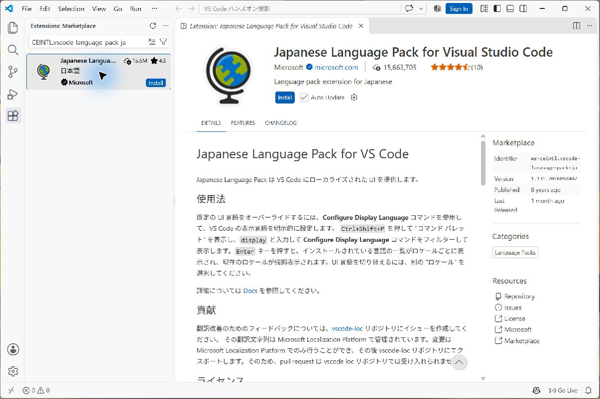
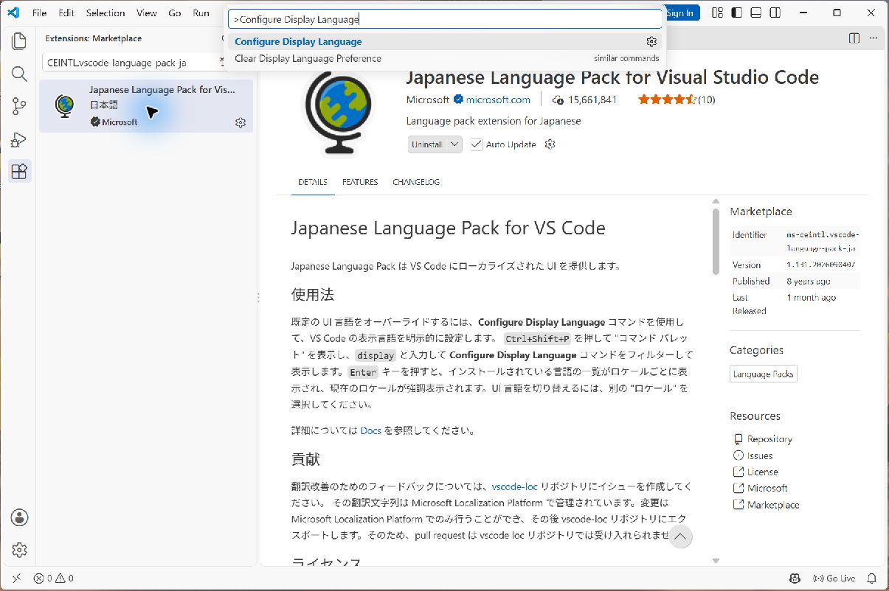
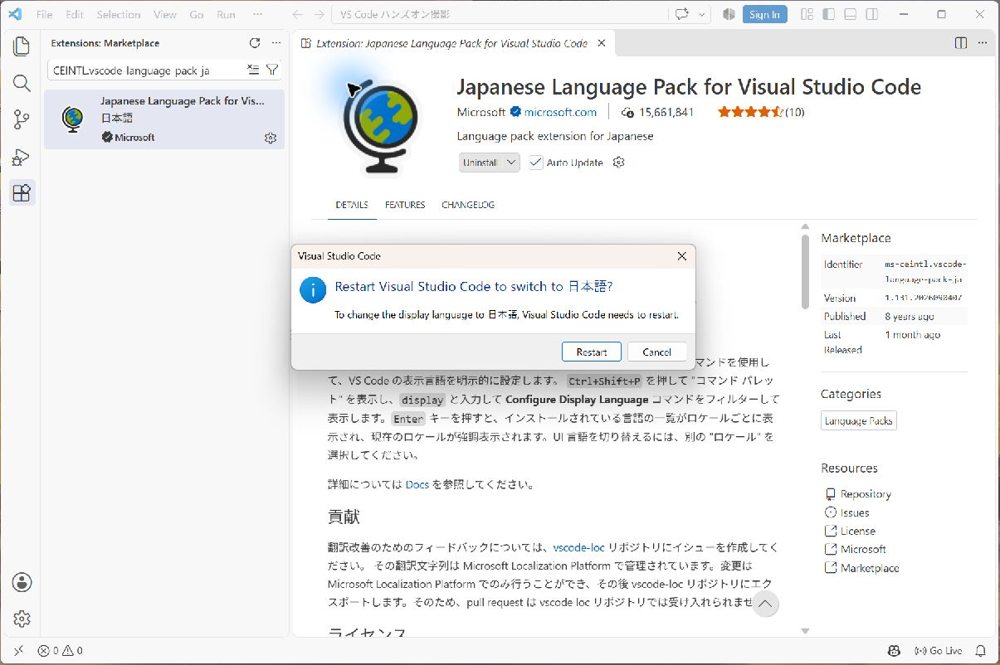
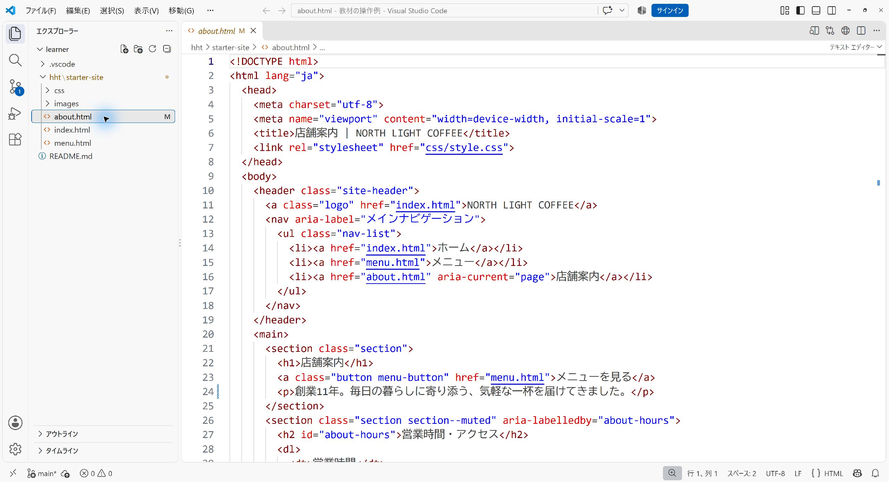
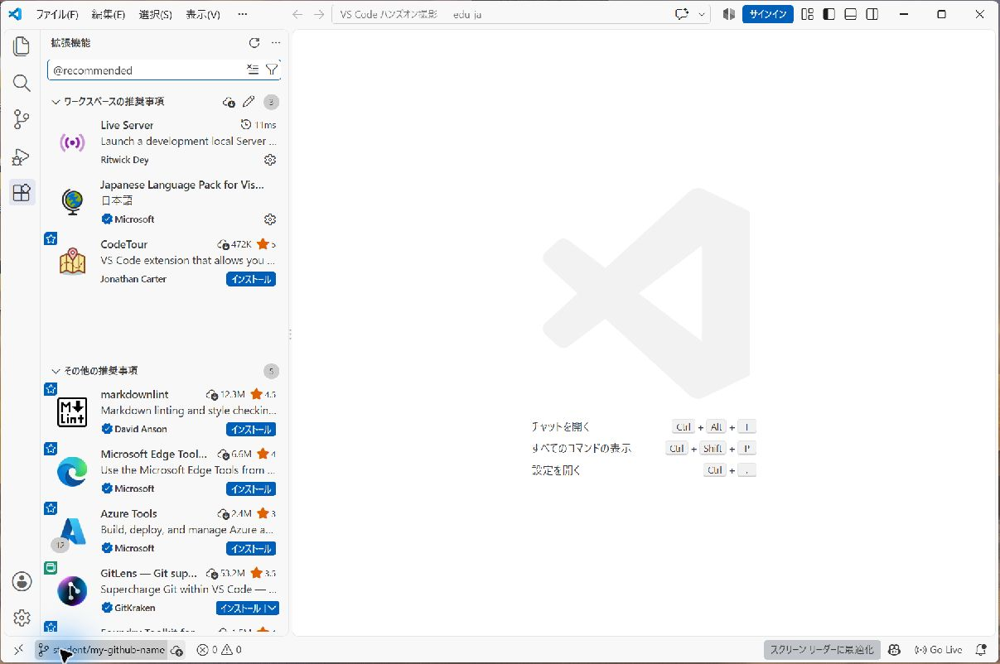
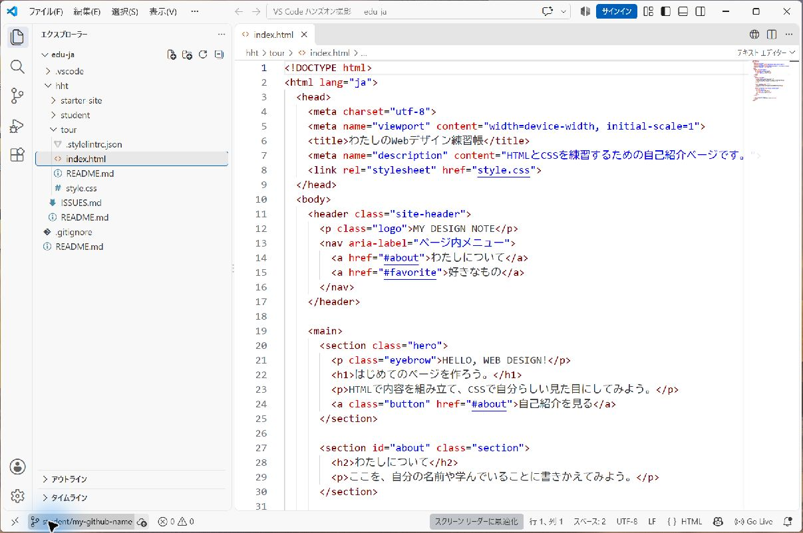
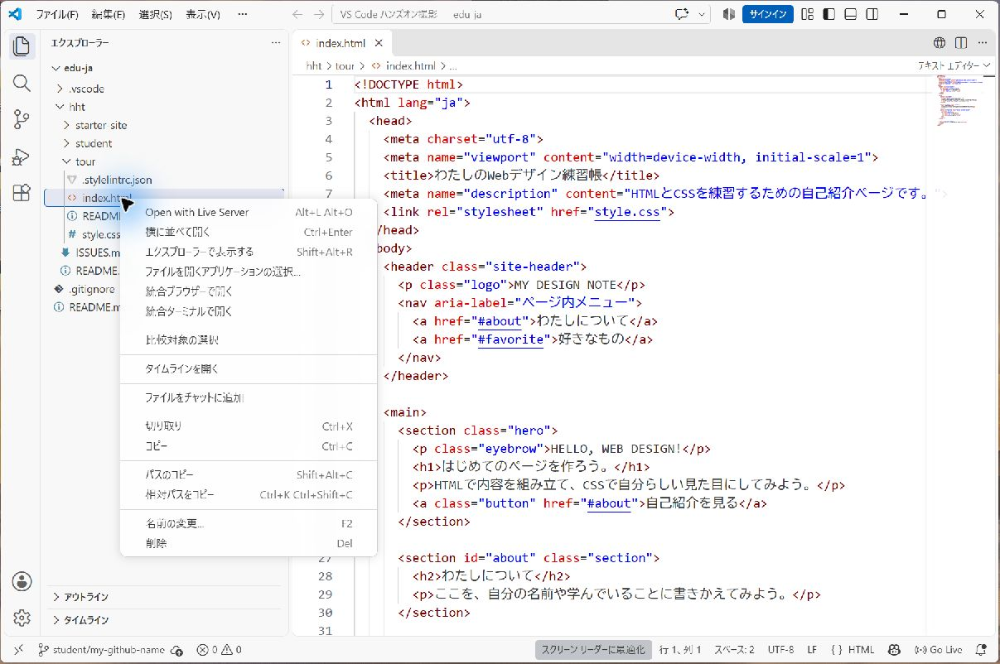
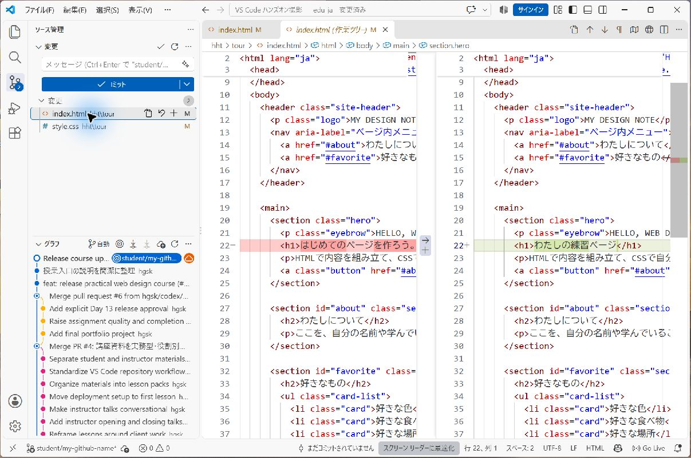

# VS Codeで進めるHTMLとCSSのハンズオン

カフェサイトの更新を担当する前に、自分のPCで安心して練習し、授業外でも作業を再開できる練習ページを準備します。  
まず下の依頼と完成条件を確認し、そのためにWindowsのVS Codeで教材取得・HTML・CSS編集・ブラウザ確認を行います。  
Gitはインストール済みとして進めます。  
初回は約120分、2回目以降は[学生向け入口](../student/README.md)のDAY教材を使います。

**受講者IDは講師が指定します。**  
GitHubアカウントの作成やログインは不要です。

最初にVS Codeを日本語にし、その後は日本語表示の画面で進めます。  
画像はローカルのVS Codeで撮影した操作例です。  
フォルダー名やブランチ名は自分のものへ読み替えてください。

## 最初に依頼とハンズオンの方針を確認する

あなたは架空の制作会社の新人Webデザイナーです。  
今回は、先輩の山本さんからカフェ案件に入る前の準備を頼まれました。

> **山本さんからの依頼**
> カフェサイトを直す前に、授業外でも自分で練習を続けられるようにしておきましょう。  
> 支給した練習ページを、あなたの練習用だと分かるページへ整えてください。  
> 見出しは「わたしの練習ページ」、メインカラーは青緑にしてください。  
> 自己紹介へのリンクを残し、小さい画面でも読めることを確認してください。  
> 次回、同じファイルから続きを始められるよう、PCへ保存しておいてください。

| 先に確認すること | 今回の指示 |
|---|---|
| 誰が見るか | 練習を続ける自分と、準備ができたか確認する先輩 |
| 目的 | 編集・表示・再開の方法が分からず練習が止まる状態をなくす |
| 何をどう変えるか | `hht/hands-on/vscode-basics/site/index.html`のページ内見出しを「わたしの練習ページ」へ変更し、`hht/hands-on/vscode-basics/site/style.css`のメインカラーを青緑 `#0f766e` にする |
| 変えないところ | 自己紹介へのリンク、ページの構造、カフェ案件の`hht/references/cafe-site` |
| 成果物 | PCに保存した練習ページと、次回開く教材フォルダー・作業ブランチ |

**作業前の確認:** 「どのページを直す？」  
「カフェサイトも変えてよい？」  
「どの状態なら準備完了？」  
を説明してから始めてください。  
分からないところは講師へ確認します。  
依頼 → 計画 → 必要な操作を学ぶ → 制作 → 確認 → 結果を伝える、の順に進めます。

### 依頼の完成条件

- ブラウザで「わたしの練習ページ」と表示され、メインカラーが指定の青緑になっている。
- 「自己紹介を見る」で自己紹介へ移動でき、指定の画面幅と拡大で文章や操作が破綻していない。
- 差分から、指定した2ファイルの変更を説明できる。  
  カフェサイトは変更していない。
- 保存後に同じ教材フォルダーとブランチを開き直し、変更したページから続きを始められる。

日本語化・教材のクローン・ローカルGitの準備は、安全に制作と復元を続けるための準備です。  

## 1 授業前に用意するもの

| 用意するもの | 確認方法 |
|---|---|
| VS Code | Windowsのスタートメニューから起動できる |
| Git | VS Codeの「ターミナル」→「新しいターミナル」で `git --version` を実行できる |
| EdgeまたはChrome | Webページと開発者ツールを開ける |
| Live Server拡張機能 | 教材を開いた後、手順5の「ワークスペースの推奨事項」からインストール |
| 教材URL | 配布済みのURLを手元に用意 |

VS Codeが未導入なら[公式Windows手順](https://code.visualstudio.com/docs/setup/windows)に沿って準備します。  
学校PCへのインストールは学校の運用に従います。  
Gitをインストールした直後に認識されない場合は、VS Codeを閉じて開き直します。

HTML・CSSの基本演習ではNode.js、Python、Dockerを追加する必要はありません。  
この資料の手順に沿って、VS Codeとブラウザで進めます。

## 2 VS Codeを日本語にする

すでに上部メニューが「ファイル」「編集」「表示」になっている人は、手順3へ進んでください。  
英語表示の人は、次の4画面で日本語にします。

### 1 日本語パックをインストールする



`Ctrl + Shift + X`で拡張機能を開き、検索欄に `@id:MS-CEINTL.vscode-language-pack-ja` を貼り付けます。  
**Japanese Language Pack for Visual Studio Code** を選び、発行元が **Microsoft** であることを確認して **Install** を押します。

### 2 表示言語の設定を開く



`Ctrl + Shift + P` → `Configure Display Language` と入力して選びます。  
インストール直後に **Change Language and Restart** が表示された場合は、それを押して手順4へ進んでも構いません。

## 4 再起動して表示を確認する



**Restart** を押します。  
上部メニューが「ファイル」「編集」「表示」になれば完了です。  
編集途中の場合は先に保存してください。  
以降の画像は、日本語化後のVS Codeです。  
Live Serverなど拡張機能固有の名前や `Go Live` は英語のまま表示されることがあります。

うまく切り替わらない場合は、`Ctrl + Shift + P`から表示言語の設定を開き直し、日本語を選んで再起動します。  
学校PCで拡張機能を入れられない場合は講師へ相談してください。  
[公式の表示言語の案内](https://code.visualstudio.com/docs/configure/locales)も参照できます。

## 3 Documentsへ教材をクローンする

[共通手順の「初回だけ：Documentsへ教材をクローンする」](./workbook/common.md#clone-edu)に沿って進めます。  
取得元は`https://github.com/hgsk/edu.git`、保存先はWindowsの「ドキュメント」です。  
クローン後に`Documents/edu`を開き、`README.md`と`hht`が見えることを確認します。  
次回からは、このフォルダーを開きます。


## 4 本人用の教材フォルダーを確認する



クローンした`Documents/edu`を開きます。  
左側のエクスプローラーで `README.md`と`hht`を確認します。  
次の授業も同じフォルダーを開きます。  
作業の記録には[共通手順](./workbook/common.md#local-git-workflow)のコミットとタグを使います。

## 5 推奨事項からLive Serverを追加する



左の拡張機能アイコン、または `Ctrl + Shift + X` を押します。  
検索欄に `@recommended` を入れ、**ワークスペースの推奨事項** の `Live Server` をインストールします。  
発行元は **Ritwick Dey** です。  
日本語パックも推奨一覧に登録されています。

画像はインストール済みなので歯車が表示されています。  
未導入なら **インストール** を押します。  
右下に `Go Live` が出れば準備完了です。

## 6 VS Codeの画面と操作を覚える



| 画面の場所 | 役割 |
|---|---|
| 左端のアイコン列 | ファイル・検索・ソース管理・拡張機能を切り替える |
| 左側のエクスプローラー | `hht/hands-on/vscode-basics/site/index.html`や`style.css`を開く |
| 中央の編集領域 | HTML・CSSを書き換える。上のタブでファイルを切り替える |
| 行番号 | 講師へ編集箇所を伝える。画像の22行目が見出し |
| 左下のブランチ名 | 自分の作業ブランチを確認する |
| 右下のGo Live | Live Serverでブラウザ表示を始める |

左のエクスプローラーからこの資料を開き、`Ctrl + Shift + V`でMarkdownのプレビューを表示します。  
次に `hht/hands-on/vscode-basics/site/index.html` を開きます。  
`hht/hands-on/vscode-basics/site`は練習用、`hht/references/cafe-site`はDAY課題用です。

| 操作 | Windowsのキー |
|---|---|
| ファイルを探す | `Ctrl + P` |
| 開いているファイル内を検索 | `Ctrl + F` |
| 教材全体を検索 | `Ctrl + Shift + F` |
| 保存 | `Ctrl + S` |
| 直前の編集を戻す | `Ctrl + Z` |
| コマンドを探す | `Ctrl + Shift + P` |

画面左の「ソース管理」は、保存したファイルとGitの記録との差分を確認する場所です。  
保存はPCへ書き込む操作、コミットは変更の区切りをGitに残す操作です。

## 7 HTMLの文章を変更して表示する

**依頼とのつながり:** 支給された見出しを、自分の練習用ページだと分かる見出しへ変えます。  
先輩が指定したのはページ内の見出しなので、`<h1>`の文章を変更します。



エクスプローラーの `index.html` を右クリックした画面です。  
一番上の **Open with Live Server** を選ぶと、ブラウザでページを確認できます。

1. `hht/hands-on/vscode-basics/site/index.html` で `<h1>自己紹介ページ</h1>` を検索します。
2. `<h1>`と`</h1>`の間の文章だけを `わたしの練習ページ` に変えます。
3. `Ctrl + S`で保存します。
4. エクスプローラーの同じファイルを右クリックし、`Open with Live Server`を選びます。
5. ブラウザで見出しが変わったことを確認します。

URLの例は `http://127.0.0.1:5500/hht/hands-on/vscode-basics/site/index.html` です。  
ポート番号は環境によって変わるので、実際に開いたURLを使います。  
[Live Serverの案内](https://marketplace.visualstudio.com/items?itemName=ritwickdey.LiveServer)にある右クリック操作や右下の `Go Live` から起動できます。

`<title>`はブラウザのタブ名、`<h1>`はページ内の見出しです。  
どちらを変えたか説明してみましょう。  
表示は自分のPC上の確認用です。  
このURLを他の人へ送っても同じページは見られません。

## 8 CSSの色を変更する

**依頼とのつながり:** ページの内容を残したまま、ボタンなどを指定の青緑でそろえます。  
文章の修正と見た目の修正が別ファイルにあることを確かめます。

1. `hht/hands-on/vscode-basics/site/style.css` を開きます。
2. `--color-main: #4f46e5;`を探し、`--color-main: #0f766e;`に変更します。
3. 保存し、ブラウザでボタンなどの色が変わったことを確認します。
4. ブラウザの開発者ツールを `F12` または右クリックの「検証」で開き、ボタンの要素と適用されたCSSを見ます。

**確認課題:** 文章の変更はHTML、色の変更はCSSにあることを、ファイル名と変更箇所で説明してください。  
開発者ツールで試した変更は通常ファイルへ保存されません。  
残したい変更はVS Codeへ書き戻します。

## 9 画面幅とリンクを確認する

**依頼とのつながり:** 見出しと色が変わっても、自己紹介へ移動できなくなったり、小さい画面で読めなくなったりしていれば完成ではありません。

開発者ツールの端末表示切り替えで、幅320px・768px・1280pxを順に試します。  
ブラウザの200%拡大も試し、横にはみ出す文章、重なる要素、押しにくいリンクがないか確認します。  
端末表示から通常表示へ戻して拡大し、確認後は100%へ戻します。

練習ページの「自己紹介を見る」を押し、同じページの自己紹介へ移動することを確認します。  
DAY課題ではホーム・メニュー・店舗案内をそれぞれ開きます。  
スクリーンショットは、表示結果と確認幅が分かる状態で残します。

## 10 差分を確認してコミットする



左端の枝分かれアイコンがソース管理です。  
変更ファイルを押すと、左が変更前、右が変更後になります。  
赤は削除、緑は追加です。  
左側のファイル横の `＋` で対象を選び、上のメッセージ欄と **コミット** で記録します。

コミットの名前とメールが未設定なら、[ローカルGitの作者設定](./local-git.md#day-1だけリポジトリを用意する)を先に行います。  
GitHubへのログイン設定ではありません。

1. ソース管理を開き、変更ファイルをクリックします。
2. `hht/hands-on/vscode-basics/site/index.html`と`hht/hands-on/vscode-basics/site/style.css`の差分を読み、意図した文章と色だけが変わっているか確認します。
3. この2ファイルだけを「＋」でステージします。  
   ステージは「次のコミットへ入れる対象を選ぶ」操作です。
4. メッセージに `練習ページの見出しと色を変更` と入力し、コミットします。
5. ステージした2ファイルが変更一覧から消えたことを確認します。  
   ほかの人の変更や認証情報をまとめて追加しません。

ターミナルでも、記録を確認できます。

```powershell
git log -1 --oneline
git status
```

コミットはPC上の履歴です。  
GitHubへ送るPushとは別です。  
[VS Code公式のGit入門](https://code.visualstudio.com/docs/sourcecontrol/quickstart)も参照できます。

### 安全に元へ戻す練習

コミットした後は、練習ページの見出しを一度だけ変更して保存し、ブラウザで確認します。  
ソース管理で **`hht/hands-on/vscode-basics/site/index.html`だけ** の差分を確認し、そのファイルの「変更を破棄」を選びます。  
この操作で未コミットの編集は失われます。  
戻す内容を確認してから実行し、「すべての変更を破棄」は使いません。

ブラウザを再読み込みして、直前にコミットした見出しへ戻ることを確認します。  

## 11 記録して、次回の作業に備える

変更したファイルの差分を確認し、コミットします。  
[共通の作業メモ](./workbook/common.md#work-notes)を使い、確認したことや残った点を短く残します。

1. 編集したファイルを保存します。
2. ブラウザで見出し・色・リンクを確認します。
3. 変更するファイルだけをステージしてコミットします。
4. 同じフォルダーを開き直し、続きから作業できるか確かめます。

最後にLive Serverを停止し、練習用タブを閉じます。  
教材フォルダーの場所、本人のブランチ、最後のコミットを控えます。

## 12 2回目以降の授業を進める

1. VS Codeで前回の教材フォルダーを開き、ブランチと前回の変更状態を確認します。
2. [学生向け入口](../student/README.md)から今回の課題を開き、講師から届いた依頼を読みます。  
   操作を始める前に、依頼者・見る人・目的・何をどう変えるか・完成条件を確認します。
3. `hht/references/cafe-site/index.html`をLive Serverで開き、開始時点を確認します。  
   DAY 14〜15は `hht/references/portfolio-template/index.html` を使います。
4. 計画 → 編集 → 保存 → ブラウザ確認 → 差分確認の順に進めます。  
   毎回、作業記録とコミットを残します。
5. 指定された練習用公開先で結果を確認します。  
   [共通のGitの記録](./workbook/common.md#local-git-workflow)で履歴と成果物を渡します。

| 既存教材にある操作 | VS Codeでの操作 |
|---|---|
| Codespaceを起動 | PCのVS Codeで教材フォルダーを開く |
| Codespaceのターミナル | VS CodeのPowerShellターミナル |
| ポート転送で表示 | Live Serverが開くローカルURLで表示 |
| Codespaceの停止 | Live Server停止、保存確認、VS Code終了 |
| SSHなどLinux向けコマンド | そのまま貼り付けず、講師がWindows向けに確認した公開手順を使う |

ローカル表示と外部公開は別です。  
公開演習は[演習運営手順](./exercise-operations.md)の段階Cから進め、講師指定の対象ファイルだけを配置します。  
Azureへの接続は、Windows端末での鍵・接続方法を講師が準備した場合に実施します。

## 困ったとき

| 症状 | 確認すること |
|---|---|
| `git`が認識されない | VS Codeとターミナルを開き直し、`git --version`を確認。直らなければ講師へ |
| `README.md`と`hht`が見えない | ZIP内部や制作フォルダーだけを開いていないか確認し、教材のルートを開き直す |
| Live Serverが出ない | 拡張機能が有効か、制限モードか、HTMLファイルを選んでいるか確認 |
| ページが変わらない | 保存、開いたURLのパス、編集したファイルを確認。必要なら再読み込み |
| CSSや画像が出ない | パスの綴り・大文字小文字・フォルダー位置を確認。開発者ツールのNetworkで404を探す |
| サーバーが起動しない | Live Serverの出力を講師に見せる。ほかのアプリを勝手に終了しない |
| コミットで名前やメールのエラー | 手順11のGit設定を確認。未設定なら保存・差分確認まで進める |
| Pushで権限エラー | 個人用の送信先とログイン先を確認。ローカルのコミットを保ち、講師へ相談 |
