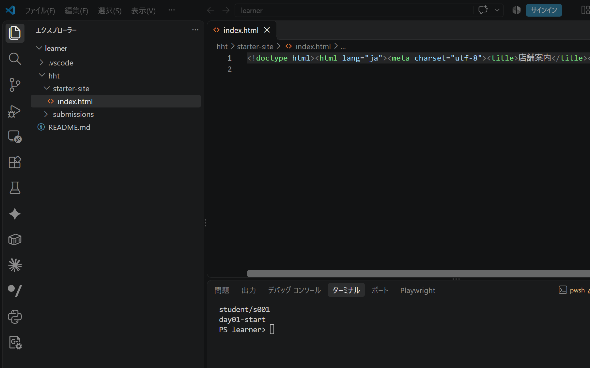
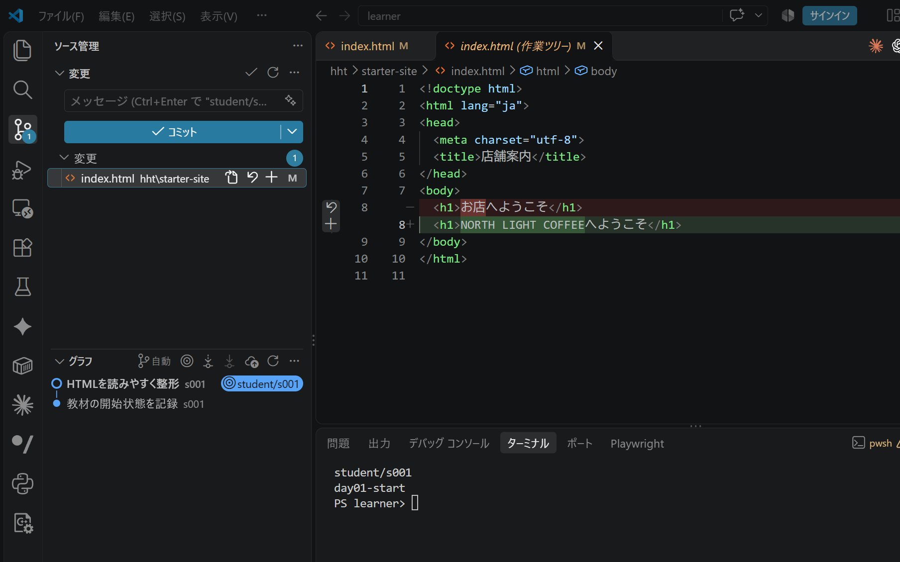
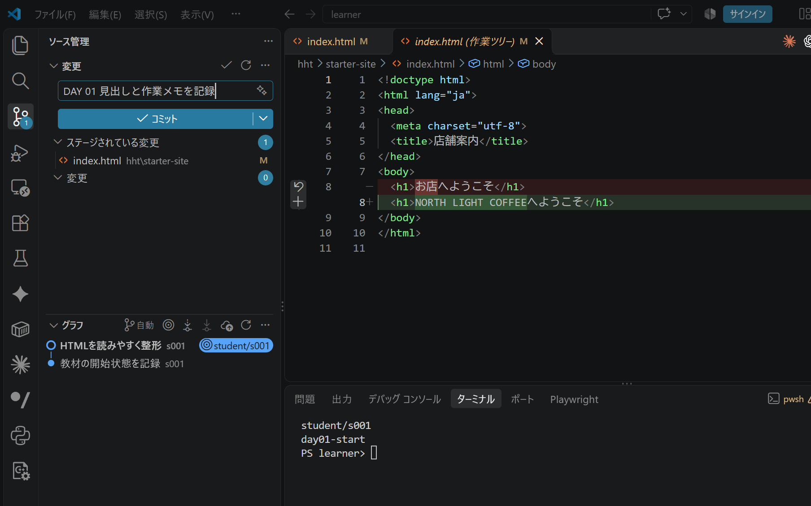

# 全日程の共通手順と作業メモ

[目次へ戻る](../student-workbook.md)

**目的：** 作業を小さく記録し、次も続きから取り組めるようにします。  
**見る人：** 制作する自分と、授業中に相談する講師です。  
**ゴール：** 依頼に沿って改修し、表示と操作を確認してGitに記録します。

<a id="local-git-workflow"></a>

Gitは全15回で使います。

## 毎回の進め方

### 1. 始める：今の状態を確認する

本人のリポジトリをVS Codeで開き、ブランチと変更一覧を確認します。  
初回の準備は[ローカルGitの操作](../local-git.md)を参照します。



未コミットの変更があれば、何の作業か確かめて記録します。  
DAY番号に合わせて、開始タグを付けます。

```powershell
git status --short
git tag day01-start
```

DAY 3・4は、各回の開始データを展開してGitに記録してからタグを付けます。  
DAY 5・6は、今使っているサイトをその場所で改修します。  
カフェサイトの標準配置は `hht/starter-site`、DAY 14・15は `hht/portfolio`です。

### 2. 作る：少し直して、画面で確かめる

その日のDAYに書かれたファイルを編集します。  
保存してブラウザを再読み込みし、変更した部分と、変えない部分を確認します。

### 3. 記録する：差分を読んでコミットする

VS Codeのソース管理で、変更したファイルを開きます。  
依頼と関係のない変更や、認証情報が混ざっていないか確認します。



必要なファイルだけをステージし、何を変えたか分かるメッセージでコミットします。



```powershell
git log -1 --oneline
git status --short
git tag day01-end
```

タグの番号は、その日のDAYに合わせます。  
既にあるタグは上書きせず、作業途中なら追加コミットで履歴を残します。

<a id="work-notes"></a>

## 毎回使う作業メモ

作業を振り返るときは、短い言葉で残します。  
必要なメモは、自分の作業フォルダーに保存できます。

```markdown
# DAY 1 作業メモ

- 目的：
- 直す場所／直さない場所：
- 変更したこと：
- 確認したこと・結果：
- 未確認・次にすること：
- バージョン：day01-end
```

## 最後のチェック

- [ ] その日の完成条件を確認した
- [ ] 表示とリンク・操作を確認した
- [ ] 差分を読み、必要な変更をコミットした
- [ ] 次に作業する場所と、残っていることを確認した

**困ったら：** エラーの出たところで止め、画面を講師へ見せます。  
内容を確かめずに、変更をまとめて破棄しないようにします。
