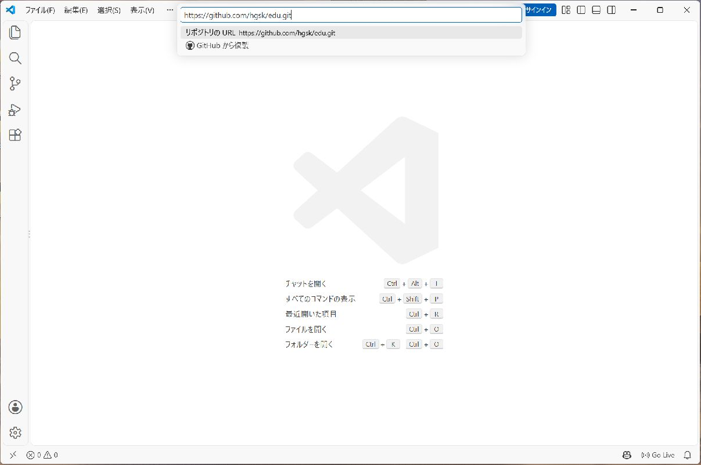
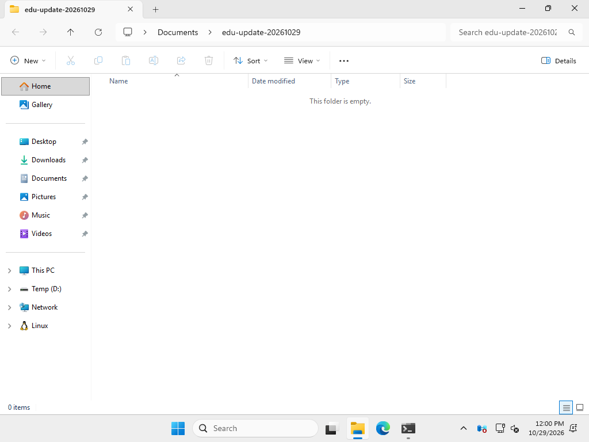
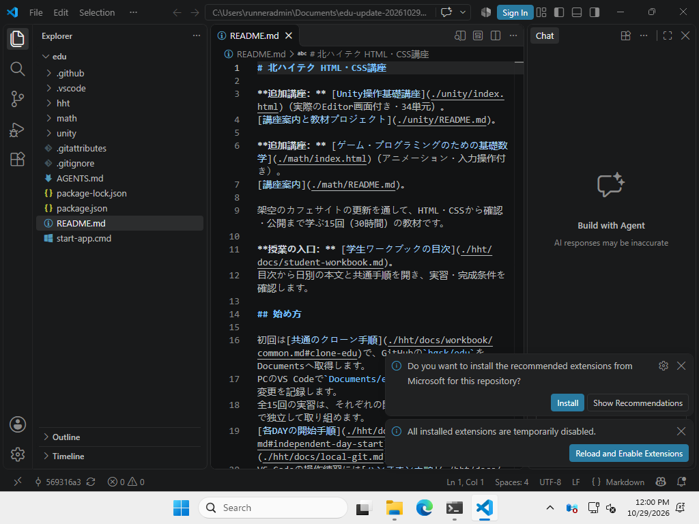
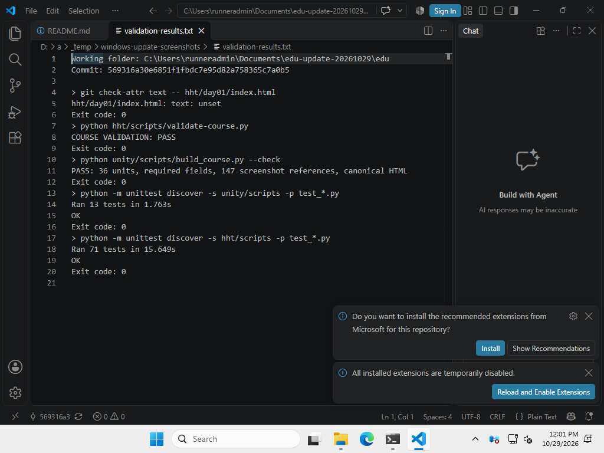

# 全日程の共通手順と作業メモ

[目次へ戻る](../student-workbook.md)

**目的：** 作業を小さく記録し、次も続きから取り組めるようにします。  
**見る人：** 制作する自分と、授業中に相談する講師です。  
**ゴール：** 依頼に沿って改修し、表示と操作を確認してGitに記録します。

<a id="local-git-workflow"></a>

Gitは全15回で使います。

<a id="clone-edu"></a>

## 初回だけ：Documentsへ教材をクローンする

GitHubの[教材リポジトリ`hgsk/edu`](https://github.com/hgsk/edu)を、自分のPCのDocumentsへ取得します。  
**クローン**は、ファイルとGitの履歴をまとめてPCへコピーする操作です。  
GitとVS CodeがインストールされたPCで進めます。

1. VS Codeを開き、`Ctrl + Shift + P`を押します。
2. `Git: クローン`を選び、次のURLを入力してEnterキーを押します。

```text
https://github.com/hgsk/edu.git
```



**見るところ：** 入力欄のURLが`https://github.com/hgsk/edu.git`になっていることを確認します。

3. 保存先を選ぶ画面で、左側の「ドキュメント」を開き、「リポジトリの宛先として選択」を押します。
4. クローンが終わったら、「開く」を押します。
5. VS Codeのエクスプローラーで、`edu`の中に`README.md`と`hht`があることを確認します。

Documentsは、Windowsで「ドキュメント」と表示されるフォルダーです。  
OneDriveを利用しているPCでは、OneDrive内の「ドキュメント」になることもあります。  
この中に`edu`が作られ、作業場所は`Documents/edu`になります。

既に`edu`があるときは、削除や上書きをせず、そのフォルダーを開いて講師と確認します。  
クローン後はGitの履歴があるので、`git init`や初期コミットは行いません。

<a id="windows-safe-update"></a>

## Windowsで以前クローンした教材を更新するとき

**依頼：** 講師から新しい教材を受け取る際に、自分の制作途中のファイルと履歴を守ります。  
**対象：** 改行変換を止める設定（`.gitattributes`）が入る前に取得したWindowsの教材です。  
**完成条件：** 元のフォルダーを残したまま、新しい教材で検証が成功し、移した自分の変更を説明できます。

### 1. 元の作業を保存して確認する

VS Codeの「ファイル → すべて保存」を選びます。  
元の`edu`で、次の読み取り専用コマンドを実行します。

```powershell
git status --short --untracked-files=all
git log -1 --oneline
```

変更一覧と最後のコミットを講師に見せます。  
一覧が空でも、自分のコミットや無視されているファイルは存在することがあります。  
一覧だけを根拠にフォルダーを削除しません。

### 2. 元を残し、別の場所に新しい教材を取得する

教材を開いているサーバーや実行中の処理を停止してから、エクスプローラーで元の`edu`フォルダー全体を別の場所へコピーします。  
隠しフォルダー`.git`、未追跡の画像、作業メモも含め、コピー先のファイルが開けることを確認します。  
コピーに失敗した場合はここで止めて講師に相談します。  
元の`edu`もそのまま残します。

エクスプローラーで新しい親フォルダーを作り、空であることを確認します。  



**見るところ：** アドレス欄が元の`Documents/edu`と別の場所で、中央に空のフォルダーと表示されています。  
この新しい親フォルダーを保存先にします。

[初回のクローン手順](#clone-edu)を使い、新しく作った空の親フォルダー（例：`Documents/edu-update-20261029`）を保存先に選びます。  
新しい教材は、その中の`edu`へ取得されます。  
既存の`Documents/edu`やバックアップ先へ上書きしないでください。


**見るところ：** URLは同じでも保存先は別です。  
VS Codeで新しい`edu`を開き、ウィンドウのタイトルと「ファイル → フォルダーを開く」の場所を確認します。



**見るところ：** `edu-update-20261029`内の`edu`を開いています。  
初回の案内画面が出る場合は、サインインせずに続けるか案内を閉じて、作業フォルダーを確認します。

### 3. 新しい教材を検証してから、自分の変更を移す

新しい`edu`のターミナルで、講師と次を確認します。  
検証にはPythonとPillowが必要です。  
見つからない場合は教材ファイルを直さず、講師に環境の準備を依頼します。

```powershell
git check-attr text -- hht/day01/index.html
python hht/scripts/validate-course.py
python unity/scripts/build_course.py --check
python -m unittest discover -s unity/scripts -p "test_*.py"
python -m unittest discover -s hht/scripts -p "test_*.py"
```

属性の表示が`text: unset`となり、教材検証がPASS、単体テストがOKになることを確認します。  
設定を取り込むだけでは、元の作業コピーで既に変換された改行は自動修復されません。



**見るところ：** 画面例はWindows CIで実行した上記コマンドの結果を、確認用テキストとして開いたものです。  
`Working folder`が新しい保存先で、`text: unset`、`PASS`、`OK`、終了コード0が並んでいます。  
自分のPCではターミナルの結果を読み、同じ成功表示を確認します。  
テスト件数は教材の更新により増えることがあります。

検証に成功したら、講師と元の作業の差分を読み、自分が編集したDAYのファイル・追加画像・作業メモだけを新しい教材へ移します。  
元のフォルダー全体や`.git`、教材のZIP、撮影記録、Unityのビルドをまとめて上書きしません。  
自分のコミットやタグを引き継ぐ必要がある場合は、講師と移行方法を決めるまで元のフォルダーで作業を続けます。

移した後はブラウザーで制作物を確認し、VS Codeのソース管理で自分の変更だけがあることを確認します。  
改行だけの大量の差分が出た場合は、コミットせず講師に見せます。  
必要な変更をコミットし、次回開く新しいフォルダーの場所を作業メモへ残します。  
元のフォルダーとバックアップは、作業と履歴の移行を講師と確認し終えるまで残します。

**使わない操作：** この更新で`git reset --hard`、`git clean -fd`、`git rm --cached -r .`や変更の一括破棄は行いません。  
`git stash`だけをバックアップの代わりにせず、未追跡・無視対象のファイルもフォルダー全体で保護します。

**改行の保存：** 新しく作るテキストは原則LFで保存します。  
既存ファイルのLF・CRLFは維持し、教材全体の一括変換はしません。

## 毎回の進め方

### 1. 始める：今の状態を確認する

初回にクローンした`Documents/edu`を、VS Codeの「ファイル → フォルダーを開く」で開きます。  
次回からはクローンし直さず、同じフォルダーを使います。  
Gitの記録操作は[ローカルGitの操作](../local-git.md)を参照します。

ソース管理で変更一覧を読み、現在の未コミット変更を確認します。  
タグは作業の終わりに付けます。

```powershell
git status --short
```

<a id="independent-day-start"></a>

### 📂 今回のDAYのフォルダーを開く

どのDAYも、他のDAYを終えていなくても始められます。  
HTML・CSS・画像・企画は、`hht/day01`〜`hht/day15`へ最初からコミットされています。

1. VS Codeで`Documents/edu`を開きます。
2. 左のエクスプローラーで`hht`を開き、今回の`dayNN`を選びます。  
   DAY 6なら`day06`です。
3. そのDAYの本文に書かれたファイルを開いて編集します。  
   DAY 6なら`hht/day06/menu.html`と`hht/day06/css/style.css`を使います。


**見るところ：** `day01`〜`day15`が初めから並んでいます。  
`day06`の中に、その回で使うHTML・CSS・画像があります。

フォルダーの生成やコピーは不要です。  
再開するときも、同じ`hht/dayNN`を開きます。  
他のDAYのファイルを変更せず、その回の修正を同じローカルGitへ記録します。

### 2. 作る：少し直して、画面で確かめる

その日のDAYに書かれたファイルを編集します。  
保存してブラウザを再読み込みし、変更した部分と、変えない部分を確認します。

### 3. 記録する：差分を読んでコミットする

VS Codeのソース管理で、変更したファイルを開きます。  
依頼と関係のない変更や、認証情報が混ざっていないか確認します。


変更一覧のファイルにある「＋」を押すと、「ステージされている変更」へ移ります。  
何を変えたか分かるメッセージを入力し、「コミット」を押します。


```powershell
git log -1 --oneline
git status --short
git tag -f day01-end
```

タグの番号は、その日のDAYに合わせます。  
`day01-end`は「DAY 1で最後に記録した状態」への目印です。  
`-f`は同じ名前の目印を、今のコミットへ付け直す指定です。  
同じコミットで何度実行しても、同じ目印になります。  
修正を追加でコミットした後も、同じコマンドで目印を更新します。  
以前のコミットも履歴に残ります。

💡 **ヒント：**
> タグが指すのは、ファイルを保存した時点ではなく、コミットした時点です。  
> 保存 → 表示確認 → 差分確認 → コミット → タグの順に進めます。

<a id="work-notes"></a>

## 毎回使う作業メモ

作業を振り返るときは、短い言葉で残します。  
必要なメモは、自分の作業フォルダーに保存できます。

```markdown
# DAY 1 作業メモ

- 目的：
- 直す場所／直さない場所：
- 変更したこと：
- 確認したこと・結果：
- 未確認・次にすること：
- バージョン：day01-end
```

## 最後のチェック

- [ ] その日の完成条件を確認した
- [ ] 表示とリンク・操作を確認した
- [ ] 差分を読み、必要な変更をコミットした
- [ ] 次に作業する場所と、残っていることを確認した

**困ったら：** エラーの出たところで止め、画面を講師へ見せます。  
内容を確かめずに、変更をまとめて破棄しないようにします。
