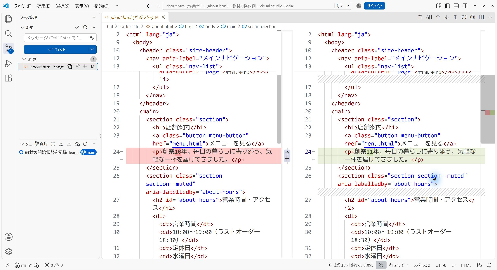
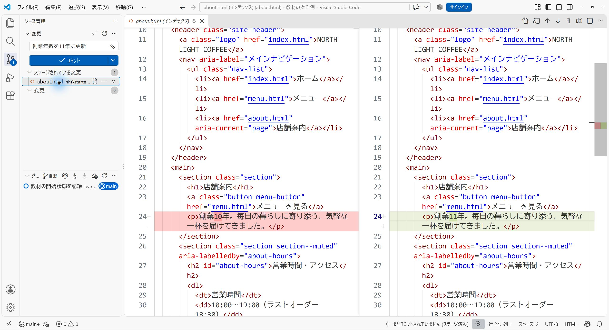

# 全日程の共通手順と作業メモ

[目次へ戻る](../student-workbook.md)

**目的：** 作業を小さく記録し、次も続きから取り組めるようにします。  
**見る人：** 制作する自分と、授業中に相談する講師です。  
**ゴール：** 依頼に沿って改修し、表示と操作を確認してGitに記録します。

<a id="local-git-workflow"></a>

Gitは全15回で使います。

## 毎回の進め方

### 1. 始める：今の状態を確認する

講師から受け取った本人用の教材フォルダーをVS Codeで開きます。  
初回の準備は[ローカルGitの操作](../local-git.md)を参照します。


ソース管理で変更一覧を読み、前回から続けている作業を確認します。  
タグは作業の終わりに付けます。

```powershell
git status --short
```

DAY 3・4は、各回の開始データを展開してGitに記録します。  
DAY 5・6は、今使っているサイトをその場所で改修します。  
カフェサイトの標準配置は `hht/starter-site`、DAY 14・15は `hht/portfolio`です。

### 2. 作る：少し直して、画面で確かめる

その日のDAYに書かれたファイルを編集します。  
保存してブラウザを再読み込みし、変更した部分と、変えない部分を確認します。

### 3. 記録する：差分を読んでコミットする

VS Codeのソース管理で、変更したファイルを開きます。  
依頼と関係のない変更や、認証情報が混ざっていないか確認します。



変更一覧のファイルにある「＋」を押すと、「ステージされている変更」へ移ります。  
何を変えたか分かるメッセージを入力し、「コミット」を押します。



```powershell
git log -1 --oneline
git status --short
git tag -f day01-end
```

タグの番号は、その日のDAYに合わせます。  
`day01-end`は「DAY 1で最後に記録した状態」への目印です。  
`-f`は同じ名前の目印を、今のコミットへ付け直す指定です。  
同じコミットで何度実行しても、同じ目印になります。  
修正を追加でコミットした後も、同じコマンドで目印を更新します。  
以前のコミットも履歴に残ります。

💡 **ヒント：**
> タグが指すのは、ファイルを保存した時点ではなく、コミットした時点です。  
> 保存 → 表示確認 → 差分確認 → コミット → タグの順に進めます。

<a id="work-notes"></a>

## 毎回使う作業メモ

作業を振り返るときは、短い言葉で残します。  
必要なメモは、自分の作業フォルダーに保存できます。

```markdown
# DAY 1 作業メモ

- 目的：
- 直す場所／直さない場所：
- 変更したこと：
- 確認したこと・結果：
- 未確認・次にすること：
- バージョン：day01-end
```

## 最後のチェック

- [ ] その日の完成条件を確認した
- [ ] 表示とリンク・操作を確認した
- [ ] 差分を読み、必要な変更をコミットした
- [ ] 次に作業する場所と、残っていることを確認した

**困ったら：** エラーの出たところで止め、画面を講師へ見せます。  
内容を確かめずに、変更をまとめて破棄しないようにします。
