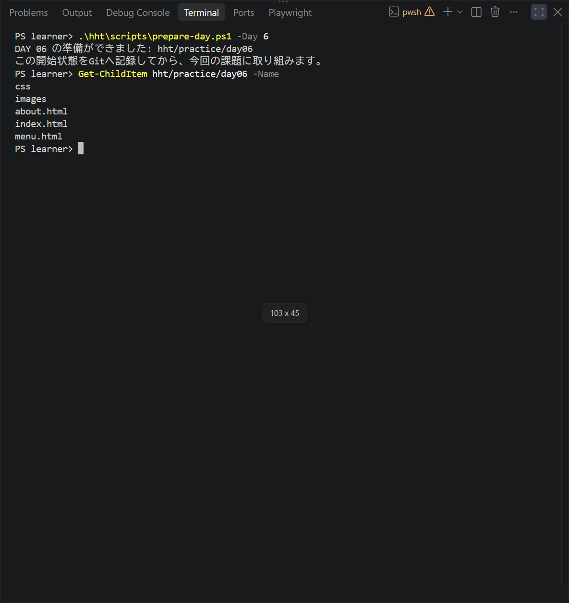

# 全日程の共通手順と作業メモ

[目次へ戻る](../student-workbook.md)

**目的：** 作業を小さく記録し、次も続きから取り組めるようにします。  
**見る人：** 制作する自分と、授業中に相談する講師です。  
**ゴール：** 依頼に沿って改修し、表示と操作を確認してGitに記録します。

<a id="local-git-workflow"></a>

Gitは全15回で使います。

<a id="clone-edu"></a>

## 初回だけ：Documentsへ教材をクローンする

GitHubの[教材リポジトリ`hgsk/edu`](https://github.com/hgsk/edu)を、自分のPCのDocumentsへ取得します。  
**クローン**は、ファイルとGitの履歴をまとめてPCへコピーする操作です。  
GitとVS CodeがインストールされたPCで進めます。

1. VS Codeを開き、`Ctrl + Shift + P`を押します。
2. `Git: クローン`を選び、次のURLを入力してEnterキーを押します。

```text
https://github.com/hgsk/edu.git
```


**見るところ：** 入力欄のURLが`https://github.com/hgsk/edu.git`になっていることを確認します。

3. 保存先を選ぶ画面で、左側の「ドキュメント」を開き、「リポジトリの宛先として選択」を押します。
4. クローンが終わったら、「開く」を押します。
5. VS Codeのエクスプローラーで、`edu`の中に`README.md`と`hht`があることを確認します。

Documentsは、Windowsで「ドキュメント」と表示されるフォルダーです。  
OneDriveを利用しているPCでは、OneDrive内の「ドキュメント」になることもあります。  
この中に`edu`が作られ、作業場所は`Documents/edu`になります。

既に`edu`があるときは、削除や上書きをせず、そのフォルダーを開いて講師と確認します。  
クローン後はGitの履歴があるので、`git init`や初期コミットは行いません。

## 毎回の進め方

### 1. 始める：今の状態を確認する

初回にクローンした`Documents/edu`を、VS Codeの「ファイル → フォルダーを開く」で開きます。  
次回からはクローンし直さず、同じフォルダーを使います。  
Gitの記録操作は[ローカルGitの操作](../local-git.md)を参照します。

ソース管理で変更一覧を読み、現在の未コミット変更を確認します。  
タグは作業の終わりに付けます。

```powershell
git status --short
```

<a id="independent-day-start"></a>

### 📂 初めて取り組むDAYの準備

どのDAYも、他のDAYを終えていなくても始められます。  
各回の`hht/lessons/NN/start`に、必要なHTML・CSS・画像・企画がそろっています。

1. VS Codeで`Documents/edu`を開きます。
2. 「ターミナル → 新しいターミナル」を開きます。
3. リポジトリのルートで、次を実行します。  
   以下はDAY 6の例です。

```powershell
.\hht\scripts\prepare-day.ps1 -Day 6
```



**見るところ：** 「DAY 06 の準備ができました」と表示され、`index.html`・`menu.html`・`about.html`・`css`・`images`が作業場所にそろいます。

4. 作成された`hht/practice/day06`を開き、開始状態をGitへ記録します。
5. そのDAYの本文へ戻り、指定されたファイルを編集します。

DAY番号だけを変えると、別のDAYの作業場所を準備できます。  
同じDAYの作業フォルダーがあると、コマンドは上書きせず停止します。  
続きを行うときは、そのフォルダーをそのまま開きます。  
最初からやり直すときは、既存の成果を残したまま別の名前で練習できるよう講師に相談します。

すべての作業を同じローカルGitリポジトリへ記録します。  
他のDAYのファイルをコピーしたり、完成まで待ったりする必要はありません。

### 2. 作る：少し直して、画面で確かめる

その日のDAYに書かれたファイルを編集します。  
保存してブラウザを再読み込みし、変更した部分と、変えない部分を確認します。

### 3. 記録する：差分を読んでコミットする

VS Codeのソース管理で、変更したファイルを開きます。  
依頼と関係のない変更や、認証情報が混ざっていないか確認します。


変更一覧のファイルにある「＋」を押すと、「ステージされている変更」へ移ります。  
何を変えたか分かるメッセージを入力し、「コミット」を押します。


```powershell
git log -1 --oneline
git status --short
git tag -f day01-end
```

タグの番号は、その日のDAYに合わせます。  
`day01-end`は「DAY 1で最後に記録した状態」への目印です。  
`-f`は同じ名前の目印を、今のコミットへ付け直す指定です。  
同じコミットで何度実行しても、同じ目印になります。  
修正を追加でコミットした後も、同じコマンドで目印を更新します。  
以前のコミットも履歴に残ります。

💡 **ヒント：**
> タグが指すのは、ファイルを保存した時点ではなく、コミットした時点です。  
> 保存 → 表示確認 → 差分確認 → コミット → タグの順に進めます。

<a id="work-notes"></a>

## 毎回使う作業メモ

作業を振り返るときは、短い言葉で残します。  
必要なメモは、自分の作業フォルダーに保存できます。

```markdown
# DAY 1 作業メモ

- 目的：
- 直す場所／直さない場所：
- 変更したこと：
- 確認したこと・結果：
- 未確認・次にすること：
- バージョン：day01-end
```

## 最後のチェック

- [ ] その日の完成条件を確認した
- [ ] 表示とリンク・操作を確認した
- [ ] 差分を読み、必要な変更をコミットした
- [ ] 次に作業する場所と、残っていることを確認した

**困ったら：** エラーの出たところで止め、画面を講師へ見せます。  
内容を確かめずに、変更をまとめて破棄しないようにします。
