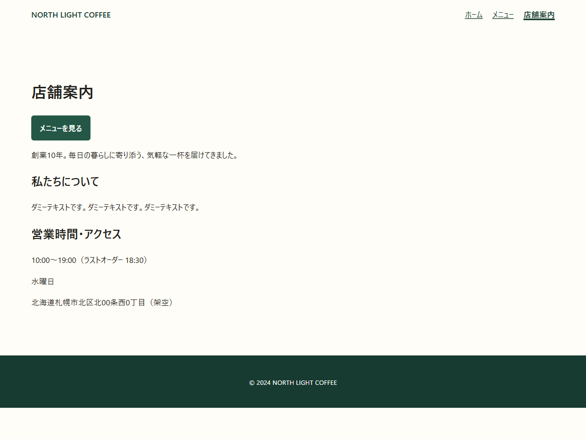
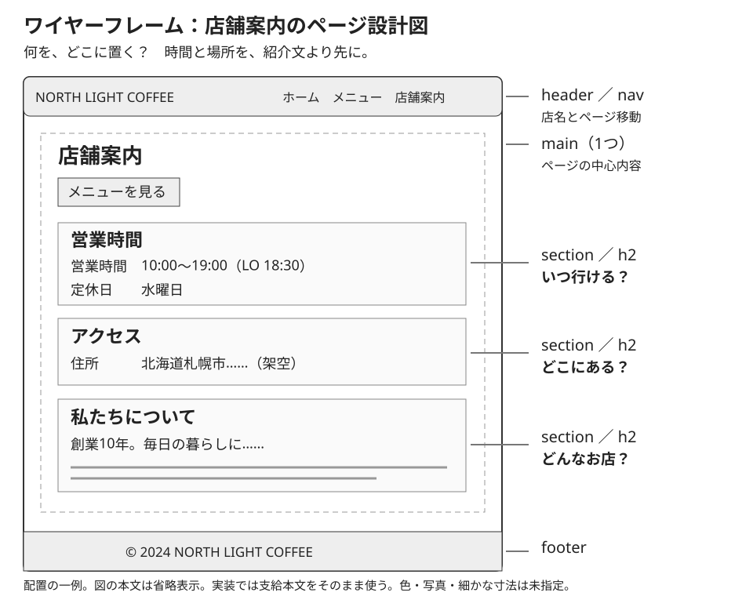
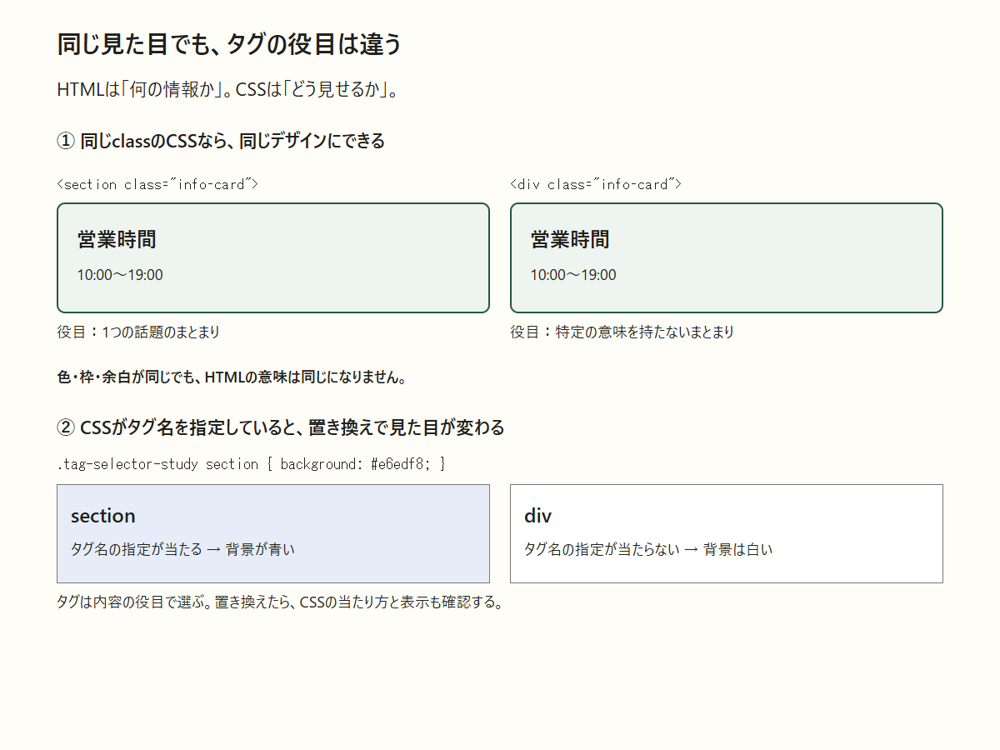
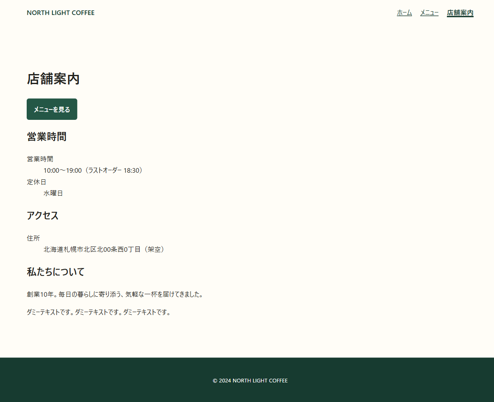

<a id="day-4"></a>

## DAY 4 お店の情報が見つけにくい

[← DAY 3](day-03.md#day-3) · [DAY一覧へ](../student-workbook.md#workbook-days) · [DAY 5 →](day-05.md#day-5)

[言葉・構文を読む](#day-4-concepts) · [実習へ進む](#day-4-actions) · [完成条件・提出へ](#day-4-done)

> **佐藤さんからの相談**
> 初めてサイトを見る人から、営業時間やアクセスが見つけにくいと言われました。

**今日のミッション:** 初めて来る人が「いつ開いている？ どこにある？」を見つけられるようにする。

### 今日やること

1. 下のDAY 4開始ZIPを展開する。DAY 3が途中でも、このデータで始められる。
2. `about.html`を表示し、時間・定休日・住所・紹介文を見つける。変更前を保存する。
3. 時間→場所→紹介の順番とまとまりを、紙かメモアプリに描く。
4. `about.html`の既存本文を移動し、1つの`main`の中で`section`・`h2`・`p`に整理する。数値・本文・CSSは変えない。
5. 保存・再読み込みし、元の本文と比較する。サイト一式・設計図・構造の変更報告を提出する。


- **依頼者／見る人**：店舗責任者の佐藤さん／初めて来店するお客さま
- **困っていること**：店舗紹介の後に情報が続き、時間や住所を探しにくい
- **変えるところ**：店舗案内 `about.html` の本文の順番、まとまり、見出し、内容に合うタグ
- **変えないところ**：本文の言葉、営業時間、定休日、住所、商品情報、CSS、リンク先
- **完成の目印**：見出しで情報を探せる。`main`は1つ。本文を変えずに整理できた

> **授業用に確認済みの仕様：** 時間と場所を店舗紹介より先に見せます。見出しと「定休日」「住所」などの項目名は追加・変更してよいものとします。時間・住所・紹介文など、本文の情報は書き換えません。

### 最初に見る：来店前に知りたいことは？



**観察すること：** 「何時まで？」「休みは？」「どこ？」の答えを指さしましょう。見つけにくい原因は、順番でしょうか、見出しでしょうか。「水曜日」は何を表すのか、画面だけで分かりますか？

### 使うファイル

[開始データをZIPで受け取る](../../lessons/04/day4-start.zip) → 展開 → フォルダー名を `day4-氏名` にする → VS Codeでフォルダーを開く。

この回は [練習用start](../../lessons/04/start/) のコピーを使います。DAY 3が途中でも開始できます。`about.html` をブラウザで開き、編集するのもこのファイルだけです。元のサイトとDAY 3の提出物は残します。

<a id="day-4-concepts"></a>

### 言葉と構文の読み方：まとまりと入れ子

**構造（こうぞう）**は、ページのどの情報が何の役目で、何に含まれるかという関係です。**セマンティックHTML**は、その意味・役目に合うHTML要素を選ぶことです。色や配置だけで意味を決めません。

```html
<main class="section">
  <h1>店舗案内</h1>
  <section>
    <h2>営業時間</h2>
    <p>10:00〜19:00（ラストオーダー 18:30）</p>
    <p>定休日：水曜日</p>
  </section>
</main>
```

- **`main`（メイン）**はページの中心内容。今回は店舗案内をまとめる1つの`main`を作ります。`header`・`footer`まで囲む必要はありません。
- **`section`（セクション）**は話題のまとまり。ここでは営業時間の見出しと本文が同じまとまりです。
- **`h1`**はページの題名、**`h2`**はその中の話題の見出し。`h2`を大きく見せたい場合も、話題の階層は保ってCSSで見せ方を調整します。今回はCSSの変更はしません。
- **`p`**は段落。営業時間の値と、休みの情報をそれぞれ段落にしています。
- **`class="section"`**はCSSを当てるための名前。`main`という要素名や`section`という要素名とは別です。教材では既存の`.section`の余白を保つために使います。
- **親・子**は囲む関係。上では`main`が`section`の親、`section`が`h2`と2つの`p`の親です。行頭の空白をそろえると、この関係を読みやすくできます。
- **閉じる順番**は、最後に開いた内側から。`p`→`section`→`main`の順です。`</main>`の後に営業時間の`p`があれば、中心内容の外へ出ています。

この例は「営業時間の部分」の書き方です。アクセスと店舗紹介、既存のリンクなども残します。ページ全体をこの短い例だけに置き換えません。

#### ページの周りにある要素も読む

- **`header`（ヘッダー）**は導入・案内。教材では店名とナビゲーションを含みます。
- **`nav`（ナビ）**は主要なページ移動のリンク群です。
- **`footer`（フッター）**は末尾の情報。教材では著作権表示などです。
- **`div`（ディブ）**は特定の意味を持たないまとまり。表示をまとめる用途には使えますが、付けるだけで見出しや中心内容にはなりません。
- **ワイヤーフレーム**は、何をどの順に置くかを示す簡単な設計図。色の完成見本でなく、情報の順番を考えるために描きます。

**よくある間違い：** `<section> ... </div>`は開始と終了の名前が不一致です。`<p><section> ...`も段落の中に置ける構造ではありません。元の本文を移すときは、開始タグと終了タグを一緒に選んだかを確認します。

### 例を分解して読む：必要な項目から確認する

ここは、今日の実習に出てくる言葉を1つずつ読むための参照欄です。全部を追加する作業一覧ではありません。最初は使う項目だけを読み、つづり・記号・意味・画面の変化を対応させます。実習へ進むときはこの欄の後の手順へ戻ります。

#### 読み取り例：ページの中心 — main

**何の言葉？** ページの中心となる情報を囲みます。classのsectionは見た目用の名前で、要素名のsectionとは別のものです。今回はmainを1つにまとめます。

```html
<main class="section">
  <!-- この要素の内容が入ります -->
</main>
```

**まず外側を読む：** `<`から最初の`>`までが開始タグです。`main`という名前で、このまとまりの役目をブラウザへ伝えています。見た目の色や大きさをここで直接決めるとは限りません。CSSのセレクターから選ばれ、見た目が付く場合もあります。

- **`class="section"`**は、属性名`class`と値`section`の組です。`=`は両者の区切り、前後の半角の二重引用符は値の範囲。属性は開始タグの`>`より前へ置きます。

**どこまでが1つ？** `</main>`はこの要素の終了です。開始と同じ名前を使い、先頭に`/`を付けます。開始と終了の間の内容が、この要素のまとまりです。 見本に内容の位置を示すコメントがある場合は、コメント自体を提出する文章として使う意味ではありません。元のファイルのどの内容を残すかを、依頼に合わせて確かめます。

**画面と照合する：** 中心の情報がmainの中にまとまることを確認します。設定用の要素は本文画面へ直接文字が出ない場合もあるので、要素の目的に合う場所を見ます。画面上で変化がないことと、HTMLに役目がないことは同じではありません。

**この例で間違いやすいところ：** headerとfooterを一緒に入れず、mainが複数できていないかをソースで確認する。属性の値をタグの外へ書いたり、本文と設定をまとめて書き換えたりしないようにします。変更前を残すと、どの記号や文字を変えたか比べられます。

**HTMLとして読む順序：** 最初に要素名、次に開始タグの属性、次に内容、最後に終了を読みます。内側に別の要素があれば同じ順序を繰り返します。字下げをそろえるのは、この囲む関係を見つけやすくするためです。画面で改行されるかどうかは、要素とCSSの表示の指定も関係します。

**理解の確認：** 「何の役目の要素か」「値や本文はどこか」「どの場所で結果を確かめるか」を、この例を指しながら説明してみましょう。読み方を理解するための見本であり、既存ページをこの短い例だけで置き換える課題ではありません。使うファイルと変更範囲は今日の実習の案内を優先します。

#### 読み取り例：話題のまとまり — section

**何の言葉？** 同じ話題の見出しと本文をまとめます。意味のまとまりを示す要素で、枠線や背景色を自動で付ける機能ではありません。

```html
<section>
  <!-- この要素の内容が入ります -->
</section>
```

**まず外側を読む：** `<`から最初の`>`までが開始タグです。`section`という名前で、このまとまりの役目をブラウザへ伝えています。見た目の色や大きさをここで直接決めるとは限りません。CSSのセレクターから選ばれ、見た目が付く場合もあります。

- この短い例では属性を省略しています。`section`は要素名です。必要な属性がある実際のファイルでは、名前と値を1組ずつ読みます。

**どこまでが1つ？** `</section>`はこの要素の終了です。開始と同じ名前を使い、先頭に`/`を付けます。開始と終了の間の内容が、この要素のまとまりです。 見本に内容の位置を示すコメントがある場合は、コメント自体を提出する文章として使う意味ではありません。元のファイルのどの内容を残すかを、依頼に合わせて確かめます。

**画面と照合する：** 1つの話題を開始と終了の間で追えることを確認します。設定用の要素は本文画面へ直接文字が出ない場合もあるので、要素の目的に合う場所を見ます。画面上で変化がないことと、HTMLに役目がないことは同じではありません。

**この例で間違いやすいところ：** 何の話題か言えない囲みを増やさず、見出しと本文が対応しているか考える。属性の値をタグの外へ書いたり、本文と設定をまとめて書き換えたりしないようにします。変更前を残すと、どの記号や文字を変えたか比べられます。

**HTMLとして読む順序：** 最初に要素名、次に開始タグの属性、次に内容、最後に終了を読みます。内側に別の要素があれば同じ順序を繰り返します。字下げをそろえるのは、この囲む関係を見つけやすくするためです。画面で改行されるかどうかは、要素とCSSの表示の指定も関係します。

**理解の確認：** 「何の役目の要素か」「値や本文はどこか」「どの場所で結果を確かめるか」を、この例を指しながら説明してみましょう。読み方を理解するための見本であり、既存ページをこの短い例だけで置き換える課題ではありません。使うファイルと変更範囲は今日の実習の案内を優先します。

#### 読み取り例：意味を限定しない囲み — div

**何の言葉？** 特定の意味を付けないまとまりです。見た目を調整するために囲めますが、それだけで話題や中心という役目は生まれません。

```html
<div class="info-card">
  <!-- この要素の内容が入ります -->
</div>
```

**まず外側を読む：** `<`から最初の`>`までが開始タグです。`div`という名前で、このまとまりの役目をブラウザへ伝えています。見た目の色や大きさをここで直接決めるとは限りません。CSSのセレクターから選ばれ、見た目が付く場合もあります。

- **`class="info-card"`**は、属性名`class`と値`info-card`の組です。`=`は両者の区切り、前後の半角の二重引用符は値の範囲。属性は開始タグの`>`より前へ置きます。

**どこまでが1つ？** `</div>`はこの要素の終了です。開始と同じ名前を使い、先頭に`/`を付けます。開始と終了の間の内容が、この要素のまとまりです。 見本に内容の位置を示すコメントがある場合は、コメント自体を提出する文章として使う意味ではありません。元のファイルのどの内容を残すかを、依頼に合わせて確かめます。

**画面と照合する：** 同じclassのCSSで見た目の箱を作れることを確認します。設定用の要素は本文画面へ直接文字が出ない場合もあるので、要素の目的に合う場所を見ます。画面上で変化がないことと、HTMLに役目がないことは同じではありません。

**この例で間違いやすいところ：** divを付けたから見出しやナビと同じ意味になったと判断しない。属性の値をタグの外へ書いたり、本文と設定をまとめて書き換えたりしないようにします。変更前を残すと、どの記号や文字を変えたか比べられます。

**HTMLとして読む順序：** 最初に要素名、次に開始タグの属性、次に内容、最後に終了を読みます。内側に別の要素があれば同じ順序を繰り返します。字下げをそろえるのは、この囲む関係を見つけやすくするためです。画面で改行されるかどうかは、要素とCSSの表示の指定も関係します。

**理解の確認：** 「何の役目の要素か」「値や本文はどこか」「どの場所で結果を確かめるか」を、この例を指しながら説明してみましょう。読み方を理解するための見本であり、既存ページをこの短い例だけで置き換える課題ではありません。使うファイルと変更範囲は今日の実習の案内を優先します。

#### 読み取り例：導入と案内 — header

**何の言葉？** ページやまとまりの導入を置く要素です。教材では店名とナビゲーションを含みます。headという設定要素と名前が似ていますが別です。

```html
<header class="site-header">
  <!-- この要素の内容が入ります -->
</header>
```

**まず外側を読む：** `<`から最初の`>`までが開始タグです。`header`という名前で、このまとまりの役目をブラウザへ伝えています。見た目の色や大きさをここで直接決めるとは限りません。CSSのセレクターから選ばれ、見た目が付く場合もあります。

- **`class="site-header"`**は、属性名`class`と値`site-header`の組です。`=`は両者の区切り、前後の半角の二重引用符は値の範囲。属性は開始タグの`>`より前へ置きます。

**どこまでが1つ？** `</header>`はこの要素の終了です。開始と同じ名前を使い、先頭に`/`を付けます。開始と終了の間の内容が、この要素のまとまりです。 見本に内容の位置を示すコメントがある場合は、コメント自体を提出する文章として使う意味ではありません。元のファイルのどの内容を残すかを、依頼に合わせて確かめます。

**画面と照合する：** ページ冒頭の案内が構造としてまとまることを確認します。設定用の要素は本文画面へ直接文字が出ない場合もあるので、要素の目的に合う場所を見ます。画面上で変化がないことと、HTMLに役目がないことは同じではありません。

**この例で間違いやすいところ：** headは設定、headerはbody側の案内と区別し、片方をもう片方へ置き換えない。属性の値をタグの外へ書いたり、本文と設定をまとめて書き換えたりしないようにします。変更前を残すと、どの記号や文字を変えたか比べられます。

**HTMLとして読む順序：** 最初に要素名、次に開始タグの属性、次に内容、最後に終了を読みます。内側に別の要素があれば同じ順序を繰り返します。字下げをそろえるのは、この囲む関係を見つけやすくするためです。画面で改行されるかどうかは、要素とCSSの表示の指定も関係します。

**理解の確認：** 「何の役目の要素か」「値や本文はどこか」「どの場所で結果を確かめるか」を、この例を指しながら説明してみましょう。読み方を理解するための見本であり、既存ページをこの短い例だけで置き換える課題ではありません。使うファイルと変更範囲は今日の実習の案内を優先します。

#### 読み取り例：主要な移動 — nav

**何の言葉？** 主要な移動リンクをまとめる要素です。aria-labelはそのまとまりの名前を支援技術などへ伝える属性。本文のすべてのリンクをnavへ入れる必要はありません。

```html
<nav aria-label="メインナビゲーション">
  <!-- この要素の内容が入ります -->
</nav>
```

**まず外側を読む：** `<`から最初の`>`までが開始タグです。`nav`という名前で、このまとまりの役目をブラウザへ伝えています。見た目の色や大きさをここで直接決めるとは限りません。CSSのセレクターから選ばれ、見た目が付く場合もあります。

- **`aria-label="メインナビゲーション"`**は、属性名`aria-label`と値`メインナビゲーション`の組です。`=`は両者の区切り、前後の半角の二重引用符は値の範囲。属性は開始タグの`>`より前へ置きます。

**どこまでが1つ？** `</nav>`はこの要素の終了です。開始と同じ名前を使い、先頭に`/`を付けます。開始と終了の間の内容が、この要素のまとまりです。 見本に内容の位置を示すコメントがある場合は、コメント自体を提出する文章として使う意味ではありません。元のファイルのどの内容を残すかを、依頼に合わせて確かめます。

**画面と照合する：** ページ移動のまとまりが分かることを確認します。設定用の要素は本文画面へ直接文字が出ない場合もあるので、要素の目的に合う場所を見ます。画面上で変化がないことと、HTMLに役目がないことは同じではありません。

**この例で間違いやすいところ：** 本文の時間や住所を見た目の横並びだけを理由にnavへ入れない。属性の値をタグの外へ書いたり、本文と設定をまとめて書き換えたりしないようにします。変更前を残すと、どの記号や文字を変えたか比べられます。

**HTMLとして読む順序：** 最初に要素名、次に開始タグの属性、次に内容、最後に終了を読みます。内側に別の要素があれば同じ順序を繰り返します。字下げをそろえるのは、この囲む関係を見つけやすくするためです。画面で改行されるかどうかは、要素とCSSの表示の指定も関係します。

**理解の確認：** 「何の役目の要素か」「値や本文はどこか」「どの場所で結果を確かめるか」を、この例を指しながら説明してみましょう。読み方を理解するための見本であり、既存ページをこの短い例だけで置き換える課題ではありません。使うファイルと変更範囲は今日の実習の案内を優先します。

#### 読み取り例：末尾の情報 — footer

**何の言葉？** ページやまとまりの末尾情報を置く要素です。教材では著作権表示などが入ります。画面の一番下へ固定するCSSとは別の役目です。

```html
<footer class="site-footer">
  <!-- この要素の内容が入ります -->
</footer>
```

**まず外側を読む：** `<`から最初の`>`までが開始タグです。`footer`という名前で、このまとまりの役目をブラウザへ伝えています。見た目の色や大きさをここで直接決めるとは限りません。CSSのセレクターから選ばれ、見た目が付く場合もあります。

- **`class="site-footer"`**は、属性名`class`と値`site-footer`の組です。`=`は両者の区切り、前後の半角の二重引用符は値の範囲。属性は開始タグの`>`より前へ置きます。

**どこまでが1つ？** `</footer>`はこの要素の終了です。開始と同じ名前を使い、先頭に`/`を付けます。開始と終了の間の内容が、この要素のまとまりです。 見本に内容の位置を示すコメントがある場合は、コメント自体を提出する文章として使う意味ではありません。元のファイルのどの内容を残すかを、依頼に合わせて確かめます。

**画面と照合する：** 末尾情報を構造として読めることを確認します。設定用の要素は本文画面へ直接文字が出ない場合もあるので、要素の目的に合う場所を見ます。画面上で変化がないことと、HTMLに役目がないことは同じではありません。

**この例で間違いやすいところ：** footerというタグへ替えただけで固定表示されると考えず、意味と配置を分ける。属性の値をタグの外へ書いたり、本文と設定をまとめて書き換えたりしないようにします。変更前を残すと、どの記号や文字を変えたか比べられます。

**HTMLとして読む順序：** 最初に要素名、次に開始タグの属性、次に内容、最後に終了を読みます。内側に別の要素があれば同じ順序を繰り返します。字下げをそろえるのは、この囲む関係を見つけやすくするためです。画面で改行されるかどうかは、要素とCSSの表示の指定も関係します。

**理解の確認：** 「何の役目の要素か」「値や本文はどこか」「どの場所で結果を確かめるか」を、この例を指しながら説明してみましょう。読み方を理解するための見本であり、既存ページをこの短い例だけで置き換える課題ではありません。使うファイルと変更範囲は今日の実習の案内を優先します。

#### 読み取り例：項目名と説明の組 — dl

**何の言葉？** 名前とそれに対応する説明をまとめる要素です。中へdtとddを置きます。例えば営業時間という項目名とその値の組に使えます。今回の基本構造に必須で追加する課題ではありません。

```html
<dl>
  <!-- この要素の内容が入ります -->
</dl>
```

**まず外側を読む：** `<`から最初の`>`までが開始タグです。`dl`という名前で、このまとまりの役目をブラウザへ伝えています。見た目の色や大きさをここで直接決めるとは限りません。CSSのセレクターから選ばれ、見た目が付く場合もあります。

- この短い例では属性を省略しています。`dl`は要素名です。必要な属性がある実際のファイルでは、名前と値を1組ずつ読みます。

**どこまでが1つ？** `</dl>`はこの要素の終了です。開始と同じ名前を使い、先頭に`/`を付けます。開始と終了の間の内容が、この要素のまとまりです。 見本に内容の位置を示すコメントがある場合は、コメント自体を提出する文章として使う意味ではありません。元のファイルのどの内容を残すかを、依頼に合わせて確かめます。

**画面と照合する：** 項目名と説明の関係を読めることを確認します。設定用の要素は本文画面へ直接文字が出ない場合もあるので、要素の目的に合う場所を見ます。画面上で変化がないことと、HTMLに役目がないことは同じではありません。

**この例で間違いやすいところ：** 見た目の字下げだけを目的に使わず、何と何が対応するかを確認する。属性の値をタグの外へ書いたり、本文と設定をまとめて書き換えたりしないようにします。変更前を残すと、どの記号や文字を変えたか比べられます。

**HTMLとして読む順序：** 最初に要素名、次に開始タグの属性、次に内容、最後に終了を読みます。内側に別の要素があれば同じ順序を繰り返します。字下げをそろえるのは、この囲む関係を見つけやすくするためです。画面で改行されるかどうかは、要素とCSSの表示の指定も関係します。

**理解の確認：** 「何の役目の要素か」「値や本文はどこか」「どの場所で結果を確かめるか」を、この例を指しながら説明してみましょう。読み方を理解するための見本であり、既存ページをこの短い例だけで置き換える課題ではありません。使うファイルと変更範囲は今日の実習の案内を優先します。

#### 読み取り例：組の項目名 — dt

**何の言葉？** dlの中で項目名を表します。説明はddです。dtを見出しの代わりにページ全体へ置くのでなく、名前と説明の組として使います。

```html
<dt>営業時間</dt>
```

**まず外側を読む：** `<`から最初の`>`までが開始タグです。`dt`という名前で、このまとまりの役目をブラウザへ伝えています。見た目の色や大きさをここで直接決めるとは限りません。CSSのセレクターから選ばれ、見た目が付く場合もあります。

- この短い例では属性を省略しています。`dt`は要素名です。必要な属性がある実際のファイルでは、名前と値を1組ずつ読みます。

**どこまでが1つ？** `</dt>`はこの要素の終了です。開始と同じ名前を使い、先頭に`/`を付けます。開始と終了の間の内容が、この要素のまとまりです。 見本に内容の位置を示すコメントがある場合は、コメント自体を提出する文章として使う意味ではありません。元のファイルのどの内容を残すかを、依頼に合わせて確かめます。

**画面と照合する：** 何の値かが項目名から分かることを確認します。設定用の要素は本文画面へ直接文字が出ない場合もあるので、要素の目的に合う場所を見ます。画面上で変化がないことと、HTMLに役目がないことは同じではありません。

**この例で間違いやすいところ：** dlの外へdtだけを書いていないか、対応するddがあるかを見る。属性の値をタグの外へ書いたり、本文と設定をまとめて書き換えたりしないようにします。変更前を残すと、どの記号や文字を変えたか比べられます。

**HTMLとして読む順序：** 最初に要素名、次に開始タグの属性、次に内容、最後に終了を読みます。内側に別の要素があれば同じ順序を繰り返します。字下げをそろえるのは、この囲む関係を見つけやすくするためです。画面で改行されるかどうかは、要素とCSSの表示の指定も関係します。

**理解の確認：** 「何の役目の要素か」「値や本文はどこか」「どの場所で結果を確かめるか」を、この例を指しながら説明してみましょう。読み方を理解するための見本であり、既存ページをこの短い例だけで置き換える課題ではありません。使うファイルと変更範囲は今日の実習の案内を優先します。

#### 読み取り例：組の説明 — dd

**何の言葉？** dl内で項目名に対応する説明を表します。内容が数字でも何の数字かはdtとの関係で伝わります。画面上の位置だけでなく構造として確認します。

```html
<dd>10:00〜19:00</dd>
```

**まず外側を読む：** `<`から最初の`>`までが開始タグです。`dd`という名前で、このまとまりの役目をブラウザへ伝えています。見た目の色や大きさをここで直接決めるとは限りません。CSSのセレクターから選ばれ、見た目が付く場合もあります。

- この短い例では属性を省略しています。`dd`は要素名です。必要な属性がある実際のファイルでは、名前と値を1組ずつ読みます。

**どこまでが1つ？** `</dd>`はこの要素の終了です。開始と同じ名前を使い、先頭に`/`を付けます。開始と終了の間の内容が、この要素のまとまりです。 見本に内容の位置を示すコメントがある場合は、コメント自体を提出する文章として使う意味ではありません。元のファイルのどの内容を残すかを、依頼に合わせて確かめます。

**画面と照合する：** 営業時間という項目と値が対応することを確認します。設定用の要素は本文画面へ直接文字が出ない場合もあるので、要素の目的に合う場所を見ます。画面上で変化がないことと、HTMLに役目がないことは同じではありません。

**この例で間違いやすいところ：** 値を移すときに項目名との組を入れ替えていないか、本文を読み直す。属性の値をタグの外へ書いたり、本文と設定をまとめて書き換えたりしないようにします。変更前を残すと、どの記号や文字を変えたか比べられます。

**HTMLとして読む順序：** 最初に要素名、次に開始タグの属性、次に内容、最後に終了を読みます。内側に別の要素があれば同じ順序を繰り返します。字下げをそろえるのは、この囲む関係を見つけやすくするためです。画面で改行されるかどうかは、要素とCSSの表示の指定も関係します。

**理解の確認：** 「何の役目の要素か」「値や本文はどこか」「どの場所で結果を確かめるか」を、この例を指しながら説明してみましょう。読み方を理解するための見本であり、既存ページをこの短い例だけで置き換える課題ではありません。使うファイルと変更範囲は今日の実習の案内を優先します。

### 作業の意味を1つずつ確認する

ここは実習を理解するための補足です。提出条件を増やすものではありません。

#### 1. 情報と見せ方を区別する

10:00〜19:00という値を変えず、その値が営業時間だと分かる見出しや項目名を添えます。本文の事実を直すことと、整理して意味を伝えることを分けます。

#### 2. ページ全体を読む

最初にbodyの中のheader、店舗案内のdiv、footerを確認します。どの開始タグにどの終了タグが対応するかを、同じ字下げの位置で追います。中心部分だけをmainへ変えるので、headerやfooterを削りません。

#### 3. 1つのまとまりを選ぶ

時間の見出しと値、定休日を1つの話題として考えます。住所は別の話題にし、店舗紹介はその後へ置きます。タグを決める前に読む人が何を探すかを図で確かめます。

#### 4. 要素全体を移動する

開始タグだけ、または中の日本語だけを切り取ると、閉じるタグや役目が残ってしまう場合があります。pを動かすなら<p>から</p>までを一緒に移し、移動後の位置を字下げで確認します。

#### 5. mainとsectionを読む

mainはこのページの中心、sectionはその中の話題です。mainを3つ作って時間・住所・紹介に分けるのではなく、1つの中心の中を話題で分けます。sectionを追加しただけで自動的に枠や色が付くわけではありません。

#### 6. 本文の保持を調べる

変更前と変更後を比較すると、行の移動とタグの変更は差分に出ます。その中で時間・住所・紹介文の文字が書き換わっていないかを見ます。表示が整ったかと本文を保持したかは別々に確認します。

#### 7. 別の人の探し方を見る

どこに情報があるかを先に教えず、営業時間と住所を探してもらいます。迷った場所があれば、設計図と見出しの名前を比べます。感想は実際に聞けたものだけを記録します。

<a id="day-4-actions"></a>

### ① 考える：タグを書く前に、まとまりを描く



**ワイヤーフレームは、何をどこに置くかを四角や線で示す「ページの設計図」です。** この例では、時間・場所・紹介を上から並べています。色や写真の仕上げは後で考えます。右側のHTMLタグは、まとまりの役目を示す補足です。

紙かメモアプリに、ページ全体の外枠と、見出し・本文・リンクの置き場所を描きます。細かな寸法は不要です。次の3点を図に添えれば十分です。

- 最初に探してほしい情報はどれか
- どの情報を同じ四角に入れるか
- その順番にした理由（「来店できる時間を先に確かめたいから」など）

### ② 選んで直す：まとまりに役目を付ける

- **`main`**：ページの中心。店舗案内の中心内容を1つにまとめる。
- **`section`**：同じ話題のまとまり。時間、場所、店舗紹介を見出しと組にする。
- **`h1`**：ページの題名。今回は「店舗案内」。
- **`h2`**：各まとまりの見出し。「営業時間」「アクセス」など。

上部の `header`（ページの案内）、`nav`（ページ移動）、下部の `footer`（末尾情報）は、開始データにあります。今回はそのまま使います。**タグを全部使うことが目的ではありません。**

```html
<!-- まとまりの書き方の例。ここに既存の本文を移す -->
<section>
  <h2>アクセス</h2>
  <p>北海道札幌市北区北00条西0丁目（架空）</p>
</section>
```

**編集の順番：**

1. `about.html`で`<h1>店舗案内</h1>`を検索し、その外側の`<div class="section">`から対応する終了タグまでを見つけます。
2. この外側の開始・終了を`<main class="section">`と`</main>`に変え、mainが1つだけあるか検索で確かめます。ほかのdivの終了タグと取り違えないよう、対応するタグを確認します。
3. 「営業時間・アクセス」のまとまりを、時間と場所という2つの話題に分けます。元のp要素を開始から終了までまとめて移し、時間の値や住所の文字は打ち直しません。
4. 時間・場所・紹介をそれぞれsectionで囲み、設計図の順に並べます。見出し・項目名は追加できます。元からある店舗紹介、仮文章、メニューへのリンクも残します。
5. 変更前ファイルと比較し、本文の言葉・数字、リンク先が同じかを確認します。CSSは編集しません。

同じ話題の見出しと本文がまとまるよう、元の内容を移します。タグを変えるときは、開始タグと終了タグを組で確認します。見出しの大きさではなく、**ページの題名→各話題**の関係で `h1`・`h2` を選びます。

**判断メモ：** 「＿＿を先にした。＿＿を1つのまとまりにした。見る人が＿＿を探すため。」

#### sectionとdiv：見た目は同じにできる。役目は違う

**`section`（セクション）と`div`（ディビジョン）は、今回のようなまとまりでは置き換え可能です。ただし、意味まで同じになるわけではありません。**

| 選ぶタグ | 伝える役目 | 選ぶ場面 |
|---|---|---|
| `section` | 1つの話題のまとまり | 「営業時間」「アクセス」など、見出しを付けて説明する部分 |
| `div` | 特定の意味を持たないまとまり | CSSで横並びにする、背景を付けるなどのためにまとめる部分 |

**HTMLは内容の役目を伝え、CSSは色・余白・配置などのデザインを決めます。** `section`は「四角く囲む」「横に並べる」というデザインの指定ではありません。同じCSSを使えば、`div`でも同じ見た目にできます。



[この比較ページを開く](../../lessons/04/tag-comparison.html)。上の2つの枠は同じ `.info-card` を使用。下の例はタグ名を指定したCSSがあるため、タグを替えると見た目も変わります。

```html
<!-- 話題としてまとめる -->
<section class="info-card">
  <h2>営業時間</h2>
  <p>10:00〜19:00</p>
</section>

<!-- 特定の役目を付けずにまとめる -->
<div class="info-card">
  <h2>営業時間</h2>
  <p>10:00〜19:00</p>
</div>
```

**置き換えるときの確認：**

- 開始タグと終了タグを両方替える。本文、class、id、リンク先は理由なく変更しない。
- CSSに `section { ... }` や `main > section` があると、`div`へ替えた部分にそのCSSは当たらなくなる。同じ見た目を保つには、必要な指定を共通classで受けられるか確認する。
- JavaScriptにもタグ名を指定した処理があれば、対象が変わる。今回の店舗案内にはその処理はない。
- 見出しと本文の関係、ブラウザや読み上げソフトに伝わる役目を確認する。`main`・`nav`や名前付きの`section`を`div`に替えると、役目が自動で同じように伝わるわけではない。
- どこにでも置けるわけではない。たとえば `p`の中に`section`や`div`は入れない。置く場所と中身の条件を確認する。

**「デザインを指定するタグではない」と「替えても必ず見た目が同じ」は別です。** ブラウザには最初から用意されたCSSもあり、タグによって初期の見た目が違う場合があります。保存後に再読み込みし、表示も確認します。

#### ほかにも、同じ見た目にできるタグはある？

次は**見た目を同じにできても、意味は等価ではない**例です。タグは色や形でなく、内容の役目で選びます。この表は必要なときに読むヒントです。今、全種類を覚える必要はありません。

| 比較するタグ | 意味の違い・置き換えの注意 |
|---|---|
| `article` と `div` | `article`は単独でも成り立つ記事など。`div`にするとその役目がなくなる |
| `nav`・`main` と `div` | ページ移動・中心内容という役目がある。`div`で同じ配置を作れても、役目は同じにならない。今回の`main`を消さない |
| `strong` と `b` | 初期表示はどちらも太字になりやすい。`strong`は重要性、`b`は重要性を加えず注意を引く部分。太くするだけならCSS |
| `em` と `i` | 初期表示はどちらも斜体になりやすい。`em`は強調、`i`は専門用語や別の声・調子など。斜めにするだけならCSS |
| `time` と `span` | 同じ文字を表示できる。`time`は日付・時刻を表し、`datetime`で機械にも値を伝えられる。`span`にはその意味や専用属性がない |

`a`と`button`は同じ形にできても、リンク移動と操作という機能が違います。`h2`と`div`も、同じ文字サイズにできても見出しとしての役目が違います。**見た目が似ているからといって、どのタグでも自由に交換できるわけではありません。**

### ③ 確かめる：初めて見る人が探せる？



写真は一例です。タグを付けるだけで表示が必ず変わるわけではありません。今回は**順番と見出し**も変えたので、時間と場所を先に探せます。

ペアに自分の画面を見せ、「営業時間」「定休日」「住所」を探してもらいます。迷った場所を聞き、図とHTMLを見直しましょう。

**星チェック:**

- [ ] 本文用の `main` が1つ。中に店舗案内の中心内容が入っている
- [ ] 見出しだけを上から読むと、内容の順番が分かる
- [ ] 時間・定休日・住所・紹介文が、元と同じ言葉で残っている
- [ ] 見出しと、その話題の本文が同じまとまりにある
- [ ] ほかの2ページ、CSS、リンク先を変えていない

### 提出：ワイヤーフレーム＋修正HTML＋構造の変更報告

`day4-氏名` フォルダーに、サイト一式・ワイヤーフレームの画像（紙なら写真）・[提出メモ](../../lessons/04/submission.md)の記入済みコピーを入れます。フォルダーをZIPにして提出できます。Gitは必須ではありません。提出したZIPを別の場所に展開し、店舗案内が表示されるか確認します。

**佐藤さんへの変更報告：** 「何を先にしたか」「誰が何を探しやすくなったか」「本文を変えていないことをどう確かめたか」を各1文で書きます。

### 用語のヒント（必要なときだけ）

<details>
<summary>用語の説明を開く</summary>

- **セマンティックHTML**：見た目だけでなく、内容の役目に合うタグを選ぶこと
- **`div`**：特定の意味を持たないまとまり
- **`article`**：単独でも内容が成り立つ記事など。今回、無理に追加しなくてよい
- **`aside`**：中心内容に関係する補足。来店に必要な時間・住所を機械的に補足扱いにしない
- **`dl`・`dt`・`dd`**：項目名と説明の組。「営業時間」とその時間など。使わなくても、役目が伝わる構造ならよい

</details>

**作戦会議:** お客さまが最初に知りたいことは？ どの情報をまとめれば探しやすい？ 自分の順番と理由を図にします。

**今日覚える技:** `main`、`section`、`h1`・`h2`。既存の `header`・`nav`・`footer` の役目も確認します。すべてのタグを使う必要はありません。

**制作メモ:** ワイヤーフレーム、情報の順番の理由、本文を元と比べた結果を記録する。

**返信チャレンジ:** 読む順番の理由と、本文を変えていないことをどう確認したかを伝える。

<a id="day-4-done"></a>

### 完成条件・提出するもの

**入力:** 情報が見つけにくい店舗ページ

**目的:** 初めて来店する人が、時間・休み・場所を探せるようにする。[DAY 4の開始ZIP・図と実習](#day-4)を使用。

**完成物:** ワイヤーフレーム、セマンティックHTML、構造変更の報告

**提出:** ワイヤーフレーム・修正HTMLを含むサイト一式・構造の変更報告。ZIP可、Git必須ではない。

**完成条件:**

- `main`が1つあり、ページの中心内容が分かる
- 見出しを上から読むと内容の流れが分かる
- 見出しと本文が話題ごとにまとまり、意味に合うタグを選んでいる（全種類を使う必要はない）
- 依頼されていない文章内容を変更していない
- 本文の言葉・値は保持し、見出しと項目名の追加・変更だけを許可範囲で行っている

**証拠:** ワイヤーフレーム、見出し一覧、HTML差分

**追加チャレンジ:** CSSを無効にしても、内容を自然な順番で読めるか試そう。


[← DAY 3](day-03.md#day-3) · [DAY一覧へ](../student-workbook.md#workbook-days) · [DAY 5 →](day-05.md#day-5)

---

