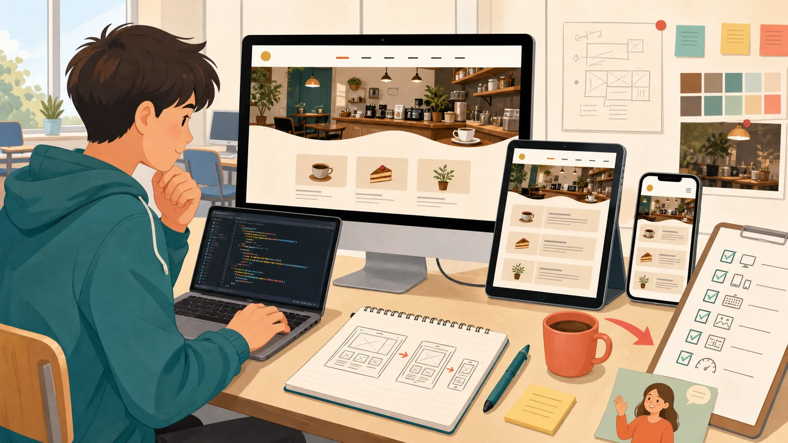

<a id="day-11"></a>

## DAY 11 5つの更新依頼を安全に直して

[← DAY 10](day-10.md#day-10) · [DAY一覧へ](../student-workbook.md#workbook-days) · [DAY 12 →](day-12.md#day-12)

[言葉・構文を読む](#day-11-concepts) · [実習へ進む](#day-11-actions) · [完成条件・提出へ](#day-11-done)

**制作するサイト：** DAY 10終了時の本人の継続サイトを使います。下の制作リンクは場所の参考です。DAY 4で見出し・id・入れ子は変わるため、元の行番号や旧idだけで変更対象を決めません。時間はトップ・店舗案内・JSON-LDで照合し、紹介文の候補と商品名も確認します。



> **佐藤さんからの依頼**
> 添付文章、開店時刻、ラストオーダー、アイスカフェラテの価格、フッターの年を更新してください。

**今日のミッション:** 依頼された場所だけを直し、ステージングで確認してもらう。

### 今日やること

1. 下にある5件の依頼を別々に記録し、対象・対象外・確認待ちを分ける。
2. 自分の継続サイトの開始時点を保存し、確認できた内容だけを1件ずつ変更する。
3. 時間・価格・年などをページ横断で照合する。未確定の内容は変更しない。
4. 確認済みファイルだけを`practice-server/staging`へ配置し、実際の表示URLを記録する。
5. 修正ファイル、5件の比較表、対象外一覧、画面、ステージングURL、確認依頼を提出する。本番相当へはまだ出さない。


**作戦会議:** ダミー文章はどこ？ 開店時刻は何か所？ 価格はどの商品？ 似た商品までまとめて変更していない？ 年にはどんな意味がある？

**今日覚える技:** エディター検索、差分、影響範囲、構造化データ、誤字チェック、確認依頼、承認状態

**制作メモ:** 「変更したもの」と「似ているが変更しなかったもの」を並べよう。

**返信チャレンジ:** 不明点への回答をもらい、確定した5件を分けて報告し、ステージングURLの確認をお願いしよう。

**星チェック:**

- [ ] 全置換しなかった
- [ ] 対象外を守った
- [ ] ラストオーダーを確認した
- [ ] 承認待ちを区別した

### 今日の目的

複数の依頼を混ぜずに、**1件ずつ確認しながら安全に修正する**ことを学びます。

### 今日のゴール

5つの依頼をそれぞれ分けて管理し、依頼された場所だけを変更します。


<a id="day-11-concepts"></a>

### 言葉と構文の読み方

**影響範囲**は変更が関係するページ・項目。**ステージング**は公開前の確認先。**承認**は「この対象を公開してよい」という明示的な判断です。

```html
<p class="price">650円（税込）</p>
```

- `price`は価格へ見た目を付けるclass名。`650`だけを全ファイルで置換すると、別商品の価格も変える危険があります。商品名と税込・税別を一緒に確認します。
- **JSON-LD**は検索サービスなどが読める構造化データ。教材ではHTML内の`<script type="application/ld+json">`にあります。HTML本文を直しても自動では更新されません。文字列の`" "`・項目間の`,`を壊さないようにします。
- **差分**は変更前と変更後の違い。依頼の5件を分けて記録すると、どの変更を確認してもらうか説明できます。

ここは書き方の説明です。既存ファイルを全部消して貼り替えず、下の実習で対象を確認してから使います。

<a id="day-11-actions"></a>

### 実習の進め方

### STEP 1　5つの依頼を分けて書く

**このSTEPで行うこと：5件の依頼整理**

次の依頼本文と添付原稿を開いてから、変更対象を整理します。5件は、添付文章・開店時刻・ラストオーダー・対象商品の価格・フッターの年のことです。

- **添付文章：** [依頼メール3](../../fixtures/emails/03-content-request.md)と[店舗紹介の添付原稿](../../fixtures/attachments/about-copy.md)を読みます。
- **開店時刻・ラストオーダー・対象価格：** [依頼メール4「営業時間と価格」](../../fixtures/emails/04-hours-and-price.md)を読み、分かることと確認待ちを分けます。
- **フッターの年：** [依頼メール5「更新年度」](../../fixtures/emails/05-copyright-year.md)を読み、どの年の表示を指すのか確認します。

依頼本文と添付を読み、文章、開店時刻、ラストオーダー、対象価格、年を別々の行へ書きます。各行に現値・新値・対象・根拠・確認待ちを入れます。

**できたかの見分け方：** 5件の状態を混ぜずに管理できることを、編集画面だけでなく必要な表示・操作で確かめます。「操作した」ことと「期待した結果を見た」ことを分けて考えます。

**そこで止まったとき：** 不明な値をそれらしく埋めません。本文や添付に見当たらない場合は、その項目だけ確認待ちにして質問を準備します。 原因を調べる間は、最後に確かめられた状態を残します。分からない箇所を全部消してやり直すより、今のファイル・今のSTEP・出ている表示を特定すると相談しやすくなります。

**記録の考え方：** このSTEPで実際に見た結果を、今日の制作メモまたはWORKLOGの該当項目へ短く残します。例の成功文を先に写して完了扱いにしません。結果が違った場合も、どこまで進めたかを残せば次に再開する手がかりになります。


最初に次の5項目を制作メモへ書き出します。

- [ ] **添付文章** — 対象：＿＿／確認が必要？：＿＿
- [ ] **開店時刻** — 対象：＿＿／確認が必要？：＿＿
- [ ] **ラストオーダー** — 対象：＿＿／確認が必要？：＿＿
- [ ] **アイスカフェラテ価格** — 対象：＿＿／確認が必要？：＿＿
- [ ] **フッターの年** — 対象：＿＿／確認が必要？：＿＿

### STEP 2　不明点を先に確認する

**このSTEPで行うこと：不明点の確認**

文章候補や商品サイズ、年の意味を質問します。営業時間は開店・閉店・ラストオーダーの関係と曜日も確認します。質問へ返答があった項目から確定へ進めます。

**できたかの見分け方：** 変更してよい根拠が項目ごとに分かることを、編集画面だけでなく必要な表示・操作で確かめます。「操作した」ことと「期待した結果を見た」ことを分けて考えます。

**そこで止まったとき：** 返答がない項目と、すでに回答がある項目を同じ未確認のままにしません。回答元の文と対象を対応させて記録します。 原因を調べる間は、最後に確かめられた状態を残します。分からない箇所を全部消してやり直すより、今のファイル・今のSTEP・出ている表示を特定すると相談しやすくなります。

**記録の考え方：** このSTEPで実際に見た結果を、今日の制作メモまたはWORKLOGの該当項目へ短く残します。例の成功文を先に写して完了扱いにしません。結果が違った場合も、どこまで進めたかを残せば次に再開する手がかりになります。


分からないまま変更しないようにします。

例:

- 開店時刻はどの店舗か
- ラストオーダーは何分前か
- 価格はどのサイズか
- フッターの年は何を表しているか

### STEP 3　1件ずつ変更する

**このSTEPで行うこと：対象限定の変更**

自分の継続サイトで対象語を検索し、1件の変更後に差分と表示を確認します。営業時間は本文だけでなくトップと店舗案内、構造化データも照合します。

**できたかの見分け方：** 1件の変更箇所と関連箇所を追跡できることを、編集画面だけでなく必要な表示・操作で確かめます。「操作した」ことと「期待した結果を見た」ことを分けて考えます。

**そこで止まったとき：** JSON-LDの引用符・カンマを壊すとデータとして読めなくなります。HTML表示が正常でもソースの構文を読み返します。 原因を調べる間は、最後に確かめられた状態を残します。分からない箇所を全部消してやり直すより、今のファイル・今のSTEP・出ている表示を特定すると相談しやすくなります。

**記録の考え方：** このSTEPで実際に見た結果を、今日の制作メモまたはWORKLOGの該当項目へ短く残します。例の成功文を先に写して完了扱いにしません。結果が違った場合も、どこまで進めたかを残せば次に再開する手がかりになります。


No.1を変更して確認したらNo.2へ進みます。

同時に全部変更しないことで、間違いを見つけやすくします。

### STEP 4　変更していない場所も確認する

**このSTEPで行うこと：対象外の照合**

似た名前の別商品、温かい飲み物、別のサイズなどを一覧にします。変更前と比べ、対象商品の価格以外が変わっていないか確認します。

**できたかの見分け方：** 対象外の情報が元と同じ状態で残ることを、編集画面だけでなく必要な表示・操作で確かめます。「操作した」ことと「期待した結果を見た」ことを分けて考えます。

**そこで止まったとき：** 数字が同じだったから一緒に変える、という判断はしません。商品名と条件が違えば別の情報として扱います。 原因を調べる間は、最後に確かめられた状態を残します。分からない箇所を全部消してやり直すより、今のファイル・今のSTEP・出ている表示を特定すると相談しやすくなります。

**記録の考え方：** このSTEPで実際に見た結果を、今日の制作メモまたはWORKLOGの該当項目へ短く残します。例の成功文を先に写して完了扱いにしません。結果が違った場合も、どこまで進めたかを残せば次に再開する手がかりになります。


似た数字や似た商品名があっても、対象外なら変更しません。

### STEP 5　ステージングで確認する

**このSTEPで行うこと：ステージング**

変更対象一覧にあるファイルだけをstagingへ配置します。CSSや画像の配置が必要なら同じ相対位置に置き、実際の確認URLで5件を確かめます。

**できたかの見分け方：** 確定した内容だけを確認先で表示できることを、編集画面だけでなく必要な表示・操作で確かめます。「操作した」ことと「期待した結果を見た」ことを分けて考えます。

**そこで止まったとき：** 手元のローカル画面とstagingの画面を取り違えないようにします。未確定内容を作業中のまままとめて転送しません。 原因を調べる間は、最後に確かめられた状態を残します。分からない箇所を全部消してやり直すより、今のファイル・今のSTEP・出ている表示を特定すると相談しやすくなります。

**記録の考え方：** このSTEPで実際に見た結果を、今日の制作メモまたはWORKLOGの該当項目へ短く残します。例の成功文を先に写して完了扱いにしません。結果が違った場合も、どこまで進めたかを残せば次に再開する手がかりになります。


公開前の確認用URLで、5件すべてを確認します。

### STEP 6　確認依頼を送る

**このSTEPで行うこと：確認依頼**

5件の変更と対象外、確認待ち、URL、特に見てほしい場所を分けて書きます。現時点では確認依頼中であり本番公開済みではないと伝えます。

**できたかの見分け方：** 相手が見るべき対象と状態を誤解なく伝えられることを、編集画面だけでなく必要な表示・操作で確かめます。「操作した」ことと「期待した結果を見た」ことを分けて考えます。

**そこで止まったとき：** 受領されたことを承認と解釈しません。内容の確認と公開可の判断が必要なときは、それを明示して依頼します。 原因を調べる間は、最後に確かめられた状態を残します。分からない箇所を全部消してやり直すより、今のファイル・今のSTEP・出ている表示を特定すると相談しやすくなります。

**記録の考え方：** このSTEPで実際に見た結果を、今日の制作メモまたはWORKLOGの該当項目へ短く残します。例の成功文を先に写して完了扱いにしません。結果が違った場合も、どこまで進めたかを残せば次に再開する手がかりになります。


まだ本番公開ではありません。

「確認してほしい状態」と「公開済み」を区別して報告します。

### 完了チェック

- [ ] 5件を別々に管理した
- [ ] 不明点を確認した
- [ ] 一括置換を使っていない
- [ ] 対象外を変更していない
- [ ] 5件すべて表示を確認した
- [ ] 確認依頼中と公開済みを区別できる

<a id="day-11-done"></a>

### 完成条件・提出するもの

**入力:** 添付文章、営業時間、価格、年の5件

**完成物:** 影響範囲表、対象限定の変更、ステージング、確認依頼

**完成条件:**

- 5件を別々に管理している
- 対象商品以外の価格を変更していない
- 開店時刻とラストオーダーの関係を確認している
- 確定した変更だけをステージングへ出している
- 「確認依頼中」と「承認済み」を区別している

**証拠:** 変更差分、対象外一覧、ステージングURL、確認メール

**追加チャレンジ:** 変更件数が50件なら、どう管理するか考えよう。


[← DAY 10](day-10.md#day-10) · [DAY一覧へ](../student-workbook.md#workbook-days) · [DAY 12 →](day-12.md#day-12)

---
