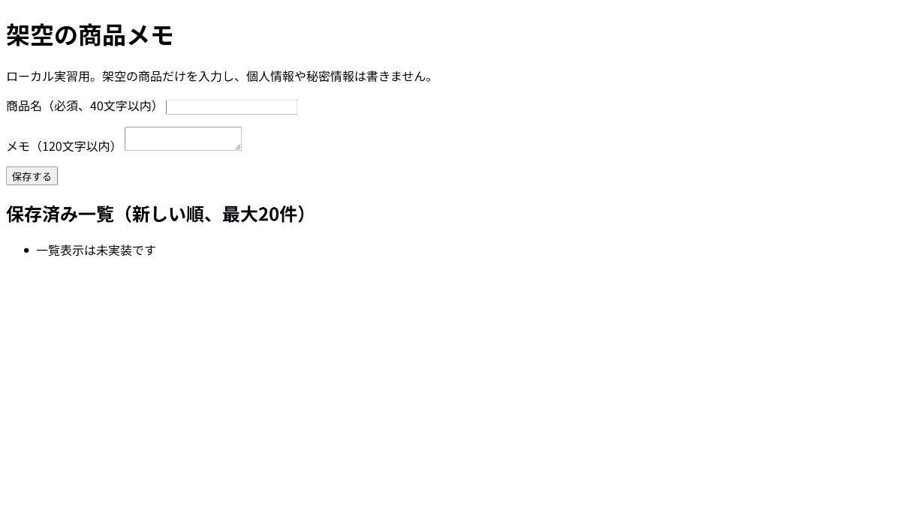
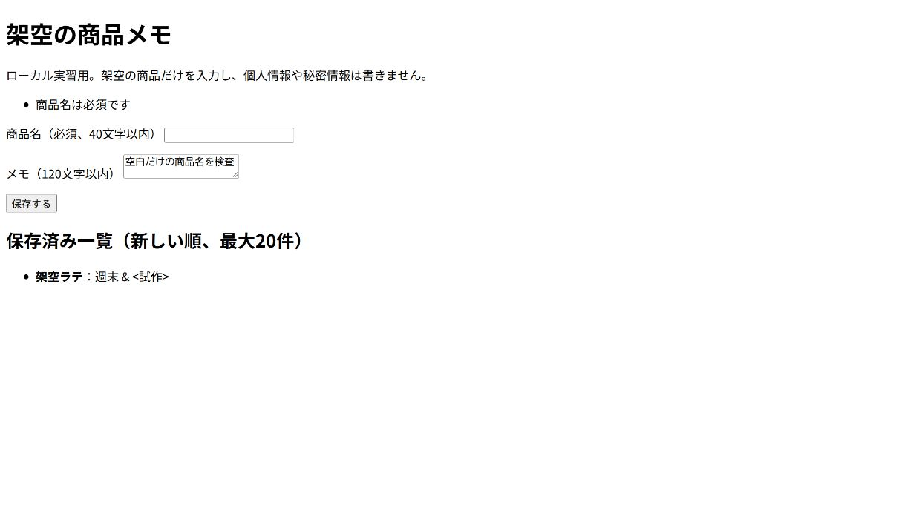
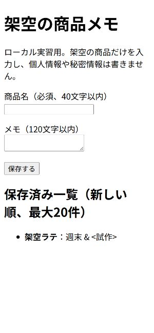

<a id="day-11"></a>

## DAY 11 5つの更新依頼を安全に直して

[← DAY 10](day-10.md#day-10) · [DAY一覧へ](../student-workbook.md#workbook-days) · [DAY 12 →](day-12.md#day-12)

[言葉・構文を読む](#day-11-concepts) · [実習へ進む](#day-11-actions) · [完成条件・提出へ](#day-11-done)

**制作するサイト：** DAY 10終了時の本人の継続サイトを使います。下の制作リンクは場所の参考です。DAY 4で見出し・id・入れ子は変わるため、元の行番号や旧idだけで変更対象を決めません。時間はトップ・店舗案内・JSON-LDで照合し、紹介文の候補と商品名も確認します。


> **佐藤さんからの依頼**
> 添付文章、開店時刻、ラストオーダー、アイスカフェラテの価格、フッターの年を更新してください。

**今日のミッション:** 依頼された場所だけを直し、ステージングで確認してもらう。

### 今日やること

1. 下にある5件の依頼を別々に記録し、対象・対象外・確認待ちを分ける。
2. 自分の継続サイトの開始時点を保存し、確認できた内容だけを1件ずつ変更する。
3. 時間・価格・年などをページ横断で照合する。未確定の内容は変更しない。
4. 確認済みファイルだけを`practice-server/staging`へ配置し、実際の表示URLを記録する。
5. 修正ファイル、5件の比較表、対象外一覧、画面、ステージングURL、確認依頼を提出する。本番相当へはまだ出さない。


**作戦会議:** ダミー文章はどこ？ 開店時刻は何か所？ 価格はどの商品？ 似た商品までまとめて変更していない？ 年にはどんな意味がある？

**今日覚える技:** エディター検索、差分、影響範囲、構造化データ、誤字チェック、確認依頼、承認状態

**制作メモ:** 「変更したもの」と「似ているが変更しなかったもの」を並べよう。

**返信チャレンジ:** 不明点への回答をもらい、確定した5件を分けて報告し、ステージングURLの確認をお願いしよう。

**星チェック:**

- [ ] 全置換しなかった
- [ ] 対象外を守った
- [ ] ラストオーダーを確認した
- [ ] 承認待ちを区別した

### 今日の目的

複数の依頼を混ぜずに、**1件ずつ確認しながら安全に修正する**ことを学びます。

### 今日のゴール

5つの依頼をそれぞれ分けて管理し、依頼された場所だけを変更します。


<a id="day-11-concepts"></a>

### 言葉と構文の読み方

**影響範囲**は変更が関係するページ・項目。**ステージング**は公開前の確認先。**承認**は「この対象を公開してよい」という明示的な判断です。

```html
<p class="price">650円（税込）</p>
```

- `price`は価格へ見た目を付けるclass名。`650`だけを全ファイルで置換すると、別商品の価格も変える危険があります。商品名と税込・税別を一緒に確認します。
- **JSON-LD**は検索サービスなどが読める構造化データ。教材ではHTML内の`<script type="application/ld+json">`にあります。HTML本文を直しても自動では更新されません。文字列の`" "`・項目間の`,`を壊さないようにします。
- **差分**は変更前と変更後の違い。依頼の5件を分けて記録すると、どの変更を確認してもらうか説明できます。

ここは書き方の説明です。既存ファイルを全部消して貼り替えず、下の実習で対象を確認してから使います。

<a id="day-11-actions"></a>

### 実習の進め方

### STEP 1　5つの依頼を分けて書く

**このSTEPで行うこと：5件の依頼整理**

次の依頼本文と添付原稿を開いてから、変更対象を整理します。5件は、添付文章・開店時刻・ラストオーダー・対象商品の価格・フッターの年のことです。

- **添付文章：** [依頼メール3](../../fixtures/emails/03-content-request.md)と[店舗紹介の添付原稿](../../fixtures/attachments/about-copy.md)を読みます。
- **開店時刻・ラストオーダー・対象価格：** [依頼メール4「営業時間と価格」](../../fixtures/emails/04-hours-and-price.md)を読み、分かることと確認待ちを分けます。
- **フッターの年：** [依頼メール5「更新年度」](../../fixtures/emails/05-copyright-year.md)を読み、どの年の表示を指すのか確認します。

依頼本文と添付を読み、文章、開店時刻、ラストオーダー、対象価格、年を別々の行へ書きます。各行に現値・新値・対象・根拠・確認待ちを入れます。

**できたかの見分け方：** 5件の状態を混ぜずに管理できることを、編集画面だけでなく必要な表示・操作で確かめます。「操作した」ことと「期待した結果を見た」ことを分けて考えます。

**そこで止まったとき：** 不明な値をそれらしく埋めません。本文や添付に見当たらない場合は、その項目だけ確認待ちにして質問を準備します。 原因を調べる間は、最後に確かめられた状態を残します。分からない箇所を全部消してやり直すより、今のファイル・今のSTEP・出ている表示を特定すると相談しやすくなります。

**記録の考え方：** このSTEPで実際に見た結果を、今日の制作メモまたはWORKLOGの該当項目へ短く残します。例の成功文を先に写して完了扱いにしません。結果が違った場合も、どこまで進めたかを残せば次に再開する手がかりになります。


最初に次の5項目を制作メモへ書き出します。

- [ ] **添付文章** — 対象：＿＿／確認が必要？：＿＿
- [ ] **開店時刻** — 対象：＿＿／確認が必要？：＿＿
- [ ] **ラストオーダー** — 対象：＿＿／確認が必要？：＿＿
- [ ] **アイスカフェラテ価格** — 対象：＿＿／確認が必要？：＿＿
- [ ] **フッターの年** — 対象：＿＿／確認が必要？：＿＿

### STEP 2　不明点を先に確認する

**このSTEPで行うこと：不明点の確認**

文章候補や商品サイズ、年の意味を質問します。営業時間は開店・閉店・ラストオーダーの関係と曜日も確認します。質問へ返答があった項目から確定へ進めます。

**できたかの見分け方：** 変更してよい根拠が項目ごとに分かることを、編集画面だけでなく必要な表示・操作で確かめます。「操作した」ことと「期待した結果を見た」ことを分けて考えます。

**そこで止まったとき：** 返答がない項目と、すでに回答がある項目を同じ未確認のままにしません。回答元の文と対象を対応させて記録します。 原因を調べる間は、最後に確かめられた状態を残します。分からない箇所を全部消してやり直すより、今のファイル・今のSTEP・出ている表示を特定すると相談しやすくなります。

**記録の考え方：** このSTEPで実際に見た結果を、今日の制作メモまたはWORKLOGの該当項目へ短く残します。例の成功文を先に写して完了扱いにしません。結果が違った場合も、どこまで進めたかを残せば次に再開する手がかりになります。


分からないまま変更しないようにします。

例:

- 開店時刻はどの店舗か
- ラストオーダーは何分前か
- 価格はどのサイズか
- フッターの年は何を表しているか

### STEP 3　1件ずつ変更する

**このSTEPで行うこと：対象限定の変更**

自分の継続サイトで対象語を検索し、1件の変更後に差分と表示を確認します。営業時間は本文だけでなくトップと店舗案内、構造化データも照合します。

**できたかの見分け方：** 1件の変更箇所と関連箇所を追跡できることを、編集画面だけでなく必要な表示・操作で確かめます。「操作した」ことと「期待した結果を見た」ことを分けて考えます。

**そこで止まったとき：** JSON-LDの引用符・カンマを壊すとデータとして読めなくなります。HTML表示が正常でもソースの構文を読み返します。 原因を調べる間は、最後に確かめられた状態を残します。分からない箇所を全部消してやり直すより、今のファイル・今のSTEP・出ている表示を特定すると相談しやすくなります。

**記録の考え方：** このSTEPで実際に見た結果を、今日の制作メモまたはWORKLOGの該当項目へ短く残します。例の成功文を先に写して完了扱いにしません。結果が違った場合も、どこまで進めたかを残せば次に再開する手がかりになります。


No.1を変更して確認したらNo.2へ進みます。

同時に全部変更しないことで、間違いを見つけやすくします。

### STEP 4　変更していない場所も確認する

**このSTEPで行うこと：対象外の照合**

似た名前の別商品、温かい飲み物、別のサイズなどを一覧にします。変更前と比べ、対象商品の価格以外が変わっていないか確認します。

**できたかの見分け方：** 対象外の情報が元と同じ状態で残ることを、編集画面だけでなく必要な表示・操作で確かめます。「操作した」ことと「期待した結果を見た」ことを分けて考えます。

**そこで止まったとき：** 数字が同じだったから一緒に変える、という判断はしません。商品名と条件が違えば別の情報として扱います。 原因を調べる間は、最後に確かめられた状態を残します。分からない箇所を全部消してやり直すより、今のファイル・今のSTEP・出ている表示を特定すると相談しやすくなります。

**記録の考え方：** このSTEPで実際に見た結果を、今日の制作メモまたはWORKLOGの該当項目へ短く残します。例の成功文を先に写して完了扱いにしません。結果が違った場合も、どこまで進めたかを残せば次に再開する手がかりになります。


似た数字や似た商品名があっても、対象外なら変更しません。

### STEP 5　ステージングで確認する

**このSTEPで行うこと：ステージング**

変更対象一覧にあるファイルだけをstagingへ配置します。CSSや画像の配置が必要なら同じ相対位置に置き、実際の確認URLで5件を確かめます。

**できたかの見分け方：** 確定した内容だけを確認先で表示できることを、編集画面だけでなく必要な表示・操作で確かめます。「操作した」ことと「期待した結果を見た」ことを分けて考えます。

**そこで止まったとき：** 手元のローカル画面とstagingの画面を取り違えないようにします。未確定内容を作業中のまままとめて転送しません。 原因を調べる間は、最後に確かめられた状態を残します。分からない箇所を全部消してやり直すより、今のファイル・今のSTEP・出ている表示を特定すると相談しやすくなります。

**記録の考え方：** このSTEPで実際に見た結果を、今日の制作メモまたはWORKLOGの該当項目へ短く残します。例の成功文を先に写して完了扱いにしません。結果が違った場合も、どこまで進めたかを残せば次に再開する手がかりになります。


公開前の確認用URLで、5件すべてを確認します。

### STEP 6　確認依頼を送る

**このSTEPで行うこと：確認依頼**

5件の変更と対象外、確認待ち、URL、特に見てほしい場所を分けて書きます。現時点では確認依頼中であり本番公開済みではないと伝えます。

**できたかの見分け方：** 相手が見るべき対象と状態を誤解なく伝えられることを、編集画面だけでなく必要な表示・操作で確かめます。「操作した」ことと「期待した結果を見た」ことを分けて考えます。

**そこで止まったとき：** 受領されたことを承認と解釈しません。内容の確認と公開可の判断が必要なときは、それを明示して依頼します。 原因を調べる間は、最後に確かめられた状態を残します。分からない箇所を全部消してやり直すより、今のファイル・今のSTEP・出ている表示を特定すると相談しやすくなります。

**記録の考え方：** このSTEPで実際に見た結果を、今日の制作メモまたはWORKLOGの該当項目へ短く残します。例の成功文を先に写して完了扱いにしません。結果が違った場合も、どこまで進めたかを残せば次に再開する手がかりになります。


まだ本番公開ではありません。

「確認してほしい状態」と「公開済み」を区別して報告します。

### 完了チェック

- [ ] 5件を別々に管理した
- [ ] 不明点を確認した
- [ ] 一括置換を使っていない
- [ ] 対象外を変更していない
- [ ] 5件すべて表示を確認した
- [ ] 確認依頼中と公開済みを区別できる

<a id="day-11-done"></a>

### 完成条件・提出するもの

**入力:** 添付文章、営業時間、価格、年の5件

**完成物:** 影響範囲表、対象限定の変更、ステージング、確認依頼

**完成条件:**

- 5件を別々に管理している
- 対象商品以外の価格を変更していない
- 開店時刻とラストオーダーの関係を確認している
- 確定した変更だけをステージングへ出している
- 「確認依頼中」と「承認済み」を区別している

**証拠:** 変更差分、対象外一覧、ステージングURL、確認メール

**追加チャレンジ:** 変更件数が50件なら、どう管理するか考えよう。

<a id="python-template"></a>

### 選択追加課題：Pythonで店舗案内を生成する

[追加課題の構文](#python-template-concepts) · [実習](#python-template-actions) · [完成条件・提出](#python-template-done)

**依頼者：** NORTH LIGHT COFFEEの佐藤さん。**見る人：** 来店前に支店の営業状況を知りたい人。

> 支店が増えると、同じ形のHTMLを何度も直すのが大変です。店舗データから案内を作り、休業中の店には営業時間の代わりに「本日休業」と出せますか。まずは手元だけで試作してください。

**目的：** 同じ形の情報をPythonのデータで管理し、Jinja2（ジンジャ・ツー）でHTMLへ変換する。変数埋め込み、繰り返し、条件分岐を体験します。

**変更対象：** 自分専用コピーの`data.py`と`templates/index.html`。`render.py`は用意済みの生成プログラムとして読みます。**対象外：** 継続中のカフェサイト、CSS、公開・メール送信、基本DAY11の5件の依頼。データはすべて架空です。

**位置づけ：** DAY 6の商品カードとDAY 11の複数更新を終えた人向けの別枠です。基本15回の順番・課題は変わりません。Pythonは既習とみなしません。準備を含め90〜120分を目安としますが、初学者の所要時間は未実測です。終わったら[DAY 12](day-12.md#day-12)へ戻ります。

<a id="python-template-concepts"></a>

#### 言葉・構文を先に読む

- **Python（パイソン）：** データを扱い、生成プログラムを動かす言語。`.py`はPythonのファイルです。
- **文字列：** `"駅前店"`のように引用符で囲む文字。引用符・かっこ・コロン・カンマは半角です。
- **辞書：** `{"name": "駅前店"}`のように項目名（キー）と値を組にする入れ物。`shop.name`は渡された辞書の`name`を読むJinja2の書き方です。
- **リスト：** `[辞書1, 辞書2]`のように順に並べる入れ物。`BRANCHES`に支店の辞書を並べます。
- **真偽値：** Pythonの`True`（はい）と`False`（いいえ）。`closed`は「休業か」です。引用符で囲んだ`"False"`は文字列なので使いません。
- **テンプレート：** 固定のHTMLと、あとでデータが入る印を持つひな型。ブラウザはJinja2の印を処理できません。
- **テンプレートエンジン：** データをひな型に当てはめ、最終的な文字列を作る道具。ここではJinja2を使います。
- **生成HTML：** エンジンが書き出した結果。ブラウザにはこのファイルを開きます。Pythonをブラウザ内で実行する仕組みではありません。

例は別の題材です。下の実習で店舗データの名前へ読み替えます。

```jinja
<h1>{{ event.title }}</h1>

  <p>{{ session.name }}</p>
  
    <p>中止</p>
  
    <p>{{ session.start }}</p>
  

```

- **`{{ ... }}`：** 値を文字として埋め込む印。かっこは二重です。
- **``〜``：** リストから1件ずつ取り出し、間のHTMLを繰り返します。`session`はその1件につけた名前です。
- **``〜``〜``：** 条件が真なら前半、偽なら後半のHTMLを選びます。両方を同時に出しません。
- **HTMLエスケープ：** データ中の`<`を`&lt;`、`&`を`&amp;`などへ変換し、文字をHTMLのタグと誤解させないこと。ブラウザ上では元の文字として読めます。用意済みの`render.py`はHTML用に有効化しています。`|safe`を付けたり、エスケープを無効化したりしません。データをJavaScript・URL・CSSへ埋める課題ではありません。
- **`StrictUndefined`：** 項目名の打ち間違いを空欄にせずエラーにする設定です。

**3つの役割：** `data.py`（内容）＋`templates/index.html`（構造と表示ルール）→`render.py`で生成→`output/index.html`（表示結果）。生成HTMLだけを直接直しても、次の生成で上書きされます。

<a id="python-template-actions"></a>

#### STEP 1　準備して開始状態を保存する

教材フォルダー全体を自分のPCへ用意し、VS Codeでそのルートを開きます。`hht/hands-on/python-store-guide/starter`を、ルート直下へ`python-store-work`という名前でコピーします。原本`starter`や講師用フォルダーは編集しません。`python-store-work`のコピーを別に`before`として保存します。既に同名の作業があれば別名を選び、以降のコマンドも読み替えます。

この追加課題には**Python 3.11以上とJinja2**が必要です。基本HTML/CSS演習だけなら不要です。VS Codeの「ターミナル」→「新しいターミナル」を開き、まずWindows PowerShellで次を1行ずつ実行します。`>>>`と出た場合はPython対話画面なので`exit()`で抜けてから行います。

```powershell
python --version
python -m pip --version
```

`Python 3.11`以上（例：`Python 3.14.6`）とpipのバージョンが出ることを確認します。`python`が見つからず`py -3 --version`で動く場合、以下の最初の`python -m venv`を`py -3 -m venv`へ読み替えます。どちらも動かない・pipがない・3.10以下の場合は、ここで止めて講師へ表示を報告し、Python導入済みの学校PCを使います。アカウント作成やPCの認証・ネットワーク設定変更はしません。

ルートに`README.md`と`hht`が見えていることを確かめ、次を実行します。

```powershell
cd python-store-work
python -m venv .venv
.\.venv\Scripts\python.exe -m pip install -r requirements.txt
.\.venv\Scripts\python.exe -c "import jinja2; print(jinja2.__version__)"
.\.venv\Scripts\python.exe render.py
```

仮想環境はこの課題専用のPythonとライブラリの置き場です。有効化コマンドは不要です。期待値はJinja2の`3.1.6`、続いて`Generated: output/index.html`です。初回のインストールにはパッケージ取得が必要です。学校で取得を許可していない場合は設定を変えず、講師が同じ`requirements.txt`から準備した環境を使います。

macOS/Linuxでは`python3 -m venv .venv`で作成し、以降の`.\.venv\Scripts\python.exe`を`./.venv/bin/python`に読み替えます。カレントディレクトリは同じです。

エクスプローラーから`python-store-work/output/index.html`をブラウザで開きます。開始時は「店舗名をここに表示」「営業状況」と出れば正しい開始状態です。この時点では未完成です。テンプレート自体を開いていないかアドレスも確かめます。


#### STEP 2　依頼どおりにデータを編集する

VS Codeの左のファイル一覧から`python-store-work/data.py`を開き、次だけを変更して保存（Ctrl+S）します。`render.py`は`SHOP`を`shop`、`BRANCHES`を`branches`という名前でテンプレートへ渡しています。

1. `SHOP`の`notice`を`"<臨時案内> & 週末"`にする。店舗名は保持する。
2. 駅前店の`hours`を`"09:00〜19:00"`へ直す。
3. 公園店は`closed: True`と元の営業時間を保持する。
4. `BRANCHES`の最後に辞書を1件追加する。`name`は`"港店"`、`hours`は`"12:00〜17:00"`、`closed`は`False`。前の辞書との間をカンマで区切る。

保存後に生成コマンドを再実行しても、まだ固定の仮表示です。データを変えるだけでは、データを参照していないテンプレートの表示は変わらないことを記録します。

#### STEP 3　テンプレートへ3つの仕組みを入れる

`python-store-work/templates/index.html`を開き、TODOの場所を編集します。固定HTMLの`main`、見出しの順番、`ul`・`li`の構造は保持します。

1. **TODO 1：** `h1`の仮文字を`shop.name`の埋め込みへ、`id="notice"`の段落の仮文字を`shop.notice`の埋め込みへ置き換える。
2. **TODO 2：** `branches`から1件を`branch`として取り出す`for`で、`li`全体を囲む。終了の`endfor`は`</li>`の後、`</ul>`の前。`h3`は`branch.name`の埋め込みにする。
3. **TODO 3：** `branch.closed`を条件にする。真なら`<p>本日休業</p>`、偽なら`<p>営業時間：…</p>`の`…`へ`branch.hours`を埋め込む。`endif`で条件を閉じる。

Ctrl+Sで保存し、同じターミナルで再生成します。ブラウザは自動で生成しません。

```powershell
.\.venv\Scripts\python.exe render.py
```

成功メッセージを見てからブラウザを再読み込みします。店舗名、お知らせ、駅前店の営業時間、公園店の休業表示、港店の営業時間が順に出ます。公園店の営業時間は出しません。


#### STEP 4　ソースと画面を照合し、変化を試す

`output/index.html`をVS Codeで開いて、Jinja2の印が残らず通常のHTMLになっているか確認します。お知らせのソースは`&lt;臨時案内&gt; &amp; 週末`となり、ブラウザの画面では`<臨時案内> & 週末`と読めます。文字がタグとして消えていないことを確かめます。

ソースの確認では、ブラウザ画面とファイル内の実体参照を区別します。

1. `data.py`の公園店だけを一時的に`False`へ変え、保存→再生成→再読み込みする。「本日休業」が消え、`11:00〜18:00`が出ることを記録する。`True`へ戻して再生成する。


2. 生成HTMLのお知らせだけを一時的に書き換え、保存→再読み込みする。続いて再生成し、データどおりの表示に戻ることを記録する。
3. 元の完成データに戻ったことを確かめ、以下の自動確認を実行する。検査は一時コピー内で別データも試し、本人の作業ファイルは書き換えない。自分または学校配布のコードだけを実行する。

```powershell
.\.venv\Scripts\python.exe ..\hht\hands-on\python-store-guide\tests\check.py .
```

期待結果は`Ran 7 tests`と`OK`、終了コード0です。FAILならテスト名と`AssertionError`にある期待値・実際の値を読みます。開始データのままではFAILになります。テストの成功は、表示や説明まで合格したことを意味しません。

#### 止まったときの調べ方

- **`can't open file`／パスが見つからない：** ターミナルの現在位置を`pwd`（Windowsは`Get-Location`でも可）で確認。`python-store-work`に`render.py`があるか調べる。
- **`No module named jinja2`：** 仮想環境のPythonで動かしているか確認し、そのPythonで`-m pip install -r requirements.txt`をやり直す。
- **インストール時の接続・権限エラー：** 表示を保存して講師へ報告。証明書検証や認証、プロキシ、実行ポリシーを変更しない。
- **`SyntaxError`：** `data.py`の指された行と直前を読む。引用符、カンマ、`[]`・`{}`、`True`・`False`の大文字を確かめる。
- **`TemplateSyntaxError`：** テンプレートの行番号を見る。`{{ }}`と``の取り違え、`endif`・`endfor`の不足を確かめる。
- **`UndefinedError`：** `shop`・`branches`・`branch`、各項目名のつづりを確認する。生成失敗時は前のHTMLが残るため、ブラウザの見た目だけで成功扱いにしない。
- **`TemplateNotFound`：** `templates/index.html`の名前と配置を確認する。`index.html.txt`になっていないかも調べる。
- **表示が変わらない：** 保存→生成の成功メッセージ→`output/index.html`の再読み込みの順を確認。HTML中に`{{`が見える場合はテンプレートを直接開いていないか調べる。
- **全店舗に営業時間が出る：** `closed`が文字列でないか、ifとelseのどちらに段落を書いたかを確認する。

<a id="python-template-done"></a>

#### 完成条件・提出・自己確認

**完成条件：** 次をすべて満たせば、この追加課題の完成とします。

- [ ] 依頼者・見る人・対象と対象外をWORKLOGに書いた。
- [ ] 指定した3店舗をデータ順で表示し、データの追加・値変更が再生成で反映される。
- [ ] 店舗名とお知らせは変数で埋め込み、店舗一覧は繰り返し、営業状況は条件分岐で生成する。完成HTMLの直書きだけで済ませていない。
- [ ] 公園店は「本日休業」だけを出し、営業中の駅前店・港店は指定の営業時間を出す。真偽の切替確認後は指定データへ戻した。
- [ ] お知らせを文字として読める。生成ソースのエスケープを確認し、`|safe`やエスケープ無効化を使っていない。
- [ ] 自動確認7件がOK。ブラウザでも3店舗を確認し、狭い画面で文字が読めることを確認した。
- [ ] 「データ／テンプレート／生成HTMLの違い」と「生成HTMLだけの変更が再生成で消える理由」を自分の言葉で説明した。
- [ ] 継続サイトを変更せず、確認内容と未確認事項を依頼者への報告案に分けた。公開・送信はしない。

**提出物：** 匿名番号を使った`template-匿名番号.zip`へ、`before/`（開始時のソース）、`after/`（完成した`data.py`・`render.py`・`requirements.txt`・`templates/`・`output/index.html`）、`WORKLOG.md`、`evidence/`（完成画面、休業切替の比較、エスケープを確認したソース画面、実行したテストの結果テキスト）を入れます。仮想環境`.venv`と`__pycache__`、講師用正解例は入れません。

ZIPを別のフォルダーへ再展開し、`after/output/index.html`を開いて内容を確認します。ソースを再実行する場合は再展開先の`after`でSTEP 1と同じ仮想環境作成・依存導入を行います。学校指定の回収先へ提出し、回収先が未配布ならZIPを保存して確認待ちと記録します。GitHubへの提出・公開はこの追加課題に含めません。

**評価との関係：** 上の完成条件がこの追加課題の合格条件です。未完成なら失敗した工程と原因・再確認を残して再提出します。基本15回の[授業全体の合格ルート](../rubric.md#合格ルート)へPythonの必須条件は追加しません。参加記録と追加課題の完成を区別します。

[DAY 11へ戻る](#day-11) · [DAY一覧へ](../student-workbook.md#workbook-days) · [DAY 12へ進む](day-12.md#day-12)

<a id="python-form"></a>

### 選択追加課題：フォームをPythonで受け取り保存する

[用語と流れ](#python-form-concepts) · [実習](#python-form-actions) · [完成条件・提出](#python-form-done)

**依頼者：** NORTH LIGHT COFFEEの佐藤さん。**見る人：** 新商品の案を整理する担当者役の自分。

> 店舗案内を作れたので、次は架空の商品メモをフォームから残せますか。空の商品名は保存せず、保存済みの案を一覧で見たいです。アプリをいったん終了しても残るよう、手元だけで試してください。

**目的：** HTMLのフォームから送った値をPythonで読み、入力を検査してSQLiteへ保存し、Jinja2の一覧へ戻す。前の課題の「Pythonのデータ→テンプレート」を、「フォーム→データベース→テンプレート」につなげます。

**前提と範囲：** [店舗案内のテンプレート課題](#python-template)を終えてから、別枠120〜150分を目安に取り組みます。Pythonの関数・SQLは初出として下で説明します。編集対象は本人専用コピーの`app.py`のTODO A〜Dと`templates/index.html`のTODO Eです。DAY 7の問い合わせフォームや継続サイトは変更しません。通常のフォーム送信だけを使い、JSON送信・ファイルアップロード・multipartは実装しません。

**扱うのは架空の商品名とメモだけです。** 氏名、メールアドレス、実在の顧客情報、パスワード、秘密情報は入力しません。外部公開・本番利用・実サイトへの送信は対象外です。

<a id="python-form-concepts"></a>

#### 用語・構文・処理の流れ

- **Flask（フラスク）：** ブラウザからの要求を受け、Pythonの処理とHTMLの返答を結ぶ小さなWeb用ライブラリ。Jinja2を使えます。
- **GET：** ページを読む要求。この課題ではフォームと保存済み一覧を表示し、保存はしません。URLに`?item=...`を足しても保存されません。
- **POST：** 本文に値を入れて送る要求。この課題では検査して保存します。POSTであるだけでは暗号化や認証にはなりません。
- **Form data：** 通常の`<form method="post">`で送る名前と値。この課題の送信形式は既定の`application/x-www-form-urlencoded`です。日本語・空白・`&`などは送信時に符号化され、Flaskが読み戻します。`multipart/form-data`は主にファイル送信などで使う別の形式で、今回は不要です。
- **JSONとの違い：** JSONは`{"item":"架空ラテ"}`のような構造をJSON形式で送るもの。`Content-Type: application/json`と`request.get_json()`を使う別経路です。今回の`request.form`へJSONは入りません。JSONやmultipartを送ると415で拒否します。
- **`name`：** HTMLの入力欄につける送信キー。`name="item"`の値はPythonで`request.form.get("item", "")`と読みます。`id="item"`はラベルと結ぶための目印で、送信キーの代わりにはなりません。
- **関数：** `def validate(item, note):`で処理に名前を付け、`return`で結果を返します。関数の中は半角空白4つでそろえます。
- **`.get("item", "")`：** キーがないときも空文字を返します。**`.strip()`**は前後の空白を除きます。**`len(item)`**は文字数です。
- **入力チェック：** 商品名は空白を除いて必須・40文字以内。メモは任意・120文字以内。ブラウザの`required`と`maxlength`に加えて、Python側でも検査します。ブラウザを通さない送信もあるためです。
- **SQLite（エスキューライト）：** Python標準の`sqlite3`で使えるファイル型データベース。別のDBサーバーを登録・起動する必要はありません。
- **SQL：** データベースに保存・読込を頼む言葉。`INSERT`は行を追加、`SELECT`は行を読む、`ORDER BY id DESC LIMIT 20`は新しいIDから最大20件です。21件目以降の古い記録は消えず、一覧の外に残ります。
- **パラメーター化：** SQLの形と値を分けること。値を`f"...{item}..."`や`+ item`でSQLへ連結しません。

別題材の書き方の例です。

```python
def validate_title(title):
    errors = []
    if not title:
        errors.append("題名は必須です")
    return errors

with db:
    db.execute("INSERT INTO ideas (title) VALUES (?)", (title,))
```

`errors`はエラー文を並べるリスト。空リストならエラーなしです。`with db:`は正常終了時に変更を確定（コミット）し、途中の例外では取り消します。`?`に値を渡す部分がパラメーターです。値が1個のタプルは`(title,)`と末尾カンマを付け、今回の2個は`(item, note)`とします。

**今回の1往復：** GET `/`→空のフォームと一覧→POST `/`→`request.form`→入力検査→不正なら400とエラー画面／正しければINSERTとコミット→303でGET `/`へ移動→SELECT→Jinja2で一覧。保存後をGETへ戻すので、通常の再読み込みだけで再POSTしません。二重クリックなどあらゆる重複を防ぐ仕組みではありません。

**保存先：** 作業コピーの`instance/notes.sqlite3`です。初回起動でフォルダーとテーブルを作ります。`CREATE TABLE IF NOT EXISTS`なので、再起動しても既存データは消しません。Pythonの変数だけに保存した場合と違い、ファイルが残るから読み直せます。ファイルを移動・削除したり別の作業コピーを起動したりすると、同じ一覧にはなりません。

<a id="python-form-actions"></a>

#### STEP 1　開始コピーと専用環境を用意する

教材ルートの`hht/hands-on/python-form-notes/starter`を、ルート直下の`python-form-work`へコピーします。既存の同名フォルダーには重ねません。開始ソースを別の`before/`へ保存し、以降は作業コピーだけを編集します。

前の課題と同じPython 3.11以上を使います。ルートで新しいターミナルを開き、Windows PowerShellでは次を実行します。

```powershell
cd python-form-work
python -m venv .venv
.\.venv\Scripts\python.exe -m pip install -r requirements.txt
.\.venv\Scripts\python.exe -c "from importlib.metadata import version; print(version('Flask'))"
.\.venv\Scripts\python.exe app.py
```

期待値はFlaskの`3.1.2`と`Running on http://127.0.0.1:5000`です。ターミナルはサーバーの待受中です。この状態で同じターミナルへ次のコマンドを打ちません。macOS/Linuxでは`python3`で環境を作り、以降のPythonパスを`./.venv/bin/python`に読み替えます。

ブラウザで`http://127.0.0.1:5000/`を開きます。`templates/index.html`を直接開いたり、Live Previewで配信したりしてもPythonの受信処理は動きません。開始状態は入力欄と「一覧表示は未実装です」が見え、送信すると「入力チェックが未実装です」が出ます。保存できたと解釈しません。



#### STEP 2　TODO A・B：受信と検査を作る

VS Codeで`python-form-work/app.py`を開きます。用意済みの`index()`がPOSTを判定して`read_form`→`validate`→`save_entry`を呼ぶ部分も先に読みます。サーバーの配線、接続・終了処理、SQLのテーブル定義、localhostの設定は保持します。

1. **TODO A `read_form(form)`：** `form.get`で`"item"`と`"note"`を読み、それぞれ`.strip()`した2値を`return 商品名, メモ`の順に返す。対応するHTMLの`name`を確認する。
2. **TODO B `validate(item, note)`：** `errors = []`から始める。空の商品名なら`"商品名は必須です"`、40文字超なら`"商品名は40文字以内です"`、メモ120文字超なら`"メモは120文字以内です"`を`errors.append`する。最後に`return errors`とする。開始時の「未実装」のエラーは置き換える。

**保存→サーバーのターミナルでCtrl+C→同じ起動コマンドを再実行→ブラウザ再読込**の順で反映します。自動再起動・デバッガーは使いません。この段階で正常入力を送ると保存処理が未実装なのでエラーになります。まず検査の処理を読み、次のSTEPで保存を完成させます。

#### STEP 3　TODO C・D・E：保存と読込をつなぐ

1. **TODO C `save_entry(db, item, note)`：** `with db:`の中で`db.execute`を呼ぶ。SQLは`INSERT INTO entries (item, note) VALUES (?, ?)`、別の引数で値のタプル`(item, note)`を渡す。`raise NotImplementedError`は置き換える。
2. **TODO D `list_entries(db)`：** `db.execute("SELECT id, item, note FROM entries ORDER BY id DESC LIMIT 20").fetchall()`を返す。`fetchall()`は検索結果の行をリストとして取り出す。
3. **TODO E `templates/index.html`：** `entries`から1行を`entry`として取り出す`for`を作り、1行ごとに`li`を出す。`strong`の中に`entry.item`、続く本文に`entry.note`を埋め込む。`for`の`else`（0行の場合）では`<li>まだ保存されていません</li>`を出し、`endfor`で閉じる。前の課題の`if`の`else`とは用途が違う。フォームとエラー表示の配布済み部分は保持する。

HTMLの値は`{{ ... }}`のままで自動エスケープされます。`|safe`、`Markup`、HTML文字列への連結は使いません。入力欄の`value="{{ item }}"`の引用符も保持します。

保存→停止→起動→再読込したら、初回は「まだ保存されていません」です。商品名`架空ラテ`、メモ`週末 & <試作>`を入れ、「保存する」を押します。入力欄は空に戻り、一覧にその文字がそのまま読めます。タグや画像として実行されません。


#### STEP 4　不正入力・再表示・再起動を検証する

1. 空欄で保存を押すとブラウザの必須チェックが止める。これはPythonの検査を確かめたことにはならない。次に商品名へ半角空白3つ、メモへ「空白だけの商品名を検査」を入れて送る。空白はブラウザのrequiredを通るが、Python側で除去され、400と「商品名は必須です」が表示される。一覧が増えないこととメモの保持も確認する。
2. 完成したソースを保存し、サーバーをCtrl+Cで止める。同じターミナルで共通テストを実行する。

```powershell
.\.venv\Scripts\python.exe ..\hht\hands-on\python-form-notes\tests\check.py .
```

期待値は`Ran 10 tests`、`OK`、HTTPテストPIDの`cleanup PASS`です。テストは本人のソースを一時コピーへ移し、別DBで実行します。本人のDBは書き換えません。ブラウザ制約を通さず必須違反・41文字・121文字を送り、400でエラー表示され保存されないことも確かめます。40文字・120文字は保存可です。JSON・multipartは415、4096バイトを超える送信は413です。長さはこの課題ではPythonの`len`で数えます。



3. もう一度`.\.venv\Scripts\python.exe app.py`で起動し、ブラウザを再読み込みする。先ほど本人が入れた`架空ラテ`が残っていることを確認する。同じ画面を2回再読込しても行数が増えないことも記録する。
4. サーバーのあるターミナルをCtrl+Cで止め、再起動→再読込し、もう一度残存を確認する。テストでも実HTTPサーバーを別プロセスで2回起動して、同じDBの保持を確認する。
5. 作業コピーの`instance/notes.sqlite3`が保存先であることを確認する。ファイルをエディターで文字として編集しない。使い終わったらCtrl+Cでサーバーを終了する。


375px幅でも入力欄と一覧が読めることを確認します。



**公開運用との境界：** このアプリには認証・認可・CSRFトークン・本番用サーバー・運用監視がありません。localhostの待受と外部Origin・Hostの拒否は補助で、CSRF対策が完成したことを意味しません。公開にはそれらに加えHTTPS、秘密情報管理、バックアップ、権限や送信頻度等の設計・検証が必要です。今回は外部公開・ホスト変更・トンネル・学校ネットワークの設定変更は行いません。

#### 止まったとき

- **Flaskが見つからない：** 作業コピー専用のPythonで`-m pip install -r requirements.txt`を行ったか確認。取得不可なら設定を変えず講師へ報告する。
- **5000番が使用中・起動不可：** 自分が前に起動したサーバーだけをCtrl+Cで終了する。他人のプロセスを止めたり、ネットワーク設定を変えたりせず、解消しなければ講師へ報告する。
- **接続拒否：** ターミナルで起動が成功しているか、URLが`http://127.0.0.1:5000/`か確認する。
- **400：** 入力チェックの失敗。画面のエラーと文字数・空白を確認する。開始時の未実装エラーならTODO Bを確認する。
- **415：** 普通のフォーム以外の形式。`method="post"`と`name`を保持し、JSON・multipartに変更していないか確認する。
- **500／`NotImplementedError`：** ターミナルの例外の行とTODO Cを確認する。SQLiteの`no such table`ならテーブル名が`entries`か、`no such column`なら`item`・`note`のつづりを確認する。
- **保存されたのに表示がない：** TODO Dの返り値、TODO Eのループ・キー・エスケープと、再起動した作業場所を確認する。
- **再起動後に空になる：** 別コピーの`app.py`や異なるDBを開いていないか、`instance/notes.sqlite3`を移動していないか確認。起動時に`DROP TABLE`やDB削除を追加しない。

<a id="python-form-done"></a>

#### 完成条件・提出・自己確認

**完成条件：** 次をすべて満たせば、この追加課題の完成です。

- [ ] 依頼と対象・対象外を書き、フォームの`name`とPythonのキーが一致する理由を説明した。
- [ ] 通常のフォームPOSTを受け、必須・40文字・120文字の検査をサーバーで行う。不正なら保存せずエラーと入力値を再表示する。
- [ ] 正常ならパラメーター化したSQLとコミットで保存し、303でGETへ戻す。新しい順の最大20件をJinja2で表示する。
- [ ] 記号を含む文字がタグにならず表示される。SQLへの文字列連結、`|safe`、認証情報は含まない。
- [ ] 自動テスト10件がOKで、HTTP検証用プロセスの終了もPASS。本人のブラウザでも保存・一覧・再読込・停止後再起動の保持を確認した。
- [ ] GETとPOST、Form dataとJSONの違い、保存ファイルと永続化、公開用に不足する対策を自分の言葉で記録した。
- [ ] 架空データ・localhostだけを使い、検証後にサーバーを停止した。

**提出物：** `form-匿名番号.zip`に`before/`（開始ソース）、`after/`（完成した`app.py`・`requirements.txt`・`templates/`）、`WORKLOG.md`、`evidence/`（完成一覧、不正入力のテスト結果、再起動前後の画面、10件の自動テストのテキスト結果）を入れます。**DBファイル・`instance/`・`.venv`・`__pycache__`・講師用正解例は入れません。** 記録した架空データはWORKLOGへ書き、DB自体は提出しません。

ZIPを別フォルダーへ再展開し、`after/`でSTEP 1と同様に環境を準備して起動します。DBを含めていないので最初は空です。同じ架空データを入力して確認し、停止します。学校指定の回収先がなければ保存して確認待ちと記録します。Git利用者もDBが除外されていることを確認し、コードと証拠だけを提出します。

**評価：** この欄が追加課題の合格条件です。機械検査とは別に画面・説明・停止を確認します。基本15回の[授業全体の合格ルート](../rubric.md#合格ルート)へ必須条件は追加しません。未完成工程は正直に記録し、修正後に再確認します。

[テンプレート課題へ](#python-template) · [DAY 11へ戻る](#day-11) · [DAY一覧へ](../student-workbook.md#workbook-days) · [DAY 12へ](day-12.md#day-12)


[← DAY 10](day-10.md#day-10) · [DAY一覧へ](../student-workbook.md#workbook-days) · [DAY 12 →](day-12.md#day-12)

---
