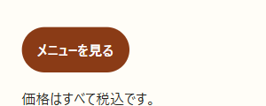
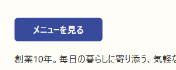
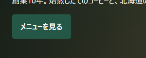
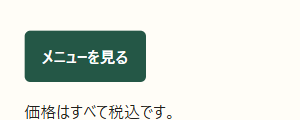
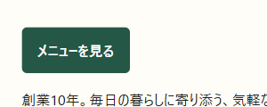

# DAY 3 ボタンのデザインをそろえて

[目次](../student-workbook.md) · [共通手順](./common.md#local-git-workflow) · [前の回：DAY 2](./day02.md) · [次の回：DAY 4](./day04.md)

💾 **Gitでの記録：** [共通の作業手順](common.md#local-git-workflow)で、作業前後の変更を記録します。  
開始タグは `day03-start`、作業後のタグは `day03-end`です。

**この回の開始データ：** ZIPの中のHTMLとCSSを `hht/practice/day03`の直下へ入れます。  
二重のフォルダーになったら、`about.html`と`css`がこの直下にあるか確かめます。  
まだ修正せず、配布状態をGitへコミットしてから `day03-start`を付けます。  
手順は[ローカルGitの開始データの記録](../local-git.md#practice-baseline)を参照します。


**仕事のイメージ：** 色だけでなく、角の形と余白もそろえると同じ役目が伝わります。

> **佐藤さんからの依頼**  
> ページによって「メニューを見る」ボタンの色や形が違います。  
> 同じデザインにそろえられますか？

**今回の課題:** どのページでも、同じボタンだと分かるようにします。

- **依頼者／見る人**：店舗責任者の佐藤さん／メニューを探すお客さま
- **困っていること**：同じ「メニューを見る」なのに、色や形が違う
- **変えるところ**：3ページの対象リンクの色・形・内側の余白。  
  共通のclassと外部CSSでそろえる
- **変えないところ**：本文、商品・価格、リンク先、ほかのリンクや見出し
- **完成の目印**：3ページで見た目がそろい、CSSが競合した理由を説明できる

> **授業用に確認済みの仕様：** ホームの緑色を基準にします。  
> 色・角の丸み・内側の余白をそろえます。  
> 実際の依頼なら、基準のデザインが決まっているか作業前に質問します。

### お客さまの「同じボタンかな？」を減らします

緑、茶色、青。  
ページを移るたびに見た目が変わると、同じ行き先でも迷いそうです。  
基準の緑色にそろえるため、まず今の指定を調べます。

### 開くファイル：DAY 3

**VS Codeで開くもの：** `hht/practice/day03` フォルダー内の `index.html`・`menu.html`・`about.html` と `css/style.css`。

**ブラウザで見るページ：** この回の[開始ZIP](../../lessons/03/day3-start.zip)を展開したコピーです。  
教材の `hht/lessons/03/start` は原本の参照先です。


**見る場所（画像の番号と対応）:**

- **① 対象ボタン**：「店舗案内」の見出しの下にある青い「メニューを見る」です。  
  開始ZIPの`about.html`では`<a class="menu-button" id="shop-menu">`に当たります。  
  右クリックして「検証」を開きます。
- **② ナビ**：右上の「メニュー」は、ページを移動するための別のリンクです。  
  ①の色・角丸・内側の余白を調べるときに、②を選ばないようにします。

### この順に、ひとつずつ進めます

1. 下の3枚の画面を見て、色・角・余白の違いを言葉にします。
2. 「使うファイル」から開始ZIPを受け取り、自分用にコピーしたフォルダーを開きます。
3. 「① 調べる」で、採用されたCSSを開発者ツールで確かめます。
4. 「② 決めて直す」で、残す指定と整理する指定を決めます。
5. 3ページを保存し、色・角・余白と元のリンク先を確かめます。
6. 調査メモと返信を書き、下の完成条件を確認します。

### 判断の例です

> **やりたいこと：** 同じ役目のリンクだと分かるようにしたいです。  
>
> **そのためにすること：** 共通classを使い、その指定を上書きしているCSSを整理します。  
>
> **報告の例：** 見た目をそろえました。  
> メニューページ内のリンク先は元のままです。

### 操作のコツ：打ち消し線も手掛かりです

Stylesの打ち消し線は、その指定が別の指定に上書きされた印です。  
「CSSを書いてあるのに効かない」ときは、採用された値とセットで読むと理由を探せます。

### 最初に見る：どこが違う？

| ホーム：基準 | メニュー：茶色・丸い角 | 店舗案内：青色・横に広い |
|---|---|---|
|  |  |  |

**3枚で見る場所:** どれも見出しの下にある本文の「メニューを見る」だけを切り出しています。  
左はホームの緑・小さな角丸、中央はメニューの茶色・大きな角丸、右は店舗案内の青・広い左右の余白を比べます。  
リンク先のURLはデザインと別に確認します。

**観察すること：** 色だけ同じにすれば、同じボタンに見えるでしょうか？  
違うところを2つ指さしてから、直す範囲を決めます。

### 使うファイル

[開始データをZIPで受け取る](../../lessons/03/day3-start.zip) → 展開 → 自分のリポジトリ内の `hht/practice/day03` へ入れる → VS Codeで教材リポジトリのルートを開いたまま、この中のHTMLを開く。

既存の自分のサイトはそのまま残します。  
この回は [練習用startのホーム](../../lessons/03/start/index.html) のコピーで作業します。  
ZIPが使えない場合は、講師から同じフォルダー一式を受け取ります。

ブラウザで `index.html`、`menu.html`、`about.html` を開きます。  
編集するのは、この3ファイルと `css/style.css` です。  
保存したらブラウザを再読み込みします。

### ① 調べる：緑色の指定はあるのに、なぜ青い？

店舗案内の「メニューを見る」を右クリック → **検証** → **Elements／要素** → **Styles／スタイル**。


**このスクリーンショットで探す場所:**

- **左側**：青い「メニューを見る」が、調べている実物です。  
  右クリックメニューは閉じてから、右側を確認します。
- **右上のElements**：`<a class="menu-button" id="shop-menu">`と表示された選択行です。  
  ナビの`<a>`を選んでいないか、文字とidで確かめます。
- **右下のStyles**：上の`#shop-menu`の`background`・`padding`が採用値、その下の`.menu-button`の同じ項目にある打ち消し線が競合の印です。  
  右端の`style.css:…`は編集元へたどるリンクです。

**図の見方：** 右下の `#shop-menu` は採用された指定。  
`.menu-button` の `background` と `padding` の打ち消し線は、その項目が別の指定に上書きされた印です。  
ほかの項目まで無効になったわけではありません。  
写真では右クリックメニューが残っていますが、調べる場所は右下です。


**図で見る場所:** `#shop-menu`と`.menu-button`の背景色・余白が競合する組を見ます。  
指定名の先頭の`#`と`.`を区別し、実画面のStylesで同じ指定名・プロパティ名を探します。  
図だけで採用値を決めず、実際の打ち消し線も確認します。

メニューページでも、同じ方法で背景色を調べます。  
**指定の名前・ファイル名・採用された値**を見つけます。  
答えを予想してから、実画面で確かめてみます。

| ページ | 調べる項目 | 採用された指定・場所 | 上書きされた指定 | 理由の予想→確認 |
|---|---|---|---|---|
| 店舗案内 | 背景色 |  |  |  |
| メニュー | 背景色 |  |  |  |

### ② 決めて直す：次の変更も1か所で済む形に

3ページの対象リンクには、すでに `class="menu-button"` が付いています。  
共通の指定が使われなくなる原因を見つけて、不要な指定を整理します。  
強い指定を次々と追加する前に、**どの指定を残せば同じ役目のリンクがそろうか**を考えます。

```html
<!-- 同じ役目に、同じ名前。hrefは元のまま -->
<a class="menu-button" href="menu.html">メニューを見る</a>
```

メニューページのリンク先は `#menu-list`（そのページの商品一覧）です。  
ほかの2ページと同じURLへ書き換える必要はありません。

**残すもの／整理するもの／理由**を1行ずつ書いてから、HTMLと `css/style.css` を修正します。  
共通CSSが読めているか、各ページの `<link rel="stylesheet" href="css/style.css">` も確認します。

### ③ 確かめる：別の人にも同じボタンに見える？

| 改善例：ホーム | 改善例：メニュー | 改善例：店舗案内 |
|---|---|---|
|  |  |  |

**改善例で見る場所:** 左・中央・右の背景色、角の丸み、文字の周囲の余白がそろっています。  
ボタンの外側の位置や、リンク先の違いまで同じにする例ではありません。

写真は完成の一例です。  
自分の3ページを再読み込みして、ペアで次を確かめます。

**確認項目:**

- [ ] 色・角の丸み・内側の余白がそろった
- [ ] クリックすると元のリンク先に移動する
- [ ] DevToolsで共通CSSの背景色が採用されている
- [ ] ほかのリンク、本文、価格を変えていない

VS Codeで保存し、再読み込みしても直っているか確認します。

> [!IMPORTANT]
> * ~~DevToolsで直して終了~~ → **保存・再読み込みして確認**。

### 用語のヒント

**class・id・CSSの用語を確認する**

- **class**：同じ役目のものに繰り返し付けられる名前。  
  CSSでは `.名前`
- **id**：ページ内の1つの要素を指す名前。  
  同じページで重複させない。  
  CSSでは `#名前`
- **外部CSS**：HTMLとは別のCSSファイル。  
  複数ページから読める
- **CSSの競合**：同じ要素の同じ項目に、違う値が指定されること
- **padding**：文字とボタンの端の間にある、内側の余白

**作業前に考えること:** 共通の緑色指定があるのに、青や茶色になるのはなぜ？  
どの指定を残せば、次の変更を1か所で済ませられる？

**今回学ぶこと:** class、外部CSS、同じ項目の指定の競合、DevToolsの打ち消し線。  
難しい言葉は実習の末尾のヒントで確認します。

**作業メモ:** 採用・上書きされた指定、残した指定、整理した指定とその理由を記録します。

### 完成条件・証拠・発展課題

**入力:** ページごとに見た目が違うボタン

**目的:** メニューを探すお客さまに、同じボタンだと伝える。  
[DAY 3の開始ZIP・図と実習](day03.md#day-3-ボタンのデザインをそろえて)を使用。

**完成物:** 共通ボタンclass、CSS競合の調査記録、確認返信


**完成条件:**

- 同じ役目のボタンへ同じclassを使っている
- ホームを基準に色・角の丸み・内側の余白がそろい、元のリンク先を保持している
- インラインCSSを増やしていない
- 色のコントラストで文字が読める
- 開発者ツールで、採用されたCSSと上書きされたCSSを説明できる

**証拠:** 3ページのボタン、開発者ツールの確認メモ

**発展課題:** ボタンの色を変えずに、押せることを分かりやすくしてみます。

---

[目次](../student-workbook.md) · [共通手順](./common.md#local-git-workflow) · [前の回：DAY 2](./day02.md) · [次の回：DAY 4](./day04.md)
