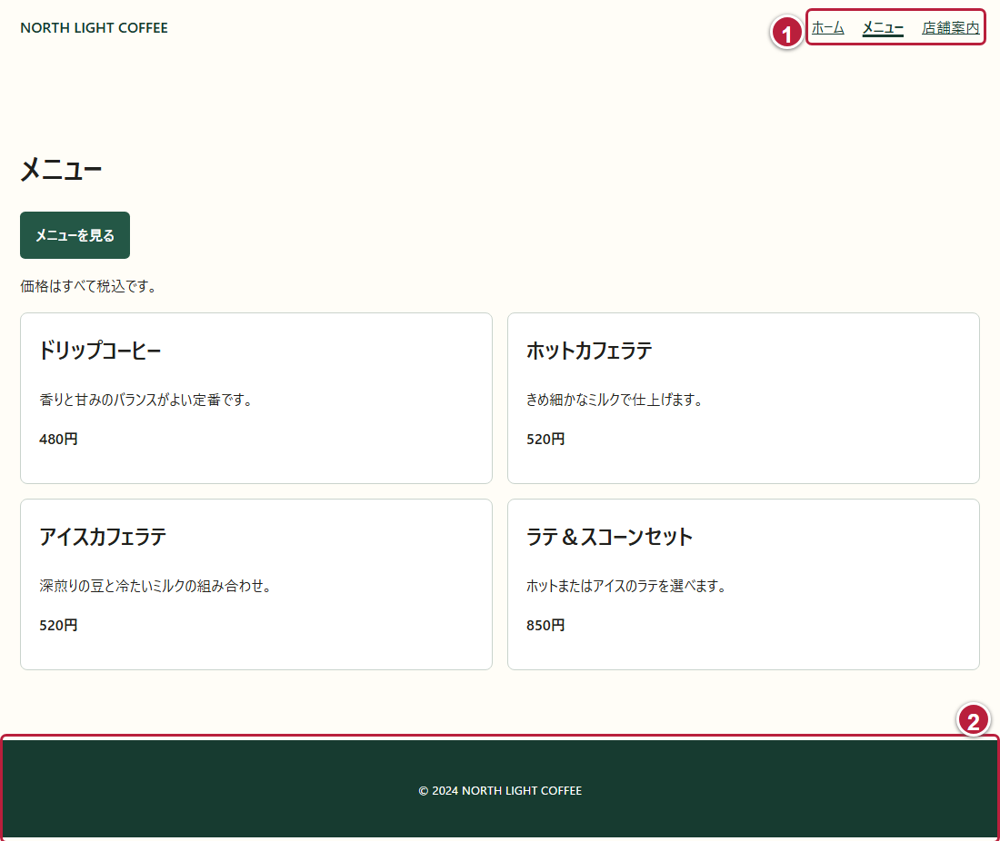
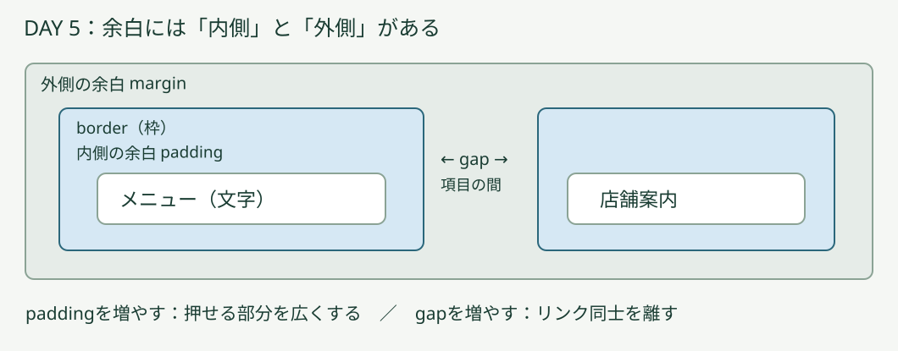
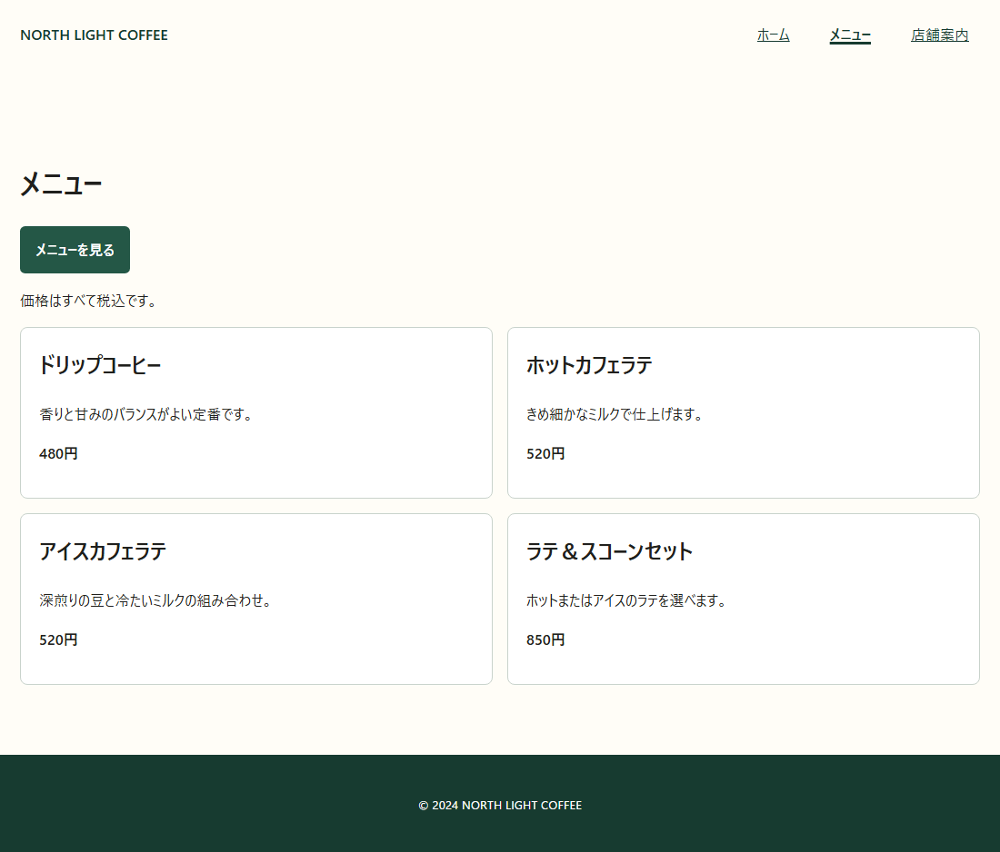
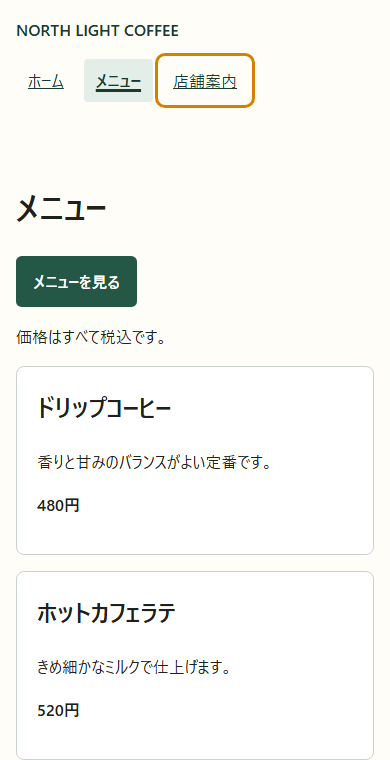
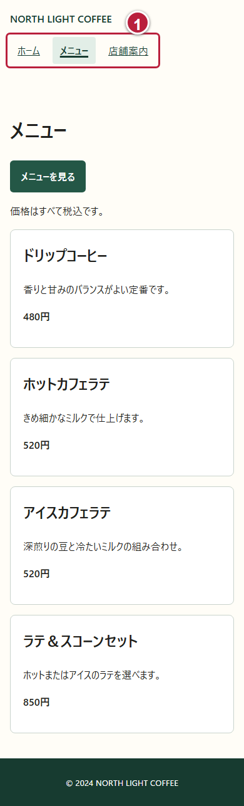

# DAY 5 全ページの上と下をそろえて

[目次](../student-workbook.md) · [共通手順](./common.md#local-git-workflow) · [前の回：DAY 4](./day04.md) · [次の回：DAY 6](./day06.md)

💾 **Gitでの記録：** [共通の作業手順](common.md#local-git-workflow)で、作業前後の変更を記録します。  
作業後は `git tag -f day05-end`で、その日の最後のコミットに目印を付けます。


☕ **仕事のイメージ：** 共通部分の余白を整え、どのページでも案内を使いやすくします。  
操作は、この後の実画面で確認します。

> ✉️ **佐藤さんからの依頼**  
> ページの上のリンクが押しやすくなるように、文字の周りに余白を付けてください。  
> ページの下も、文字と端の間を少し空けてください。

👤 **依頼者：** 店舗責任者の佐藤さん。  
👀 **見る人：** メニューや店舗案内へ移動するお客さまです。

🎯 **今回の課題:** 上のリンクを押しやすくし、下の文字も読みやすくします。

🔧 **変える場所：** 今使っているサイトの `css/style.css`にある、ナビのリンクとフッターの余白です。  
📌 **残すもの：** 今ある本文・価格・画像・リンク先です。

🏁 **完成の目安：** 基本編の変更を3つのページ（[ホーム](../../starter-site/index.html)・[メニュー](../../starter-site/menu.html)・[店舗案内](../../starter-site/about.html)）で確認し、変えた場所を説明できることです。  

📘 **今回学ぶこと:** `padding（文字などの内容と、その要素の端との間に余白を付けるCSSの指定）`、box（リンクの文字とその周りの余白を含む四角い領域）、共通CSSの反映です。

🧭 **作業前に考えること:** 今使っているサイトを開き、Gitで改修前の状態を記録します。  
編集するファイルやGitの操作が分からない場合は、手を挙げて講師に相談してください。

<a id="day5-start-data"></a>

### 📂 今あるサイトを開く

**DAY 5は、今あるサイトをそのまま改修します。**  
DAY 3・4の受講や完成物は必要ありません。  
フォルダーのコピー、開始データへの置き換え、別サイトの新規作成は行いません。

1. VS Codeで、今使っている本人の教材リポジトリを開きます。
2. 今の `index.html`・`menu.html`・`about.html`と、読み込まれている外部CSSを確認します。
   教材の標準配置は `hht/starter-site`です。
   別の場所で制作している場合は、現在の作業場所を使います。
3. Gitの差分を確認し、未コミットの作業があれば内容を確かめて記録します。
   変更がなければ、新しいコミットは不要です。
   ソース管理で今の変更一覧を読み、作業を続ける場所を確認します。
4. 今の `menu.html`をブラウザで開き、同じサイトが使う `css/style.css`を編集します。

見本では、案内に `.nav-list`、フッターに `.site-footer`、商品一覧に `.menu-grid`、1商品に `.menu-card`を使っています。  
自分のHTMLで違うclass名を使っている場合は、実際の要素と指定を確認します。  
対象が分からないときは、コピーで置き換えず、今のサイトを講師と確認します。

## 🛠️ 基本編：リンクとフッターの余白を整える

### 🔎 ① 変える場所を画面で探す

`menu.html`をブラウザで開きます。  
上の「ホーム・メニュー・店舗案内」と、一番下の著作権表記を探します。



今回は①の案内と②のフッターを変えます。  
中央の商品カードはDAY 6で扱います。

### 🔧 ② 上のリンクに余白を付ける

エディターで `css/style.css`を開き、末尾へ次の指定を加えて保存します。

```css
.nav-list a {
  display: block;
  padding: 8px 12px;
}
```

- [ ] ブラウザを再読み込みし、リンクの文字の周りに空きができたか見ます。  
- [ ] `8px`を`12px`へ変え、もう一度表示を比べます。  
- [ ] 最後に、押しやすいと感じた方を選びます。

💡 **ヒント：**
> `.nav-list a`は、案内の中のリンクを選ぶ書き方です。  
> `display: block`はリンクを箱として扱う指定です。  
> `padding`は箱の内側の余白で、値を2つ書くと「上下、左右」の順です。



💡 **ヒント：**
> 基本編で変える`padding`は、文字と枠の間の余白です。  
> `margin`と`gap`は、余白の位置を比べるための例です。

### 🔧 ③ フッターの余白を整える

CSSの既存の `.site-footer`を探します。  
色などは残し、`padding`の行だけを次のように変えます。

```css
padding: 32px 16px;
```

保存して再読み込みし、下の文字の上下に空きができたか見ます。  
`32px`を`24px`にした表示とも比べ、読みやすい方を選びます。



この見本はリンクの上下が`8px`、フッターの上下が`32px`です。  
[動く基本編の見本](../../instructor/day56-basic/day5/menu.html)でも確認できます。

### 🔎 ④ 3ページで確認し、記録する

「ホーム → メニュー → 店舗案内」とリンクを押して移動します。  
3ページとも同じCSSを使っているので、1つのCSSの変更がほかのページにも反映されます。  
上の案内と下の文字が読めて、正しいページへ移動できるか確認します。

📝 **作業メモ:** 「リンクの上下を8pxにした。  
3ページで移動を確認した」のように、変更と確認を2〜3文で書きます。

### ✅ 完成条件・証拠・発展課題

📂 **入力:** 今使っているサイトの3ページと共通CSSです。

📦 **完成物:** 余白を調整したサイトと作業メモです。

✅ **完成条件:** 基本編で次を確認します。

☑️ **確認項目:**

- [ ] ナビのリンクとフッターの余白を変更した
- [ ] 3ページの上と下に変更が反映され、リンクで移動できる
- [ ] 本文・価格・画像を保ち、変更したCSSを説明できる

📸 **証拠:** 変更前と変更後のメニューページの画面を各1枚と、作業メモを残します。  
フッターまで入らないときは、下へスクロールして別の1枚に撮ります。


🌱 **発展課題:** 基本編の後で、以下から選べます。

## 🌱 発展編：今いる場所と操作のしやすさを確かめる

基本編が終わったら、次から1つ選んで取り組みます。  
選んだ課題名・変更したところ・確認結果を、基本編の作業メモへ追記します。

### 🌱 発展1：今いるページを分かりやすくする

💡 **ヒント：**
> **属性**は、HTMLタグに付ける追加情報です。  
> たとえば、`href="menu.html"`はリンクの行き先を表します。  
> **ARIA属性**は、画面を読み上げるソフトなどへ、要素の名前や状態を伝えるための追加情報です。  
> `aria-current="page"`は、「このリンクが、今見ているページを指しています」という意味です。

各HTMLのナビを見て、今いるページのリンクだけに `aria-current="page"`があるか確認します。  
なければ追加し、ほかのリンクには付けません。  
メニューページでは次のようになります。

```html
<!-- menu.htmlのナビの中 -->
<a href="index.html">ホーム</a>
<a href="menu.html" aria-current="page">メニュー</a>
<a href="about.html">店舗案内</a>
```

`index.html`では「ホーム」、`about.html`では「店舗案内」のリンクだけに付けます。  
属性は自動で切り替わるわけではないので、各HTMLで指定します。

**目で見ても現在地が分かるように、CSSで太字と下線を付けます。**  
CSSへ次の指定を加えます。

```css
.nav-list [aria-current="page"] {
  font-weight: 700;
  text-decoration: underline;
  text-underline-offset: 0.3em;
}
```

3ページを移動し、今いるページの印が切り替わることを確認して、1枚撮影します。

💡 **ヒント：**
> `[aria-current="page"]`は、その属性と値が付いた要素を選ぶCSSの書き方です。  
> ARIA属性は「意味や状態」を伝え、上のCSSは「太字や下線」という見た目を整えます。  
> 同じタグに、同じ属性を重ねて書く必要はありません。  
> [aria-currentの説明（MDN）](https://developer.mozilla.org/ja/docs/Web/Accessibility/ARIA/Reference/Attributes/aria-current)でも確認できます。

### ⌨️ 発展2：キーボードでも操作してみる

マウスを使わず、キーボードだけでページを移動する人もいます。  
どのリンクを操作しようとしているか分かり、目的のページへ移動できるようにします。

💡 **ヒント：**
> **フォーカス**は、次のキーボード操作を受け取る場所です。  
> `Tab`で、次のリンクやボタンへフォーカスを移します。  
> `Shift + Tab`で、一つ前へ戻ります。  
> リンクにフォーカスがあるとき、`Enter`を押すとリンク先へ移動します。

**今いるページの印と、次に操作するリンクの枠は別です。**  
メニューページを開いたまま、`Tab`で店舗案内のリンクへ枠を移せます。  
枠が見えないと、どのリンクで `Enter`を押そうとしているのか分かりません。

**キーボードで選んだリンクに枠を付けるため、CSSへ次の指定を加えます。**

```css
.nav-list a:focus-visible {
  outline: 3px solid #a34b00;
  outline-offset: 3px;
}
```

💡 **ヒント：**
> `:focus-visible`は、キーボード操作などでフォーカスの目印を見せる必要があるときの要素を選びます。  
> `outline`は要素の周りに枠を付けます。  
> `outline-offset: 3px`は、その枠を要素の外側へ3px離します。

1. CSSを保存し、ブラウザを再読み込みします。
2. ページ内のリンクではない余白を一度クリックし、ブラウザのページを操作する状態にします。
3. `Tab`を繰り返し押し、ナビのリンクへ順番に枠が移るか確認します。
4. `Shift + Tab`で、一つ前のリンクへ戻れるか確認します。
5. 枠が見える状態を1枚撮影します。
6. 行きたいページのリンクに枠があるとき、`Enter`を押して移動できるか確認します。



この見本では「メニュー」が今いるページ、「店舗案内」の枠が次に操作する場所です。  
枠や背景の色は、自分のサイトのCSSによって変わります。

**枠が見えないとき：** CSSを保存・再読み込みしたか、リンクへフォーカスが移っているかを確認します。  
`Tab`でエディターの文字が字下げされる場合は、ブラウザのページへ戻って操作します。

### 🔎 発展3：狭い画面と拡大表示で確認する

ブラウザのウィンドウを狭くし、ナビが重ならず読めるか確認します。  
次にブラウザのズームを200%にし、同じように確認します。  
困った表示があれば講師とCSSを確認し、確認後はズームを100%へ戻します。



これは狭い画面の例です。  
200%拡大は、自分のブラウザでも別に確認します。  
[発展編の見本](../../instructor/day56-examples/day5/menu.html)を比べる参考にできます。

✅ **発展編の完成条件：** 選んだ課題の手順に沿って動作や表示を確認し、確認した画面を1枚保存します。  
作業メモには、選んだ課題名・変更したところ・確認結果を書きます。
うまくいかなかった場合も、何ができなかったかを書けば大丈夫です。

> 💡 **なんのために作業メモを残すの？**  
> 作業メモは、自分が行ったことを振り返り、後から同じ作業をするときの手がかりにするために残します。  
> 「どこを変えたか」「どう確認したか」「どんな結果だったか」を書くと、講師や一緒に作業する人にも状況が伝わります。  
> うまくいかなかったことや、まだ確認できていないことも、大切な記録です。
> 困った場所を具体的に書くと、質問や次の作業につなげやすくなります。  
> 長い文章でなくて大丈夫です。下の例を参考に、自分が実際に変更・確認したことを短く書きましょう。
> 
> 📝 **作業メモの例：**  
> 選んだ課題：発展2「キーボードでも操作してみる」をやった。  
> 変更点：CSSに、選んだリンクへ枠を付ける指定を加えた。  
> 確認結果：Tabキーでリンクに枠が出て、Enterキーで目的のページへ移動できることを確認した。

⏱️ **120分の目安：** 依頼と開始確認10分 → 基本編の編集40分 → 基本編の確認と記録20分 → 発展編または基本編の復習30分 → 振り返り20分。

[目次](../student-workbook.md) · [次の回：DAY 6](./day06.md)
