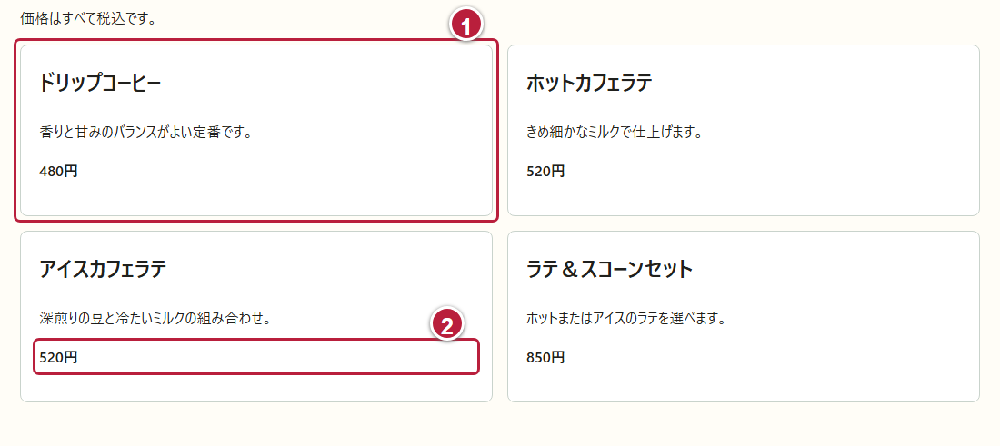
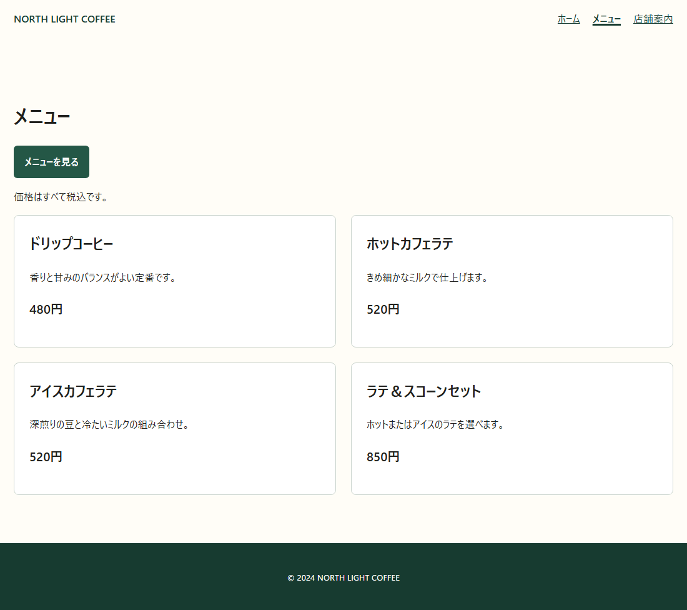
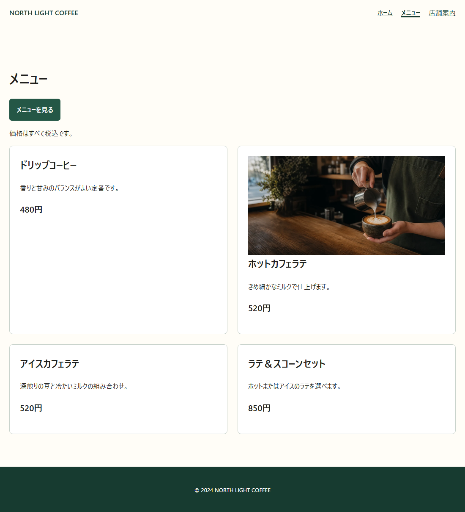
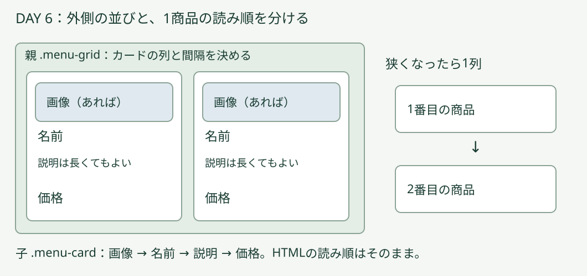
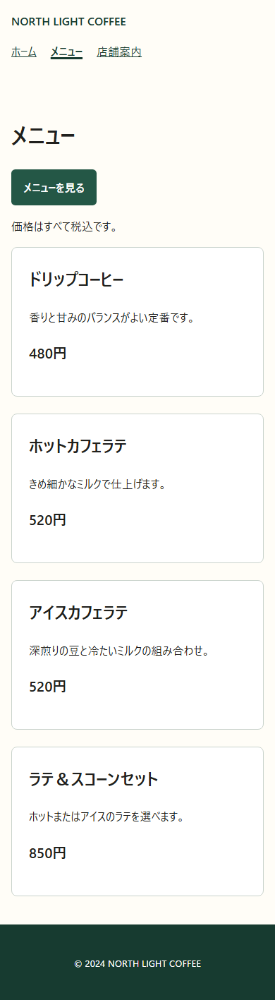

# DAY 6 人気メニューを見つけやすくして

[目次](../student-workbook.md) · [共通手順](./common.md#local-git-workflow) · [前の回：DAY 5](./day05.md) · [次の回：DAY 7](./day07.md)

💾 **Gitでの記録：** [共通の作業手順](common.md#local-git-workflow)で、作業前後の変更を記録します。  
作業後は `git tag -f day06-end`で、その日の最後のコミットに目印を付けます。


☕ **仕事のイメージ：** 商品をひとまとまりにし、余白を整えて選びやすくします。  
操作は、この後の実画面で確認します。

> ✉️ **佐藤さんからの依頼**  
> メニューの文字と枠の間を少し空けて、値段も見つけやすくしてください。  
> 商品の名前や値段は変えないでください。

👤 **依頼者：** 店舗責任者の佐藤さん。  
👀 **見る人：** 注文する商品を選びたいお客さまです。

🎯 **今回の課題:** 商品ごとのまとまりを見やすくし、価格を探しやすくします。

🔧 **変える場所：** サンプルサイトの `hht/day06/css/style.css`です。  
発展1・3では、同じフォルダーの`menu.html`も編集します。  
📌 **残すもの：** `menu.html`の4商品の名前・説明・価格、ヘッダーとフッター、一覧の `id="menu-list"`とそこへ移動するリンクです。

🏁 **完成の目安：** [メニューページ](../../day06/menu.html)で、カードの内側とカード同士に余白があり、4商品の名前・説明・価格を読み分けられることです。  
変えた場所と確認結果を、自分の言葉で説明します。  

📘 **今回学ぶこと:** `padding`（カードの内側の余白）、`gap`（カード同士の間隔）、`font-size`（文字の大きさ）です。

🧭 **作業前に考えること:** このDAYのメニューページを開き、商品名・説明・価格を確認します。  
編集するファイルや商品情報が分からない場合は、手を挙げて講師に相談してください。  
Gitで開始状態を記録してから編集します。

### 📂 このDAYのフォルダーを開く

VS Codeで`Documents/edu`を開き、`hht/day06`のファイルを編集します。

`hht/day06/menu.html`をブラウザで開き、`hht/day06/css/style.css`を編集します。

## 🛠️ 基本編：商品カードの余白と価格を整える

### 🔎 ① 1商品のまとまりを探す



①が1商品のカード、②がその価格です。  
`menu.html`をエディターで開き、最初の「ドリップコーヒー」のまとまりを探します。  
名前や価格は、今のサイトにある値を保ちます。

```html
<article class="menu-card">
  <h2>ドリップコーヒー</h2>
  <p>香りと甘みのバランスがよい定番です。</p>
  <p class="price">480円</p>
</article>
```

💡 **ヒント：**
> **カード**は、1商品の情報をまとめて囲んだ部分です。  
> `article`が1商品のまとまり、`h2`が商品名、`p`が説明や価格の段落です。  
> `price`は価格の段落に付けたclass名で、HTMLのタグ名ではありません。

基本編ではHTMLの内容を書き換えません。

### 🔧 ② カードの内側に余白を付ける

`css/style.css`の`.menu-card`には、`padding: 1.25rem;`があります。  
この行を`padding: 24px;`へ変更します。  
枠・角丸・背景の行は残し、変更後は次の形にします。

```css
.menu-card {
  padding: 24px;
  border: 1px solid #c9d3cc;
  border-radius: 0.5rem;
  background: #fff;
}
```

- [ ] CSSを保存し、ブラウザを再読み込みします。
- [ ] 文字とカードの枠の間に空きができたか確認します。
- [ ] `16px`も試し、読みやすい方を選びます。

💡 **ヒント：**
> `padding`を1つの値で書くと、上下左右に同じ余白が付きます。  
> `px`は大きさを指定する単位です。  
> `24px`は、`16px`より余白が広くなります。

### 🔧 ③ カード同士の間を空ける

`.menu-grid`には、`display: grid;`と`gap: 1rem;`があります。  
`gap: 1rem;`を`gap: 24px;`へ変更します。  
変更後は次の形です。  
ファイル末尾の`@media`の中にある列数の指定は、基本編では変更しません。

```css
.menu-grid {
  display: grid;
  gap: 24px;
}
```

- [ ] CSSを保存し、ブラウザを再読み込みします。
- [ ] となり合うカードの間が広がったか確認します。
- [ ] カードの内側を変える`padding`との違いを、画面で指さします。

💡 **ヒント：**
> **親の箱**は、ほかの要素をまとめて囲む要素です。  
> `.menu-grid`が親、その中の各`.menu-card`が子です。  
> `gap`は、その中のカード同士の間隔です。

今回は、既存のGridを使って間隔を調整します。

### 🔧 ④ 価格を少し大きくする

サンプルの`.price`には、`font-weight: 800;`だけが書かれています。  
この行を残し、その下へ`font-size: 20px;`を追加します。  
変更後は次の形です。

```css
.price {
  font-weight: 800;
  font-size: 20px;
}
```

- [ ] CSSを保存し、ブラウザを再読み込みします。
- [ ] 4商品の価格が少し大きくなったか確認します。
- [ ] 価格と説明が重なっていないか、1商品ずつ読みます。

💡 **ヒント：**
> `.price`は、価格に付いたclassを選ぶCSSの書き方です。  
> `font-size`は文字の大きさを変えます。

商品名や価格の数字は、HTMLを書き換えずにそのまま保ちます。



見本ではカードの内側とカード同士の間隔を`24px`、価格を`20px`にしています。  
[動く基本編の見本](../../instructor/day56-basic/day6/menu.html)でも確認できます。

### 🔎 ⑤ 変更前後を確認し、記録する

ブラウザで4商品の名前・説明・価格を読みます。  
「メニューを見る」を押し、商品一覧へ移動できることも確認します。

📝 **作業メモ:** 「カードの内側を24px、カード同士の間を24px、価格を20pxにした。  
4商品と一覧へのリンクを確認した」のように、実際に変えた値と確認結果を書きます。

### ✅ 完成条件・証拠・発展課題

📂 **入力:** このDAYの作業フォルダーの4商品と共通CSSです。

📦 **完成物:** 余白と価格を整えた商品一覧と作業メモです。

✅ **完成条件:** 基本編で次を確認します。

☑️ **確認項目:**

- [ ] カードの内側、カード同士の間隔、価格の文字サイズを調整した
- [ ] 4商品の情報を保ち、名前・説明・価格が重ならない
- [ ] 「メニューを見る」から商品一覧へ移動できる
- [ ] 3つのCSSで何が変わったかを作業メモに書いた

📸 **証拠:** 変更前と変更後の商品一覧を各1枚撮り、作業メモと一緒に残します。


🌱 **発展課題:** 基本編の後で、以下から選べます。

## 🌱 発展編：写真や画面幅に合わせて整える

基本編が終わったら、次から1つ選びます。  
全部を行う必要はありません。  
選んだ課題名・変更内容・確認結果を、基本編の作業メモへ追記します。

### 🖼️ 発展1：1商品に練習用の画像を入れる

写真があると、商品の見た目を手がかりに選べます。  
今回は、ラテのカード1件に練習用の画像を表示します。

講師と[使用するラテアート画像](../../day06/images/hero-cafe.webp)を確認します。  
サンプルには`hht/day06/images/hero-cafe.webp`が入っています。  
`menu.html`からは、`images/hero-cafe.webp`という相対パスで参照します。  
これは[素材台帳](../../fixtures/photographer-delivery/ASSET-MANIFEST.md)に記載された生成画像で、実商品の写真ではありません。  

💡 **ヒント：**
> `img`は画像を表示するタグです。  
> `src`は画像ファイルの場所、`alt`は画像の内容を伝える短い説明です。  
> `width`と`height`は元画像の幅と高さです。

`menu.html`でホットカフェラテのカードを探し、その中の`h2`の直前へ次を加えます。

```html

```

**画像をカードの幅に収めるため、`css/style.css`の末尾へ次の指定を追加します。**  
サンプルには、`.menu-card img`の指定はまだありません。

```css
.menu-card img {
  display: block;
  width: 100%;
  height: auto;
}
```

💡 **ヒント：**
> `.menu-card img`は、カードの中の画像を選びます。  
> `width: 100%`は、画像をカードの内側の幅に合わせます。  
> `height: auto`は、元の縦横比を保つために高さを自動で決めます。

1. HTMLとCSSを保存し、ブラウザを再読み込みします。
2. ラテの画像が表示され、カードからはみ出していないか確認します。
3. 画像が縦横に引き伸ばされていないか、元の画像と比べます。
4. 確認した画面を1枚保存し、練習用画像であることを作業メモに書きます。

ほかの商品には、別商品の写真を仮置きしません。

**画像が出ないとき：** `src`のフォルダー名・ファイル名と、実際の画像の場所を確認します。  
大文字・小文字や拡張子も見比べ、分からなければ講師に相談します。



この画面は、基本編の変更後に発展1の画像とCSSを追加した結果です。  
ラテのカードだけに画像が表示されます。



💡 **ヒント：**
> 図の外側の親はカード同士の並び方、内側の子は1商品のまとまりです。  
> 画像がないカードも、名前・説明・価格が同じ商品のまとまりに入ります。

### 🌱 発展2：広い画面は2列、狭い画面は1列にする

広い画面では商品を見比べやすい2列、狭い画面では文字を読みやすい1列にします。  
サンプルでは、ファイル末尾の`@media (min-width: 42rem)`の中に、`grid-template-columns: repeat(2, 1fr);`が書かれています。  
この指定によって、広い画面は2列、狭い画面は1列になります。

今回は、その列の幅が長い文字に押されて広がりすぎないように調整します。

1. 基本編で`gap: 24px;`にした`.menu-grid`へ、`grid-template-columns: minmax(0, 1fr);`を追加します。
2. ファイル末尾の`@media`内で、`repeat(2, 1fr)`を`repeat(2, minmax(0, 1fr))`へ変更します。

変更後の2か所は、次の形です。  
同じ`.menu-grid`や`@media`を末尾へ重ねて追加せず、該当する指定を編集します。

```css
.menu-grid {
  display: grid;
  grid-template-columns: minmax(0, 1fr);
  gap: 24px;
}
@media (min-width: 42rem) {
  .menu-grid {
    grid-template-columns: repeat(2, minmax(0, 1fr));
  }
}
```

💡 **ヒント：**
> `grid-template-columns`は列の幅と数を決める指定です。  
> `minmax(0, 1fr)`は、文字に押されて列が広がりすぎるのを防ぎながら、使える幅を分けます。  
> `repeat(2, …)`は同じ指定の列を2つ作ります。  
> `@media (min-width: 42rem)`の中は、画面幅が42rem以上のときに使う指定です。  
> `rem`は、ページの基準となる文字サイズをもとにした単位です。

1. 外部CSSを保存し、ブラウザを再読み込みします。
2. ウィンドウの左右の端をドラッグして幅を広げ、2列の画面を1枚保存します。
3. 幅を狭くし、1列の画面を1枚保存します。
4. 幅をゆっくり変え、途中でも名前・説明・価格が重ならないか確認します。



この画面は、基本編の見本にある既存の幅切り替えを確認した例です。  
変更したサンプルでも、広いとき2列・狭いとき1列になるかを確認します。

**列数が変わらないとき：** 同じ`.menu-grid`の指定が後ろに重複していないか、`@media`の波かっこの閉じ忘れがないか見ます。  
ブラウザのズームではなく、ウィンドウの幅を変えて確認します。  
詳しいスマートフォン対応はDAY 10で学びます。

### 🌱 発展3：説明が長くなっても読めるか試す

説明を追加したときも、文字と価格が重ならずに読めるかを確かめます。  
試す前に、ここまでの改修と画像をGitへコミットします。  
フォルダーは増やさず、今の`menu.html`で試します。

1. 1商品の元の説明を、作業メモへ控えます。
2. その商品の説明だけを一時的に2〜3文へ増やし、保存します。
3. ブラウザを再読み込みし、説明が増えても価格と重ならないか確認します。
4. 確認した画面を1枚保存し、結果を作業メモへ書きます。
5. 説明を元へ戻して保存し、再読み込みします。
6. Gitの差分で、試験用の文章が残っていないことと、CSSの改修が残っていることを確認します。

💡 **ヒント：**
> サンプルの`.menu-card`には、カードの高さを固定する`height`の指定がありません。  
> 説明が長くなると、その内容に合わせてカードの高さが伸びます。  
> この課題では、高さを固定する指定を追加せず、文章が増えたときの表示を確認します。

余裕があれば、カードを一時的に1件・4件・7件に変えて試せます。  
確認後は試験で変えた商品数を戻し、正式な4商品がそろっているか確かめます。

✅ **発展編の完成条件：** 選んだ課題の手順に沿って、動作や表示を確認した画面と結果を残します。  
発展2は広い画面・狭い画面を各1枚、それ以外は確認した画面を1枚保存します。  
うまくいかなかった場合も、何ができなかったかを書けば大丈夫です。

> 📝 **作業メモの例：**
>
> - **選んだ課題：** 発展2「広い画面は2列、狭い画面は1列にする」。
> - **変更点：** `.menu-grid`へ列の幅の指定を追加し、`@media`内の`repeat(2, 1fr)`を`repeat(2, minmax(0, 1fr))`に変更した。
> - **確認結果：** ウィンドウの幅を変え、2列と1列になることを確認した。  
>   どちらの幅でも価格と説明は重ならなかった。

⏱️ **120分の目安：** 依頼と開始確認10分 → 基本編の編集40分 → 基本編の確認と記録20分 → 発展編または基本編の復習30分 → 振り返り20分。

[目次](../student-workbook.md) · [次の回：DAY 7](./day07.md)
