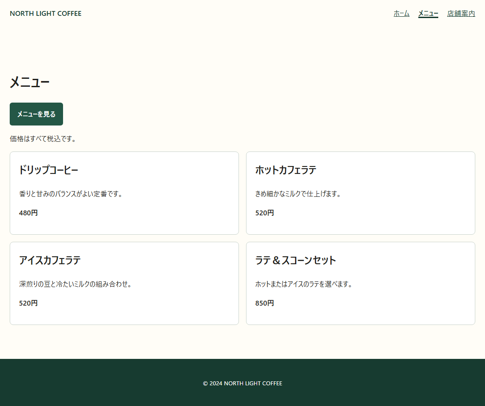
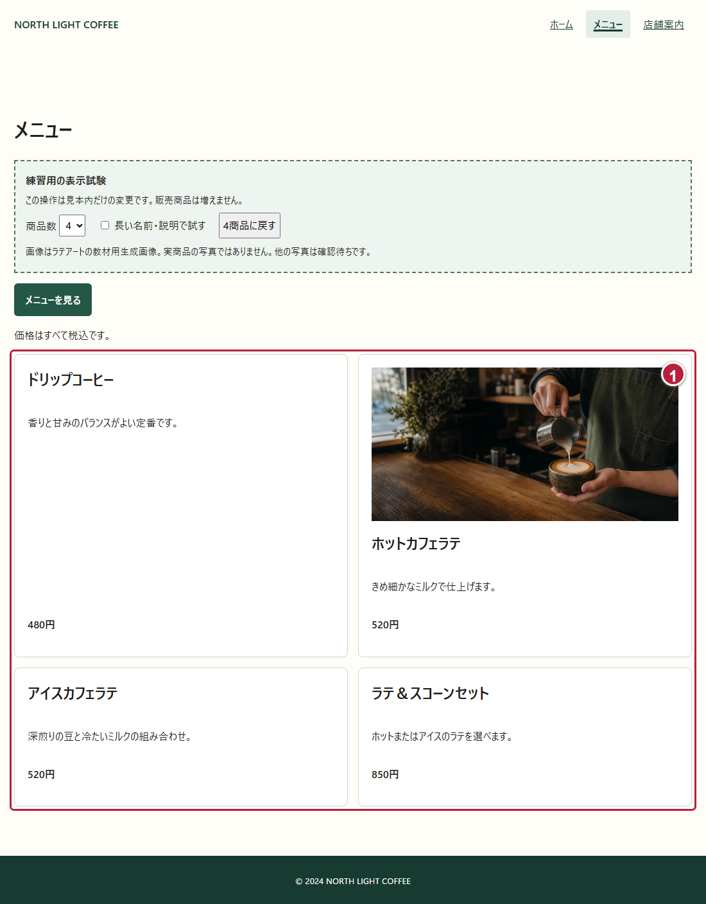

# DAY 6 人気メニューを見つけやすくして

[目次](../student-workbook.md) · [共通手順](./common.md#local-git-workflow) · [前の回：DAY 5](./day05.md) · [次の回：DAY 7](./day07.md)

💾 **Gitでの記録：** [共通の作業手順](common.md#local-git-workflow)で、作業前後の変更を記録します。  
開始タグは `day06-start`、作業後のタグは `day06-end`です。


☕ **仕事のイメージ：** 商品をひとまとまりにし、余白を整えて選びやすくします。  
これは作業のイメージを表すイラストです。  
操作は、この後の実画面で確認します。

> ✉️ **佐藤さんからの依頼**  
> メニューの文字と枠の間を少し空けて、値段も見つけやすくしてください。  
> 商品の名前や値段は変えないでください。

👤 **依頼者：** 店舗責任者の佐藤さん。  
👀 **見る人：** 注文する商品を選びたいお客さまです。

🎯 **今回の課題:** 商品ごとのまとまりを見やすくし、価格を探しやすくします。

🔧 **変える場所：** 今使っているサイトの `css/style.css`です。  
📌 **残すもの：** `menu.html`の4商品の名前・説明・価格、ヘッダーとフッター、一覧の `id="menu-list"`とそこへ移動するリンクです。

🏁 **完成の目安：** 基本編の3つのCSSを調整し、4商品と価格が読みやすくなったことです。  

📘 **今回学ぶこと:** `padding`、`gap`、`font-size`の違いです。

🧭 **作業前に考えること:** 今使っているメニューページを開き、商品名・説明・価格を確認します。  
ファイルや商品情報が見つからないときは、講師と確認します。  
Gitで開始状態を記録してから編集します。

### 📂 今あるサイトを開く

**DAY 6は、今あるサイトをそのまま改修します。**  
DAY 3・4の受講や完成物は必要ありません。  
フォルダーのコピー、開始データへの置き換え、別サイトの新規作成は行いません。

1. VS Codeで、今使っている本人の教材リポジトリを開きます。
2. 今の `index.html`・`menu.html`・`about.html`と、読み込まれている外部CSSを確認します。
   教材の標準配置は `hht/starter-site`です。
   別の場所で制作している場合は、現在の作業場所を使います。
3. Gitの差分を確認し、未コミットの作業があれば内容を確かめて記録します。
   変更がなければ、新しいコミットは不要です。
   今の状態へ `day06-start`タグを付けます。
4. 今の `menu.html`をブラウザで開き、同じサイトが使う `css/style.css`を編集します。

見本では、案内に `.nav-list`、フッターに `.site-footer`、商品一覧に `.menu-grid`、1商品に `.menu-card`を使っています。  
自分のHTMLで違うclass名を使っている場合は、実際の要素と指定を確認します。  
対象が分からないときは、コピーで置き換えず、今のサイトを講師と確認します。

## 🛠️ 基本編：商品カードの余白と価格を整える

### 🔎 ① 1商品のまとまりを探す


①が1商品のカード、②がその価格です。  
`menu.html`をエディターで開き、次のようなまとまりを探します。  
名前や価格は、今のサイトにある値を保ちます。

```html
<article class="menu-card">
  <h2>ドリップコーヒー</h2>
  <p>香りと甘みのバランスがよい定番です。</p>
  <p class="price">480円</p>
</article>
```

💡 **ヒント：**
> `article`が1商品のまとまり、`h2`が商品名です。  
> `price`は価格の段落に付けたclass名で、HTMLのタグ名ではありません。  
> 基本編ではHTMLの内容を書き換えません。

### 🔧 ② カードの内側に余白を付ける

`css/style.css`の `.menu-card`を探します。  
枠や背景の指定は残し、`padding`の行を次のように変えます。

```css
padding: 24px;
```

保存してブラウザを再読み込みし、文字と枠の間がどう変わったか見ます。  
`16px`も試し、読みやすい方を選びます。

💡 **ヒント：**
> `padding`を1つの値で書くと、上下左右に同じ余白が付きます。

### 🔧 ③ カード同士の間を空ける

`.menu-grid`を探し、`gap`の行を次のように変えます。  
`display: grid`や、既存の列数の指定はそのまま使います。

```css
gap: 24px;
```

再読み込みし、隣のカードとの間隔を確認します。

💡 **ヒント：**
> `.menu-grid`は4枚のカードをまとめる親の箱です。  
> `gap`は、その中のカード同士の間隔です。  
> 今回はGridの書き方を一から覚える必要はありません。

### 🔧 ④ 価格を少し大きくする

`.price`の中へ次の行を加えます。  
すでに `font-size`があれば、その値を変更します。

```css
font-size: 20px;
```

保存して再読み込みします。  
4商品の価格が見つけやすくなり、説明と重なっていないか確認します。



見本ではカードの内側とカード同士の間隔を`24px`、価格を`20px`にしています。  
[動く基本編の見本](../../instructor/day56-basic/day6/menu.html)でも確認できます。

### 🔎 ⑤ 変更前後を確認し、記録する

ブラウザで4商品の名前・説明・価格を読みます。  
「メニューを見る」を押し、商品一覧へ移動できることも確認します。

📝 **作業メモ:** `padding`・`gap`・`font-size`で何が変わったかを、それぞれ一言で書きます。

### ✅ 完成条件・証拠・発展課題

📂 **入力:** 今使っているサイトの4商品と共通CSSです。

📦 **完成物:** 余白と価格を整えた商品一覧と作業メモです。

✅ **完成条件:** 基本編で次を確認します。

☑️ **確認項目:**

- [ ] カードの内側、カード同士の間隔、価格の文字サイズを調整した
- [ ] 4商品の情報を保ち、名前・説明・価格が重ならない
- [ ] 「メニューを見る」から商品一覧へ移動できる
- [ ] 3つのCSSで何が変わったかを作業メモに書いた

📸 **証拠:** 変更前と変更後の商品一覧を各1枚撮り、作業メモと一緒に残します。


🌱 **発展課題:** 基本編の後で、以下から選べます。

## 🌱 発展編：写真や画面幅に合わせて整える

基本編が終わったら、次から1つ選びます。  
全部を行う必要はありません。  
選んだ課題名・変更内容・確認結果を、基本編の作業メモへ追記します。

### 🖼️ 発展1：1商品に練習用の画像を入れる

講師と使用できる画像を確認します。  
練習用の画像は、教材の `images/hero-cafe.webp`を参照できます。  
[使用するラテアート画像](../../starter-site/images/hero-cafe.webp)を確認し、使用する場合は既存サイトの画像を参照します。  
これは[素材台帳](../../fixtures/photographer-delivery/ASSET-MANIFEST.md)に記載された生成画像で、実商品の写真ではありません。  
練習用として、ホットカフェラテの `h2`の直前へ次を加えます。

```html

```

CSSへ次の指定を加えます。

```css
.menu-card img {
  display: block;
  width: 100%;
  height: auto;
}
```

画像がカードの幅に収まり、縦横に引き伸ばされないことを確認します。  
ほかの商品には、別商品の写真を仮置きしません。  
確認後の画面を1枚保存し、練習用画像であることを記録します。



[発展編の見本](../../instructor/day56-examples/day6/menu.html)は、複数の改善を組み合わせた参考です。  
この見本の全部を再現する必要はありません。


🖼️ **図で確認：** 外側の親はカード同士の並び方、内側の子は1商品のまとまりです。  
画像がないカードも、名前・説明・価格を同じまとまりに保ちます。

### 🌱 発展2：広い画面は2列、狭い画面は1列にする

教材原本には、すでに幅によって列数を変えるCSSがあります。  
同じ指定を追加せず、既存の `.menu-grid`と `@media`を探して、次の例と比べます。

```css
.menu-grid {
  display: grid;
  grid-template-columns: minmax(0, 1fr);
  gap: 24px;
}
@media (min-width: 42rem) {
  .menu-grid {
    grid-template-columns: repeat(2, minmax(0, 1fr));
  }
}
```

ブラウザの幅を狭くしたり広くしたりして、1列と2列の表示を各1枚保存します。  
幅の途中でも、文字が重ならないか確認します。

💡 **ヒント：**
> `@media`は画面幅などの条件で指定を切り替えます。  
> `repeat(2, …)`は同じ幅の列を2つ作る指定です。  
> 詳しいスマートフォン対応はDAY 10で学びます。

### 🌱 発展3：説明が長くなっても読めるか試す

試す前に、ここまでの改修と画像をGitへコミットします。  
フォルダーは増やさず、今の `menu.html`で試します。  
1商品の説明を一時的に2〜3文へ増やし、価格と重ならないか確認します。  
問題があれば、カードに固定の高さが付いていないか調べます。  
試した画面を1枚保存し、本番の説明は元のままにします。

余裕があれば、同じページのカードを一時的に1件・4件・7件に変えて試せます。  
確認後は、試験で変えた説明・商品数だけを元へ戻し、CSSの改修を残します。  
Gitの差分で、正式な商品情報に戻ったか確認します。  
この追加試験と、Flexboxで価格を下にそろえる工夫は、さらに試したい人向けです。

✅ **発展編の完成条件：** 選んだ課題の画面と確認結果を残し、正式な商品情報と練習データを区別できたことです。

⏱️ **120分の目安：** 依頼と開始確認10分 → 基本編の編集40分 → 基本編の確認と記録20分 → 発展編または基本編の復習30分 → 振り返り20分。

[目次](../student-workbook.md) · [次の回：DAY 7](./day07.md)
