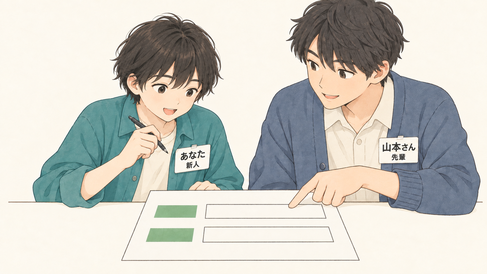
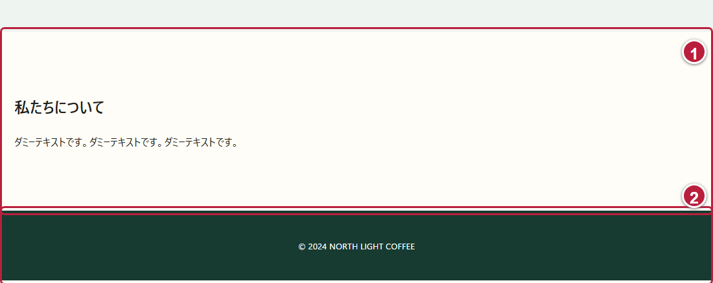

# DAY 7 お問い合わせフォームがほしい

[目次](../student-workbook.md) · [共通手順](./common.md#local-git-workflow) · [前の回：DAY 6](./day06.md) · [次の回：DAY 8](./day08.md)

💾 **記録と提出：** [共通手順](common.md#local-git-workflow)に沿って、教材更新の前に必要な成果と証拠を保護します。  
[PR提出](common.md#submission-policy)と、教材の破棄・Pullは別の操作です。



☕ **仕事のイメージ：** 入力欄の名前と、必須かどうかが分かるフォームを作ります。  
操作は、この後の実画面で確認します。

> ✉️ **佐藤さんからの依頼**  
> 名前、メール、問い合わせ内容を入力できるフォームを作ってください。  
> 入力後は、練習用の完了ページへ進めるようにしてください。  
> お店への問い合わせは送信しません。

👤 **依頼者：** 店舗責任者の佐藤さん。  
👀 **見る人：** お店への問い合わせを入力するお客さまです。

🎯 **今回の課題:** 何を入力するかが分かり、キーボードでも使えるフォームを作ります。

🔧 **変える場所：** `about.html`の既存の`main`内へ問い合わせのまとまりを追加し、`css/style.css`で欄の並びを整えます。  
📌 **残すもの：** 営業時間・住所・紹介文と、ほかのページです。  
練習用の完了ページ`complete.html`は用意されています。  
POSTを受け取るサーバーも用意されているので、今回はHTMLとCSSを編集します。  
お店へのメール送信や内容の保存は行わず、架空の情報だけを入力します。

🏁 **完成の目安：** 基本編の3つの欄をキーボードでも操作でき、入力チェック後に練習用の完了ページへ進めることです。

📘 **今回学ぶこと:** `form`、`label`、`input`、`textarea`、`button`、`required`、`action`、`method="post"`です。  
選択肢を作る`radio`・`checkbox`は、発展編で扱います。

🧭 **作業前に考えること:** どの欄を必須にするか、佐藤さんへ確認するとしたら何を聞くか考えます。  
この練習では、名前・メール・問い合わせ内容の3つを必須として進めます。  
編集する場所が分からない場合は、講師に相談してください。

### 📂 このDAYのフォルダーを開く

VS Codeで`Documents/edu`を開き、`hht/day07`のファイルを編集します。  
HTML・CSS・画像は、このフォルダーへ最初からコミットされています。  
他のDAYの受講や完成物は必要ありません。  
再開するときも、同じフォルダーを開きます。

[共通のPOST受信手順](./common.md#form-post-practice)で、`hht/day07`内の`server.py`を起動します。  
ブラウザで`http://127.0.0.1:8000/about.html`を開き、VS Codeでは`hht/day07/about.html`を編集します。

## 🛠️ 基本編：3つの入力欄を作る

### 🔎 ① 追加する場所を画面とHTMLで探す

店舗案内の「私たちについて」と、一番下のフッターを探します。



VS Codeで`about.html`を開き、`</main>`を探します。  
フォームは①のまとまりの後、`</main>`の直前へ追加します。  
②のフッターへ入れたり、`main`をもう1つ作ったりしません。

### 🔧 ② 問い合わせのまとまりを追加する

`</main>`の直前へ、次のHTMLを追加して保存します。

```html
<section class="section" id="contact" aria-labelledby="contact-heading">
  <h2 id="contact-heading">お問い合わせ（入力練習）</h2>
  <p>架空の情報で入力を練習します。入力後は練習用の完了ページへ進みます。</p>
  <form class="contact-form" action="complete.html" method="post">
    <p>
      <label for="contact-name">名前（必須）</label>
      <input id="contact-name" name="name" type="text" required>
    </p>
    <p>
      <label for="contact-email">メール（必須）</label>
      <input id="contact-email" name="email" type="email" required>
    </p>
    <p>
      <label for="contact-message">問い合わせ内容（必須）</label>
      <textarea id="contact-message" name="message" rows="4" required></textarea>
    </p>
    <button type="submit">入力を確認して次へ</button>
  </form>
</section>
```

ブラウザを再読み込みし、「私たちについて」の下に3つの入力欄があるか確認します。

💡 **ヒント：**
> `label`は欄の名前を示します。  
> `for`と入力欄の`id`を同じ値にすると、ラベルを押して欄へ移れます。  
> `textarea`は複数行の文章を入力する欄です。  
> `required`は必須の指定で、「必須」の文字も添えると入力する人に伝わります。

💡 **ヒント：**
> `type="submit"`のボタンを押すと、ブラウザが必須欄とメールの形式をチェックします。  
> 入力に問題がなければ、`name`の付いた欄の内容をPOSTでサーバーへ送ります。  
> POSTでは、入力内容をURLではなくリクエストの本文に入れます。  
> 配布されたサーバーは`complete.html`宛てのPOSTを受け取り、必須欄とメール形式をもう一度チェックします。  
> 問題がなければ、ブラウザを練習用の完了ページへ移動させます。  
> 受信した内容は、サーバーを起動したターミナルに`[POST受信]`として表示されます。  
> この練習では、サーバー自身による入力内容のファイル保存や、お店へのメール送信は行いません。

### 🔧 ③ ラベルと入力欄を縦に並べる

`hht/day07/css/style.css`を開き、末尾へ次のCSSを追加して保存します。

```css
.contact-form label {
  display: block;
}

.contact-form input:not([type="radio"]):not([type="checkbox"]),
.contact-form textarea {
  display: block;
  max-width: 100%;
}
```

ブラウザを再読み込みし、ラベルの下に入力欄が並ぶか確認します。

💡 **ヒント：**
> `display: block`は、ラベルや入力欄を箱として扱い、縦に並べるための指定です。  
> `:not(...)`は、括弧の中に合う要素を除く書き方です。  
> この例では発展編のradioとcheckboxを除き、文字を入力する欄に指定を適用します。

### 🔎 ④ 架空の情報で入力と移動を確かめる

次の順に操作します。

1. 「名前（必須）」の文字をクリックし、名前の欄へ入力できるか確認します。
2. 名前に「練習用カフェ太郎」と入力します。
3. Tabキーを押し、メールの欄へ移動したら`cafe-test@example.com`と入力します。
4. もう一度Tabキーを押し、問い合わせ内容に「営業時間を確認したいです。」と入力します。
5. Tabキーでボタンへ移動し、Shift+Tabキーで前の欄へ戻れるか確認します。
6. メールと問い合わせ内容のラベルもクリックして、対応する欄へ移れるか確かめます。

<!-- 実画面の撮影待ち：基本編のHTMLを追加した実画面。3つの欄に架空の情報を入力している -->

[動く基本編の見本](../../instructor/day78-basic/day7/about.html)でも操作できます。  
見本のフォームを送信するときは、見本の`about.html`と同じフォルダーで`python server.py`を実行します。  
見本を見た後は、サーバーを止めて`hht/day07`内で起動し直し、自分のファイルでも同じ確認をします。

**移動先が分かりにくいとき：** Tabキーで選んだ欄やボタンに、枠などの目印が出ているか見ます。  
目印が見えない場合は、講師に相談します。  
CSSへ`outline: none`を追加すると、キーボードで選んだ場所が分かりにくくなるため、追加しません。

### 🔎 ⑤ 入力チェックと完了ページへの移動を確かめる

1. 名前の欄を空にして、「入力を確認して次へ」を押します。
2. ブラウザの案内が出て、フォームのページにとどまるか確認します。
3. 名前を戻し、メールを`cafe-test`に変えてボタンを押します。
4. メール形式についての案内が出て、ページが移動しないか確認します。
5. メールを`cafe-test@example.com`へ戻します。
6. Tabキーでボタンへ移動してEnterキーを押し、`complete.html`に「入力練習が完了しました」と表示されるか確認します。
7. 完了ページのURLに、入力した名前やメールが付いていないか確認します。
8. 完了ページを再読み込みしても、入力内容の再送信を求められないか確認します。
9. サーバーを起動したターミナルで`[POST受信]`の行を探し、入力した3つの項目が届いたか確認します。
10. 「フォームに戻る」を押し、店舗案内のフォームへ戻れるか確認します。

<!-- 実画面の撮影待ち：フォームから移動した練習用の完了ページ。お店への問い合わせは送信されていないことと、フォームへ戻るリンクを表示している -->

💡 **ヒント：**
> ブラウザの案内文は、使うブラウザや言語設定によって異なります。  
> メールの形式が正しくても、そのアドレスが実在するかは確認されません。  
> 配布サーバーはPOSTの後に完了ページをGETで開き直すため、完了画面の再読み込みではPOSTを繰り返しません。  
> 完了ページを直接開くこともできるため、この表示だけでお店の受付が済んだとは判断できません。

### ✅ 完成条件・証拠・発展課題

📂 **入力:** このDAYの店舗案内・共通CSS・練習用の完了ページです。

📦 **完成物:** フォームを追加した店舗案内と、入力・操作の確認をまとめた作業メモです。

✅ **完成条件:** 基本編で次を確認します。

☑️ **確認項目:**

- [ ] 既存の`main`内に、名前・メール・問い合わせ内容の3つの欄を追加した
- [ ] 各欄のラベルをクリックすると、その欄へ入力できる
- [ ] 3つの欄に「必須」の文字と`required`がある
- [ ] Tabキーで3つの欄とボタンへ順番に移動でき、移動先が分かる
- [ ] 必須欄が空のときとメール形式が不正なときは、案内が出てページが移動しない
- [ ] 架空の情報をPOSTすると完了ページへ進み、URLに入力内容が付かず、フォームへ戻れる
- [ ] 営業時間・住所・紹介文を保ち、お店への問い合わせは送信されないと説明できる

📸 **証拠:** 追加前の店舗案内と、架空の情報を入力したフォームの画面を各1枚残します。  
完了ページの画面も1枚残します。  
作業メモには、Tabキーの移動順、空欄・メール形式のチェック結果、完了ページへの移動結果を書きます。

📝 **作業メモ:** 変更した場所と、操作・表示を確かめた結果を書きます。  
次のように、変更と確認を2〜3文でまとめます。

**記入例：** 「3つの入力欄を追加した。  
名前→メール→問い合わせ内容→ボタンの順に移動できた。  
空欄とメール形式のチェックが働き、修正すると完了ページへ進めた。」

🌱 **発展課題:** 基本編が終わったら、次から1つ選んで取り組みます。

## 🌱 発展編：選びやすさと分かりやすさを工夫する

### 🌱 発展1：1つだけ選ぶ欄と、複数選べる欄を作る

返信方法を1つ選ぶ欄と、興味のあるメニューを複数選べる欄を試します。  
この練習の選択肢は、以下の例を使います。  
基本編の`<button type="submit">`の行の直前へ追加します。

```html
<fieldset>
  <legend>返信方法</legend>
  <label><input type="radio" name="reply" value="email"> メール</label>
  <label><input type="radio" name="reply" value="none"> 返信不要</label>
</fieldset>
<fieldset>
  <legend>興味のあるメニュー（複数選択可）</legend>
  <label><input type="checkbox" name="interest" value="coffee"> コーヒー</label>
  <label><input type="checkbox" name="interest" value="food"> 軽食</label>
</fieldset>
```

1. ラベルをクリックして選択できるか確認します。
2. 返信方法は片方を選ぶと、もう片方の選択が外れるか確認します。
3. 興味のあるメニューは、2つとも選べるか確認します。
4. Tabキーで選択肢へ移動し、radioは矢印キーで選択肢を変え、checkboxはSpaceキーで選択・解除できるか確かめます。

💡 **ヒント：**
> `radio`は同じ`name`のグループから1つを選びます。  
> `checkbox`は項目ごとに選択と解除ができます。  
> `fieldset`は関連する欄をまとめ、`legend`はそのまとまりの名前を示します。  
> この例は入力欄を`label`で囲むため、`for`を使わなくてもラベルを押して選択できます。

### 🌱 発展2：入力の案内を分かりやすくする

入力に迷いそうな欄を1つ選び、そのラベルの直後へ短い説明を追加します。  
たとえば、問い合わせ内容に「知りたいことを具体的に書いてください。」と添えます。  
説明文は`<span id="message-help">知りたいことを具体的に書いてください。</span>`と書きます。  
対応する`textarea`へ`aria-describedby="message-help"`を追加します。  
入力前後で、欄の名前と説明が残るか確認します。

💡 **ヒント：**
> `placeholder`に書いた案内は、入力すると消えます。  
> 欄の名前や必要な説明は、入力後も見える場所へ書くと確認しやすくなります。  
> `aria-describedby`は、入力欄と補足の説明を関連付ける指定です。  
> 基本編では入力欄が`p`の中にあるため、説明にはその中へ書ける`span`を使います。

✅ **発展編の完成条件：** 選んだ課題の変更と確認結果を作業メモへ書き、確認した画面を1枚残します。  
うまくいかなかった場合も、どの操作で困ったかを記録します。

⏱️ **120分の目安：** 依頼と開始確認10分 → 基本編の編集40分 → 基本編の確認と記録20分 → 発展編または基本編の復習30分 → 振り返り20分。

[目次](../student-workbook.md) · [次の回：DAY 8](./day08.md)
