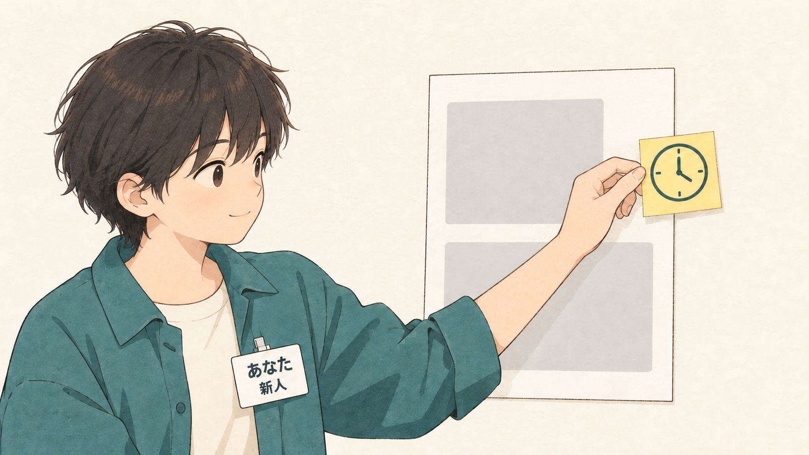
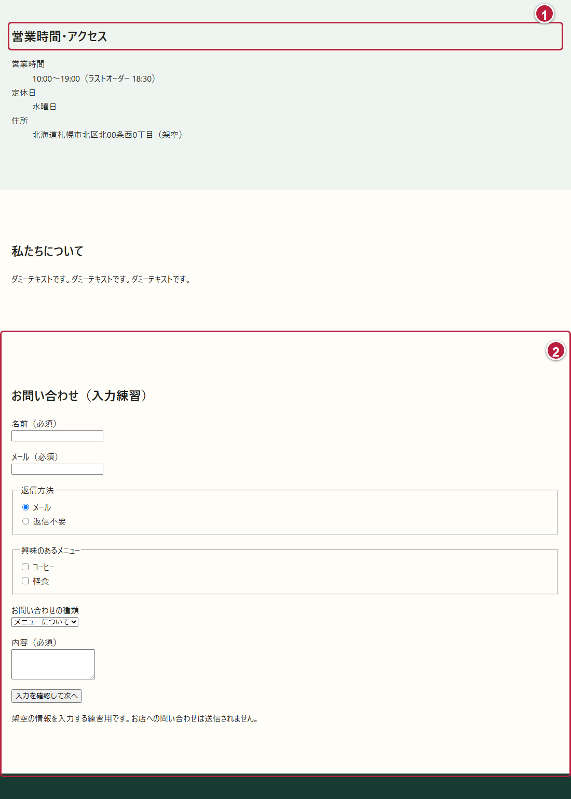

# DAY 8 営業時間を見逃さないようにして

[目次](../student-workbook.md) · [共通手順](./common.md#local-git-workflow) · [前の回：DAY 7](./day07.md) · [次の回：DAY 9](./day09.md)

💾 **記録と提出：** [共通手順](common.md#local-git-workflow)に沿って、教材更新の前に必要な成果と証拠を保護します。  
[PR提出](common.md#submission-policy)と、教材の破棄・Pullは別の操作です。



☕ **仕事のイメージ：** 営業時間を見つけやすくし、ほかの内容も読めるようにします。  
操作は、この後の実画面で確認します。

> ✉️ **佐藤さんからの相談**  
> 店舗案内を読んでいると、営業時間がどこにあったか分からなくなります。

👤 **依頼者：** 店舗責任者の佐藤さん。  
👀 **見る人：** 来店前に営業時間や場所を確かめたいお客さまです。

🎯 **今回の課題:** 営業時間を見つけやすい見せ方に変えます。

🔧 **変える場所：** 基本編では、`about.html`の営業時間の1行と、`css/style.css`です。  
📌 **残すもの：** 営業時間・定休日・住所の内容、HTMLの読む順番、問い合わせフォームです。  
画面に案内を残す配置は、発展編で試します。

🏁 **完成の目安：** 営業時間の見た目を変え、狭い画面や拡大した画面でも内容が読めることです。

📘 **今回学ぶこと:** クラスを使ったCSSの指定と、余白・枠線による強調です。  
発展編では`position: sticky`と、固定しない配置を比べます。

🧭 **作業前に考えること:** 店舗案内を下へ読み進め、どこで営業時間を見失うか確認します。  
「最初に見つけにくい」のか、「下を読んでいる途中で見返したい」のかで、役立つ案が変わります。

### 📂 このDAYのフォルダーを開く

VS Codeで`Documents/edu`を開き、`hht/day08`のファイルを編集します。  
営業時間・アクセス、紹介文、入力練習用フォーム、練習用の完了ページ`complete.html`が用意されています。  
フォームはPOSTで練習用サーバーへ入力内容を送り、チェック後に完了ページへ進む仕組みです。  
入力内容の保存やお店へのメール送信は行わず、架空の情報だけを使います。  
他のDAYの受講や完成物は必要ありません。  
再開するときも、同じフォルダーを開きます。

[共通のPOST受信手順](./common.md#form-post-practice)で、`hht/day08`内の`server.py`を起動します。  
ブラウザで`http://127.0.0.1:8000/about.html`を開き、VS Codeでは`hht/day08/about.html`と`hht/day08/css/style.css`を編集します。

## 🛠️ 基本編：固定せずに営業時間を目立たせる

### 🔎 ① 営業時間とフォームを探す

店舗案内の「営業時間・アクセス」を探し、さらに下へスクロールしてフォームを確認します。



今回は①の営業時間を見つけやすくします。  
②の入力欄や、ほかの文章に重ならないかも確かめます。

### 🔧 ② 営業時間の1行にクラスを付ける

VS Codeで`about.html`を開き、`<dt>営業時間</dt>`を探します。  
その直後の`dd`へ、次のように`class="hours-value"`を追加します。  
時刻の文字は変えません。

```html
<dt>営業時間</dt>
<dd class="hours-value">10:00〜19:00（ラストオーダー 18:30）</dd>
```

💡 **ヒント：**
> `dt`は項目名、`dd`はその内容を表します。  
> 今回は営業時間の`dd`だけにクラスを付けるので、住所や定休日の見た目と分けて指定できます。

### 🔧 ③ 余白と枠線で目立たせる

`css/style.css`の末尾へ追加し、保存します。

```css
.hours-value {
  margin-inline-start: 0;
  padding: 12px 16px;
  border-inline-start: 4px solid var(--color-brand);
  background: #fff;
  font-weight: 700;
}
```

ブラウザを再読み込みし、営業時間の左に線が付き、文字の周りに余白ができたか確認します。  
上下の`padding`を`12px`から`20px`へ変えた表示とも比べ、読みやすい方を選びます。

💡 **ヒント：**
> `margin-inline-start: 0`は、このページでは左側の外の余白をなくす指定です。  
> `border-inline-start`は、このページでは左側に枠線を付けます。  
> `var(--color-brand)`は、既存CSSで名前を付けたお店の色を使う書き方です。

<!-- 実画面の撮影待ち：基本編の実画面。営業時間の1行に余白と左の枠線を付けて強調している -->

この見本は上下の余白が`12px`です。  
[動く基本編の見本](../../instructor/day78-basic/day8/about.html)でも表示を確認できます。  
見本のフォームを送信するときは、見本の`about.html`と同じフォルダーで`python server.py`を実行します。

### 🔎 ④ 狭い画面と拡大した画面で確かめる

1. ブラウザの幅を狭め、営業時間が折り返しても全文を読めるか確認します。
2. ブラウザを200%に拡大し、時刻やラストオーダーの文字が欠けないか確認します。
3. フォームまでスクロールし、入力欄やボタンが隠れていないか確認します。
4. フォームには架空の名前・メール・問い合わせ内容を入力し、Tabキーで移動先が見えるか確認します。
5. 必須欄を1つ空にして「入力を確認して次へ」を押し、ブラウザの案内が見えるか確認します。
6. 空欄を埋め、メールを`cafe-test`に変えてボタンを押し、メール形式の案内が見えるか確認します。
7. メールを`cafe-test@example.com`へ戻してボタンを押し、練習用の完了ページへ進めるか確認します。
8. 完了ページのURLに入力内容が付いていないか確認します。
9. サーバーを起動したターミナルで`[POST受信]`の行を探し、入力した内容が届いたか確認します。
10. 「フォームに戻る」で店舗案内へ戻り、ブラウザの拡大率を元へ戻します。

<!-- 実画面の撮影待ち：Day8のフォームから移動した練習用の完了ページ。お店への送信ではないことを説明している -->

練習用サーバーがPOSTを受け取った後、完了ページへ移動します。  
完了ページには決まった文章が表示され、受信した内容はサーバーのターミナルで確認できます。  
サーバー自身による入力内容のファイル保存や、お店へのメール送信は行いません。

📝 **作業メモ:** 変更した場所と、操作・表示を確かめた結果を書きます。  
次のように、変更と確認を2〜3文でまとめます。

**記入例：** 「営業時間に左の線と余白を付けた。  
狭い画面と200%拡大でも、全文と入力欄が読めた。  
下を読んでいる途中では営業時間が画面から消れるので、見返すには上へ戻る必要がある。」

### ✅ 完成条件・証拠・発展課題

📂 **入力:** このDAYの店舗案内と共通CSSです。

📦 **完成物:** 営業時間の見せ方を変えた店舗案内と、確認結果をまとめた作業メモです。

✅ **完成条件:** 基本編で次を確認します。

☑️ **確認項目:**

- [ ] 営業時間の1行へクラスを付け、余白と枠線を指定した
- [ ] 時刻・定休日・住所の内容と、HTMLの読む順番を保っている
- [ ] 狭い画面と200%拡大でも、営業時間の全文を読める
- [ ] 営業時間・本文・フォームを最後まで読め、Tabキーで移動した場所が分かる
- [ ] 入力チェックの案内が読め、修正後は完了ページへ進んでフォームへ戻れる
- [ ] 変更によって見つけやすくなった点と、残る不便を説明できる

📸 **証拠:** 変更前後の営業時間の画面を各1枚と、200%に拡大した画面を1枚残します。  
完了ページの画面も1枚残します。  
作業メモには、狭い画面での表示、入力チェック、完了ページへの移動を確認した結果も書きます。

🌱 **発展課題:** 基本編が終わったら、次の比較に取り組みます。

## 🌱 発展編：スクロール中も残す案と比べる

### 🌱 ① 短い案内を追加する

ここまでの変更をGitへコミットしてから、同じファイルで試します。  
`about.html`の`<main>`の直後へ、次の1行を追加します。

```html
<p class="hours-note">営業時間 10:00〜19:00（ラストオーダー 18:30）</p>
```

`css/style.css`の末尾へ追加します。

```css
.hours-note {
  margin: 0;
  padding: 8px 16px;
  background: var(--color-muted);
  border-bottom: 1px solid var(--color-brand);
}

@media (min-width: 48rem) {
  .hours-note {
    position: sticky;
    top: 0;
  }
}
```

💡 **ヒント：**
> `sticky`は、スクロール中に指定した位置へ届くと、その位置にとどまる指定です。  
> 親要素の終わりまでしかとどまれません。  
> `top: 0`は、その位置を画面の上端にします。  
> この例では広い画面でだけ案内を残し、狭い画面では通常の並びに戻します。  
> `fixed`は画面を基準に固定することが多く、本文と重なりやすいため、この例では使いません。

### 🌱 ② スクロールと入力で比べる

1. 広い画面で下へスクロールし、上端に案内が残るか確認します。
2. フォームの欄やボタンへTabキーで移動し、入力チェックの案内も含めて、営業時間の案内の裏へ隠れないか確認します。
3. 開発者ツールの画面幅を320pxにして、案内が通常の並びに戻り、全文が読めるか確認します。
4. 200%拡大でも、案内・本文・入力欄を読めるか確認します。
5. 基本編と比べて、この相談にはどちらの案が合うか、理由を作業メモへ書きます。

<!-- 実画面の撮影待ち：発展編の実画面。広い画面でスクロールし、フォームの上に短い営業時間の案内が残っている -->

[発展編の見本](../../instructor/day78-sticky/about.html)は、基本編に案内と上のCSSを追加したものです。  
この見本のフォームを送信するときも、見本のフォルダーにある`server.py`を起動します。  
開発者ツールで幅を指定する方法は、[共通の画面幅チェック](./common.md)を参照します。

**案内が動かないとき：** 画面幅が`48rem`以上か、`top: 0`があるかを確認します。  
親要素の高さや`overflow`の指定も、`sticky`の動きに関わります。  
`z-index`の値だけを増やしても、これらの原因は解決できません。

### 🌱 ③ 採用する案を選び、試験用の変更を整理する

基本編の案を選ぶ場合は、追加した`.hours-note`のHTMLとCSSを取り除きます。  
発展編の案を選ぶ場合は、営業時間が2か所にあることを作業メモへ書きます。  
時刻を変更するときに、両方を確認する必要があるためです。  
最後にGitの差分で、選んだ案に必要な変更だけが残っているか確認します。

✅ **発展編の完成条件：** 基本編と発展編を比べられる画面を各1枚、幅320pxの画面を1枚、200%に拡大した画面を1枚残します。  
採用した案と理由も書きます。  
本文や入力欄が隠れる場合は、そのまま採用せず、基本編へ戻すか講師に相談します。

⏱️ **120分の目安：** 依頼と開始確認10分 → 基本編の編集40分 → 基本編の確認と記録20分 → 発展編または基本編の復習30分 → 振り返り20分。

[目次](../student-workbook.md) · [次の回：DAY 9](./day09.md)
