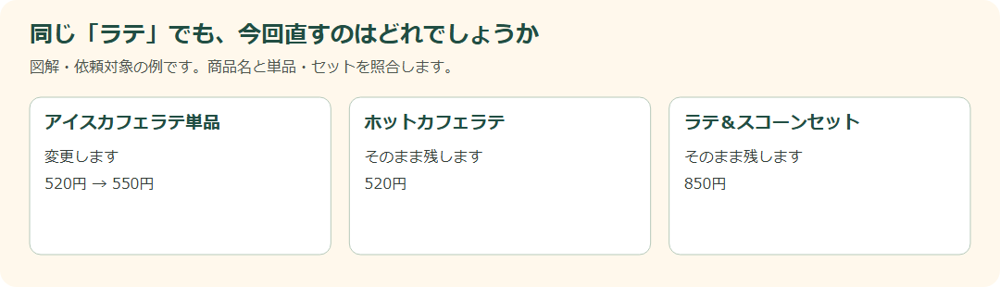
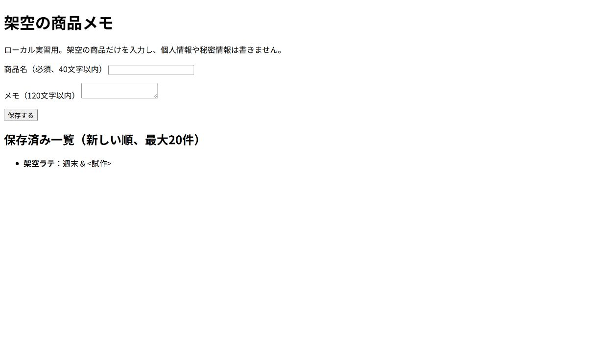
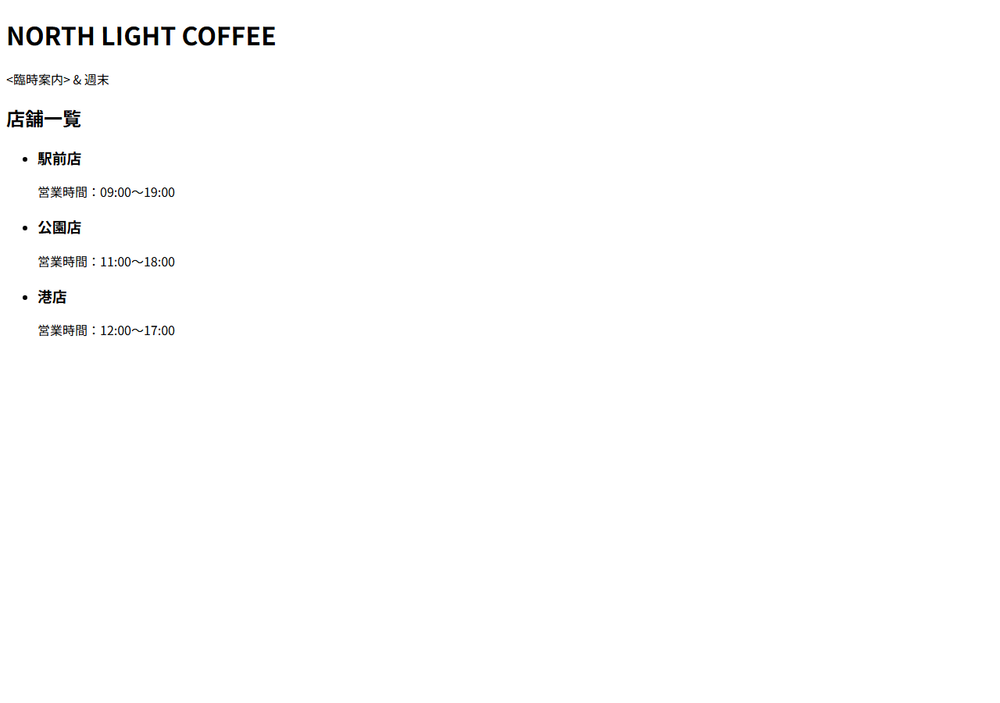
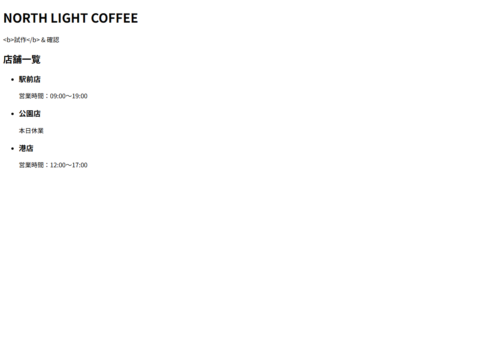
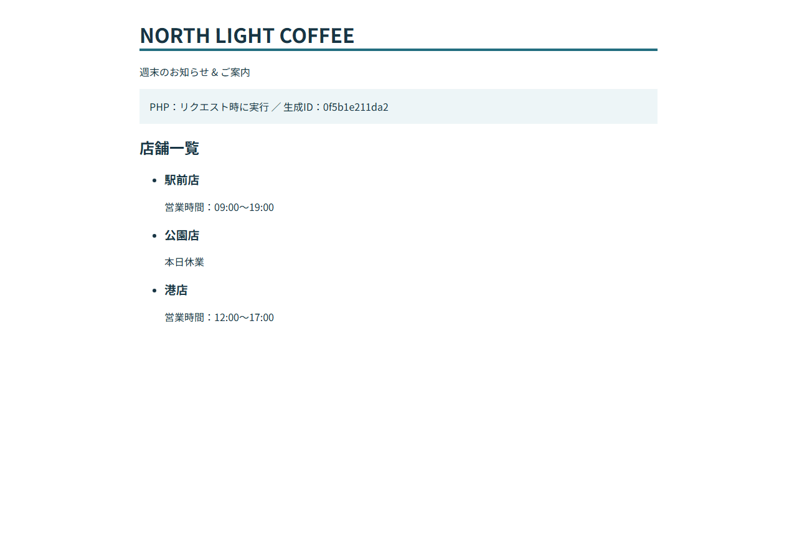
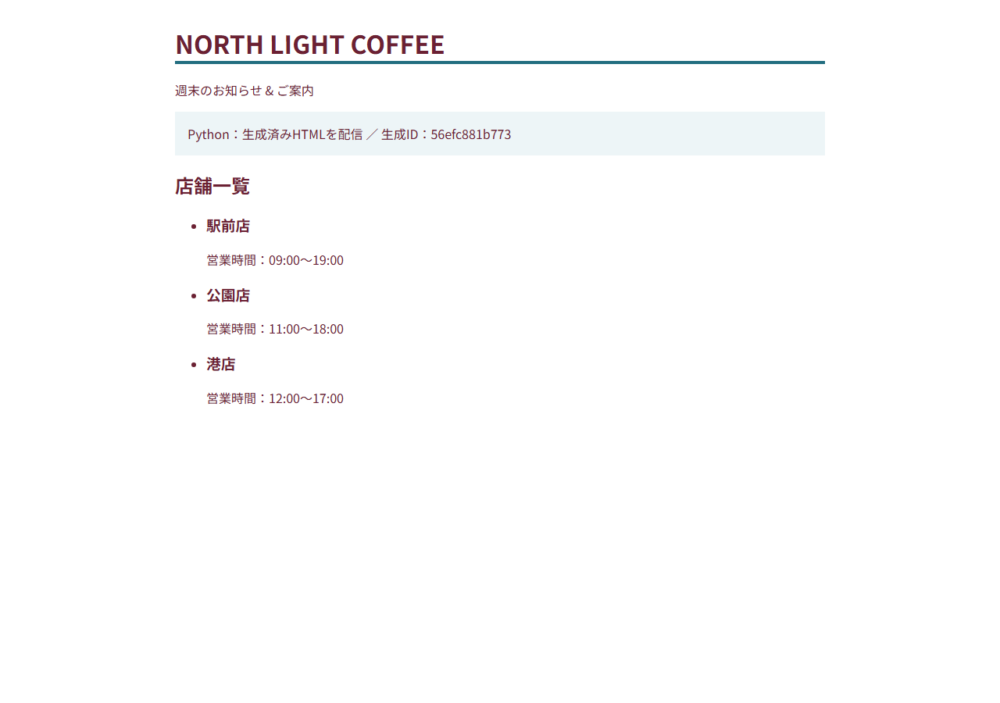
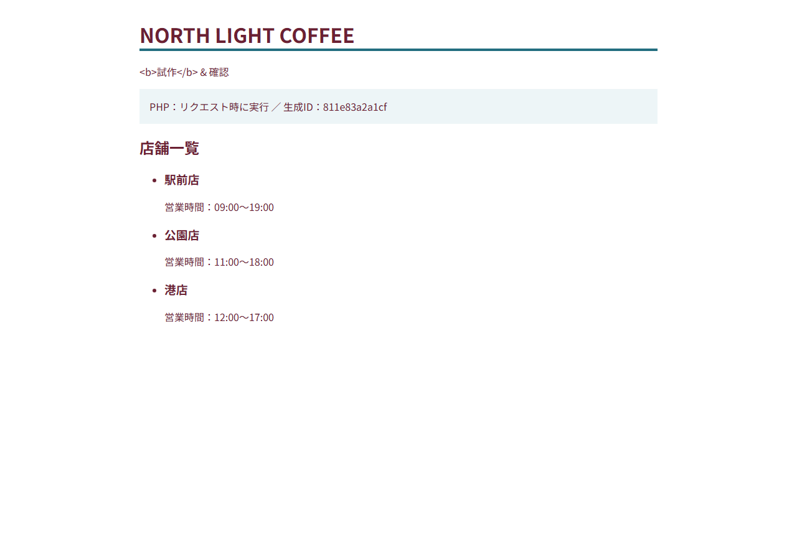
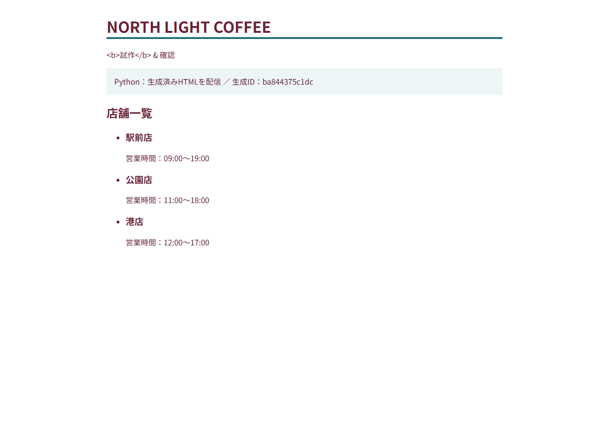
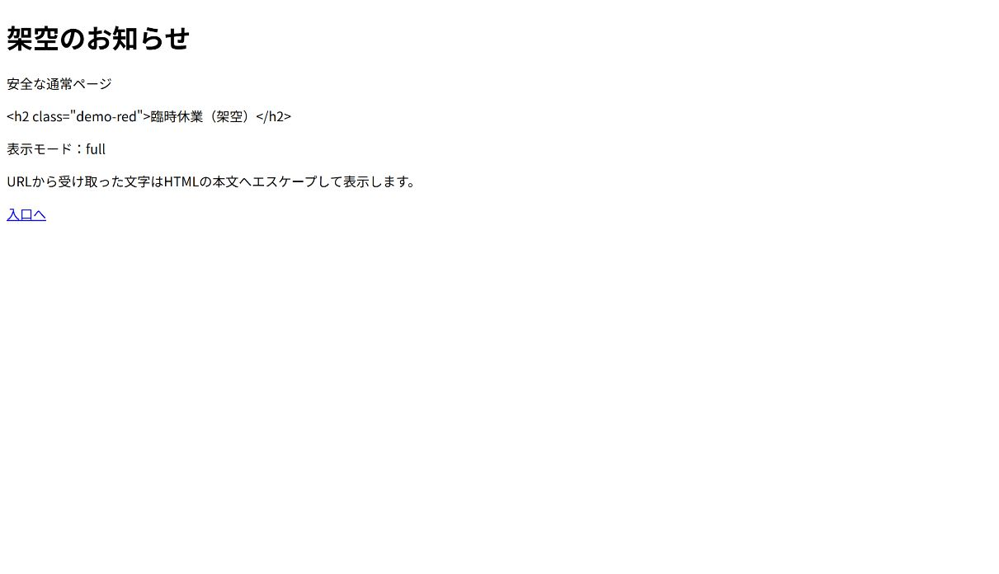

# DAY 11 5つの更新依頼を安全に直して

[目次](../student-workbook.md) · [共通手順](./common.md#local-git-workflow) · [前の回：DAY 10](./day10.md) · [次の回：DAY 12](./day12.md)

💾 **Gitでの記録：** [共通の作業手順](common.md#local-git-workflow)で、作業前後の変更を記録します。  
作業後は `git tag -f day11-end`で、その日の最後のコミットに目印を付けます。


**仕事のイメージ：** 似た商品を見比べて、依頼されたものだけを変更します。

**開始データ：** 写真背景とフォームを含み、5件の依頼を反映する前のカフェサイトです。
営業時間はトップ・店舗案内・JSON-LDで照合し、紹介文と商品名も確認します。  

VS Codeで `Documents/edu` を開き、`hht/day11/` のファイルを編集します。  
開始データはコミット済みで、他の回の成果は必要ありません。  
再開するときも同じフォルダーを開きます。

> **佐藤さんからの依頼**  
> 添付文章、開店時刻、ラストオーダー、アイスカフェラテの価格、フッターの年を更新してください。

**この回の依頼と原稿：** [添付原稿の依頼](../../fixtures/emails/03-content-request.md)、[支給原稿](../../fixtures/attachments/about-copy.md)、[営業時間・価格の依頼](../../fixtures/emails/04-hours-and-price.md)、[年度更新の依頼](../../fixtures/emails/05-copyright-year.md)を読みます。  
反映先・誤字候補・変更開始日などは、この回の作業前に講師へ確認します。

**今回の課題:** 依頼された場所だけを直し、ステージングで確認してもらう。

### 五つの依頼を、一つずつ確実に終えます

「時間も、価格も、文章も」と届くと、まとめて変えたくなります。  
今日は一件ずつ対象と確認状態を分けて、直し過ぎを防ぎます。

**依頼者・見る人：** 佐藤さん／変更を確認する高橋さんと、サイトのお客さまです。

**今回の範囲：** 確定した5件を確認用ページへ反映します。  
似た商品や過去の年は保ちます。  
対象・開始日・時刻の運用が不明なら質問し、公開は承認まで待ちます。

### 開くファイル：DAY 11

**VS Codeで開くもの：** 作業場所の `index.html`・`menu.html`・`about.html`。

**ブラウザで見るページ：** `hht/day11/` の紹介文と時刻は該当ページを検索し、価格は「メニュー」で商品名と照合します。


**見る場所（画像の番号と対応）:**

- **① 変更対象**：「アイスカフェラテ」単品の価格です。  
  `menu.html`で**商品名と同じカード内の`.price`**を探します。
- **② 変更しない価格**：「ホットカフェラテ」です。  
  ①と同じ520円でも、一括置換しません。
- **③ 変更しない価格**：「ラテ＆スコーンセット」です。  
  単品の依頼をセットへ広げません。

数字は教材原本の開始時点の値です。  
自分の作業前の値と、依頼で指定された変更後の値を記録してから編集します。


**見る場所（画像の番号と対応）:**

- **① 紹介文の候補**：ホームの「創業10年。」  
  で始まる文章です。  
  添付原稿の反映先かどうかは、文章と依頼を照合して判断します。
- **② 表示される時刻**：「営業時間」の下の開店・閉店・ラストオーダーです。  
  店舗案内の時刻も別に探します。  
  画面には出ないJSON-LDは、`index.html`内の`openingHours`を検索します。
- **③ フッターの年**：ページ最下部の著作権表記です。  
  本文中の日付や過去のお知らせの年とは区別します。

### この順に、ひとつずつ進めます

1. 添付文章・開店・ラストオーダー・価格・フッターの年を別々にメモします。
2. 添付の原稿と、反映先の候補を照合します。
3. 開店時刻は本文だけでなく、トップと店舗案内、JSON-LDも探します。
4. ラストオーダーの運用と変更開始日を質問します。
5. 商品名を照合し、アイスカフェラテ単品だけを変更します。
6. フッターの年を確認し、記事の日付や創業年と区別します。
7. 確定分の差分を読み、確認用のステージングへ反映します。
8. 5件それぞれの結果と承認待ちの状態を返信に書きます。



**図で見る場所:** 左欄は変更するアイス単品、中央と右欄は変更しないホット・セットです。  
上の実画面の①②③と対応させ、商品名を確認してから価格を編集します。

### 質問と記録の例です

> **質問の例：** ラストオーダーは閉店30分前のままですか。  
> 変更を始める年月日も教えてください。  
>
> **対象確認の例：** アイスカフェラテ単品を520円から550円へ変更します。  
> ホットとセットは変更しません。  
>
> **状態の例：** ステージングへ反映済みです。  
> 高橋さんへ確認依頼中で、公開はまだです。

### 操作のコツ：差分では「消えたもの」も読みます

差分は追加した行だけでなく、削除した行も手掛かりになります。  
Gitのソース管理で編集前後の差分を比べ、対象外の文章まで変えていないか確認します。

**作業前に考えること:** ダミー文章はどこ？  
開店時刻は何か所？  
価格はどの商品？  
似た商品までまとめて変更していない？  
年にはどんな意味がある？

**今回学ぶこと:** エディター検索、差分、影響範囲、構造化データ、誤字チェック、確認依頼、承認状態

**作業メモ:** 「変更したもの」と「似ているが変更しなかったもの」を並べます。

**確認項目:**

- [ ] 全置換しなかった
- [ ] 対象外を守った
- [ ] ラストオーダーを確認した
- [ ] 承認待ちを区別した

### 完成条件・証拠・発展課題

**入力:** 添付文章、営業時間、価格、年の5件

**完成物:** 影響範囲表、対象限定の変更、ステージング、確認依頼

**完成条件:**

- 5件を別々に管理している
- 対象商品以外の価格を変更していない
- 開店時刻とラストオーダーの関係を確認している
- 確定した変更だけをステージングへ出している
- 「確認依頼中」と「承認済み」を区別している

**証拠:** 変更差分、対象外一覧、ステージングURL、確認メール

**発展課題:** 変更件数が50件なら、どう管理するか考えてみます。

---

[目次](../student-workbook.md) · [共通手順](./common.md#local-git-workflow) · [前の回：DAY 10](./day10.md) · [次の回：DAY 12](./day12.md)

<a id="python-template"></a>

**追加課題の選び方：** [Python/Jinja2で静的HTML生成](#python-template) → [PHP CLIコンテナで同じ生成を比較](#php-cli-template) → [フォーム受信・保存](#python-form)の順で比べられます。  
PHPはWSL Containers（wslc）が学校で利用可能な場合だけ行う選択実習です。  
PHP CLIの後に[localhost HTTPの2方式を比較](#php-http-comparison)できます。  
使えない場合もPythonとフォーム課題はそのまま進められます。

### 選択追加課題：Pythonで店舗案内を生成する


**依頼者：** NORTH LIGHT COFFEEの佐藤さん。  
**見る人：** 来店前に支店の営業状況を知りたい人。

> 支店が増えると、同じ形のHTMLを何度も直すのが大変です。  
店舗データから案内を作り、休業中の店には営業時間の代わりに「本日休業」と出せますか。  
まずは手元だけで試作してください。

**目的：** 同じ形の情報をPythonのデータで管理し、Jinja2（ジンジャ・ツー）でHTMLへ変換する。  
変数埋め込み、繰り返し、条件分岐を体験します。

**変更対象：** 自分専用コピーの`data.py`と`templates/index.html`。  
`render.py`は用意済みの生成プログラムとして読みます。  
**対象外：** 基本課題のカフェサイト、CSS、公開・メール送信、基本DAY11の5件の依頼。  
データはすべて架空です。

**位置づけ：** 商品カードと複数更新に関心がある人向けの別枠です。  
基本15回の順番・課題は変わりません。  
Pythonは既習とみなしません。  
準備を含め90〜120分を目安としますが、初学者の所要時間は未実測です。  
終わったら[DAY 12](day12.md#day-12)へ戻ります。

<a id="python-template-concepts"></a>

#### 言葉・構文を先に読む

- **Python（パイソン）：** データを扱い、生成プログラムを動かす言語。  
`.py`はPythonのファイルです。
- **文字列：** `"駅前店"`のように引用符で囲む文字。  
引用符・かっこ・コロン・カンマは半角です。
- **辞書：** `{"name": "駅前店"}`のように項目名（キー）と値を組にする入れ物。  
`shop.name`は渡された辞書の`name`を読むJinja2の書き方です。
- **リスト：** `[辞書1, 辞書2]`のように順に並べる入れ物。  
`BRANCHES`に支店の辞書を並べます。
- **真偽値：** Pythonの`True`（はい）と`False`（いいえ）。  
`closed`は「休業か」です。  
引用符で囲んだ`"False"`は文字列なので使いません。
- **テンプレート：** 固定のHTMLと、あとでデータが入る印を持つひな型。  
ブラウザはJinja2の印を処理できません。
- **テンプレートエンジン：** データをひな型に当てはめ、最終的な文字列を作る道具。  
ここではJinja2を使います。
- **生成HTML：** エンジンが書き出した結果。  
ブラウザにはこのファイルを開きます。  
Pythonをブラウザ内で実行する仕組みではありません。

例は別の題材です。  
下の実習で店舗データの名前へ読み替えます。

```jinja
<h1>{{ event.title }}</h1>

  <p>{{ session.name }}</p>
  
    <p>中止</p>
  
    <p>{{ session.start }}</p>
  

```

- **`{{ ... }}`：** 値を文字として埋め込む印。  
かっこは二重です。
- **``〜``：** リストから1件ずつ取り出し、間のHTMLを繰り返します。  
`session`はその1件につけた名前です。
- **``〜``〜``：** 条件が真なら前半、偽なら後半のHTMLを選びます。  
両方を同時に出しません。
- **HTMLエスケープ：** データ中の`<`を`&lt;`、`&`を`&amp;`などへ変換し、文字をHTMLのタグと誤解させないこと。  
ブラウザ上では元の文字として読めます。  
用意済みの`render.py`はHTML用に有効化しています。  
`|safe`を付けたり、エスケープを無効化したりしません。  
データをJavaScript・URL・CSSへ埋める課題ではありません。
- **`StrictUndefined`：** 項目名の打ち間違いを空欄にせずエラーにする設定です。

**3つの役割：** `data.py`（内容）＋`templates/index.html`（構造と表示ルール）→`render.py`で生成→`output/index.html`（表示結果）。  
生成HTMLだけを直接直しても、次の生成で上書きされます。

<a id="python-template-actions"></a>

#### STEP 1　準備して開始状態を保存する

教材フォルダー全体を自分のPCへ用意し、VS Codeでそのルートを開きます。  
`hht/hands-on/python-store-guide/starter`を、ルート直下へ`python-store-work`という名前でコピーします。  
原本`starter`や講師用フォルダーは編集しません。  
`python-store-work`のコピーを別に`before`として保存します。  
既に同名の作業があれば別名を選び、以降のコマンドも読み替えます。

この追加課題には**Python 3.11以上とJinja2**が必要です。  
基本HTML/CSS演習だけなら不要です。  
VS Codeの「ターミナル」→「新しいターミナル」を開き、まずWindows PowerShellで次を1行ずつ実行します。  
`>>>`と出た場合はPython対話画面なので`exit()`で抜けてから行います。

```powershell
python --version
python -m pip --version
```

`Python 3.11`以上（例：`Python 3.14.6`）とpipのバージョンが出ることを確認します。  
`python`が見つからず`py -3 --version`で動く場合、以下の最初の`python -m venv`を`py -3 -m venv`へ読み替えます。  
どちらも動かない・pipがない・3.10以下の場合は、ここで止めて講師へ表示を報告し、Python導入済みの学校PCを使います。  
アカウント作成やPCの認証・ネットワーク設定変更はしません。

ルートに`README.md`と`hht`が見えていることを確かめ、次を実行します。

```powershell
cd python-store-work
python -m venv .venv
.\.venv\Scripts\python.exe -m pip install -r requirements.txt
.\.venv\Scripts\python.exe -c "import jinja2; print(jinja2.__version__)"
.\.venv\Scripts\python.exe render.py
```

仮想環境はこの課題専用のPythonとライブラリの置き場です。  
有効化コマンドは不要です。  
期待値はJinja2の`3.1.6`、続いて`Generated: output/index.html`です。  
初回のインストールにはパッケージ取得が必要です。  
学校で取得を許可していない場合は設定を変えず、講師が同じ`requirements.txt`から準備した環境を使います。

macOS/Linuxでは`python3 -m venv .venv`で作成し、以降の`.\.venv\Scripts\python.exe`を`./.venv/bin/python`に読み替えます。  
カレントディレクトリは同じです。

エクスプローラーから`python-store-work/output/index.html`をブラウザで開きます。  
開始時は「店舗名をここに表示」「営業状況」と出れば正しい開始状態です。  
この時点では未完成です。  
テンプレート自体を開いていないかアドレスも確かめます。


#### STEP 2　依頼どおりにデータを編集する

VS Codeの左のファイル一覧から`python-store-work/data.py`を開き、次だけを変更して保存（Ctrl+S）します。  
`render.py`は`SHOP`を`shop`、`BRANCHES`を`branches`という名前でテンプレートへ渡しています。

1. `SHOP`の`notice`を`"<臨時案内> & 週末"`にする。  
店舗名は保持する。
2. 駅前店の`hours`を`"09:00〜19:00"`へ直す。
3. 公園店は`closed: True`と元の営業時間を保持する。
4. `BRANCHES`の最後に辞書を1件追加する。  
`name`は`"港店"`、`hours`は`"12:00〜17:00"`、`closed`は`False`。  
前の辞書との間をカンマで区切る。

保存後に生成コマンドを再実行しても、まだ固定の仮表示です。  
データを変えるだけでは、データを参照していないテンプレートの表示は変わらないことを記録します。

#### STEP 3　テンプレートへ3つの仕組みを入れる

`python-store-work/templates/index.html`を開き、TODOの場所を編集します。  
固定HTMLの`main`、見出しの順番、`ul`・`li`の構造は保持します。

1. **TODO 1：** `h1`の仮文字を`shop.name`の埋め込みへ、`id="notice"`の段落の仮文字を`shop.notice`の埋め込みへ置き換える。
2. **TODO 2：** `branches`から1件を`branch`として取り出す`for`で、`li`全体を囲む。  
終了の`endfor`は`</li>`の後、`</ul>`の前。  
`h3`は`branch.name`の埋め込みにする。
3. **TODO 3：** `branch.closed`を条件にする。  
真なら`<p>本日休業</p>`、偽なら`<p>営業時間：…</p>`の`…`へ`branch.hours`を埋め込む。  
`endif`で条件を閉じる。

Ctrl+Sで保存し、同じターミナルで再生成します。  
ブラウザは自動で生成しません。

```powershell
.\.venv\Scripts\python.exe render.py
```

成功メッセージを見てからブラウザを再読み込みします。  
店舗名、お知らせ、駅前店の営業時間、公園店の休業表示、港店の営業時間が順に出ます。  
公園店の営業時間は出しません。


#### STEP 4　ソースと画面を照合し、変化を試す

`output/index.html`をVS Codeで開いて、Jinja2の印が残らず通常のHTMLになっているか確認します。  
お知らせのソースは`&lt;臨時案内&gt; &amp; 週末`となり、ブラウザの画面では`<臨時案内> & 週末`と読めます。  
文字がタグとして消えていないことを確かめます。

ソースの確認では、ブラウザ画面とファイル内の実体参照を区別します。

1. `data.py`の公園店だけを一時的に`False`へ変え、保存→再生成→再読み込みする。  
「本日休業」が消え、`11:00〜18:00`が出ることを記録する。  
`True`へ戻して再生成する。


2. 生成HTMLのお知らせだけを一時的に書き換え、保存→再読み込みする。  
続いて再生成し、データどおりの表示に戻ることを記録する。
3. 元の完成データに戻ったことを確かめ、以下の自動確認を実行する。  
検査は一時コピー内で別データも試し、本人の作業ファイルは書き換えない。  
自分または学校配布のコードだけを実行する。

```powershell
.\.venv\Scripts\python.exe ..\hht\hands-on\python-store-guide\tests\check.py .
```

期待結果は`Ran 7 tests`と`OK`、終了コード0です。  
FAILならテスト名と`AssertionError`にある期待値・実際の値を読みます。  
開始データのままではFAILになります。  
テストの成功は、表示や説明まで合格したことを意味しません。

#### 止まったときの調べ方

- **`can't open file`／パスが見つからない：** ターミナルの現在位置を`pwd`（Windowsは`Get-Location`でも可）で確認。  
`python-store-work`に`render.py`があるか調べる。
- **`No module named jinja2`：** 仮想環境のPythonで動かしているか確認し、そのPythonで`-m pip install -r requirements.txt`をやり直す。
- **インストール時の接続・権限エラー：** 表示を保存して講師へ報告。  
証明書検証や認証、プロキシ、実行ポリシーを変更しない。
- **`SyntaxError`：** `data.py`の指された行と直前を読む。  
引用符、カンマ、`[]`・`{}`、`True`・`False`の大文字を確かめる。
- **`TemplateSyntaxError`：** テンプレートの行番号を見る。  
`{{ }}`と``の取り違え、`endif`・`endfor`の不足を確かめる。
- **`UndefinedError`：** `shop`・`branches`・`branch`、各項目名のつづりを確認する。  
生成失敗時は前のHTMLが残るため、ブラウザの見た目だけで成功扱いにしない。
- **`TemplateNotFound`：** `templates/index.html`の名前と配置を確認する。  
`index.html.txt`になっていないかも調べる。
- **表示が変わらない：** 保存→生成の成功メッセージ→`output/index.html`の再読み込みの順を確認。  
HTML中に`{{`が見える場合はテンプレートを直接開いていないか調べる。
- **全店舗に営業時間が出る：** `closed`が文字列でないか、ifとelseのどちらに段落を書いたかを確認する。

<a id="python-template-done"></a>

#### 完成条件と自己確認

**完成条件：** 次をすべて満たせば、この追加課題の完成とします。

- [ ] 依頼者・見る人・対象と対象外をWORKLOGに書いた。
- [ ] 指定した3店舗をデータ順で表示し、データの追加・値変更が再生成で反映される。
- [ ] 店舗名とお知らせは変数で埋め込み、店舗一覧は繰り返し、営業状況は条件分岐で生成する。  
完成HTMLの直書きだけで済ませていない。
- [ ] 公園店は「本日休業」だけを出し、営業中の駅前店・港店は指定の営業時間を出す。  
真偽の切替確認後は指定データへ戻した。
- [ ] お知らせを文字として読める。  
生成ソースのエスケープを確認し、`|safe`やエスケープ無効化を使っていない。
- [ ] 自動確認7件がOK。  
ブラウザでも3店舗を確認し、狭い画面で文字が読めることを確認した。
- [ ] 「データ／テンプレート／生成HTMLの違い」と「生成HTMLだけの変更が再生成で消える理由」を自分の言葉で説明した。
- [ ] 基本課題のサイトを変更せず、確認内容と未確認事項を依頼者への報告案に分けた。  
公開・送信はしない。


[DAY 11へ戻る](#day-11) · [DAY一覧へ](../student-workbook.md) · [DAY 12へ進む](day12.md#day-12)

<a id="python-form"></a>

### 選択追加課題：フォームをPythonで受け取り保存する


**依頼者：** NORTH LIGHT COFFEEの佐藤さん。  
**見る人：** 新商品の案を整理する担当者役の自分。

> 店舗案内を作れたので、次は架空の商品メモをフォームから残せますか。  
空の商品名は保存せず、保存済みの案を一覧で見たいです。  
アプリをいったん終了しても残るよう、手元だけで試してください。

**目的：** HTMLのフォームから送った値をPythonで読み、入力を検査してSQLiteへ保存し、Jinja2の一覧へ戻す。  
前の課題の「Pythonのデータ→テンプレート」を、「フォーム→データベース→テンプレート」につなげます。

**前提と範囲：** [店舗案内のテンプレート課題](#python-template)を終えてから、別枠120〜150分を目安に取り組みます。  
Pythonの関数・SQLは初出として下で説明します。  
編集対象は本人専用コピーの`app.py`のTODO A〜Dと`templates/index.html`のTODO Eです。  
基本課題の問い合わせフォームやサイトは変更しません。  
通常のフォーム送信だけを使い、JSON送信・ファイルアップロード・multipartは実装しません。

**扱うのは架空の商品名とメモだけです。  
** 氏名、メールアドレス、実在の顧客情報、パスワード、秘密情報は入力しません。  
外部公開・本番利用・実サイトへの送信は対象外です。

<a id="python-form-concepts"></a>

#### 用語・構文・処理の流れ

- **Flask（フラスク）：** ブラウザからの要求を受け、Pythonの処理とHTMLの返答を結ぶ小さなWeb用ライブラリ。  
Jinja2を使えます。
- **GET：** ページを読む要求。  
この課題ではフォームと保存済み一覧を表示し、保存はしません。  
URLに`?item=...`を足しても保存されません。
- **POST：** 本文に値を入れて送る要求。  
この課題では検査して保存します。  
POSTであるだけでは暗号化や認証にはなりません。
- **Form data：** 通常の`<form method="post">`で送る名前と値。  
この課題の送信形式は既定の`application/x-www-form-urlencoded`です。  
日本語・空白・`&`などは送信時に符号化され、Flaskが読み戻します。  
`multipart/form-data`は主にファイル送信などで使う別の形式で、今回は不要です。
- **JSONとの違い：** JSONは`{"item":"架空ラテ"}`のような構造をJSON形式で送るもの。  
`Content-Type: application/json`と`request.get_json()`を使う別経路です。  
今回の`request.form`へJSONは入りません。  
JSONやmultipartを送ると415で拒否します。
- **`name`：** HTMLの入力欄につける送信キー。  
`name="item"`の値はPythonで`request.form.get("item", "")`と読みます。  
`id="item"`はラベルと結ぶための目印で、送信キーの代わりにはなりません。
- **関数：** `def validate(item, note):`で処理に名前を付け、`return`で結果を返します。  
関数の中は半角空白4つでそろえます。
- **`.get("item", "")`：** キーがないときも空文字を返します。  
**`.strip()`**は前後の空白を除きます。  
**`len(item)`**は文字数です。
- **入力チェック：** 商品名は空白を除いて必須・40文字以内。  
メモは任意・120文字以内。  
ブラウザの`required`と`maxlength`に加えて、Python側でも検査します。  
ブラウザを通さない送信もあるためです。
- **SQLite（エスキューライト）：** Python標準の`sqlite3`で使えるファイル型データベース。  
別のDBサーバーを登録・起動する必要はありません。
- **SQL：** データベースに保存・読込を頼む言葉。  
`INSERT`は行を追加、`SELECT`は行を読む、`ORDER BY id DESC LIMIT 20`は新しいIDから最大20件です。  
21件目以降の古い記録は消えず、一覧の外に残ります。
- **パラメーター化：** SQLの形と値を分けること。  
値を`f"...{item}..."`や`+ item`でSQLへ連結しません。

別題材の書き方の例です。

```python
def validate_title(title):
    errors = []
    if not title:
        errors.append("題名は必須です")
    return errors

with db:
    db.execute("INSERT INTO ideas (title) VALUES (?)", (title,))
```

`errors`はエラー文を並べるリスト。  
空リストならエラーなしです。  
`with db:`は正常終了時に変更を確定（コミット）し、途中の例外では取り消します。  
`?`に値を渡す部分がパラメーターです。  
値が1個のタプルは`(title,)`と末尾カンマを付け、今回の2個は`(item, note)`とします。

**今回の1往復：** GET `/`→空のフォームと一覧→POST `/`→`request.form`→入力検査→不正なら400とエラー画面／正しければINSERTとコミット→303でGET `/`へ移動→SELECT→Jinja2で一覧。  
保存後をGETへ戻すので、通常の再読み込みだけで再POSTしません。  
二重クリックなどあらゆる重複を防ぐ仕組みではありません。

**保存先：** 作業コピーの`instance/notes.sqlite3`です。  
初回起動でフォルダーとテーブルを作ります。  
`CREATE TABLE IF NOT EXISTS`なので、再起動しても既存データは消しません。  
Pythonの変数だけに保存した場合と違い、ファイルが残るから読み直せます。  
ファイルを移動・削除したり別の作業コピーを起動したりすると、同じ一覧にはなりません。

<a id="python-form-actions"></a>

#### STEP 1　開始コピーと専用環境を用意する

教材ルートの`hht/hands-on/python-form-notes/starter`を、ルート直下の`python-form-work`へコピーします。  
既存の同名フォルダーには重ねません。  
開始ソースを別の`before/`へ保存し、以降は作業コピーだけを編集します。

前の課題と同じPython 3.11以上を使います。  
ルートで新しいターミナルを開き、Windows PowerShellでは次を実行します。

```powershell
cd python-form-work
python -m venv .venv
.\.venv\Scripts\python.exe -m pip install -r requirements.txt
.\.venv\Scripts\python.exe -c "from importlib.metadata import version; print(version('Flask'))"
.\.venv\Scripts\python.exe app.py
```

期待値はFlaskの`3.1.2`と`Running on http://127.0.0.1:5000`です。  
ターミナルはサーバーの待受中です。  
この状態で同じターミナルへ次のコマンドを打ちません。  
macOS/Linuxでは`python3`で環境を作り、以降のPythonパスを`./.venv/bin/python`に読み替えます。

ブラウザで`http://127.0.0.1:5000/`を開きます。  
`templates/index.html`を直接開いたり、Live Previewで配信したりしてもPythonの受信処理は動きません。  
開始状態は入力欄と「一覧表示は未実装です」が見え、送信すると「入力チェックが未実装です」が出ます。  
保存できたと解釈しません。


#### STEP 2　TODO A・B：受信と検査を作る

VS Codeで`python-form-work/app.py`を開きます。  
用意済みの`index()`がPOSTを判定して`read_form`→`validate`→`save_entry`を呼ぶ部分も先に読みます。  
サーバーの配線、接続・終了処理、SQLのテーブル定義、localhostの設定は保持します。

1. **TODO A `read_form(form)`：** `form.get`で`"item"`と`"note"`を読み、それぞれ`.strip()`した2値を`return 商品名, メモ`の順に返す。  
対応するHTMLの`name`を確認する。
2. **TODO B `validate(item, note)`：** `errors = []`から始める。  
空の商品名なら`"商品名は必須です"`、40文字超なら`"商品名は40文字以内です"`、メモ120文字超なら`"メモは120文字以内です"`を`errors.append`する。  
最後に`return errors`とする。  
開始時の「未実装」のエラーは置き換える。

**保存→サーバーのターミナルでCtrl+C→同じ起動コマンドを再実行→ブラウザ再読込**の順で反映します。  
自動再起動・デバッガーは使いません。  
この段階で正常入力を送ると保存処理が未実装なのでエラーになります。  
まず検査の処理を読み、次のSTEPで保存を完成させます。

#### STEP 3　TODO C・D・E：保存と読込をつなぐ

1. **TODO C `save_entry(db, item, note)`：** `with db:`の中で`db.execute`を呼ぶ。  
SQLは`INSERT INTO entries (item, note) VALUES (?, ?)`、別の引数で値のタプル`(item, note)`を渡す。  
`raise NotImplementedError`は置き換える。
2. **TODO D `list_entries(db)`：** `db.execute("SELECT id, item, note FROM entries ORDER BY id DESC LIMIT 20").fetchall()`を返す。  
`fetchall()`は検索結果の行をリストとして取り出す。
3. **TODO E `templates/index.html`：** `entries`から1行を`entry`として取り出す`for`を作り、1行ごとに`li`を出す。  
`strong`の中に`entry.item`、続く本文に`entry.note`を埋め込む。  
`for`の`else`（0行の場合）では`<li>まだ保存されていません</li>`を出し、`endfor`で閉じる。  
前の課題の`if`の`else`とは用途が違う。  
フォームとエラー表示の配布済み部分は保持する。

HTMLの値は`{{ ... }}`のままで自動エスケープされます。  
`|safe`、`Markup`、HTML文字列への連結は使いません。  
入力欄の`value="{{ item }}"`の引用符も保持します。

保存→停止→起動→再読込したら、初回は「まだ保存されていません」です。  
商品名`架空ラテ`、メモ`週末 & <試作>`を入れ、「保存する」を押します。  
入力欄は空に戻り、一覧にその文字がそのまま読めます。  
タグや画像として実行されません。


#### STEP 4　不正入力・再表示・再起動を検証する

1. 空欄で保存を押すとブラウザの必須チェックが止める。  
これはPythonの検査を確かめたことにはならない。  
次に商品名へ半角空白3つ、メモへ「空白だけの商品名を検査」を入れて送る。  
空白はブラウザのrequiredを通るが、Python側で除去され、400と「商品名は必須です」が表示される。  
一覧が増えないこととメモの保持も確認する。
2. 完成したソースを保存し、サーバーをCtrl+Cで止める。  
同じターミナルで共通テストを実行する。

```powershell
.\.venv\Scripts\python.exe ..\hht\hands-on\python-form-notes\tests\check.py .
```

期待値は`Ran 10 tests`、`OK`、HTTPテストPIDの`cleanup PASS`です。  
テストは本人のソースを一時コピーへ移し、別DBで実行します。  
本人のDBは書き換えません。  
ブラウザ制約を通さず必須違反・41文字・121文字を送り、400でエラー表示され保存されないことも確かめます。  
40文字・120文字は保存可です。  
JSON・multipartは415、4096バイトを超える送信は413です。  
長さはこの課題ではPythonの`len`で数えます。


3. もう一度`.\.venv\Scripts\python.exe app.py`で起動し、ブラウザを再読み込みする。  
先ほど本人が入れた`架空ラテ`が残っていることを確認する。  
同じ画面を2回再読込しても行数が増えないことも記録する。
4. サーバーのあるターミナルをCtrl+Cで止め、再起動→再読込し、もう一度残存を確認する。  
テストでも実HTTPサーバーを別プロセスで2回起動して、同じDBの保持を確認する。
5. 作業コピーの`instance/notes.sqlite3`が保存先であることを確認する。  
ファイルをエディターで文字として編集しない。  
使い終わったらCtrl+Cでサーバーを終了する。



375px幅でも入力欄と一覧が読めることを確認します。


**公開運用との境界：** このアプリには認証・認可・CSRFトークン・本番用サーバー・運用監視がありません。  
localhostの待受と外部Origin・Hostの拒否は補助で、CSRF対策が完成したことを意味しません。  
公開にはそれらに加えHTTPS、秘密情報管理、バックアップ、権限や送信頻度等の設計・検証が必要です。  
今回は外部公開・ホスト変更・トンネル・学校ネットワークの設定変更は行いません。

#### 止まったとき

- **Flaskが見つからない：** 作業コピー専用のPythonで`-m pip install -r requirements.txt`を行ったか確認。  
取得不可なら設定を変えず講師へ報告する。
- **5000番が使用中・起動不可：** 自分が前に起動したサーバーだけをCtrl+Cで終了する。  
他人のプロセスを止めたり、ネットワーク設定を変えたりせず、解消しなければ講師へ報告する。
- **接続拒否：** ターミナルで起動が成功しているか、URLが`http://127.0.0.1:5000/`か確認する。
- **400：** 入力チェックの失敗。  
画面のエラーと文字数・空白を確認する。  
開始時の未実装エラーならTODO Bを確認する。
- **415：** 普通のフォーム以外の形式。  
`method="post"`と`name`を保持し、JSON・multipartに変更していないか確認する。
- **500／`NotImplementedError`：** ターミナルの例外の行とTODO Cを確認する。  
SQLiteの`no such table`ならテーブル名が`entries`か、`no such column`なら`item`・`note`のつづりを確認する。
- **保存されたのに表示がない：** TODO Dの返り値、TODO Eのループ・キー・エスケープと、再起動した作業場所を確認する。
- **再起動後に空になる：** 別コピーの`app.py`や異なるDBを開いていないか、`instance/notes.sqlite3`を移動していないか確認。  
起動時に`DROP TABLE`やDB削除を追加しない。

<a id="python-form-done"></a>

#### 完成条件と自己確認

**完成条件：** 次をすべて満たせば、この追加課題の完成です。

- [ ] 依頼と対象・対象外を書き、フォームの`name`とPythonのキーが一致する理由を説明した。
- [ ] 通常のフォームPOSTを受け、必須・40文字・120文字の検査をサーバーで行う。  
不正なら保存せずエラーと入力値を再表示する。
- [ ] 正常ならパラメーター化したSQLとコミットで保存し、303でGETへ戻す。  
新しい順の最大20件をJinja2で表示する。
- [ ] 記号を含む文字がタグにならず表示される。  
SQLへの文字列連結、`|safe`、認証情報は含まない。
- [ ] 自動テスト10件がOKで、HTTP検証用プロセスの終了もPASS。  
本人のブラウザでも保存・一覧・再読込・停止後再起動の保持を確認した。
- [ ] GETとPOST、Form dataとJSONの違い、保存ファイルと永続化、公開用に不足する対策を自分の言葉で記録した。
- [ ] 架空データ・localhostだけを使い、検証後にサーバーを停止した。


**評価：** この欄が追加課題の合格条件です。  
機械検査とは別に画面・説明・停止を確認します。  
基本15回の[授業全体の合格ルート](../rubric.md#合格ルート)へ必須条件は追加しません。  
未完成工程は正直に記録し、修正後に再確認します。

[テンプレート課題へ](#python-template) · [DAY 11へ戻る](#day-11) · [DAY一覧へ](../student-workbook.md) · [DAY 12へ](day12.md#day-12)

<a id="php-cli-template"></a>

### 選択追加課題：公式PHP CLIコンテナでHTMLを生成する


**依頼者：** NORTH LIGHT COFFEEの佐藤さん。  
**見る人：** 来店前に店舗の営業状況を知りたい人。

> Pythonで作った店舗案内と同じ内容を、PHPでもデータから作れるか比べたいです。  
PCへPHP本体を追加せず、学校で用意済みのコンテナで試してください。  
今回は完成したHTMLだけを手元で確認します。

**目的：** 配列データとPHPテンプレートを分離し、PHP CLIでHTMLを生成する。  
変数・繰り返し・条件分岐を、Python/Jinja2版と対応させます。  
Webサーバー・PHPの開発サーバー・PHP-FPM・Composer・外部テンプレートライブラリは使いません。

**対象：** 本人の作業コピーの`hello.php`、`data.php`、`templates/index.php`。  
用意済みの`render.php`と`build.php`を読んで使います。  
**対象外：** 基本課題のサイト、Python・フォーム課題のファイル、DockerやOSの導入・設定変更、外部公開・実サイトへの送信。  
データは架空の店舗だけです。

**2026-10-26の確認：T770iのwslc 3.0.3でPHP実行・マウント・保存を検証しました。  
** このローカル実習では`--cap-drop`・`--security-opt`を使用せず、wslcの既定の権限動作を使います。  
通常ユーザー・ネットワークなし・本人の作業コピーだけのマウントを維持します。  
[実機・模擬テスト・残る制約](../../hands-on/php-cli-template/instructor/verification-20261026.md)は講師用です。

#### 前の課題と何が違う？

| 観点 | Python/Jinja2 | PHP CLIコンテナ | Flaskフォーム |
|---|---|---|---|
| データ | Pythonの辞書・リスト | PHPの配列 | POSTした値をSQLiteへ保存 |
| テンプレート | Jinja2の印 | PHP自体の構文 | Jinja2の印 |
| 実行時期 | 生成コマンドを打つとき | CLIコンテナを1回動かすとき | HTTP要求を受けるとき |
| ブラウザへ渡すもの | 生成HTMLファイル | 生成HTMLファイル | Flaskが返すHTML |
| Webサーバー | 不要 | 不要 | ローカル受信用に必要 |

<a id="php-cli-concepts"></a>

#### 用語と最小限の構文

- **PHP（ピーエイチピー）：** HTMLに処理を埋め込めるプログラミング言語。  
Webサーバー以外にCLIでも実行できます。
- **CLI：** ターミナルのコマンドで動かす方式。  
`php hello.php`は「PHPでこのファイルを実行する」。  
`.php`をブラウザへ直接開く操作とは違います。
- **コンテナ：** 用意された実行環境でプログラムを動かす仕組み。  
**イメージ**はその環境の元、**タグ**はバージョン等の名前、**digest**は特定のイメージ内容を識別する値です。
- **ホスト：** 自分のPC。  
**コンテナ内：** 実行環境側。  
同じフォルダーでもパス表記が違います。
- **バインドマウント：** ホストの指定フォルダーをコンテナから見える場所へ対応させること。  
今回の作業コピーだけを`/work`へ対応させます。  
PC全体、ホーム全体、Dockerソケットは渡しません。
- **標準出力：** 実行結果が通常ターミナルへ流れる経路。  
画面へ出すこととファイルへ保存することは別です。

```php
<?php
$title = '架空イベント';
echo $title;
echo "\n";
```

`<?php`はPHP処理の開始。  
`$title`は変数で、先頭に`$`を付けます。  
`=`は代入、`echo`は標準出力へ文字を出す命令、`;`は文の終わりです。  
`"\n"`は改行。  
PHPだけのファイルは末尾の`?>`を省き、意図しない空白を出さないようにします。

```php
<h1><?= e($event['title']) ?></h1>
<?php foreach ($sessions as $session): ?>
  <p><?= e($session['name']) ?></p>
  <?php if ($session['cancelled']): ?>
    <p>中止</p>
  <?php else: ?>
    <p><?= e($session['start']) ?></p>
  <?php endif; ?>
<?php endforeach; ?>
```

- **`<?= ... ?>`：** `<?php echo ...; ?>`の短い書き方。  
PHPと固定HTMLを混ぜるときに使います。
- **配列：** `['name' => '駅前店']`はキーと値の組。  
`$shop['name']`で読む。  
`[$branch1, $branch2]`のように並べることもできます。  
PHPは両方を配列で表せます。  
Pythonの辞書の`:`と違い、対応には`=>`を使います。
- **`foreach ($sessions as $session):`〜`endforeach;`：** 配列から1件ずつ取り出して、間のHTMLを繰り返す構文です。
- **`if (...) :`〜`else:`〜`endif;`：** 真なら前半、偽なら後半を出す。  
PHPの真偽値は`true`と`false`。  
文字列`'false'`にはしません。
- **`include`：** 別のPHPファイルをこの場所で実行する。  
`render.php`が固定した`templates/index.php`を読み込みます。  
`$shop`と`$branches`を用意してからincludeするため、テンプレート内で読めます。  
入力値からincludeのパスを組み立てません。
- **`require`と`return`：** `require`は必須ファイルを読み込み、欠落時は止まります。  
`data.php`の`return [...]`で返された配列を、生成側が受け取ります。
- **`__DIR__`と`.`：** `__DIR__`はそのPHPファイルのある場所、`.`は文字列の連結。  
`__DIR__ . '/data.php'`なので、コマンドの実行場所に依存せず同じデータを読めます。
- **`e(...)`：** 配布済みの関数です。  
中で`htmlspecialchars($value, ENT_QUOTES | ENT_SUBSTITUTE, 'UTF-8')`を呼び、`<`・`>`・`&`・両方の引用符をHTML用にエスケープします。  
不正なUTF-8は置換します。  
PHPのecho自体は自動エスケープしないため、データをHTMLへ出す箇所は必ず`e`を通します。

`render.php`は出力バッファ（`ob_start`）へテンプレートの出力を集め、文字列として返します。  
`build.php`はそのUTF-8文字列をファイルへ保存します。  
今回はデータをHTMLの本文だけへ入れ、URL・JavaScript・CSSには埋め込みません。

<a id="php-cli-actions"></a>

#### STEP 1　WSL Containers（wslc）の利用条件を確認する

この実習ではMicrosoftの**WSL Containers（`wslc.exe`）**を使います。  
WSLはLinuxを実行する基盤で、wslcはWSL 2.9.3以上に同梱されるコンテナCLIです。  
UbuntuへDocker EngineやPodmanを追加する方式ではありません。  
[Microsoft公式手順](https://learn.microsoft.com/en-us/windows/wsl/tutorials/wsl-containers)を参照できます。

教材ルートを開いたWindows PowerShellで、次を実行します。  
前のPython課題と同じPython 3.11以上を、配布済みの安全確認・起動スクリプトに使います。  
WindowsへPHP本体を導入する必要はありません。

```powershell
wsl --version
wslc version
wslc run --help
python hht/scripts/verify_php_cli.py --runtime wslc --check-runtime
```

最後のコマンドはバージョンとhelpを読むだけで、イメージのpullやコンテナ起動はしません。  
WSL／wslcが2.9.3未満、wslcがない、アクセス拒否なら停止します。  
更新・新規導入・セキュリティ設定変更は承認なしで行わず、講師へ報告します。

最低バージョンだけで判断せず、`--network`・`--user`・`--mount`・`--workdir`・`--rm`・`--name`があることを確認します。  
確認結果は`test-results/php-cli/runtime-report.json`に保存されます。  
T770iのwslc 3.0.3では`ready: true`を確認しました。  
必要な指定がない・接続拒否の場合はBLOCKEDで停止し、無断導入や別ランタイムへの切替はしません。

この実習では、現行wslcにない**`--cap-drop ALL`（全capabilityの削除）と`--security-opt no-new-privileges`（新たな権限取得の禁止）を指定しません**。  
capabilityはLinuxで特定の管理操作を許す権限です。  
実測ではCapEffは0、CapBndは`00000000a80425fb`、NoNewPrivsは0でした。  
現在有効なcapabilityが0でも、将来使える権限の上限まで0にした状態ではありません。  
非rootユーザーだけで、この2つの保護を代用したとは説明しません。

残る保護は、非root UID、`--network none`、ポート公開なし、本人の作業フォルダー1つだけのマウント、固有名の一時コンテナと終了確認、固定した公式イメージです。  
起動後にもUIDが0でないこととネットワークがループバック（`lo`）だけであることを検査します。  
`--privileged`、ホストネットワーク、ホスト全体・Dockerソケットのマウントは使いません。  
OS・VPN・ファイアウォール・アカウント権限・wslcの設定を変更しません。  
学校管理の端末で架空データを扱うローカル実習の範囲であり、不明なプログラムの安全な実行環境や公開運用の保証ではありません。

#### STEP 2　本人のコピーと固定イメージでechoを実行する

以後も**Windows PowerShell・教材ルート**で操作します。  
開始コピーが既にあれば別名を選び、以下も読み替えます。

```powershell
if (Test-Path .\php-template-work) { throw '同名の作業があるため停止します。別名を選んでください。' }
Copy-Item .\hht\hands-on\php-cli-template\starter .\php-template-work -Recurse
```

開始ソースを別の`before/`へ保存します。  
`php-template-work/hello.php`のTODO 0を`echo "PHPでHTMLを作る\n";`へ変更して、UTF-8・BOMなしで保存します。

```powershell
python hht/scripts/run_php_cli.py --source .\php-template-work --action version
python hht/scripts/run_php_cli.py --source .\php-template-work --action hello
```


- 公式イメージは`hht/hands-on/php-cli-template/image.txt`のタグ＋digestで固定します。  
現在は`docker.io/library/php:8.4.27-cli-bookworm`、index digestは`sha256:496b5e02fe9fe44fcfb715023b931048111dc4e0bc719789d83c906be9f04b05`です。  
2026-10-25に`linux/amd64`の配信を確認しています。  
実際のPHPバージョンは起動時にも照合します。
- タグは読める名前、digestは内容の識別子です。  
古い`latest`のキャッシュやRC・未修正版へ切り替えません。  
レジストリへ接続できない・digestが違う場合も停止します。
- ランチャーはwslcへ`--rm`、固有の`--name`、`--network none`、`--user 65534:65534`、本人のフォルダーの`--mount`、`--workdir /work`を渡します。  
2つの権限縮小オプションを加えず、実際のUID・ネットワークを検査します。
- ホスト側は本人のWindows作業フォルダー、コンテナ側は`/work`です。  
バインドマウントはこのコピーだけを対応させます。  
パスに空白・日本語があっても1引数で渡し、ドライブ全体・ホーム全体・リポジトリ全体・Dockerソケットはマウントしません。
- `--workdir /work`により、`hello.php`はコンテナ内の`/work/hello.php`です。  
ホストの`C:\...`をPHPのincludeパスへ書きません。
- PHPが書いた`/work/output/index.html`は、本人のホスト側コピーの`output/index.html`です。  
`--rm`でコンテナを除去しても生成ファイルは残ります。  
T770iのwslc 3.0.3で、空白・日本語を含むWindowsパスのマウントとUTF-8保存を検証しました。
- Webサーバー、ポート公開、特権コンテナ、ホストネットワークは使いません。  
権限エラーを昇格や設定変更で回避しません。

#### STEP 3　データとテンプレートを完成させる

まず`data.php`だけを編集します。  
店名は保持し、お知らせを`'<臨時案内> & 週末'`、駅前店の営業時間を`'09:00〜19:00'`へ変更します。  
公園店は`closed => true`と元の営業時間を保持します。  
最後に`name => '港店'`、`hours => '12:00〜17:00'`、`closed => false`の配列を追加します。  
キーも文字列なので引用符で囲み、項目間・店舗間のカンマを保持します。

次に`templates/index.php`のTODOを編集します。

1. **TODO 1：** h1に`$shop['name']`、お知らせ段落に`$shop['notice']`を、短縮echoと`e`を使って埋め込む。
2. **TODO 2：** `$branches`から`$branch`を取り出すforeachでli全体を囲む。  
h3に`$branch['name']`をエスケープして埋め込む。  
終了の`endforeach;`はliの後、ulの前。
3. **TODO 3：** `$branch['closed']`でifを分け、真なら`<p>本日休業</p>`、偽なら`<p>営業時間：…</p>`の`…`に`e($branch['hours'])`を出す。  
`endif;`で閉じる。

固定HTMLのmain、見出しの順番、ul/liは保持します。  
`render.php`の`e`を削除したり、データをそのままechoしたりしません。

#### STEP 4　ファイルへ生成しブラウザで確認する

```powershell
python hht/scripts/run_php_cli.py --source .\php-template-work --action build
```

期待値は`Generated: output/index.html (UTF-8)`です。  
コンテナ内の`/work/output/index.html`は、Windows側の`php-template-work/output/index.html`に対応します。  
PHPが`file_put_contents`で直接書くので、保存データはWindows PowerShellのテキスト変換を通りません。

**`wslc run ... > output/index.html`や`Out-File`でHTMLを保存しません。  
** Windows PowerShell等では標準出力をテキストとして変換し、UTF-16等になる場合があります。  
今回の保存経路は常にPHPの`build.php`です。  
標準出力を観察する場合だけ、ランチャーの`--action stdout`を使います。  
これはHTMLをターミナルへ出すモードで、ファイル保存とは別です。

本人の`php-template-work/output/index.html`をエクスプローラーからブラウザで開きます。  
Webサーバーは起動しません。  
URLは`file:///.../output/index.html`で、`http://localhost:...`ではありません。  
コンテナの`lo`はコンテナ自身のループバックで、Windowsのlocalhostとは別です。  
`--network none`は「外部だけを遮断してホストからは接続できる」という意味ではありません。  
この課題ではHTTPサーバーもポート公開も用意せず、バインドマウントで保存したファイルをWindows側から読みます。  
店舗名、`<臨時案内> & 週末`という文字、駅前店09:00〜19:00、公園店「本日休業」、港店12:00〜17:00が読めることを確認します。  
テンプレートの`.php`を直接開いても生成されません。

VS Codeで生成HTMLも開き、お知らせのソースが`&lt;臨時案内&gt; &amp; 週末`、文字コードがUTF-8であることを確認します。  
`<?php`や`<?=`が残っていれば生成HTMLを開いているかを確認します。  
`view-source:`は使いません。  
以下はT770iのwslc 3.0.3で生成したHTMLを、Chromeで実際に描画した画像です。  
ヘッドレスChromeによる描画結果で、VS CodeやPowerShellの操作画面ではありません。  
エディター・ターミナルの操作画面は未撮影です。


通常表示では、お知らせの山括弧と&が文字のまま読め、3店舗の順番と営業時間・休業表示を確認できます。

#### STEP 5　条件・特殊文字・再生成を確かめる

1. 公園店を一時的に`false`へ変えて保存→再生成→ブラウザ再読込し、営業時間11:00〜18:00へ切り替わることを確認。  
`true`へ戻して再生成する。
2. お知らせに一時的に`'<b>試作</b> & 確認'`を入れる。  
太字タグにはならず、そのまま文字として読めることと、生成ソースのエスケープを確認。  
指定のお知らせへ戻す。
3. 生成HTMLだけを直接変更してから再生成し、変更がデータとテンプレートから作り直されることを確認する。
4. 自分の作業コピーだけを次の共通テストで確認する。  
正解例は見ずに行う。



操作1の切替後は、公園店も11:00〜18:00と表示されます。



操作2では`<b>試作</b> & 確認`が文字として表示され、試作だけを太字にするHTMLにはなりません。

```powershell
python hht/scripts/run_php_cli.py --source .\php-template-work --action check
```

期待値は`Checks: 29; failures: 0`と`Temporary copy cleanup PASS`、終了コード0です。  
別データ4店舗、0店舗、両方の条件、特殊文字・両方の引用符・不正UTF-8の置換、ファイルとstdoutのバイト一致、別の実行場所、再生成を検査します。  
本人のソースは変更せず、テスト用コピーへ必要ファイルだけを複製して試します。  
講師用正解例を読み込む処理はありません。  
開始データのままならFAILが正しい結果です。  
実行できていない検査をPASSと記録しません。

ランチャーは固有名の検証コンテナが終了・不在になるまで確認します。  
接続拒否や一覧の形式不明を「不在」と扱いません。  
最後に`wslc container list`で実習の実行中コンテナが残っていないことも確認します。  
ほかの人や別用途のコンテナを停止・削除しません。

#### 止まったとき

- **wslcがない／必要な指定がない：** 最低バージョンとrunのhelpを照合し、確認スクリプトがBLOCKEDなら停止します。  
2つの権限縮小オプションがないことだけでは停止しません。  
エラーを保存し、講師へBLOCKEDを報告。  
無断導入・設定変更・別環境への切替はしません。
- **修正版タグがない：** 公開待ちで停止。  
古い`latest`・8.4.26・RCでは実行しません。
- **`Runtime PHP version does not match...`：** 実際のPHPが修正条件を満たしていません。  
イメージ名・pull結果・`php --version`を照合し、古いキャッシュを使い回しません。
- **マウントのパス・権限エラー：** `--source`が本人の開始コピーか確認。  
空白・日本語を含むパスはPowerShellで引用符を付け、ランチャーへ1引数で渡します。  
PC全体やDockerソケットのマウントで解決しません。
- **`Could not open input file`：** `/work`に作業コピーが見えるか、`--workdir /work`とファイル名を確認する。
- **`Parse error`：** 表示の行と直前を読む。  
`$`、`;`、`=>`、引用符、`endif;`・`endforeach;`を確認する。
- **`Undefined array key`：** `name`・`notice`・`hours`・`closed`のつづり、配列とループ変数を確認する。
- **日本語が文字化け：** ソースと生成HTMLのUTF-8、meta charset、PHP直接保存の経路を確認。  
`>`や`Out-File`で作ったファイルを検証結果へ使わない。  
文字化けしたデータをさらにエスケープして直そうとしない。
- **タグが動いたり文字が消える：** echoへ渡す値に`e(...)`があるか、`htmlspecialchars`の引数が配布時どおりか確認する。
- **表示が古い：** 保存→生成コマンドの成功→ホストの正しいHTMLを再読込の順で確認する。

<a id="php-cli-done"></a>

#### 完成条件と自己確認

**完成条件：** 次をすべて満たせばこの追加課題の完成です。  
環境またはタグが未準備なら、完成ではなくBLOCKEDとして記録します。

- [ ] 依頼と対象・対象外を記録し、PHP・Python/Jinja2・フォーム課題の実行時期の違いを説明した。
- [ ] 公式修正版情報、pullした固定タグ、実行したPHPバージョン、digestを記録した。  
旧版・RC・latestで代用していない。
- [ ] 作業コピーだけをマウントし、ホストのWindowsパスと`/work`の対応を説明した。  
省く2つの権限縮小と残る保護を説明した。  
Webサーバー、特権・ホストネットワークは使っていない。
- [ ] echoの短い実行から始め、配列とテンプレートを分離し、変数・foreach・条件分岐・includeを使って指定3店舗を生成した。
- [ ] すべてのデータ出力を`htmlspecialchars`経由でエスケープし、UTF-8の生成HTMLをPHPから直接保存した。
- [ ] 通常表示、休業切替、特殊文字をブラウザと生成ファイルで照合した。  
29チェックが成功し、実際のプロセスで非root UID・ネットワーク隔離が確認され、コンテナが残っていない。  
模擬テストだけでこの条件を満たしたとはしない。
- [ ] 生成物だけの編集が消える理由、stdoutとファイル保存、PowerShellのリダイレクトを使わない理由を説明した。

基本15回の合格ルートへPHPの必須条件は追加しません。  
未準備の環境で止まった記録と、課題完成を区別します。

[Python/Jinja2と比べる](#python-template) · [次はフォーム受信・保存](#python-form) · [DAY一覧へ](../student-workbook.md) · [DAY 12へ](day12.md#day-12)

<a id="php-http-comparison"></a>

### 選択追加課題：localhostでPHP実行とPython静的配信を比べる

**依頼者：** NORTH LIGHT COFFEEの佐藤さん。  
**見る人：** 店舗情報を確認する担当者。

> 同じ店舗案内をHTTPで開き、お知らせを保存してから画面に反映されるまでの違いを説明してください。  
PHPで毎回作る方式と、作ったファイルをPythonで配信する方式の両方を比べます。

**目的：** PHPがリクエストに応じて実行されること、静的配信は生成済みファイルを返すことを、HTTPの結果と画面で確認します。  
[PHP CLI課題](#php-cli-template)の後に別枠60〜90分を目安に取り組みます。  
初学者の所要時間は未実測です。

**対象：** 本人の`php-http-work`内の`data.php`、`public/style.css`、生成した`output/`。  
**対象外：** 基本課題のサイト、外部サイト、実データ、学校PCの設定、公開運用・認証・フォーム送信。  
架空データだけで進めます。

#### まず、実行の違いを整理する

- **PHPビルトインサーバー：** WindowsブラウザのHTTPリクエストを受け、コンテナ内の`public/index.php`が毎回`data.php`と固定テンプレートを読み、HTMLを返します。  
`public/`だけが配信対象です。  
`生成ID`はリクエストごとに変わります。  
CSSは`public/style.css`を返します。
- **Python静的HTTPサーバー：** PHP CLIの`build.php`で作った`output/index.html`と`output/style.css`を、Windows上のPythonで配信します。  
PythonはPHPを実行しません。  
`data.php`を保存しただけでは変わらず、再生成した後に変わります。  
生成IDも再生成まで同じです。
- **HTTPとファイル表示：** 今回のURLは`http://localhost:ポート/`です。  
前の`file:///.../index.html`表示ではありません。  
HTMLを返すリクエストとCSSを返すリクエストは別々に発生します。
- **公開範囲：** ホストは`127.0.0.1`だけで待ち受けます。  
PHPのコンテナ内`0.0.0.0:8000`は、Windowsの全アドレスで公開する指定ではありません。  
`127.0.0.1:18765:8000`でホスト側を限定し、実際の待受も検査します。
- **ネットワークの違い：** PHP CLI生成は引き続き`--network none`です。  
HTTP配信用だけは`bridge`とループバックへのポート公開を使います。  
コンテナの`lo`はWindowsのlocalhostとは別です。  
bridgeは外向き通信まで遮断する構成ではありません。  
コードは外部通信せず、外部素材・秘密情報も扱いません。

PHPビルトインサーバーとPythonの簡易サーバーは授業用です。  
公開運用向けの認証済みシステムではありません。  
OS・VPN・ファイアウォール・アカウント権限・wslc設定を変えず、`--privileged`・ホストネットワーク・LAN公開を使いません。  
拒否されたら停止して講師へ報告します。

#### STEP 1　開始コピーと生成ファイルを準備する

Windows PowerShellで教材ルートを開きます。  
前課題と同じPython 3.11以上・WSL 2.9.3以上・wslcを使います。  
新たなライブラリ導入はありません。

```powershell
if (Test-Path .\php-http-work) { throw '既存の作業があるため別名を選んでください。' }
Copy-Item .\hht\hands-on\php-http-comparison\starter .\php-http-work -Recurse
python hht/scripts/serve_http_comparison.py --source .\php-http-work --mode build
```

期待結果は`Generated: output/index.html + style.css (UTF-8)`です。  
`data.php`はデータ、`templates/page.php`はHTMLテンプレート、`public/index.php`はHTTP用PHP入口、`build.php`はファイル生成です。  
入力をincludeのファイル名へつなぎません。  
テンプレートの`e`は`htmlspecialchars`で引用符も含めてエスケープします。

#### STEP 2　PHPをHTTPで開く

```powershell
python hht/scripts/serve_http_comparison.py --source .\php-http-work --mode php --port 18765
```

表示された`http://localhost:18765/`をWindowsのブラウザで開きます。  
このターミナルは実行中のままです。  
`NORTH LIGHT COFFEE`、日本語のお知らせ、公園店だけ「本日休業」、PHPの実行方式と生成IDを確認します。  
再読込すると生成IDが変わります。  
ページ自体を`output/`へ保存する動作ではありません。  
保存直後の変更を読むため、実習サーバーのプロセスだけPHPのコードキャッシュを無効にしています。  
PC全体の設定変更はしません。



wslcで動くPHPへHTTP接続した実描画です。  
画像はヘッドレスChromeの描画結果で、PowerShellの操作画面ではありません。

#### STEP 3　Pythonの静的HTTP配信を開く

別のPowerShellターミナルを教材ルートで開きます。

```powershell
python hht/scripts/serve_http_comparison.py --source .\php-http-work --mode static --port 18766
```

`http://localhost:18766/`をWindowsブラウザの別タブで開きます。  
こちらは「Python：生成済みHTMLを配信」と表示されます。  
何度再読込しても生成IDは変わりません。  
配信対象は`output/`だけで、PHPのソースやデータを置いたフォルダー全体は配信しません。


ブラウザの開発者ツール「Network」で再読込し、文書と`style.css`が200で返ること、文書がUTF-8で日本語を読めることを確認します。  
`file://`表示をHTTP成功の証拠にしません。

#### STEP 4　保存・再生成・再読込を比べる

1. `data.php`の公園店だけ`'closed' => true`を`false`へ変更して保存します。
2. 両ページを再読込。  
PHPは公園店も11:00〜18:00へ変わり、Pythonはまだ「本日休業」のままです。  
生成IDも比較します。
3. `public/style.css`の本文の色`#183544`を`#6b2133`へ変更して保存。  
PHPのCSSは変わりますが、Pythonは生成時のCSSのままです。  
Networkで各`style.css`のResponseも比べます。
4. 3つ目のターミナルでSTEP 1の`--mode build`を再実行し、両ページを再読込。  
Pythonも営業時間と色が変わり、生成IDが新しくなります。




#### STEP 5　特殊文字・関連ファイル・終了を確認する

お知らせを`'<b>試作</b> & 確認'`へ変えて保存します。  
PHPを再読込し、Pythonは再生成後に再読込します。  
両方ともタグは文字として見え、試作だけを太字にするHTMLにはなりません。  
NetworkのHTMLには`&lt;b&gt;`・`&amp;`があり、CSSも200で返ることを確認します。





`http://localhost:18765/data.php`と`http://localhost:18766/data.php`は404であり、データのソースを配信しません。  
PHPの入口は決まったページ以外のURLを拒否します。  
任意のファイル名を入力して探索する課題ではありません。

終わったら**両方のサーバーを動かした各ターミナルでCtrl+C**を押します。  
PHPは固有名のコンテナを停止・除去し、Pythonは自身のHTTPサーバーを閉じます。  
両URLへ再接続して表示できなくなったことと、`wslc container list`に実習コンテナが残っていないことを確認します。  
他の人のコンテナ・プロセスは止めません。

#### 止まったとき

- **ポート使用中：** 既存プロセスを止めず、未使用の別ポートを`--port`に指定しURLも読み替える。  
管理者権限やファイアウォール変更で解決しない。
- **BLOCKED・接続拒否：** エラーとモード・ポートを記録して講師へ報告。  
LAN向け公開・設定変更・別環境への切替はしない。
- **Pythonだけ古い：** `data.php`／`public/style.css`の保存→`--mode build`成功→HTTP再読込の順を確認。
- **CSSが404：** `output/style.css`の生成と`public/style.css`を確認。  
PHPはpublic、Pythonはoutputを配信している違いを確認。
- **PHPソースが見える：** 誤ってソース全体を静的配信していないか確認し、直ちに自分のサーバーを止める。  
配布ランチャーのstaticはoutputだけを使う。
- **文字化け：** ソース・HTTP文書・生成ファイルのUTF-8を確認。  
`Out-File`でHTMLを書き換えない。

<a id="php-http-done"></a>

#### 完成条件と自己確認

- [ ] 2つのlocalhost HTTP URLをWindowsブラウザで開き、文書・CSSの200と日本語UTF-8を確認した。
- [ ] PHPの生成IDは再読込ごと、Pythonの生成IDは再生成後だけ変わることを記録した。
- [ ] データとCSSを保存し、再生成前後の反映を両方式で比較した。
- [ ] 条件切替と特殊文字を両方式で確認し、エスケープと配信対象の違いを説明した。
- [ ] ホストの待受がループバック限定であり、ネットワークなしのCLI生成とHTTP起動の違いを説明した。
- [ ] 両サーバーと自分のコンテナを終了し、両ポートに再接続できないことを確認した。


**考察：** PHPは何をいつ実行したか。  
Pythonで再生成が必要な理由は何か。  
localhost限定と外向き通信の遮断は同じか。  
`file://`確認だけでHTTPの200やCSS取得を証明できるか。  
保存したHTMLとPHPのソースを配信することの違いは何か。

[PHP CLIへ](#php-cli-template) · [フォーム受信・保存へ](#python-form) · [DAY一覧](../student-workbook.md) · [DAY12](day12.md#day-12)

<a id="python-path-escaping"></a>

### 選択追加課題：URLのパスで画面を変え、エスケープを比較する


**依頼者：** NORTH LIGHT COFFEEの佐藤さん。  
**見る人：** 来店前のお知らせを読む人。

> URLごとにお知らせの文面を変えたいです。  
ただし、URLに入った文字が勝手に見出しになったり、色を変えたりしないようにしてください。  
手元の比較画面で、その違いも説明してください。

**目的：** パスパラメータをルートで受け、固定テンプレートへ渡して表示する。  
同じ入力を文字として表示する場合とHTMLとして解釈する場合を比較し、表示改変を防ぐ理由を理解します。  
[フォーム課題](#python-form)を終えてから、別枠60〜90分を目安に進めます。  
所要時間は初学者未実測です。

**対象：** 本人の作業コピーの`app.py`のTODO A・Bと、`templates/notice.html`のTODO C。  
**対象外：** 基本課題のサイト、他の追加課題、外部サイト、Cookie・認証情報、JavaScript、外部送信、永続保存。  
PHP CLIはファイルを生成する仕組みで、HTTPルーティングを自動提供しません。  
この課題は既存のFlaskで行います。

<a id="path-concepts"></a>

#### 用語・データの流れ

- **ルーティング：** 要求されたURLのパスを、処理するPython関数へ対応させること。
- **パスパラメータ：** `/notice/週末メニュー`の`週末メニュー`に当たる、パスの一部として受け取る値。  
Flaskでは`@app.get("/notice/<path:message>")`の印に一致した値が`def notice(message):`へ渡ります。  
`path:`は値の中のスラッシュも扱えるコンバーターです。
- **クエリパラメータ：** URLの`?`以降の名前と値。  
`/notice/週末メニュー?view=compact`では、本文の値はパス、`view=compact`はクエリです。  
`request.args.get("view", "full")`で別に読みます。  
フォームPOSTの`request.form`とも別です。
- **URLエンコード：** `<`・空白・日本語などをURLで運ぶための表現へ変えること。  
たとえば`<`は`%3C`、`>`は`%3E`、`/`は`%2F`。  
Flaskが復号した文字列を渡すので、この課題でさらに`unquote`を重ねません。
- **HTMLエスケープとの違い：** URLエンコードはURLで運ぶため、HTMLエスケープはHTMLの構文と文字を区別するためです。  
`%3C`を使って運んでも、復号後の`<`をHTMLへそのまま出せばタグになり得ます。
- **テンプレートへの受渡し：** `render_template("notice.html", message=message, view=view)`は、固定したテンプレートへ名前付きで値を渡します。  
受け取ったパスをテンプレート名、ファイル名、includeのパスに連結しません。
- **自動エスケープ：** 通常のJinja2 HTMLテンプレートの`{{ message }}`はデータを文字として出します。  
`|safe`や`Markup`で解除すると、文字がHTMLとして解釈される可能性があります。
- **HTML注入とXSS：** 文字列がHTMLとして解釈され、見出し等が増えるのが今回のHTML注入です。  
XSSはスクリプト等の実行に関わる問題であり、見出しが増えたことだけでXSS実行を証明したとは言いません。  
今回JavaScriptは使いません。

例：`GET /notice/週末メニュー?view=compact` → Flaskのルート → Pythonの`message`と`request.args` → 固定テンプレート → HTML返答 → ブラウザ。  
URLによって返答が変わっても、サーバーのソースファイルが書き換わったわけではありません。

<a id="path-actions"></a>

#### STEP 1　安全な通常アプリを用意する

`hht/hands-on/python-path-escaping/starter`をルート直下へ`python-path-work`としてコピーし、開始ソースの別コピーを`before/`へ保存します。  
既存作業を上書きしません。  
教材ルートで新しいPowerShellターミナルを開き、次を実行します。

```powershell
cd python-path-work
python -m venv .venv
.\.venv\Scripts\python.exe -m pip install -r requirements.txt
.\.venv\Scripts\python.exe app.py
```

前の課題と同じPython 3.11以上とFlaskです。  
macOS/Linuxでは仮想環境を`python3`で作り、以後を`./.venv/bin/python`へ読み替えます。  
導入済み環境を使い、取得や起動が許可されない場合は設定変更せず停止して講師へ報告します。

`http://127.0.0.1:5002/`をブラウザで開きます。  
入口には「週末メニュー」「営業時間の案内（compact）」の2リンクがあります。  
開始時はリンク先の本文が未実装です。


#### STEP 2　パスを表示し、クエリを別に扱う

1. **TODO A：** `displayed_message(message)`の返り値を、受け取った`message`にする。  
HTML文字列を組み立てたり、`Markup`を付けたりしない。
2. **TODO B：** `selected_view(arguments)`で`arguments.get("view", "full")`を`view`に代入する。  
`view`が`{"full", "compact"}`に含まれなければ`abort(400)`、含まれればその値を返す。  
受信値をファイルパスへ使わない。
3. **TODO C：** `templates/notice.html`の`id="message"`内の仮文を、通常の変数埋め込み`{{ message }}`へ置き換える。  
`|safe`は付けない。  
テンプレート名とほかの部分は保持する。

保存→通常アプリのターミナルでCtrl+C→同じ起動コマンド→ブラウザ再読込の順で反映します。  
入口の「週末メニュー」を押すと本文と`表示モード：full`、2つ目では別本文と`表示モード：compact`が見えます。  
compactでは補足文が省かれます。

アドレスの本文だけを別の架空の短文へ変えて、再表示を確認します。  
`?view=unknown`へ変えた場合は400、`/notice?message=週末メニュー`はパス部分がないので404です。  
意図した拒否とサーバー故障を区別します。

#### STEP 3　同じ無害なHTML入力を通常版へ渡す

比較に使う入力は、次の1つだけです。

```html
<h2 class="demo-red">臨時休業（架空）</h2>
```

サーバーが動くターミナルとは別のPowerShellを開き、次を実行します。  
出たURLをコピーしてブラウザへ貼ります。

```powershell
$demoInput = '<h2 class="demo-red">臨時休業（架空）</h2>'
$encoded = [uri]::EscapeDataString($demoInput)
"http://127.0.0.1:5002/notice/$encoded"
```

macOS/Linuxではブラウザのアドレスへ元の文字列を貼る方法ではなく、Pythonの`urllib.parse.quote(入力, safe="")`等で値の部分だけをURLエンコードします。  
URL全体をエンコードすると`http://`やルートの区切りまで変わります。

**通常版の期待結果：** `<h2 class="demo-red">...`というタグ自体が文字として読めます。  
新しい見出しや赤い本文にはなりません。



#### STEP 4　隔離した教育専用アプリで表示改変を比較する

通常アプリはそのままにし、別ターミナルを`python-path-work`で開いて次を実行します。

```powershell
.\.venv\Scripts\python.exe ..\hht\hands-on\python-path-escaping\comparison\demo.py --allow-unsafe-comparison
```

これは通常アプリとは別の教育用プロセスです。  
明示フラグなしでは起動しません。  
`http://127.0.0.1:5001/`を開き、「同じ入力を安全・危険の2通りで比べる」を押します。  
このリンクはSTEP 3と同じ固定入力を含みます。

**期待結果：** 上の安全版はタグの文字列のまま。  
下の危険版の教育用再現では、`臨時休業（架空）`が大きな赤い見出しになります。  
テンプレートに元からある`demo-red`用のCSSが、挿入されたh2へ適用されます。  
単なるお知らせ入力がページの構造・見た目を変えることを確認します。


比較アプリは**この無害な入力と完全一致する場合だけ**受理し、そのほかは400です。  
任意の入力へ`Markup`を付ける実装ではありません。  
CSPでスクリプト・外部リソース・フォーム送信も禁止しています。  
この再現は任意HTML・JavaScript・外部送信を試す入口ではありません。  
比較用ファイル・設定・エスケープ解除を通常アプリや通常の完成版へコピーしません。

**何が書き換わった？** 生成された返答HTMLの解釈が変わり、ブラウザの画面が改変されました。  
サーバーの`app.py`・テンプレート・DBを書き換えたわけではなく、永続化する例でもありません。  
実在サイトの内容変更や攻撃は行いません。

#### STEP 5　考察して安全な修正を説明する

次の架空の不適切なコードを、WORKLOGに安全な形へ直して書きます。  
通常アプリへ危険な行を入れて実行する作業ではありません。

```jinja
<div>{{ message | safe }}</div>
```

解除を取り除いた`{{ message }}`を使い、同じ入力がタグの文字になる理由を説明してください。  
長さチェックが通ってもエスケープが必要な理由、URLエンコードだけではHTML注入を防げない理由も書きます。

考察すること：

- ルートのパス値と`view`のクエリ値は、どこでどう読まれたか。
- 安全・危険の表示で入力は同じか。  
生成された要素と見た目はどう違うか。
- 今回の表示改変だけで、JavaScript実行やサーバーファイルの書換えまで証明できるか。
- HTML本文以外の属性・URL・JavaScript・CSSへ入れる場合も、同じ処理だけでよいか。

最後の問いでは、**表示する場所に合う対策が必要**と整理します。  
HTML属性は引用符を保つ、URLは許可する方式・宛先を検証する、JavaScript/CSSへ入力を直接埋め込まない等、本文の自動エスケープだけで全用途を安全にできるとは考えません。  
今回の実装はHTML本文だけです。

#### STEP 6　自動検査し、比較用プロセスを終了する

両サーバーをそれぞれCtrl+Cで停止し、作業コピーのターミナルで実行します。

```powershell
.\.venv\Scripts\python.exe ..\hht\hands-on\python-path-escaping\tests\check.py .
```

期待値は`Ran 8 tests`と`OK`です。  
UTF-8とスラッシュを含むパス、クエリの分離、長さ・不正view、通常版のタグ非生成、同じ固定入力での見出し生成、比較の既定無効・任意入力拒否、ソースファイルのハッシュ不変を検査します。  
本人のソースへ危険版を上書きしません。  
元からのアプリやほかの人のプロセスは止めません。

#### 止まったとき

- **5001/5002へ接続できない：** 対応するターミナルの起動結果とURLを確認。  
ファイルを直接開く方法やLive PreviewはFlaskルートを動かしません。
- **フラグなしで比較が起動しない：** 正しい既定動作です。  
教育用の明示フラグ付きコマンドだけを使います。
- **比較ページが400：** 固定入力と異なります。  
比較入口のリンクを使い、任意のタグを試さないでください。
- **404：** `/notice/値`の形か確認。  
クエリだけではパスの値を代用できません。  
スラッシュを含む入力を扱う`<path:message>`も保持します。
- **500：** ターミナルの例外と、`message`・`view`、`notice.html`のつづりを照合します。  
未保存や未再起動も確認します。
- **通常版でタグが見出しになる：** `|safe`・`Markup`・HTML文字列への連結が混ざっていないかを確認し、通常のJinja2埋め込みへ戻す。
- **文字化け・入力が違う：** UTF-8保存とURLエンコードを確認。  
値を二重に復号せず、比較リンクの入力と照合します。

<a id="path-done"></a>

#### 完成条件と自己確認

- [ ] 異なるパス値で本文が変わり、クエリ`view`は別に扱われる。  
固定テンプレートを使い、パス値をファイル名へ連結していない。
- [ ] 通常版の自動エスケープを維持し、同じ無害HTML入力が文字として表示される。
- [ ] 明示モードの独立比較ページで、同じ入力だけが赤い見出しになる違いを実画面とテストで確認した。
- [ ] エスケープ解除を取り除く修正案と、URLエンコード／HTMLエスケープ、HTML注入／XSS、表示改変／ソース書換えの違いを説明した。
- [ ] 8テストがOK。  
localhostと架空データだけで実施し、両プロセスを終了した。

以上すべてをこの追加課題の合格条件とします。  
基本15回の合格ルートへ必須化しません。

[フォーム課題へ](#python-form) · [PHP CLIとの違い](#php-cli-template) · [DAY一覧へ](../student-workbook.md) · [DAY 12へ](day12.md#day-12)
