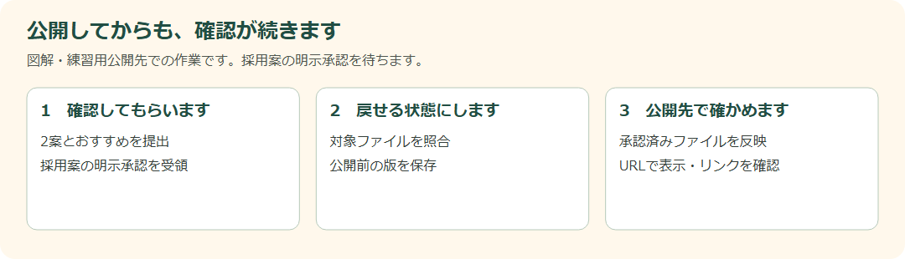

# DAY 13 カフェサイトを承認・公開しよう

[目次](../student-workbook.md) · [共通手順](./common.md#local-git-workflow) · [前の回：DAY 12](./day12.md) · [次の回：DAY 14](./day14.md)

💾 **Gitでの記録：** [共通の作業手順](common.md#local-git-workflow)で、作業前後の変更を記録します。  
作業後は `git tag -f day13-end`で、その日の最後のコミットに目印を付けます。

**仕事のイメージ：** 採用案の承認、戻せるコピー、公開後の確認をそろえます。

**開始データ：** 更新と操作状態の調整が済んだ架空のカフェサイトです。
お知らせの2案を試し、今回の承認と練習用公開先を講師に確認します。  

[各回の開始手順](common.md#independent-day-start)を確認し、初回だけ講座フォルダーで `.\hht\scripts\prepare-day.ps1 -Day 13` を実行します。  
作業場所は `hht/practice/day13/` です。  
同じ回を再開するときは準備コマンドは不要です。  
既存の作業は上書きされません。

> **佐藤さんからの依頼**  
> リニューアルのお知らせを、最初に見たときだけ目立たせたいです。  
>
> **高橋さんからの返信**  
> 修正内容を確認しました。  
> お知らせの案を一つ選んだら、この内容で公開してください。

**今回の課題:** 動く案と静かな案を比較し、選ばれた案と承認済みファイルだけを安全に公開します。

### 公開ボタンの前に、採用案と承認をそろえます

仕上がった画面を見てもらえる、うれしい日です。  
その前に「どの案を、どのファイルで出すか」を高橋さんの返信と照らし合わせます。

**依頼者・見る人：** 佐藤さんと最終承認者の高橋さん／公開後に訪れるお客さまです。

**今回の範囲：** `#notice`のお知らせ2案を比較し、明示承認された案を練習用公開先へ出します。  
未承認の案やファイルは含めません。  
採用案の返事がなければ公開せず確認します。

### 開くファイル：DAY 13

**VS Codeで開くもの：** 作業場所のサイトと、[採用案の承認メール](../../student/requests/day13-release-approval.md)。

**ブラウザで見るページ：** `hht/practice/day13/index.html` です。  
承認メールと練習用公開先は今回、講師の確認後に受け取ります。  
画像はページの見分け方で、公開済みの証拠ではありません。

**見る場所（画像の番号と対応）:**

- **① 公開後にたどるリンク**：ホーム・メニュー・店舗案内を、公開URLで順に開きます。
- **② 見出しや背景の確認位置**：自分が承認を受けた画像・文章と照合します。  
  下は配置の目印となる教材原本で、本人の採用案の画面ではありません。
- **③ フッター**：公開先で、承認された年の表記になっているか確かめます。  
  手元のファイルだけを見て完了にしません。

### この順に、ひとつずつ進めます

1. お知らせの動く案と静かな案を、確認用ページに用意します。
2. 動きを減らす設定でも内容を読めるか確かめます。
3. おすすめの案と理由を、確認用URLに添えます。
4. 採用案の明示承認を受け取り、対象のURLとファイルを照合します。
5. 公開前のバージョンとバックアップの場所を記録します。
6. 承認されたファイルだけを、指定の練習用公開先へ反映します。
7. 公開URLで3ページ・リンク・画像・スマホ表示を確認します。
8. 公開時刻、確認結果、未対応事項を完了報告に書きます。

**図で見る場所:** 左の①は高橋さんから受け取る明示承認、中央の②は公開前の版と対象ファイル、右の③は公開先URLの確認です。  
③では、上の画面の①ナビ・②見出しや背景・③フッターを実際に開いて確認します。

### 確認と報告の例です

> **承認前：** 静かな案をおすすめします。  
> こちらの確認用URLの内容で、公開してよいでしょうか。  
>
> **公開後：** 承認いただいた静かな案を練習用URLへ反映しました。  
> 3ページと画像、リンクを確認しました。  
> 未対応事項はありません。

報告は実際の結果に合わせます。  
確認できていない項目があれば、その項目を書きます。

### 操作のコツ：自分の画面と公開先は別です

自分のPCで保存しただけでは、公開先のファイルは変わりません。  
反映後は公開URLを開き直して確かめます。  
手順は[公開・復元の参照資料](../vscode-hands-on.md)と講師指定の公開方法を使います。

**作業前に考えること:** どちらをおすすめする？  
最終承認はある？  
バックアップはある？  
問題が出たらどこへ戻す？

**今回学ぶこと:** `@keyframes`、`prefers-reduced-motion`、最終承認、バックアップ、デプロイ、公開後確認、ロールバック

**作業メモ:** 2案の比較、選ばれた案、公開ファイル、公開時刻、確認結果、戻す場所を書きます。

**確認項目:**

- [ ] 動き低減に対応
- [ ] 承認を確認した
- [ ] 公開後も確認した
- [ ] 戻し方が分かる

### 完成条件・証拠・発展課題

**入力:** お知らせの表現依頼、最終承認

**完成物:** 動く案・静かな案、承認記録、バックアップ、公開、完了報告

**完成条件:**

- `prefers-reduced-motion`で不要な動きを止める
- 公開前に承認と対象ファイルを照合する
- [採用案の明示承認メール](../../student/requests/day13-release-approval.md)または講師指定の同等文面を受け取るまで公開しない
- 公開前バージョンへ戻せる
- 公開URLでページ、リンク、画像、スマホを確認する
- 完了報告に未対応事項も書く

**証拠:** 承認記録、バージョンID、公開URL、公開後チェック

**発展課題:** 公開後に不具合が見つかった想定で、復元を練習しよう。

---

[目次](../student-workbook.md) · [共通手順](./common.md#local-git-workflow) · [前の回：DAY 12](./day12.md) · [次の回：DAY 14](./day14.md)
