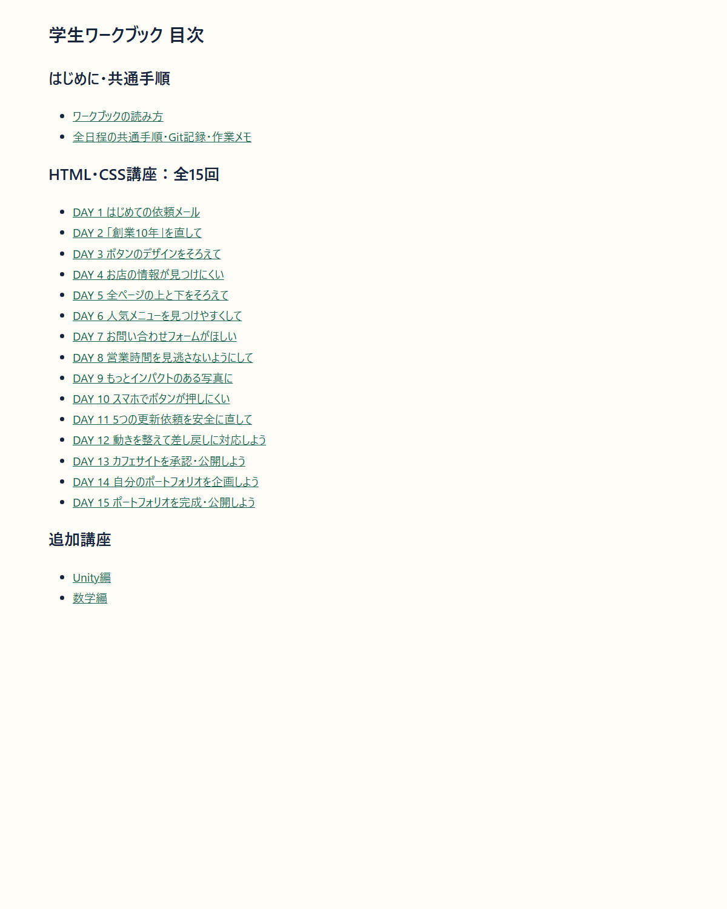
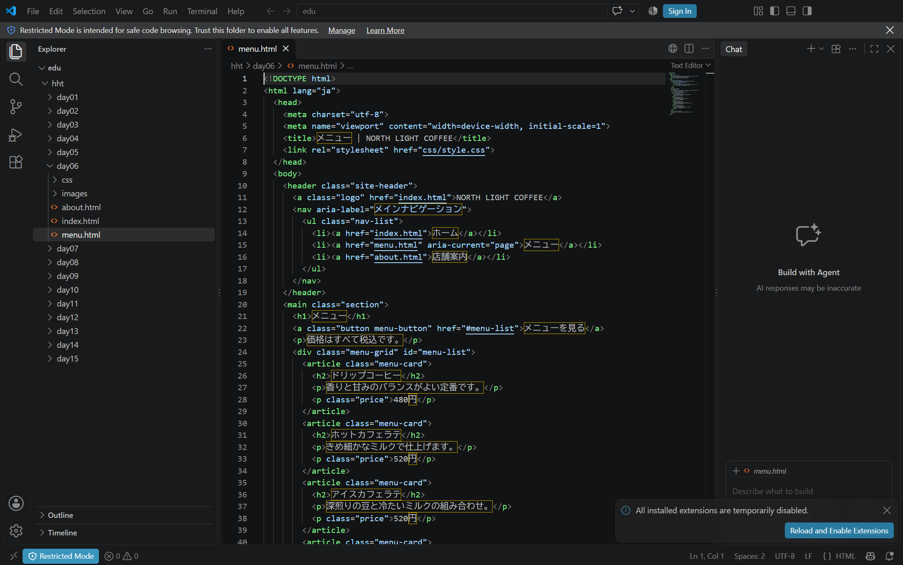

# はじめに：ワークブックの読み方

[目次へ戻る](../student-workbook.md)

今日からあなたは、架空のカフェ「NORTH LIGHT COFFEE」を担当する新人Webデザイナーです。

「この言葉を直してほしい」「スマホでは押しにくいみたいです」。  
佐藤さんから、小さな依頼が届きます。  
まずはお客さまのつもりで画面を見てみます。  
何に困りそうでしょうか。

この本では、依頼を読むところから、直して確かめ、返事を書くところまで一緒に進めます。  
分からないことは、作り始める前に質問して大丈夫です。

**絵に出てくる人は、胸の名札で見分けられます。**

- **あなた（新人）**：サイトの制作・確認・返信を担当します。  
  青緑のシャツが目印です。
- **佐藤さん（店舗責任者）**：お店から修正を依頼します。  
  緑のエプロンが目印です。
- **山本さん（先輩）**：制作会社の先輩として、作業の相談に乗ります。
- **高橋さん（最終承認）**：お店側で最終確認し、公開してよいかを判断します。

お客さまや撮影担当が出る場面では、その役割を名札に書いています。

## 最初に開くのは、このワークブックです

**最初に開く目次は `hht/docs/student-workbook.md` です。  
編集するカフェのHTMLとは別のファイルです。  
**

**チャット横に `student-workbook.md` が表示されていれば、そのまま読み進められます。**  
[目次](../student-workbook.md)から、今回の授業を選んでください。  
VS Codeから開き直す場合は、次の手順を使います。

1. VS Codeで、自分用の教材フォルダーを開きます。
2. 左のエクスプローラーで `hht` → `docs` → `student-workbook.md` を開きます。
3. `Ctrl + Shift + V`を押して、Markdownを読み物の表示に切り替えます。
4. 目次のリンクから、今回取り組む日別ファイルを開きます。
5. 各回の「開くファイル」を見て、編集するHTMLを開きます。

**チャット横で読む場合：** このチャットの案内にある「ワークブックを開く」からローカルの `student-workbook.md` を開きます。  
配布元の閲覧画面には、ローカルで編集中の内容はまだ表示されません。

**この画面は、同じMarkdownをブラウザで表示したプレビューです。**  
VS Codeの操作画面ではありません。  
今日のDAYを選ぶと、その日だけの本文を開けます。

`Ctrl + Shift + V`でプレビューを開きます。

### カフェのページは、別に開きます

**読む資料：** `hht/docs/student-workbook.md` です。

**カフェを編集する場所：** DAY1〜9は今日の`hht/dayNN`です。  
DAY10以降は教材外の同じportfolioを開きます。  
各DAYのフォルダーに教材が入っているので、そのまま開きます。

**ブラウザで確認する方法：** VS Codeの左側で対象HTMLを右クリックし、導入済みのLive Serverの **Open with Live Server** を選びます。  
メニューがない場合は、[環境準備の手順](../vscode-hands-on.md)を確認します。  
拡張機能が使えないPCでは、対象HTMLをエクスプローラーからブラウザで開きます。

**この画面で確認する場所：**

- **左のファイル一覧：** `hht`の中から今日の`dayNN`を選びます。
- **右の編集欄の上端：** `hht > day06 > menu.html`のように、DAYとファイル名を確認します。
- **右のHTML本文：** 今日の課題で指定された箇所を編集します。

同じ名前のHTMLが複数あるので、上部のパンくずでDAYも確認します。  
DAY 3のボタン修正も、最初から入っている`hht/day03`で取り組みます。

**環境準備では、別の練習ページを使います。**  
[VS Codeハンズオン](../vscode-hands-on.md)から`hht/hands-on/vscode-basics/site/index.html`を開きます。

## 現行運用

教材更新・作品保存・PR提出は[共通手順](./common.md)を確認します。  
DAY10以降は同じ作品の制作を続け、外部公開・相互レビュー・発表を必須にしません。

## この本の進め方

1. [授業の目次](../student-workbook.md)から今回の課題を開き、佐藤さんや先輩の依頼を読みます。
2. 「今回の範囲」で、変えるところと残すところを確かめます。
3. 「この順に、ひとつずつ進めます」の手順に沿って作業します。
4. 迷ったら、すぐ下の例と操作のコツを読みます。

**赤い番号は、画像の下の「見る場所」と対応しています。**  
まずページ名と番号を確認し、説明されたHTML・CSSを自分の作業用フォルダーで探します。  
番号と囲みは教材の注釈で、元のページにはありません。

細かい文字を見る画像は、対象の周辺だけを切り出しています。  
ページ全体の位置は、画像の下の説明とファイル名で確認します。

**各回の最初の絵は、仕事の内容をつかむためのイラストです。**  
実際に操作するファイルや画面は、その下の「開くファイル」とスクリーンショットで確認します。

[15枚の挿絵をまとめて見る](../../assets/workbook/illustrations/README.md)こともできます。

**例は、自分の答えを考えるための手掛かりです。**  
そのまま写すより、自分が変えた場所や確認できたことへ言い換えてみます。  
図解は考え方の例、実画面は操作や表示を確かめるための画像として、説明を添えています。

**読み物：どうして、色を付ける前に文章を整理するのでしょうか（DAY 4の前にも読めます）**

## まず意味を整える。見せ方は後から変えられます

**マークアップをする目的は、文章を意味のまとまりで整理し、人にもコンピューターにも内容の役目が伝わるようにすることです。**  
先に「題名」「営業時間」「アクセス」「紹介文」をはっきりさせると、後からCSSで色・余白・配置を変えても、何の情報かを保てます。

**図で見る場所:** 上段の左①で情報を分け、中央②で見出しと本文の役目をHTMLで示し、右③でCSSの見せ方を選びます。  
下段の左Aと右Bは、同じ情報を縦・横に配置した比較です。  
HTMLの意味とCSSの配置を区別して見ます。

### なぜ整理が必要？

情報があっても、まとまりや順番が分からないと、相手は答えを探すために何度も読み直すことになります。

- **メモ書き：** 北海道札幌市北区北00条西0丁目（架空）／水曜／18:30ラストオーダー／10:00〜19:00。  
  数字や曜日が何の情報かを、その都度考える。
- **文章：** お店は札幌にあります。  
  水曜日は休みです。  
  ラストオーダーは18:30です。  
  住所は北海道札幌市北区北00条西0丁目（架空）です。  
  営業時間は10:00〜19:00です。  
  時間と場所の話が行き来し、欲しい情報を拾いにくい。
- **会話：** 「住所はどこ？」  
  「札幌です。  
  水曜は休みで、ラストオーダーは18:30です」「住所は？」  
  「北00条西0丁目です。  
  あ、営業時間は10:00〜19:00です」。  
  質問の途中で話題が変わり、聞き直しが増える。

同じ情報を「営業時間：10:00〜19:00、ラストオーダー18:30」「定休日：水曜日」「アクセス：住所」に分ければ、必要なまとまりを選んで読めます。  
**まず情報を整理し、そのまとまりにHTMLで役目を付けます。**  
色を付けるだけでは、話題が混ざったままの文章は整理されません。

### 前回のマークアップ・Markdownとつなげる

マークアップは、文章に「ここは見出し」「ここは段落」などの目印を付けること。  
HTMLは、そのための**マークアップ言語**です。  
プログラミングと同じくコードを書いてコンピューターに伝えますが、計算や条件分岐を行うプログラミング言語とは役割が違います。

| 伝えたい役目 | Markdownで書く | HTMLで書く |
|---|---|---|
| 見出し | `## 営業時間` | `<h2>営業時間</h2>` |
| 段落 | `10:00〜19:00`（前後を空行で区切る） | `
10:00〜19:00
` |

Markdownは、文章の構造を読み書きしやすい記号で示す方法です。  
HTMLもMarkdownも「見出しや段落として何を伝えるか」を表します。  
Webページの色・文字の大きさ・余白・並べ方はCSSで表現します。

💡 **ヒント：**
> Markdownなら、**大事なこと**、*補足*、~~やめた案~~、**追記した内容**も短い記号で示せます。  
> [書き方と表示の比較](../markdown-format-guide.md)で、表・チェックリスト・引用・折りたたみも見られます。

**DAY 4の順番：意味を整理する → ワイヤーフレームで順番と配置を考える → HTMLで構造を示す → 見つけやすくなったか確認する。**  
デザインを変える前に、何の情報かを分かるようにします。  
DAY 4ではCSSを変えず、構造の改善まで取り組みます。

**課題の条件は、どこで確認できますか**

## 学ぶ内容と課題の条件は、この本で確認できます

入口のREADMEと説明が違って見えたときも、まずこの本の該当する回を確かめます。  
講師にも、授業の番号と迷った場所を伝えられます。

- **講師用資料：** 時間配分、デモの進め方、支援方法。  
  課題条件はこの正本を参照します。
- **参照資料・配布データ：** Markdownの書式、用語、サンプル、HTML・CSS・画像の実体。  
  課題の条件を独立して追加しません。

