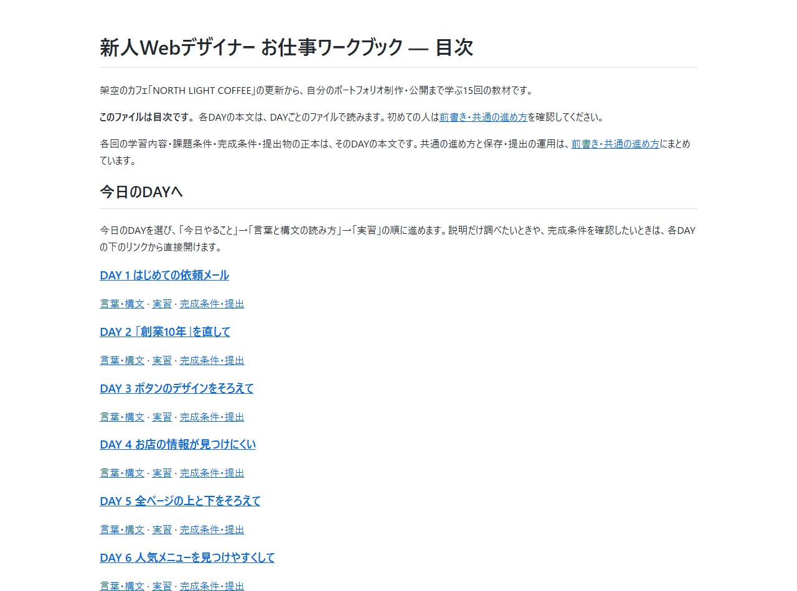
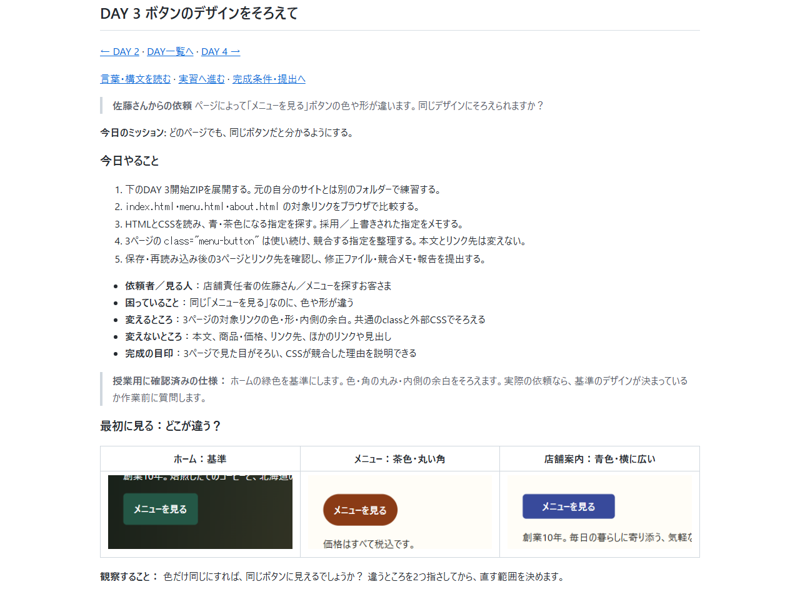
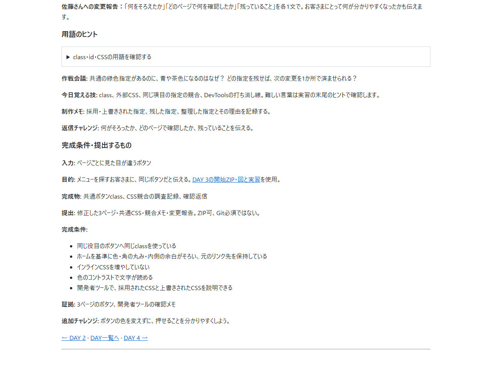
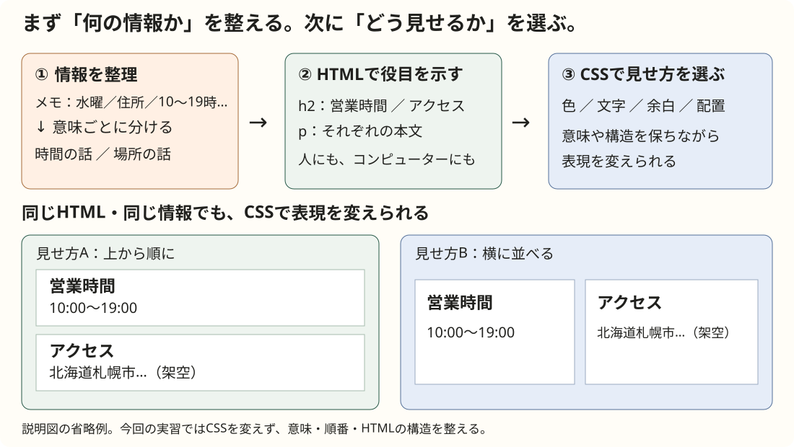

# ワークブックの前書き・共通の進め方

今日からあなたは、架空のカフェ「NORTH LIGHT COFFEE」を担当する新人Webデザイナーです。毎回、お客さまから新しい依頼が届きます。分からないことは質問して大丈夫。必要なHTML・CSSをその場で覚え、最後は自分の言葉で作業を報告しましょう。

[DAY一覧へ](../student-workbook.md#workbook-days) · [DAY 1から始める](day-01.md#day-1)

VS Codeで記号のまま表示されている場合は、右上の「プレビューを横に表示」（WindowsはCtrl+Kの後にV）でMarkdownの表示を開きます。コードを書く画面と教材を読む画面は別です。GitHubではファイルのPreviewを開いてリンクを押します。

目次で今日のDAYを選ぶと、そのDAYの本文が開きます。「言葉・構文」「実習」「完成条件・提出」のリンクでは、必要な箇所へ直接進めます。各DAYの上下にある「DAY一覧へ」で目次へ戻れます。

以下は、この教材をローカルのMarkdownプレビューで開き、リンクを操作した実画面です。GitHubやVS Code本体の画面ではありません。

「DAY 3」を選ぶと、依頼と今日やることを先頭から読めます。

「完成条件・提出」を選ぶと、そのDAYで確認する条件と提出物を読めます。

## 前書き：まず意味を整える。見せ方は後から変えられる

**マークアップをする目的は、文章を意味のまとまりで整理し、人にもコンピューターにも内容の役目が伝わるようにすることです。** 先に「題名」「営業時間」「アクセス」「紹介文」をはっきりさせると、後からCSSで色・余白・配置を変えても、何の情報かを保てます。

### なぜ整理が必要？

情報があっても、まとまりや順番が分からないと、相手は答えを探すために何度も読み直すことになります。

- **メモ書き：** 北海道札幌市北区北00条西0丁目（架空）／水曜／18:30ラストオーダー／10:00〜19:00。数字や曜日が何の情報かを、その都度考える。
- **文章：** お店は札幌にあります。水曜日は休みです。ラストオーダーは18:30です。住所は北海道札幌市北区北00条西0丁目（架空）です。営業時間は10:00〜19:00です。時間と場所の話が行き来し、欲しい情報を拾いにくい。
- **会話：** 「住所はどこ？」「札幌です。水曜は休みで、ラストオーダーは18:30です」「住所は？」「北00条西0丁目です。あ、営業時間は10:00〜19:00です」。質問の途中で話題が変わり、聞き直しが増える。

同じ情報を「営業時間：10:00〜19:00、ラストオーダー18:30」「定休日：水曜日」「アクセス：住所」に分ければ、必要なまとまりを選んで読めます。**まず情報を整理し、そのまとまりにHTMLで役目を付けます。** 色を付けるだけでは、話題が混ざったままの文章は整理されません。

### 前回のマークアップ・Markdownとつなげる

マークアップは、文章に「ここは見出し」「ここは段落」などの目印を付けること。HTMLは、そのための**マークアップ言語**です。プログラミングと同じくコードを書いてコンピューターに伝えますが、計算や条件分岐を行うプログラミング言語とは役割が違います。

| 伝えたい役目 | Markdownで書く | HTMLで書く |
|---|---|---|
| 見出し | `## 営業時間` | `<h2>営業時間</h2>` |
| 段落 | `10:00〜19:00`（前後を空行で区切る） | `
10:00〜19:00
` |

Markdownは、文章の構造を読み書きしやすい記号で示す方法です。HTMLもMarkdownも「見出しや段落として何を伝えるか」を表します。Webページの色・文字の大きさ・余白・並べ方はCSSで表現します。

> [!TIP]
> Markdownなら、**大事なこと**、*補足*、~~やめた案~~、<ins>追記した内容</ins>も短い記号で示せます。[書き方と表示の比較](../markdown-format-guide.md)で、表・チェックリスト・引用・折りたたみも見られます。

**DAY 4の順番：意味を整理する → ワイヤーフレームで順番と配置を考える → HTMLで構造を示す → 見つけやすくなったか確認する。** デザインを変える前に、何の情報かを分かるようにします。DAY 4ではCSSを変えず、構造の改善まで取り組みます。

## このワークブックが学習内容と課題条件の正本です

**各回の目的・依頼・入力データ・作業内容・完成条件・提出するものは、ワークブックの該当DAY本文だけで管理します。** 共通の進め方と保存・提出の運用は、このページで管理します。 目次・README・授業パックは、各DAYの正本への入口です。完成条件の一覧も別ファイルへ複製しません。

- **このワークブック：** 学生が何のために、何を変え、何を確認・提出するか。
- **講師用資料：** 時間配分、デモの進め方、支援方法。課題条件はこの正本を参照します。
- **参照資料・配布データ：** Markdownの書式、用語、サンプル、HTML・CSS・画像の実体。課題の条件を独立して追加しません。

## 授業の始め方

- **PCのVS Codeで取り組む場合：** 本人用の教材フォルダーを開きます。環境準備は[VS Codeハンズオン手順](../vscode-hands-on.md)を参照します。
- **Codespacesで取り組む場合：** READMEからCodespaceを起動し、リポジトリのルートに`README.md`と`hht`が見えること、本人のコピーまたは作業ブランチであることを確認します。
- **提出前の確認：** 本人のリポジトリと作業ブランチを確認します。教材原本・共有mainは編集しません。

**DAY 3・DAY 4は、各DAYにある開始ZIPのコピーで練習します。** DAY 5以降への引き継ぎも、[DAY 5](day-05.md#day-5)で確認します。

## 全15回で共通の保存・提出

全15回とも[PR提出の手順](../../submissions/README.md#prで提出してci判定を受ける)を使います。本人の作業ブランチで変更し、各DAYのWORKLOG、画面、証拠と課題ソースをコミット・pushします。CIと講師レビューを確認し、指摘は同じPRへ追加コミットして直します。DAY 4もWORKLOGが必要です。

DAY 3・4の開始ZIPは練習素材です。提出用ZIPは作りません。演習の変更部分だけを本人の`hht/starter-site`へ反映し、以前の本文・画像を保持します。DAY 4の具体的な提出物は[正本の提出手順](day-04.md#day-4-submission)を参照します。

## 毎回のお仕事ルート

1. **メールを開く** — 何を頼まれたのか見つける
2. **作戦を立てる** — 直す場所、直さない場所、質問を決める
3. **技を覚える** — 今日の仕事に必要なHTML・CSSを試す
4. **サイトを直す** — 小さく変更し、ブラウザで見る
5. **チェックする** — パソコン、スマートフォン、キーボードで確かめる
6. **返信する** — 変更したこと、確認したこと、まだ分からないことを伝える

星チェックは振り返りの要点です。完成度だけではなく、質問できたこと、対象外を守れたこと、確認できたことにも星を付けましょう。

---

[DAY一覧へ](../student-workbook.md#workbook-days) · [DAY 1から始める](day-01.md#day-1)
