# Unity編：Unity操作基礎講座

[目次へ戻る](../student-workbook.md)

<a id="unity-course"></a>

## Unity編：Unity操作基礎講座

[Unity講座の入口](../../../unity/README.md) · [講座設計](../../../unity/docs/course-design.md) · [用語と公式資料](../../../unity/references.md)

### 依頼と進め方

**依頼者：** 学内展示の担当者。  
**見る人：** ゲームに不慣れな来場者。  
**解決したいこと：** 説明がなくても操作と反応が分かる、小さな展示サンプルを作りたい。

**変更対象：** 配布する専用Unityプロジェクト内の各単元のシーンと指定アセット。  
**対象外：** 他のゲーム、本番データ、外部配信、有料素材。  
分からない点は「どの場面で、誰が、何をするか」に分けて作業前に確認します。

**環境：** Windows、Unity 6000.3.25f1（Unity 6.3）、URP 17.3.0。  
Editorは英語表示の画面を使用します。  
Input System 1.20.0、Timeline 1.8.13、uGUI 2.0.0、VFX Graph 17.3.0をプロジェクトに指定しています。  
他のバージョンでは名称・配置が異なる場合があります。  
VFX Graphには対応GPUとCompute Shader対応環境が必要です。

**教材を開く：** リポジトリを自分のPCへコピーし、Unity HubのProjectsで **Add → Add project from disk** を選び、`unity/project` を指定します。  
初回インポートが終わるまで待ちます。  
Projectウィンドウで `Assets/Scenes` を開き、その日のシーンをダブルクリックします。  
配布シーンは操作例が入った開始データです。  
見本が既にある場合も、指定した数値や接続を一度変更し、元との差を確かめます。

**共通の確認と提出：** 各単元の完成条件を確認した後、Playを停止し、Ctrl+Sで保存します。  
シーンを開き直して保存を確かめます。  
自分の変更を含む `.unity`、変更したスクリプト・アセットと対応する `.meta`、確認画面1枚、「変更点／確認方法／残件」の3行メモを提出します。  
Library・Temp・認証情報は提出しません。  
講座全体は22単元です。  
番号は授業回数ではありません。

**サンプル：** [単元別シーン一覧](../../../unity/samples.md)に開始22・完成22シーンがあります。  
開始シーンを別名で保存して作業し、`Assets/Scenes/Completed` の完成サンプルと見比べます。  
完成サンプル専用の素材は `Assets/LessonSamples` に分けています。

**ブラウザで試す：** 各単元の「開始を実行」「完成を実行」からWebGLサンプルを開きます。  
HTTPで開いた実画面付き教材では本文内に表示されます。  
一度に動くプレイヤーは1つです。  
Editorの操作画面はスクリーンショットを見て確認します。  
U17のGizmoとU19のVFX GraphはWebGLでは再現できないためEditorで確認します。


### 色と名前で対象を見分ける

画面の物体は、次の配色と識別名で照合します。  
操作するときは色だけで決めず、形、ラベル、Hierarchyの名前を確認します。  
右下の凡例と物体の名前ラベルは教材の補助表示です。

- **A Exhibit：青 `#246C96` の立方体。**  
  U02で名前を変えた後は A WelcomeExhibit と表示します。  
  U10・U23の完成例では、材質変更の結果として橙になります。
- **B Sphere：橙 `#C67B00` の球。**  
  U09でAの立方体と区別します。
- **C Capsule：淡い黄 `#F4E8A1` のカプセル。**  
  U09の完成サンプルにあります。
- **D ExhibitRight：淡い紫 `#E6DBF5` の立方体。**  
  U07で追加する2個目です。  
  Aより明るくしています。
- **F DisplayFloor：黒に近い紺 `#080C11` の床。**  
  展示物の色と分けています。
- **M Marker：赤紫 `#9D4C7A` の四角いSprite。**  
  U05で使用します。
- **V WelcomeParticles：明るい青緑 `#81D8D0` の粒子。**  
  U19のEditorで確認します。  
  WebGL2では粒子を表示しません。

物体には暗い背景の白文字ラベルを付け、色を見分けにくい場合も識別できるようにしています。  
材質の設定色では床とのコントラストを3:1以上、同じ形のAとDは約4.3:1にしています。  
照明・反射で実際の画面の色や明るさは変わるため、この数値を全ての描画ピクセルの保証にはしません。  
U10・U12ではラベルを基準に色や照明の変化を観察します。

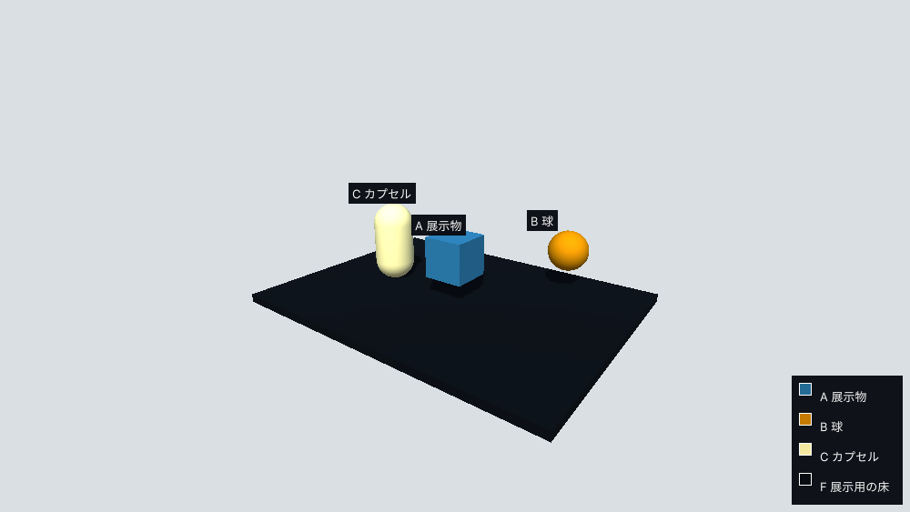

### 単元一覧

1. [導入・Editorの画面構成](unity.md#unity-01)
2. [Scene](unity.md#unity-02)
3. [GameObjectとTransform](unity.md#unity-03)
4. [MonoBehaviour](unity.md#unity-04)
5. [2D](unity.md#unity-05)
6. [Input](unity.md#unity-06)
7. [Prefab](unity.md#unity-07)
8. [物理と衝突](unity.md#unity-08)
9. [3D](unity.md#unity-09)
10. [マテリアル](unity.md#unity-10)
11. [カメラ](unity.md#unity-11)
12. [ライティング](unity.md#unity-12)
13. [Animator](unity.md#unity-13)
14. [Timeline](unity.md#unity-14)
15. [音](unity.md#unity-15)
16. [uGUI](unity.md#unity-16)
17. [Gizmo](unity.md#unity-17)
18. [UI Elements／UI Toolkit](unity.md#unity-18)
19. [VFX Graph](unity.md#unity-19)
20. [デバッグ](unity.md#unity-20)
21. [ビルド](unity.md#unity-21)
22. [Unity CLI](unity.md#unity-22)
23. [Shader Graph：ノードで展示物の色を指定する](unity.md#unity-23)
24. [ゲームループ・共有プレイデータ・セーブ管理](unity.md#unity-24)
25. [複数のバージョン管理手法](unity.md#unity-25)
26. [複数のデータ共有手法](unity.md#unity-26)
27. [複数人での開発と統合](unity.md#unity-27)
28. [コンポーネントの依存管理と設定漏れの防止](unity.md#unity-28)
29. [物理演算で作るローコード・サンドボックス](unity.md#unity-29)
30. [グレイボックスで空間と導線を検証する](unity.md#unity-30)
31. [キットバッシュで既存部品から外観を組む](unity.md#unity-31)
32. [VRoid・VRMのボーン、メッシュ、アニメーションとIK](unity.md#unity-32)
33. [サウンド：BGM・操作音・3D音とAudio Mixer](unity.md#unity-33)
34. [フォーリー：素材別の足音と接地の同期](unity.md#unity-34)
35. [エディタ拡張：市街・Terrainのプロシージャル生成](unity.md#unity-35)
36. [当たり判定：衝突・Trigger・Layer・Raycast](unity.md#unity-36)

### 追加する主要機能（制作予定）

以下を含めて全50単元の構成とします。  
U01〜U36は本文・実画面・開始／完成シーンを収録し、U37〜U50は今後の制作対象です。  
アセット導入・2D制作はU41の環境制作へまとめ、市街・Terrainの生成をU35で扱います。  
予定単元を教材化済みとは扱いません。  
U50は引き続き保留します。

37. **U37 シリアライズと保存・読込の発展：複数スロット、データ移行、設定値。**
38. **U38 シーン・イベント・時間と非同期処理：Additive、Bootstrap、UnityEvent、C#イベント、Coroutine、Awaitable、Time、キャンセル。**
39. **U39 Cinemachine：追従、注視、カメラ切替。**
40. **U40 AI Navigation：NavMesh、Agent、障害物、経路探索。**
41. **U41 アセット・2D・環境制作の発展：Package Manager、Import Settings、Sprite Atlas、Tilemap、Sorting Layer、2D Animation、Rigidbody2D、Collider2D、2DのTrigger・Joint・Raycast、Terrainの樹木・草、LOD、Volume、Bloom、色調補正、URP設定、Lightmap、Light Probe、Reflection Probe、Render Texture。**
42. **U42 Particle System：放出、寿命、形状、衝突。**
43. **U43 文字と多言語の発展：文字組み、言語切替、Localization。  
    日本語TMPの導入はU16で扱います。  
    **
44. **U44 Addressables：非同期アセット読込、解放、配信構成。**
45. **U45 性能計測と自動テスト：Profiler、Memory Profiler、Frame Debugger、Unity Test Framework、Edit Mode、Play Mode。**
46. **U46 Editor拡張：Custom Inspector、Property Drawer、EditorWindow、asmdef。**
47. **U47 ネットワーク：Netcode、同期、所有権、接続・切断。**
48. **U48 XR：XR Interaction Toolkit、入力、移動、実機確認。**
49. **U49 DOTS：Entities／ECS、Jobs、Burst、大量オブジェクト。**
50. **U50 GitHub Copilot Agent：依頼、変更レビュー、テスト、結果の確認（依頼により保留）。**

<a id="unity-01"></a>

#### U01 導入・Editorの画面構成

**ブラウザで実行：** [U01 開始を実行](../../../unity/webgl/index.html?unit=01&variant=start) · [U01 完成を実行](../../../unity/webgl/index.html?unit=01&variant=complete)

**依頼者・見る人：** 展示担当者・制作メンバー。  
**困りごと：** どこで配置し、どこで実行結果を見るか共有できていません。  
**変更：** 専用プロジェクトを開き、選択と再生の操作を確かめます。  
アセットの削除はしません。  
**完成条件：** 同じExhibitをHierarchyから選び、Inspectorの値とScene上の位置を対応づけ、Playを開始・停止できること。

**準備：** `01-Editor.unity` を開きます。  
パネルが見つからない場合はWindow → GeneralからHierarchy、Project、Inspector、Scene、Gameを開きます。  
対象はA Exhibit（青い立方体）です。


1. 左のHierarchyで `Exhibit` をクリックします。  
   中央Sceneで立方体に枠が付き、右のInspectorへTransformが表示されることを確認します。
2. 下のProjectでAssets → Scenesを開きます。  
   Hierarchyは現在のシーンの中身、Projectは保存されたファイルの一覧です。
3. 上の三角のPlayボタンを押します。  
   Gameタブでカメラが映している展示を見ます。  
   もう一度Playを押して停止します。
4. Sceneへ戻り、Exhibitを選び直します。  
   Sceneの視点を動かしてもMain CameraのTransformが変わらないことを確かめます。


**ヒント・用語：** Sceneは編集用の作業場所、Gameは実行用カメラの表示です。  
再生中の変更は停止時に戻るものがあるため、課題の保存は停止後に行います。

**確認して報告：** 5つのパネルの役割と、Playを止めた証拠をメモします。  
画面が見つからない時は閉じたパネル名を記録します。

**サンプル：** [開始シーン](../../../unity/project/Assets/Scenes/01-Editor.unity) · [完成サンプル](../../../unity/project/Assets/Scenes/Completed/01-Editor.unity)。  
Projectで対応するファイルをダブルクリックして開き、手順と見比べます。


<a id="unity-02"></a>

#### U02 Scene：展示の場面を保存する

**ブラウザで実行：** [U02 開始を実行](../../../unity/webgl/index.html?unit=02&variant=start) · [U02 完成を実行](../../../unity/webgl/index.html?unit=02&variant=complete)

**依頼者・見る人：** 展示担当者・次の制作者。  
**困りごと：** 編集した展示の場面を翌日再開できません。  
**変更：** シーン内の名前を変え、別名で保存します。  
他のシーンは変更しません。  
**完成条件：** `02-Scene-Student.unity` を開き直すと `WelcomeExhibit` が存在すること。

**準備：** U01の選択と再生停止を確認してから `02-Scene.unity` を開きます。  
対象はA Exhibit（青い立方体）です。  
名前変更後はA WelcomeExhibitになります。


1. Hierarchyの `Exhibit` を選び、F2で `WelcomeExhibit` に変更します。
2. File → Save AsでAssets/Scenesへ `02-Scene-Student.unity` として保存します。
3. 別のシーンを開いた後、Projectから保存したシーンをダブルクリックします。
4. 名前と配置が保存されていること、現在のシーン名を確認します。  
   シーンは「ステージ」「タイトル」などの場面を保存するファイルです。


**ヒント・用語：** Sceneタブの視点と、シーンファイルは別のものです。  
シーン名の横に付くアスタリスクは未保存の変更を示します。

**確認して報告：** 保存先と開き直したシーン名を書きます。

**サンプル：** [開始シーン](../../../unity/project/Assets/Scenes/02-Scene.unity) · [完成サンプル](../../../unity/project/Assets/Scenes/Completed/02-Scene.unity)。  
Projectで対応するファイルをダブルクリックして開き、手順と見比べます。


<a id="unity-03"></a>

#### U03 GameObjectとTransform：展示物を配置する

**ブラウザで実行：** [U03 開始を実行](../../../unity/webgl/index.html?unit=03&variant=start) · [U03 完成を実行](../../../unity/webgl/index.html?unit=03&variant=complete)

**依頼者・見る人：** 展示担当者・来場者。  
**困りごと：** 展示物が中央に重なっています。  
**変更：** 子オブジェクトExhibitの位置と向きを調整します。  
親の大きさは変えません。  
**完成条件：** ExhibitのPositionが `(2,1,0)`、Rotationが `(0,30,0)`、Scaleが `(1,1,1)` になり、親を動かすと一緒に動くこと。

**準備：** `03-Transform.unity` を開き、HierarchyのDisplayRootを展開します。  
対象はA Exhibit（青い立方体）です。

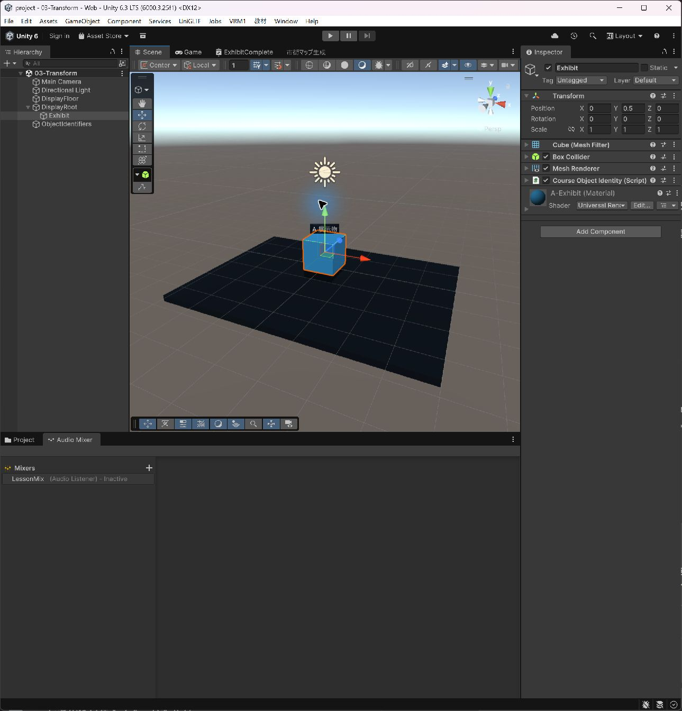

1. Exhibitを選び、InspectorのTransformで上記の値を入力します。  
   親を持つ場合、Inspectorは親から見たローカル座標です。
2. Wで移動、Eで回転、Rで拡縮ツールを選び、軸の矢印・円・ハンドルを確認します。  
   操作後はCtrl+Zで指定値へ戻します。
3. DisplayRootのPosition Xを1にし、親子が一緒に移動することを見ます。  
   確認後は親Xを0へ戻します。
4. Fキーで選択対象をSceneの中心へ寄せ、完成値を確認して保存します。


**ヒント・用語：** GameObjectは部品を付ける器です。  
Transformは位置・回転・大きさを持つ部品で、すべてのGameObjectにあります。

**確認して報告：** 親と子のどちらを変えたか、位置の基準は何かを書きます。

**サンプル：** [開始シーン](../../../unity/project/Assets/Scenes/03-Transform.unity) · [完成サンプル](../../../unity/project/Assets/Scenes/Completed/03-Transform.unity)。  
Projectで対応するファイルをダブルクリックして開き、手順と見比べます。

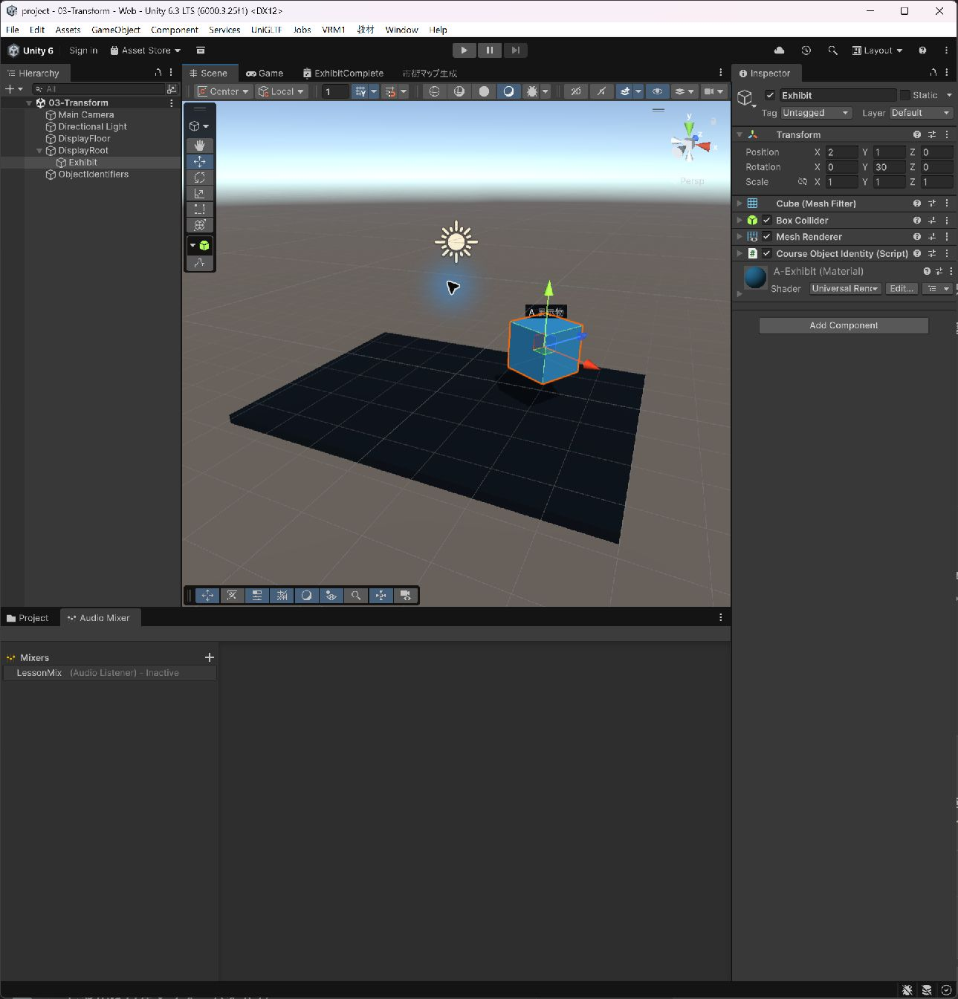


<a id="unity-04"></a>

#### U04 MonoBehaviour：コンポーネントで動きを付ける

**ブラウザで実行：** [U04 開始を実行](../../../unity/webgl/index.html?unit=04&variant=start) · [U04 完成を実行](../../../unity/webgl/index.html?unit=04&variant=complete)

**依頼者・見る人：** 展示担当者・来場者。  
**困りごと：** 静止した展示に気づいてもらえません。  
**変更：** ExhibitMoverの速度を調整し、上下に動かします。  
入力による移動は次の単元へ分けます。  
**完成条件：** Play中に上下へ繰り返し移動し、移動速度を2から1へ変えると周期が長くなること。

**準備：** `04-MonoBehaviour.unity` と `Assets/Scripts/ExhibitMover.cs` を開きます。  
対象はA Exhibit（青い立方体）です。


1. HierarchyでExhibitを選び、InspectorのExhibit Moverを探します。  
   見つからなければAdd Componentで `ExhibitMover` を追加します。
2. スクリプトで `Start` と `Update` を探します。  
   Startは開始時の位置を保存し、Updateは毎フレーム位置を更新しています。
3. Playを押して上下の動きを確認します。  
   停止し、移動速度を1へ変更して、もう一度Playします。
4. 動きが遅くなったことを確認し、停止して保存します。  
   クラス名とファイル名を変更する場合は一致させます。

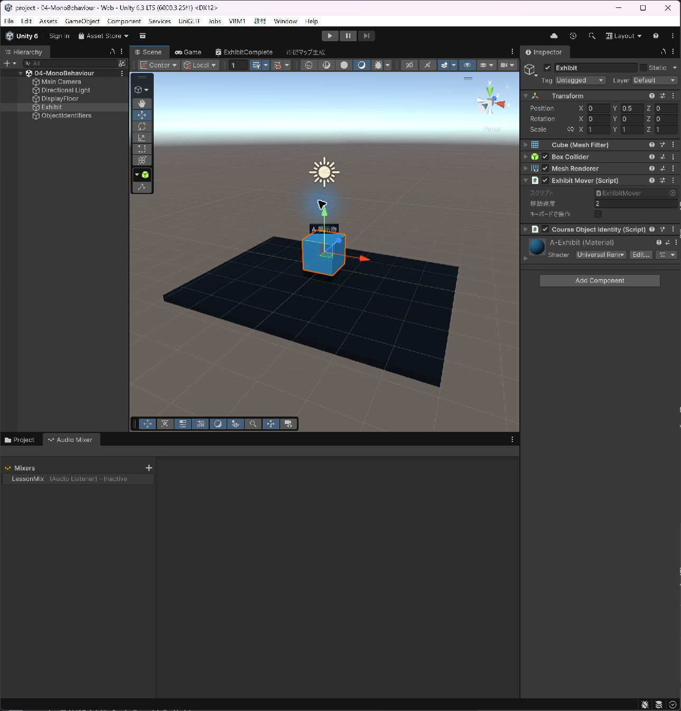

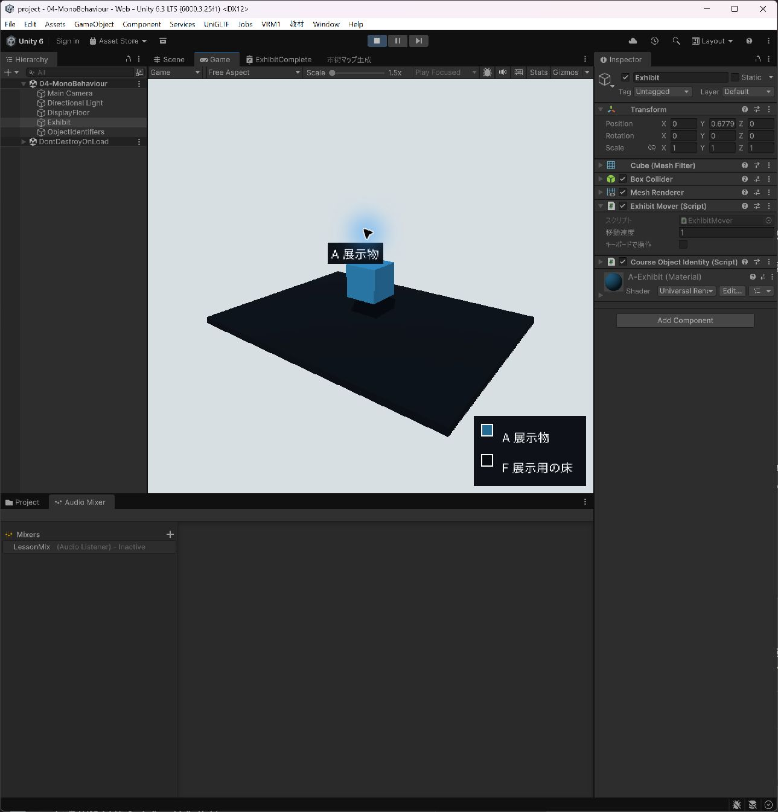

**ヒント・用語：** MonoBehaviourを継承したクラスをGameObjectへ付けると、UnityからStartやUpdateが呼ばれます。  
`[SerializeField]` はprivateフィールドをInspectorで編集・保存できるようにします。

**確認して報告：** 編集時の値と再生中の値を区別し、変更前後の速さを言葉で比較します。

**サンプル：** [開始シーン](../../../unity/project/Assets/Scenes/04-MonoBehaviour.unity) · [完成サンプル](../../../unity/project/Assets/Scenes/Completed/04-MonoBehaviour.unity)。  
Projectで対応するファイルをダブルクリックして開き、手順と見比べます。


<a id="unity-05"></a>

#### U05 2D：Spriteを平面に配置する

**ブラウザで実行：** [U05 開始を実行](../../../unity/webgl/index.html?unit=05&variant=start) · [U05 完成を実行](../../../unity/webgl/index.html?unit=05&variant=complete)

**依頼者・見る人：** 展示担当者・来場者。  
**困りごと：** 平面の案内マークを置きたいのに奥行きで見え方が変わります。  
**変更：** SpriteをXY平面に置きます。  
3D展示シーンは変更しません。  
**完成条件：** OrthographicカメラでMarkerが表示され、Position `(2,1,0)` へ移動できること。

**準備：** `05-2D.unity` を開きます。  
Scene上部の2Dを有効にします。  
対象はM Marker（赤紫の四角）とF DisplayFloor（暗い床）です。

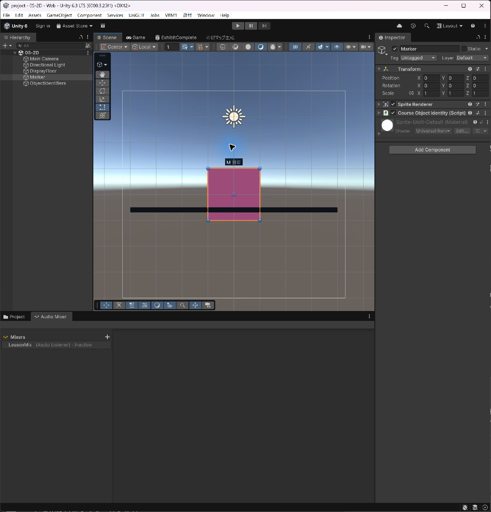

1. Projectの `Assets/Art/Marker.png` を選び、Texture TypeがSprite (2D and UI)であることを確認します。
2. HierarchyでMarkerを選び、Sprite RendererのSprite欄にMarkerが入っていることを確認します。
3. TransformのPositionを `(2,1,0)` にします。  
   Main Cameraを選び、ProjectionがOrthographicであること、Zが-10であることを確認します。
4. Gameでマークの位置を確認します。  
   Sprite RendererのColorを変え、表示が変わることも試します。


**ヒント・用語：** Spriteは2D用の画像です。  
2DボタンはSceneの編集視点を変える操作で、カメラ設定そのものは変えません。  
2D物理にはRigidbody2DとCollider2Dを使います。

**確認して報告：** 編集視点の2DとカメラのOrthographicの違いを書きます。

**サンプル：** [開始シーン](../../../unity/project/Assets/Scenes/05-2D.unity) · [完成サンプル](../../../unity/project/Assets/Scenes/Completed/05-2D.unity)。  
Projectで対応するファイルをダブルクリックして開き、手順と見比べます。

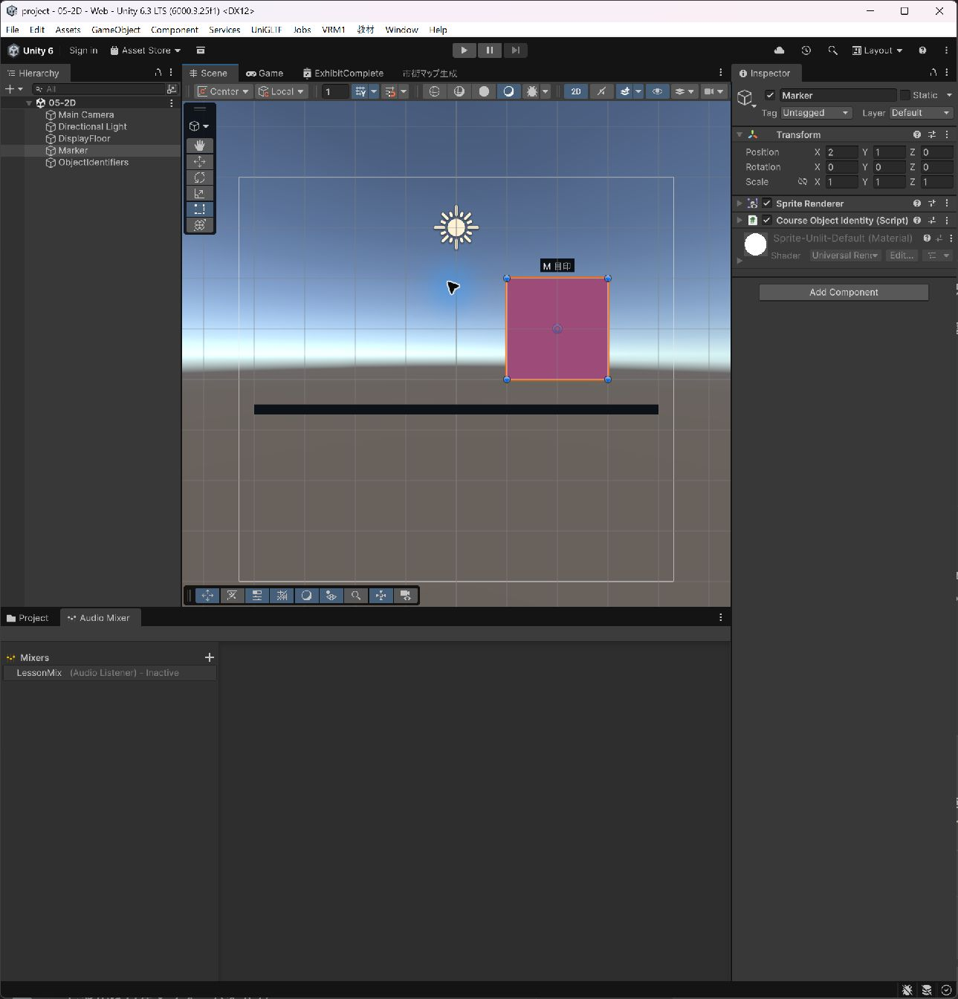


<a id="unity-06"></a>

#### U06 Input：キーボードの入力を動きへつなぐ

**ブラウザで実行：** [U06 開始を実行](../../../unity/webgl/index.html?unit=06&variant=start) · [U06 完成を実行](../../../unity/webgl/index.html?unit=06&variant=complete)

**依頼者・見る人：** 展示担当者・来場者。  
**困りごと：** A・Dキーで展示物を左右に動かせません。  
**変更：** Input Systemでキーを読み取り、移動量へ変換します。  
旧Input Managerやゲームパッド対応は扱いません。  
**完成条件：** GameにフォーカスしたPlay中、Aで左、Dで右へ動き、離すと止まること。

**準備：** `06-Input.unity` を開きます。  
Edit → Project Settings → Player → Active Input HandlingはInput System Package (New)またはBothにします。  
変更に再起動が必要な場合は保存後に再起動します。  
対象はA Exhibit（青い立方体）です。


1. ExhibitのExhibit Moverで「キーボードで操作」が有効であることを確認します。  
   `ExhibitMover.cs` の `Keyboard.current` とA・Dキーの参照を読みます。
2. Playし、Gameの中を一度クリックしてからAとDを押します。  
   移動量は「方向×移動速度×Time.deltaTime」です。
3. 停止し、 `Assets/Exhibit.inputactions` をダブルクリックします。  
   ExhibitマップのMoveアクションと1D AxisのA・D割当を確認します。
4. この配布例の実行コードはKeyboardを直接読みます。  
   Input Actionsは割当を学ぶ別の資料です。  
   アクションの割当だけを変更しても実行コードのキーは変わりません。  
   両者を混同せず、それぞれ確認します。

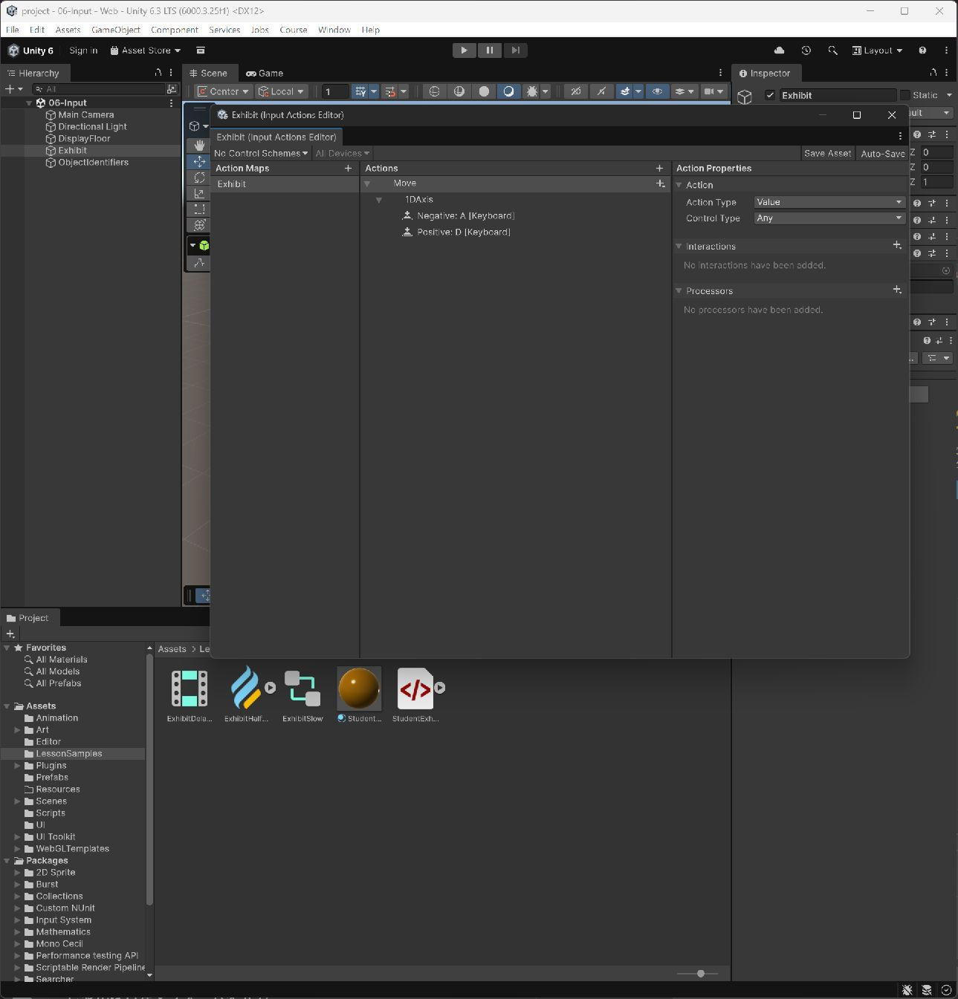

**ヒント・用語：** フォーカスは入力を受け取る場所です。  
反応しない時はConsole、Gameのフォーカス、「キーボードで操作」、入力設定の順に調べます。

**確認して報告：** A・D・キーを離す、の3つの結果を書きます。

**サンプル：** [開始シーン](../../../unity/project/Assets/Scenes/06-Input.unity) · [完成サンプル](../../../unity/project/Assets/Scenes/Completed/06-Input.unity)。  
Projectで対応するファイルをダブルクリックして開き、手順と見比べます。


<a id="unity-07"></a>

#### U07 Prefab：同じ展示物を再利用する

**ブラウザで実行：** [U07 開始を実行](../../../unity/webgl/index.html?unit=07&variant=start) · [U07 完成を実行](../../../unity/webgl/index.html?unit=07&variant=complete)

**依頼者・見る人：** 展示担当者・制作メンバー。  
**困りごと：** 同じ展示物を複製するたび設定がばらつきます。  
**変更：** Prefabのインスタンスを増やし、共通設定と個別設定を区別します。  
元Prefabの削除はしません。  
**完成条件：** 同じPrefabに接続した2個を置き、片方の位置変更が他方へ影響しないことを確認できること。

**準備：** `07-Prefab.unity` を開きます。  
対象はA Exhibit（青い立方体）です。  
追加する方はD ExhibitRight（淡い紫）に分けます。


1. Projectの `Assets/Prefabs/Exhibit.prefab` をHierarchyへドラッグします。
2. 追加した方を `ExhibitRight` と名付け、Positionを `(2,0.5,0)` にします。  
   `Assets/Art/Palette/D-ExhibitRight.mat` をその立方体へドラッグして淡い紫に分け、青いA Exhibitの位置が変わらないことを確認します。  
   色の差はそのインスタンスのOverrideとして残し、元Prefabへ適用しません。
3. PrefabアセットをダブルクリックしてPrefab Modeを開き、元の構造を見ます。  
   左上の戻る矢印でシーンへ戻ります。
4. インスタンスのScaleを一度変更し、InspectorのOverridesに現れることを確認します。  
   Revertする場合は内容を確認してその変更だけ戻します。

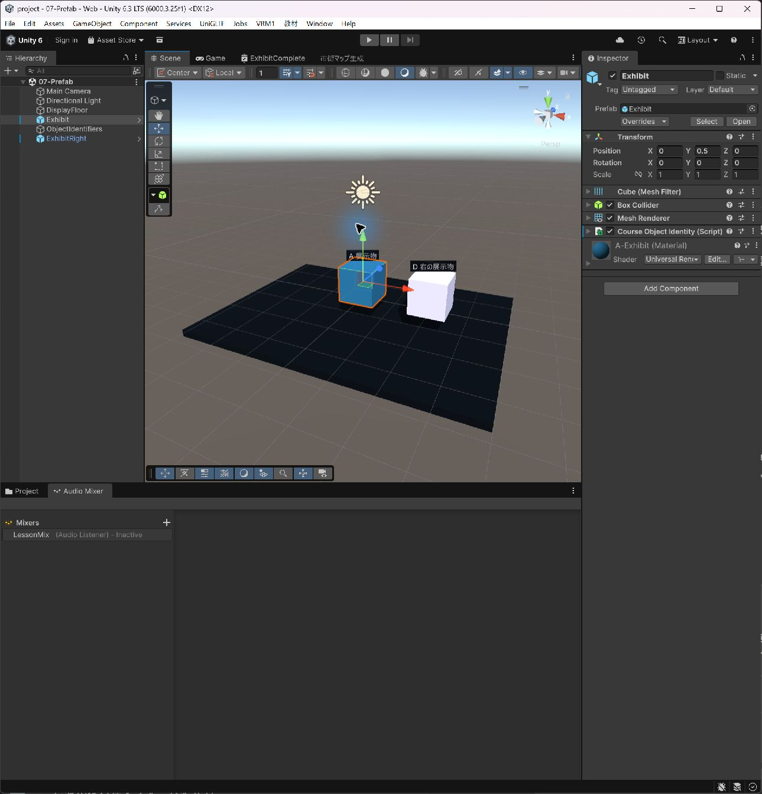

**ヒント・用語：** Prefabは再利用する元データ、インスタンスはシーンへ置いた実体です。  
適用は元データへ反映する操作で、他の配置にも影響します。

**確認して報告：** 共通化する設定と、配置ごとに変える設定を一つずつ挙げます。

**サンプル：** [開始シーン](../../../unity/project/Assets/Scenes/07-Prefab.unity) · [完成サンプル](../../../unity/project/Assets/Scenes/Completed/07-Prefab.unity)。  
Projectで対応するファイルをダブルクリックして開き、手順と見比べます。

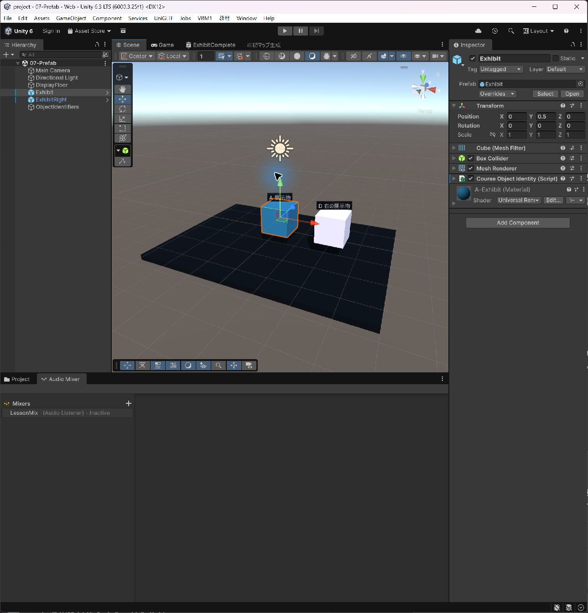


<a id="unity-08"></a>

#### U08 物理と衝突：展示物を床へ落とす

**ブラウザで実行：** [U08 開始を実行](../../../unity/webgl/index.html?unit=08&variant=start) · [U08 完成を実行](../../../unity/webgl/index.html?unit=08&variant=complete)

**依頼者・見る人：** 展示担当者・来場者。  
**困りごと：** 展示物が空中で静止し、床に置いた感じが出ません。  
**変更：** RigidbodyとColliderを使います。  
2D物理は混ぜません。  
**完成条件：** 高さ3から落下し、床を通り抜けず止まること。

**準備：** `08-Physics.unity` を開きます。  
対象はA Exhibit（青い立方体）です。


1. Exhibitを選び、Box ColliderとRigidbodyを確認します。  
   Use Gravityを有効、Is Kinematicを無効にします。
2. DisplayFloorにもBox Colliderが付いていることを確認します。  
   静止した床へRigidbodyを追加する必要はありません。
3. Playし、落下と接触を見ます。  
   停止すると開始位置へ戻ることを確認します。
4. ColliderのIs Triggerを有効にした場合の違いを予想します。  
   試すなら確認後に無効へ戻し、もう一度床で止まることを確かめます。


**ヒント・用語：** Rigidbodyは物理による動きを、Colliderは当たる形を担当します。  
Triggerは重なりの検出用で、押し返して止める用途とは異なります。

**確認して報告：** 落下前・接触後の高さと、床を通り抜けないための設定を書きます。

**サンプル：** [開始シーン](../../../unity/project/Assets/Scenes/08-Physics.unity) · [完成サンプル](../../../unity/project/Assets/Scenes/Completed/08-Physics.unity)。  
Projectで対応するファイルをダブルクリックして開き、手順と見比べます。

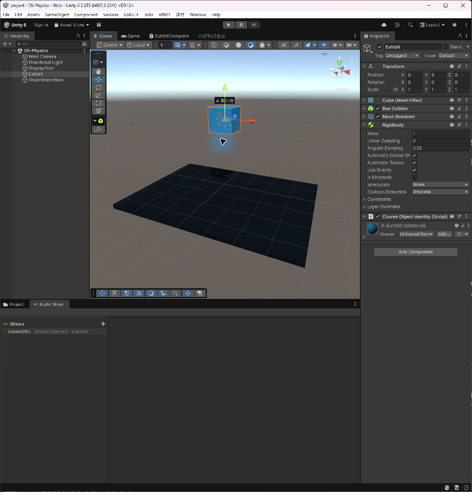


<a id="unity-09"></a>

#### U09 3D：立体を見ながら配置する

**ブラウザで実行：** [U09 開始を実行](../../../unity/webgl/index.html?unit=09&variant=start) · [U09 完成を実行](../../../unity/webgl/index.html?unit=09&variant=complete)

**依頼者・見る人：** 展示担当者・来場者。  
**困りごと：** 立体同士の前後関係が分かりません。  
**変更：** CubeとSphereを奥行き方向に置き分けます。  
素材の追加購入はしません。  
**完成条件：** 2つの立体がGameから見え、Sceneを回して前後・高さを説明できること。

**準備：** `09-3D.unity` を開き、Sceneの2Dを無効にします。  
対象はA Exhibit（青い立方体）です。  
B Sphere（橙の球）、完成例のC Capsule（淡い黄）も名前と形で確認します。

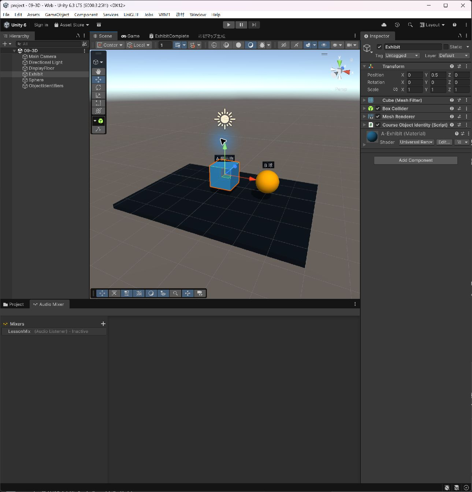

1. HierarchyからExhibitとSphereを交互に選び、Fで注目します。
2. Scene上でAlt+左ドラッグで回転、中央ドラッグで平行移動、ホイールで拡大縮小します。
3. SphereのPosition Zを2へ変え、Gameの見え方とSceneの前後関係を比べます。
4. GameObject → 3D ObjectからCapsuleを追加し、Positionを `(-2,0.5,0)` にして保存します。

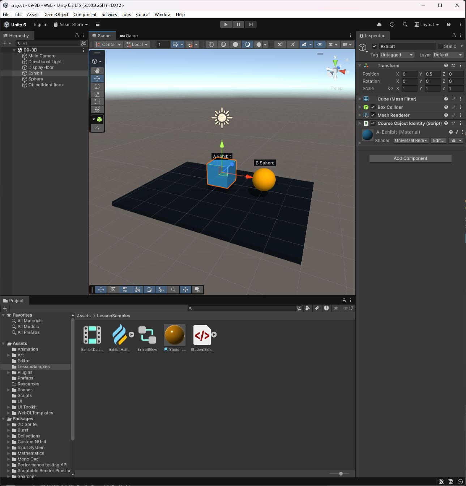

**ヒント・用語：** Unityでは通常Yが上です。  
移動ツールのGlobal／Localは、世界の軸か対象自身の軸かを切り替えます。

**確認して報告：** Sceneの視点操作とGameの見え方を区別して説明します。

**サンプル：** [開始シーン](../../../unity/project/Assets/Scenes/09-3D.unity) · [完成サンプル](../../../unity/project/Assets/Scenes/Completed/09-3D.unity)。  
Projectで対応するファイルをダブルクリックして開き、手順と見比べます。

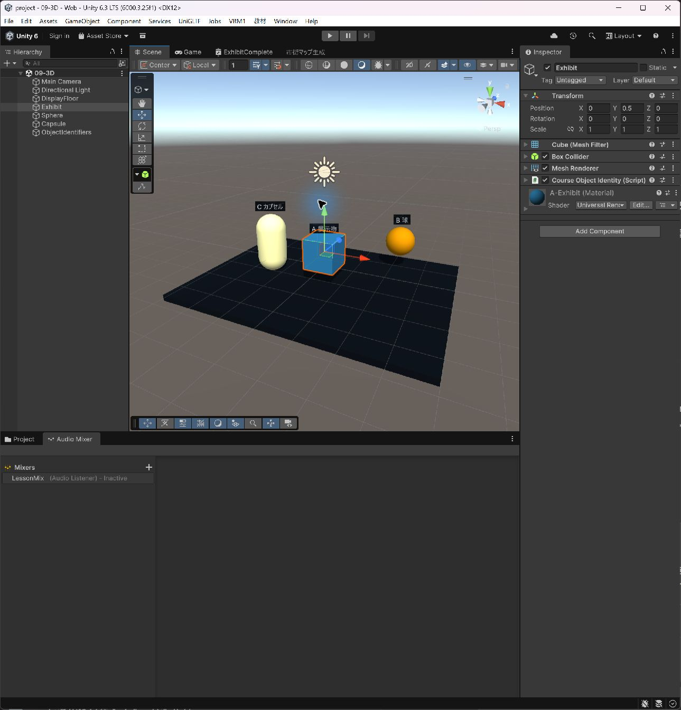


<a id="unity-10"></a>

#### U10 マテリアル：展示物の表面を変える

**ブラウザで実行：** [U10 開始を実行](../../../unity/webgl/index.html?unit=10&variant=start) · [U10 完成を実行](../../../unity/webgl/index.html?unit=10&variant=complete)

**依頼者・見る人：** 展示担当者・来場者。  
**困りごと：** 注目してほしい展示物を色で区別できません。  
**変更：** 自分用のマテリアルを作り、色と滑らかさを調整します。  
共有のExhibit.matを一括変更しません。  
**完成条件：** 作成したマテリアルをExhibitへ割り当て、色と反射の変化を確認できること。

**準備：** `10-Material.unity` を開きます。  
対象はA Exhibit（青い立方体）です。  
材質変更後はAのラベルを保ち、橙へ変わります。

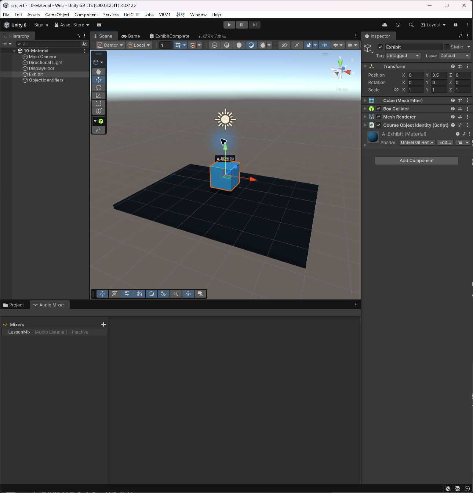

1. ProjectのArtで右クリック → Create → Materialを選び、`StudentExhibit` と名付けます。
2. InspectorでShaderをUniversal Render Pipeline/Litにします。  
   Base Mapの色をオレンジへ変えます。
3. ProjectのマテリアルをSceneのExhibitへドラッグします。  
   Mesh RendererのMaterials欄でも割当を確認します。
4. Smoothnessを0と0.8で比べ、好きな値にします。  
   光と視点によって反射の見え方が変わることを確かめます。

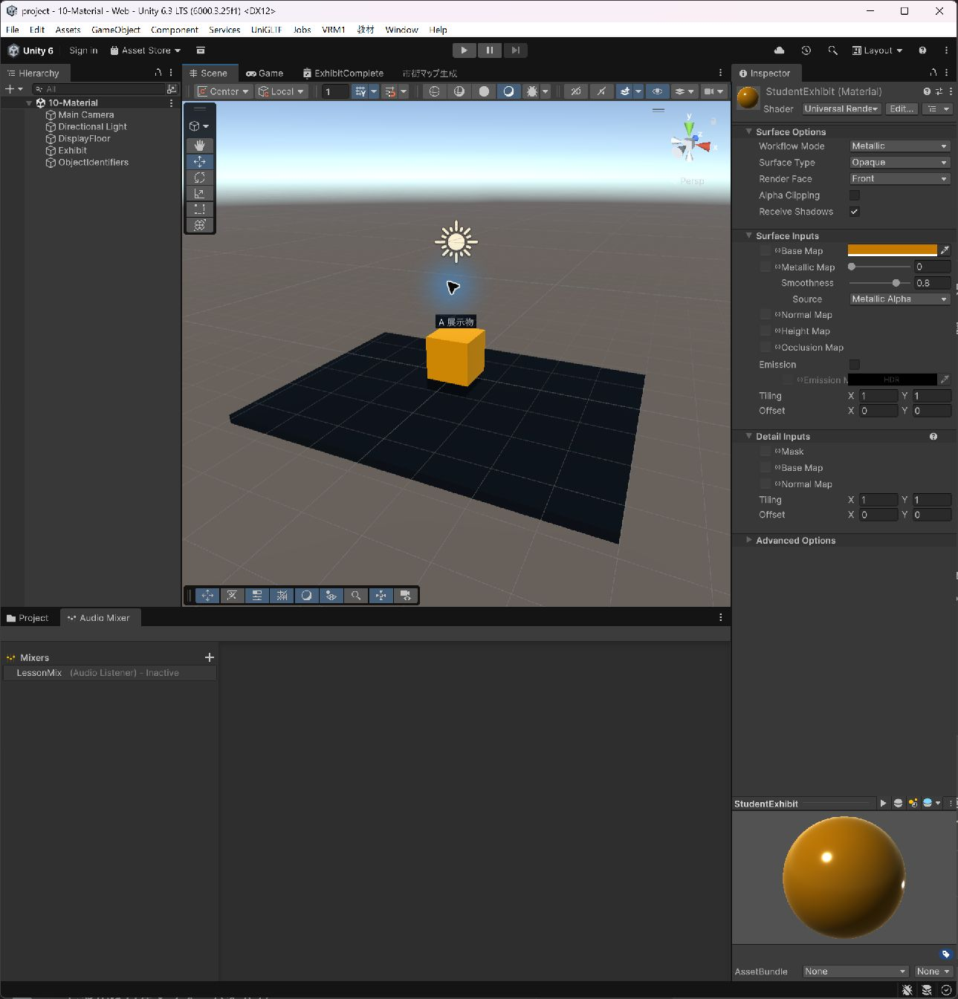

**ヒント・用語：** Shaderは表面の描き方、MaterialはShaderへ渡す色や画像などの設定です。  
ピンク色ならShaderやRender Pipelineの不一致を調べます。

**確認して報告：** 作ったアセット名と、どのオブジェクトに割り当てたかを書きます。

**サンプル：** [開始シーン](../../../unity/project/Assets/Scenes/10-Material.unity) · [完成サンプル](../../../unity/project/Assets/Scenes/Completed/10-Material.unity)。  
Projectで対応するファイルをダブルクリックして開き、手順と見比べます。

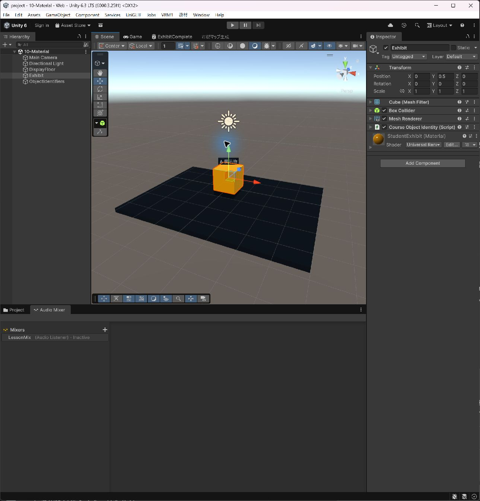


<a id="unity-11"></a>

#### U11 カメラ：来場者に見せる範囲を決める

**ブラウザで実行：** [U11 開始を実行](../../../unity/webgl/index.html?unit=11&variant=start) · [U11 完成を実行](../../../unity/webgl/index.html?unit=11&variant=complete)

**依頼者・見る人：** 展示担当者・来場者。  
**困りごと：** Sceneで見える展示物がGameでは切れています。  
**変更：** Main Cameraの位置と画角を調整します。  
Scene視点だけの調整で終えません。  
**完成条件：** Gameの16:9表示で展示物全体と床の一部が見えること。

**準備：** `11-Camera.unity` を開きます。  
対象はA Exhibit（青い立方体）です。


1. Gameタブで比率を16:9へ設定します。  
   HierarchyでMain Cameraを選びます。
2. CameraコンポーネントのField of Viewを45から60へ変え、映る範囲を比べます。
3. 必要ならCameraのPositionを少し後ろへ移動します。  
   Sceneの視点だけを動かしていないかInspectorで確かめます。
4. Near／FarのClipping Planesを確認し、展示物が範囲内にある状態で保存します。

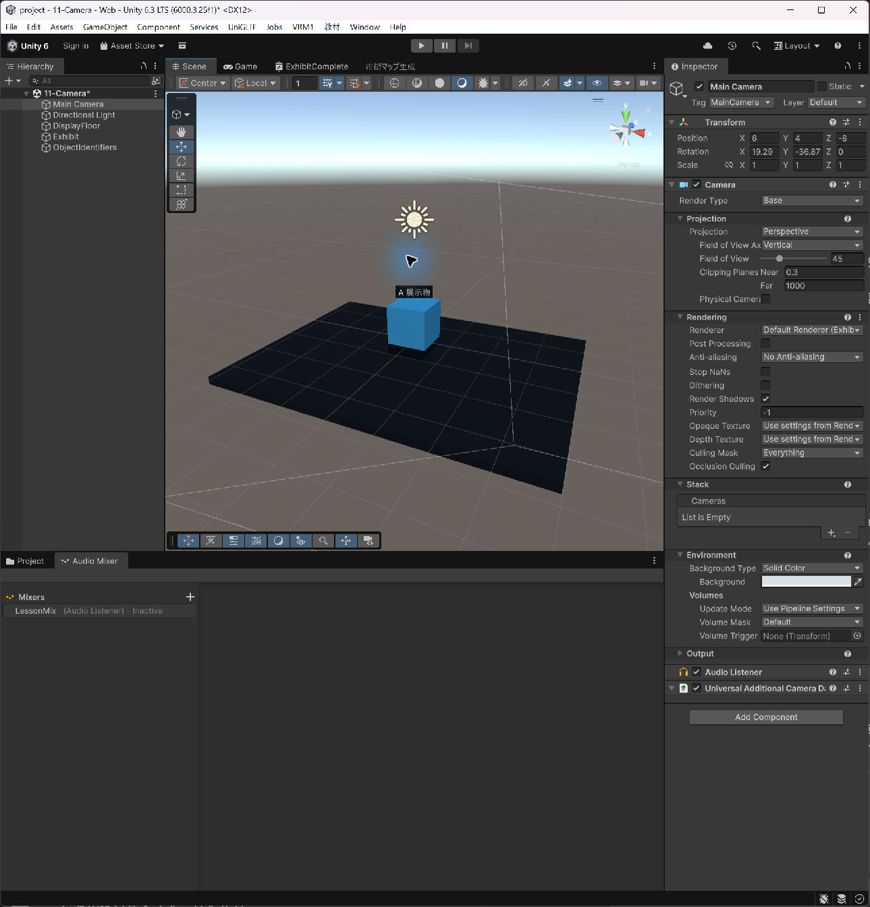

**ヒント・用語：** Field of ViewはPerspectiveの画角です。  
Orthographicでは主にSizeで表示範囲を調整します。

**確認して報告：** 画角変更前後の表示範囲を比較し、選んだ値を書きます。

**サンプル：** [開始シーン](../../../unity/project/Assets/Scenes/11-Camera.unity) · [完成サンプル](../../../unity/project/Assets/Scenes/Completed/11-Camera.unity)。  
Projectで対応するファイルをダブルクリックして開き、手順と見比べます。


<a id="unity-12"></a>

#### U12 ライティング：立体の形を見やすくする

**ブラウザで実行：** [U12 開始を実行](../../../unity/webgl/index.html?unit=12&variant=start) · [U12 完成を実行](../../../unity/webgl/index.html?unit=12&variant=complete)

**依頼者・見る人：** 展示担当者・来場者。  
**困りごと：** 展示物の凹凸と床との関係が読み取りにくいです。  
**変更：** Directional Lightの方向・明るさを調整します。  
ライトベイクは扱いません。  
**完成条件：** 光の方向を変えると明暗と影の向きが変わり、展示物を見失わない明るさにできること。

**準備：** `12-Lighting.unity` を開きます。  
対象はA Exhibit（青い立方体）です。


1. HierarchyでDirectional Lightを選び、LightのTypeがDirectionalであることを確認します。
2. TransformのRotation Yを変えて、立方体の明るい面と床の影を観察します。
3. Intensityを0.5と1で比べ、Colorを少し暖色へ変えます。
4. Gameで暗い側の面が見えるか確認します。  
   Sceneだけ暗い場合はSceneの照明表示の切替も確認します。

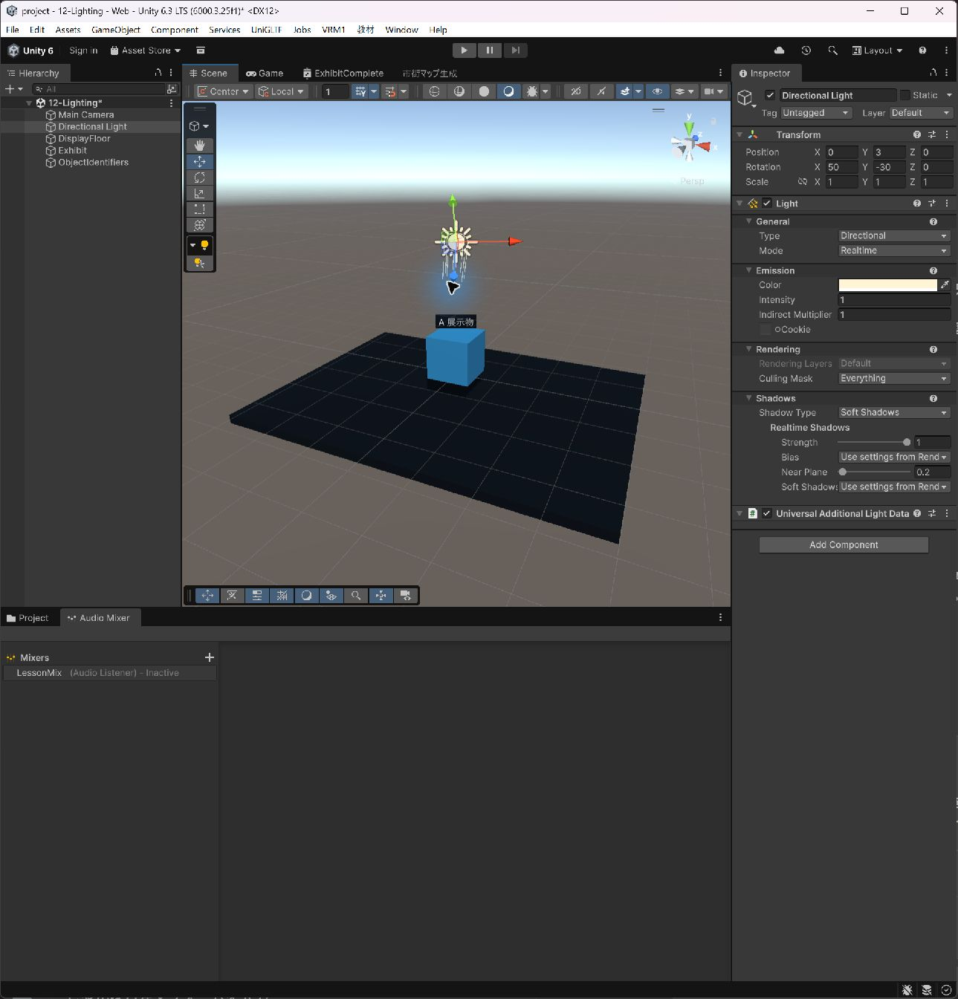

**ヒント・用語：** Directional Lightは主に向きが効き、点光源のように位置から距離で減衰しません。  
見え方はマテリアルと環境光にも左右されます。

**確認して報告：** Rotation、Intensity、Colorのうち変えた値と効果を書きます。

**サンプル：** [開始シーン](../../../unity/project/Assets/Scenes/12-Lighting.unity) · [完成サンプル](../../../unity/project/Assets/Scenes/Completed/12-Lighting.unity)。  
Projectで対応するファイルをダブルクリックして開き、手順と見比べます。

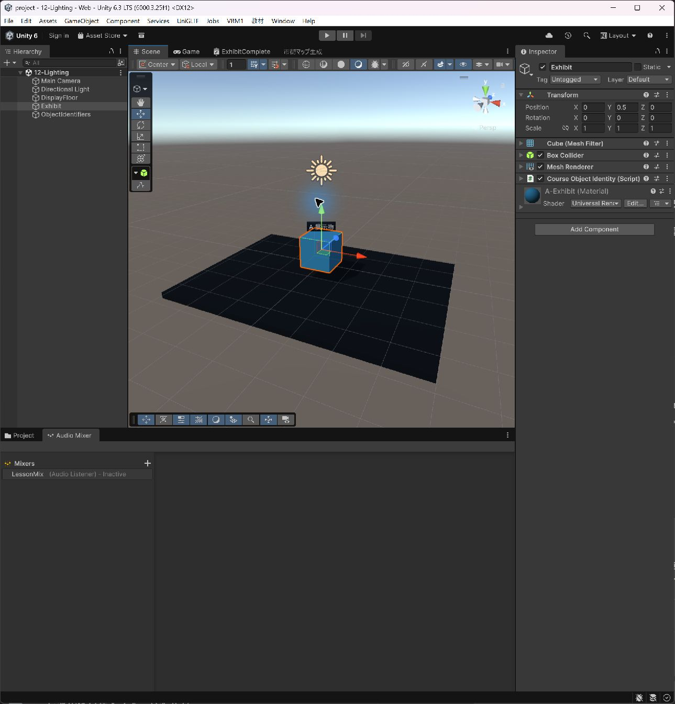


<a id="unity-13"></a>

#### U13 Animator：状態からアニメーションを再生する

**ブラウザで実行：** [U13 開始を実行](../../../unity/webgl/index.html?unit=13&variant=start) · [U13 完成を実行](../../../unity/webgl/index.html?unit=13&variant=complete)

**依頼者・見る人：** 展示担当者・来場者。  
**困りごと：** 展示物に繰り返しの動きを付ける仕組みが分かりません。  
**変更：** Animator Controllerの既定状態とClipの接続を確認します。  
Timelineの演出制御は次単元です。  
**完成条件：** ExhibitのAnimatorにControllerが入り、既定状態のMotionを追跡してPlay中の動きまで確認できること。

**準備：** `13-Animator.unity` を開きます。  
対象はA Exhibit（青い立方体）です。

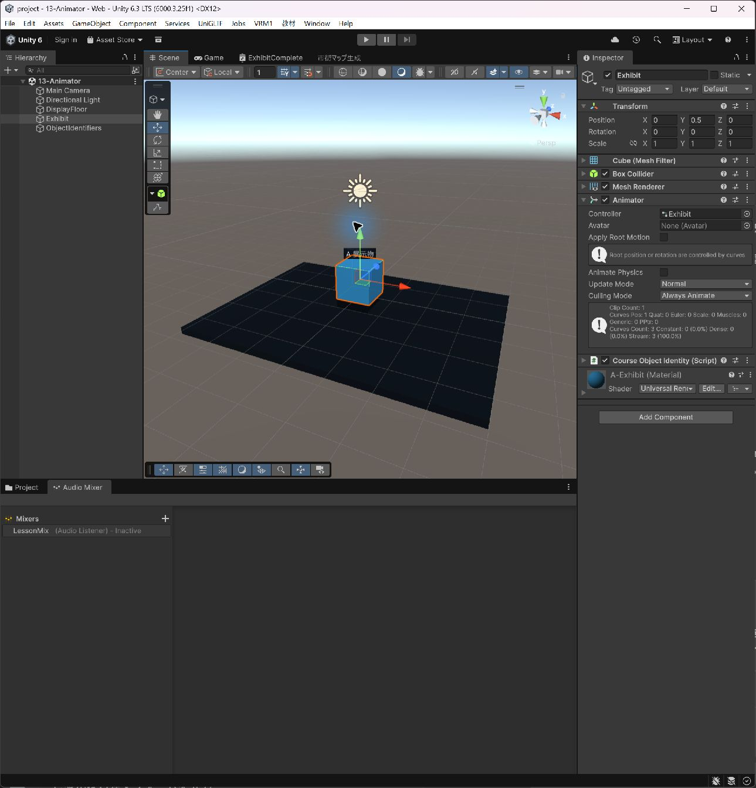

1. Exhibitを選び、AnimatorのControllerが `Exhibit` であることを確認します。
2. `Assets/Animation/Exhibit.controller` をダブルクリックします。  
   Entryからオレンジ色の既定状態へつながる矢印を探します。
3. 状態を選び、InspectorのMotionがExhibitMoveであることを確認します。  
   ProjectのClipを選ぶと時間とカーブを調べられます。
4. Playし、Animatorの状態表示とGameの移動を見ます。  
   停止後、状態のSpeedを0.5にして再生の速さを比較します。

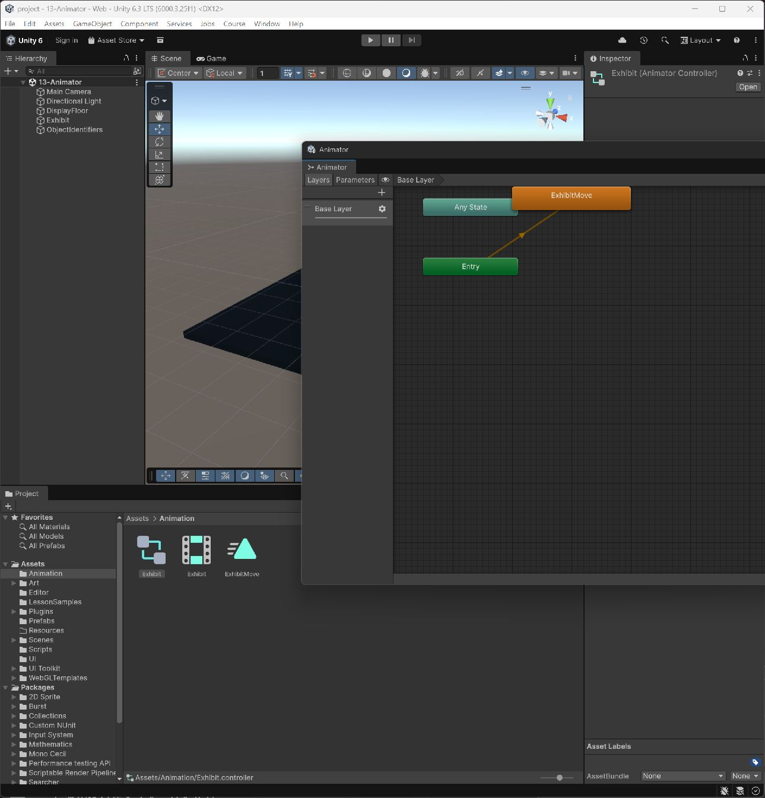


**ヒント・用語：** Clipは動きのデータ、Controllerはどの状態でどのClipを再生するかの定義、AnimatorはGameObjectで再生するコンポーネントです。

**確認して報告：** GameObject → Animator → Controller → State → Motionの接続を順番に書きます。

**サンプル：** [開始シーン](../../../unity/project/Assets/Scenes/13-Animator.unity) · [完成サンプル](../../../unity/project/Assets/Scenes/Completed/13-Animator.unity)。  
Projectで対応するファイルをダブルクリックして開き、手順と見比べます。


<a id="unity-14"></a>

#### U14 Timeline：時間に沿って展示を演出する

**ブラウザで実行：** [U14 開始を実行](../../../unity/webgl/index.html?unit=14&variant=start) · [U14 完成を実行](../../../unity/webgl/index.html?unit=14&variant=complete)

**依頼者・見る人：** 展示担当者・来場者。  
**困りごと：** 開始から何秒後に展示物が動くのか共有できません。  
**変更：** Timeline上のClip位置と再生位置を調整します。  
Animatorの状態遷移は追加しません。  
**完成条件：** Playable Director、Timeline Asset、Animation Trackの対象を確認し、再生ヘッドで異なる時刻の位置を比較できること。

**準備：** `14-Timeline.unity` を開き、Exhibitを選択します。  
対象はA Exhibit（青い立方体）です。

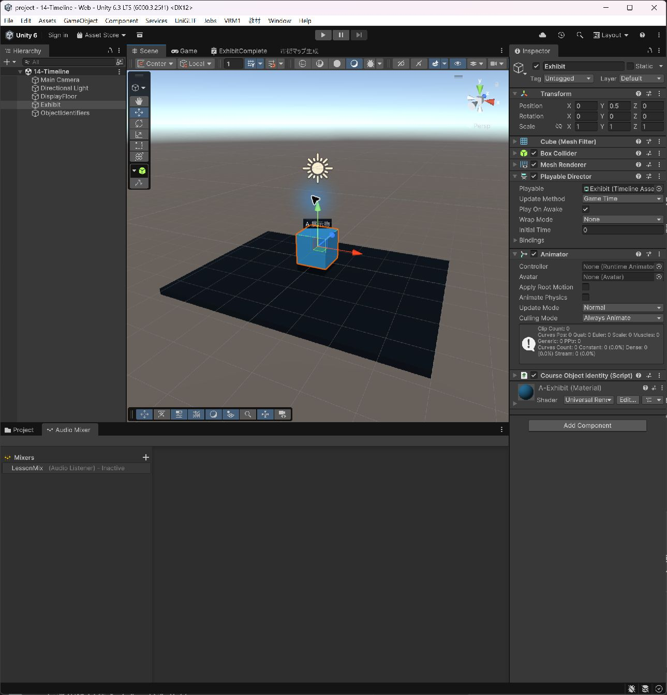

1. Window → Sequencing → Timelineを開きます。  
   ExhibitのPlayable DirectorでPlayableがExhibit、トラックのBindingがExhibitのAnimatorであることを確認します。
2. ExhibitへBindingされたAnimation Track（アセット名は `Exhibit position`）のClipを選び、StartとDurationを確認します。  
   初期状態は開始0秒、長さ2秒です。  
   目盛がフレーム表示なら、このTimelineでは60フレームが1秒、120フレームが2秒です。
3. Previewを有効にし、上の時間目盛で0秒と1秒をクリックして展示物の位置を比較します。
4. Clipを右へ動かして開始を1秒にし、演出の始まりが遅れることを確認します。  
   Previewを解除して保存し、Playでも確認します。

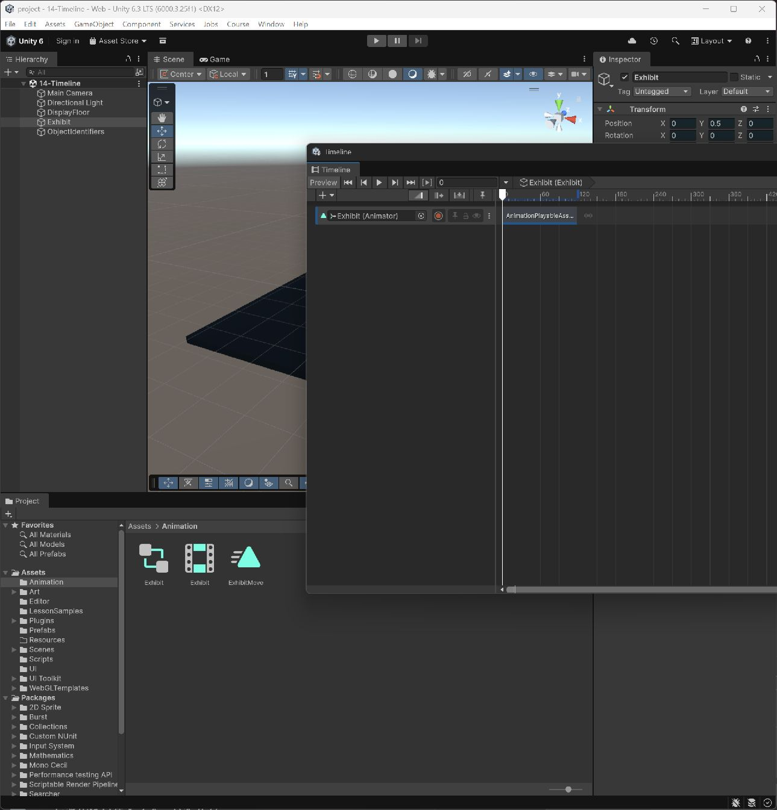

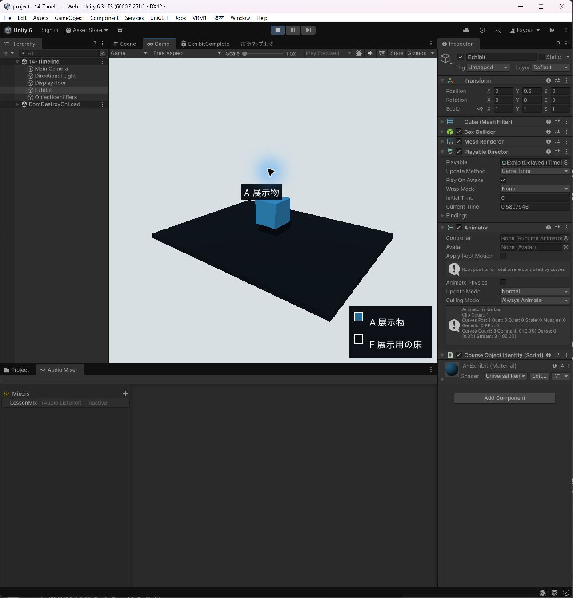

**ヒント・用語：** Playable DirectorはTimelineを再生し、Bindingはトラックが動かす対象です。  
対象欄が空なら、Clipがあっても展示物は動きません。

**確認して報告：** 演出の開始時刻、長さ、対象の3点を書きます。

**サンプル：** [開始シーン](../../../unity/project/Assets/Scenes/14-Timeline.unity) · [完成サンプル](../../../unity/project/Assets/Scenes/Completed/14-Timeline.unity)。  
Projectで対応するファイルをダブルクリックして開き、手順と見比べます。


<a id="unity-15"></a>

#### U15 音：開始の合図を鳴らす

**ブラウザで実行：** [U15 開始を実行](../../../unity/webgl/index.html?unit=15&variant=start) · [U15 完成を実行](../../../unity/webgl/index.html?unit=15&variant=complete)

**依頼者・見る人：** 展示担当者・来場者。  
**困りごと：** 展示の開始に気づけません。  
**変更：** 短い開始音を小さな音量で鳴らします。  
外部音源は使用しません。  
**完成条件：** Audio SourceにChimeが入り、Play開始時に1回だけ鳴り、Loopが無効であること。

**準備：** `15-Audio.unity` を開き、PCの音量を小さくしてから試します。  
対象はA Exhibit（青い立方体）です。

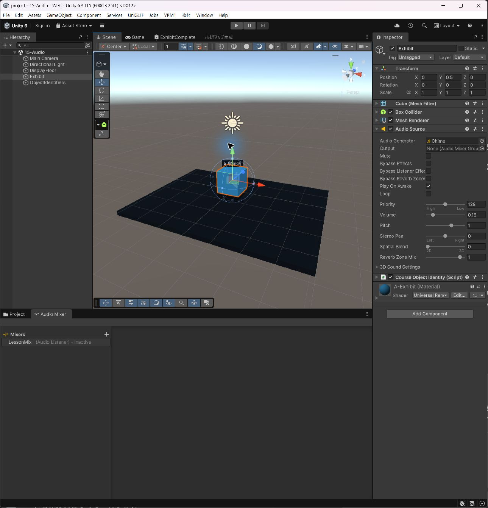

1. ExhibitのAudio Sourceを確認します。  
   Audio Generator（以前のバージョンではAudio Resource／AudioClip）に `Chime`、Volumeに0.15を設定します。
2. Play On Awakeを有効、Loopを無効、Spatial Blendを0（2D）にします。
3. Main CameraにAudio Listenerがあることを確認してPlayします。  
   開始時だけ音が鳴るか耳で確かめます。
4. 無音ならGameのMute Audio、OSの音量・出力先、Audio Listenerの順に確認します。  
   確認のために過大な音量へ上げません。

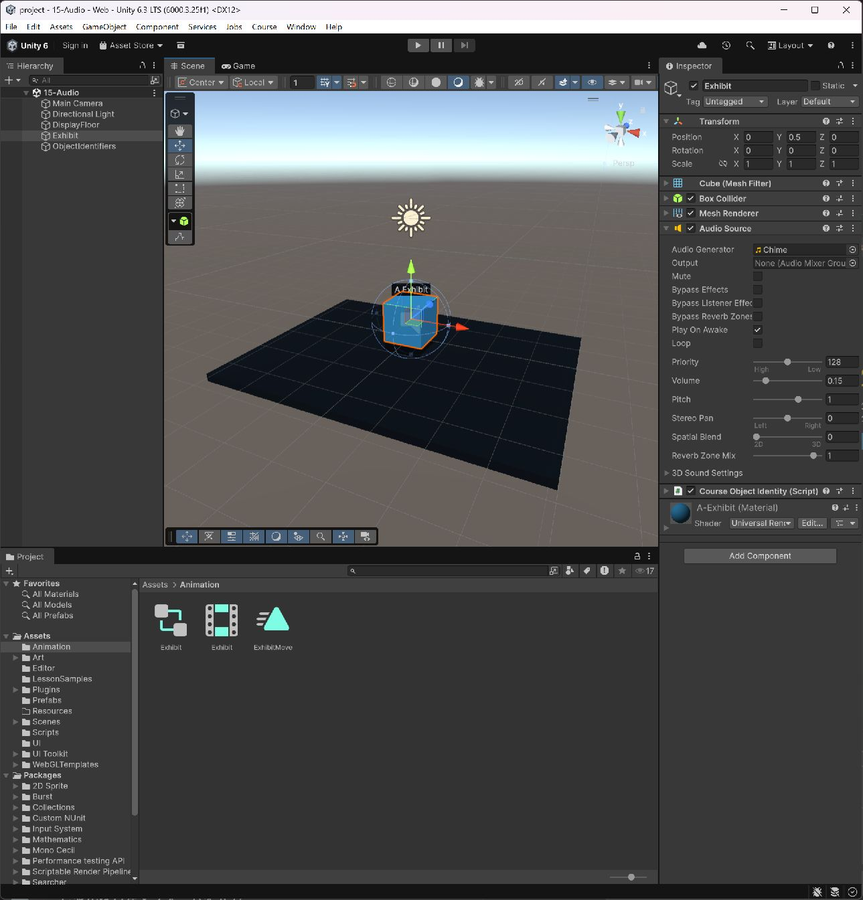

**ヒント・用語：** Audio Sourceは音を出す場所、Audio Listenerは聞く場所です。  
画像だけでは音が鳴った証拠になりません。

**確認して報告：** 設定確認と聴取確認を別々に記録します。  
聴取できなければ未確認と書きます。

**サンプル：** [開始シーン](../../../unity/project/Assets/Scenes/15-Audio.unity) · [完成サンプル](../../../unity/project/Assets/Scenes/Completed/15-Audio.unity)。  
Projectで対応するファイルをダブルクリックして開き、手順と見比べます。


<a id="unity-16"></a>

#### U16 uGUI：Canvasにボタンを置く

**ブラウザで実行：** [U16 開始を実行](../../../unity/webgl/index.html?unit=16&variant=start) · [U16 完成を実行](../../../unity/webgl/index.html?unit=16&variant=complete)

**依頼者・見る人：** 展示担当者・来場者。  
**困りごと：** どこを押せば始まるか分かりません。  
**変更：** Canvas上のボタンとクリック時の表示を確認します。  
UI ToolkitのUXMLは使いません。  
**完成条件：** Play中に「開始」をクリックするとようこそ！  
へ変わり、Gameの比率を変えてもボタンが見えること。

**準備：** `16-uGUI.unity` を開きます。  
対象はA Exhibit（青い立方体）です。


1. HierarchyのCanvasを展開してStartButtonを選びます。  
   CanvasのRender ModeがScreen Space - Overlayであることを確認します。
2. StartButtonのRect Transform、Image、Buttonを見ます。  
   ButtonのOn Click()にExhibitの `ExhibitButton.Begin` が登録されていることを確認します。
3. EventSystemとInput System UI Input Moduleを確認します。  
   UIの入力イベントを受け取るために必要です。
4. Playし、Gameの「開始」をクリックします。  
   ようこそ！  
   への変化を確認します。  
   停止し、Gameの比率を16:9から4:3へ変えて配置を確認します。

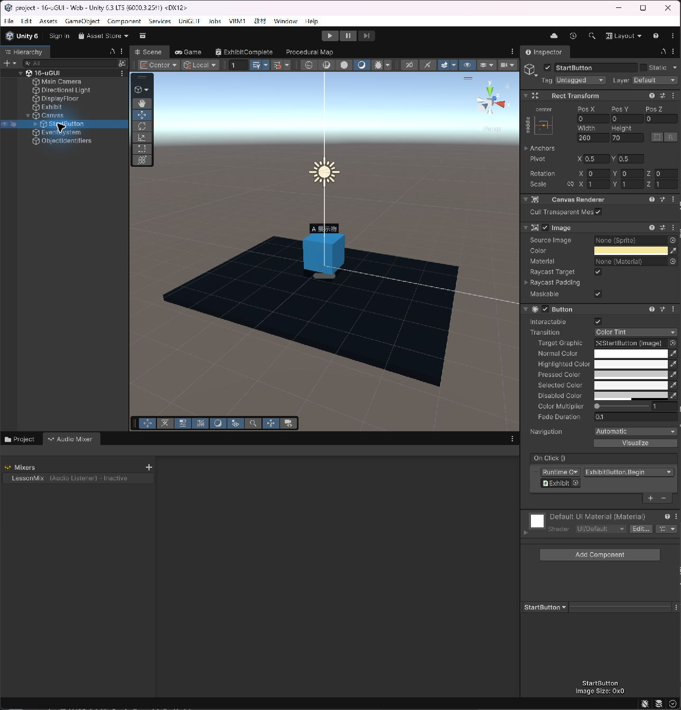


**ヒント・用語：** Rect TransformはUIの位置とサイズ、Anchorは親のどこを基準にするかを決めます。  
文字はTextMeshPro（TMP）を使用し、日本語フォントを割り当てています。  
Legacy Textは使いません。

**日本語フォントの設定**

1. StartButtonの子のLabelを選び、TextMeshPro - Text (UI)のFont Assetが `NotoSansJP-TMP` であることを確認します。  
   表示文字は「開始」、ExhibitButtonの状態参照はこのTMP文字を指定します。
2. `Assets/Fonts/NotoSansJP-Regular.otf` は元フォント、`NotoSansJP-TMP.asset` はTMP用のSDFフォントです。  
   新しいTMP文字にも同じFont Assetを指定します。
3. U18以降のUI Toolkitは `ExhibitPanel.asset` のText Settingsに `JapanesePanelTextSettings` を指定し、そのDefault Font Assetに `NotoSansJP-UIToolkit` を設定します。  
   同じ元フォントから作った別形式のアセットで、TMP用と取り違えないでください。
4. 日本語・英数字・句読点を入力し、□の文字欠け、切れた行、ボタンからのはみ出しがないことをGameとブラウザで確認します。  
   新しい文字はDynamic方式で元フォントから追加します。  
   教材の文字は事前にアトラスへ収録済みです。

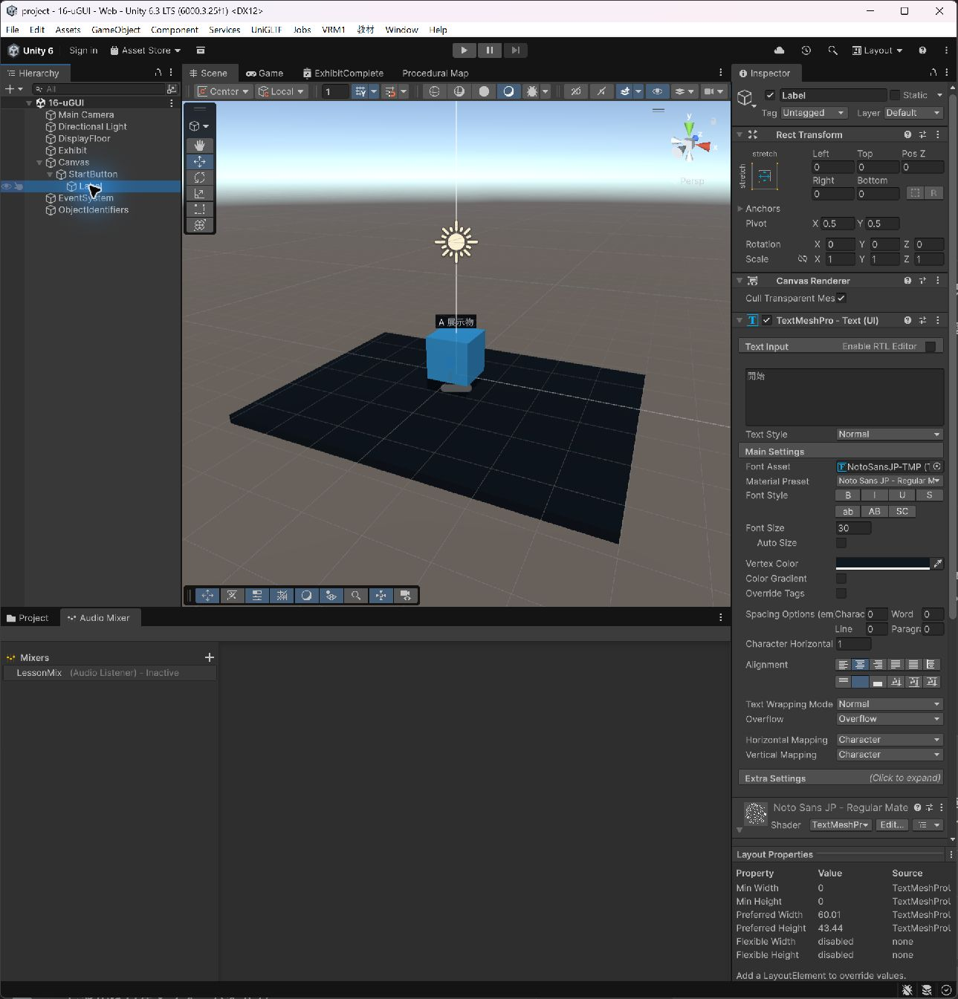

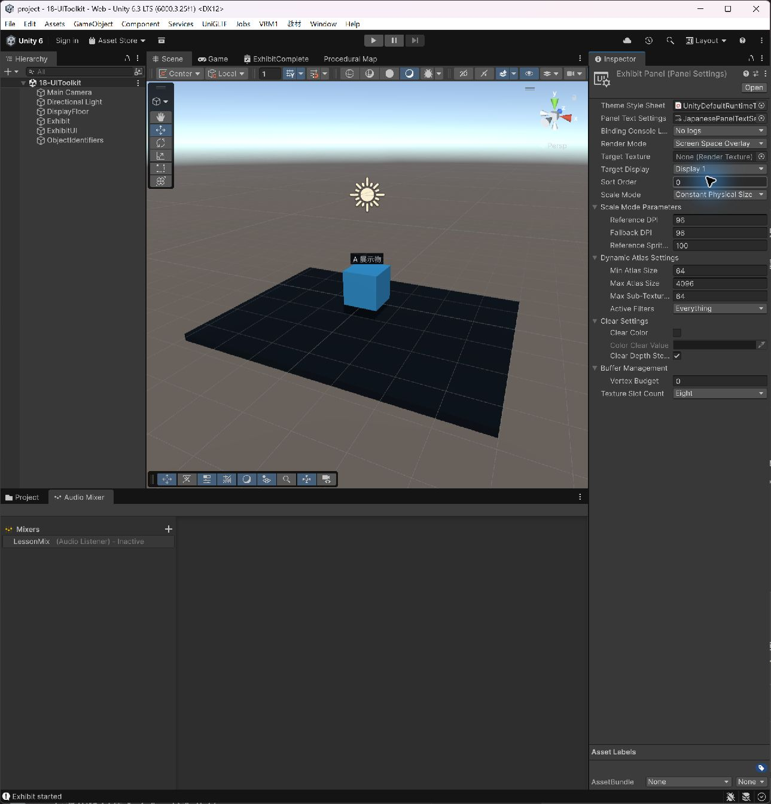

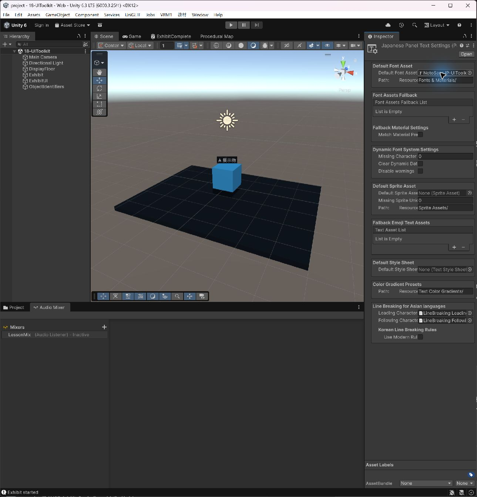

元フォントは [Noto Sans JP公式配布](https://github.com/notofonts/noto-cjk/tree/main/Sans/SubsetOTF/JP)、利用条件は同梱の [OFL](../../../unity/project/Assets/Fonts/OFL.txt) を参照します。  
教材UIと独自ツールは日本語です。  
Unity標準のコンポーネント名・API名は、検索と画面の照合ができるよう正式名を併記します。

**確認して報告：** クリック前後の表示と、2つの画面比率での結果を書きます。

**サンプル：** [開始シーン](../../../unity/project/Assets/Scenes/16-uGUI.unity) · [完成サンプル](../../../unity/project/Assets/Scenes/Completed/16-uGUI.unity)。  
Projectで対応するファイルをダブルクリックして開き、手順と見比べます。


HUD・画面UIの配置例は[U18の14パターンギャラリー](unity.md#unity-18)で比較します。  
ギャラリーの実装はUI Toolkitです。

<a id="unity-17"></a>

#### U17 Gizmo：編集用に範囲を可視化する

**ブラウザで実行：** [U17 開始を実行](../../../unity/webgl/index.html?unit=17&variant=start) · [U17 完成を実行](../../../unity/webgl/index.html?unit=17&variant=complete)

**依頼者・見る人：** 展示担当者・制作メンバー。  
**困りごと：** 接近判定を置きたい範囲がSceneで分かりません。  
**変更：** 黄色のワイヤー球で半径を表示します。  
実際の衝突判定は追加しません。  
**完成条件：** Exhibit選択時に半径2の線が出て、半径を3に変えると広がること。

**準備：** `17-Gizmo.unity` を開き、SceneのGizmosを有効にします。  
対象はA Exhibit（青い立方体）です。


1. Exhibitを選び、Range Gizmoコンポーネントの「半径」が2であることを確認します。
2. Sceneの黄色いワイヤー球を見ながら半径を3へ変えます。  
   Inspectorの数値と線の大きさを照合します。
3. `RangeGizmo.cs` のOnDrawGizmosSelected、Gizmos.color、DrawWireSphereの順に読みます。
4. 選択を外すと線が消えることを確認します。  
   完成した実行ファイルへこの線を表示する用途なら、別の描画方法が必要です。

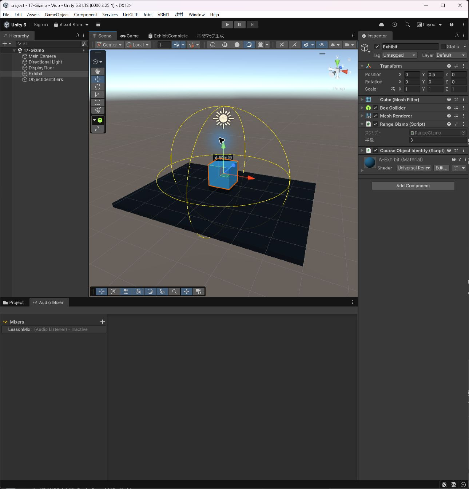

**ヒント・用語：** Gizmoは開発中の補助表示です。  
Gizmoを描くだけでは当たり判定や検知処理は動きません。

**確認して報告：** 見える条件と、描画と判定の違いを書きます。

**サンプル：** [開始シーン](../../../unity/project/Assets/Scenes/17-Gizmo.unity) · [完成サンプル](../../../unity/project/Assets/Scenes/Completed/17-Gizmo.unity)。  
Projectで対応するファイルをダブルクリックして開き、手順と見比べます。


<a id="unity-18"></a>

#### U18 UI Elements／UI Toolkit：画面制作とHUD・UIパターンギャラリー

**ブラウザで実行：** [U18 開始を実行](../../../unity/webgl/index.html?unit=18&variant=start) · [U18 完成を実行](../../../unity/webgl/index.html?unit=18&variant=complete)

**依頼者・見る人：** 展示担当者・来場者。  
**困りごと：** 見出し、案内、ボタンをまとめて整えたいです。  
**変更：** UI BuilderでUXMLの要素とUSSの見た目を編集します。  
uGUIのCanvasへ混ぜません。  
**完成条件：** UIDocumentの画面がGameに表示され、「開始」を押すと準備完了がようこそ！  
になること。

**準備：** `18-UIToolkit.unity` を開きます。  
以前のUI Elementsという呼び方に対応する現在の仕組みをUI Toolkitとして学びます。  
対象はA Exhibit（青い立方体）です。


1. `Assets/UI/Exhibit.uxml` をダブルクリックしてUI Builderを開きます。  
   開かない場合はWindow → UI Toolkit → UI Builderから同ファイルを開きます。
2. Hierarchyでpanel、見出しのLabel、status、start-buttonの親子関係を見ます。  
   見出しのTextを `Unity 展示サンプル` から自分の展示名へ変更し、保存します。
3. StyleSheetsのExhibit.ussを確認します。  
   `.panel` はclass、`#status` はnameに対応する選択です。  
   USSで余白と文字色を変えます。
4. シーンのExhibitUIを選び、UIDocumentのSource AssetとPanel Settingsの参照を確認します。  
   Playし、「開始」をクリックして状態の文字が変わることを確認します。

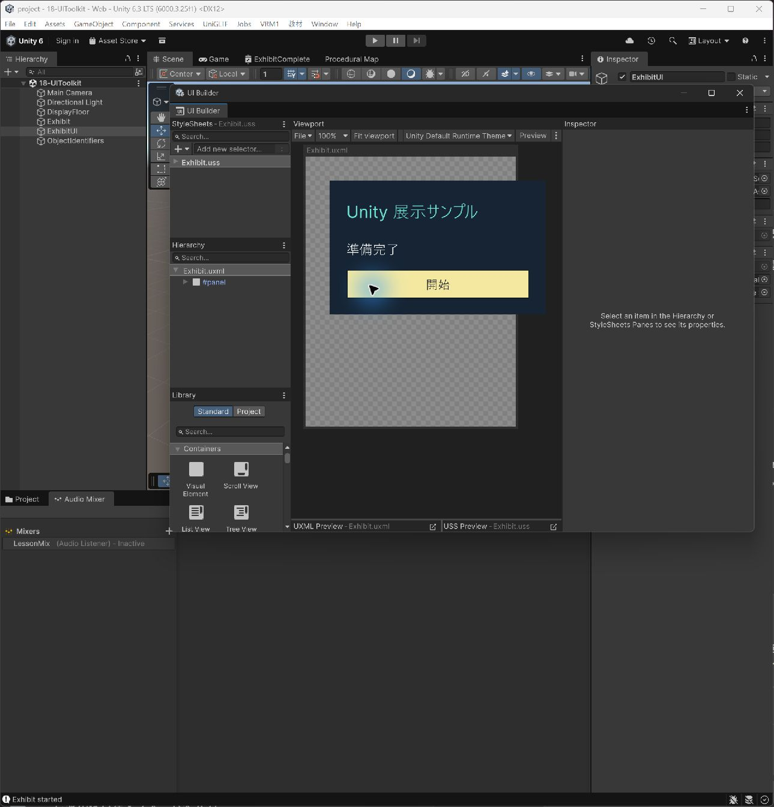


**ヒント・用語：** UXMLは構造、USSは見た目、C#は動作です。  
ExhibitUI.csは `Q<Button>("start-button")` で要素を探すため、nameを変える場合はコード側も合わせます。

**確認して報告：** 構造・見た目・動作を担当する3つのファイルを挙げます。

**サンプル：** [開始シーン](../../../unity/project/Assets/Scenes/18-UIToolkit.unity) · [完成サンプル](../../../unity/project/Assets/Scenes/Completed/18-UIToolkit.unity)。  
Projectで対応するファイルをダブルクリックして開き、手順と見比べます。

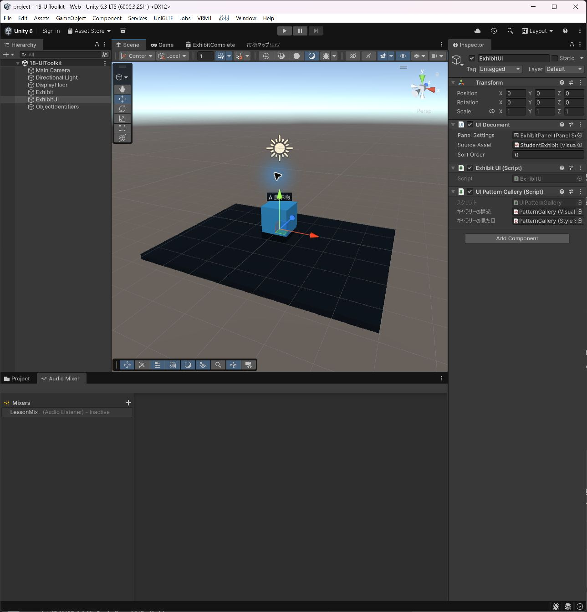


**HUD・UIパターンギャラリー**

**依頼者・見る人：** ゲームのUI担当者・プレイヤー。  
**困りごと：** 必要な情報と操作を、どこへ置くか判断したいです。  
**変更：** 14種類の定番パターンを比較し、用途に合う配置と状態表示を選びます。  
**完成条件：** HUDと画面UIを1種類ずつ選び、配置の理由を説明でき、片方の余白・文字サイズをUSSで変更して操作を確認できること。

1. U18の開始または完成シーンをPlayし、左下の **HUD・UIギャラリー（14種類）** を押します。  
   ブラウザ版も同じ入口です。
2. 左の一覧か **前へ / 次へ** で切り替えます。  
   狭い画面では一覧を隠すため、前へ / 次へを使います。  
   **見本を初期化** は現在の例を初期化し、**教材に戻る** は展示画面へ戻ります。
3. 各例のボタンを操作し、表示・数値・無効状態を比較します。  
   Tabでフォーカスを移し、Enterで実行、Escでダイアログをキャンセル、またはギャラリーを閉じます。  
   色だけでなく番号・名称・枠・数値で区別します。

**01 体力・スタミナHUD：** 画面端へ寄せ、中央の視界を空けます。  
25ダメージを受けるでHPが減り、体力を100に戻すで回復します。  
ゲージと正確な数値を併記します。

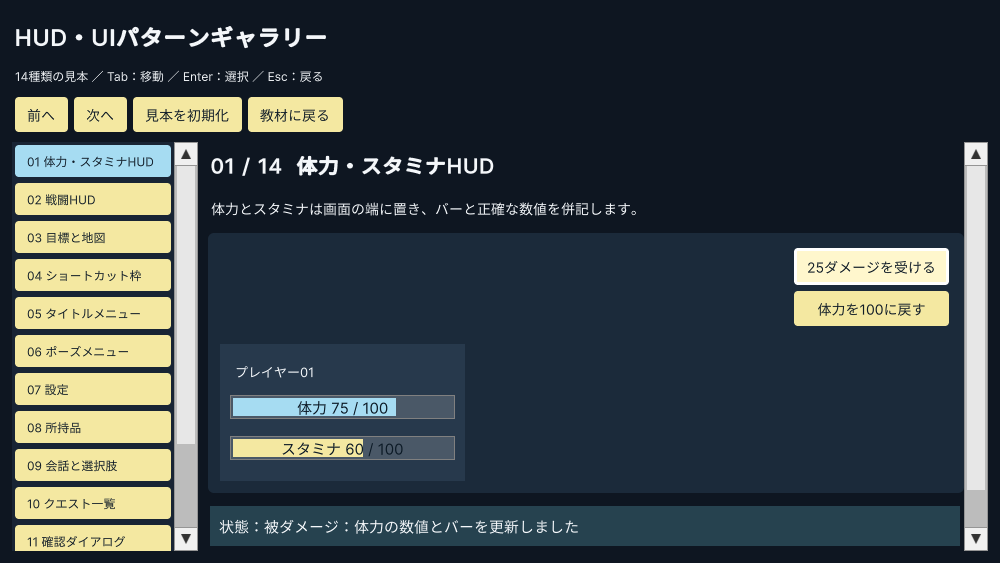

**02 照準・弾薬HUD：** 照準を中央、装填数と予備弾を右下に分けます。  
1発撃つと再装填で装填数の変化を確認します。

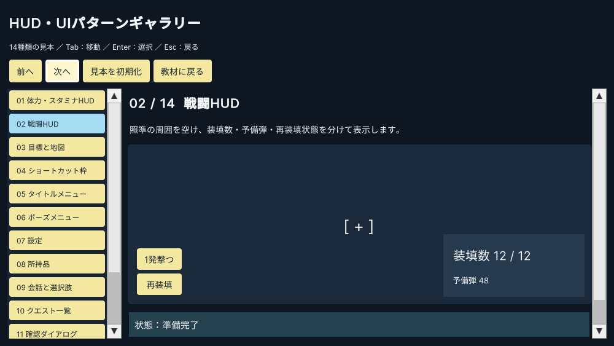

**03 目標・マップ：** 左上に位置関係、右上に次の行動を置きます。  
Pはプレイヤー、Aは端末、Gは出口です。  
次の目標へで目標が進みます。  
この例は模式図で、カメラで描くミニマップではありません。

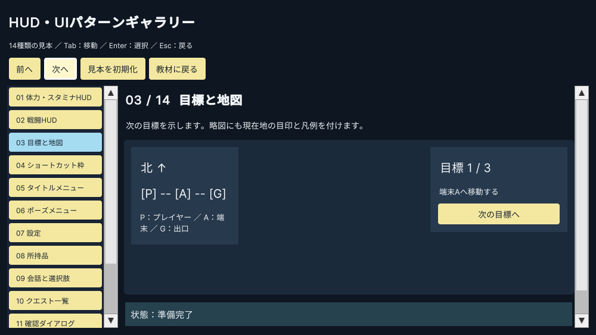

**04 ホットバー：** 下中央に番号付きのスロットを並べます。  
1・2のボタンを選び、選択中を確認します。  
3のクールダウン表示と4の未解放は無効状態の固定例です。  
数字キーの割当や残り時間の計測は行いません。

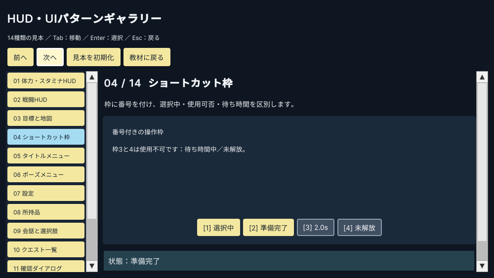

**05 タイトルメニュー：** はじめからを主な入口にします。  
セーブがない続けるは理由を添えて無効にします。  
設定は設定例へ移動します。

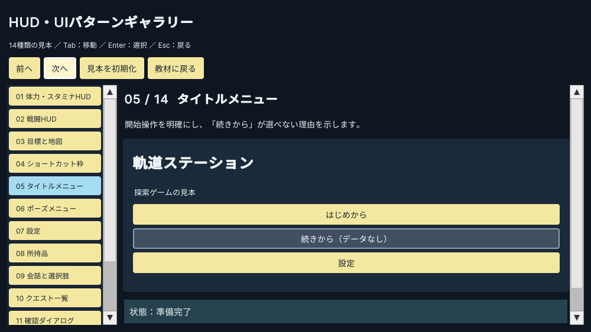

**06 ポーズメニュー：** 再開、設定、タイトルへ戻るをまとめます。  
この例は画面構成の確認用です。  
実際のゲーム停止や再開はU24のゲームループへ接続して実装します。

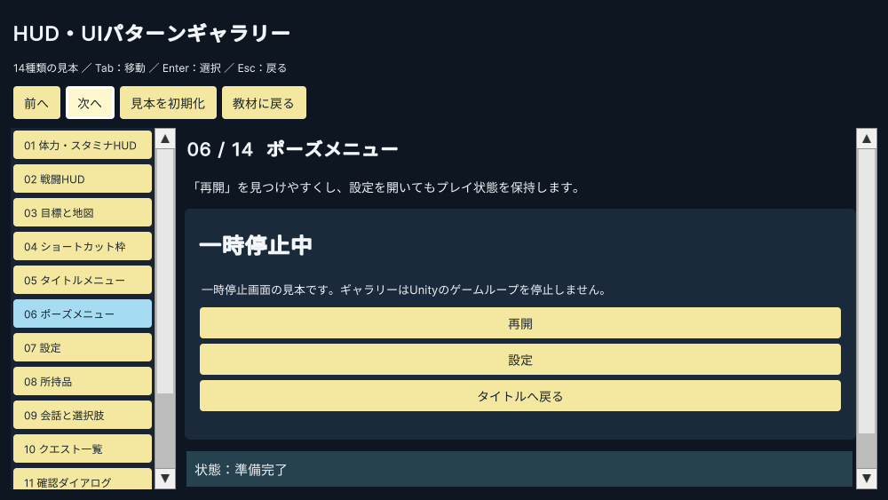

**07 設定画面：** スライダーか±10で編集中を変更し、適用で適用済みへ反映します。  
編集中と適用済みの値を分けます。  
音量と全画面は例の内部だけを変更し、機器の音量・画面モードには反映しません。  
実際の音量接続はU33を参照します。

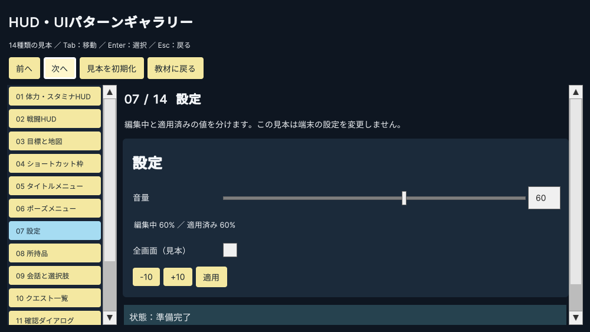

**08 所持品：** グリッドで選び、詳細欄を読んで選択した物を使うを押します。  
Emptyを選ぶと使用を無効にし、何もない理由を示します。

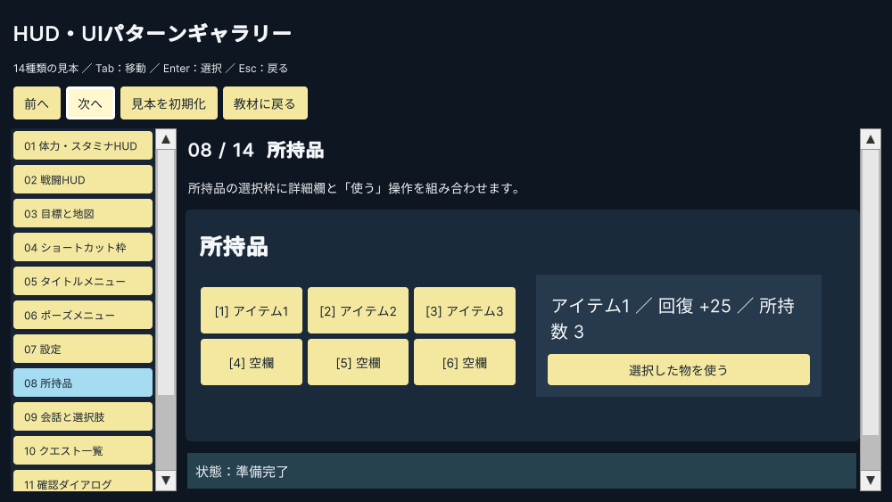

**09 会話・選択肢：** 話者、本文、返答の選択肢を分けます。  
東門について聞くか西の道を選び、STATEの返答を比較します。

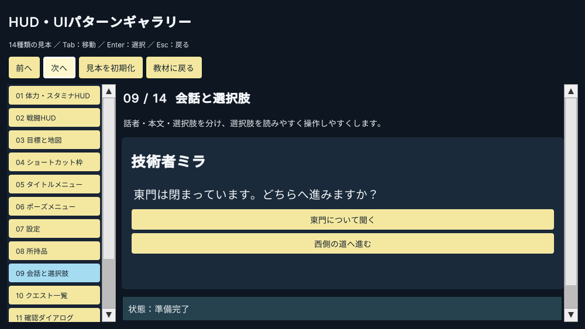

**10 クエスト一覧：** ActiveとCompletedを切り替えます。  
途中の件数とDONEを文字で示し、未完了と完了を区別します。

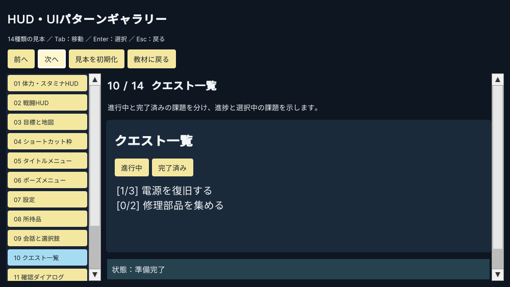

**11 確認ダイアログ：** 1件削除 practice saveを押します。  
対象と結果を明記し、最初のフォーカスを取消へ置きます。  
背景のボタンは操作できません。  
取消またはEscでは件数を保持し、1件削除では1件だけ減らします。  
閉じると開いたボタンへフォーカスが戻ります。  
実ファイルは削除しません。

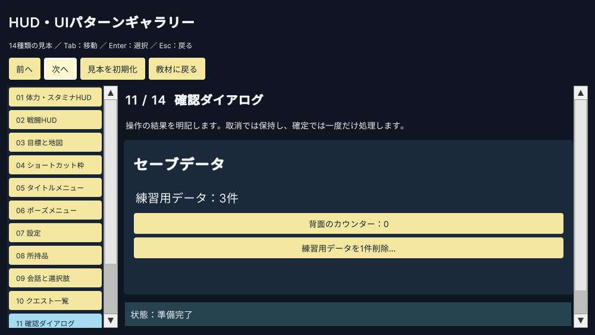

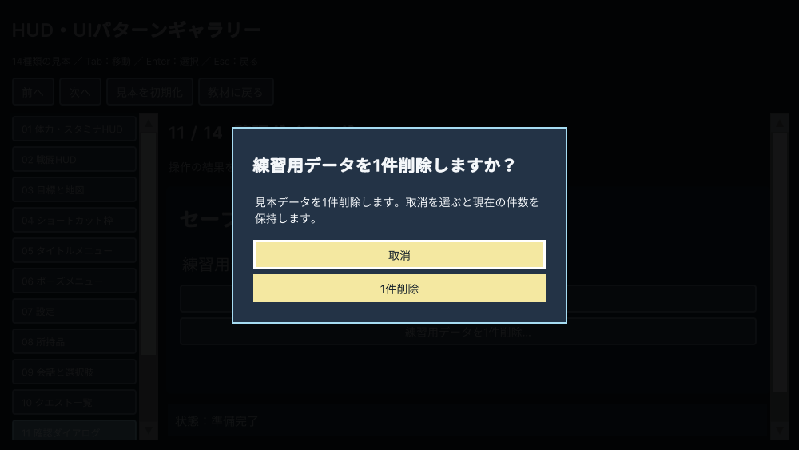

**12 リザルト：** 結果、スコア、時間、ボーナスの順に読み、続けるか再試行を選びます。  
次にできる操作を結果と同じ画面で示します。

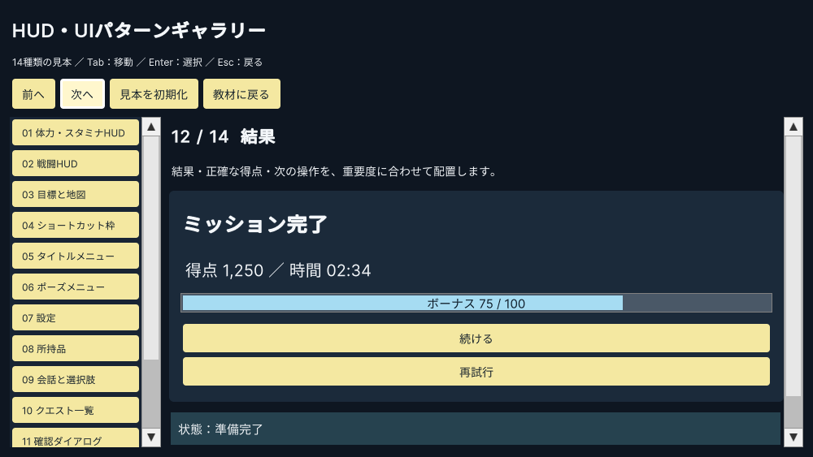

**13 読込・エラー・再試行：** 25%進めるで進捗を増やし、エラーを試すで失敗させます。  
失敗中は進行操作が無効になり、再試行でやり直せます。  
実通信ではなく、状態遷移の練習です。

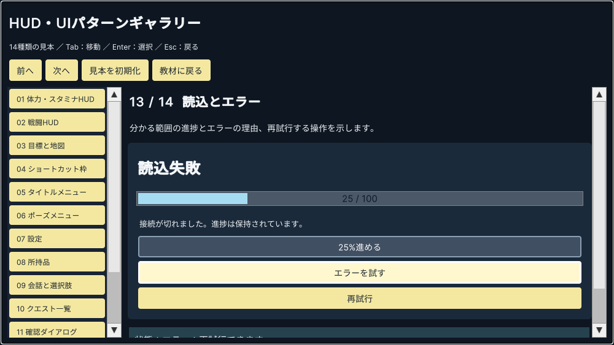

**14 通知・ツールチップ：** 鍵を拾うで通知を表示し、通知を閉じるで閉じます。  
通知は他の操作を止めません。  
Helpはマウスを重ねるかTabでフォーカスして説明を読めます。  
この例の通知は自動で消えません。

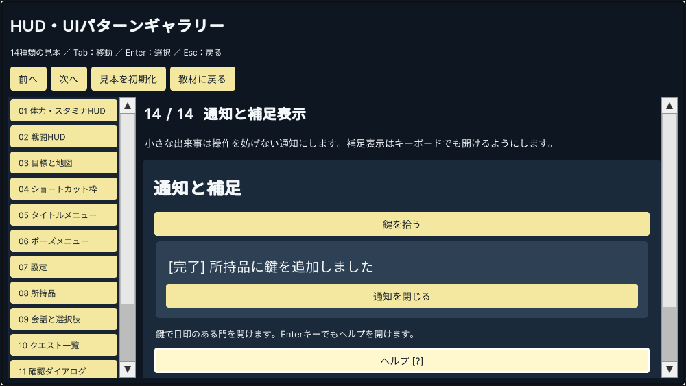

**制作して確認：** HUDと画面UIを1種類ずつ選び、誰が・いつ・何を判断する表示かを記録します。  
`Assets/UI/PatternGallery.uss` の該当クラスで余白または文字サイズを変更し、変更前後の実画面を撮ります。  
選択・無効・空・エラーのうち、その画面で起こる状態を操作し、フォーカス枠と戻る経路も確認して提出します。

**ヒント・構造：** `PatternGallery.uxml` は見出し・一覧・表示領域の枠、`PatternGallery.uss` は配置と見た目、`UIPatternGallery.cs` は14例の要素生成と動作です。  
実行時に生成する例の全体はPlayで確認します。  
設定・所持品・セーブ件数はサンプル内の一時データで、永続保存しません。  
uGUIで作り直す場合はU16のAnchor・Layout Group・Slider・Scroll Rect・Navigationと対応を考えます。

<a id="unity-19"></a>

#### U19 VFX Graph：粒子の流れを編集する

**ブラウザで実行：** [U19 開始を実行](../../../unity/webgl/index.html?unit=19&variant=start) · [U19 完成を実行](../../../unity/webgl/index.html?unit=19&variant=complete)

**依頼者・見る人：** 展示担当者・来場者。  
**困りごと：** 展示の開始を視覚的にも知らせたいです。  
**変更：** 配布された最小の粒子グラフを確認し、発生量を変えます。  
Shader Graphや高負荷な演出は扱いません。  
**完成条件：** Visual EffectにGraphが割り当てられ、Spawnの発生量を変えると粒子数の違いをSceneで確認できること。

**準備：** `19-VFXGraph.unity` を開きます。  
URPとVFX Graphを含む専用プロジェクトを使います。  
対応GPUがない場合は無理に進めず、環境と未確認の内容を記録します。  
対象はA Exhibit（青い立方体）です。  
V WelcomeParticles（明るい青緑の粒子）をEditorで確認します。

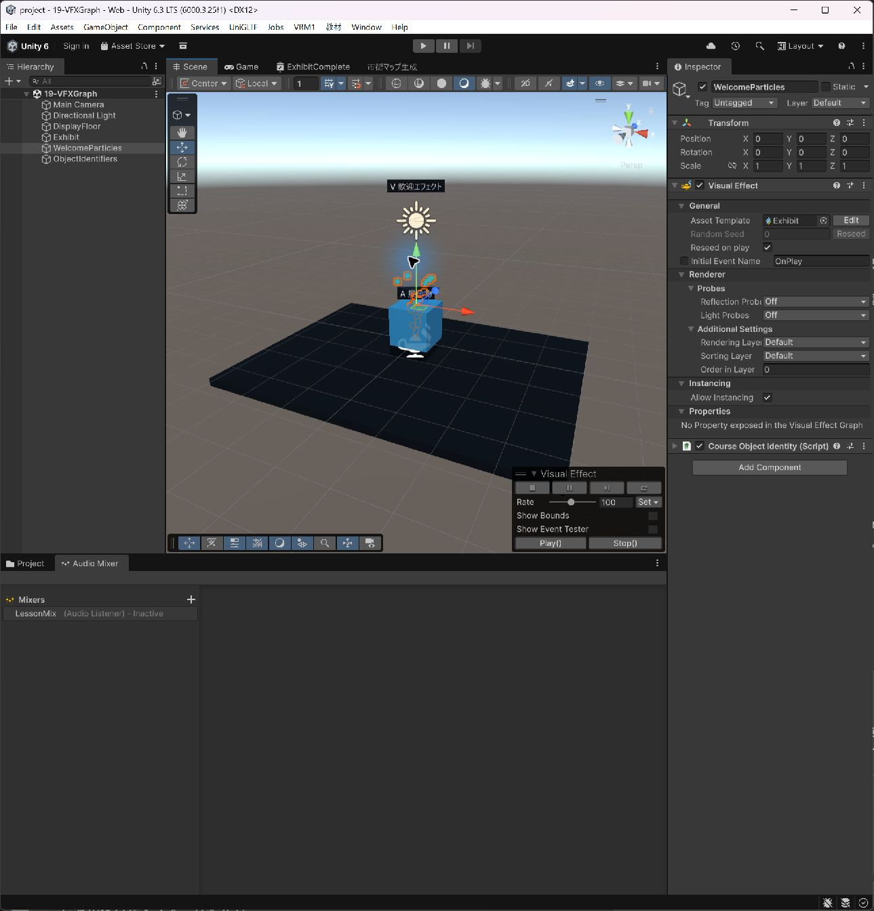

1. HierarchyでWelcomeParticlesを選び、Visual EffectコンポーネントのAsset TemplateにExhibitが設定されていることを確認します。
2. `Assets/Art/Exhibit.vfx` をダブルクリックしてVisual Effect Graphを開きます。
3. Spawn → Initialize → Update → Outputの接続をたどります。  
   SpawnのConstant Spawn Rateの値を調べ、元の値をメモして半分へ変えます。
4. Saveし、Sceneで粒子の発生を見比べます。  
   見えない場合はSceneのEffects表示、Visual Effectの有効状態、Bounds、対応GPU・パイプラインを順に確認します。


Spawnの見出しを選択し、ホイールで拡大すると発生量の入力欄を読めます。  
配布GraphはRateが64で、半分は32です。


**ヒント・用語：** Spawnは発生、Initializeは誕生時の状態、Updateは時間による更新、Outputは描画を扱います。  
Capacityは保持できる粒子数の上限で、発生数を無制限に増やしません。

**確認して報告：** 発生量の変更前後と、実際に粒子が見えたかを区別して記録します。

**サンプル：** [開始シーン](../../../unity/project/Assets/Scenes/19-VFXGraph.unity) · [完成サンプル](../../../unity/project/Assets/Scenes/Completed/19-VFXGraph.unity)。  
Projectで対応するファイルをダブルクリックして開き、手順と見比べます。


<a id="unity-20"></a>

#### U20 デバッグ：Consoleから原因を調べる

**ブラウザで実行：** [U20 開始を実行](../../../unity/webgl/index.html?unit=20&variant=start) · [U20 完成を実行](../../../unity/webgl/index.html?unit=20&variant=complete)

**依頼者・見る人：** 展示担当者・制作メンバー。  
**困りごと：** 動かない時に何を確認したか伝えられません。  
**変更：** 意図したログと警告を出して原因の場所を探します。  
無関係なエラーを消すためにコードを削除しません。  
**完成条件：** Consoleからログの発生元を開き、警告を出す設定を戻して、再実行で新たな警告が出ないことを確認できること。

**準備：** `20-Debug.unity` を開きます。  
対象はA Exhibit（青い立方体）です。


1. Window → General → Consoleを開き、Log、Warning、Errorのフィルターを確認します。
2. ExhibitのDebug ProbeでShow Warningを有効にしてPlayします。  
   Exhibit readyと確認 the exhibit labelを探します。
3. メッセージをクリックして詳細と呼出元を読み、ダブルクリックでDebugProbe.csの場所を開きます。
4. 停止し、Show Warningを無効にします。  
   ConsoleのClearで過去ログを消して再実行します。  
   readyだけが出ることを確認して保存します。


**ヒント・用語：** Clearは表示中の履歴を消す操作です。  
原因の修正とは別です。  
赤いコンパイルエラーが残る時はPlayの前に先頭のエラーから直します。

**確認して報告：** 再現操作、ログの原文、発生箇所、修正後の結果を短く書きます。

**サンプル：** [開始シーン](../../../unity/project/Assets/Scenes/20-Debug.unity) · [完成サンプル](../../../unity/project/Assets/Scenes/Completed/20-Debug.unity)。  
Projectで対応するファイルをダブルクリックして開き、手順と見比べます。


<a id="unity-21"></a>

#### U21 ビルド：Editorの外で展示を起動する

**ブラウザで実行：** [U21 開始を実行](../../../unity/webgl/index.html?unit=21&variant=start) · [U21 完成を実行](../../../unity/webgl/index.html?unit=21&variant=complete)

**依頼者・見る人：** 展示担当者・別のPCの来場者。  
**困りごと：** Editorを開ける人しか展示を確認できません。  
**変更：** Windows向けの実行ファイルをローカルに作ります。  
Web公開・ストア提出・アップロードはしません。  
**完成条件：** Build Profilesのシーン一覧を確認し、Windowsビルドを作り、Editorの外で起動して表示を確認し、終了できること。

**準備：** `21-Build.unity` を開き、保存します。  
必要なWindows Build SupportがなければUnity Hubの対象EditorのAdd modulesで講師と確認します。  
対象はA Exhibit（青い立方体）です。


1. File → Build Profilesを開きます。  
   WindowsのプロファイルまたはWindowsプラットフォームを選びます。
2. Scene Listに `Assets/Scenes/21-Build.unity` が有効な状態で含まれ、先頭にあることを確認します。  
   違うシーンなら必要なシーンだけを一覧へ追加します。
3. Buildを押し、プロジェクト内の `Builds/Windows` を保存先に指定します。  
   完了後、生成されたexeと隣のDataフォルダーを一緒に扱います。
4. exeを起動し、Gameと同じ展示が見えることを確認してAlt+F4で終了します。  
   EditorのPlay成功とビルド成功、実行ファイルの起動成功は別々に記録します。


**ヒント・用語：** プロジェクトは編集用、ビルドは実行用です。  
exeだけをコピーすると必要なデータが欠けます。  
OSごとのビルド支援モジュールも必要です。

**確認して報告：** この単元では共通提出物に加え、ビルド一式、対象OS、実行結果と終了確認を提出します。  
ビルドや起動を実施できなかった場合は未確認とし、エラーまたは不足モジュールを記録します。

**サンプル：** [開始シーン](../../../unity/project/Assets/Scenes/21-Build.unity) · [完成サンプル](../../../unity/project/Assets/Scenes/Completed/21-Build.unity)。  
Projectで対応するファイルをダブルクリックして開き、手順と見比べます。


<a id="unity-22"></a>

#### U22 Unity CLI：同じ手順で教材を検査する

**ブラウザで実行：** [U22 開始を実行](../../../unity/webgl/index.html?unit=22&variant=start) · [U22 完成を実行](../../../unity/webgl/index.html?unit=22&variant=complete)

**依頼者・見る人：** 展示担当者・教材を配布する制作者。  
**困りごと：** 手作業だけではシーンや参照の欠落を見落とします。  
**変更：** Unity CLIから専用プロジェクトの検査を呼び出し、結果を残します。  
配信やパッケージ追加は行いません。  
**完成条件：** CLIとEditorのバージョンを区別し、検査の終了コード0、収録した開始・完成シーン全件のPASSを確認して、検査できない項目も説明できること。

**準備：** 専用プロジェクト、Windows上のPowerShell 7、公式Unity CLIを用意します。  
撮影環境はCLI `1.0.0-beta.8`、Editor `6000.3.25f1` です。  
CLIが見つからない場合は[公式手順](https://docs.unity.com/en-us/unity-cli/use-unity-cli)で導入し、新しいPowerShellを開きます。  
Unity Hubで指定Editorが利用可能な状態にします。  
対象はA Exhibit（青い立方体）です。

1. エクスプローラーで教材リポジトリのルートを開き、右クリックの「ターミナルで開く」でPowerShellを開きます。  
   `unity --version` と `unity editors --installed --format json` を実行します。  
   前者はCLI、後者はインストール済みEditorの一覧です。  
   指定Editorがなければ講師へ確認します。
2. `pwsh -NoProfile -File .\unity\scripts\Invoke-CourseCli.ps1 -Action Inspect` を実行します。  
   `unity/evidence/22-cli-inspect.txt` をVS CodeのFile → Open Fileで開き、バージョンと末尾の `RESULT: PASS` を確認します。


3. Unity Editorでシーンを保存し、教材用Editorを閉じます。  
   `pwsh -NoProfile -File .\unity\scripts\Invoke-CourseCli.ps1 -Action Verify` を実行し、検査終了まで待ちます。  
   開いている教材Editorを検出すると停止するため、保存・終了して再実行します。
4. 実行直後に `$LASTEXITCODE` を確認します。  
   0以外なら表示された理由と `unity/evidence/22-cli-editor.log` を調べます。  
   スクリプトは `unity run` に `-executeMethod LessonSamples.Verify` を渡します。  
   `-quit` と `-batchmode` はUnity CLIが管理するため追加しません。
5. `unity/evidence/22-cli-verify.txt` をVS Codeで開き、`CLI exit code: 0`、`startScenes:28`、`completedScenes:28`、`status:PASS`、末尾の `RESULT: PASS` を照合します。  
   画面は実行済みコマンドの出力ログです。


6. Unity Hubから教材を開き直し、`Assets/Scenes/22-UnityCLI.unity` を開きます。  
   CLIは、このプロジェクトのEditor処理を呼び出していることを確認します。

**サンプル：** [開始シーン](../../../unity/project/Assets/Scenes/22-UnityCLI.unity) · [完成サンプル](../../../unity/project/Assets/Scenes/Completed/22-UnityCLI.unity)。  
この単元はシーンの見た目を変更せず、検査ログを成果物にします。


**ヒント・用語：** CLIの `unity.exe` とEditorの `Unity.exe` は別のプログラムです。  
`run` はプロジェクトに指定されたEditorを呼び出します。  
この検査はシーンの存在、Missing Script、Camera、Timelineの接続、UIとVFXの参照を調べます。  
見た目、キー長押し、音の聴取はPlayで別途確認します。  
PASSだけで全課題の合格にはしません。  
CLIはベータ版なので、環境が異なる場合は `unity --help` と公式資料で構文を照合します。

**確認して報告：** CLIとEditorのバージョン、実行コマンド、終了コード、ログ、実画面1枚、手動確認の残件を共通の3行メモへまとめます。  
ログは `unity/evidence`、検査レポートはプロジェクト直下に保存されます。  
認証情報は提出しません。


<a id="unity-23"></a>

#### U23 Shader Graph：ノードで展示物の色を指定する

**ブラウザで実行：** [U23 開始を実行](../../../unity/webgl/index.html?unit=23&variant=start) · [U23 完成を実行](../../../unity/webgl/index.html?unit=23&variant=complete)

**依頼者・見る人：** 展示担当者・展示を調整する制作者。  
**困りごと：** 色を決める仕組みと、物体へ適用する材質の関係が分かりません。  
**変更：** Shader GraphのColorプロパティをFragmentのBase Colorへつなぎ、Materialから展示物を橙へ変更します。  
位置、床、照明、ほかの単元の材質は変えません。  
**完成条件：** 色プロパティからBase Colorへの接続、Materialへの適用、Gameの橙色の表示を確認し、Shader・Material・Rendererの役割を説明できること。

**準備：** `Assets/Scenes/23-ShaderGraph.unity` を開き、作業用の別名で保存します。  
A Exhibitは青い立方体、F DisplayFloorは黒に近い紺の床です。  
URPとShader Graph 17.3が導入された専用プロジェクトを使います。  
完成見本は `Assets/Scenes/Completed/23-ShaderGraph.unity` です。


1. Projectの `Assets/LessonSamples/ShaderGraph/ExhibitStart.shadergraph` を複製して `StudentExhibit.shadergraph` とし、ダブルクリックでShader Graphを開きます。  
   元の開始・完成見本は編集しません。
2. Blackboardの **Exhibit Color** と、同名のPropertyノードを確認します。  
   見えないときはBlackboardを表示し、プロパティをグラフ上へドラッグします。  
   Propertyノード右側の出力から、Fragmentの **Base Color** 左側の入力へドラッグして接続します。  
   Save Assetで保存します。


3. ProjectでMaterialを作成し、InspectorのShaderへ自分のグラフを設定します。  
   グラフのShaderメニューは `Course/StudentExhibit` です。  
   名前が異なる場合は作成したグラフ名を選びます。
4. Materialの **Exhibit Color** を橙 `#C67B00` に設定し、Hierarchyの **Exhibit** へドラッグして適用します。  
   床へ適用しないでください。  
   開始シーンにあった青い表示と比べます。  
   ExhibitのCourse Object IdentityのColor Hexも `#C67B00`、Color Nameを `橙` に更新し、凡例と材質を一致させます。
5. Playして、A Exhibitが橙で表示されることを確認します。  
   物体名のA Exhibitと右下の凡例も照合します。  
   StopしてシーンとMaterialを保存します。


**ヒント：** Shader Graphは描画の計算をノードで組み立てます。  
MaterialはそのShaderと色などの値を保持し、RendererがMaterialを使って物体を描きます。  
今回は照明の影響を受けないUnlitなので、U10のLit材質とは陰影が異なります。  
Graph編集はEditorで行い、WebGLでは実行結果を確認します。  
Colorの設定値は材質と補助凡例の両方で合わせます。

**確認して報告：** 接続したノード名、適用したMaterial名、設定した色、SceneとGameで確認した結果を記録します。  
グラフの接続とGame画面を各1枚添え、保存して開き直しても結果が残ることを説明します。  
WebGLの完成見本を見ただけで、自分のグラフの接続確認を済ませた扱いにはしません。

<a id="unity-24"></a>

#### U24 ゲームループ・共有プレイデータ・セーブ管理

**ブラウザで実行：** [U24 開始を実行](../../../unity/webgl/index.html?unit=24&variant=start) · [U24 完成を実行](../../../unity/webgl/index.html?unit=24&variant=complete)

**依頼者・見る人：** 展示担当者・繰り返しゲームを遊ぶ来場者。  
**困りごと：** シーンを読み直すと得点が消え、再挑戦とアプリ再起動でも同じデータを残そうとして管理が混乱しています。  
**変更：** タイトル→プレイ→結果→再挑戦の状態遷移を作り、シーンをまたぐ今回のプレイ状態と、次回起動へ残す記録を分けます。  
**完成条件：** 完成例で得点2のままシーンを読み直せること、Rootが1個であること、再挑戦で今回の得点だけ0になること、保存完了後のアプリ再起動で今回得点0・最高得点3以上になること、保存失敗・破損・旧形式・未知の新形式の扱いを説明できること。

**準備：** `Assets/Scenes/24-GameLoop.unity` を作業用の別名で保存します。  
完成見本は `Assets/Scenes/Completed/24-GameLoop.unity` です。  
A Exhibitは青い立方体、F DisplayFloorは黒に近い紺の床です。  
UIのボタンは英語表示です。  
U04・U07・U18・U22を先に確認します。  
この単元は配布コードの責任と寿命をたどる90〜120分の演習で、全コードの書写は求めません。


**先に決めるデータの寿命**

- **設定：CourseGameRules（SO）。**  
  `Assets/LessonSamples/CourseGameRules.asset` は目標点3を保存するScriptableObjectです。  
  シーン間で同じ設定アセットを参照します。  
  実行中の得点を書き込む場所にはしません。  
  SOはGameObjectへ付けるComponentではありません。
- **今回のプレイ：CoursePlaySession。**  
  状態、今回得点、未保存の結果件数を持つ通常のC#オブジェクトです。  
  再挑戦で今回得点を0にし、アプリを終了すると失われます。
- **次回へ残す記録：CourseSaveData。**  
  `version`、`bestScore`、`completedRuns` だけをJSONへ保存します。  
  シーン内のGameObject・UI・Transformの参照は含めません。  
  再挑戦しても保存済み最高得点は消しません。

**Unityの更新ループとゲームの進行を分ける**

UnityがPlayer loopを動かし、MonoBehaviourのAwake、OnEnable、Start、Update、FixedUpdate、LateUpdateなどを呼びます。  
自分で終了しない `while` を回してフレームを作らないでください。  
毎フレームの処理はUpdate、物理更新と歩調を合わせる処理はFixedUpdate、追従カメラなどはLateUpdateへ配置します。  
FixedUpdateは表示1フレームに0回または複数回の場合もあります。  
ほかのGameObjectのAwakeとの実行順を当てにして初期化しません。

これとは別に、ゲームの進行を **Title → Playing → Result → Playing** と定義します。  
サンプルではボタンのイベントから `StartRun`、`Collect`、`Finish`、`Retry` を呼びます。  
Playing以外の加点や、3点未満の結果確定を状態の側で拒否します。  
ファイル保存をUpdateから毎フレーム呼びません。

1. 開始シーンをPlayし、**開始 → +1を2回 → シーンを再読込** の順に操作します。  
   今回得点が0、状態が「タイトル」へ戻ることを確認します。  
   開始例は `keepAcrossSceneReload` が無効で、シーンの表示を作るたびに今回のセッションを作り直します。  
   セーブした記録の消去ではありません。
2. Stopし、作業用シーンのHierarchyで **ExhibitUI** を選びます。  
   Course Game Lessonの **シーン再読込後も保持** を有効にして保存します。  
   「ゲームルール」には配布のCourseGameRulesアセットを割り当てます。  
   完成見本でも同じ割当を確認できます。
3. Playして、「タイトル」の今回得点0を確認します。  
   **開始** で「プレイ中」になり、**+1** を2回押すと今回得点2になります。  
   3点になる前は「結果と保存」ボタンが無効です。


**シーンをまたぐ保持の組み方**

[CourseSessionRoot.cs](../../../unity/project/Assets/Scripts/CourseSessionRoot.cs) の `Ensure` が実行中の所有者を1個だけ用意します。  
Awakeで重複を拒否し、ルートGameObjectへ `DontDestroyOnLoad` を使います。  
`Instance` は所有者への入口で、得点そのものをどのスクリプトからでも書けるstatic変数にはしません。  
値は読み取り用プロパティで公開し、変更はStartRunなどの操作を通します。  
static参照はSubsystemRegistrationで初期化し、OnDestroyでも自身の参照を解除します。  
Domain Reloadを省略するEditor設定でも、前回Playのstatic値を持ち越さないためです。

[CourseGameLesson.cs](../../../unity/project/Assets/Scripts/CourseGameLesson.cs) はOnEnableで所有者を取得し、変更通知を購読し、OnDisableで解除します。  
シーンのUIやPlayerへの参照はシーン側が持ちます。  
永続Rootに破棄済みUIの参照を残さず、読み直したシーンが同じプレイ状態へ接続し直します。  
これは小規模サンプルの構成例です。  
Unityが唯一のGameManager構成を指定しているわけではなく、規模に応じてBootstrapシーンや明示的な依存注入も選べます。

4. 得点2の状態で **シーンを再読込** を押します。  
   **画面ID** の番号が変わり、今回得点2・「プレイ中」・**管理元：1個** が維持されることを確認します。  
   番号は表示側のインスタンスIDで、保存データには含めません。  
   同じシーンを実際に破棄・再生成していることを比べるための補助表示です。
5. **+1 → 結果と保存** と進めます。  
   「結果」になり、**保存状態：保存済み（形式2）**、保存済み最高得点3、保存済み完了件数の増加を確認します。  
   同期中は操作を待ちます。  
   保存済み記録がすでにある場合、最高得点は既存値と比較した大きい方です。


**セーブファイルの責任と失敗時の扱い**

[CourseSaveStore.cs](../../../unity/project/Assets/Scripts/CourseSaveStore.cs) は、UIやシーンに依存しない読み書き処理です。  
`Application.persistentDataPath` の下の `EduCourseLoop/save.json` を使います。  
AssetsやResourcesは配布するアセットの場所で、プレイ記録の保存先にはしません。  
JsonUtilityではSerializableな型の対応するフィールドを保存し、任意のDictionaryなどをそのまま扱えるとは考えません。

- **保存：** データを検証し、同じフォルダーの `.tmp` へ書き、読み直して検証します。  
  既存の正常な記録を `.bak` へ残してから本体を置き換えます。  
  最初の保存には以前の記録がないため、バックアップは次の保存から作られます。  
  WindowsではFile.Replace、WebGLではメモリー上の仮想ファイルを更新し、その後IndexedDBへ同期します。  
  全環境・電源断で同じ原子性を保証する実装ではありません。
- **読み込み：** ファイルがなければ新規記録にします。  
  本体が壊れていて正常なバックアップがあれば回復します。  
  両方が読めない既存記録を、黙って0点で上書きしません。  
  復元するまで書き込みを止め、画面へ理由を表示します。
- **バージョン：** 現行はv2です。  
  v1の `highScore` はメモリー上で `bestScore` へ変換します。  
  読み込みだけでは旧ファイルを変更せず、次の保存でv2を書きます。  
  v99など未知の新しい形式は上書き禁止にします。  
  古いバックアップへ黙って戻して新しい記録を失わせません。
- **保存タイミング：** 結果確定をチェックポイントにして保存し、アプリの一時停止時には未保存の結果を保存します。  
  終了通知だけに依存しません。  
  再保存しても完了件数が二重に増えないよう、保存成功後に未保存件数を消費します。
- **保存完了：** Windowsの書き込み成功と、ブラウザの非同期保存完了を区別します。  
  WebGLはFS.syncfsの完了コールバック後に「保存済み」を表示します。  
  再読み込みも確認してください。  
  ブラウザのサイトデータ削除、プライベートモード、容量制限などで記録が失われる・保存できない場合があります。  
  PlayerPrefsは小さな設定値向けで、暗号化や改ざん防止の仕組みではありません。  
  このJSONも改ざん対策やクラウド同期は扱いません。  
  サンプルの対象は1プロセス・1スロットで、複数起動の排他や複数スロットはU37の発展内容です。


6. **保存** をもう一度押し、完了件数が二重に増えないことを確認します。  
   **再試行** でPLAYING・今回得点0になっても、保存済み最高得点は残ります。


7. EditorではStopして再びPlay、ブラウザでは同じURLを再読み込みします。  
   TITLE・今回得点0・保存済み最高得点3以上を確認します。  
   **新しいセッション** は今回のセッションを捨てて保存済み記録を読み直す操作で、セーブファイル削除ではありません。  
   未保存の結果がある場合は失われます。
8. Editorを保存して閉じ、PowerShellで `unity run unity/project --timeout 180 -- -executeMethod GameLoopLesson.SaveTests -logFile <絶対パスの検査ログ>` を実行します。  
   `<絶対パスの検査ログ>` は自分の保存先へ置き換えます。  
   終了コード0と `unity/evidence/24-loop-save-tests.json` のPASSを確認します。  
   検査は新規作成した一時フォルダーだけを使い、正常往復・破損回復・移行・未来版の保護・書き込み失敗を試します。  
   自分の実セーブを壊す必要はありません。


**確認して報告：** 状態遷移、設定・今回の状態・永続記録それぞれの所有者と寿命、シーン読み直し前後の得点とRoot数、再起動前後の値、保存成功・失敗の判定、移行とバックアップの検査結果を記録します。  
画面で確認したことと、機械検査だけで確認したことを区別してください。

<a id="unity-25"></a>
#### U25 複数のバージョン管理手法

**ブラウザで実行：** [U25 開始を実行](../../../unity/webgl/index.html?unit=25&variant=start) · [U25 完成を実行](../../../unity/webgl/index.html?unit=25&variant=complete)

**依頼者・見る人：** 展示制作の担当者から、プログラマーとアセット制作者が変更を戻せる制作環境を依頼されました。  
**困りごと：** 「完成版2」「最終版」のコピーでは、どの変更を採用したか分かりません。  
**変更：** 管理方式を比較し、ローカルの共有リポジトリと2人分の作業コピーで、履歴・差分・GUID・大きなファイルの受け渡しを確認します。  
**完成条件：** Gitの履歴とLFSの実体を別の作業コピーで確認し、metaを維持できること、チームに選ぶ方式と理由を説明できます。  
外部アカウント作成・送信・既存リポジトリの変更は対象外です。

**準備：** U07・U22を確認します。  
Unityの配置演習は `Assets/Scenes/25-VersionControl.unity` を別名保存して使います。  
完成見本は `Assets/Scenes/Completed/25-VersionControl.unity` です。  
青のAと淡い紫のDは別の共有Prefabです。  
WebGLは配置見本の比較用で、Gitやクラウドを実行しません。  
Git演習にはGit、Git LFS、Python、VS Codeが必要です。  
教材ルートのPowerShellを使います。

**方式を選ぶヒント：** 以下は導入候補の比較です。  
アカウント・サーバーの設定操作はこの演習では行いません。

- **Git：** 各作業コピーが履歴を持ち、ローカルでコミット・分岐できます。  
  コードやテキスト設定を小さくレビューして統合する制作に向きます。  
  GitHub・GitLab等は共有先のサービスであり、Gitそのものとは分けます。
- **Git＋Git LFS：** PSD・動画等の大きなバイナリはGit内のポインターとLFS側の実体に分けます。  
  履歴を小さくできますが、複製先にはLFSの実体も必要です。  
  LFSだけでバイナリをマージ可能にはしません。  
  ロックは対応するLFSサーバーと運用規則が必要で、今回のローカル演習では未検証です。
- **Unity Version Control（UVCS）：** changeset、branch、workspaceで制作を管理します。  
  アセット中心の制作やロック運用も候補になります。  
  作業対象を絞るGluonと通常のワークスペースの使い分け、ロック取得・解除の担当、サーバー／プランを導入前に確認します。  
  この教材の実機演習はGitを使用し、UVCSクラウドの接続・ロックは実行していません。
- **Perforce／SVN：** 共有サーバーを中心にする運用の候補です。  
  Perforceのチェックアウト・排他管理、SVNの履歴・ロック等を、既存チームの資産や必要なツールと比較します。  
  製品ごとのセットアップは対象外です。
- **ZIP・同期ドライブ：** 区切りごとの配布やバックアップに使えます。  
  誰の変更をどこへ統合したかという履歴や競合解決は別に必要です。  
  開いたUnityプロジェクトを複数人で同じ同期フォルダーから編集する運用は避け、各自の作業コピーを持ちます。

**作業手順：**

1. 配布プロジェクトの `Project Settings > Version Control` が **Visible Meta Files**、`Editor > Asset Serialization` が **Force Text** になっていることを確認します。  
   Gitへ渡す基本は `Assets` とmeta、`Packages/manifest.json`・`packages-lock.json`、`ProjectSettings` です。  
   `Library`・`Temp`・`Logs`・`UserSettings` は作業環境ごとの生成物として除外します。  
   公開しない認証情報は含めません。
2. `python unity/scripts/collaboration_lab.py create` を実行します。  
   毎回別名の `test-results/unity-team-…` が作られます。  
   表示された `root` が自分の演習先です。  
   教材本体のGit履歴・index・remoteには触れません。  
   `origin.git` は共有先、`alice` と `bob` は独立した作業コピーです。  
   これはUnityアセットの最小Git演習で、Unityで開く完全なプロジェクトではありません。
3. VS Codeの **ファイル > フォルダーを開く** で演習先の `alice` を開き、左のソース管理を選びます。  
   グラフにBaseline・Alice・Bobの履歴があること、同じSOを変更したため **Merge Changes** が1件あることを確認します。  
   U27で解決するため、ここでは保留します。


4. `alice` のターミナルで `git log --oneline --graph --all`、`git diff --name-only --diff-filter=U` を実行し、ブランチと競合ファイルを確認します。  
   `git show HEAD:Assets/palette.bin` ではLFSのポインター、`git lfs ls-files` では追跡対象を確認します。  
   `bob/Assets/palette.bin` には実データが届いています。  
   LFSを使う形式は `git lfs track` で登録し、生成された `.gitattributes` も共有します。
5. Unityへ戻り、完成見本でAとDを選びます。  
   InspectorのPrefab参照から `Assets/LessonSamples/TeamSharing` の元Prefabを確認します。  
   アセット名の変更・移動はProjectウィンドウで行い、対応するmetaも一緒に共有します。  
   metaを消して作り直すとGUIDが変わり、参照先を失う場合があります。


**確認して報告：** 制作人数、扱うバイナリの量、レビュー担当、ロックの要否を挙げ、Git・Git LFS・UVCS等から選ぶ理由を書きます。  
ローカルで確認した操作と、接続していないサービスの比較説明を区別してください。  
Gitの共有先だけでなくLFSの実体も復元できるかはU27で確認します。

<a id="unity-26"></a>
#### U26 複数のデータ共有手法

**ブラウザで実行：** [U26 開始を実行](../../../unity/webgl/index.html?unit=26&variant=start) · [U26 完成を実行](../../../unity/webgl/index.html?unit=26&variant=complete)

**依頼者・見る人：** 展示制作の担当者から、別チームにも同じ展示Prefabを渡したいと依頼されました。  
**困りごと：** Prefabだけコピーすると材質やスクリプトを失い、各チームで別物になります。  
**変更：** 依存関係と版を含めて共有し、受け取り側で参照を確認します。  
**完成条件：** unitypackageとローカルUPMの違いを説明し、別プロジェクトで共有Prefab・材質・識別子が揃うことを確認できます。  
**準備：** U07・U22・U25を確認します。  
`Assets/Scenes/26-DataSharing.unity` を別名保存して使い、完成見本は `Assets/Scenes/Completed/26-DataSharing.unity` です。  
WebGLでは受け取り後のA・Dの配置を比較します。  
ブラウザからパッケージはインポートしません。

**共有先によって方式を選ぶ：**

- **同じゲームのソース共有：** Git／UVCSでプロジェクトの必要なファイルをまとめて渡します。  
  Editor版、パッケージの版、GUIDを揃えます。  
  チームメンバーには各自の作業コピーを用意します。
- **unitypackage：** 選択したアセットをmeta・依存アセットとまとめて渡す単発の配布に使います。  
  受け手のAssetsへ取り込まれるため、継続的な版更新・依存パッケージの管理は受け手の確認が必要です。  
  同じGUIDを持つアセットの上書き対象をImport画面で確認します。
- **UPM：** `package.json` の名前・版・依存関係を持つ再利用単位にします。  
  ディスク上のフォルダー、tgz、Git URL、scoped registry等から導入できます。  
  Git URLではcommitやtagを指定して採用版を固定し、依存関係の変更をレビューします。  
  ローカルの絶対パスは他のPCへそのまま渡せないため、配布先で置き直すか共有可能な供給先を決めます。
- **AssetBundle／Addressables：** ビルド済みアセットを実行中のプレイヤーへ届ける用途です。  
  開発用ソースの共同編集とは別です。  
  Addressablesはアドレス・依存・カタログ・ロードと解放を管理し、配信先は別に用意します。  
  遠隔配信と版の互換性は予定単元で扱います。
- **共有ストレージ・ZIP：** 編集元のPSD・動画、書き出したビルド等を渡す用途に使えます。  
  担当者、版、ライセンス、チェックサムを添えます。  
  Git LFSを使う場合もポインターだけ渡して終了せず、実体の取得を確認します。
- **プレイデータの共有：** SO・static・DontDestroyOnLoadは別PCへの同期手段ではありません。  
  プレイヤー間の同期やクラウドセーブには、サーバー側の認証・保存・競合規則が必要です。  
  ローカル保存はU24、ネットワーク同期は予定単元で区別します。

**作業手順：**

1. UnityのProjectで `Assets/LessonSamples/TeamSharing` を開き、Aの **Exhibit** とDの **ExhibitRight** のPrefab、それぞれのMaterialを確認します。  
   共通スクリプトは `Assets/Scripts/CourseObjectIdentity.cs` です。  
   共有元を複製してから変更し、他単元で使うPrefabを直接書き換えません。


2. 共有フォルダーと共通スクリプトを選択し、**Assets > Export Package** を開きます。  
   依存対象を確認して書き出します。  
   受け手にも同じURPパッケージが必要です。  
   自動検査では、Editorを閉じて `unity run unity/project --timeout 180 -- -executeMethod CollaborationLesson.ExportShared -logFile "<絶対パスのログ>"` を実行すると `test-results/TeamSharing.unitypackage` を再生成できます。
3. 教材ルートで `python unity/scripts/sharing_lab.py` を実行します。  
   表示された新しい演習先にUPM用tgz、`unitypackage` と `upm` の2つの検査用プロジェクトができます。  
   UPMは `Runtime` にasmdefとそのmeta、同じPrefab・材質・スクリプトとmetaを収め、`package.json` に `jp.edu.team-sharing`、版 `1.0.0`、URPの依存版を記載しています。  
   教材では `hideInEditor: false` としてProjectから部品を選べるようにしています。  
   アーカイブのバイト照合に失敗したら先へ進まず、再書き出しします。
4. 受け取り側では **どちらか一方式** を選びます。  
   unitypackageはURPを入れた別プロジェクトで **Assets > Import Package > Custom Package** から取り込みます。  
   UPMは別プロジェクトのPackage Managerで **Install package from tarball** から生成tgzを選びます。  
   サンプルの `upm` 検査用プロジェクトはmanifestでこのローカルtgzを指定済みです。  
   同じGUIDの二重配置を避けるため、両方式を同じプロジェクトに同時導入しません。
5. 受け取り側はURPのプロジェクトを使い、Graphics／QualityでURP Assetが有効かも確認します。  
   検査用プロジェクトでは **Course > Inspect shared prefabs** でURPを設定し、A・Dを配置して `SharedImportPreview` を保存し、Prefabを選択できます。  
   Projectの一覧が空でもこのメニューから参照と描画を確認できます。  
   新規プロジェクトでAとDをシーンへ配置します。  
   Missing Scriptやピンクの材質がなく、名前・青／淡い紫・材質の参照が揃うことを確認します。  
   自動確認は、各検査用プロジェクトを閉じて `unity run "<検査用プロジェクト>" --timeout 600 -- -executeMethod SharingImportVerify.Run -logFile "<絶対パスのログ>"` を実行し、`sharing-import-report.json` のPASSを確認します。  
   unitypackage検査用への初回インポートは手順4のGUIで行います。  
   自動で開いて取り込む場合は `unity open "<検査用プロジェクト>" --args '-executeMethod SharingImportVerify.Import'` とし、インポートが終わるまでEditorを開いたまま待ちます。


6. 教材の完成シーンで、AとDが共有Prefabのインスタンスであることを確認します。  
   継続配布では採用版・更新内容・戻す版を記録し、受け手のプロジェクトで再インポート・動作確認してから更新します。

**確認して報告：** 共有物がソース・再利用部品・実行用コンテンツ・プレイデータのどれかを示し、方式、版、依存関係、受け取り側での確認結果を提出します。  
UPMとunitypackageの新規プロジェクトへの導入は検査済みです。  
Git URL／registry・遠隔Addressables・クラウドセーブの実接続は本演習の対象外です。

<a id="unity-27"></a>
#### U27 複数人での開発と統合

**ブラウザで実行：** [U27 開始を実行](../../../unity/webgl/index.html?unit=27&variant=start) · [U27 完成を実行](../../../unity/webgl/index.html?unit=27&variant=complete)

**依頼者・見る人：** 展示制作の担当者から、2人の変更を1つの動く展示にまとめたいと依頼されました。  
**困りごと：** 同じ設定・シーンを同時に変えると、上書きや競合が起きます。  
**変更：** 担当・統合担当・完成条件を決め、小さな変更をレビューして統合し、別の作業コピーから復元します。  
**完成条件：** SOの実競合を合意した値5へ解決し、両者のレビュー記録・metaのGUID・LFS実体を残して新しいcloneで確認できます。  
UnityではA・DのPrefabを別担当に分けた配置を完成させます。  
**準備：** U07・U24〜U26を確認します。  
配置演習は `Assets/Scenes/27-TeamDevelopment.unity` の別名保存、完成見本は `Assets/Scenes/Completed/27-TeamDevelopment.unity` です。  
Git演習はU25で作った演習先を使い、単独で始める場合は `collaboration_lab.py create` で新しいものを作ります。  
数値設定のGit演習とUnityの配置演習は別の確認です。

**開発フローを選ぶヒント：**

- **短命のブランチ＋レビュー：** mainから作業ごとに分岐し、差分・確認結果を添えてレビュー後に統合します。  
  共有サービスではPull Request／Merge Requestを使えます。  
  教材ではローカルのレビュー記録を使い、実サービスへのPR送信はしません。
- **トランクベース開発：** mainへ小さく頻繁に統合します。  
  テストが速く、未完成機能を隠す仕組みがあるチーム向けです。  
  長期間別々に作り続けるのを避けます。  
  コードレビューの有無とは別の選択です。
- **Git Flow等の長命ブランチ：** develop・release・hotfix等を分ける運用は、複数の保守版や出荷準備を並行する場合の候補です。  
  小規模展示では統合・バックポートの負担も比較します。  
  ブランチを増やすこと自体を目的にしません。
- **ロックを使う制作：** マージしにくいPSD・音声・大きなシーン等は、UVCS／Perforce／対応LFSサーバー等で担当とロックを調整します。  
  取得前の最新版確認、解除担当、不在時の扱いを決めます。  
  ロックで参照破損や完成品質まで保証されるわけではありません。

**作業手順：**

1. 役割を先に決めます。  
   AliceはAのPrefab、BobはDのPrefab、統合担当はシーン配置を持ちます。  
   共通のSO・マテリアル・Input Actions・ProjectSettingsは変更前に相談します。  
   Prefab、担当別のAdditiveシーン、asmdefやパッケージへの分割で同じファイルを触る範囲を減らせます。  
   UnityのEditor版とパッケージ版を固定します。
2. `alice` をVS Codeで開き、`Assets/LessonSamples/CourseGameRules.asset` の競合を読みます。  
   現在側は4、取り込み側は5です。  
   両方を採用して同じプロパティを2行にせず、依頼者と合意した **5** を1つ残す方針にします。  
   `m_Script`、fileID、metaのGUIDは変更しません。  
   競合マーカーが残ったままUnityで編集・保存しません。


3. VS Codeで取り込み側を採用し、保存→差分確認→ステージ→マージコミットの順に進められます。  
   再現用スクリプトでは **手動操作とどちらか一方** を選び、`python unity/scripts/collaboration_lab.py resolve --root "<自分の演習先>"` を実行します。  
   このコマンドは合意した5で解決し、両者の記録を残してローカル共有先へ反映し、新しいcloneも検査します。  
   既に解決済みの演習へ再実行すると拒否します。


4. 出力されたPASSと演習先の `report.json` を確認します。  
   別名の `restored-…` に、設定値5、両者のレビュー記録、元のmeta、LFSの元バイト列が復元されています。  
   手動で解決した場合はローカル共有先へpushしてから `python unity/scripts/collaboration_lab.py check --root "<自分の演習先>"` で同じ確認ができます。  
   `git status` に未処理の変更がないことを確認します。
5. Scene／Prefabの競合は、UnityYAMLMerge（Smart Merge）を使う候補があります。  
   Unity Editorの同梱ツールをGitのmerge driver等に設定します。  
   通常のテキスト置換でfileIDを作り直したり、常に片側の全ファイルを採用したりしません。  
   自動マージ後もEditorで参照・配置・実行結果を確認します。  
   この演習のSO競合は合意値の手動相当解決で、UnityYAMLMergeの自動成功を検証したものではありません。
6. 配置演習では、開始シーンの重なったA・Dを確認します。  
   Prefab内部の変更は各担当、シーンのインスタンス配置は統合担当に分け、AをX=-1.4、DをX=1.4、両方Y=0.5へ置きます。  
   完成見本のように名前ラベル・色・明るさで別々に識別できることをPlayで確認します。


7. レビューには依頼、変更範囲、動作確認、残件、元へ戻す方法を添えます。  
   共有済み履歴の取り消しは打ち消しコミットを基本にし、他人が参照する履歴を無断で強制更新しません。  
   CIではコンパイル・テスト・ビルドを検査し、統合後のUnity上の確認も担当を決めます。  
   教材自体の更新は既存のWebGL更新タスクで全シーンを再ビルドします。

**確認して報告：** 採用した開発フロー、担当ファイル、統合担当、競合の合意内容、復元した作業コピーと検査結果を提出します。  
ローカルGitの統合・復元とUnityの配置確認を区別し、クラウドのPR・権限・ロック・CIを実行したと報告しません。

<a id="unity-28"></a>
#### U28 コンポーネントの依存管理と設定漏れの防止

**ブラウザで実行：** [U28 開始を実行](../../../unity/webgl/index.html?unit=28&variant=start) · [U28 完成を実行](../../../unity/webgl/index.html?unit=28&variant=complete)

**依頼者・見る人：** 展示制作の担当者から、担当者が変わっても展示物の動作設定を落とさず渡したいと依頼されました。  
**困りごと：** スクリプトの付け忘れ、Rigidbodyの不足、移動先の参照漏れによって、動かなかったり実行時に例外が出たりします。  
**変更：** 依存する型・参照・有効状態を明記し、追加時・編集時・実行時・ビルド時に分けて確認します。  
**完成条件：** 開始シーンの参照漏れを特定して修正し、参照を外すと理由を表示して停止、明示的に戻すと再開できることを確認できます。  
完成シーンの不備を検査で拒否でき、各予防策が保証する範囲を説明できます。

**準備：** U03・U04・U07・U08・U18・U22を確認します。  
`Assets/Scenes/28-ComponentSafety.unity` を自分用の別名で保存します。  
完成見本は `Assets/Scenes/Completed/28-ComponentSafety.unity` です。  
青い **A Exhibit** が移動する物体、淡い紫の **D ExhibitRight** が移動先の役割です。  
ブラウザは設定漏れによる停止と復旧を体験する場所です。  
コンポーネントの追加、Inspectorの参照設定、ビルド検査はEditorで行います。

**予防策の役割を分ける：**

- **同じGameObjectの必要な型：** `SafeExhibitDriver` に `RequireComponent` を付け、追加時にRigidbodyとBoxColliderを補います。  
  この属性は別オブジェクトの参照やRigidbodyの設定値を保証しません。  
  後から属性の依存型を増やしても、既存の全インスタンスを自動修復する仕組みにはなりません。
- **重複の防止：** `DisallowMultipleComponent` で同じ動作スクリプトの重複追加を制限します。  
  別のGameObjectに作られた複数インスタンスまで1個にするものではありません。
- **初期値と取得：** `Reset` はEditorでの追加・Reset時の補助です。  
  実行時の保証にはせず、`Awake` でも `TryGetComponent` で同じGameObjectの依存を確認します。  
  再有効化ではOnEnableでローカルのキャッシュを取り直します。  
  存在だけでなく、Kinematic、Gravity OFF、Collider有効もこのサンプルの契約です。
- **外部参照：** 移動先は `SerializeField` の `CourseDestination` 型で明示します。  
  任意のTransformより役割を絞れますが、None・自分自身・無効状態・別シーン・違う移動先も検査します。  
  名前検索で見つかった物体へ黙って結び直しません。
- **編集時の値：** `OnValidate` は速度を有限の正の値へ補正します。  
  Editorだけの処理で、ロード中などメインスレッド以外から呼ばれることもあります。  
  ここでは自身の数値だけを扱い、別オブジェクトの変更、AddComponent、アセット生成や保存は行いません。  
  Inspectorの診断表示は別のCustom Editorで行います。
- **欠落したスクリプト自身の検出：** 動作スクリプトが付いていなければ、そのAwakeも検査関数も動きません。  
  別の `CourseDependencyLesson` が「AにはSafeExhibitDriverが1つ必要」と検査します。  
  この検査役自体の存在・有効状態も、シーン一覧を持つEditor側の検査が確認します。
- **実行中の停止：** 不備を理由付きで表示し、該当する動作だけ無効にします。  
  破棄されたUnityオブジェクトも `if (!destination)` で確認します。  
  例外が出るまで進めたり、毎フレーム同じエラーを出し続けたりしません。
- **初期化順序：** コンポーネントが存在することと、依存先の初期化が完了していることは別です。  
  本例の移動先は設定だけの役割で、他のAwake完了に依存しません。  
  準備が必要な別コンポーネントは、生成側から明示的に初期化する等の順序を決めます。

**作業手順：**

1. 開始シーンを開き、Hierarchyで **DependencyRig > Exhibit** を選びます。  
   InspectorにRigidbody・BoxCollider・Safe Exhibit Driverがあること、**移動先がNone** で診断が出ることを確認します。  
   ここは「Rigidbodyがない」ではなく「別オブジェクトへの参照がない」ケースです。


2. Dを選び、**Course Destination** が付いていることを確認します。  
   Aの「移動先」へDをドラッグします。  
   AのRigidbodyを **Is Kinematic ON／Use Gravity OFF**、BoxColliderを有効にします。  
   診断が解消することを確認して、自分用シーンを保存します。
3. Playに入り、**確認済み** と表示され、AがDの手前まで移動して止まることを確認します。  
   名前・色・明るさの異なるAとDを見比べます。  
   元の開始シーンのままPlayに入ると、**実行停止：移動先が未設定です。  
   Dを指定してください** でAだけが止まります。  
   Consoleには対象付きの警告が出ます。


4. 配布サンプルの **Dへの参照を戻す** を押すと、シーン側に登録されたDを明示的に再設定して検査・再開します。  
   **参照を外す** で参照を外し、実行停止になってAが止まること、再びDへの参照を戻すで戻せることを確認します。  
   **確認** は現在の状態の再確認です。  
   Play中の復旧操作は、停止後の保存データを自動修正しません。  
   停止してInspectorで直し、保存してください。


5. `Assets/LessonSamples/DependencyRig.prefab` を確認します。  
   AとDを同じPrefabにまとめ、内部参照を保持しています。  
   Aのスクリプトだけを別オブジェクトへコピーしても依存一式は揃いません。  
   PrefabのOverridesに参照の解除が残っていないか確認し、既存データは移行・点検してください。  
   `RequireComponent` だけに既存データの修復を任せません。
6. 保存してPlayを止め、**教材 > 完成サンプルの依存関係を検査** を実行します。  
   保存前なら先に保存するよう停止します。  
   配布済みの完成シーンを順に開いて検査するため、作業用の未保存シーンを残さず実行してください。  
   この検査はMissing Script、U28の必須スクリプト・参照・有効状態等を確認します。  
   任意の全SerializeFieldを自動で必須判定するものではなく、実際の案件では対象シーンと契約を登録します。
7. Editorを閉じ、教材ルートのPowerShellで `unity run unity/project --timeout 180 -- -executeMethod DependencyLesson.ValidateCompleted -logFile "<絶対パスの検査ログ>"` を実行します。  
   ログの **COMPLETED DEPENDENCIES: PASS (35 scenes)** と終了コード0を確認します。  
   自分のログの保存先に置き換えてください。  
   `DependencyLesson.Tests` でも、専用の一時シーンで付け忘れ・参照漏れ・設定違い・無効化・Prefab参照の独立性・破棄後の停止等を確認できます。


8. `DependencyBuildGate` は通常のPlayerビルドでも同じシーン検査を呼びます。  
   不備がある完成データはビルドを拒否します。  
   この講座は比較用の開始シーンもWebGLへ含めるため、**配布された開始シーンのDestination参照漏れだけ** を例外として扱います。  
   スクリプト自体の欠落や無効なUIまで許容しません。  
   実案件ではこの教材用の例外を持ち込まず、完成データを検査対象にします。

**補足：** 検査は警告を消すための作業ではありません。  
何の型・値・参照・有効状態が必要かを先に決め、任意の設定と区別します。  
参照名の変更ではシリアライズの移行も検討し、Prefabとシーンの両方を確認します。  
実行中に不備が見つかった場合も、対象・理由・直し方を表示してから停止します。

**確認して報告：** 付け忘れ・同じGameObjectの不足・外部参照漏れ・初期化順序の違いを説明し、修正箇所、停止／復旧の実画面、完成データの検査結果を提出します。  
属性だけで全ての依存が保証されるとは報告しません。

<a id="unity-29"></a>
#### U29 物理演算で作るローコード・サンドボックス

**ブラウザで実行：** [U29 開始を実行](../../../unity/webgl/index.html?unit=29&variant=start) · [U29 完成を実行](../../../unity/webgl/index.html?unit=29&variant=complete)

**依頼者・見る人：** 学内展示の担当者から、来場者が坂や跳ね方を変えて試せる物理の遊び場を依頼されました。  
**困りごと：** 全ての動きをコードで指定すると、部品の配置を変えるたびに書き直す必要があります。  
**変更：** ボール・坂・積み木の形状、Collider、Rigidbody、Physics Materialを設定し、重力と接触から動きを生みます。  
配布する操作用スクリプト1本で、落下開始・復元・比較操作を付けます。  
**完成条件：** ボールを坂で転がして積み木を1個以上動かし、傾斜または反発を変えた結果を比較できます。  
自分で配置を変えた遊び方を1つ作り、初期状態に戻すで再試行できます。

**準備：** U03・U07・U08・U10・U18・U28を確認します。  
`Assets/Scenes/29-PhysicsSandbox.unity` を自分用の別名で保存します。  
完成見本は `Assets/Scenes/Completed/29-PhysicsSandbox.unity` です。  
`Assets/LessonSamples/PhysicsSandbox/` に5部品のPrefab、表示用Material、摩擦・反発用Physics Materialが入っています。  
操作用 `PhysicsSandboxLesson.cs` は配布済みです。  
受講者が書くコードは必須にせず、Inspectorで遊びを組むローコード演習にします。  
無制限の物体生成、ネット対戦、セーブは今回の対象外です。

**部品と動作：**

- **A Exhibit：青い球。**  
  質量3のRigidbodyとSphere Colliderがあります。
- **R Ramp：橙の坂。**  
  Box Colliderだけの固定部品です。  
  Transformで傾斜を作ります。
- **B1〜B3 Block：黄色・淡い紫・青緑の積み木。**  
  各部品にBox ColliderとRigidbodyがあります。  
  色だけでなく番号・名前・明るさで識別します。
- **F DisplayFloor：暗い床。**  
  固定Colliderで落下物を受け止めます。
- **操作用スクリプト：** 落下開始時に4個のRigidbodyのIs Kinematicを解除し、重力で動かします。  
  球を目標へ自動移動させたり、積み木を演出で倒したりしません。  
  初期状態に戻す時は速度・角速度を0にして、Play開始時の位置・回転へ戻します。  
  編集中はKinematicで保持します。

**作業手順：**

1. 開始シーンを開き、AのRigidbody・Sphere Collider、RのBox Collider、B1〜B3のRigidbodyを確認します。  
   開始のRはZ回転0度で水平です。  
   まずPlayして落下開始を押し、球が落下しても狙った方向へ進みにくいことを観察します。  
   停止して編集へ戻ります。


2. RのZ回転を **−15度** にします。  
   Aの位置は **(−2.8, 3, 0)**、Rは **(−1, 1, 0)**、B1〜B3はX=2.3の積み重ねを基準にします。  
   Colliderの形と大きさを確認し、最初から重ならないようにします。  
   全体を変形する親の非一様スケールは避け、部品自身の寸法で調整します。
3. Playし、**編集・待機中** の状態で落下開始を押します。  
   球が落下・接触・転がり、積み木が移動または回転することを確認します。  
   **動いた箱** は開始位置から0.2以上、または開始回転から15度以上変わった積み木の数です。  
   物理的な接触を必ず検出した得点ではなく、配置変化の観察用です。


4. **初期状態に戻す** で球と積み木を元へ戻します。  
   **傾斜 15° / 30°** で坂を−15／−30度へ切り替え、落下開始を押して比べます。  
   開始シーンで初めて「傾斜 15° / 30°」を押すと−30度、次に押すと−15度です。  
   実行中は傾斜と反発の変更を受け付けません。  
   初期状態に戻すしてから1条件ずつ変えます。  
   初期状態に戻すは現在の傾斜・反発設定を維持します。


5. Projectで **Soft.physicMaterial** と **Bouncy.physicMaterial** を選びます。  
   Dynamic／Static Frictionはどちらも0.1、BouncinessはSoft=0.05／Bouncy=0.8です。  
   本例はFriction Combine=Minimum、Bounce Combine=Maximumで接触する両面の値を組み合わせます。  
   表示色を決めるRendererのMaterialと、Colliderへ設定するPhysics Materialを区別します。


6. Playして初期状態に戻す後、**反発 弱 / 強** で球のPhysics Materialを切り替え、同じ角度で落下開始を比較します。  
   反発を大きくすると接触後の動きが変わりますが、摩擦・接触角度・速度にも影響され、必ず積み木が多く倒れるとは限りません。  
   厳密に同じ軌道・個数の再現を完成条件にはしません。
7. Playを停止し、部品Prefabを使って配置を変更します。  
   たとえば積み木を低い壁として並べる、坂を短くする、球と積み木の質量比を変える、という方法があります。  
   この配布スクリプトは球1個・積み木3個を対象にするので、複製で数を増やす場合は `ExhibitUI > Physics Sandbox Lesson` の **Blocks** 配列と検査も見直します。  
   今回は既存3個を並べ替える方法で完成させて構いません。
8. 物理用の固定時間刻み、Collision Detection、Constraintsを確認します。  
   本例は奥行Z方向の移動とX／Y軸回転を固定し、見やすい平面内で遊びます。  
   Continuous Speculativeを使用しますが、高速・薄いColliderの貫通対策を完全に保証するものではありません。  
   瞬間移動で動作を作る代わりに、形状・速度・厚さを見直します。  
   ブラウザは実行と比較用、配置・参照・物理設定の編集はEditorで行います。

**確認して報告：** 変更した配置の意図、角度・質量・摩擦・反発のうち変更した値、落下開始前後と初期状態に戻す後の実画面を提出します。  
最初は1条件だけ変えて比較し、動きの違いを記録します。  
Play中の変更は停止すると戻るため、最終配置・設定はEdit Modeで保存します。  
勝敗を固定するゲームへ広げる場合も、物理の判定と演出を分けて説明してください。

<a id="unity-30"></a>
#### U30 グレイボックスで空間と導線を検証する

**ブラウザで実行：** [U30 開始を実行](../../../unity/webgl/index.html?unit=30&variant=start) · [U30 完成を実行](../../../unity/webgl/index.html?unit=30&variant=complete)

**依頼者・見る人：** 展示のレベル制作担当者から、入口から出口へ進める小さな空間を確認したいと依頼されました。  
**困りごと：** 見た目を作り込んでから、開口が狭くてプレイヤーが通れないことが分かると、修正範囲が大きくなります。  
**変更：** プリミティブと簡単な当たり判定で空間を作り、寸法・通路・視認性をプレイして確かめます。  
**完成条件：** 開始の狭い開口で中央の前進が止まり、寸法を変更した完成では中央を通って出口へ到達できることを確認できます。  
外観を作る前に直した理由を寸法と実画面で説明できます。

**準備：** U03・U07・U08・U11・U28を確認します。  
`Assets/Scenes/30-Graybox.unity` を自分用の別名で保存します。  
完成見本は `Assets/Scenes/Completed/30-Graybox.unity` です。  
グレイボックスは詳細な美術表現を省いて空間を検証する段階です。  
必ず全てを灰色にする意味ではなく、この教材は識別用に色と明るさ・名前を使います。  
制作対象は平面の通路と開口で、段差・ジャンプ・落下・敵のAIは今回扱いません。

**見る対象：**

- **A Exhibit：青いカプセル。**  
  高さ2、半径0.45のCharacterControllerで接触を検査します。  
  表示モデルの大きさと当たり判定の寸法を区別します。
- **L WallLeft／R WallRight：橙と明るい灰青の壁。**  
  Box Colliderを持つ固定の壁です。
- **S Entrance／G Exit：赤紫の入口と黄色の出口。**  
  目印です。  
  Colliderはなく、出口への到達は水平方向の距離0.7未満で表示します。
- **F DisplayFloor：暗い床。**  
  1 Unity unitを1mとして、10×10mの範囲を基準にします。  
  単位はこの教材の制作上の約束です。

**作業手順：**

1. 開始シーンで壁とAを選び、Transform・Box Collider・CharacterControllerの寸法を確認します。  
   壁の幅は各3、X座標は左−1.6／右1.6で、中央の隙間は **0.2m** です。  
   Aの直径0.9mより狭くなっています。


2. Gameを見やすい大きさにし、Playで画面をクリックします。  
   W／Sで前後、A／Dで左右へ移動します。  
   画面の **前進 +Z／後退 -Z／左 -X／右 +X** は0.5mずつ試すボタンです。  
   中央を前進して、壁で止まり **移動できません** と表示されることを確認します。  
   「初期状態に戻す」で入口へ戻します。  
   横から壁の外へ迂回することと、中央の開口を通ることは分けて確認します。


3. Playを停止します。  
   Sceneのグリッドとスナップ設定を確認し、左右の壁をX方向へ移動します。  
   完成見本は左 **−2.5**、右 **2.5**、幅は各3のままで、開口は **2m** です。  
   移動量・軸を数値で確認し、見た目だけで幅を決めません。  
   Global／Local、Pivot／Centerの違いも確認します。
4. 壁のBox ColliderをSceneで見て、表示と一致することを確認します。  
   完成見本で中央を前進し、黄色い出口付近で **GOAL** が出ることを確認します。  
   平面内の操作なので、配布スクリプトにジャンプや重力の処理はありません。  
   標準のCharacterControllerもRigidbodyのように自動で重力を付けるものではありません。


5. 自分用シーンで、通路幅を変えた案と壁の位置を変えた案を1つずつ試します。  
   入口から出口が見えるか、壁に接触するか、曲がるための余白があるかを記録します。  
   経路を自動で再生せず、実際に操作して確認します。  
   配布の移動・判定・UIは `SpatialPracticeLesson.cs` を使用します。
6. 未確認の部分へ詳細なモデルを置く前に、寸法と遊びの条件を決めて保存します。  
   必要に応じて別名のシーンやGitの履歴で案を残し、比較が終わってから次の外観制作へ進みます。

**確認して報告：** 狭い状態と広げた状態の開口寸法、止まった位置、通過してGOALに着いた実画面、配置を変えた理由を提出します。  
見た目の完成度とは分けて、移動・接触・視認性で空間を評価してください。

<a id="unity-31"></a>
#### U31 キットバッシュで既存部品から外観を組む

**ブラウザで実行：** [U31 開始を実行](../../../unity/webgl/index.html?unit=31&variant=start) · [U31 完成を実行](../../../unity/webgl/index.html?unit=31&variant=complete)

**依頼者・見る人：** 同じ展示の美術担当者から、通れることを確認した入口を、柱・梁・看板のある門にしたいと依頼されました。  
**困りごと：** 各部品を別々に作り直すと時間がかかり、装飾で通路を塞ぐ変更も起こります。  
**変更：** 配布された複数のPrefabを組み合わせ、原点・寸法・向きを合わせて門の外観を作ります。  
**完成条件：** 柱2本・梁・看板をネストしたPrefabとして構成し、外観のON／OFFを比べても中央通路を通れることを確認できます。  
部品の参照元とOverrides、外観と当たり判定の分担を説明できます。

**準備：** U07・U10・U26・U28・U30を確認します。  
`Assets/Scenes/31-Kitbash.unity` を自分用に保存します。  
完成見本は `Assets/Scenes/Completed/31-Kitbash.unity` です。  
`Assets/LessonSamples/SpatialPractice/` のSideModule・HeaderModule・SignModule・GateAssemblyを使います。  
これらは本教材用にUnityの標準プリミティブから作成した部品で、外部の有料素材は使っていません。  
一般のキットバッシュでは、既存のモデルや複数のキットを組み合わせて別の形へ見立てます。  
この演習は小さな部品セットでその手順を体験します。

**作業手順：**

1. 開始シーンはU30で通過を確認した2mの開口です。  
   Playして中央を通れることを先に確認します。  
   ゲーム上の寸法と、外観の作業範囲を記録します。  
   基礎の壁のRendererとBox Colliderを残し、装飾を加える範囲を選びます。


2. Projectの **SideModule.prefab** を開き、原点が柱の足元にあることを確認します。  
   HeaderModuleは梁の中央、SignModuleは看板の中央が原点です。  
   寸法・上方向Y・前後Z・RendererのMaterialを確認します。  
   外部の部品を使う場合も、導入前に出所・利用条件・再配布可否を確認し、単位と軸を合わせます。  
   [配布部品の技術メモ](../../../unity/spatial-kit-notes.md)も参照できます。
3. 空のGameObjectを **GateAssembly** として作り、Scale=(1,1,1)を維持します。  
   SideModuleを2つ、HeaderModuleとSignModuleを各1つ、その子として配置します。  
   柱の中心Xは **−1.35／1.35**、柱の幅は0.7なので内側の面が−1／1に揃い、元の2m開口を保ちます。  
   柱・梁を基礎壁の前にずらし、同じ面を重ねてちらつかせないようにします。
4. 完成見本のHierarchyでGateAssemblyを展開します。  
   4部品がPrefabとのつながりを保っていること、全体もPrefabインスタンスであることを確認します。  
   部品のTransform・Material・識別子の変更はOverridesとして確認し、元の部品を全て書き換える **Apply** と、そのインスタンスだけの変更を区別します。  
   別の利用箇所への影響を確認せずApply Allしません。


5. 門の外観4部品にはColliderを追加せず、基礎壁のBox Colliderで通路を維持します。  
   基礎壁自体も表示し、見えない壁にぶつかる状態を作りません。  
   柱は壁の外側、梁は通過するカプセルの上へ置きます。  
   装飾だけが当たり判定なしでよいかは、用途ごとに判断します。  
   大きく飛び出す装飾や登れる足場へ変更するなら、当たり判定も設計し直します。
6. Gameタブを右クリックして **Maximize** し、操作と凡例が重ならない大きさにします。  
   Playして **外観 表示 / 非表示** で門の装飾を切り替えます。  
   「初期状態に戻す」で入口へ戻し、両方の状態で中央を前進して「目標に到着」を確認することを確認します。  
   開始シーンには装飾がないので、「外観 表示 / 非表示」を押すと **開始シーンには外観部品がありません** と表示します。  
   ブラウザは組立結果の比較用です。  
   部品配置とPrefabの保存はEditorで行います。


7. 自分用の門を1案作ります。  
   部品を拡大・縮小する前に通路や柱の厚みへの影響を確認し、離れた位置・近い位置・Gameカメラから見ます。  
   配色や形状の接続部が不自然でないか、重なり・浮き・ちらつきがないかを確認します。  
   識別用の色・番号は維持し、教材のどの部品か分かるようにします。

**確認して報告：** 使用した部品と参照元、原点・単位・軸の確認、変更したOverrides、装飾ON／OFFの実画面と通過確認を提出します。  
単純に複製しただけで終わらず、部品をどう見立てて別の外観を作ったか説明してください。

<a id="unity-32"></a>

#### U32 VRoid・VRMのボーン、メッシュ、アニメーションとIK

**ブラウザで実行：** [U32 開始を実行](../../../unity/webgl/index.html?unit=32&variant=start) · [U32 完成を実行](../../../unity/webgl/index.html?unit=32&variant=complete)

**依頼者・見る人：** キャラクター展示の担当者・来場者。  
**困りごと：** VRoidのモデルを配置できても、メッシュを変形する仕組みや、手を目標点へ合わせる方法が分かりません。  
**変更：** 教材用に新規作成したVRoidモデルをVRM 1.0で渡し、Humanoid Animatorと右手のIKを組み合わせます。  
**完成条件：** 元モデル・ボーン・スキン・Avatar・Clip・Controllerの役割を説明し、目標Tを動かしてIKの0／1を比較できること。  
右手からTへの距離を記録し、左腕のアニメーションも確認します。

**準備：** Unity 6000.3.25f1、VRoid Studio 2.7.0、UniVRM 0.131.3を使います。  
`Assets/Scenes/32-VrmBones.unity`を開きます。  
最初から入っているパッケージを重複導入しません。  
サンプルと原本の場所は[配布一覧](../../../unity/samples.md#u32-vroidvrm)を参照します。

**VRoidから書き出す：**

1. VRoid Studioの「新規作成」からベースを選びます。  
   この教材は新規の男性ベースを使っています。  
   既存の個人モデルを上書きしません。
2. Ctrl+Shift+Sで`CourseAvatar.vroid`として保存します。  
   これはVRoidで再編集する原本です。  
   `.vrm`へ拡張子だけ変更しません。
3. 右上の書き出しアイコン →「VRMエクスポート」を開きます。  
   ポリゴン・マテリアル・ボーン数を確認し、「エクスポート」を押します。


4. **VRM 1.0**を選び、アバター名と作者を入力します。  
   実名や連絡先を入力する必要はありません。  
   本教材の作者表記は`Unity Course`です。


5. 利用・改変・再配布条件を確認し、`.vrm`を書き出します。  
   教材モデルは全ユーザーの利用、再配布、改変版の再配布を許可し、クレジットは必須としています。  
   商用・表現の制限など残りの条件もVRM内のメタデータを確認します。  
   他人のモデルや衣装・テクスチャには別の条件があるため、この設定を流用しません。


**Unityへ取り込んで構造を見る：**

1. 配布プロジェクトのPackage Managerで`glTF`と`VRM-1.0`が導入済みか確認します。  
   VRMのインポーターはUnity本体の標準機能ではありません。  
   固定した導入元は`Packages/manifest.json`です。
2. 書き出したVRMを`Assets/LessonSamples/VrmPractice/`へ置きます。  
   配布済みの`CourseAvatar.vrm`は上書きせず、別の名前で試してください。  
   Projectで読み込みが終わってからHierarchyへ配置します。
3. 開始シーンの`Exhibit`を選び、AnimatorのAvatarとControllerを見ます。  
   Hierarchyを展開し、`J_Bip_R_UpperArm`、`J_Bip_R_LowerArm`、`J_Bip_R_Hand`を探します。  
   ボーンはTransformであり、立方体のような表示用メッシュではありません。
4. メッシュ側のSkinned Mesh Rendererを選び、Mesh・Root Bone・Materialsを確認します。  
   ボーン配列はInspectorのDebug表示、または`SkinnedMeshRenderer.bones`で確認します。  
   ボーンの親子関係と、頂点に影響を与えるウェイトによって変形します。  
   VRoidがスキニングを作成済みなので、今回はウェイトを塗り直しません。


**AnimatorとIKを比較する：**

1. Playし、Gameタブを右クリック → Maximizeで広く表示します。  
   `動きを再生`で左肘の曲げ伸ばしを見ます。  
   `ポーズ 0 / 0.5`はClip内の時刻を切り替えて停止し、同じ形を比較するためのボタンです。
2. `Wave.anim`はHumanoidの筋肉カーブと体の基準位置・向きを持ち、`Wave.controller`は再生する状態を持ちます。  
   AvatarはHumanoidの部位をモデルのボーンへ対応づけます。  
   VRMを配置するだけで歩行モーションが付くわけではありません。
3. `IK 0 / 1`を押します。  
   重み0ではClipの姿勢、重み1では右手の目標Tへの補正を比較します。  
   `目標を移動`でTの高さと前後位置を変え、表示される「手から目標Tまで」の距離を読みます。  
   到達不能な目標を置くと距離が0になるとは限りません。
4. B1は肩、B2は肘、B3は手、Tは目標です。  
   色と番号を併用します。  
   `ボーン目印を切替`で補助球を隠し、球を動かすだけでなく腕の表面も変形していることを確認します。  
   教材のメッシュM1／M2は識別用の単色表示に変更しています。  
   原本のVRMには元の外見を残しています。


**標準IKの組み方：** UnityにはHumanoid向けIKが標準であります。  
Animator Controllerの対象Layerで**IK Pass**を有効にし、Animatorと**同じGameObject**のスクリプトで`OnAnimatorIK`を使います。  
配布の`VrmBoneLesson.cs`では次の処理を行います。

```csharp
void OnAnimatorIK(int layerIndex)
{
    animator.SetIKPositionWeight(AvatarIKGoal.RightHand, ikWeight);
    animator.SetIKPosition(AvatarIKGoal.RightHand, target.position);
    animator.SetIKRotationWeight(AvatarIKGoal.RightHand, 0);
}
```

**理解のヒント：**

- **FK：** 肩→肘→手の関節回転から手の位置が決まります。  
  **IK：** 手などの到達点を指定し、関節側を解きます。  
  IKはメッシュのウェイトを作る機能ではありません。
- **標準Humanoid IK：** 左右の手足、視線などを扱います。  
  任意の骨格すべてへ自動で使えるわけではありません。  
  肘・膝の向きにはHint、手の向きには回転と重みを追加します。
- **Animation Rigging：** Unity提供の追加パッケージです。  
  Two Bone IKやMulti-AimなどのConstraintで、Humanoid／Genericのリグを組む選択肢です。  
  この単元では標準IKを検証し、Animation Riggingの導入は行いません。
- **VRM固有の処理：** 表情、視線、Spring Bone、ConstraintにはUniVRMの更新も関係します。  
  この演習はAnimatorと標準IKの順序を見るため、シーン内のVrm10Instanceを無効にしています。  
  製品でそのまま無効にするとVRM固有機能は更新されません。  
  自動更新との併用時は処理順と二重制御を検証します。
- **表示：** VRM 1.0にはURP用MToonがあります。  
  本演習はボーンとスキンの理解を目的に、配布シーンの材質をURP Unlitへ変えています。  
  元のMToonや表情・揺れものの再現性を確認する演習ではありません。

**動かないとき：** AvatarがValidかつHumanoidか、ControllerとClipが割り当て済みか、LayerのIK Pass、スクリプトの場所、Target参照、Weightを順に見ます。  
ClipのカーブはVRoidモデルのボーンを直接書き換えるTransformカーブと混在させません。  
ピンク表示は材質とレンダーパイプラインを確認します。

**確認して報告：** `.vroid`と`.vrm`の違い、Skinned Mesh Rendererとボーンの関係、IK重み0／1それぞれの距離、目標移動後の追従、ボーン補助表示を消してもメッシュが変形することを、画面2枚と短文で提出します。  
完成条件はこの単元を参照します。

**参照：** [Unity 6.3のIK](https://docs.unity3d.com/6000.3/Documentation/Manual/InverseKinematics.html)、[UniVRMの導入](https://vrm.dev/univrm1/install/)、[URPの材質](https://vrm.dev/univrm1/material/)、[Animation Rigging](https://docs.unity3d.com/Packages/com.unity.animation.rigging@1.4/manual/index.html)。

<a id="unity-33"></a>

#### U33 サウンド：BGM・操作音・3D音とAudio Mixer

**依頼者・見る人：** 展示担当者から、来場者が操作結果と音の出る場所を聞き分けられるようにしてほしいと依頼されました。

**困りごと：** 音源から離れても同じ音量で鳴り、BGMと操作音をまとめて調整できません。

**変更：** U15のAudioSourceの基本を使い、BGM・操作音を2D、物体Aの環境音を3Dにします。  
Master／Music／SFXのAudio Mixerで役割ごとに音量を管理します。  
音源の作曲、マイク入力、残響などのエフェクト制作は対象外です。

**完成条件：** AのSpatial Blendを1へ変更し、Lを遠ざけると環境音が小さくなる。  
2DのBGM・操作音は距離の影響を受けない。  
Musicだけの−12dB、Master全体の消音、停止を確認し、音源→グループ→Master→AudioListenerの関係を説明できる。

**準備：** U15を確認し、`Assets/Scenes/33-Sound.unity` を開きます。  
Game画面が狭い時はGameタブの右クリック → Maximizeで広げます。  
最初は端末の音量を小さくしてください。  
WebGLでは画面内のボタンを押して音声を有効にします。  
[開始サンプルを実行](../../../unity/webgl/index.html?unit=33&variant=start)・[完成サンプルを実行](../../../unity/webgl/index.html?unit=33&variant=complete)。


1. 依頼を読み、A＝青い音源、L＝橙色の聞き手、F＝暗い床を凡例と名前で確認します。  
   HierarchyでA（Exhibit）を選び、AudioSourceのAudio Generator（AudioClipの参照）、Output、Loop、Spatial Blendを確認します。  
   AudioListenerはLに1個だけです。  
   Main Cameraへ重複して追加しません。
2. AのSpatial Blendを **1（3D）** にします。  
   Volume RolloffはLinear、Min Distanceは1、Max Distanceは10です。  
   Music2DとUICue2DはSpatial Blend 0のままにします。  
   3Dの減衰は聞き手との距離で変わり、2Dは距離で変わりません。
3. Projectの `Assets/LessonSamples/AudioPractice/LessonMix.mixer` を開きます。  
   Music2DのOutputはMusic、AとUICue2DのOutputはSFXです。  
   両グループはMasterへ流れます。  
   各AudioSourceのPlay On Awakeはオフです。


4. MixerのExposed Parametersを開き、MasterGainとMusicGainを確認します。  
   配布スクリプトは `AudioMixer.SetFloat` で公開した音量を変えます。  
   自分で公開する場合は対象グループのVolumeを右クリックしてExposeし、公開名をスクリプトと一致させます。  
   開始シーンでは公開済みなので二重に追加しません。
5. Playして **再生 / 停止** を押します。  
   Musicと環境音はLoop、**UI操作音** はPlayOneShotによる1回の操作音です。  
   **立体音のみ聞く** でBGMを消してから **聞く位置 近 / 遠** を押し、Lの移動と環境音の変化を確認します。  
   開始サンプルの2Dと完成サンプルの3Dで比較してください。
6. 「立体音のみ聞く」を戻し、**音楽 0 / -12dB** でMusicだけを下げます。  
   −12dBは音の振幅がおよそ0.25倍になる設定で、音量の12%ではありません。  
   **全体ミュート切替** でBGM・環境音・UI操作音がすべて消音されることを確認し、戻します。  
   再生 / 停止でループを停止します。


**音源と設定の説明：** LessonMusic.wavは教材用の短い合成旋律、LessonAmbience.wavは距離比較用の一定の合成音です。  
実際の環境録音ではありません。  
短い音はMono・Decompress On Loadで取り込みます。  
Music／SFXは用途の分類で、ファイル形式の名前ではありません。  
読み込み方式・圧縮・ループ継ぎ目は実際の対象端末でも確認します。

**ブラウザーの範囲：** Unity 6.3のWebGLではAudio Mixerのグループ音量を扱えますが、他のエフェクト・プロパティは対応していません。  
Snapshotによる複数設定の遷移や残響・コンプレッサーを使う場合はEditor／対応ビルドで別途確認します。  
本演習は公開した2つの音量値だけを操作します。  
音が出ない時は最初のクリック、タブやOSの消音、AudioListenerの重複、OutputとClipの参照を確認します。

**確認して報告：** 2D／3Dそれぞれで、近距離・遠距離、Music −12dB、Master消音、停止の結果を記録します。  
画面の「再生中」表示だけで発音の証拠にせず、聞こえ方と設定値を分けて報告してください。

<a id="unity-34"></a>

#### U34 フォーリー：素材別の足音と接地の同期

**依頼者・見る人：** 展示のキャラクター担当から、来場者が足の接地と床の材質を音でも感じられるようにしてほしいと依頼されました。

**困りごと：** 足が空中にある間に足音が鳴り、コンクリートと木の床でも同じ音です。

**変更：** 歩行クリップのAnimation Eventを接地付近へ移し、床別の足音を選びます。  
形状は接地を観察するための簡易模型です。  
移動・接地判定を含むゲーム用キャラクターコントローラーの実装は対象外です。

**完成条件：** 左右の接地付近で1回ずつ足音が鳴る。  
Concrete／Woodの切替で音源が変わり、歩行速度を1.6倍にしてもイベントが動作に追従する。  
停止時には追加の足音が鳴らない。  
音源の出所と利用条件を示せる。

**準備：** U13とU33を確認し、`Assets/Scenes/34-Foley.unity` を開きます。  
[開始サンプルを実行](../../../unity/webgl/index.html?unit=34&variant=start)・[完成サンプルを実行](../../../unity/webgl/index.html?unit=34&variant=complete)。


**フォーリーとは：** 映像や動作に合わせて、足音、衣擦れ、道具の触れる音などを演じて録る仕事・音を指します。  
このサンプルでは録音済みのCC0音源を借り、同期と素材選択を練習します。  
教材制作者が足音を新しく収録したものではありません。

1. A＝青い身体、L＝橙色の左足、R＝淡い黄色の右足、C＝明るい灰青色のコンクリート床、W＝紫の木の床を名前と凡例で確認します。  
   開始シーンのPlayで **歩行 / 停止** を押し、EARLYと足が上がった状態のcontact heightを確認します。
2. Playを止めてExhibitを選択し、Window → Animation → Animationを開きます。  
   `FootEarly.anim` は1秒のループで、FootContactイベントが0.27秒と0.77秒にあります。  
   左足は0秒、右足は0.5秒付近で最も低くなるため、この配置では鳴るのが遅れています。
3. FootEarlyクリップのイベントを0.02秒と0.52秒へ移します。  
   Functionは **FootContact**、Intは左0／右1です。  
   Animationウィンドウの時間は秒:フレームです。  
   60fpsでは約1フレームと31フレームの位置になります。  
   完成例は `FootContact.anim` とそのControllerです。  
   イベントを受けるFoleyPracticeLessonはAnimatorと同じExhibitに付けます。  
   子の足だけへ付けてもAnimatorのイベントは受け取れません。


4. 完成シーンを開いてPlayし、歩行 / 停止を押します。  
   「接地時」表示、左足／右足、音源名、接地時の高さを確認します。  
   ここでcontact heightは足のローカル座標から基準値0.1mを引いた測定値です。  
   地形を調べた値ではありません。  
   接地付近では0に近く、「早め」では大きくなります。


5. **コンクリート / 木** を押します。  
   模型がCとWの間を移り、次の接地から `footstep_concrete_...` と `footstep_wood_...` が切り替わります。  
   配布例は3種類を順番に選び、Pitchを0.96／1.04と小さく変えます。  
   無制限に高低を変えると別の素材に聞こえるので、音を確認して調整します。
6. **歩行速度 1 / 1.6** を押します。  
   Animatorの速度を変えると、クリップ内のイベントも速くなります。  
   Updateに別の足音タイマーを足しません。  
   **接地時 / 早め** で完成・不具合の比較ができますが、これは観察用の切替です。  
   自分の修正は手順3のクリップで行います。  
   歩行 / 停止を押して止め、step数が増えず、鳴り続けないことを確認します。


**配布音源の利用条件：** 足音は[Kenney Impact Sounds](https://kenney.nl/assets/impact-sounds)のコンクリート・木各3ファイルです。  
CC0で、配布フォルダーの `Kenney-License.txt` と `sources.json` に原文・取得先・ファイル照合値を残しています。  
自分で音を収録する場合は、使う床・靴・動作、周囲の雑音、録る前後の余白、複数テイクを先に決め、無音の切り過ぎやクリッピングを避けて音源を差し替えます。  
本演習では録音アプリの操作やマイク収録は実施していません。

**判断のヒント：** Animation Eventは見た目と音を合わせやすい方法です。  
実際の移動では、接地中か、空中か、どの床かを別途Raycastなどで確かめ、着地音・走行音・水面などを選びます。  
このサンプルの床ボタンは材質選択を観察するための仕組みで、自動の地面判定ではありません。

**確認して報告：** ずれた・正しいイベント位置、コンクリート・木、通常・高速、停止の結果を記録します。  
クリップのイベント位置と受信コンポーネント、使用音源の利用条件を添えて提出してください。

<a id="unity-35"></a>

#### U35 エディタ拡張：市街・Terrainのプロシージャル生成

**ブラウザで実行：** [U35 開始を実行](../../../unity/webgl/index.html?unit=35&variant=start) · [U35 完成を実行](../../../unity/webgl/index.html?unit=35&variant=complete)

**依頼者・見る人：** 展示マップの制作担当者・プレイヤー。  
**困りごと：** 道路、建物、周囲の丘を毎回手で並べ直すと、配置の比較に時間がかかります。  
**変更：** EditorWindowで乱数シードと寸法を指定し、市街とTerrainをまとめて生成します。  
**完成条件：** 同じ設定で同じ配置を再生成でき、設定を変えると結果が変わり、Undo／Redoと保存後の再読込で建物・道路・地形・設定の整合を確認できること。  
実在都市の地図、建物内部、交通、NavMesh、樹木・草は対象外です。

**準備：** `35-ProceduralMap.unity` を開き、Playを停止します。  
HierarchyのExhibitは生成設定を持つRecipe、GeneratedMapは出力です。  
Fは暗い土台、Tは黄緑のTerrain、R番号は明度の異なる道路、B番号はそれぞれ異なる色の建物です。  
番号・名前・位置でも対象を特定します。


**作業用コピーを分ける**

1. File → Save Asで、シーンを自分の名前を付けて `Assets/Scenes` に保存します。
2. Projectで `Assets/LessonSamples/ProceduralMaps/StartTerrain.asset` を選び、Ctrl+Dで複製します。  
   複製は同じフォルダー内に置きます。
3. HierarchyのExhibitを選び、Procedural Map Recipeの **専用の地形データ** へ複製したファイルを割り当て、シーンを保存します。  
   シーンをコピーしてもTerrainDataは共有されたままなので、この手順が必要です。  
   生成時にTのTerrain／TerrainColliderもこの専用データへ割り当て直します。
4. 自分で追加する目印や演出はGeneratedMapの外へ置きます。  
   出力の中に所有していないオブジェクトがある場合、ツールはそれを消さずに停止します。

**生成ツールを使う**

1. メニュー **教材 → 市街マップ生成** を開き、生成設定欄が現在のシーンのExhibitになっていることを確認します。
2. 乱数シードを35、一辺の区画数 per sideを2、道幅を2、建物の最高高さを3、地形の起伏を0にします。  
   寸法の単位はmです。
3. **入力を確認 / validate** を押します。  
   建物4個、道路2本、65 x 65 heightmapの確認が表示されます。  
   このボタンではシーンを変更しません。


4. **市街マップと地形を生成 city + Terrain** を押します。  
   GeneratedMapに道路・建物・Terrainが生成されます。  
   **Frame generated output** でSceneの表示を合わせ、Hierarchyで生成物の数と名前を確認します。
5. 同じ設定でもう一度市街マップと地形を生成し、棟数が増殖せず、結果の8桁の識別値が同じになることを記録します。  
   識別値は設定名だけでなく、実際の配置・寸法・高さ配列から計算します。  
   同一の教材・Unity版で比較する値で、異なるUnity版での完全一致や暗号学的な同一性は保証しません。
6. 乱数シードを73、一辺の区画数を3、道幅を3、建物の最高高さを8、地形の起伏を4へ変更し、入力を確認、市街マップと地形を生成の順に押します。  
   9棟・4本の道路と、外周の丘へ変わることを確認します。


7. **Ctrl+Z** で建物・道路・Terrainの高さとRecipeの設定が変更前へ戻ることを確認します。  
   **Ctrl+Y** でやり直します。  
   Windowの入力欄は編集途中の値なので、復元した設定はExhibitのInspectorで確認します。  
   Windowを開き直すとRecipeの現在値を読み直します。


8. HierarchyのT Terrainを選びます。  
   TerrainコンポーネントとTerrainColliderが同じTerrainDataを参照すること、中央の市街が平坦で外周に起伏があることを確認します。  
   共有する材質・TerrainLayerを編集すると別のシーンにも影響するため、見た目を変える場合はそれらも複製します。


9. シーンを保存し、File → Save ProjectでTerrainDataなどの変更も保存します。  
   別のシーンへ移ってから作業用シーンを開き直し、配置と識別値を見比べます。  
   Gameタブを右クリックして **Maximize** で拡大してからPlayし、**真上 / 斜めから見る** で真上と斜め、**凡例 表示 / 非表示** で凡例と図中のB／R番号を切り替えます。  
   停止後にPlay中のカメラ切替を保存する必要はありません。


**ヒント・計算の分け方**

- **市街：** 街区中心を8m間隔で並べ、街区間へ道路を置きます。  
  建物の幅は「8 − 道路幅 − 余白1m」で求め、道路へはみ出さないようにします。  
  高さだけを乱数シード付きの `System.Random` で変え、他のゲーム処理の乱数へ影響を与えません。
- **Terrain：** 65×65の高さ配列を `[z, x]` で作ります。  
  TerrainData.SetHeightsへ渡す値は0〜1なので、mの高さをTerrainの高さ8mで割ります。  
  市街部分のノイズを抑え、外側へ滑らかに増やすことで、道路の下を平坦に保ちます。  
  道路を傾斜へ追従させる処理は含みません。
- **Editorと実行時：** `Assets/Editor/ProceduralMapWindow.cs` がウィンドウ・入力検証・Undo・生成を担当します。  
  `ProceduralMapRecipe.cs` は設定と計算、`ProceduralMapLesson.cs` は保存済み結果の観察です。  
  ブラウザからEditorWindowやAssetDatabaseを操作しません。
- **再生成の境界：** Recipe直下の所有するGeneratedMapだけを置き換えます。  
  入力範囲、Play停止、保存済みのアクティブシーン、専用TerrainData、所有権を先に検査します。  
  共有データや不明な子が見つかった場合は停止の理由を読み、手作業で対象を確認します。
- **保存とバージョン管理：** Recipeの値を持つ `.unity` と、高さを持つTerrainDataの `.asset`、対応する `.meta` を一緒に管理します。  
  乱数シードだけを残す場合も、生成コード・Unity版・他の設定値が必要です。  
  共同編集ではTerrainDataを担当者ごとに分け、U25〜U27の管理・共有方法と組み合わせます。

**確認して報告：** 同設定の再生成2回、変更後、Undo、Redo、保存後の再読込について、乱数シード・街区数・道路幅・最大建物高・起伏・識別値を記録します。  
開始・変更後・Undo後の実画面と、編集したシーン／TerrainDataのファイル名を添えます。  
共有TerrainData、無効な入力、生成領域内の手作業オブジェクトで停止した場合は、理由と解消方法も区別して報告します。

**サンプル：** [開始シーン](../../../unity/project/Assets/Scenes/35-ProceduralMap.unity) · [完成サンプル](../../../unity/project/Assets/Scenes/Completed/35-ProceduralMap.unity)。  
完成は乱数シード73・3×3街区・道路3m・最大建物高8m・起伏4mです。  
ブラウザは保存済み結果の比較用で、生成・Undo・保存はUnity Editorで行います。


<a id="unity-36"></a>

#### U36 当たり判定：衝突・Trigger・Layer・Raycast

**ブラウザで実行：** [U36 開始を実行](../../../unity/webgl/index.html?unit=36&variant=start) · [U36 完成を実行](../../../unity/webgl/index.html?unit=36&variant=complete)

**依頼者・見る人：** 展示の制作担当者・遊ぶ来場者。  
**困りごと：** 入場を数えるセンサーで球が止まり、逆に壁をすり抜けます。  
**変更：** 壁の衝突とセンサーの通過検出を分け、対象レイヤーと照会条件を確かめます。  
力・摩擦・反発の調整はU08・U29、2D物理はU41の発展内容です。  
**完成条件：** 球がGを通過して入場・退場が各1回、Wで停止して衝突開始1回となる。  
球と壁の衝突を無効にすると通過する一方、Raycastは壁を検出する。  
検索対象とTriggerの条件を変えた結果を説明できること。

**準備：** U03・U08・U18・U28を確認し、`36-Collision.unity` を自分用の別名で保存します。  
Aは青い球、Gは赤紫の枠で示すセンサー、Wは橙の壁、Fは暗い床です。  
番号・日本語の凡例・位置も併用し、色だけで判別しません。  
専用LayerはCourseBall／CourseSensor／CourseWallです。  
重力を使わずX方向だけに進め、当たり判定の違いに絞ります。


**壁とセンサーを分ける：**

1. HierarchyでExhibitを選び、Sphere ColliderとRigidbodyを確認します。  
   Use Gravityは無効、ConstraintsはY・Z位置と全回転を固定しています。  
   Collision Practice Probeが物理イベントを受け取り、ExhibitUIのCollision Practice Lessonへ通知します。
2. TriggerSensorのBox Colliderは **Is Triggerを有効** にします。  
   枠の内側を通過するとOnTriggerEnter／OnTriggerExitが呼ばれ、物理的に押し戻しません。  
   枠の線と判定用Colliderは別の役割です。
3. CollisionWallのBox Colliderを確認します。  
   開始サンプルではIs Triggerが有効なので、Playして **球を進める** と壁まで通過します。  
   衝突開始は0回、壁Trigger入場は1回です。


4. Playを停止し、CollisionWallの **Is Triggerを無効** にして保存します。  
   再生して球を進め、Gの入場・退場が各1回、Wの衝突開始が1回になり、球が壁の手前で止まることを確認します。  
   完成シーンはこの設定です。  
   **球を初期位置へ** は配置と回数を戻し、壁や照会の比較条件は維持します。


**検出の前提：** Colliderは形状、Rigidbodyは物理ボディ、Rendererは見た目です。  
3DのCollision通知では、この例のように少なくとも一方を動的なRigidbodyにします。  
Trigger通知にも少なくとも一方にRigidbodyが必要です。  
Kinematicを含む組合せは[公式の組合せ表](https://docs.unity3d.com/6000.3/Documentation/Manual/collider-types-interaction.html)で確認します。  
両方が静的Colliderのままでは、この例の通知を再現できません。  
2DではRigidbody2D／Collider2DとOnCollisionEnter2D／OnTriggerEnter2Dを使い、3D用と混ぜません。

```csharp
void OnCollisionEnter(Collision hit) { /* 接触点や相手を調べる */ }
void OnTriggerEnter(Collider other) { /* 範囲へ入った相手を調べる */ }
void OnTriggerExit(Collider other) { /* 範囲から出た相手を調べる */ }
```

**Layerで衝突する組合せを変える：**

1. GameObject上部のLayerと、Edit → Project Settings → PhysicsのLayer Collision Matrixを確認します。  
   球・センサー・壁を専用Layerへ分けます。  
   Tagは対象の意味を判別するラベルで、Tagを付けただけで物理衝突が除外されることはありません。
2. 完成シーンをPlayし、**球と壁の衝突を切替** で無効にしてから球を進めます。  
   Gの入退場は残り、Wをすり抜け、衝突開始は0回になります。  
   ここでは `Physics.IgnoreLayerCollision` を使い、Project Settingsの保存内容を書き換えず実行中の専用ペアだけを変えます。  
   同じLayer同士の全ペアに影響するため、個体間だけを除外する `Physics.IgnoreCollision` と区別します。  
   サンプルは終了・シーン切替時に元の組合せへ戻します。


**Raycastの照会条件を変える：**

1. **Raycastで照会** を押します。  
   X=-4.8から右向きへ最大10mの線で、最初のColliderを検索します。  
   結果は `W 壁` です。  
   球と壁の衝突を無効にしたままでも、検索用のLayerMaskで壁を含めれば検出します。  
   衝突する組合せと検索する対象は別の設定です。
2. **照会：壁 / 壁とセンサー** で両方を対象にします。  
   Triggerを除外中ならGを飛ばしてWが見つかります。  
   **照会にTriggerを含める** を有効にすると、手前の `G センサー` が見つかります。  
   LayerMaskのビット列、距離、`QueryTriggerInteraction.Ignore／Collide` をそれぞれ明示しています。  
   Layer番号をそのままマスクへ渡さず、`1 << layer` または `LayerMask.GetMask` を使います。
3. **壁：衝突 / 通過** で壁もTriggerへ切り替え、照会を壁のみ・Trigger除外にして検索します。  
   結果が「該当なし」になることを確認します。  
   このボタンによる変更はPlay中だけです。  
   課題の壁の設定は停止後にInspectorで保存します。


**判断のヒント：** 見えるMeshとColliderの大きさは一致するとは限りません。  
SceneのCollider編集表示で形・位置を確認します。  
動的な複雑形状では複数の基本ColliderやConvex MeshColliderを検討し、非Convex MeshColliderをそのまま動的Rigidbodyへ使いません。  
高速な小物のすり抜けはCollision Detectionや物理ステップも調べ、コールバック名だけを変えて直したことにしません。  
無効なCollider、Layerの組合せ、物理ボディの種類、検索マスク、Triggerの条件、Raycastの始点がCollider内にないかを分けて確認します。

**サンプル：** [開始シーン](../../../unity/project/Assets/Scenes/36-Collision.unity) · [完成サンプル](../../../unity/project/Assets/Scenes/Completed/36-Collision.unity) · [通知を受けるコード](../../../unity/project/Assets/Scripts/CollisionPracticeProbe.cs) · [操作と照会のコード](../../../unity/project/Assets/Scripts/CollisionPracticeLesson.cs)。  
U08の落下・停止やU29の物理サンドボックスへ応用する場合も、相手を確認してから得点や演出へ接続します。  
OnCollisionStay／OnTriggerStayは接触・滞在中に繰り返す通知なので、1回の入場として加算しません。

**確認して報告：** 壁のIs Trigger有効／無効、球と壁の衝突有効／無効、RaycastのTrigger除外／含むを比較します。  
球の停止位置、衝突開始、Gの入場・退場、照会結果を実画面とともに示し、Collider・Rigidbody・Layer・Tag・LayerMaskの役割を説明します。  
Playを停止して開き直した時にも自分の壁の設定が残ることを確認します。

