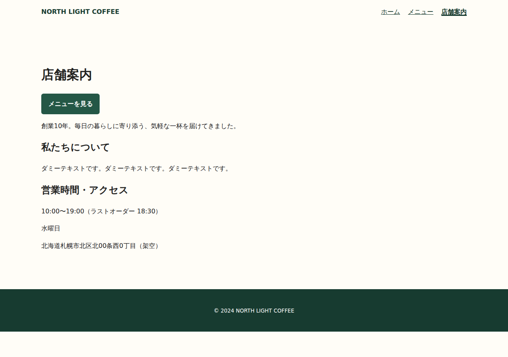
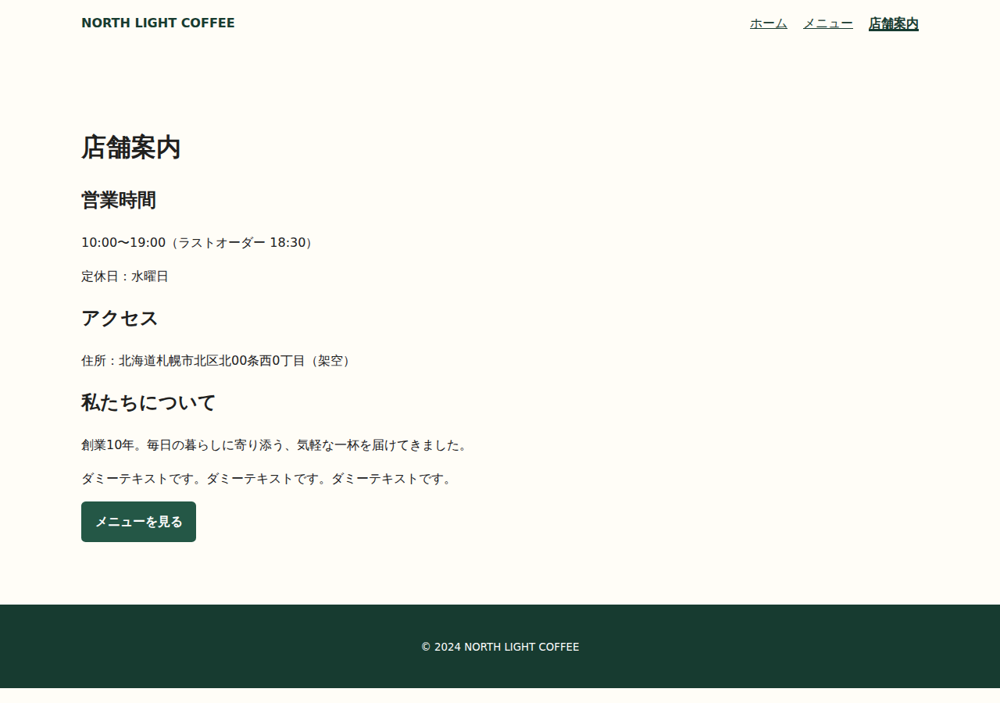
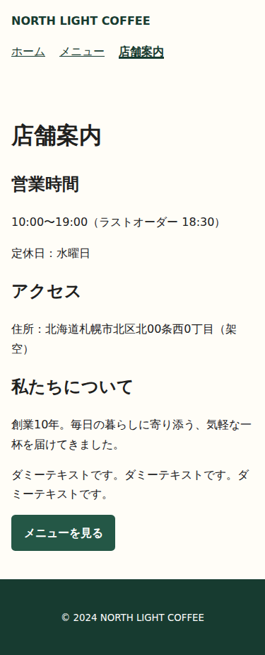
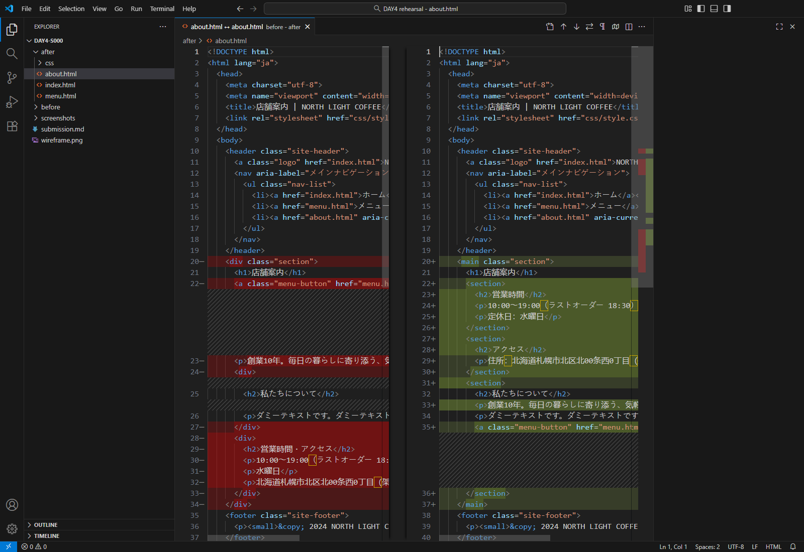

# DAY 4 実習の再現検証（2026-10-21）

対象はPR #18マージ後のmain `1d8f0f3`。修正PRは[#20](https://github.com/hgsk/edu/pull/20)。DAY別分割やPR #15の説明増量は再実装していません。条件の正本は[DAY 4](../docs/workbook/day-04.md)、本書は検証記録です。

## 教材をたどって見つかった問題

| 場所 | 確認した問題 | 今回の変更 |
|---|---|---|
| DAY4／共通ZIP提出 | 独立startと継続starter-site、提出メモとWORKLOG、氏名入りと匿名番号が衝突 | DAY4の標準ZIPは正本の独立手順に統一。共通資料の冒頭で例外を案内 |
| 開始ZIP | GitHubでリンクを押すとZIPの紹介画面になる | Download raw file、展開、内側の4点、before／afterの保存先を明示 |
| 差分 | 証拠にHTML差分が必要なのに、Gitなしの比較と保存先が不明 | VS Codeの2つの比較メニュー、本文・対象外ファイルの比較、実画像の保存を説明 |
| タグ説明 | `
`〜`
`がMarkdown内でHTMLとして解釈され、GitHub実画面で消える | コード表記へ修正 |
| タグ比較リンク | 「比較ページを開く」がGitHubのHTMLソースを開く | 教材一式をローカルで表示する方法と、開始ZIPには含まれないことを補足 |
| 提出 | メモのコピー・画像化・圧縮・再展開後の記録更新が曖昧 | 記入済みコピー、図と画面、ZIP再作成と最終再確認、回収先とUSB経路を説明 |
| 一人での自習 | ペア必須の読み方では確認が止まる | 自己確認とペア未実施の記録方法を追加 |
| 実習へのジャンプ | ダウンロード準備を飛ばして設計から始まる | `day-4-actions`を開始ZIPの準備位置へ移動 |

## 確認方法

1. **GitHub本体**：Chromeで授業入口から正本を開き、実習アンカーを操作。開始ZIPページのDownload raw fileを押してダウンロードが完了。assignment-checksのDAY4リンクを押し、`#day-4-done`と完成条件の表示を確認。サインイン不要。検証用タブは終了。修正ブランチでも実習アンカーの存在・移動と、`
`〜`
`の説明が文字として表示されることを確認。
2. **実ファイル**：配布ZIPを展開し、4ファイルをstart実体と比較（Linuxはバイト一致、WindowsのGitチェックアウトによるCRLF/LF差だけは除外）。変更前を保存し、講師用回答を読まず、既存段落を移動するp要素中心の別解を作成。本文・値・head・header・footer・href・対象外の2ページとCSSを照合。差分と検証用提出メモ、独自の設計図を保存。
3. **回帰検証**：本文欠落、定休日の改変、リンク変更、main重複、終了タグ不一致の5例を作り、検証が拒否することを確認。これは講師用リハーサルの検証であり、学生の自由な解答を限定する採点器ではない。
4. **実ブラウザ**：Windows/LinuxのCIでChromiumを起動。開始・編集後・HTML差分の実画面を撮影。サイト・図・記録・画面をZIP化し、別フォルダーに再展開。375px/1280pxでCSS、話題の順番、3ページのリンク移動を確認。結果をメモに追記した最終ZIPを再作成し、内容の一致を確認。
5. **VS Code本体**：Windows CIでMicrosoft公式のportable版1.105.1を、CI専用プロファイル（自動字下げ・自動タグ補完を無効）で起動し、変更前後を差分エディターで開く。変更後を開始本文に戻した状態から、実エディターへ修正文を入力・保存し、ディスク上のHTMLが期待する本文に一致するかを検証。差分エディターの実画面を撮影。終了処理も実行。

## 結果と確認範囲

Linuxの実習CIは[39518918768](https://github.com/hgsk/edu/actions/runs/39518918768)でSUCCESS。成果物を実際にダウンロードし、result.jsonのPASS、1280pxと375pxの実画面、提出ZIPを確認しました。Windows/Linuxの実習CIは[39519949997](https://github.com/hgsk/edu/actions/runs/39519949997)で両方SUCCESS。WindowsのArtifactsもダウンロードし、vscode-result.jsonのPASS、VS Code差分画面、最終ZIP内のHTMLと差分画像がUI操作後の実ファイル・実画像とバイト一致することを確認しました。実行方法は`python hht/scripts/check_day4_practice.py --browser --output test-results/day4`。ブラウザ検証依存はCIだけに導入し、学生環境には要求しません。

既存の教材構造検証、DAYリンク13テスト、採点8テストはローカルPASS。開始ZIPから提出ZIPまでのファイル操作もローカルPASS。QualityとStudent AssignmentのCIは初回コミットでSUCCESS。Student Assignmentは教材保守として採点対象外に分類されることを確認しており、学生の提出が合格したという意味ではありません。

**未確認**：Windows/MacのOSメニューをマウスで使う展開・圧縮、VS Codeの右クリック比較メニューの一連の手動操作、日本語UI、学校のLMS/USBでの提出・受領、初学者本人の理解度と所要時間。CIは実際のアプリを使いますが、学校の実機を操作した検証ではありません。ペアの感想や学生の成功率は作っていません。

修正前は、提出条件の衝突と操作の省略があり、講師補足なしの完了を保証できません。今回の修正で操作経路を一本化しました。自動再現の成功と、初学者の操作試験は分けて判断します。

## 実画面

