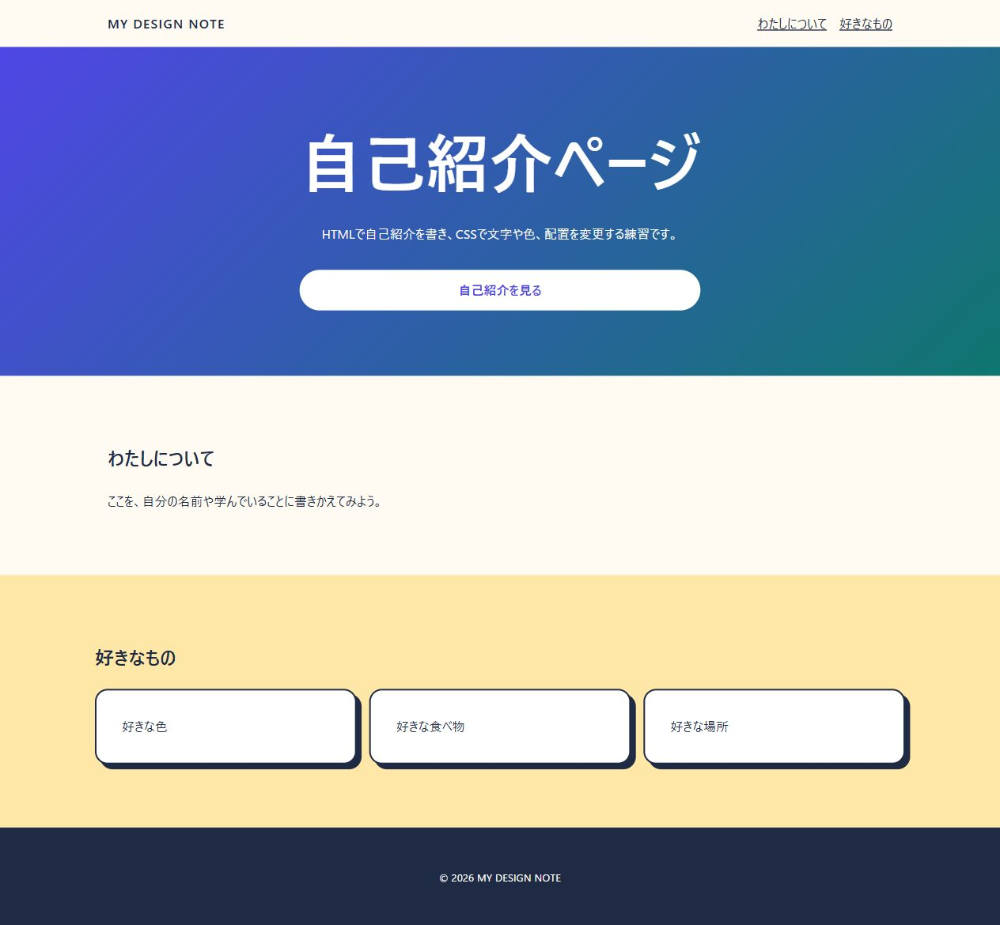

# Codespaces・HTML・CSS はじめてツアー

このフォルダーは、CodespacesのCodeTour機能を使って学ぶ練習場所です。

## 始め方

1. Codespacesで、`README.md`と`hht`が見えるリポジトリのルートを開きます。
2. おすすめに表示された`CodeTour`と`Live Server`をインストールします。
3. 左側のアクティビティバーから`CodeTour`を開きます。
4. `01 はじめてのCodespaces`の再生ボタンを押します。

ツアーは次の順番で進みます。

1. はじめてのCodespaces
2. HTMLを書いてみよう
3. CSSで見た目を整えよう

## 練習用ページ

ブラウザで確認する開始時点のページです。HTMLで文章、CSSで文字や色、配置を変更します。

## 困ったとき

- 表示が消えたら、コマンドパレットで`CodeTour: Resume Current Tour`を実行します。
- ファイルを壊しても大丈夫です。`hht/tour`は練習専用です。
- 保存してからブラウザを更新すると、変更を確認できます。

