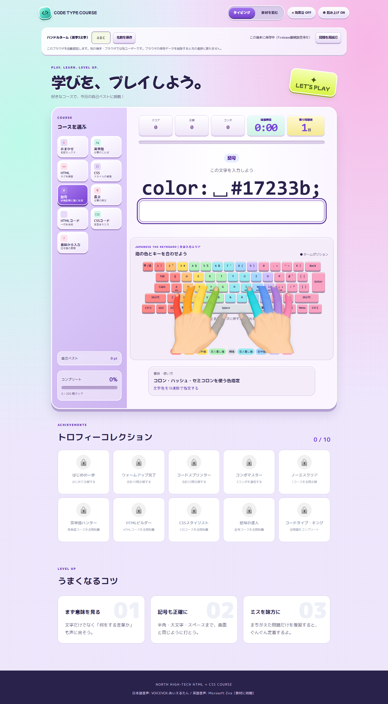

# 読み上げ音声について

## 現在の教材音声

全200問を、問題のコース名と入力文字をキーにした `audio-catalog.js` で音声へ対応付けています。問題の並び替えでは対応が変わりません。英単語は読みのカタカナ、追加の英文は英語、コード・記号は入力内容と記号名を読み上げます。「意味から入力」では、答えを読み上げず日本語の質問を読みます。

日本語部分は **VOICEVOX:あいえるたん（ノーマル、スタイルID 68）**、英語部分は **Microsoft Zira Desktop** の同梱音声です。日本語の記号名・読み・質問もあいえるたんで生成します。受講者のPCで音声エンジン・Python・ネットワーク接続を用意する必要はありません。



画面下部の音声クレジットで、現在の話者を確認できます。

教材制作者が作り直す場合だけ、WindowsにNode.js、ffmpeg、Microsoft Zira DesktopとVOICEVOX COREの生成環境を用意します。標準の生成環境フォルダーは `%USERPROFILE%\.cache\hht-voicevox-0.17` です。

VOICEVOX CORE 0.17.0をインストールしたPython環境と、公式配布の次のファイルを配置します。通常のONNX Runtimeはこのモデル形式を扱えないため、VOICEVOX版を使ってください。

| 生成環境内の場所 | 入力 |
|---|---|
| `venv/Scripts/python.exe` | `voicevox_core` 0.17.0を導入したPython環境 |
| `14.vvm` | あいえるたんを含む音声モデル |
| `runtime/voicevox_onnxruntime-win-x64-1.23.2/lib/voicevox_onnxruntime.dll` | VOICEVOX ONNX Runtime 1.23.2のCPU版 |
| `dict/open_jtalk_dic_utf_8-1.11/` | Open JTalk辞書 |

配布元は[VOICEVOX CORE](https://github.com/VOICEVOX/voicevox_core/releases/tag/0.17.0)、[音声モデル](https://github.com/VOICEVOX/voicevox_vvm/releases/tag/0.17.0)、[VOICEVOX ONNX Runtime](https://github.com/VOICEVOX/onnxruntime-builder/releases/tag/voicevox_onnxruntime-1.23.2)です。生成用スクリプトはモデル内の話者情報を読み、スタイル68があいえるたんであることを検査します。

リポジトリ直下で実行します。

```powershell
node hht/scripts/build-course-audio-catalog.mjs
powershell -NoProfile -File hht/scripts/generate-course-audio.ps1
node hht/scripts/build-course-audio-catalog.mjs --publish
```

別の生成環境を使うときはPowerShellコマンドに `-VoicevoxRoot` と、必要なら `-PythonPath` を指定します。既存のファイルと音声の断片は再利用します。全ファイルを作り直すときは生成コマンドに `-Force` を付けます。生成入力は `audio/catalog.json` に保存されます。最後の `--publish` は全200ファイルを検査してからアプリの対応表を更新します。生成に失敗した場合は、以前のアプリ用対応表を維持したまま再実行できます。

## 旧VOICEVOX音声

以下は旧音声の再生成手順です。現在のアプリは番号だけで音声を選びません。

タイピング問題の出題時に、VOICEVOX「あいえるたん」で生成済みの音声を読み上げます。
音声は`audio/`に小容量のOpus形式で同梱しています。授業中にVOICEVOXを起動したり、ネットワークへ接続したりする必要はありません。

## 音声を再生成する場合だけ

教材の問題文を変更して音声を作り直す場合は、VOICEVOX ENGINEを起動します。

```powershell
docker run --rm `
  -p 127.0.0.1:50021:50021 `
  voicevox/voicevox_engine:cpu-latest
```

追加のフレームワーク・デザイン用語80問の音声を再生成する場合は、ENGINEの起動後にリポジトリ直下で実行します。

```powershell
python hht/scripts/generate-extra-word-audio.py
```

## クレジット

生成音声を使う画面には、VOICEVOXの利用規約に従い、次のクレジットを表示しています。

`VOICEVOX:あいえるたん`
