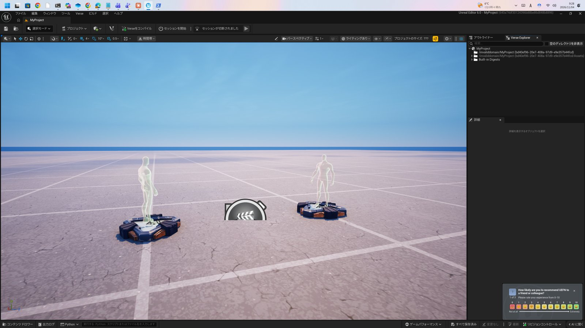
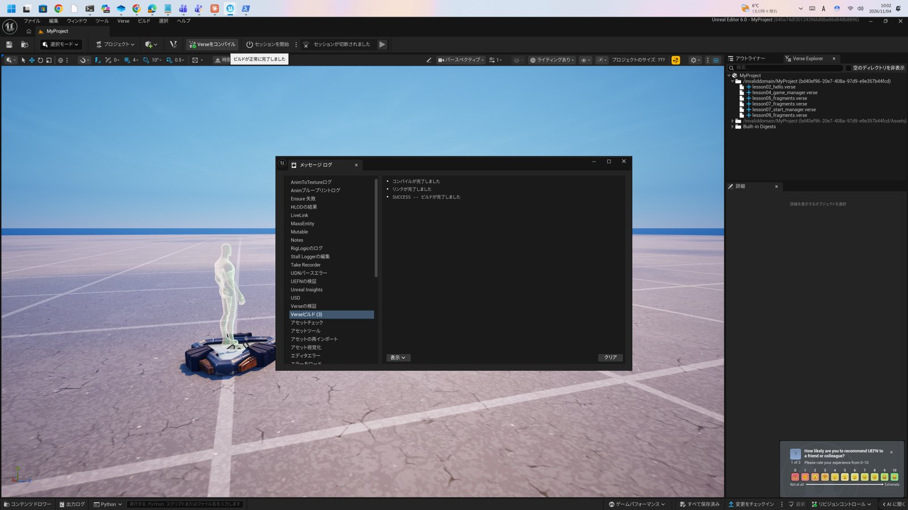
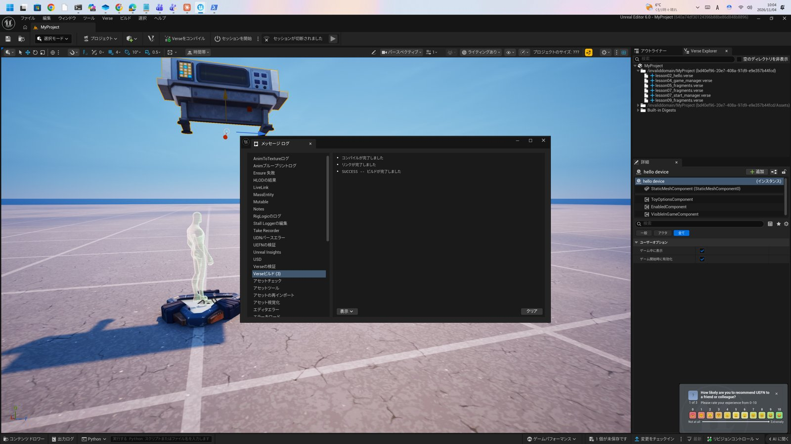

# 第2単元 最初のデバイス


[目次](../README.md) · [前の単元：第1単元 Verseとは](./lesson01.md) · [次の単元：第3単元 構文の基礎](./lesson03.md)


**この単元で学ぶこと：** Verseファイルの基本形を読み、`using`、`class(creative_device)`、`OnBegin`、`Print` の役割を説明できるようになります。


## Verseファイルの基本形


Verseのコードは `.verse` という拡張子のファイルに書きます。  
UEFNでは、自分のプロジェクトのコンテンツフォルダーへVerseファイルを作り、ビルドするとデバイスとして島へ置けるようになります。


ファイルの基本形は次の3層です。


- **取り込み：** 先頭に `using` を並べ、使うモジュールを宣言します。

- **定義：** `名前 := class(creative_device):` でデバイスのクラスを定義します。

- **入口：** `OnBegin` に、ゲーム開始時に行う処理を書きます。


## コードを読む


```verse
using { /Fortnite.com/Devices }
using { /Verse.org/Simulation }
using { /UnrealEngine.com/Temporary/Diagnostics }

hello_device := class(creative_device):
    OnBegin<override>()<suspends> : void =
        Print("Hello, Verse!")
        Print("2 + 3 = {2 + 3}")
```


### usingとモジュールパス


`using { /Fortnite.com/Devices }` のように、モジュールはURL風のパスで指定します。  
必要なパスが足りないと、そのモジュールの名前はコンパイル時に見つかりません。


- **`/Fortnite.com/Devices`：** `creative_device` をはじめ、島に置くデバイスの型が入っています。

- **`/Verse.org/Simulation`：** `OnBegin` のような、実行の仕組み側の定義が入っています。

- **`/UnrealEngine.com/Temporary/Diagnostics`：** `Print` などの診断用機能が入っています。


💡 **ヒント：**

> コンパイルエラーで「名前が見つからない」と出たら、まず `using` の不足を疑います。  
> 他人のコードを写すときは、本体だけでなく先頭の `using` ごと写すのが安全です。


### class(creative_device)


`hello_device := class(creative_device):` は、「`creative_device` を土台にした `hello_device` というクラスを定義する」という意味です。  
`:=` は「定義する」の記号で、第3単元で詳しく扱います。  
このクラスをビルドすると、UEFNのコンテンツブラウザーにデバイスとして現れ、島へ配置できるようになります。


### OnBegin


`OnBegin` は、ゲームが始まったときに自動で呼ばれる関数です。  
`<override>` は「土台の関数を上書きする」という指定です。  
`<suspends>` は「途中で待つことがある」という印で、第6単元で扱うエフェクトの一種です。  
戻り値の型は `: void` 、つまり「値を返さない」と宣言しています。


### Print


`Print("...")` は、文字をログへ出し、同時にゲーム画面にも表示する関数です。  
画面への表示は、既定では2秒間です。  
文字列の中に `{ }` を書くと、その中の式の結果を埋め込めます。  
上の例では `{2 + 3}` の部分が `5` に置き換わって表示されます。


## 実行の流れ


1. 島にデバイスを配置します。  
2. ゲームを開始します。  
3. デバイスの `OnBegin` が呼ばれ、`Print` の内容が画面とログの両方へ出ます。


成功の確認は、画面とログの2か所で行います。  
ゲーム画面に文字が約2秒表示されることと、ログにも同じ内容が残ることの両方を見ます。


## 実画面で確認しました


UEFNをインストールし、この単元のコードで実際にプロジェクトを作成して確認しました（2026年11月、Fortnite 43.00）。  
インストールの順序は、第1単元で説明したとおりです。  
プロジェクトは、プロジェクトブラウザーで島テンプレートの「空白」から作成しました。





Verseファイルをプロジェクトへ置き、「Verseをコンパイル」を実行すると、ビルドが成功しました。  
メッセージログに「SUCCESS -- ビルドが完了しました」と表示されます。





ビルドした `hello_device` は、コンテンツドロワーから島へ配置できました。





セッションは、開始するとクックとアップロードまで進むことを確認しました。  
ただし今回の環境では、Fortniteクライアント側の初回設定に時間がかかり、ゲーム内での `Print` 表示までは確認できていません。  
ゲーム画面に文字が約2秒表示され、ログにも残ることは、各自の環境で実行の流れに沿って確認してください。


## 確認


- [ ] `using` のパスが足りないと何が起きるか説明できる

- [ ] `OnBegin` が呼ばれるタイミングを説明できる

- [ ] 文字列の `{ }` で式を埋め込む書き方が分かる

- [ ] `Print` の結果が、画面とログの両方へ出ることを説明できる


**演習：** `Print` の文を自分の好きな挨拶に変え、さらに `{10 * 5}` を使って計算結果も出すコードを書いてください。


[目次](../README.md) · [前の単元：第1単元 Verseとは](./lesson01.md) · [次の単元：第3単元 構文の基礎](./lesson03.md)
